# 6 时间序列预测的特征工程

## 加入我们的 Discord 图书社区


[`packt.link/EarlyAccess/`](https://packt.link/EarlyAccess/)

在上一章中，我们开始探讨将机器学习（ML）作为解决时间序列预测问题的工具。我们还讨论了一些技术，如时间延迟嵌入和时间嵌入，这些技术从机器学习范式将时间序列预测问题转化为经典回归问题。在本章中，我们将详细研究这些技术，并使用贯穿全书的数据集进行实践演示。

在本章中，我们将涵盖以下主题：

* 特征工程
* 避免数据泄露
* 设定预测范围
* 时间延迟嵌入
* 时间嵌入

## 技术要求

* 您需要按照本书*前言*中的说明设置 `Anaconda` 环境，以获得一个包含本书代码所需的所有库和数据集的工作环境。任何额外的库将在运行笔记本时安装

在使用本章代码之前，您需要运行以下笔记本：

* `Chapter02` 中的 `02-Preprocessing London Smart Meter Dataset.ipynb`
* `Chapter04` 中的 `01-Setting up Experiment Harness.ipynb`

本章代码可在 https://github.com/PacktPublishing/Modern-Time-Series-Forecasting-with-Python-/tree/main/notebooks/Chapter06 找到。

## 特征工程

顾名思义，特征工程是从数据中构建特征的过程，主要利用领域知识，使学习过程更顺畅、更高效。在典型的机器学习设置中，构建良好的特征对于从任何机器学习模型获得良好性能至关重要。特征工程是机器学习中高度主观的部分，每个手头的问题都有不同的路径——一条专门为该问题手工打造的路径。

当我们将时间序列问题转化为回归问题时，可以应用一些标准技术。这是该过程中的关键步骤，因为机器学习模型对时间的理解程度取决于我们设计捕捉时间特征的效果。我们在第 4 章 *建立强基线预测* 中介绍的基线方法，是专门为时间序列预测用例创建的，因此问题的时间层面内嵌在这些模型中。例如，`ARIMA` 不需要任何特征工程来理解时间，因为这已内嵌在模型中。但标准回归模型对时间没有显式理解，因此我们需要创建良好的特征来嵌入问题的时间层面。

在上一章（第 5 章，*时间序列预测作为回归*）中，我们讨论了将时间编码到回归框架中的两个主要思想：时间延迟嵌入和时间嵌入。虽然我们在高层面上涉及了这些概念，但现在是时候深入挖掘并看到它们的实际应用了。

> 笔记本提示
>
> 要跟随完整代码，请使用 `chapter06` 文件夹中的 `01-Feature Engineering.ipynb` 笔记本。

我们已经将正在处理的数据集拆分为训练、验证和测试数据集。但由于我们生成的特征基于先前的观测值，从操作角度来看，拥有合并后的训练、验证和测试数据集会更好。稍后会清楚为什么，但现在请先相信这一点并继续前进。现在，让我们继续合并这些数据集：

```python
### 读取缺失值插补和训练测试拆分的数据
train_df = pd.read_parquet(preprocessed / "selected_blocks_train_missing_imputed.parquet")
val_df = pd.read_parquet(preprocessed / "selected_blocks_val_missing_imputed.parquet")
test_df = pd.read_parquet(preprocessed / "selected_blocks_test_missing_imputed.parquet")
### 在合并前添加训练、验证和测试标签以区分它们
train_df['type'] = "train"
val_df['type'] = "val"
test_df['type'] = "test"
full_df = pd.concat([train_df, val_df, test_df]).sort_values(["LCLid", "timestamp"])
del train_df, test_df, val_df
```

现在，我们有了一个合并了训练、验证和测试数据集的 `full_df`。你们中的一些人可能已经对合并训练集和测试集感到警觉。那数据泄露怎么办？让我们来看看。

## 避免数据泄露

当模型使用在预测时不可用的信息进行训练时，就会发生数据泄露。通常，这会导致训练集上性能很高，但在未见数据上性能很差。数据泄露有两种类型：

* **目标泄露** 是指我们试图预测的目标信息泄露到了模型的某些特征中，导致模型过度依赖这些特征，最终导致泛化能力差。这包括以任何方式使用目标的特征。

* **训练-测试污染** 是指训练集和测试集之间存在信息泄露。这可能是由于粗心的数据处理和拆分造成的。但也可能以更微妙的方式发生，例如在拆分训练集和测试集之前对数据集进行缩放。

当我们处理时间序列预测问题时，我们能犯的最大且最常见的错误就是目标泄露。我们必须仔细思考每个特征，确保我们没有使用任何在预测期间不可用的数据。下图将帮助我们记住并内化这一概念：

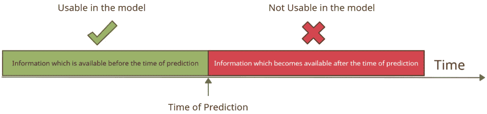

图 6.1 – 避免数据泄露的可用与不可用信息


为了让这个概念更清晰，并更贴合时间序列预测的场景，我们来看一个例子。假设我们正在预测洗发水的销量，并将护发素的销量作为一个特征。我们开发了模型，在训练数据上进行了训练，并在验证数据上进行了测试。模型表现非常好。问题出现在我们开始对未来进行预测的那一刻。我们同样不知道未来护发素的销量是多少。虽然这个例子相当直观，但有时这个问题并不那么显而易见。这就是为什么我们在创建特征时必须格外谨慎，并始终通过*“该特征在预测时刻是否可用？”*这一视角来评估特征。

> **最佳实践**
>
> 除了深思熟虑特征之外，还有许多识别目标泄露的方法：
>
> - 如果你构建的模型好得令人难以置信，那极有可能存在泄露问题
> - 如果在模型的特征重要性中，任何单一特征的权重过高，该特征可能存在泄露问题
> - 仔细复查那些与目标高度相关的特征

## 设定预测范围

虽然我们在本书前面已经生成过预测，但从未明确讨论过**预测范围**。预测范围是指我们在任意时间点想要预测的未来时间步数。例如，如果我们想预测一直在使用的电力消费数据集未来 24 小时的情况，由于数据是半小时粒度的，预测范围就变成了 48。在第 5 章 *时间序列预测作为回归* 中生成基线时，我们只是一次性预测了整个测试数据。在这种情况下，预测范围等于测试数据的长度。

直到现在我们都不必担心这个问题，因为在经典的统计预测方法中，这个决策是与建模解耦的。如果我们训练了一个模型，就可以用它来预测任意未来的时间点，而无需重新训练。但对于*时间序列预测作为回归*，我们对预测范围有约束，其根源在于数据泄露。目前，我们只关注单步向前预测。就我们正在使用的数据集而言，这意味着我们将回答的问题是：*下半小时的能源消耗是多少？* 我们将在*第 4 节 – 预测的机制* 中讨论多步预测和其他预测机制。

现在我们已经设定了一些基本规则，让我们开始看看不同的特征工程技术。要跟随 Jupyter Notebook 进行操作，请前往 `chapter06` 文件夹并使用 `01-Feature Engineering.ipynb` 文件。

## 时间延迟嵌入

时间延迟嵌入的基本思想是用最近的观测值来表示时间。如果你想回到第 5 章 *时间序列预测作为回归* 复习这个概念（*图 5.1*），请现在就去做。

在*图 5.1* 中，我们讨论了将时间序列的先前观测值作为**滞后项**纳入。然而，利用这个概念还有更多方法来捕捉最近的和季节性的信息。让我们来看看。

### 滞后项或后移

假设我们有一个带有时间步的时间序列。考虑我们位于时间 `t`，并且有一个历史长度为 `L` 的时间序列。因此，我们的时间序列将以 `y_t` 作为最新观测值，然后是 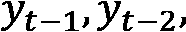 等，随着时间回溯。正如第 5 章 *时间序列预测作为回归* 所解释的，滞后项是包含时间序列中先前观测值的特征，如下图所示：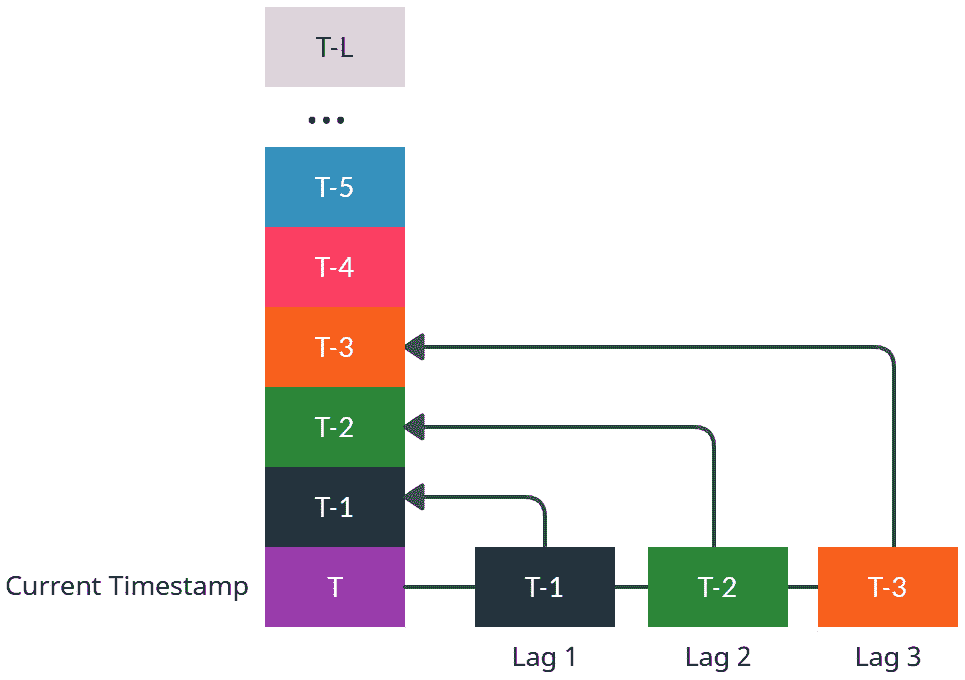

Figure 6.2 – Lag features (Color figure)

我们可以通过包含 `a` 个时间步之前的观测值（`y_{t-a}`）来创建多个滞后项；我们将其称为*滞后 a*。在前面的图中，我们展示了**滞后 1**、**滞后 2** 和**滞后 3**。不过，我们可以添加任意数量的滞后项。现在，让我们学习如何在代码中实现：

```
df["lag_1"] = df["column"].shift(1)
```

还记得我们合并训练集和测试集时，我请你姑且相信一下吗？现在是时候给这个信任一个理由了。如果我们考虑滞后操作（或任何自回归特征），它依赖于时间轴上的连续表示。如果考虑测试数据集，对于前几行（或最早的日期），滞后项会缺失，因为它们属于训练数据集。因此，通过合并两者，我们在时间轴上创建了一个连续的表示，从而可以轻松高效地利用 pandas 中的标准函数（如 `shift`）来创建这些特征。

就是这么简单，但我们需要对每个 `LCLid` 单独执行滞后操作。我们在 `src.feature_engineering.autoregressive_features` 中包含了一个名为 `add_lags` 的实用方法，它可以快速高效地为每个 `LCLid` 添加你想要的所有滞后项。让我们看看如何使用它。

我们将导入该方法，并使用其几个参数来按我们想要的方式配置滞后操作：

```
from src.feature_engineering.autoregressive_features import add_lags
#### 创建前 5 个滞后项，然后创建前一天和前一周相同的 5 个滞后项以捕捉季节性
lags = (
    (np.arange(5) + 1).tolist()
    + (np.arange(5) + 46).tolist()
    + (np.arange(5) + (48 * 7) - 2).tolist()
)
full_df, added_features = add_lags(
    full_df, lags=lags, column="energy_consumption", ts_id="LCLid", use_32_bit=True
)
```

现在，让我们看看前面代码片段中使用的参数：

- `lags`: 该参数接受一个整数列表，表示我们需要创建为特征的所有滞后项。
- `column`: 要滞后的列的名称。在我们的例子中，是 `energy_consumption`。
- `ts_id`: 包含时间序列唯一 ID 的列的名称。如果为 `None`，则假设 DataFrame 仅包含单个时间序列。在我们的例子中，`LCLid` 是该列的名称。
- `use_32_bit`: 该参数在功能上不做任何事情，但牺牲浮点数精度换取 DataFrames 在内存中占用更小的空间。

该方法返回添加了滞后项的 DataFrame 和一个包含新增特征列名的列表。

### 滚动窗口聚合

使用滞后项时，我们将当前点与过去的单个点相连接；而使用滚动窗口特征时，我们将当前点与过去一个窗口的聚合统计量相连接。我们不再查看前几个时间步的观测值，而是查看过去三个时间步观测值的平均值。请看下图以更好地理解：

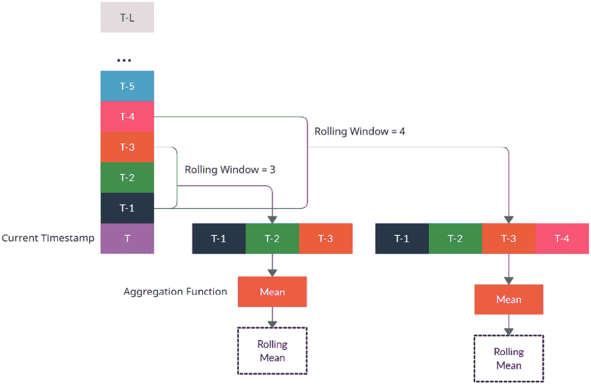

Figure 6.3 – Rolling window aggregation features(Color figure)

我们可以用不同的窗口计算滚动统计量，每个窗口会捕捉历史略微不同的方面。在前面的图中，我们可以看到窗口为三和窗口为四的例子。当我们位于时间步 `t` 时，窗口为三的滚动窗口将包含 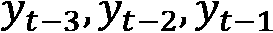 作为过去观测值的向量。一旦我们有了这些，就可以应用任何聚合函数，如平均值、标准差、最小值、最大值等。一旦聚合函数得到一个标量值，我们就可以将其作为时间步 `t` 的特征纳入。

> **注意**
>
> 我们*不包含* 在过去观测值的向量中，因为这会导致数据泄露。

让我们看看如何用 pandas 来实现这一点：


#### 我们向后移动一步，以确保不发生数据泄露

```python
df["rolling_3_mean"] = df["column"].shift(1).rolling(3).mean()
```

类似于滞后特征，我们需要对每个 `LCLid` 列分别执行此操作。我们在 `src.feature_engineering.autoregressive_features` 中提供了一个名为 `add_rolling_features` 的实用方法，它能以快速高效的方式为每个 `LCLid` 添加所有你想要的滚动特征。让我们看看如何使用它。

我们将导入此方法并使用其几个参数来按我们想要的方式配置滚动操作：

```python
from src.feature_engineering.autoregressive_features import add_rolling_features
full_df, added_features = add_rolling_features(
    full_df,
    rolls=[3, 6, 12, 48],
    column="energy_consumption",
    agg_funcs=["mean", "std"],
    ts_id="LCLid",
    use_32_bit=True,
)
```

现在，让我们看看在前面的代码片段中使用的参数：

*   **`rolls`**：该参数接受一个整数列表，表示我们需要计算聚合统计量的所有窗口。
*   **`column`**：要滞后的列的名称。在我们的例子中，是 `energy_consumption`。
*   **`agg_funcs`**：这是我们想要对 `rolls` 中声明的每个窗口执行的聚合操作列表。允许的聚合函数包括 `{mean, std, max, min}`。
*   **`n_shift`**：这是在进行滚动操作之前需要移动的时间步数。此参数可避免数据泄露。虽然我们现在只移动一步，但也存在需要移动多步的情况。这通常用于多步预测，我们将在*第 3 部分 - 预测机制*中介绍。
*   **`ts_id`**：包含时间序列唯一 ID 的列的名称。如果为 `None`，则假设 DataFrame 只包含单个时间序列。在我们的例子中，`LCLid` 是该列的名称。
*   **`use_32_bit`**：此参数在功能上不做任何操作，但能使 DataFrame 在内存中小得多，代价是牺牲浮点数的精度。

此方法返回添加了滚动特征的 DataFrame 以及一个包含新增特征列名的列表。

## 季节性滚动窗口聚合

季节性滚动窗口聚合与滚动窗口聚合非常相似，但它不是在窗口中取过去 *n* 个连续的观测值，而是取一个季节性窗口，在窗口中的每个项目之间跳过固定数量的时间步。下图将使这一点更清晰：

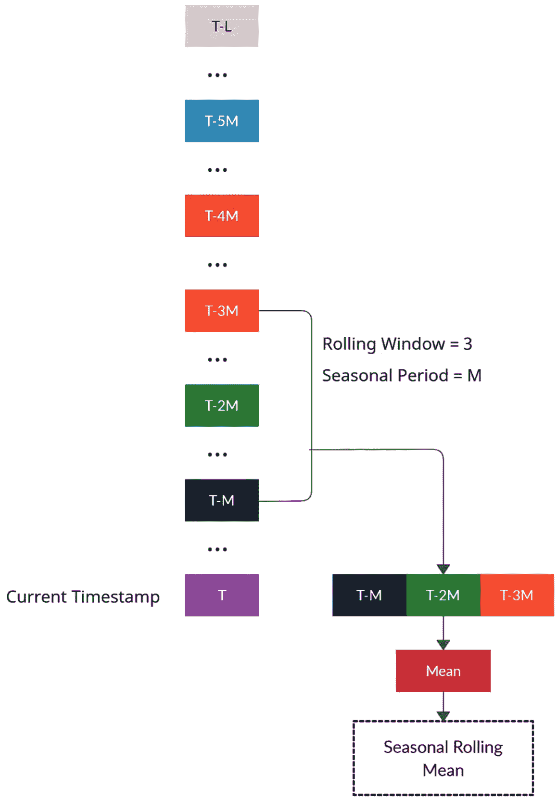

**图 6.4 - 季节性滚动窗口聚合（彩图）**

这里的关键参数是季节周期，通常称为 *m*。这是我们预期季节性模式重复所需的时间步数。当我们位于时间步 *t* 时，大小为 3 的滚动窗口将包含 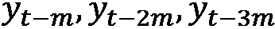 作为过去观测值的向量。但季节性滚动窗口会在窗口中的每个项目之间跳过 *m* 个时间步。这意味着季节性滚动窗口中的观测值将是 。和往常一样，一旦我们有了窗口向量，只需应用聚合函数即可得到一个标量值，并将其作为特征加入。

> **重要提示**
>
> 我们*不将*  作为季节性滚动窗口向量中的元素，以避免数据泄露。

这不是一个可以用 pandas 轻松高效完成的操作。一些花哨的 NumPy 索引和 Python 循环应该能搞定。我们使用来自 `github.com/jmoralez/window_ops/` 的实现，它利用 NumPy 和 Numba 使操作快速高效。

就像我们之前看到的特征一样，我们需要对每个 `LCLid` 分别执行此操作。我们在 `src.feature_engineering.autoregressive_features` 中提供了一个名为 `add_seasonal_rolling_features` 的实用方法，它能以快速高效的方式为每个 `LCLid` 添加所有你想要的季节性滚动特征。让我们看看如何使用它。

我们将导入该方法并使用其几个参数来按我们想要的方式配置季节性滚动操作：

```python
from src.feature_engineering.autoregressive_features import add_seasonal_rolling_features
full_df, added_features = add_seasonal_rolling_features(
    full_df,
    rolls=[3],
    seasonal_periods=[48, 48 * 7],
    column="energy_consumption",
    agg_funcs=["mean", "std"],
    ts_id="LCLid",
    use_32_bit=True,
)
```

现在，让我们看看在前面的代码片段中使用的参数：

*   **`seasonal_periods`**：这是一个应在季节性滚动窗口中使用的季节周期列表。在存在多重季节性的情况下，我们可以包含所有季节性的季节性滚动特征。
*   **`rolls`**：该参数接受一个整数列表，表示我们需要计算聚合统计量的所有窗口。
*   **`column`**：要滞后的列的名称。在我们的例子中，是 `energy_consumption`。
*   **`agg_funcs`**：这是我们想要对 `rolls` 中声明的每个窗口执行的聚合操作列表。允许的聚合函数为 `{mean, std, max, min}`。
*   **`n_shift`**：这是在进行滚动操作之前需要移动的季节性时间步数。此参数可避免数据泄露。
*   **`ts_id`**：包含时间序列唯一 ID 的列的名称。如果为 `None`，则假设 DataFrame 仅包含单个时间序列。在我们的例子中，`LCLid` 是该列的名称。
*   **`use_32_bit`**：此参数在功能上不做任何操作，但能使 DataFrame 在内存中小得多，代价是牺牲浮点数的精度。

和往常一样，该方法返回包含季节性滚动特征的 DataFrame 以及一个包含新增特征列名的列表。

## 指数加权移动平均 (EWMA)

使用滚动窗口均值操作时，我们计算的是窗口的平均值，这与**移动平均**同义。EWMA 是移动平均稍微聪明一点的“表亲”。移动平均考虑一个滚动窗口，并在计算平均值时同等对待窗口中的每个项目，而 EWMA 试图对窗口进行加权平均，且权重以指数速率衰减。有一个参数 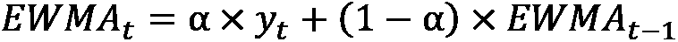，决定了权重衰减的速度。因此，我们可以将所有可用历史视为一个窗口，让该参数决定 EWMA 中包含多少近期信息。这可以简单地用递归形式写出，如下所示：

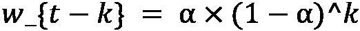

在这里，我们可以看到， 的值越大，平均值越偏向近期值（请参阅*图 6.6* 以直观了解权重的分布）。如果我们展开递归，每一项的权重计算结果为：其中 *k* 是落后于 *t* 的时间步数。如果我们绘制权重图，可以看到它们呈指数衰减； 决定了衰减的速度。理解  的另一种方式是从**跨度** 的角度。跨度是衰减权重趋近于零所需的周期数（不是严格的数学意义上，而是直观上）。 和跨度通过以下公式相关联：

下图将使这一点更清晰，我们在其中绘制了不同  值下的权重衰减情况：

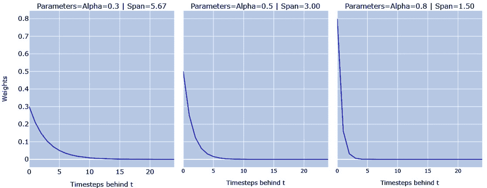

**图 6.5 - 不同值下的指数权重衰减**

在这里，我们可以看到，当达到跨度时，权重变得很小。


## EWMA 特征

直观上，我们可以将 EWMA 视为时间序列整个历史的平均值，但通过 `span` 等参数，我们可以让不同历史时期在平均值中具有不同的代表性。如果我们定义一个 60 周期的 span，我们可以认为最近 60 个时间周期主要驱动了该平均值。因此，使用不同 spans 或 s 创建 EWMA 会给我们提供具有代表性的特征，这些特征捕捉了不同历史时期的信息。

整体过程如下图所示：

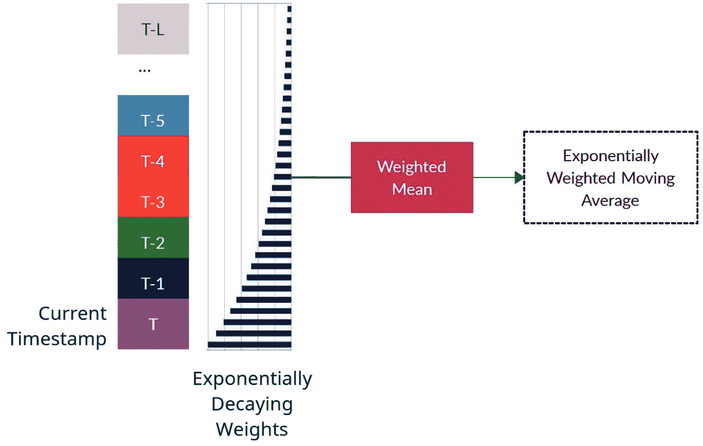

Figure 6.6 – EWMA features(Color figure)

现在，让我们看看如何在 pandas 中实现这一点：

```
df["ewma"]=df['column'].shift(1).ewm(alpha=0.5).mean()
```

就像我们之前讨论的其他特征一样，EWMA 也需要为每个 `LCLid` 单独计算。我们在 `src.feature_engineering.autoregressive_features` 中包含了一个名为 `add_ewma` 的实用方法，它能以快速高效的方式为每个 `LCLid` 添加你想要的所有 EWMA 特征。让我们看看如何使用它。

我们将导入该方法，并使用该方法的几个参数来按我们想要的方式配置 EWMA：

```
from src.feature_engineering.autoregressive_features import add_ewma
full_df, added_features = add_ewma(
    full_df,
    spans=[48 * 60, 48 * 7, 48],
    column="energy_consumption",
    ts_id="LCLid",
    use_32_bit=True,
)
```

现在，让我们看看之前代码片段中使用的参数：

*   `alphas`: 这是一个包含我们需要计算 EWMA 特征的所有 s 的列表。
*   `spans`: 或者，我们可以使用它来列出我们需要计算 EWMA 特征的所有 spans。如果你使用此功能，`alphas` 将被忽略。
*   `column`: 要滞后的列的名称。在我们的例子中，是 `energy_consumption`。
*   `n_shift`: 这是在进行滚动操作之前需要移动的季节性时间步数。此参数可避免数据泄露。
*   `ts_id`: 包含时间序列唯一 ID 的列名。如果为 `None`，则假设 DataFrame 仅包含单个时间序列。在我们的例子中，`LCLid` 是该列的名称。
*   `use_32_bit`: 此参数在功能上不做任何事情，但能使 DataFrames 在内存中小得多，代价是牺牲浮点数的精度。

和往常一样，该方法返回包含 EWMA 特征的 DataFrame 以及一个包含新增特征列名的列表。

这些是在 ML 模型中包含时间延迟嵌入的几种标准方法，但你并不局限于这些。一如既往，特征工程是一个不受规则约束的领域，我们可以尽可能发挥创造力，将领域知识注入模型。除了我们看到的特征外，我们还可以将滞后差分作为自定义滞后特征纳入其中，以注入领域知识，等等。

现在，让我们看看另一类可以通过 `temporal embedding`（时间嵌入）添加的特征。

## 时间嵌入

在第 5 章 *Time Series Forecasting as Regression*（时间序列预测作为回归）中，我们简要讨论了时间嵌入，这是一个将*时间*嵌入到 ML 模型可利用的特征中的过程。如果我们思考一下*时间*，我们会意识到在时间序列预测的背景下，有两个重要的时间方面——*时间的流逝* 和 *时间的周期性*。

让我们看看一些可以帮助我们在 ML 模型中捕捉这些方面的特征。

### 日历特征

我们可以提取的第一组特征是基于日历的特征。虽然时间序列的严格定义是按时间顺序获取的一组观测值，但通常我们会拥有这些观测值的时间戳以及时间序列本身。我们可以利用这些时间戳提取日历特征，如月份、季度、一年中的第几天、小时、分钟等。这些特征捕捉了时间的周期性，有助于 ML 模型很好地捕捉季节性。只有时间粒度高于时间序列频率的日历特征才有意义。例如，在周频率的时间序列中，小时特征没有意义，但月份特征和周特征是有意义的。我们可以利用 pandas 内置的 datetime 功能来创建这些特征，并在模型中将它们视为分类特征。

### 时间流逝

这是另一个在 ML 模型中捕捉时间流逝的特征。随着时间增加，该特征单调递增，给 ML 模型一种时间流逝的感觉。创建此特征的方法有很多，但最简单高效的方法之一是使用 NumPy 中日期的整数表示：

```
df['time_elapsed'] = df['timestamp'].values.astype(np.int64)/(10**9)
```

我们在 `src.feature_engineering.temporal_features` 中包含了一个名为 `add_temporal_features` 的实用方法，它可以自动添加所有相关的时间特征。让我们看看如何使用它。

我们将导入该方法，并使用该方法的几个参数来配置和创建时间特征：

```
full_df, added_features = add_temporal_features(
    full_df,
    field_name="timestamp",
    frequency="30min",
    add_elapsed=True,
    drop=False,
    use_32_bit=True,
)
```

现在，让我们看看之前代码片段中使用的参数：

*   `field_name`: 这是包含用于创建特征的 datetime 的列名。
*   `frequency`: 我们应该提供时间序列的频率作为输入，以便该方法自动提取相关特征。这些是标准的 pandas 频率字符串。
*   `add_elapsed`: 此标志用于开启或关闭时间流逝特征的创建。
*   `use_32_bit`: 此参数在功能上不做任何事情，但能使 DataFrames 在内存中小得多，代价是牺牲浮点数的精度。

就像我们讨论的之前的方法一样，这也会返回添加了时间特征的新 DataFrame 以及一个包含新增特征列名的列表。

### 傅里叶项

之前，我们提取了一些日历特征，如月份、年份等，并讨论了在 ML 模型中将它们作为分类变量使用。另一种表示相同信息但处于连续尺度上的方法是使用 `Fourier terms`（傅里叶项）。我们在第 3 章 *Analyzing and Visualizing Time Series Data*（分析和可视化时间序列数据）中讨论了傅里叶级数。回顾一下，傅里叶级数的正弦-余弦形式如下：

此处，`N` 项近似信号 `S`。理论上，当 `N` 为无穷大时，生成的近似等于原始信号。`P` 是周期的最大长度。我们可以创建这些余弦和正弦函数作为特征来表示季节周期。如果我们要编码月份，我们知道月份从 1 到 12 然后重复。因此，在这种情况下 `P` 将是 12，而 `x` 将是 1, 2, …12。因此，对于每个 `x`，我们可以计算余弦和正弦项并将它们作为特征添加到 ML 模型中。下图显示了月份在有序尺度上与作为傅里叶级数表示的区别：
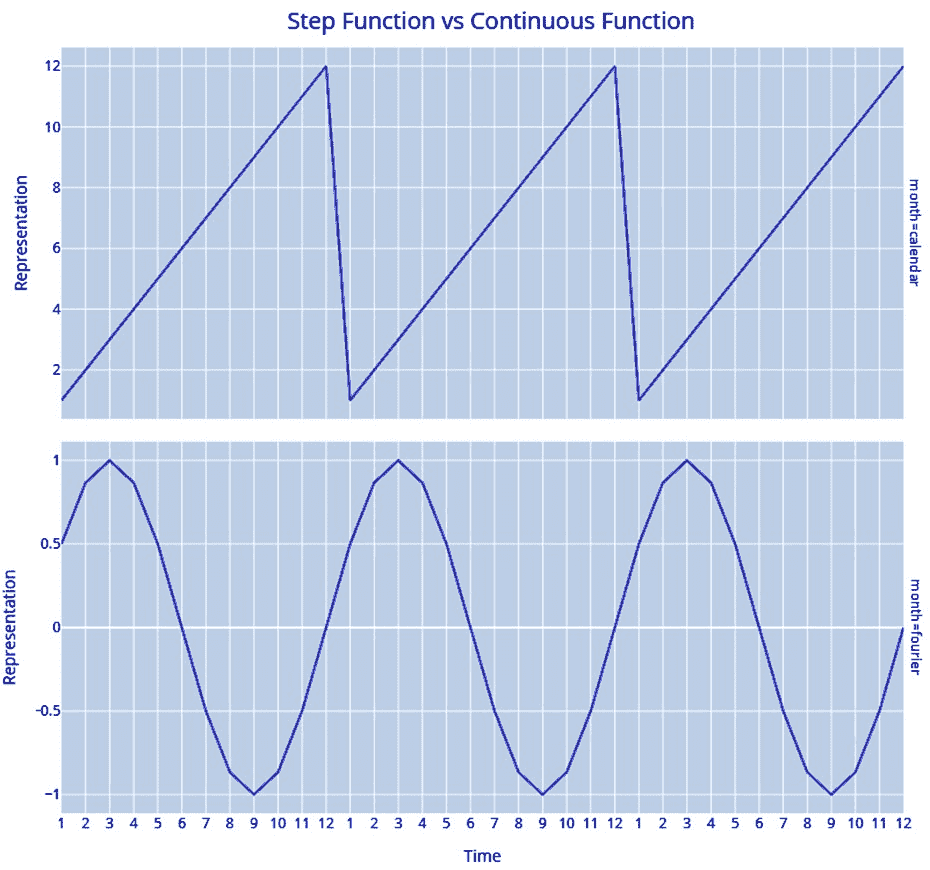

Figure 6.7 – Month as an ordinal step function (top) versus Fourier terms (bottom)

上图仅展示了单个傅里叶项；我们可以添加多个傅里叶项来帮助捕捉复杂的季节性。

我们不能说季节性的连续表示优于分类表示，因为这取决于你使用的模型类型和数据集。这是我们必须通过实证来发现的。


## 添加傅里叶特征

为了让添加傅里叶特征的过程变得简单，我们在 `src.feature_engineering.temporal_features` 中提供了一些易于使用的方法，这些方法位于一个名为 `bulk_add_fourier_features` 的文件中，它能以自动化的方式为我们想要的所有日历特征添加傅里叶特征。让我们看看如何使用它。

我们将导入该方法，并使用该方法的几个参数来配置和创建基于傅里叶级数的特征：

```
full_df, added_features = bulk_add_fourier_features(
    full_df,
    ["timestamp_Month", "timestamp_Hour", "timestamp_Minute"],
    max_values=[12, 24, 60],
    n_fourier_terms=5,
    use_32_bit=True,
)
```

现在，让我们看看在前面的代码片段中使用的参数：

### 参数

*   `columns_to_encode`：这是我们需要使用傅里叶项进行编码的日历特征列表。

*   `max_values`：这是日历特征季节周期的最大值列表，顺序与 `columns_to_encode` 中给出的顺序相同。例如，对于作为编码列的 `month`，我们将 `12` 作为相应的 `max_value`。如果未给出，将推断 `max_value`。仅当您拥有的数据至少包含一个完整的季节周期时，才建议这样做。

*   `n_fourier_terms`：要添加的傅里叶项数。这等同于前面提到的傅里叶级数方程中的 `n`。

*   `use_32_bit`：此参数在功能上不执行任何操作，但能使 DataFrame 在内存中占用空间小得多，代价是牺牲浮点数的精度。

就像我们讨论的之前的方法一样，这也会返回一个添加了傅里叶特征的新 DataFrame 以及一个包含新增特征列名的列表。

执行 `chapter06` 中的 `01-Feature Engineering.ipynb` 笔记本后，我们将获得写入磁盘的以下特征工程文件：

### 输出文件

*   `selected_blocks_train_missing_imputed_feature_engg.parquet`
*   `selected_blocks_val_missing_imputed_feature_engg.parquet`
*   `selected_blocks_test_missing_imputed_feature_engg.parquet`

在本节中，我们介绍了几种生成时间序列特征的常用且有效的方法。但还有更多方法，根据您的问题和领域，其中许多都将是相关的。

### 补充信息

> 特征工程的世界很广阔，有一些开源库让探索这个领域变得更容易。其中包括 `https://github.com/Nixtla/tsfeatures`、`https://tsfresh.readthedocs.io/en/latest/` 和 `https://github.com/DynamicsAndNeuralSystems/catch22`。Ben D. Fulcher 的预印本 *基于特征的时间序列分析*（Feature-based time-series analysis），地址为 `https://arxiv.org/abs/1709.08055`，也对该领域进行了很好的总结。
>
> 一个名为 `functime` 的较新库（`https://github.com/functime-org/functime`）也提供了用 `Polars` 编写的快速特征工程例程，值得一试。本书中讨论的许多特征工程都可以通过使用 `functime` 和 `Polars` 变得更快。

## 总结

在上一章简要概述了用于时间序列预测的机器学习范式后，在本章中，我们从实践角度审视了这一点，并了解了如何准备包含所需特征的数据集以开始使用这些模型。我们回顾了一些针对时间序列的特征工程技术，如滞后、滚动和季节性特征。本章学到的所有技术都是工具，我们可以利用它们快速迭代实验，找出适合我们数据集的方法。然而，我们只讨论了特征工程，它影响标准回归方程（ ）的一边。另一边，即我们要预测的目标（ ），同样重要。在下一章中，我们将介绍平稳性等概念以及一些影响目标的变换。
