## 1

## 匹配图片

> *当我们为电子学习平台创建练习时，主要重点是向学生呈现组织良好的信息。然而，有特殊教育需求的儿童需要独特的活动。他们喜欢电脑，通常也喜欢视觉丰富且互动的活动，因为这些活动能让他们专注于解决简单或复杂的练习。图形、视频、声音和玩具般的硬件是他们提升技能时最好的朋友。有必要将多媒体资源与有趣的环境结合起来，让他们享受家庭作业。他们不需要无聊的练习。幸运的是，Moodle 是一个开源的电子学习平台，对于支持为有特殊教育需求的儿童实施最令人兴奋的活动确实非常有用。*

我们可以将 Moodle、Web 2.0 工具、商业和免费软件以及通用硬件设备结合起来，为有**特殊教育需求**的儿童开发带有图片的丰富互动活动。

在本章中，七岁的小女孩爱丽丝去上学了。我们将学习如何创建与她的旅程相关的活动。通过阅读本章并跟随练习，我们将：

- 学习创建合成图片
- 创建将合成图片与句子匹配的活动
- 搜索并组织 3D 模型以创建 3D 场景
- 使用颜色来定义技能水平
- 创建丰富的练习，以同时激发注意力和专注力
- 学习利用游戏手柄和数字笔创建有趣的练习
- 添加、运行和评估不同类型的丰富互动活动

### 匹配合成图片

那是一个非常好的日子。阳光明媚，鸟儿欢快地飞翔。

学校操场上挤满了准备开始他们第一天学校生活的孩子们。爱丽丝也在其中。

铃声响了。每个人都必须去上课。所有的孩子都坐下来，打开了书包。爱丽丝在教室里看到了很多有趣的东西。我们帮她整理一下好吗？

### 动手实践——安装工具来处理 2D 可缩放剪贴画

我们必须首先下载并安装一些额外的工具，这些工具将帮助我们在 Moodle 及其相关应用中搜索、编辑、组合和转换 2D 可缩放剪贴画为最合适的文件格式：

> 所需的工具将取决于原始的 2D 可缩放剪贴画。不过，我们将使用一些在我们的示例中运行良好的工具。

1. 下载以下文件：

   | 应用程序名称 | 下载链接 | 文件名 | 说明 |
   | --- | --- | --- | --- |
   | Inkscape | http://inkscape.org/download/?lang=en | Inkscape-0.47win32.exe | 这是一个非常完整的免费开源矢量绘图程序。该工具使我们能够导入多种流行文件格式的矢量资源，并将其导出为 Moodle 和 Hot Potatoes 可识别的格式。 |
   | Microsoft Office Home and Student 2007 | http://www.microsoft.com/office/trial/default.aspx | X12-30107.exe | 这是一个商业工具，但其试用版提供 60 天免费完全功能版本。Microsoft Word 2007 使我们能够在 **Office Online 剪贴画和媒体** 中搜索矢量资源。 |

2. 运行安装程序，并按照步骤完成安装向导。

3. Inkscape 安装完成后，您将能够加载和编辑多种文件格式的矢量资源，如下面的截图所示：

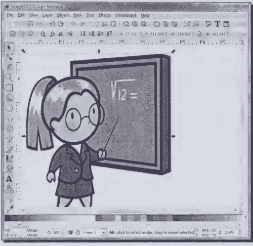

4. Office 2007 安装完成后，您将能够使用 Word 2007 提供的强大剪贴画搜索功能，如下一张截图所示：

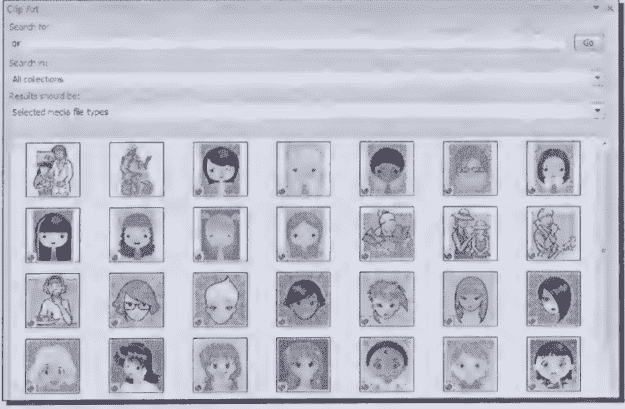

7. 单击 Go 按钮。Word 将开始下载并显示与“黑板”关键词相关的剪贴画，如下一张截图所示：

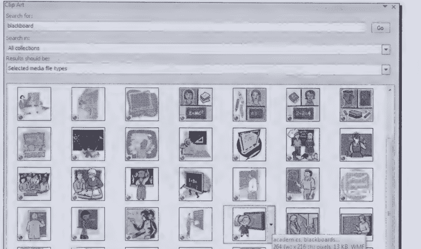

8. 将鼠标指针移到所需剪贴画的缩略图上。由于您想使用 Inkscape 在不损失质量的情况下更改图片大小，请确保它是 WMF（Windows 图元文件）或 EMF（增强型图元文件）文件。当您将鼠标指针移到每张图片的缩略图上时，Word 会在工具提示的右侧显示文件格式。

> WMF 是一种旧的可缩放矢量格式。Moodle 和 Hot Potatoes 都不直接支持 WMF 图形。但是，使用接下来的步骤，我们还可以组合 Inkscape 支持的任何矢量格式，例如 SVG（可缩放矢量图形）、AI（Adobe Illustrator）、PDF（Adobe PDF）和 EMF（增强型图元文件）等。

9. 右键单击所需剪贴画的缩略图，然后在出现的上下文菜单中选择**预览/属性**。Word 将显示一个新的对话框，以更大的预览显示可缩放剪贴画和一个临时文件名，如下一张截图所示：

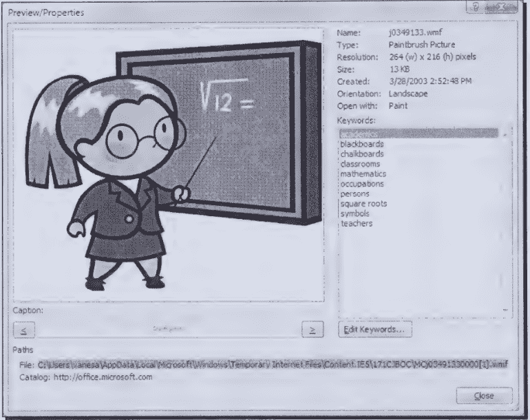

10. 三击**文件**后显示的长路径和文件名。这样，您将确保选中临时文件的完整路径。然后右键单击它，并在出现的上下文菜单中选择**复制**。

11. 接着激活 Inkscape——记住它是以最小化方式运行的。您可以使用 **Alt + Tab** 或 **Windows + Tab**。不要关闭剪贴画的预览窗口。

12. 从主菜单中选择**文件 | 导入**。单击**输入文件名**按钮（带纸张图标的铅笔），然后将之前复制的临时文件的完整路径粘贴到**位置**文本框中。该路径将与 `C:\Users\Username\AppData\Local\Microsoft\Windows\Temporary Internet Files\Content.IE5\171CJB0C\MC03491330000[1].wmf` 类似，如下一张截图所示：

14. 返回 Word 2007，关闭“预览/属性”对话框，并对要组合到一个框（即 Inkscape 绘图区域）中的每个矢量图形重复上述步骤（6 到 13）。在本例中，重复这些步骤搜索一个黑板擦。现在，Inkscape 绘图区域中将出现两个不同大小的可缩放剪贴画项目，如下面的截图所示：

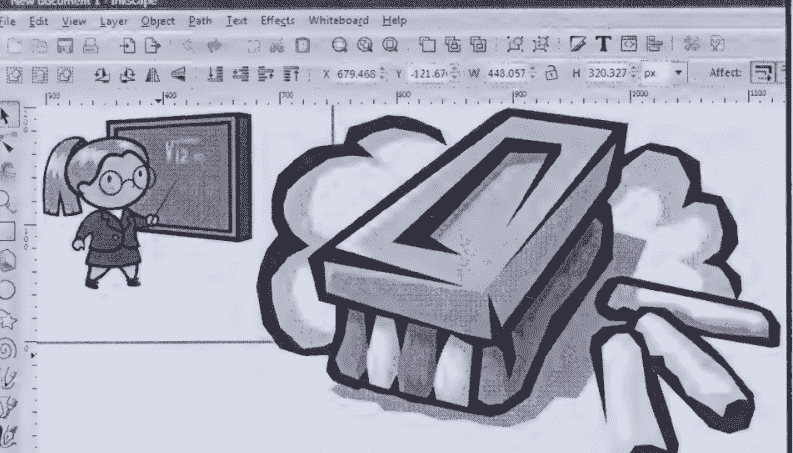

15. 从 Inkscape 主菜单中选择“文件 | 保存”。将文件另存为 image010101.svg，保存在之前创建的文件夹 C:\School 中。

16. 现在，重复上述步骤（6 到 14）创建一个由两个矢量图形（一个文具盒和一把剪刀）组成的新绘图。Inkscape 绘图区域中将出现两个不同大小的新可缩放剪贴画项目，如下一张截图所示：

17. 从 Inkscape 主菜单中选择“文件 | 保存”。将文件另存为 image010102.svg，保存在之前创建的文件夹 C:\School 中。

### 刚才发生了什么？

我们在 Inkscape 的绘图区域中组合了两对 2D 可缩放剪贴画项目。我们在 **Office Online 剪贴画和媒体** 中搜索了矢量资源，并将 Word 创建的临时文件导入到 Inkscape 的绘图区域中。

我们现在有以下两个文件：

- image010101.svg：一块黑板和一个黑板擦
- image010102.svg：一个文具盒和一把剪刀

使用这些矢量数字艺术资源，练习会看起来很不错。

> 我们为图片使用了命名约定，因为我们希望为练习保持一切井井有条。image010101 表示第 01 章的图片；练习 01；图片编号 01。

6. 选择“文件 | 保存”，以保存对原始 Inkscape SVG 文件所做的更改。

7. 选择“文件 | 导出位图”。将出现一个显示许多导出选项的对话框。在第一个 dpi（每英寸点数）文本框中输入 30。

8. 单击“绘图”按钮，然后选择“导出”。Inkscape 将以 PNG（便携式网络图形）格式导出绘图。导出的位图图形（包含大黑板和大黑板擦）将保存在 C:\School\image010101.png。

9. 接下来，在 Inkscape 中打开另一个矢量图形文件（C:\School\image010102.svg）。

10. 重复上述步骤（2 到 7），导出包含一个大文具盒和一把大剪刀的新位图图形，如下一张截图所示。导出的位图图形将为 C:\School\image010102.png。

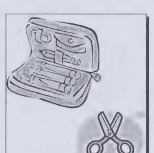

11. 单击文具盒图片将其选中并缩小。

12. 单击剪刀图片将其选中并缩小，以匹配新的更小的文具盒尺寸。

13. 拖放剪刀，将它们移动到文具盒下方，如下一张截图所示：

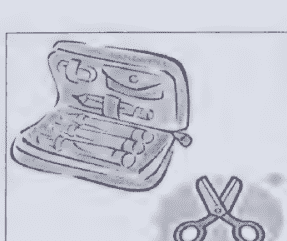


**14.** 选择 **文件 | 另存为**，为新的被修改的矢量图形保存一个新名称。输入 `image010103` 作为新名称并点击 **保存** 按钮。

**15.** 选择 **文件 | 导出位图**。一个显示许多导出选项的对话框将会出现。点击 **绘图** 按钮，然后点击 **导出**。Inkscape 将以 **PNG** 格式导出编辑后的绘图。导出的 **位图图形** 文件带有小写字母和一对小剪刀的图标为 `C:\School\image010103.png`。

**16.** 接下来打开之前被修改的矢量图形文件在 Inkscape 中（`C:\School\image010101.svg`）。

**17.** 重复上述步骤（11 到 15）来编辑矢量图形并导出一张新的位图，上面有一块小黑板和一块小橡皮擦，如下一图所示。使用 `image010104` 作为新的 Inkscape 文件。因此，新的导出的位图图形将会是 `C:\School\image010104.png`。

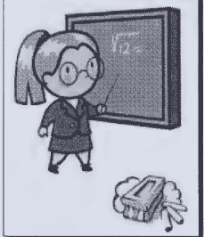

## *发生了什么？*

我们使用 Inkscape 编辑了两对 2D 可缩放剪贴画图片。由于我们使用矢量图形创建了绘图，因此我们可以改变其大小而不损失质量，并且我们将 resulting 图像导出为 PNG 格式。

> > PNG 是一种开放的、可扩展的图像格式，具有 **无损压缩**。Moodle 和 Hot Potatoes 都能很好地处理 PNG 图像。我们没有为这些图形使用 **JPEG**（联合图像专家组）格式，因为它使用 **有损压缩** 方法，会从图像中移除一些信息。由于导出的图像尺寸很小，我们可以使用 PNG 格式。

我们现在有以下四个位图图形准备用于我们的匹配复合图片练习：

- `image010101.png`：一块大黑板和一块大橡皮擦
- `image010102.png`：一个大箱子和一对大剪刀
- `image010103.png`：一个小箱子和一对小剪刀
- `image010104.png`：一块小黑板和一块小橡皮擦

## 行动时间 — 使用颜色和字体准备文本

首先，我们必须下载并安装 Hot Potatoes 6.3。接下来，我们将为我们的匹配复合图片练习准备句子。

- 1. 如果你还没有，下载并安装 Hot Potatoes 6.3（`http://hotpot.uvic.ca/#downloads`）。
- 2. 启动 Hot Potatoes 并点击 **JMatch**。一个新的窗口会显示 JMatch 应用程序。
- 3. 在 **标题** 文本框中输入 `Matching composite pictures`。
- 4. 点击相应的 **右侧（乱序）项目** 文本框并为每一行输入下一表中显示的文本，如下一张截图所示：

| 行号 | 在右侧（乱序）项目文本框中输入的文本 |
|---|---|
| 1 | `<h2 style="color:blue"><br>&nbsp;&nbsp;&nbsp;&nbsp;<em>There is a big blackboard and a big eraser</em><br></h2>` |
| 2 | `<h2 style="color:blue"><br>&nbsp;&nbsp;&nbsp;&nbsp;<em>There is a big case and a pair of big scissors</em><br></h2>` |
| 3 | `<h2 style="color:green"><br>&nbsp;&nbsp;&nbsp;&nbsp;<em>There is a small case and a pair of small scissors</em><br></h2>` |
| 4 | `<h2 style="color:green"><br>&nbsp;&nbsp;&nbsp;&nbsp;<em>There is a small blackboard and a small eraser</em><br></h2>` |

## 发生了什么？

我们安装了 Hot Potatoes 6 并使用拖放格式为我们的匹配复合图片练习准备了句子。

我们使用 JMatch 编辑并预览了以下四个句子作为右侧的项目：

- There is a big blackboard and a big eraser
- There is a big case and a pair of big scissors
- There is a small case and a pair of small scissors
- There is a small blackboard and a small eraser

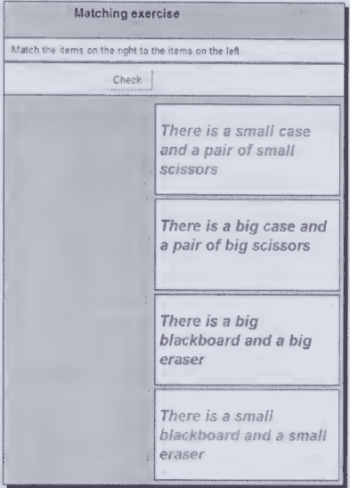

## 使用 HTML 标签定义颜色和字体

我们不想使用默认的字体和颜色。我们添加了 HTML 代码来为上述句子指定不同的颜色。JMatch 没有提供简单的方法来为句子选择字体和颜色。然而，它允许我们使用标准的 HTML 标签。因此，我们使用了以下标题来指定一个蓝色颜色的二级标题样式和强调文本：

```
<h2 style="color:blue"><em>
```

接下来，我们输入了句子的纯文本：

```
There is a big blackboard and a big eraser
```

最后，我们使用了以下页脚：

```
</em></h2>
```

我们对其他句子使用了相同的标签。我们只是将绿色着色的句子中的 `color:blue` 代码替换为 `color:green`。

> HTML 标签有点复杂。然而，你不需要掌握 HTML 标准就能创建一个漂亮的匹配复合图片练习。你可以把颜色名称替换为其他纯色，例如红色、黑色或白色。

## 使用红色、绿色和蓝色分量定义自定义颜色

如果我们需要其他颜色，我们可以使用动态 HTML 颜色代码图表或 HTML 颜色选择器，例如 HTML Color Codes 网站提供的，http://html-color-codes.info。

我们可以点击图表中的一个颜色框，网站将显示所选的颜色代码，如下一张截图所示：

## 行动时间 – 组织复合图片和文本

我们现在必须将带有不同尺寸的复合图片添加到 JMatch 中的练习中：

- 1. 保持在 JMatch 练习 `matching0101` 中。
- 2. 点击第一个 **左侧（有序）项目** 文本框。
- 3. 从 JMatch 的主菜单中选择 **插入 | 图片 | 从本地文件插入图片**。选择 `C:\School` 中之前导出的位图图像 `image010101.png` 并点击 **打开** 按钮。一个对话框将会出现，显示图像预览和一些选项，如下一张截图所示：

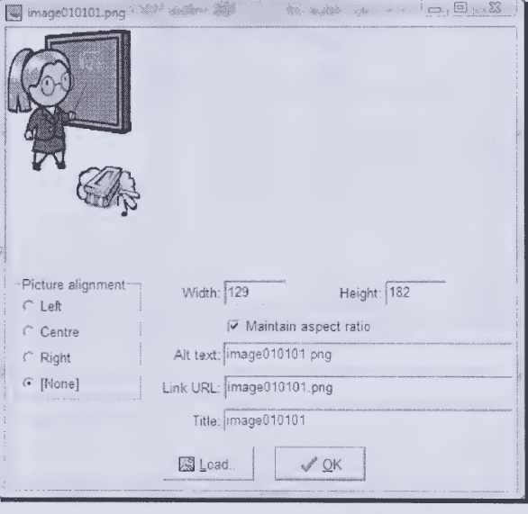

- 4. 点击 **确定**。JMatch 将在文本框中显示以下 HTML 代码：
  ```html
  </img>
  ```
- 5. 编辑文本框中的 HTML 代码，添加以下标题（前缀）。我们想要为图片指定一个背景颜色。
  ```html
  <h2 style="background:blue">
  ```

## 6.

添加以下页脚（后缀）：

```
```html
</h2>
```
```

## 7.

文本框中显示的 HTML 代码应如下所示：

```
```html
<h2 style="background:blue">
</img></h2>
```
```

## 8.

点击相应的 **左侧（有序）** 项目文本框并重复上述步骤（2 到 8），使用下一表中显示的信息。你必须用每一行指定的颜色替换在 `background:` 标签后输入的颜色名称。

| 行号 | 图片文件名 | 背景颜色名称 |
|---:|---|---|
| 2 | `image010102.png` | blue |
| 3 | `image010103.png` | green |
| 4 | `image010104.png` | green |

## 9.

**左侧（有序）** 项目文本框必须显示每张图片的 HTML 代码，如以下截图所示：

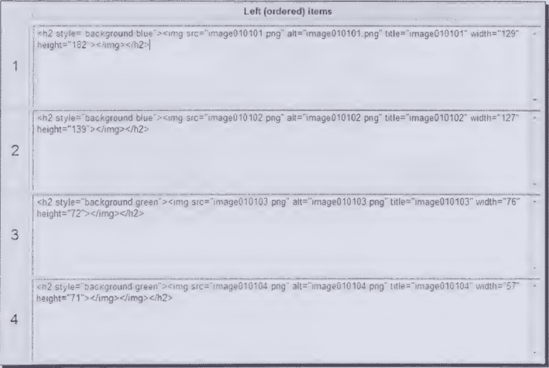

- 10. 保存更改并选择 文件 | 创建网页 | 拖放格式。替换现有的网页并点击 在我的浏览器中查看练习。

- 11. 默认网页浏览器将会出现，显示带有拖放格式的匹配练习。你将能够看到四张图片和乱序的句子。两张图片显示蓝色背景（带大物体的图片），另外两张显示绿色背景（带小物体的图片），如下一张截图所示：

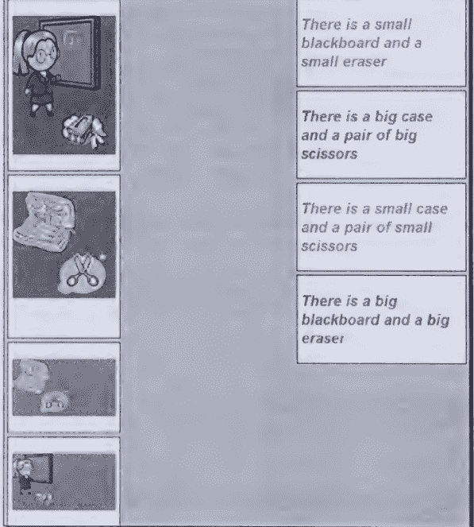

- 12. 重复最后两个步骤。每次匹配练习在网页浏览器中出现时，乱序的句子都会改变顺序。

## 发生了什么？

我们将带有不同尺寸的复合图片添加到我们的匹配复合图片练习中。我们在右侧每一句话的左侧插入了相应的图片。

当我们运行由 JMatch 创建的网页加载的练习时，它会打乱屏幕右侧的句子。

## 使用 HTML 标签定义背景颜色

我们不想使用图片的默认背景颜色。我们添加了 **HTML 代码** 来为上述复合图片指定不同的背景颜色。如前面在为句子中的文本定义颜色时所解释的，JMatch 没有提供简单的方法来为图片选择背景颜色。因此，我们不得不再次使用 HTML 标签。我们使用了以下标题来指定一个带有蓝色背景颜色的 `二级标题` 样式：

```
```html
<h2 style="background:blue">
```
```

我们没有更改 JMatch 添加来插入图片的 HTML 代码，最后我们使用了以下页脚：

```
```html
</h2>
```
```

我们对其他图片使用了相同的标签。我们只是将背景颜色为绿色的图片中的 `backgroundcolor:blue` 代码替换为 `backgroundcolor:green`。

> > 我们关于为文本前景色（`color` 属性）定义自定义颜色代码所学到的所有内容也适用于背景颜色属性。


## 动手操作——将活动添加到 Moodle 课程

现在，我们需要将匹配复合图片练习添加到现有的 Moodle 课程中。

1. 登录 Moodle 服务器。
2. 由于我们要添加一个 Hot Potatoes 练习，因此必须确保**Hot Potatoes 测验**活动模块未被隐藏。在**网站管理**面板中，单击**模块 | 活动 | 管理活动**。如果**Hot Potatoes 测验**活动模块显示为灰色，并且“隐藏/显示”列中显示闭合的眼睛图标，则必须单击此图标，图标会变为睁开的眼睛。这样，Moodle 就会启用此活动，如下面的屏幕截图所示：

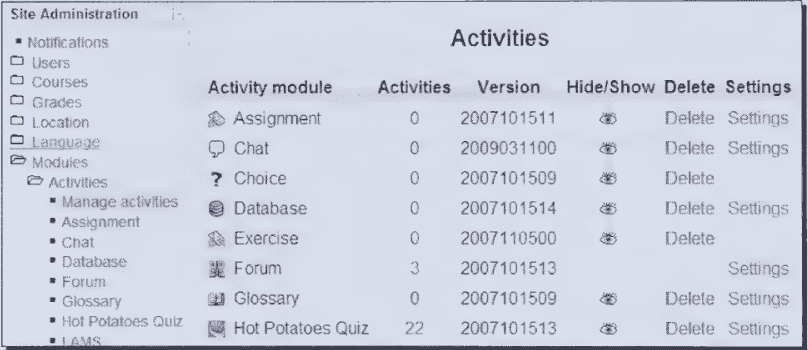

3. 单击所需的课程名称（**School**）。你可以创建新课程，也可以使用现有课程。
4. 单击**开启编辑功能**。网页将发生变化，以便你编辑**每周概要**。
5. 将鼠标指针移动到**每周概要**下的目标周，并单击**编辑概要**图标（一个带铅笔的小手）。
6. 在**概要**中输入 `Exercise 1`，然后单击**保存更改**按钮。
7. 接下来，单击所选周对应的**添加活动**组合框，并选择**Hot Potatoes 测验**，如下一个屏幕截图所示。

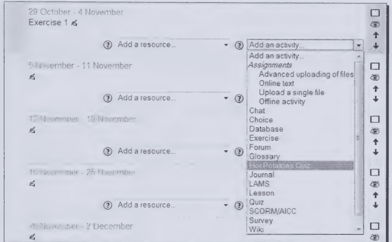

8. 将出现一个新的网页，标题为“添加新的 Hot Potatoes 测验”。单击“选择或上传文件”按钮，将弹出一个显示文件和文件夹信息的窗口。

9. 单击“创建文件夹”按钮。

10. 在文本框中输入 chapter01，然后单击“创建”。Moodle 将创建一个名为该名称的文件夹，以便我们组织练习所需的文件。

11. 单击 chapter01（刚创建的文件夹超链接）。

12. 单击“上传文件”按钮。

13. 单击“浏览”按钮。浏览到存放练习所用图片和文件的文件夹（C:\School），并选择要上传的文件 image010101.png。然后，单击“打开”，再单击“上传此文件”按钮。

14. 对下面列表中的每个文件重复上述步骤（12 至 13）。你必须将以下文件上传到 chapter01 文件夹中。

- image010102.png
- image010103.png
- image010104.png
- matching0101.html

## 匹配图片

15. 接下来，将鼠标指针移动到 `matching0101.html` 名称上，然后水平移动到同一行中的**选择**操作超链接。随后单击**选择**，如下图所示：

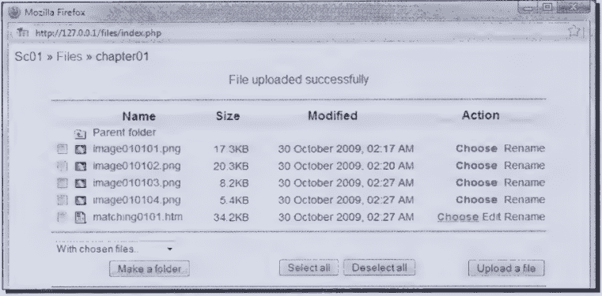

16. Moodle 会在**文件名**文本框中显示 `chapter01/matching0101.html`。这是使用 JMatch 之前创建的、将要运行该练习的网页。

17. 向下滚动，并单击位于网页底部的**保存并显示**按钮。Web 浏览器将显示采用拖放格式的匹配练习，如下一个屏幕截图所示：

## Sc01：匹配复合图片

School

Sc01 > Sc01 > Hot Potatoes 测验 > 匹配复合图片

# 匹配复合图片

匹配练习

将右侧的项目与左侧的项目进行匹配。

检查

- 有一个小盒子和一把小剪刀
- 有一个大盒子和一把大剪刀
- 有一块大黑板和一块大橡皮
- 有一块小黑板和一块小橡皮

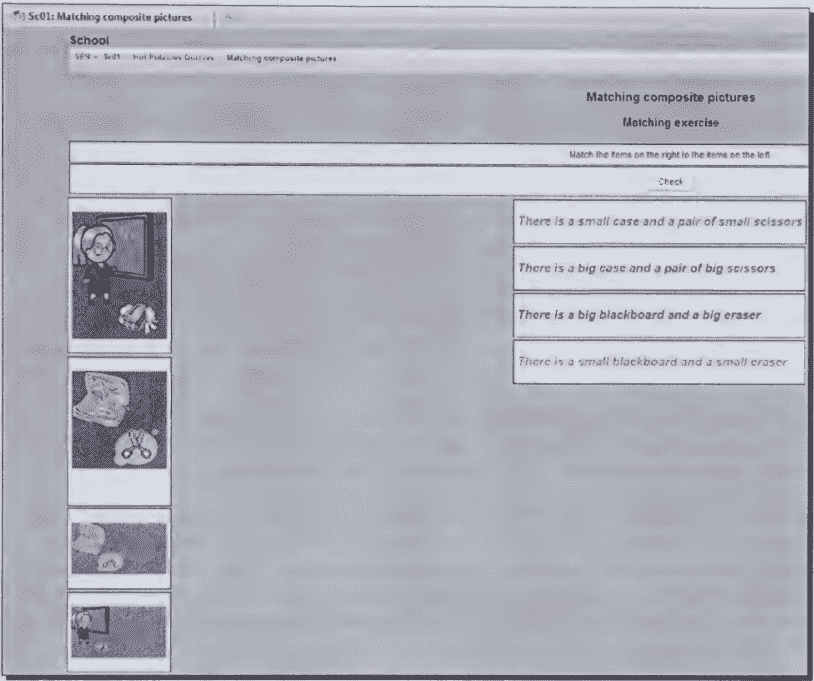

18. 单击网页顶部的短课程超链接，练习将显示在之前选定的周中，如下面的屏幕截图所示：

10 月 29 日至 11 月 4 日

练习 1

匹配复合图片

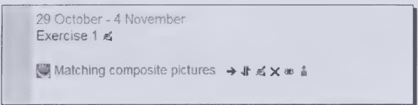

3. 如下图所示，将每个句子拖放到对应的图片上：

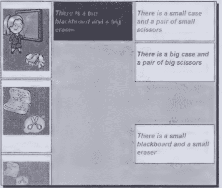

4. 对四个句子重复上述步骤后，单击**检查**按钮测试结果，如下一个屏幕截图所示：

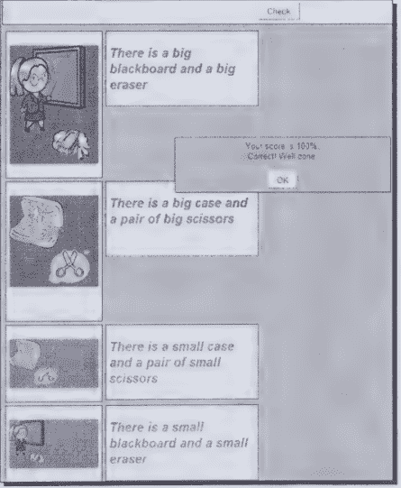

## 刚才发生了什么？

在此活动中，我们使用了句子和复合图片。我们的目标是让儿童在治疗师或家人的帮助下独自阅读并理解这些句子，从而能够完成练习。

该活动包括将一个句子的含义与一幅复合图片进行匹配。我们应用了以下概念和资源：

- **大小概念：**因此，我们选择了大小不同的学校相关物品。
- **数量概念：**我们使用了复合图片，每个图片框中显示多个元素。
- **感官知觉资源：**我们使用颜色简化了活动的执行过程。在本例中，描述大物品的句子使用了相关复合图片中的背景颜色。

> 我们可以使用不同的颜色组合来增加或降低此练习的复杂度。例如，如果要创建一个简单的活动，可以为每个匹配对使用相同的前景色和背景色。

## 发现与 3D 场景相关的句子

今天早上，Alice 非常开心地起床。她打开卧室的门，看到了她的小狗 Clifford。Clifford 摇着尾巴、跳跃着向她打招呼。

后来，她的妈妈叫她去吃早餐。吃完早餐后，她准备去上学。今天，她遇到了一个问题：她不知道哪些学习用品能装进书包。我们能帮助她吗？

## 动手操作——搜索要组合到 2D 方框中的 3D 模型

为发现句子练习创建并渲染 3D 模型非常复杂，需要专业技能。我们将通过使用现有的、免费渲染为 2D 位图图像的 3D 模型来简化这一过程。

1. 启动 Inkscape，然后将其最小化。稍后你会使用它。
2. 打开默认的 Web 浏览器，并访问 `http://sketchup.google.com/3dwarehouse`。此网页允许我们在 Google 3D 模型库中搜索 3D 模型。

## 匹配图片

3. 在文本框中输入 school bag，在组合框中选择**模型**，然后单击**搜索**按钮。许多符合搜索条件的模型将会出现，如下一个屏幕截图所示：

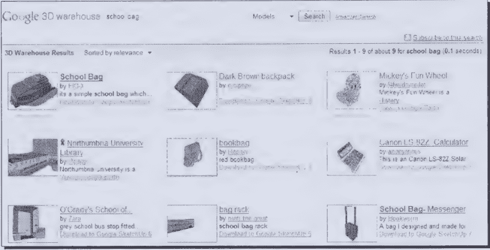

4. 单击所需模型的缩略图。渲染后的 3D 模型默认视图将会出现。

5. 单击位于 3D 模型右上角的**3D 视图**按钮。

6. 将鼠标指针放在 3D 模型的中心。按住鼠标按钮并水平拖动模型，直到获得所需的视图。

7. 再次将鼠标指针放在 3D 模型的中心。右键单击模型，并在出现的快捷菜单中选择**保存图片**，如下一个屏幕截图所示：

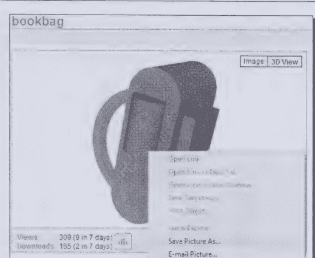

8. 由于你希望使用 Inkscape 更改图片大小而不损失质量，因此在**保存类型**组合框中选择**位图（*.bmp）**，并将文件保存为先前创建的文件夹 C:\School 中的 schoolbag.bmp。

9. 现在，激活 Inkscape——记住它当时处于最小化状态。你可以使用 *Alt + Tab* 或 *Windows + Tab*。

10. 从主菜单中选择**文件 | 导入**，选择之前保存的文件（C:\School\schoolbag.bmp），然后单击**打开**按钮。渲染后的 3D 模型将出现在 Inkscape 的绘图区域中。

11. 现在，在不关闭 Inkscape 的情况下返回 Web 浏览器，并对要组合到一个方框（Inkscape 的绘图区域）中的每个 3D 模型重复上述步骤（2 至 10）。在本例中，重复这些步骤，搜索以下物品，并使用下表所示的名称保存图像文件：

| 搜索内容 | 图片文件名 |
| :--- | :--- |
| book | book.bmp |
| calculator | calculator.bmp |


## 匹配图片

- 12. 三个渲染后的 3D 模型现在会出现在 Inkscape 的绘图区域中，如以下截图所示：

  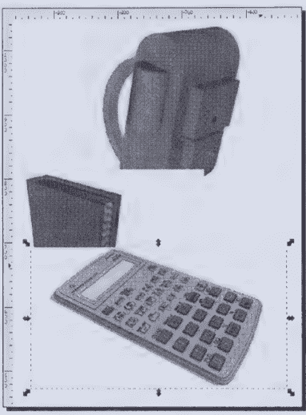

- 13. 从 Inkscape 的主菜单中选择“文件 | 保存”。将文件以 `image010201.svg` 为名，保存在之前创建的文件夹 `C:\School` 中。

### 刚才发生了什么？

我们在 Inkscape 的绘图区域中组合了三个渲染后的 3D 模型。我们在 Google 3D Warehouse 中搜索了 3D 模型，并将从所需视图获得的位图文件导入到 Inkscape 的绘图区域中。

我们现在有了一张包含这三个渲染后 3D 模型的图片，它们代表了现实生活中的物体：

- 一个书包
- 一本书
- 一个计算器

### 动手实践 – 将复合 3D 模型整理为渲染后的 2D 方框

我们现在要在 Inkscape 中移动、调整大小并保存组合后的渲染 3D 模型的新版本，以用于本练习。

- 1. 在 Inkscape 中打开矢量图形文件（`C:\School\image010201.svg`）。
- 2. 调整每张图片的大小并移动它们，以创建一幅绘图，如以下截图所示：

  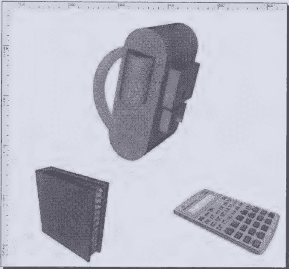

- 3. 选择“文件 | 保存”，以保存对原始 Inkscape SVG 文件所做的更改。
- 4. 选择“文件 | 导出位图”。将出现一个显示许多导出选项的对话框。在第一个 dpi（每英寸点数）文本框中输入 90。
- 5. 单击“绘图”按钮，再单击“导出”。Inkscape 将以 PNG 格式导出绘图。导出的包含书包、书和计算器的位图图像将为 `C:\School\image010201.png`。

### 刚才发生了什么？

我们使用 Inkscape 操作了渲染 3D 模型的位图图像。我们可以更改其大小和位置，并将结果图像导出为 PNG 格式。

渲染后的 2D 方框就是导出的位图图形，它表示一个 3D 场景。

### 动手实践 – 组合文本块并更改颜色

现在是时候为与 3D 场景相关的随堂测验创建包含可能答案的文本块了。

- 1. 启动 Hot Potatoes，并单击 JQuiz。将出现一个包含 JQuiz 应用程序的新窗口。
- 2. 在**标题**文本框中输入 `Discovering sentences related to 3D scenes`。
- 3. 在右上角的组合框中选择**多项选择**。
- 4. 单击标题文本框下方、问题 1 右侧的文本框。
- 5. 从 JQuiz 的主菜单中选择**插入 | 图片 | 来自本地文件的图片**。选择之前导出到 `C:\School` 的位图图像 `image010201.png`，并单击“打开”按钮。将出现一个显示图像预览和某些选项的对话框。
- 6. 单击“确定”。JQuiz 将在文本框中显示以下 HTML 代码：

  ```html
  </img>
  ```

- 7. 单击相应的**答案**文本框，并为每行输入下表中显示的文本，如以下截图所示：

| 行标签 | 要在正确（乱序）项目文本框中输入的文本 |
|---|---|
| A | `<h2 style="color:green"><br><br><em>There is a calculator and a book in the school bag.</em><br><br></h2>` |
| B | `<h2 style="color:green"><br><br><em>There is a calculator and a book under the school bag.</em><br><br></h2>` |
| C | `<h2 style="color:green"><br><br><em>There is a calculator and four books next to the school bag.</em><br><br></h2>` |

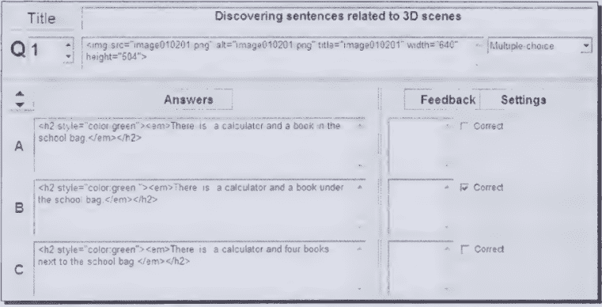

- 8. 激活与标记为 B 的行对应的**正确**复选框。这是多项选择测验的正确答案。
- 9. 从 JQuiz 的主菜单中选择**文件 | 保存**。将文件以 `quiz0102.jgz` 为名，保存在之前创建的文件夹 `C:\School` 中。
- 10. 接下来，选择**文件 | 创建网页 | 标准格式**。JQuiz 将创建一个新的网页。将新文件以 `quiz0102.htm` 为名，保存在上述文件夹中。

### 刚才发生了什么？

我们插入了包含 3D 场景的图像，并使用多项选择格式为“发现句子”练习准备了句子。

我们使用 JQuiz 编辑和预览了以下三个句子，作为 3D 场景下方的可能答案：

- 书包里有一个计算器和一本书。
- 书包下面有一个计算器和一本书。
- 书包旁边有一个计算器和四本书。

我们再次使用熟悉的 HTML 标签来改进句子的字体和颜色。

### 动手实践 – 将活动添加到 Moodle 课程

我们现在必须将“发现句子”练习添加到现有的 Moodle 课程中。

- 1. 登录到你的 Moodle 服务器，并确保 **Hot Potatoes Quiz** 活动模块未被隐藏。
- 2. 单击所需的课程名称（School），然后再单击**打开编辑功能**。
- 3. 将鼠标指针移到**周大纲**下的所需周次（比匹配合成图片练习晚一周）上。然后，单击**编辑摘要**图标（一只握着铅笔的小手）。
- 4. 在**摘要**中输入 *练习 2*，并单击**保存更改**按钮。
- 5. 单击所选周次的**添加活动**组合框，然后选择 **Hot Potatoes Quiz**。
- 6. 将出现一个新网页，显示标题**添加新的 Hot Potatoes Quiz**。单击**选择或上传文件...**按钮，将出现一个显示文件和文件夹信息的弹出窗口。
- 7. 单击 **chapter01**（我们在之前练习中创建的文件夹）。
- 8. 单击**上传文件**按钮，再单击**浏览**。浏览到存放练习所用图像和文件的文件夹（C:\School），并选择要上传的文件 `image010201.png`。然后，单击**打开**，再单击**上传此文件**按钮。
- 9. 对 JQuiz 生成的文件 `quiz0102.htm` 重复上述步骤。
- 10. 接下来，将鼠标指针移到 **quiz0102.htm** 名称上，并水平移动到同一行的**选择**操作超链接上。然后，单击**选择**，如以下截图所示：

  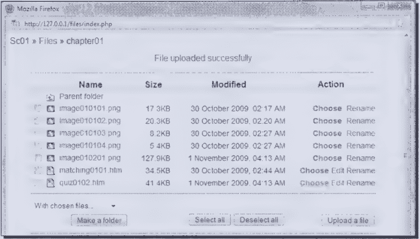

- 11. Moodle 将在**文件名**文本框中显示 `chapter01/quiz0102.htm`。这就是将运行之前使用 JQuiz 创建的练习的网页。
- 12. 向下滚动并单击位于网页底部的**保存并显示**按钮。Web 浏览器将显示采用多项选择格式的“发现句子”练习，如以下截图所示：

  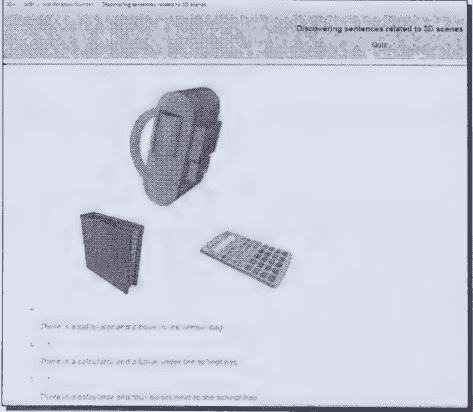

### 刚才发生了什么？

我们将“发现与 3D 场景相关的句子”练习添加到了 Moodle 课程中。现在，学生可以通过单击相应周次的超链接来运行该活动。

我们使用了之前创建的文件夹 `chapter01`。我们上传了包含渲染 3D 场景的位图图像以及使用 JQuiz 创建的 HTML 文件（`quiz0102.htm`）。

### 使用文件夹整理练习文件

我们创建了一个文件夹 `chapter01`，并在其中上传了匹配合成图片练习和发现句子练习的所有文件。然而，有时我们需要使用额外的文件夹来整理练习文件。

例如，我们可以使用以下结构来组织文件：

- ◆ chapter01
  - □ exercise01
  - □ exercise02

我们可以在 `chapter01` 文件夹中创建两个子文件夹 `exercise01` 和 `exercise02`。这样，与第二个练习相关的所有文件都必须上传到 `chapter01/exercise02` 文件夹中。

> 所选的文件组织方案将取决于练习的数量及其与课程的关系。但是，为了简化你的工作，一个好的做法是将与某个练习相关的所有文件保存在一个文件夹中。你可以在不同的文件夹中处理文件；但这将要求你在 HTML 代码中使用复杂的路径。

### 动手实践 – 运行发现句子活动

现在是时候以学生身份运行“发现句子”活动了。

- 1. 单击课程名称（School），并将你的角色切换为学生。
- 2. 单击相应周次上的**发现与 3D 场景相关的句子**链接。Web 浏览器将显示多项选择练习。


## Matching Pictures

- 3. 点击右侧句子上方的按钮，如下一张截图所示。Moodle 将保存结果并返回课程。

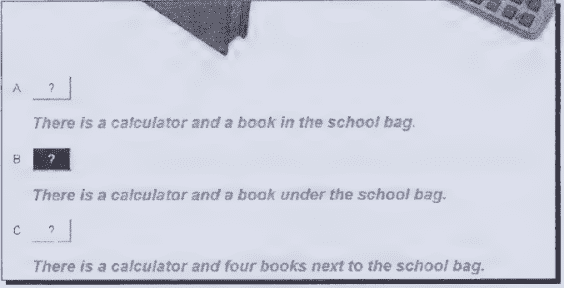

- 4. 重复上述步骤（1 至 3），然后点击其中一个错误句子上方的按钮。Moodle 将显示一条允许你重试的消息，并在之前点击的错误答案上显示一个 X，如下一张截图所示。但是，它会保存你第一次的错误尝试，以便计算公平的分数。

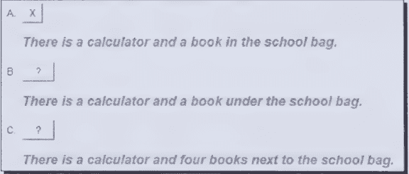

- 5. 现在，点击对应 **Discovering sentences related to 3D scenes** 活动的“View reports”链接，Moodle 将按用户名分组显示所有尝试的详细信息，如下一张截图所示：

| Grade (Highest grade) | Attempt | Time | Status | Time taken | Raw score |
|---|---:|---|---|---|---:|
| 100 | 1 | 1 November 2009, 06:57 PM | Completed | 5 secs | 100 |
|  | 2 | 1 November 2009, 06:57 PM | Completed | 5 mins 1 sec | 50 |

### What just happened?

在本次活动中，我们使用句子和一个 3D 场景。目标是从多个句子中选出正确描述活动中所呈现的复合 3D 图像的句子。

为什么我们使用 3D 插图？我们使用它们是为了激发动机，因为这些图像的一个特点是逼真，孩子们会被它们吸引。

该活动是通过点击解释 3D 场景中所示情况的句子来完成的。为了同时激发注意力和集中力，我们应用了以下概念和资源：

- **Reading comprehension:** 孩子需要阅读并理解每一条句子
- **Listening comprehension:** 如果孩子不能独自阅读和理解句子，他/她可以由治疗师或家庭成员帮助完成练习
- **Space notions:** 句子描述了特定空间内元素的所在位置

> 我们还可以通过不同颜色的组合来增加或减少此练习的复杂性。例如，如果我们想创建一个简单的活动，我们可以在 3D 场景中添加背景颜色，并将此颜色用作正确句子的前景。

### Time for action – using a gamepad to solve the exercise

我们也可以使用 **gamepad** 而不是鼠标来解决练习。它的使用更容易，更吸引那些有 **manual dyspraxia** 的孩子。

我们将使用一个 USB gamepad，类似于索尼 PlayStation 3 游戏机所使用的那种。我们希望使用 gamepad 右侧的迷你摇杆来控制鼠标指针。

我们必须配置 gamepad 驱动程序，将其左侧迷你摇杆映射到鼠标指针。

> 学生需要一个具有 4 个轴和 2 个迷你摇杆的 USB gamepad 才能完成以下练习。此示例基于 Windows 操作系统。

- 1. 将 USB gamepad 连接到计算机，并在尚未安装的情况下安装其驱动程序。
- 2. 进入 **Control Panel | Game controllers**。在游戏控制器列表中选择 gamepad 并点击 **Properties**（某些驱动程序显示通用名称 **USB Network Joystick**）。对话框将显示 gamepad 的按钮、迷你摇杆轴和视角帽（POV），如以下图片所示：
- 3. 禁用模拟模式（模拟模式 LED 应关闭）。gamepad 必须处于 **digital mode**，以便让我们将右侧迷你摇杆映射到鼠标按钮。
- 4. 你可以使用上述对话框测试屏幕上显示的按钮编号与 gamepad 按下的按钮之间的关系。
- 5. 点击 **Keyboard & Mouse Setting** 按钮。会出现一个新的对话框。它允许你更改 gamepad 模式并将其按钮映射到你的鼠标按钮。
- 6. 激活复选框 **Keyboard & Mouse mode** 和 **POV to arrow**。

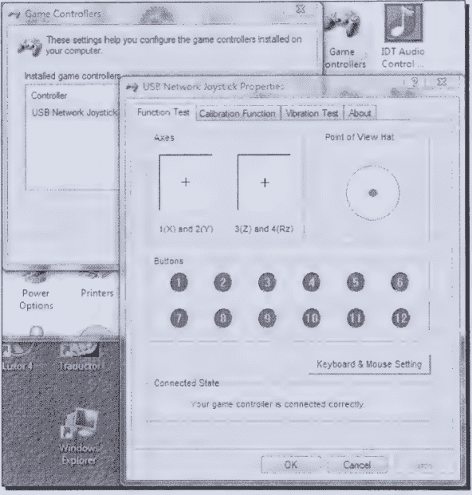

- 7. 在 **Key 1** 下拉框中选择 **Left** 鼠标按钮。
- 8. 值应与下一张截图中显示的相似：

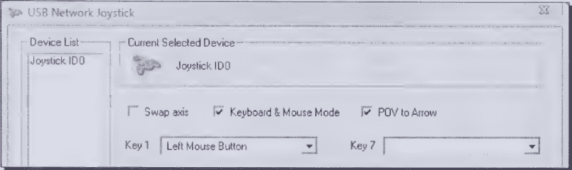

- 9. 点击 OK。
- 10. 移动 gamepad 的左侧迷你摇杆。鼠标指针应随着迷你摇杆的移动而改变位置。
- 11. 控制 gamepad 的 POV。鼠标指针应随着按压不同方向而改变位置。
- 12. 按下 gamepad 的动作按钮编号 1（右上方）。它应作为鼠标的左键工作。
- 13. 以学生身份运行发现句子活动，按照之前解释的步骤进行。这次，使用 gamepad 而不是鼠标，如下一张图片所示：

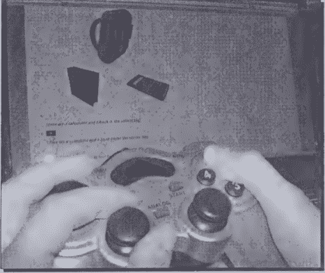

### What just happened?

我们配置了 gamepad 驱动程序，将其一个迷你摇杆和一个动作按钮映射到鼠标指针和鼠标左键。因此，你能够使用 gamepad 无问题地执行练习。

有手动发育不良的孩子在协调和排序手势、指向和手语等任务的动作方面存在困难。因此，gamepad 的摇杆可以帮助他们专注于移动屏幕上的大鼠标指针并解决这些练习。

> 有时，gamepad 并不是最方便的设备。但是，它便宜且在任何电脑相关商店都很容易找到。我们可以按前述方式配置 gamepad，我们将能够为学生提供不同的移动鼠标指针的方式。相同的技术可用于操纵杆和飞行摇杆。

### Understanding the gamepad as an input device

Gamepad 是一个复杂的输入设备。它通常提供许多动作按钮和两个迷你摇杆，如以下图片所示（俯视图）：

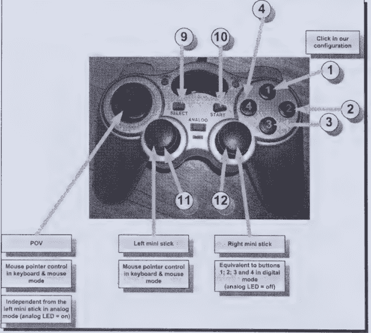

### Time for action – creating speech bubbles and filling them with text

创建漫画条可能是一项非常复杂的任务。幸运的是，有许多网页提供非常简单的交互式环境来使用对话气泡和角色创建条幅。此外，我们可以将它们导出为与 Moodle 兼容的图像格式，并在令人兴奋的练习中使用它们。

- 1. 打开默认网页浏览器并前往 http://stripgenerator.com。此网页允许我们创建简单的漫画条。
- 2. 点击 Create New Strip!。一个新的网页将出现，显示三个漫画条框和许多角色。
- 3. 点击 Bubbles 按钮。不同气泡的列表将出现，如以下截图所示：
- 4. 将鼠标指针悬停在所需气泡的缩略图上。将其拖放到第一个框中。
- 5. 双击框中新的气泡内以选择原始文本。输入 Today is Halloween。
- 6. 通过拖放出现的不同矩形来更改气泡的大小和方向，如下一张截图所示：

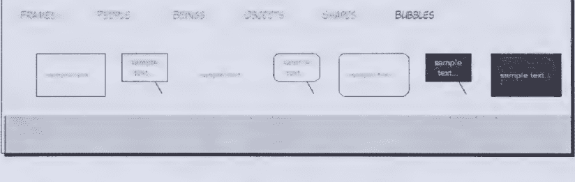

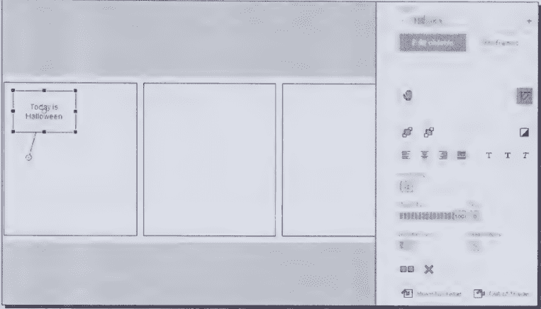

> 你也可以拖放气泡以在框内移动它。

- 7. 重复上述步骤（4 至 6）以添加对话气泡并用以下对话填充它们：
    - **Box number 1**
        - Today is Halloween
        - What costume are you wearing?
    - **Box number 2**
        - I'm a princess
        - I'm a butterfly! What about you, Alice?
    - **Box number 3**
        - Ohhhh....
        - I'm a mummy
        - How scary!!!!!
- 8. 点击位于左下角的 Finish 按钮。
- 9. 在 **Title** 文本框中输入所需标题 Halloween，然后点击 **Next**，这是最后一步，因为我们对缩略图预览不感兴趣。
- 10. 网页将提供登录或保持匿名用户的机会。点击 **Remain anonymous**，然后点击 **Publish**，网页将为漫画条创建位图图像，如以下图片所示：

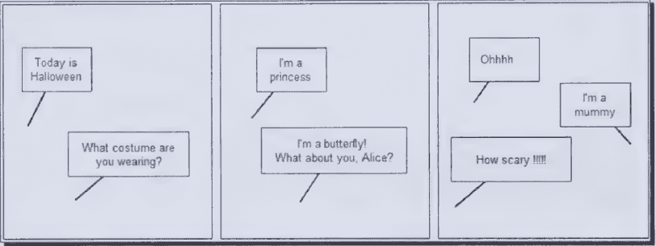

- 11. 将鼠标指针定位在生成的漫画条图像中心。右键点击并在出现的上下文菜单中选择 **Save picture as**。
- 12. 将文件保存为 `halloweenstrip01.png` 到之前创建的文件夹 `C:\School` 中。

### What just happened?

我们为一个包含三个框的非常简单的漫画条创建了对话气泡。我们使用了 stripgenerator.com 提供的工具和简单的用户界面。

我们可以组织不同类型的对话气泡，改变其大小，并输入文本以创建简单的漫画条。然后，我们将结果图像导出为 PNG 格式。


## 行动时间 – 将活动添加到 Moodle 课程

我们现在需要将根据对话框绘制和说明添加到现有的 Moodle 课程中。

- 1. 登录到你的 Moodle 服务器。必要时请点击 **Return to my normal role** 按钮。
- 2. 点击所需课程名称（**School**），然后点击 **Turn editing on**。
- 3. 编辑新周的摘要。在 **Summary** 中输入 `Exercise 3` 并点击 **Save changes** 按钮。
- 4. 点击所选周的 **Add an activity** 下拉框并选择 **Upload a single file**。
- 5. 在 **Assignment name** 中输入 `Drawing with a digital pen`。
- 6. 在 **Description** 下方的前两个下拉框中，选择字体为 `Impact`，大小为 `5 (18)`。
- 7. 点击 **Font Color** 按钮（带六个颜色框的 T）并为文本选择你想要的颜色。
- 8. 点击 **Description** 下方的较大文本框并输入 `Draw an illustration of one of the characters according to the speech bubbles`。这是本次练习学生目标的描述。
- 9. 按下 `Enter` 并点击 **Insert Image** 按钮（山或树，根据 Moodle 版本而定）。一个新的网页将出现，显示标题 **Insert image**。
- 10. 点击 `chapter01`。
- 11. 点击 **Browse** 按钮。浏览到存放漫画条图像的文件夹（`C:\School`）并选择要上传的文件 `halloweenstrip01.png`。然后，点击 **Open** 和 **Upload** 按钮。标签 **File uploaded successfully** 将出现在 **File browser** 框内。

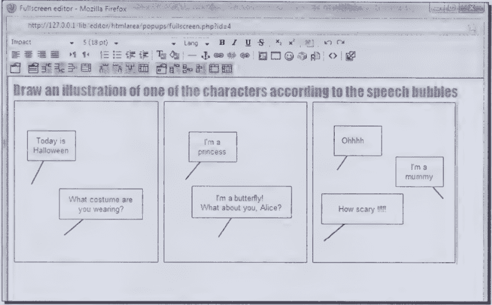

- 15. 关闭放大的编辑器窗口。
- 16. 在 **Maximum size** 中选择 10MB。这是每个学生为本次活动上传结果所能上传文件的最大大小。然而，检查你的 Moodle 服务器提供的可能性与你的 Moodle 管理员非常重要。
- 17. 向下滚动并点击 **Save and display** 按钮。网页浏览器将显示描述和之前上传的带对话框的图像。

## 发生了什么？

我们将绘画练习添加到了 Moodle 课程中。学生现在可以在阅读目标并点击相应周的超链接后为本次活动上传结果。

我们使用了之前创建的文件夹 `chapter01`。我们上传了带对话框的漫画条位图图像（`halloweenstrip01.png`）。我们使用描述的编辑器用自定义字体和颜色添加了标题。

上传单个文件活动允许我们使用段落和图像来描述活动的目标。

## 行动时间 – 使用数位笔作为鼠标解决练习

是时候使用数位笔（也称为笔绘）作为鼠标来根据对话框绘制其中一个角色了。我们将作为学生来解决活动。

我们也可以使用经典鼠标来解决练习。然而，数位笔更合适。

- 1. 将 USB 数位笔连接到计算机并在尚未完成时安装其驱动程序。
- 2. 点击课程名称（School）并将你的角色切换为学生。
- 3. 点击相应周的 Drawing with a digital pen 链接。网页浏览器将显示活动的描述和漫画条。尝试想象其中一个角色。
- 4. 启动 Inkscape。
- 5. 点击工具栏中的 Draw calligraphic or brush strokes 按钮。此功能将允许你使用数位笔或鼠标进行绘制，如下一张截图所示：

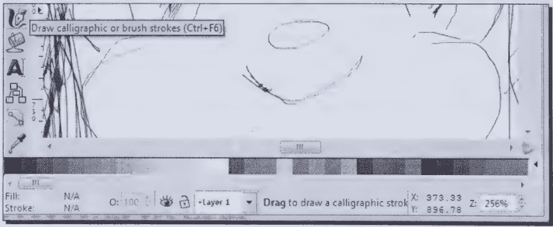

- 6. 现在，使用数位笔作为铅笔在平板上想象并绘制所需角色，如下一张图像所示：

- 13. 最后，你可以通过点击页面底部出现的链接下载并打开已上传的绘画。网页浏览器将为此类型文件提供默认应用程序，如下一张截图所示。

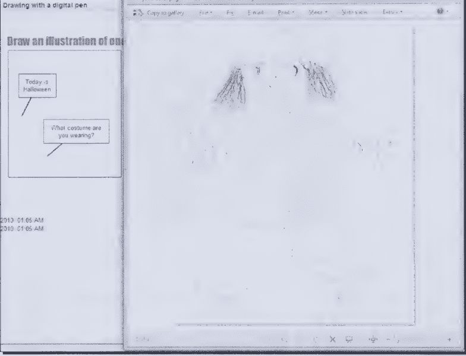

- 14. 不要忘记检查此练习的结果，如之前所学。

## 发生了什么？

在此活动中，我们使用 strip generator.com 提供的在线工具在漫画条中创建了对话框。我们要求孩子想象并使用数位笔绘制漫画条中其中一个角色。

这对幼儿来说是一项有趣且吸引人的活动。他们真的很喜欢使用数位笔。我们应用了以下概念和资源以刺激注意力和集中力：

- **阅读理解**：孩子必须阅读并理解对话框中的文本。
- **听力理解**：如果孩子无法独自阅读和理解漫画条，他/她可以与治疗师或家庭成员一起工作，以便他/她能够想象角色。
- **情境抽象**
- **创造力**

为什么我们使用数位笔？该设备提供多种用于进行艺术活动的资源。此外，它也是那些有手动发育不良的孩子们的另一个资源。

> 孩子通常需要在治疗师或家庭成员的帮助下使用 Inkscape、Moodle 和数位笔来解决此练习。孩子通过将绘画上传到上传单个文件活动来解决练习。

## 描摹绘画以解决练习

孩子们喜欢描摹绘画！解决此练习的另一种替代方法是使用数位笔描摹现有绘画。

你可以通过将模型绘画放在平板上来实现。然后你可以使用数位笔沿着现有线条绘制，如下一张图像所示：

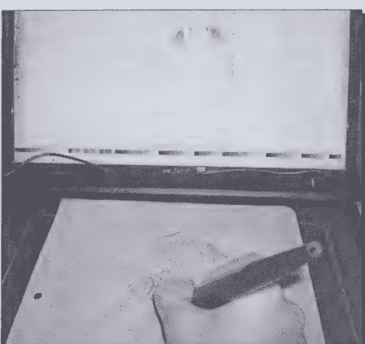

匹配图片

> 你可以将模型绘画作为位图图像添加到上传单个文件活动中。学生可以打印此图像并使用数位笔描摹打印的绘画。这样，你就可以开始测量手动操作。

## 试一试英雄 – 将 3D 场景与 2D 图像匹配

你的新活动真的很有吸引力！你想添加一个新的匹配图片活动。然而，你不想使用文本，只想在两侧使用图片。

使用 JMatch 创建一个新的匹配复合图片活动。在左侧添加三个 3D 场景，在右侧添加三个 2D 图片。这样，学生将不得不将 3D 场景与相应的等效 2D 图片匹配。

使用 Inkscape 为每个图片组合 2D 剪贴画和 3D 模型。创建四对图像，组合以下元素：

- 一支铅笔和一把圆规
- 一张纸和一块橡皮
- 一把画笔和彩色铅笔
- 一个铅笔盒和一个书包

创建一个新的 Moodle 练习并作为学生运行。然后，使用数位笔作为鼠标拖放图像以将每个 2D 图片与其对应的 3D 场景匹配。

> 你可以用本章学到的所有技术与许多其他 Hot Potatoes 练习一起使用。我们使用 JMatch 和 JQuiz 创建了视觉练习。然而，此应用程序提供了许多其他有趣的模块。使用 Hot Potatoes 创建其他类型活动的描述在 Mary Cooch 所著的 Packt Publishing 出版的《Moodle 1.9 for Teaching 7-14 Year Olds: Beginner's Guide》中深入描述。

## 快速测验 – 为儿童创建有吸引力的内容

- 1. 你可以在 JMatch 活动中为 PNG 图像定义背景颜色，使用：
  - a. HTML 标签
  - b. 一个简单的菜单选项
  - c. 一个颜色上下文菜单
- 2. 你可以在 JMatch 活动中为句子定义字体，使用：
  - a. 一个简单的组合框
  - b. 一个字体上下文菜单
  - c. HTML 标签
- 3. JMatch 允许你插入以下格式的图片：
  - a. SVG 格式
  - b. PNG 格式
  - c. TARGA 格式
- 4. 为了将使用许多图像的 JMatch 活动添加到 Moodle 课程中，你必须：
  - a. 上传 JMatch 生成的 HTML 文件（.html）以及所有图像文件
  - b. 仅上传 JMatch 生成的 HTML 文件（.html）
  - c. 仅上传 JMatch 保存的 JMT 文件（.jmt）
- 5. 为了作为学生测试练习，你可以：
  - a. 点击学生图片
  - b. 重新启动 Moodle 服务器
  - c. 点击 **Switch role to** 下拉框并选择 **Student**
- 6. 你可以在以下位置找到并旋转渲染的 3D 模型图片：
  - a. Google 3D warehouse
  - b. Microsoft Office Office Online Clip Art & Media
  - c. Inkscape 3D warehouse
- 7. 你可以将游戏手柄的迷你摇杆映射到：
  - a. 鼠标滚轮
  - b. 数位笔
  - c. 鼠标指针


## 本章小结

在本章中，我们学习了如何：

- 使用2D和3D剪贴画创建丰富的活动
- 使用Inkscape处理多种不同的图片格式，并将结果导出为Moodle和Hot Potatoes都支持的PNG格式
- 使用JMatch和JQuiz创建可视化练习，然后上传到Moodle服务器并运行
- 利用免费的2D剪贴画、3D模型和连环画生成工具
- 使用通用硬件为有特殊教育需求的儿童创建更具吸引力的活动

现在我们已经学会了如何创建丰富的图片匹配活动，接下来可以准备练习，以评估和处理抽象思维和序列排序障碍，这是下一章的主题。
