## 制作一个将图片转换为文字的填空活动

重要的日子终于到来了。

爱丽丝和她的朋友们去城市动物园郊游。爱丽丝喜欢看动物；有些动物如长颈鹿非常高，有些如兔子非常小而柔软，还有一些像狮子一样吼叫。

爱丽丝最喜欢的动物生活在动物园的水族馆里。我们一起去了解更多关于它们的事好吗？

### 动手实践——获取动物和大自然的图片

我们将搜索现有的动物和大自然2D剪贴画图像。然后使用一个简单的屏幕元素截图工具将它们转换为2D位图图像。

1. 在Windows资源管理器中创建一个新文件夹（`C:\Zoo`）。

   > 所描述的步骤针对Windows操作系统。不过，你也可以在Moodle支持的所有其他操作系统（如Linux和Mac OS X）中创建本练习和其他练习。你应该使用默认应用程序来处理文件系统，并使用不同的文件夹名称。

2. 打开你的默认Web浏览器，访问 http://office.microsoft.com/en-us/clipart/default.aspx。该网页允许我们在Office Online剪贴画和媒体中搜索免费剪贴画。

   > 你不需要安装Microsoft Office或Word来创建本练习，因为我们不会下载剪贴画。

3. 在文本框中输入“海豹”（seal），然后点击**搜索**按钮。与输入关键字相关的可用剪贴画缩略图将出现，如以下截图所示：

   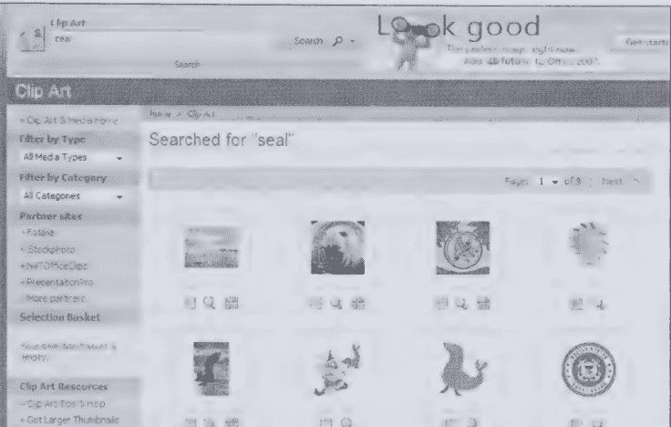

4. 点击所需剪贴画缩略图下方的缩放图标。将出现一个新窗口，显示剪贴画的小预览。

5. 点击**放大预览**，该标签将变为**缩小预览**，如以下截图所示。我们希望使用大预览以相同尺寸截取剪贴画。

   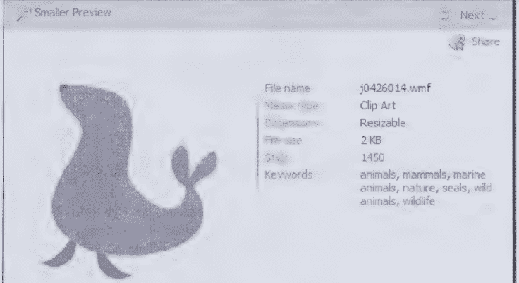

6. 启动**截图工具（Snipping Tool）**（开始菜单 | 所有程序 | 附件 | Snipping Tool），将出现一个小窗口。点击**选项**按钮，取消选中**捕获截图后显示选区墨水**复选框，然后点击**确定**。

   > 你可以使用其他操作系统提供的默认屏幕捕获快捷键和应用程序，然后编辑图像文件以达到相同目的。

7. 点击**截图工具**工具栏上的**新建**按钮。屏幕亮度将增加，默认鼠标指针将替换为**精确选择十字光标**。

8. 将鼠标指针定位到剪贴画预览的左上角，然后将其拖到右下角。拖动鼠标时，将显示一个矩形以指示屏幕的选定部分。释放鼠标按钮后，将出现**截图工具**窗口并显示捕获的图像，如以下截图所示：

   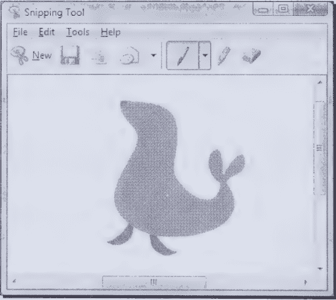

9. 从截图工具的主菜单中选择**文件 | 另存为**。在**保存类型**组合框中选择**便携式网络图形文件（PNG）（*.PNG）**，并将文件保存为`image020101.png`到之前创建的文件夹`C:\Zoo`中。

10. 接下来，返回Web浏览器，重复上述步骤（3至9）以捕获另一个剪贴画图片的位图图像。在这种情况下，重复这些步骤搜索“海”（sea），并将捕获的图像文件保存为`image020102.png`到同一文件夹中。

### 刚才发生了什么？

我们通过Web浏览器在Office Online剪贴画和媒体中搜索了剪贴画预览。这次我们没有使用Inkscape，而是使用截图工具应用程序捕获显示所需剪贴画预览的屏幕部分。这样，我们只需几个简单步骤即可将所需图像保存为PNG格式。

> 截图工具是一个非常有用的应用程序，可以截取矩形区域、自由形状区域、特定窗口或整个屏幕。大多数现代Windows版本都包含此应用程序：Windows 7、Windows Vista和Windows XP Tablet PC Edition。你可以使用其他截图应用程序代替截图工具，以应用本练习中介绍的技术。

我们现在拥有以下两个位图图形，可用于“根据图片补全句子中的虚线部分”练习：

- `image020101.png`：一只海豹
- `image020102.png`：一张大海的照片

### 动手实践——使用图像准备完形填空

是时候准备句子和虚线部分，并为我们的完形填空整理图像了。

1. 启动Hot Potatoes并点击JCloze。将出现一个带有JCloze应用程序的新窗口。

2. 在**标题**文本框中输入“根据图片补全句子中的虚线部分”。

3. 从JCloze的主菜单中选择**文件 | 保存**。将文件保存为`cloze0201.jgz`到之前创建的文件夹`C:\Zoo`中。

4. 点击标题文本框下方的文本框，输入**海豹生活在海里。**

5. 将光标放在单词**海豹**之后，然后从JCloze的主菜单中选择**插入 | 图片 | 来自本地文件的图片**。选择之前保存在`C:\Zoo`中的位图图像`image020101.png`，点击**打开**按钮，然后点击**确定**。JCloze将使用默认选项插入图像。

6. 现在，将光标放在单词**海**之后，重复上述步骤以插入之前保存在`C:\Zoo`中的位图图像`image020102.png`。JCloze将在文本框中显示以下HTML代码，如下一张截图所示：

```
The seal

</img>
lives in the sea

</img>
```

| 标题 | 根据图片补全句子中的虚线部分 |
| --- | --- |
| 海豹 `</img>` 生活在海 `</img>` 里 | |

7. 选择单词**海豹**并点击**填空**按钮。将出现**填空词选项**对话框。在**提示**文本框中输入*它是一种动物*，然后点击**确定**按钮。选中的单词将以下划线红色显示，如以下截图所示：

| 标题 | 根据图片补全句子中的虚线部分 |
| --- | --- |
| ` ` 生活在海 `</img>` 里 | |

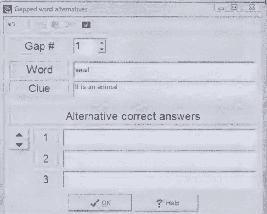

8. 接下来，选择单词“海”并点击**填空**按钮。将出现**填空词选项**对话框。这一次，不输入提示信息，直接点击**确定**按钮。

9. 选择“文件 | 创建网页 | 标准格式”。JCloze将创建一个新的网页。将新文件保存为`cloze0201.htm`到上述文件夹中。将出现一个新的对话框，点击**在我的浏览器中查看练习**。


- 10. 默认的 Web 浏览器将显示采用标准格式的填空练习。你将看到一个句子和两个文本框，如下一个屏幕截图所示。你必须根据每张配图写出正确的单词。[?]按钮可以通过提供线索，帮助你发现隐藏的单词。

  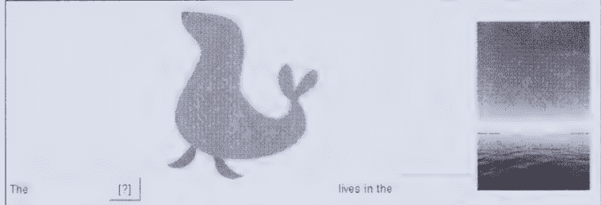

## 刚刚发生了什么？

我们插入了两张图片，并根据图片为“完成句子中的点线”练习准备了句子。我们定义了两个空缺单词，并为其中一个指定了线索。每个空缺单词都将由一个带有配图的文本框表示。

我们使用 JCloze 编辑并预览了句子`The seal lives in the sea.`的填空练习。

> [灯泡图标] 我们插入了海豹和大海的图片，以创建内容丰富的填空练习。这样，我们提供了额外的刺激，并呈现视觉资源来简化练习的完成过程。

## 动手操作——将活动添加到 Moodle 课程

现在，我们必须将“根据图片完成句子中的点线”练习添加到现有的 Moodle 课程中。

- 1. 登录 Moodle 服务器。
- 2. 单击所需的课程名称（Zoo）。你可以创建新课程，也可以使用现有课程。
- 3. 正如之前所学，按照必要步骤编辑所需周次的摘要。在**摘要**文本框中输入 Exercise 1，然后保存更改。
- 4. 单击所选周次的**添加活动**组合框，然后选择**Hot Potatoes 测验**。
- 5. 将出现一个新的网页，显示标题**添加新的 Hot Potatoes 测验**。单击**选择或上传文件**按钮，随后将出现熟悉的弹出窗口，其中显示有关文件和文件夹的信息。
- 6. 按照必要步骤创建新文件夹`chapter02`。该文件夹将用于整理新练习所需的文件。
- 7. 单击`chapter02`（刚刚创建的文件夹超链接）。
- 8. 单击**上传文件**按钮，然后单击**浏览**按钮。浏览到存放练习所用图片和文件的文件夹（`C:\Zoo`），并选择要上传的文件`image020101.png`。然后，单击**打开**，再单击**上传此文件**按钮。
- 9. 对下面列表中显示的每个文件重复上述步骤。你必须将所有这些文件上传到`chapter02`文件夹中。
  - `image020102.png`
  - `cloze0201.htm`
- 10. 接下来，将鼠标指针移到`cloze0201.htm`名称上，并水平移动到同一行中的**选择操作**超链接。然后单击**选择**，如下一个屏幕截图所示：
- 11. Moodle 将在**文件名**文本框中显示`chapter02/cloze0201.htm`。这是运行之前使用 JCloze 创建的练习的网页。

  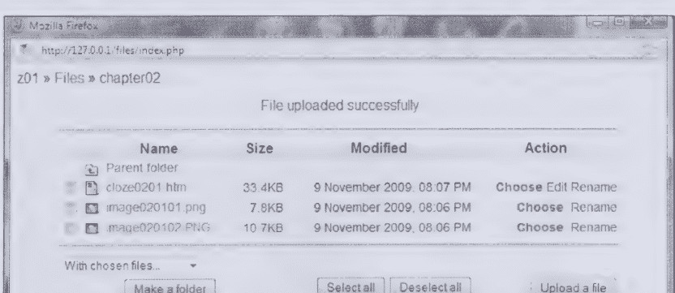

- 12. 向下滚动，然后单击网页底部的保存并显示按钮。Web 浏览器将显示带有两张图片的“根据图片完成句子中的点线”练习。

## 刚刚发生了什么？

我们将内容丰富的填空练习添加到了 Moodle 课程中。学生现在可以单击相应周次中的超链接来运行该活动。

我们创建了一个新文件夹`chapter02`。该文件夹将存放与动物园之旅相关活动所需的全部文件。

然后，我们上传了之前使用截图工具捕获的两张图片，以及使用 JCloze 创建的 HTML 文件（cloze0201.htm）。这个 HTML 文件包含由 JCloze 插入的两张图片的链接。

## 动手操作——运行并完成带图片的填空练习

现在，是时候以学生身份运行活动，并以教师身份检查结果了。

- 1. 单击课程名称（zoo），然后将你的角色切换为学生。
- 2. 单击相应周次中的“根据图片完成句子中的点线”链接。
- 3. 根据配图，在每个文本框中填写正确的单词。接下来，单击检查按钮测试结果，如下一个屏幕截图所示：

  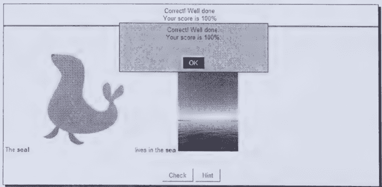

- 4. 如果学生的得分为 100%，Moodle 将保存结果，并返回课程网页。
- 5. 现在，使用不同数量的正确单词运行练习，并在每次完成后单击检查按钮。Moodle 会告诉你其中一些答案不正确，并允许你再次运行活动。不过，错误答案会显示在原来的文本框中，供你修改。系统会保存学生每次尝试的结果。
- 6. 你可以切换回普通角色，并像检查 Hot Potatoes 测验活动一样检查尝试次数。

> 我们运行的是 JCloze 练习。但是，Moodle 会将其统计信息显示在 Hot Potatoes 测验活动下。


## 刚刚发生了什么？

在这项活动中，我们使用了一个不完整的句子和两张图片。目标是根据每个文本框右侧的图片完成缺失的单词。孩子可以独自阅读、理解并完成缺失的单词，也可以在治疗师或家人的帮助下运行练习。

这项活动要求根据相关图片写出正确的单词。为了刺激注意力、集中力和抽象能力，我们应用了以下概念和资源：

- **阅读理解**：孩子必须阅读并理解包含若干缺失单词的句子。
- **听力理解**：如果孩子无法独自阅读并理解句子，他/她可以在治疗师或家人的帮助下完成练习，从而无需阅读或书写即可运行活动。
- **绘画和照片**：它们提供了一种视觉机制，可以简化不同线索的传达，引导孩子写出缺失的单词。孩子必须运用抽象能力来完成练习。
- **阅读和书写**：孩子必须根据配图写出缺失的单词。

动物园是本次练习的主要场景。它通常被认为是一个适合儿童游玩的有趣场所。此外，它还提供了大量资源和想法，可用于设计有趣的练习。

## 处理抽象和排序障碍

对于某些孩子来说，这项练习可能太难，尤其是那些书写困难或存在阅读理解问题的孩子。此外，患有动作性运用障碍的孩子在正确位置书写单词时可能会遇到很大困难。在这些情况下，在治疗师或家人的帮助下进行练习非常重要。

> 我们还可以使用额外的线索、要求学生在多个句子中完成单词，以及为每个缺失单词添加不止一张图片，来提高或降低这项练习的复杂程度。例如，如果想创建一个更简单的活动，可以写一个只有一个缺失单词的短句，提供三张与该单词相关的图片，并添加一个描述性很强的线索。

## 根据说明为图片着色

动物园里发生了多么混乱的事情！猴子逃跑了，还趁没人注意打开了其他几个笼子。所有动物都在奔跑和跳跃。它们还在动物园里到处淘气。

动物管理员向爱丽丝和她的朋友们求助。他想找出动物们所在的位置，尤其是那只淘气的猴子。

幸运的是，狮子没有逃跑！

### 动手操作——使用数位笔绘制背景

我们将使用数位笔作为鼠标来绘制一幅图片。之后，学生就可以为图片中的多个封闭区域填色。

我们也可以使用传统鼠标来绘制这幅图片。不过，数位笔更适合创作具有手绘风格的逼真图片。

- 1. **启动画图**（开始菜单 | 所有程序 | 附件 | 画图）。

  > 你也可以使用其他位图或图像编辑应用程序来完成这项练习，例如 GIMP。我们将在其他练习中学习使用 GIMP。

- 2. 将鼠标指针放在白色背景（绘图区）的右下角，然后拖动鼠标以填充窗口。松开鼠标按钮后，白色背景将覆盖更大的绘图区。

- 3. 单击工具栏中的铅笔按钮。此功能允许你使用数位笔或鼠标进行绘图。


4. **接下来，为每个元素选择所需的颜色，并使用数字笔作为铅笔，在白色背景上绘制一个包含以下元素的场景，如下一个截图所示：**

    - 一只猴子
    - 一只巨嘴鸟
    - 一头猪
    - 三朵云
    - 一棵树

    > 记住，你必须绘制封闭区域，因为学生将根据练习中提供的说明填充其中的许多区域。

    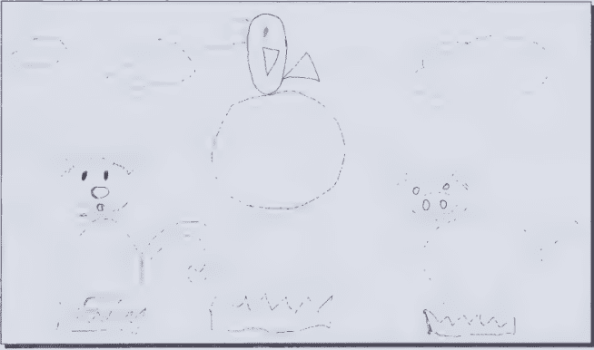

5. 在画图工具的主菜单中选择 **文件 | 另存为**。在 **保存类型** 组合框中选择 **PNG (\*.PNG)**，并将文件保存为 `image020201.png`，保存在之前创建的文件夹 `C:\zoo` 中。

## 发生了什么？

我们使用画图工具绘制了动物园中不同形状的动物。我们使用了封闭区域，以便通过颜色填充功能对它们进行填充。我们使用了不同的画笔颜色，因为我们将指导学生用特定颜色填充特定形状。

## 现在开始操作——在 Moodle 中准备包含图片、颜色和字体的说明

我们将使用之前创建的图像的许多部分来准备此活动的说明。

1. **打开画图工具（开始菜单 | 所有程序 | 附件 | 画图）。**

2. 在画图工具中打开位图文件（`C:\Zoo\image020201.png`）。

3. 单击工具栏中的 **选择** 按钮（一个虚线矩形）。此功能允许您选择绘图区域的矩形区域。

4. 将鼠标指针定位到所需区域的左上角（巨嘴鸟左侧的小云朵），并将其拖动到右下角。拖动鼠标时，一个虚线矩形会显示绘图区域的选定部分。

5. 在画图工具的主菜单中选择 **编辑 | 复制到**。在 **保存类型** 组合框中选择 **PNG (\*.PNG)**，并将文件保存为 `image020202.png`，保存在之前创建的文件夹 `C:\Zoo` 中。这样，您只是将选定区域保存到一个新的位图图像中。

6. 对其他区域重复上述步骤（3 至 5），并按下表所示的名称保存图像文件：

| 选择区域 | 图片文件名 |
|---|---|
| 巨嘴鸟左侧的小云朵 | image020202.png |
| 巨嘴鸟右侧的大云朵 | image020203.png |
| 树上方的那只巨嘴鸟 | image020204.png |
| 树下的草地 | image020205.png |

7. 这样，您将拥有四张包含原始绘画四个不同部分的图像。现在，返回到您的 Web 浏览器。

8. 登录到您的 Moodle 服务器。

9. 单击所需的课程名称 (Zoo)。如之前所学，按照必要的步骤编辑所需星期的摘要。在 **摘要** 文本框中输入“练习 2”，然后保存更改。

10. 为所选星期单击 **添加一个活动** 组合框，然后选择 **上传单个文件**。

11. 在 **作业名称** 中输入“按照说明绘制图片”。

12. 选择 Verdana 字体和大小 5 (18)——即 **描述** 下方的头两个组合框。

13. 为文本选择您想要的颜色。

14. 单击 **描述** 下方的大文本框，并输入“按照说明绘制元素”。这是本练习学生目标的描述。

15. 按 Enter 键，并单击 **插入图片** 按钮（根据 Moodle 版本可能是一座山或一棵树）。将出现一个标题为 **插入图片** 的新网页。

16. 按照必要的步骤将文件 `image020201.png` 上传到之前创建的文件夹 `chapter02` 中。记得输入替代文本，图片将出现在之前输入的标题下方。

17. 按照必要的步骤将四张包含原始图像不同区域的新图像上传到同一文件夹 `chapter02` 中。

18. 单击 **插入表格** 按钮（一个网格）。在 **行** 中输入 4，在 **列** 中输入 2，以插入一个 4 行 2 列的新表格，然后单击 **确定**。

19. 接下来，按照下表所述，在左侧的单元格中输入说明文本，并在每条说明的右侧输入图片。记得为每张图片输入替代文本。

| 文本 | 要插入到文本右侧的图片文件名 |
| --- | --- |
| 将巨嘴鸟左侧的小云朵涂成蓝色 | image020202.png |
| 将巨嘴鸟右侧的大云朵涂成蓝色 | image020203.png |
| 将树上方的那只巨嘴鸟涂成橙色和黑色 | image020204.png |
| 将树下的草地涂成绿色 | image020205.png |

20. 选择每个代表颜色名称的单词，并将其颜色更改为相应的颜色，如下一个截图所示。例如，句子“将巨嘴鸟左侧的小云朵涂成蓝色”中的“蓝色”应为蓝色。

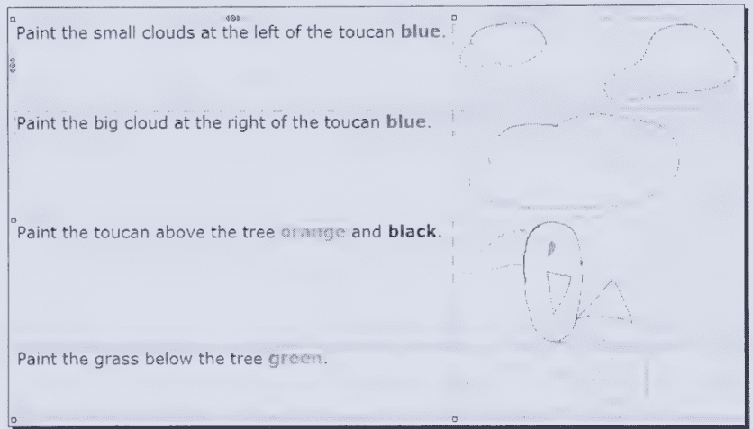

> 记住，您可以单击 **放大编辑器** 按钮（一个带有两个方块的对角线箭头），以便使用更大的编辑区域来编辑内容。

21. 在 **最大大小** 中选择 **10MB**。这是每个学生能够为此活动上传文件的最大大小。然而，非常重要的是，要与您的 Moodle 管理员核实您的 Moodle 服务器所提供的可能性。

22. 向下滚动并单击 **保存并显示** 按钮。Web 浏览器将显示主场景以及带图片和颜色的说明。

## 发生了什么？

我们向一个 Moodle 课程中添加了绘画练习。学生现在可以在点击相应星期上的超链接阅读详细目标之后，上传绘制好的图片作为此活动的结果。

我们使用了之前创建的文件夹 `chapter02`。我们上传了包含要绘制的封闭区域的主位图图像（`image020201.png`）。我们使用“上传单个文件”编辑器添加了一个标题，该标题使用了自定义字体和颜色；随后添加了带有绘画说明的句子，并用四张图片显示需要填充的区域：

- `image020202.png`
- `image020203.png`
- `image020204.png`
- `image020205.png`

“上传单个文件”活动的描述区域允许我们结合多张图片、段落和颜色来解释活动目标。

## 现在开始操作——在 Moodle 中执行绘制图片的活动

是时候使用数字笔作为鼠标，按照说明填充封闭区域了。我们将以学生的身份完成该活动。

我们也可以使用传统鼠标来完成练习。不过，数字笔会让它更加有趣。

1. 将 USB 数字笔连接到计算机，并安装其驱动程序（如果尚未安装）。

2. 点击课程名称 (Zoo)，并将您的角色切换为学生。

3. 点击相应星期上的 **按照说明绘制图片** 链接。Web 浏览器将显示场景图片，以及四条带有说明和相应图片的句子。

4. 右键单击场景图片，并在出现的上下文菜单中选择 **图片另存为**。将文件另存为 `myzoo.png` 到您的文档文件夹中。您的 Web 浏览器将把文件下载到所选文件夹。

> 为了保持说明简单，我们没有包含学生完成练习所需的所有必要步骤的详细分步信息。然而，大多数情况下，您应该将我们现在在完成练习过程中遵循的相同步骤作为给学生的说明包含进去。例如，您必须包含指导孩子的家长右键单击和下载文件的说明。

这对幼儿来说是一项有趣的活动，因为他们喜欢画画。我们运用了以下概念和资源来激发他们的注意力和专注力：

- 阅读理解
- 模式识别
- 理解简单任务：孩子必须使用指定颜色填充一个确定的元素
- 理解复杂任务：孩子必须使用两种颜色填充巨嘴鸟
- 执行简单和复杂任务
- 空间概念：说明描述了要绘制的元素在特定空间内的位置
- 感官知觉资源：我们使用图案、图片和颜色简化了活动的执行。在这种情况下，用于绘制每个区域轮廓线的颜色与必须用来填充它的颜色相同

> 如前所学，我们也可以使用游戏手柄代替数字笔来完成练习。有时，对于有手部运动障碍的儿童来说，游戏手柄使用起来更容易，也更具吸引力。在许多步骤中，它比鼠标指针提供更高的精度。

孩子通过将绘制好的图片上传到“上传单个文件”活动来完成练习。

## 试试身手——绘制剪影

学生们很喜欢绘制与动物园相关的场景。您想再添加一个绘画练习。但这次您不想使用另一幅手绘风格的图片。相反，这次您将使用现有的剪影剪贴画。

使用 Inkscape 组合许多动物和自然元素（如树木和云朵）的剪影剪贴画。使用剪影创建新场景，并将图像导出为 PNG 格式。

然后，使用画图工具将此场景的多个部分复制到新的 PNG 图像中，以便创建将图片与句子相结合的视觉丰富说明。

创建一个新的 Moodle 练习，并以学生身份运行它。按照说明绘制剪影。

记住，您已经学会了如何组合现有剪贴画来创建位图图像。


## Have a go hero – using other tools to paint the image

许多学生都玩过他们的“开始”菜单，现在，他们找不到 Paint 应用程序了。然而，他们都找到了通往 Tux Paint 的快捷方式。

以学生身份运行现有的练习，使用 Tux Paint 代替 Paint 来为元素涂上不同的颜色。

在上传单个文件活动中添加必要的说明，使用 Paint 和 Tux Paint 绘制元素。使用图文并茂的说明向学生解释必要的步骤。

## Solving a yes/no multiple choice

终于，爱丽丝到家了。她妈妈焦急地等着她，想知道她第一次去动物园的情况如何。

爱丽丝告诉妈妈，她玩得很开心，很有趣。她补充说，她见到了很多不同大小的动物，但她不记得其中一种动物的名字。

我们来帮爱丽丝回忆那只动物的名字吧？

### Time for action – preparing several images and Boolean questions

我们首先要搜索现有的两个动物的 2D 剪贴画，一只猴子和一头牛。然后，我们将使用我们熟知的 Snipping Tool 将它们转换为 2D 位图图像。

一旦我们有了这两张图片，我们将使用 Moodle 的测验活动准备一个以是/否多选题格式的句子。

> 是/否问题也被称为布尔问题。布尔代数是两个值的代数，0 和 1 或 True 和 False。

1. 打开你的默认网页浏览器并前往 `http://office.microsoft.com/en-us/clipart/default.aspx`。我们将再次在 **Office Online Clip Art & Media** 中搜索剪贴画。

2. 按照我们在第一个练习中为海豹和海洋找到剪贴画时学到的相同步骤，搜索这些动物的剪贴画。使用 Snipping Tool 拍摄的快照以以下表格中显示的名称保存到之前创建的文件夹 `C:\Zoo` 中。下图显示了这些动物的示例图像：

| Animal | Picture file name |
| --- | --- |
| Monkey | `image020301.png` |
| Cow | `image020302.png` |

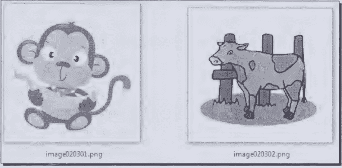

3. 登录你的 Moodle 服务器并点击所需课程名称（Zoo）。

4. 如我们之前所学，遵循必要的步骤编辑所需周的摘要。在 **Summary** 文本框中输入 **Exercise 3** 并保存更改。

5. 点击所选周的 **Add an activity** 下拉框并选择 **Quiz**。

6. 在 **Quiz name** 中输入 Boolean multiple choice，然后点击 **Save and display** 按钮。Moodle 将显示此测验的问题库，如下图所示：

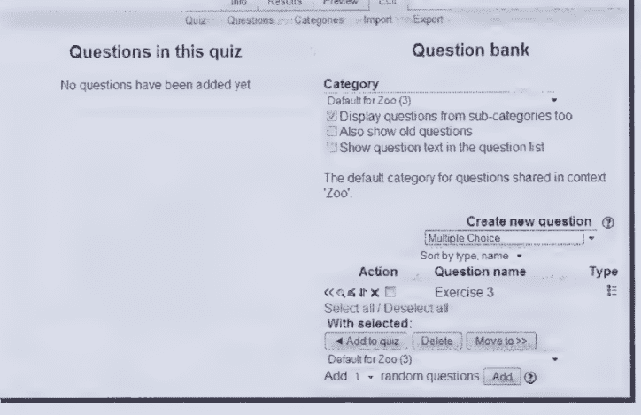

7. 点击 **Create new question** 下拉框并选择 **Multiple choice**。一个要求输入添加多选题所需信息的新页面将会出现。

8. 在 **Question Name** 中输入 **Multiple choice**。

9. 点击 **Question text** 标签下方的[content]

## Have a go hero – using other tools to paint the image

Many students have played with their Start menu and now, they can't find the Paint application. However, all of them found a shortcut to Tux Paint.

Run the existing exercises as a student using Tux Paint instead of Paint in order to paint the elements with different colors.

Add the necessary instructions in the upload a single file activity to paint the elements using both Paint and Tux Paint. Use visually rich instructions explaining the necessary steps to the students.

## Solving a yes/no multiple choice

Finally, Alice arrived home. Her mother was waiting for her anxiously to know how her first visit to the zoo was.

Alice told her mother that she played and had a lot of fun. She added that she met a lot of animals of different sizes, but she didn't remember the name of one animal.

Shall we help Alice to remember that animal's name?

### Time for action – preparing several images and Boolean questions

We are first going to search for existing 2D clipart of two animals, a monkey and a cow. We will then convert them to 2D bitmap images using our well-known Snipping Tool.

Once we have the two images, we are going to prepare a sentence with a yes/no multiple choice format using Moodle's Quiz activity.

> A yes/no question is also known as a Boolean question. Boolean algebra is the algebra of two values, 0 and 1 or True and False.

1. Open your default web browser and go to `http://office.microsoft.com/en-us/clipart/default.aspx`. We are going to search for clipart in **Office Online Clip Art & Media**, again.

2. Following the same steps learned to find clipart for a seal and the sea in our first exercise, search for clipart for these animals. Save the snapshots taken by Snipping Tool with the names shown in the following table, in the previously created folder, `C:\Zoo`. The next picture displays sample images for these animals:

| Animal | Picture file name |
| --- | --- |
| Monkey | `image020301.png` |
| Cow | `image020302.png` |


3. Log in to your Moodle server and click on the desired course name (Zoo).

4. As we have learned previously, follow the necessary steps to edit the summary for a desired week. Enter **Exercise 3** in the **Summary** textbox and save the changes.

5. Click on the **Add an activity** combo box for the selected week and select **Quiz**.

6. Enter Boolean multiple choice in **Quiz name**, then click on the **Save and display** button. Moodle will display the question bank for this quiz, as shown in the next screenshot:


7. Click on the **Create new question** combo box and select **Multiple choice**. A new page asking for the necessary information to add a multiple choice question will appear.

8. Enter **Multiple choice** in **Question Name**.

9. Click on the big textbox below the **Question text** label. Use different fonts and colors to enter the sentences that define the goal and the question to answer using the multiple choice quiz, as shown in the next screenshot:

    ☐ Solving a Boolean multiple choice

    ☐ Which animal eats bananas, has a long tail, and climbs the tree?

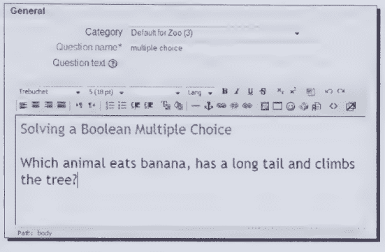

### What just happened?

We searched for clipart previews in Office Online Clip Art & Media, through our web browser and we captured the desired portions using the Snipping Tool application. We now have the following two bitmap graphics ready to be used as visual answers in our Boolean multiple choice exercise:

- `image020301.png`: A monkey
- `image020302.png`: A cow

> It is very important to avoid using descriptive names in the images because they could give the student undesired clues for the answer.

Next, we created a Quiz activity and we added a question for our Boolean multiple choice using the most appropriate question style.

### Time for action – creating a YES button and a NO button with associated images

We now have to prepare the two possible answers using text and images.

1. Scroll down and go to the section named **Choice 1** (the first possible answer).

2. Enter `A monkey` in the **Answer** textbox inside the **Choice 1** section.

3. Click on the **Insert Image** button (a mountain) under the **Feedback** title inside the **Choice 1** section. A new web page will appear displaying the title **Insert image**.

4. Follow the necessary steps to upload the file `image020301.png` in the previously created folder, `chapter02`. Remember to enter an alternate text and the image will appear below the previously entered title.

> It is very important to avoid using descriptive names in the alternate text for these images because they could give the student undesired clues for the answer. In this case, we are inserting the image to be displayed as feedback. However, we are doing this in order to copy the complex HTML code generated to include this image accompanying the answer's text.

5. The monkey will appear in the Feedback's big textbox. Click on the **Toggle HTML Source** button (the one with the `<>` label) under the **Feedback** title inside the **Choice 1** section. The big textbox will display HTML code, a line similar to the following one:

```
<br/>
```

6. Select all the text and press *Ctrl + C*. We want to copy the code to display the uploaded image.

7. Click on the **Answer** textbox inside the **Choice 1** section. Press *End* and then *Ctrl + V*. Now, the text in this textbox will be similar to the following:

```
A monkey<br/>
```

8. Select **100%** in the **Grade** combo box because this is the correct answer, as shown in the next screenshot:

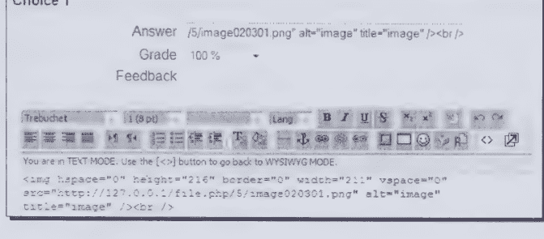

9. Scroll down and go to the section named **Choice 2** (the other possible answer).

10. Repeat the aforementioned steps (2 to 7) to define the second possible answer. In this case, repeat those steps under the section named **Choice 2**, enter `A cow` in the **Answer** textbox, and insert the `image020302.png`.

11. Select **None** in the **Grade** combo box under the section named **Choice 2** because this is the wrong answer.

12. Scroll down and click on the **Save changes** button, located at the bottom of the web page.

13. Moodle will display a question bank and the questions for the quiz. Now, activate the **Action** checkbox corresponding to the row labeled with the previously created question, **Multiple choice**. Then, click on the **Add to quiz** button. Moodle will add the question to our quiz, as shown in the following screenshot:

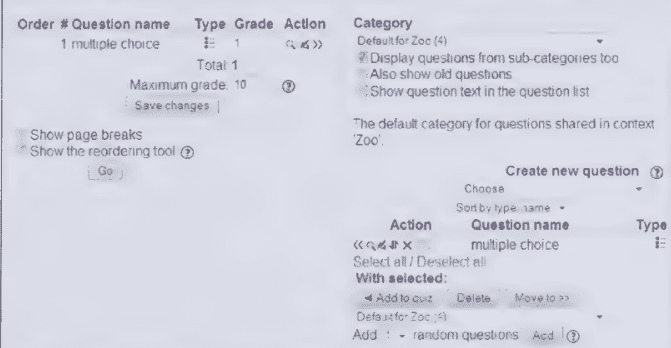

14. Click on the **Save changes** button. The Boolean multiple choice exercise with text and images in its possible answers is ready.

### What just happened?

We added the two possible answers to our previously created question for our Boolean multiple choice. We took advantage of the possibility of adding pictures as feedback for each answer and then we copied the HTML code and added it after the answer's text. This way, the image will appear with the text.

Next, the students are going to be able to solve the multiple choice with two buttons with text and images after reading the question by clicking on its hyperlink on the corresponding week.

We used the previously created folder, **chapter02**. We uploaded the two bitmap images representing the possible answers to the question:

- `image020301.png`
- `image020302.png`

Inserting HTML code into the answer text allowed us to create a visually rich multiple choice.

### Time for action – executing the activity

It is time to run the activity as a student and to check the results as a teacher.

1. Click on the course name (Zoo) and switch your role to student.

2. Click on the **Boolean multiple choice** link on the corresponding week.

3. Click on the **Attempt quiz now** button. The question and two radio buttons with text and images will appear, as shown in the next screenshot:


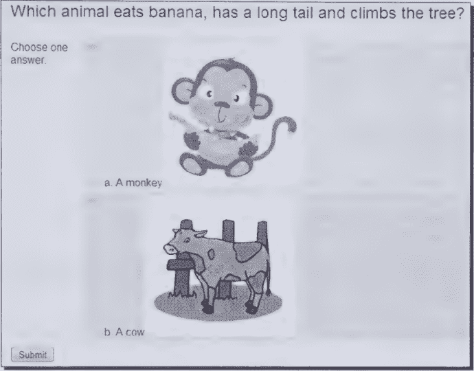

- 4. 点击图片左侧的单选按钮以选择正确答案。然后，点击位于左下角的 **Submit** 按钮。
- 
- 5. Moodle 将显示反馈，告知所选答案是否正确。
- 
- 6. 接下来，点击 **Submit all and finish** 按钮。在出现的确认对话框中点击 **OK**，Moodle 将显示该活动的成绩回顾：
  - 如果选择了正确答案，它将以绿色背景上的两张图片显示。
  - 如果未选择正确答案，正确答案将以绿色背景上的单张图片显示。
- 
- 7. 点击 **Finish review** 按钮，返回 Moodle 课程，并恢复到你的正常角色。

- 8. 在 **Activities** 面板中点击 **Quizzes**。尝试次数将显示在 **Attempts** 列中。
- 9. 接下来，点击对应 **Boolean multiple choice** 活动的行中的 **Attempts** 链接，Moodle 将显示所有尝试的详情，按用户名分组。

## What just happened?

在本次活动中，我们使用单选按钮处理了一个问题和两个可能的答案，与动物图片相关。目标是根据问题和单选按钮右侧的图片选择动物名称。孩子可以独自阅读、理解并回答问题，也可以在治疗师或家庭成员的帮助下进行练习。

该活动包括根据相关图片点击正确动物的单选按钮。我们应用了以下概念和资源，以刺激注意力、集中力和抽象能力：

- *   **阅读理解：** 孩子需要阅读并理解问题和动物名称。
- *   **概念关联：** 孩子需要将问题与可能的答案关联起来。
- *   **图片：** 它们提供了一种视觉机制，以简化不同线索的传达，引导孩子选择正确答案。孩子需要使用其抽象和排序能力来回答布尔问题。
- *   **长期记忆：** 孩子需要思考哪个动物具有问题中描述的特征。他/她需要思考自己知道的所有动物，并将特征与显示的可能答案之一关联起来。

动物园是我们练习的主要场景。它通常被认为是对孩子来说有趣的地方。此外，它提供了大量资源和创意，可用于有趣的练习。

对于某些孩子来说，尤其是那些有写作或阅读理解问题的人来说，这项练习可能太难了。此外，有手部失用症的孩子在正确位置书写单词时可能会遇到很大困难。在这些情况下，非常重要的是在治疗师或家庭成员的帮助下进行练习。

> > 我们可以使用相同的模式创建布尔多项选择，使用不同种类的事物。这些视觉丰富的活动对孩子来说非常吸引人。

## Have a go hero — preparing more Boolean questions

你已经知道如何创建包含多个元素的复合图片。请在现有剪贴画的帮助下创建以下图片：

- - 一只兔子和一根胡萝卜
- - 一只兔子和一个柠檬

接下来，创建一个布尔多项选择题，询问学生兔子吃什么。

> 将我们在上一章学到的所有内容与本章中开发的新活动结合起来，你可以为有特殊教育需求的孩子创建更具吸引力和视觉丰富的练习。

## Pop quiz — discovering new tools and activities

- 1. 你可以使用 Snipping Tool 应用程序来：
  a. 截取矩形区域的屏幕截图
  b. 增加图像的亮度值
  c. 在现有 Moodle 课程中创建布尔多项选择活动
- 2. JMatch 允许你创建填空练习：
  a. 仅混合一张图片和文字
  b. 不带图片
  c. 混合文字和图片
- 3. 为了在 JCloze 练习中定义缺口词，你必须：
  a. 在句子中选择该词并点击 Gap 按钮
  b. 在句子中三击该词
  c. 先写出没有缺词的句子，然后在缺词组合框中输入它们
- 4. 为了检查添加到 Moodle 课程中的 JCloze 练习的尝试次数，你必须：
  a. 在 Activities 面板中点击 Hot Potatoes Clozes
  b. 在 Activities 面板中点击 JCloze Exercises
  c. 在 Activities 面板中点击 Hot Potatoes Quizzes

5. 为了指示 Moodle 布尔测验活动的正确答案，你必须：

- a. 激活 **Right answer** 复选框
- b. 在 **Grade** 组合框中选择 100%
- c. 在 **Grade** 组合框中选择 0%

## Summary

在本章中，我们学习了如何：

- - 创建结合文字和图片的视觉丰富的活动
- - 使用 Snipping Tool 捕获屏幕的不同部分，以便将结果导出为 Moodle 和 Hot Potatoes 都支持的 PNG 格式
- - 使用 JClose、上传单个文件活动和 Moodle 的 Quiz 创建视觉练习
- - 利用 Moodle 生成的 HTML 代码，以便在 Moodle Quiz 的问题中添加图片
- - 使用 Paint 和数位笔创建逼真的活动，以进一步激励有特殊教育需求的孩子。

现在我们已经学会了如何创建练习来评估和处理抽象和排序障碍，我们准备好准备将图片和文字关联的练习了，这是下一章的主题。
