## 3

## Associating Images with Words

> > 我们可以使用包含许多独立元素的图片和图像，并将其与文字和句子结合起来。可以使用许多不同的应用程序来创建练习，挑战学生在创造性和视觉丰富的 Moodle 体验中将图片与文字和句子关联起来。这样，我们可以在不同场景中训练阅读理解和概念关联。

在本章中，Alice 去海滩。我们将学习如何创建与她旅程相关的丰富活动。通过阅读本章并完成练习，我们将：

- - 学习如何将图片与声音结合起来以表现真实生活场景
- - 创建根据视觉和声音资源写句子的活动
- - 提高简单的写作和构思技能
- - 使用多层和不同工具创建场景
- - 创建将文字拖放进场景的活动
- - 使用图片、区域、元素、图层、文字和颜色来评估孩子的关联能力和逆向思维过程

## Writing a sentence using two images

海滩上是如此美好的一天。太阳在天空中闪耀，沙子干净而闪闪发光，海水清澈、湛蓝，充满了可以玩耍的波浪。去游泳的完美日子。

Alice 和她的小弟弟 Kevin 一起跑向大海。他们一起玩耍、跳跃，并用身体冲浪板滑行。突然，一只动物在他们之间游了过来。那是一只海豚。它跳跃并向他们泼水。太棒了！Alice 非常高兴，因为她在这次度假中交到了一个新且非常特别的朋友。

## Time for action – looking for two images to generate the exercise

我们将在两个专业网页上搜索两张与海滩相关的免版税照片。然后我们将使用它们来创建丰富的活动。

- 1. 在 Windows 资源管理器中创建一个新文件夹（C:\Beach）。
- 2. 打开默认网页浏览器并访问 http://animalphotos.info。该网页允许我们搜索免版税动物照片。
- 3. 在文本框中输入 dolphin，然后点击 Search 按钮。浏览结果并选择一张单只海豚的照片，如下一张图所示：
- 4. 右键点击想要的海豚图片并在出现的上下文菜单中选择 Save picture as。将文件保存为 image030101.jpg 到之前创建的文件夹 C:\Beach。

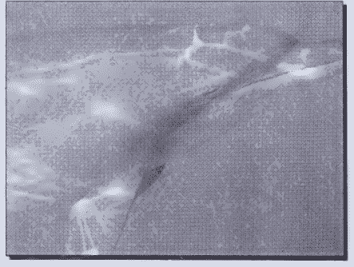

## 行动时间 – 搜索相关音效

我们有两张数码照片，想要为它们添加相关音效。我们将前往 **The Freesound Project** 网站（http://www.freesound.org/）搜索 MP3 文件，用作场景的音效：

- 1. 打开默认网页浏览器并访问 `http://www.freesound.org`。此网页允许我们搜索和下载音效文件。需要在该网站注册后才能下载文件。注册和访问内容均免费。

> The Freesound Project 网站提供具有 Creative Commons 许可的高质量音效。网站提供数千个采样。然而，它不提供歌曲。

- 2. 在 **Search/Browse** 下点击 **Search**。
- 3. 激活 **Filenames** 复选框。这样，网站也会搜索其音效文件数据库的文件名。
- 4. 在文本框中输入 `sea mp3` 然后点击 **Submit** 按钮。结果将显示许多音效文件的详细信息。你可以点击每个音效文件名称左侧的 **Play** 按钮预览录制的声音，如下一张截图所示：

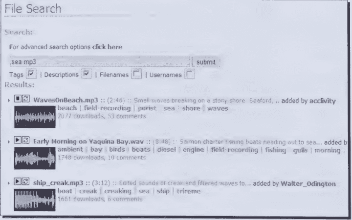

- 5. 点击所选文件名（`WavesOnBeach.mp3`）或其波形图。将会出现一个包含更详细信息的新页面（`http://www.freesound.org/samplesViewSingle.php?id=14777`），如下一张截图所示：

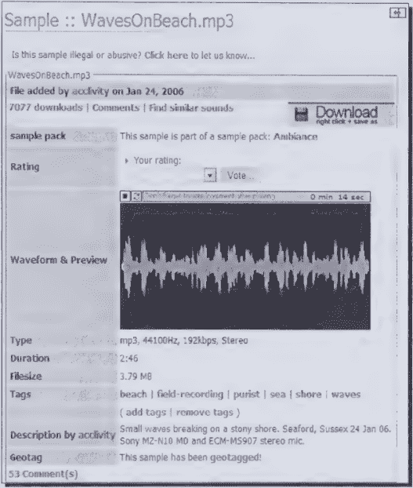

- 6. 检查所选文件的许可信息。
- 7. 右键点击位于右上角的 **Download** 标签，并在出现的上下文菜单中选择 **Save target as**。将文件保存为 `sound030102.mp3` 到之前创建的文件夹 `C:\Beach` 中。由于该音效与照片名为 `image030102.jpg` 所代表的海相关，我们使用相同名称并更改扩展名（`.mp3` 而非 `.jpg`）。
- 8. 接下来，返回网页浏览器并重复上述步骤（2 至 7）以查找并下载与海豚相关的 MP3 格式音效。在此情况下，重复上述步骤搜索 `dolphin mp3` 并将音效文件保存为 `sound030101.mp3` 到同一文件夹中。该网站上找到的一个不错的海豚录音是 `common_dolphins_isla_san_jose_16jan2002.mp3`（`http://www.freesound.org/samplesViewSingle.php?id=52099`）。

## 刚才发生了什么？

我们搜索了两个 MP3 格式的音效文件，因为它很容易整合到 Moodle 练习中。我们现在已准备好以下两个数字化声音，可用于我们的写作句子练习，使用两张图片及其相关音效：

- `sound030101.mp3`：圣何塞岛的海豚
- `sound030102.mp3`：海滩上的波浪

## 行动时间 — 在 Moodle 中激活 MP3 播放器

由于我们将把上述音效文件添加到 Moodle 中的练习中，我们必须确保其多媒体插件已启用。

- 1. 登录你的 Moodle 服务器。
- 2. 在站点管理面板中点击 **Modules | Filters | Manage filters**。
- 3. 如果 **Multimedia Plugins** 过滤器显示为灰色，并在禁用/启用列中显示关闭的眼睛图标，则必须点击该图标将其更改为打开的眼睛图标。这样，Moodle 将启用多媒体插件，如下一张截图所示：

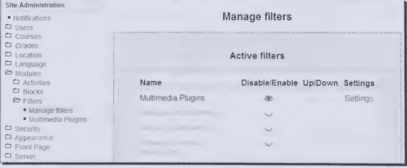

- 4. 如果你做了更改，点击 **Save changes** 按钮。
- 5. 接下来，在站点管理面板中点击 **Modules | Filters | Multimedia Plugins**。
- 6. 确保 **Enable .mp3 filter** 复选框已激活。如果未激活，请激活它然后点击 **Save changes** 按钮。
- 13. 按 Enter 并点击插入图像按钮（根据 Moodle 版本显示山或树）。将出现一个新网页，显示标题 Insert Image。
- 14. 按照必要步骤上传之前创建的文件夹 chapter03 中的文件 image030101.png。记得输入替代文本，图像将出现在之前输入的标题下方。
- 15. 请记住，你可以点击放大编辑器按钮以查看所有说明。重复上述步骤（9 至 14）以添加第二个音效文件 sound030102 及其相关图像 image030102.jpg。请注意，无需再次创建 chapter03 文件夹。
- 16. 在线文本作业将显示标题和两个 Listen to its sound 副标题及其相关照片，如下一张截图所示：

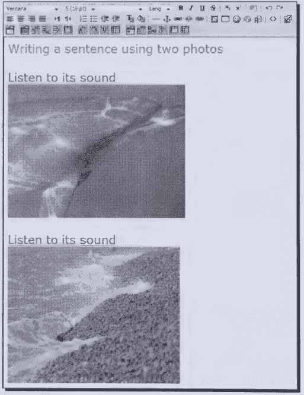

- 17. 最后，向下滚动并选择 Save and return to course。

- 4. 选择 Verdana 字体和 5（18）大小。
- 5. 写一句句子，The dolphin is swimming in the sea. 如下一张截图所示：

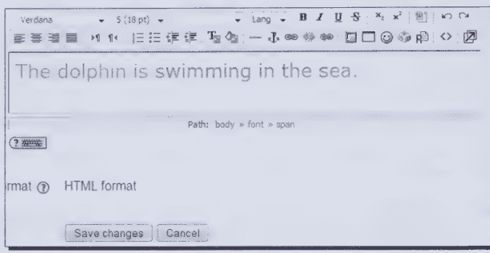

- 6. 点击 **Save changes** 按钮。这样，Moodle 将保存此练习的结果。
- 7. 不要忘记检查此练习的结果，如之前所学。

## 刚才发生了什么？

在此活动中，我们使用了真实的图像和声音。我们在此练习中的目标是让孩子收听音频、观看图像，然后找到它们之间的关系。孩子可以独自完成，或在治疗师或家庭成员的帮助下完成，以便他/她理解并运行练习。

该活动包括根据照片及其相关音效写一个简单句子。我们应用了以下概念和资源：

- **视觉和听觉感知资源。** 我们使用声音简化了活动的执行。声音资源提供了额外的信息来源，以便简化识别每个元素或场景。
- **照片。** 它们提供了真实场景的完美再现。孩子必须根据这些照片写一个句子。
- **关联图像。** 孩子必须关联两张图像以找到它们之间的关系并考虑其相关声音。在此情况下，海是动物的自然环境。
- **简单写作和构图技能。** 孩子必须处理语言结构、顺序和连贯性。
- **动机。** 真实的音效录音和照片通常会增加孩子对该活动的兴趣。

我们可以通过使用更多图像和一个声音来增加此练习的复杂性。我们也可以使用包含许多不同大小元素的复杂照片。每张图片中的主要角色可以是较大的那个。

## 在图像中带结构地放置文字

太好了！又一个假期日！

爱丽丝喜欢海滩。那是她最喜欢的玩乐场所，但她担心玩太多海滩会忘记在学校学到的东西。因此，她有一个想法。她请母亲帮助她写下她周围发现的一切。她有很多东西要写，因为海滩上人很多：有些人在晒太阳，其他人在海里游泳；还有孩子们在建造沙堡和玩球。

我们也能帮助她吗？

## 行动时间 – 创建场景

我们将使用背景图片创建一个场景，然后在其中添加其他剪贴画以代表每个词。

- 1. **启动 Inkscape** 并最小化它。你稍后会用到它。
- 2. **启动 Word 2007。** 你将在一个新空白文档中工作。

在此情况下，我们将使用 Word 2007 搜索剪贴画。然而，你也可以使用其他剪贴画库创建场景。我们还将在其他视觉丰富的练习中使用提供高质量剪贴画的其他应用程序。

- 3. 点击 **Insert | Clip Art.** 剪贴画面板将出现在主窗口右侧。
- 4. 点击组合框中的 **Search** 并激活 **Everywhere** 复选框。这样，Word 将在所有可用集合中搜索剪贴画，包括网络集合。

5. 点击**搜索文本框**并输入 `Beach`。
6. 点击**转到**按钮。
7. 将鼠标指针悬停在所需剪贴画的缩略图上。由于你想使用 Inkscape 在不损失质量的情况下更改图片大小，请务必确保它是一个 **WMF** 或 **EMF** 文件。
8. 右键单击所需剪贴画的缩略图，并在出现的上下文菜单中选择**预览/属性**。Word 将显示一个新的对话框，其中会显示可缩放剪贴画的更大预览以及一个临时文件名。
9. 三击**文件**后面显示的长路径和文件名。这样，你可以确保临时文件的完整路径已被选中。然后，右键单击它，并在出现的上下文菜单中选择**复制**。
10. 现在，激活 Inkscape——记住它当时是以最小化状态运行的。你可以使用 **Alt + Tab** 或 **Windows + Tab**。不要关闭剪贴画的预览窗口。
11. 从主菜单中选择**文件 | 导入**。点击**键入文件名**按钮（带纸张图标的铅笔），然后将之前复制的临时文件的完整路径粘贴到**位置：**文本框中。该路径类似于 `C:\Users\vanesa\AppData\Local\Microsoft\Windows\Temporary Internet Files\Content.IE5\WL240QUN\MCj04354940000[1].wmf`。
12. 点击**打开**按钮。之前预览过的剪贴画（即我们场景的背景）将出现在 Inkscape 的绘图区域中，如下图所示：

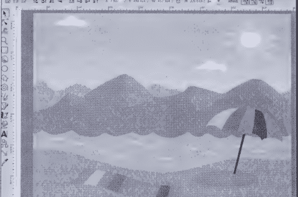

13. 返回 Word 2007，并关闭**预览/属性**对话框。

14. 对于每个要添加到之前显示的海滩背景图片中的矢量图形，重复上述步骤（6 到 13）。下一张图显示了三个可能的图片：

    - 一个水桶和一把铲子
    - 一个沙滩球
    - 一座沙堡

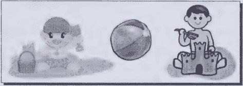

15. 点击最近添加的图片之一以将其选中。选区周围会出现一个带有八个双向箭头的矩形。拖放其中一个对角线双向箭头，在水平（X）和垂直（Y）方向上缩放图形。你可以按住 **Ctrl** 键来保持原始纵横比。然后，将图片拖放到海滩背景中的适当位置。

16. 对其余两张图片重复上述步骤，以创建如下图所示场景：

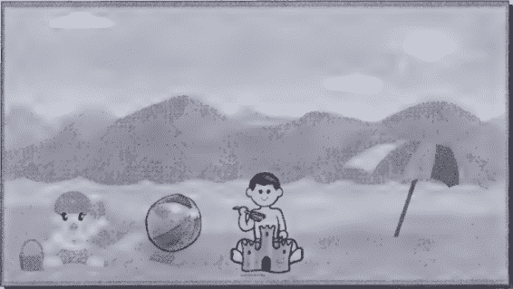

17. 从 Inkscape 的主菜单中选择**文件 | 保存**。将文件保存为 `image030201.svg`，存入之前创建的文件夹 `C:\Beach` 中。

6. **选择文件 | 导出位图。** 将出现一个显示许多导出选项的对话框。在第一个 dpi（每英寸点数）文本框中输入 72。

7. 点击**绘图**按钮，然后点击**导出**。Inkscape 将以 PNG 格式导出图形。导出的包含海滩场景和底部文字的位图图形将保存到 `C:\Beach\image030201.png`。

### 刚才发生了什么？

我们使用 Inkscape 和可缩放矢量剪贴画呈现了一个海滩场景。我们首先添加了背景图片，然后使用矢量图形添加了与特定单词相关的不同元素。我们可以无损失地改变它们的大小，并且可以将它们放在现有背景之上。

我们为场景中表示元素的每个单词添加了文本标签。最后，我们将生成的图像导出为 PNG 格式。

## 动手实践——将场景上传到 Moodle

我们现在必须上传原始 SVG 文件及其位图表示，以便将练习添加到现有的 Moodle 课程中。

1. 登录你的 Moodle 服务器。

2. 点击所需的课程名称（Beach）。你可以创建新课程或使用现有课程。

3. 按照之前学到的步骤，编辑所需周的摘要。在**摘要**文本框中输入**练习 2**，然后保存更改。

4. 点击所选周的**添加一个活动**组合框，然后选择**上传单个文件**。

5. 在**作业名称**中输入“拖放单词”。

6. 在字体中选择 Verdana，在字号中选择 5（18）——这是**描述**下方的两个组合框。接下来，为文本选择你想要的颜色。

7. 点击**描述**下方的大文本框，输入“将单词放入具有结构的图像中”。这是学生完成此练习的目标描述。

8. 按回车键，点击**插入图像**按钮（根据 Moodle 版本的不同，图标可能是一座山或一棵树）。将出现一个新网页，显示标题**插入图像**。

9. 点击 `chapter03` 文件夹链接，然后点击**浏览**按钮。浏览到存放导出图形的文件夹，选择要上传的文件 `image030201.png`。然后点击**打开**和**上传**按钮。**文件上传成功**标签将出现在**文件浏览器**框中。

10. 接下来，点击最近上传的文件名 `image030201.png`。图像将出现在**预览**框中。

11. 在**替代文本**中输入 `image`，然后点击**确定**。图像将出现在之前输入的标题下方。请记住，你可以点击**放大编辑器**按钮以在屏幕上查看更多信息。

12. 按 *Enter*，点击**有序列表**按钮（即显示 1、2、3 的列表图标）。

13. 写下完成练习的详细步骤。

    - 使用 Inkscape 打开此 picture
    - 拖放每个单词以匹配图片中对应的元素
    - 保存并上传新图片

14. 接下来，选中描述第一步的句子中写着的 `picture` 单词。

15. 点击**插入 Web 链接**按钮（一个链环图标）。将出现一个新网页，显示标题**插入链接**。

16. 点击**浏览**按钮，然后点击 `chapter03` 文件夹链接。

17. 点击出现的新**浏览**按钮。浏览到存放之前创建的 Inkscape 场景图形（`C:\Beach`）的文件夹，选择要上传的文件 `image030201.svg`。接下来，依次点击**打开**、**上传**以及文件名链接，如下图所示：

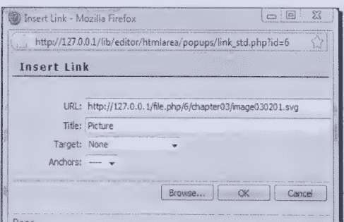

18. Moodle 将在**URL**文本框中显示此 Inkscape 文件的 URL。在标题文本框中输入“picture”，然后点击确定。这样，学生就可以通过单击带有超链接的“picture”一词下载 Inkscape 图形，如下图所示：

    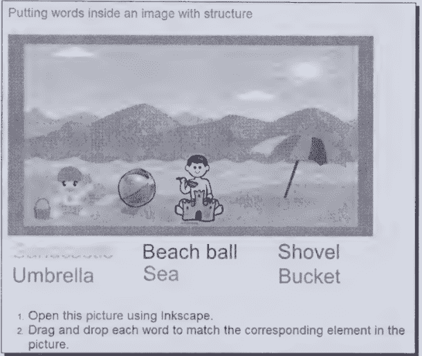

    1. 使用 Inkscape 打开此 picture。
    2. 将每个单词拖放到与图片中对应元素匹配的位置。

19. 在**成绩**组合框中选择 100。

20. 在**最大大小**中选择 10MB。这是每个学生作为本活动结果可以上传的文件的最大大小。然而，与你的 Moodle 管理员确认你的 Moodle 服务器所提供的可能性非常重要。

21. 最后，向下滚动并选择**保存并返回课程**。

### 刚才发生了什么？

我们将“将单词放入具有结构的图像中”练习添加到了 Moodle 课程。学生们现在将能够按照“上传单个文件”作业中说明的步骤，下载 Inkscape 图形以拖放单词。

我们定义了指向 Inkscape 图形的超链接，因为学生将使用它把每个单词拖放到场景的相应区域。

“上传单个文件”作业使我们能够描述完成活动所需的步骤，并且它将使学生能够以 Inkscape 图形的形式上传他们的结果。

> 在本例中，为了简化示例，完成活动所需的步骤只有几句话。然而，有时当需要与其他应用程序（如 Inkscape）一起工作时，有必要编写更多的说明。

## 动手实践——使用上网本的触摸板运行练习

1. 点击课程名称（Beach）并将你的角色切换为学生。

2. 点击相应周次中的“拖放单词”链接。Web 浏览器将显示场景的位图图像以及带有指向 Inkscape 图形超链接的说明。“picture”一词将以蓝色和下划线显示，表示它是一个超链接。

3. 右键单击带有超链接的“picture”一词，并在出现的上下文菜单中选择**链接另存为**。将该文件保存在你的文档文件夹中，文件名另存为 `mybeach.svg`。

4. 点击**开始或编辑我的日志条目**按钮。Moodle 将显示一个带有 HTML 编辑器的大文本区域。

5. 启动 Inkscape，打开之前保存的文件 `mybeach.svg`。

6. 将图像下方的每个单词拖放到场景中对应的区域或元素上。你可以用手指移动鼠标指针到所需的单词上，然后按下触控板左键，用手指拖动该单词而不松开按键。当单词位于场景中所需的区域或元素上时，松开按键即可。这样，你可以在完成练习的同时用手指操作，如下图所示：

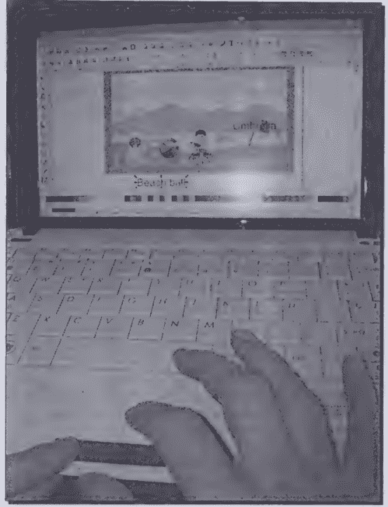

- 7. 完成每个单词的拖放后，选择“文件 | 导出位图”。将出现一个显示多种导出选项的对话框。
- 8. 点击“绘图”按钮，然后点击“导出”。Inkscape 会将绘图导出为 PNG 格式。导出的图形将是文档文件夹中的 `mybeach.png`。
- 9. 返回 Web 浏览器，点击“浏览”。浏览到保存导出图形的文件夹，选择要上传的文件 `mybeach.png`，然后点击“打开”。

## 将图像与单词关联

- 10. 之前导出的 PNG 格式图形现在将显示在说明下方，名称为 **mybeach.png**。您可以点击链接下载此图像，其中单词已拖放到场景中的相应元素上。下一张图片显示了已完成练习的示例。

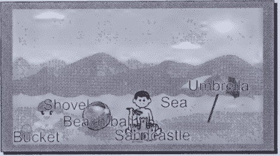

- 11. 别忘了按照之前学到的方法检查此练习的结果。

### 刚才发生了什么？

在此活动中，我们创建了一幅代表海滩场景的绘图。我们要求孩子使用上网本及其触摸板，将场景下方的每个单词拖放到相应的元素或区域上。

此活动包括观察场景、阅读单词、理解单词及其与场景元素的关系。然后，孩子可以使用任何能够拖放元素的指点设备开始拖放每个单词。我们应用了以下概念和资源：

- **将图像与单词关联及可逆性。** 孩子必须将图像与单词关联起来。这样，练习可以增强逆向思维训练。
- **阅读理解。** 孩子必须阅读并理解与现有场景相关的简单单词。
- **由多个图层组成的图像。** 背景场景、元素和单词组成了复杂场景的多层结构。孩子在解决练习时可以将自己代入情境，并发挥想象力。

> 我们可以通过添加更多单词和元素来增加此练习的复杂度。这种视觉丰富的活动对于提高孩子的词汇量非常有用。

也可以使用经典鼠标、游戏手柄摇杆或操纵杆来运行此活动。使用不同的硬件设备可以增加或降低复杂度，并有助于处理各种类型的问题。最合适的硬件取决于孩子的残障情况。

上网本及其触摸板等新硬件通常会给孩子带来额外的动力。

### 动手实践 – 将图片拖放到场景中

您可以增加先前活动的复杂度，让孩子练习模式识别和匹配。不用单词，而是添加与场景中元素相似的图片。但是，新图片应略有不同。例如，您可以添加一把颜色不同的雨伞。

按照之前讲解的单词布局，在场景底部以行和列的形式排列新图片。

现在，孩子可以识别模式，将每个元素拖放到场景中与其相似的元素上，并完成新练习。

> 您可以使用不同技能水平创建不同场景，并利用我们目前学到的工具组合多种活动。

### 快速测验 – 发现新工具和新活动

- 1. 要在 Moodle 中嵌入 MP3 声音文件，您可以：
  - a. 上传文件并插入指向它的 Web 链接
  - b. 将其复制到 Moodle 服务器上的声音共享文件夹中
  - c. 上传文件并点击**嵌入声音**按钮
- 2. 为了能够在 Moodle 中播放嵌入的 MP3 文件：
  - a. 您必须在练习中安装多媒体插件
  - b. 您必须确保其多媒体插件已启用
  - c. 您必须确保在 Moodle 的多媒体控制面板中激活了 MP3 编解码器复选框
- 3. “上传单个文件”作业：
  - a. 不允许学生上传文件
  - b. 既不允许学生上传文件，也不允许其输入文本
  - c. 允许学生上传文件
- 4. 上网本的触摸板提供的功能类似于：
  - a. 键盘
  - b. 网络摄像头
  - c. 鼠标
- 5. 要在 Moodle 中上传并添加文件链接，您可以：
  - a. 选择要包含超链接的文本，然后点击**插入 Web 链接**按钮（链形图标）
  - b. 不选择任何文本，直接点击**插入 Web 链接**按钮（链形图标）
  - c. 点击 Moodle 控制面板中的超链接管理器

### 总结

在本章中，我们学习了如何：

- 创建许多视觉丰富的活动，结合图像、声音、场景、图层、元素、单词和图片
- 利用 Moodle 集成的多媒体插件添加与图像相关的 MP3 声音文件
- 使用许多提供图像和声音的网页、作业以及 Inkscape，在 Moodle 中创建有吸引力的练习
- 使用 Moodle 生成的超链接添加声音和文件链接，学生可以下载这些文件来解决问题
- 使用 Inkscape 和上网本的触摸板，让有特殊教育需求的孩子能够用手指在小屏幕上拖放场景中的单词

现在我们已经学习了如何将图像与单词关联，我们准备制作练习来开展混合单词和图片的排序活动，这是下一章的主题。
