## 对时间顺序进行排序

爱丽丝喜欢和妈妈一起去超市，因为妈妈通常会给她买一些小礼物——饼干、糖果等。这次，她需要画几幅关于她周末活动的画作为学校作业。再次去超市是一个绝佳的机会，让她可以观察许多情景，并从中获得绘画灵感。

### 动手操作 – 获取三张图片来代表一个时间序列

我们将搜索与在超市购物相关的现有 2D 剪贴画。然后，我们将使用截图工具应用程序捕获屏幕元素快照，将它们转换为 2D 位图图像。

- 1. 在 Windows 资源管理器中新建一个文件夹（`C:\Supermarket`）。
- 2. 打开默认的 Web 浏览器，访问 http://office.microsoft.com/en-us/clipart/default.aspx。此网页允许我们在 **Office Online 剪贴画和多媒体** 中搜索免费剪贴画。
- 3. 在文本框中输入“grocery stores”（杂货店），然后点击**搜索**按钮。与输入的关键词相关的可用剪贴画缩略图将出现。
- 4. 在 **按类型筛选** 中选择“剪贴画”。这样，搜索结果将被过滤，只显示矢量图形。
- 5. 点击所需剪贴画缩略图下方的缩放图标。将出现一个新窗口，显示剪贴画的小预览。
- 6. 点击**放大预览**，此标签将变为**缩小预览**。我们希望使用大预览来截取剪贴画的快照，并保持相同的大小。
- 7. 启动截图工具（开始菜单 | 所有程序 | 附件 | 截图工具），并按照之前学到的方法捕获剪贴画预览。将文件以便携式网络图形（PNG）格式保存为 `image040101.png`，放在之前创建的文件夹 `C:\Supermarket` 中。这样，我们就有了序列的第一张图片——一位女士在杂货店挑选商品，如下图所示：

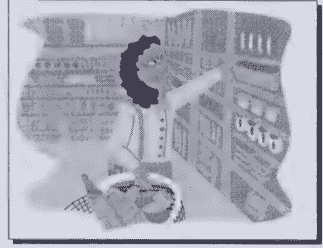

- 8. 返回 Web 浏览器，重复上述步骤（3 至 7）捕获另一张剪贴画图像的位图。这次，重复这些步骤，搜索 `cashier`（收银员），并将捕获的图像文件保存为同一文件夹中的 `image040102.png`。这样，我们就有了序列的第二张图片——收银员在结账，如下图所示：

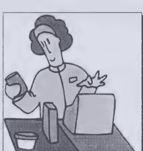

- 9. 返回 Web 浏览器，重复上述步骤（3 至 7）捕获第三张剪贴画图像的位图。这次，重复这些步骤，搜索 `grocery shopping`（杂货购物），并将捕获的图像文件保存为同一文件夹中的 `image040103.png`。这样，我们就有了序列的第三张图片——汽车后备箱里的物品，如下图所示：

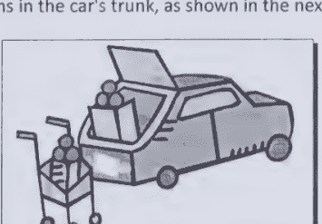


# 刚才发生了什么？

我们通过网络浏览器在 Office Online 剪贴画和媒体中搜索了剪贴画预览。随后，我们使用了众所周知的截图工具（Snipping Tool）应用，捕获屏幕上显示所需剪贴画预览的部分。这样，只需几个简单步骤，我们就能以 PNG 格式保存三张图像。

现在，我们获得了以下三幅位图图像，它们分别代表在超市购物时的三种不同情境，可用于我们的“排序时间序列”练习：

- image040101：一位女士在杂货店挑选商品
- image040102：收银员为商品结账
- image040103：一辆购物车和汽车后备箱中的物品

## 操作步骤——使用图像创建混合时间序列

- 1. 是时候整理用于混合时间序列的图像了。
- 2. 启动 Hot Potatoes 并点击 JMix。将出现一个包含 JMix 应用的新窗口。
- 3. 在“标题”文本框中输入“排序时间序列”。
- 4. 从 JMix 的主菜单中选择“文件 | 保存”。将文件保存为 `jmix0401.jmx`，放在之前创建的文件夹 C:\Supermarket 中。
- 5. 点击“主句”下方的大文本框。
- 6. 从 JMix 的主菜单中选择“插入 | 图片 | 来自本地文件的图片”。在 C:\Supermarket 中选择之前保存的位图图像 image040101.png，点击“打开”按钮，然后点击“确定”。JMix 将使用默认选项插入图像。
- 7. 按回车键，重复上述步骤，插入之前在 C:\Supermarket 中保存的位图图像 image040102.png。
- 8. 再次按回车键，重复上述步骤，插入之前在 C:\Supermarket 中保存的位图图像 image040103.png。JMix 将在文本框中显示以下 HTML 代码，如下一个截图所示：

```
</img>
</img>
</img>
```

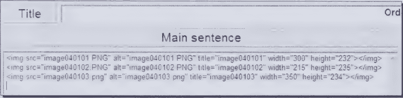

- 9. 选择“文件 | 创建网页 | 拖放格式”。JMix 将创建一个新网页。将新文件保存为 `jmix0401.htm`，放在上述文件夹中。将出现一个新的对话框。点击**在浏览器中查看练习**。

- 10. 默认 Web 浏览器将出现，显示组成序列的三张图像。它们将以随机顺序杂乱出现，如下一个截图所示：

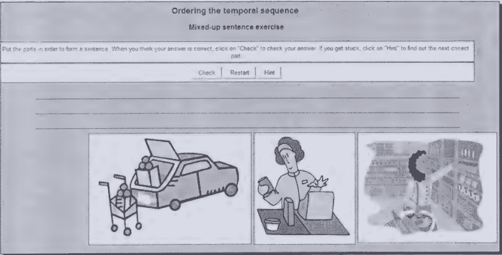

- 11. 返回 JMix。从主菜单中选择“文件 | 创建 ZIP 包 | 创建拖放 ZIP 包”，并为新的 ZIP 文件输入名称 `jmix0401.zip`。JMix 将创建一个 ZIP 文件，其中包含上传到 Moodle 以运行 JMix 练习所需的全部文件。

- 9. 将鼠标指针移到 **jmix0401.zip** 名称上，并水平移动到同一行的 **解压** 操作超链接。接下来，点击 **解压 | 确定**，Moodle 将从此 ZIP 文件中解压所有压缩文件。

- 10. 接下来，将鼠标指针移到 **Jmix0401.htm** 名称上，并水平移动到同一行的 **选择** 操作超链接。然后点击 **选择**，如下一个截图所示：

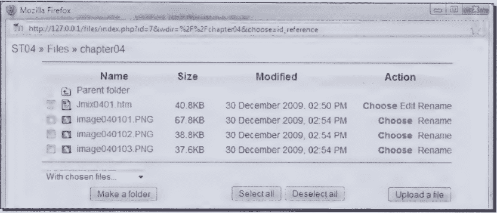

- 11. Moodle 将在 **文件名** 文本框中显示 **chapter04/jmix0401.htm**。这是运行之前使用 JMix 创建的练习的网页。

- 12. 向下滚动并点击网页底部的 **保存并显示** 按钮。Web 浏览器将显示练习，其中包含三张打乱的图片，必须通过拖放它们来准备有序序列。

## 刚才发生了什么？

我们向 Moodle 课程添加了一个丰富的“排序时间序列”练习。现在，学生可以通过点击相应周次中的超链接来运行该活动。

我们创建了一个新文件夹 chapter04。该文件夹将保存与参观超市相关的活动所需的所有文件。

然后，我们上传并解压了一个 ZIP 文件，其中包含之前使用截图工具捕获的三张图像和使用 JMix 创建的 HTML 文件（`jmix0401.htm`）。此 HTML 文件包含指向使用 JMix 插入的三张图像的链接。

## 操作步骤——通过拖放图像来排序序列

现在是时候以学生身份运行该活动，并以教师身份检查结果了。

- 1. 点击课程名称（Supermarket）并将角色切换到学生。
- 2. 点击相应周次上的“排序时间序列”链接。
  Web 浏览器将显示采用拖放格式的练习。
- 3. 将每张图像拖放到相应的位置，以组成逛超市时通常发生的事件的有序序列。您必须将每张图像放到第一行上，从左到右创建有序序列，如下一个截图所示：

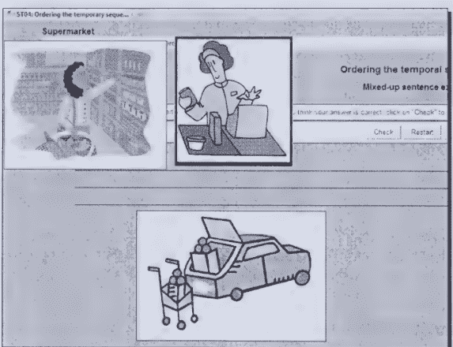

- 4. 将所有图像拖放到相应位置以组成视觉序列后，点击“检查”按钮以测试结果。
- 5. 如果学生的得分是 100%，Moodle 将保存结果并返回课程网页。
- 6. 使用不同的错误序列运行练习，并每次点击“检查”按钮。Moodle 将显示学生排序后的结果序列以及答案中位置正确的部分，如下一个截图所示。此外，它允许您再次运行该活动。但是，它会保存学生每次尝试的结果。

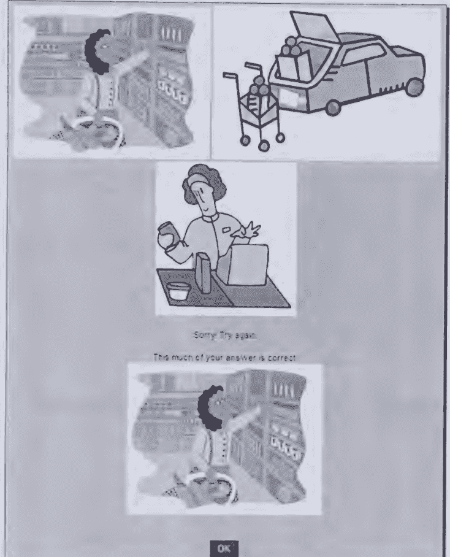

- 7. 您可以返回正常角色，并像处理 Hot Potatoes 测验活动一样检查尝试次数。

> 我们运行了一个 JMix 练习。但是，Moodle 会在“Hot Potatoes 测验”活动下显示其统计信息。

## 刚才发生了什么？

在此活动中，我们处理了一个常见的现实生活序列，即在超市购物。我们用三幅图片来表示不同的情境。孩子必须观察三张打乱的图片，并理解每种情境。

该活动包括根据现有部分组合时间序列。我们应用了以下概念和资源：

- **时间管理能力。** 孩子必须考虑情境发生的时间，对序列进行排序。
- **视觉感知资源。** 图片提供了关于常见现实生活序列不同部分的信息。孩子会很容易将图片与他们的超市之行联系起来。
- **情境关联。** 孩子必须关联三种不同的情境，以找出它们之间的关系，并对它们进行排序，从而构成一个可能的序列。
- **动机。** 该练习具有挑战性，并采用有吸引力的拖放格式。
- **注意力刺激。** 孩子必须专注于理解不同的图片，并将它们排序以构成一个可能的序列。

超市是我们练习的主要场景。大多数孩子通常和家人一起去超市。因此，这个场景提供了一个很好的机会来创建他们非常熟悉的活动——即超市中通常发生的情境。

## 在金字塔中按图片大小排序

爱丽丝和她的妈妈非常高兴，因为她们在超市买了很多好东西。由于爱丽丝的妈妈非常热衷于环保，她使用非常大的可重复使用的超市购物袋，以便将尽可能多的产品放入每个袋子。

这一次，爱丽丝根据产品的大小，从小到大，高效地整理了产品。这样，她们只需三个袋子就能分配好所有产品。

## 操作步骤——构建金字塔

我们首先下载并安装 Edraw Max 5.1。然后，我们将准备一个由三部分组成的金字塔图，用于我们的“按图片大小排序”练习。

- 1. 启动 Word 2007 并将其最小化。稍后您会用到它。


- 2. 如果你还没有，请下载并安装 Edraw Max 5.1 的免费试用版 (http://www.edrawsoft.com/download.php)。

- 3. 启动 Edraw Max 5.1。会出现一个新窗口，图形软件将显示启动页面。

- 4. 在模板类别下点击 Basic diagram，然后在模板下双击 Blank drawing。会出现一个新的绘图区域。

- 5. 点击 Libraries 下方的文本框。输入 pyramid 并点击箭头按钮（Start search）。Edraw 将显示其已安装模板中符合搜索条件词的所有预定义形状，如下一张截图所示：

  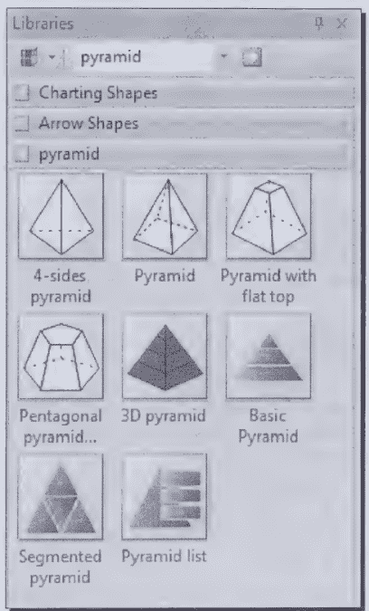

- 6. 点击之前搜索结果中显示的 Basic Pyramid 图标。

- 7. 将 Basic Pyramid 图标拖放到绘图区域。由三部分组成的金字塔形状将出现在绘图区域中，如下一张截图所示：

  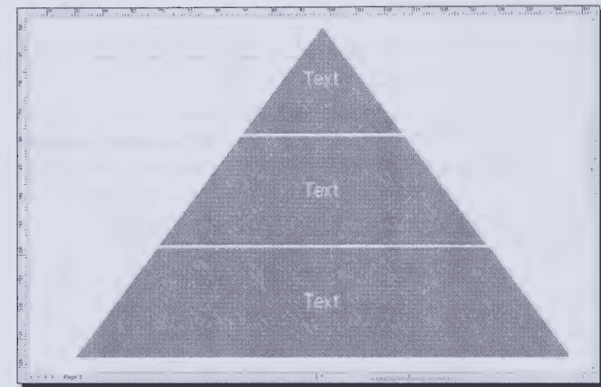

- 8. 双击金字塔的每个部分并删除其默认文本。

- 9. 选择金字塔。点击功能区上的 Shape format | Rotate & Flip | -90。金字塔现在将从左到右绘制。

- 10. 按 F3，Shape format 对话框将出现。点击 Fill | Gradient fill 并选择所需颜色以用线性渐变填充每个部分。你也可以为金字塔的每个部分添加其他效果。

- 11. 点击功能区上的 Shape format | Grouping | Ungroup。金字塔的每个部分现在将成为一个独立的形状。因此，你可以根据需要移动每个部分以将其分开。

- 12. 接下来，激活 Word 2007——记住它处于最小化状态。

- 13. 搜索一个可缩放矢量剪贴画的牛奶瓶图像，如先前练习中解释的那样。

- 14. 右键单击所需剪贴画的缩略图，并在出现的上下文菜单中选择 Preview/Properties。Word 将显示一个新对话框，显示可缩放剪贴画的较大预览和临时文件名。

- 15. 三次单击 File 后显示的长路径和文件名。这样可以确保临时文件的完整路径被选中。然后右键单击它并在出现的上下文菜单中选择 Copy。

- 16. 接下来，激活 Edraw。你可以使用 Alt + Tab 或 Windows + Tab。不要关闭剪贴画的预览窗口。

- 17. 点击功能区上的 Insert | Picture。在文件名文本框中粘贴之前复制的临时文件的完整路径，然后点击 Open 按钮。之前预览的剪贴画将出现在 Edraw 的绘图区域中。

- 18. 调整此图形的大小，使其适合金字塔的第一部分，左侧的三角形。

  > 移动和调整插入图片大小所需的步骤与之前学习在 Inkscape 绘图区域中移动和调整图形大小的步骤相同。

- 19. 通过复制和粘贴来复制此图形。将副本移入金字塔的下一部分，中间的梯形。调整此副本的大小，使其大于第一个副本。

- 20. 通过复制和粘贴来复制此新图形。将副本移入金字塔的下一部分，右侧的最后一个梯形。调整此副本的大小，使其成为最大的一张，如下一张截图所示：

  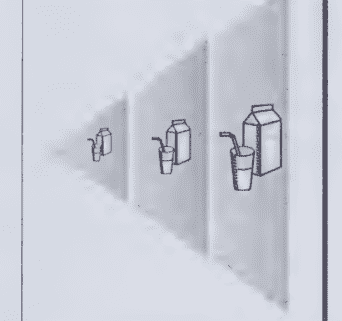

- 21. 点击功能区上的 **View | Gridlines**。这样，**Gridlines** 复选框将被停用，Edraw 绘图区域中的背景灰色虚线将消失。这样你就可以使用白色背景且没有网格线的快照来拍摄金字塔三个不同部分的快照。

- 22. 按照先前练习中学到的相同步骤，使用 Snipping Tool 拍摄金字塔不同部分的快照，并将生成的图像文件以以下表格中显示的名称保存在之前创建的文件夹 C:\Supermarket 中。下一张截图显示了使用 Paint 查看快照的示例图像：

| 金字塔的部分 | 图片文件名 |
| :--- | :--- |
| 左侧（三角形） | image040201.png |
| 中间（梯形） | image040202.png |
| 右侧（梯形） | image040203.png |

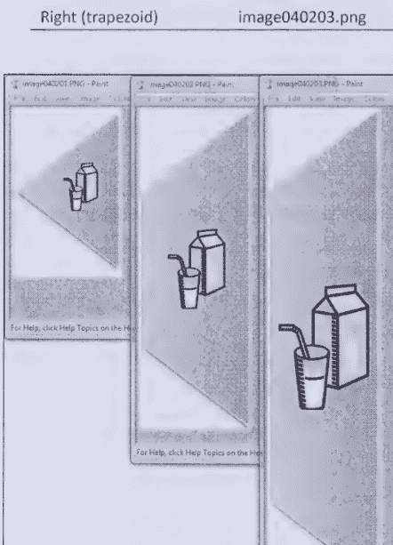

## 发生了什么？

我们安装了 Edraw Max 5.1 的免费试用版。这种多功能的图形软件允许我们使用其广泛的预定义符号和模板创建和编辑专业外观的流程图和图表。免费试用版在将图形导出到其他格式时有一些限制。然而，它对于创建我们的金字塔非常有用。如果你喜欢试用版，你可以购买完整版。

我们将 Edraw 模板中找到的金字塔形状与可缩放剪贴画图像结合起来。我们在 Office Online Clip Art & Media 中搜索了一个矢量资源，并将 Word 创建的临时文件导入 Edraw 的绘图区域。

> 你也可以使用 Inkscape 或任何其他矢量绘图软件构建本练习中使用的类似金字塔。使用 Edraw 的关键优势是可以拖放金字塔形状的现有定义。尽管如此，通过绘制几条线来创建每个部分来绘制金字塔并不困难。

然后我们在金字塔的不同部分以不同大小复制并粘贴剪贴画。最后，我们使用了我们熟知的 Snipping Tool 应用程序来捕获显示金字塔每个部分的三个屏幕区域。这样，我们就可以按照几个简单的步骤保存三种 PNG 格式的图像。

我们现在有了以下三个位图图形，表示从左到右的金字塔的三个部分，准备在我们的按金字塔大小排序图像中使用：

- `image040201`：金字塔的第一部分，图片最小
- `image040202`：金字塔的第二部分，图片较大
- `image040203`：金字塔的第三部分，图片最大

## 行动时间 – 使用图像创建金字塔的混合部分

是时候为我们的练习整理图像了。

- 1. 启动 Hot Potatoes 并点击 JMix。会出现一个新窗口，显示 JMix 应用程序。

- 2. 在 **Title** 文本框中输入 `Ordering the images according to their sizes in the pyramid`。

- 3. 从 JMix 的主菜单中选择 File | Save。将文件保存为 `jmix0402.jmx` 到之前创建的文件夹 `C:\Supermarket`。

- 4. 点击 Main sentence 下方的较大文本框。

- 5. 从 JMix 的主菜单中选择 Insert | Picture | Picture from local file。选择 `C:\Supermarket` 中之前保存的位图图像 `image040201.png` 并点击 Open 按钮。在 Width 文本框中输入 97，然后点击 OK。JMix 将调整高度以保持图像的宽高比，并以新尺寸插入图像。

- 6. 按 Enter 并重复上述步骤以调整大小并插入 `C:\Supermarket` 中之前保存的位图图像 `image040202.png`。

- 7. 再次按 Enter 并重复上述步骤以调整大小并插入 `C:\Supermarket` 中之前保存的位图图像 `image040203.png`。JMix 将在文本框中显示以下 HTML 代码，如下一张截图所示：

  ```
  </img>
  </img>
  </img>
  ```

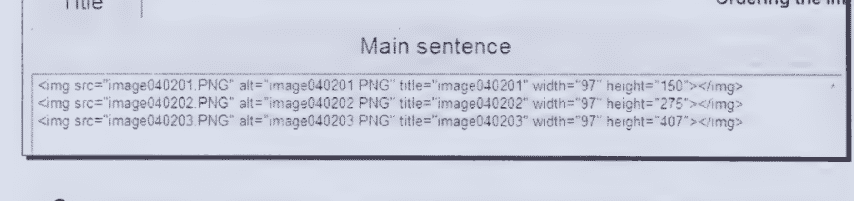

- 8. 选择 File | Create Web Page | Drag/Drop Format。JMix 将创建一个新的网页。将新文件保存为 `jmix0402.htm` 到上述文件夹。会出现一个新对话框。点击 View the exercise in my browser。

- 9. 默认网页浏览器将出现，显示组成金字塔的三个图像。不同大小的同一张图片将出现在金字塔的每个部分内部。它们将以随机位置出现，如下一张截图所示：


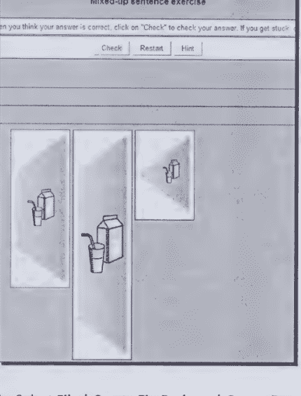

10. 返回 JMix。从主菜单选择“文件 | 创建压缩包 | 创建拖放式压缩包”，并为新的 ZIP 文件输入名称 jmix0402.zip。JMix 将创建一个 ZIP 文件，其中包含上传到 Moodle 以运行该 JMix 练习所需的全部文件。

## 刚才完成的操作

我们插入了三张图片，以构建练习所需的金字塔，同时考虑了金字塔的形状以及金字塔各部分内部图片的尺寸。和上一个练习一样，我们利用 JMix 提供的功能，创建了一个视觉上丰富的乱序图形练习。

我们按照从左到右（自下而上）构建金字塔的顺序，添加了代表金字塔特定部分的每张图片。如前所述，学生每次运行该练习时，JMix 都会以随机生成的顺序打乱这些图片。

## 动手实践——将活动添加到 Moodle 课程中

我们现在需要将“按尺寸对金字塔中的图片进行排序”的活动添加到一个现有的 Moodle 课程中。

- 1. 登录你的 Moodle 服务器。
- 2. 点击所需的课程名称（Supermarket）。你可以创建一个新课程，也可以使用现有课程。
- 3. 按之前学过的步骤，编辑所需星期的课程摘要。在“摘要”文本框中输入 Exercise 2，然后保存更改。
- 4. 点击所选星期的“添加一个活动”组合框，并选择 Hot Potatoes Quiz。
- 5. 将出现一个新的网页，显示标题“添加一个新的 Hot Potatoes Quiz”。点击“选择或上传文件”按钮，会出现我们熟悉的弹出窗口，显示文件和文件夹的信息。
- 6. 点击 chapter04（之前创建的文件夹的链接）。
- 7. 点击“上传文件”按钮，然后点击“浏览”按钮。浏览到存放练习中使用的图像和文件的文件夹（C:\Supermarket），并选择要上传的 ZIP 文件 jmix0402.zip。然后点击“打开”和“上传此文件”按钮。
- 8. 将鼠标指针移到 jmix0402.zip 名称上，水平移动到同一行的“解压”操作链接上。然后点击“解压”，点击“确定”，Moodle 将解压该 ZIP 文件中的所有压缩文件。
- 9. 接着，将鼠标指针移到 jmix0402.htm 名称上，水平移动到同一行的“选择”操作链接上。然后点击“选择”，如以下截图所示：

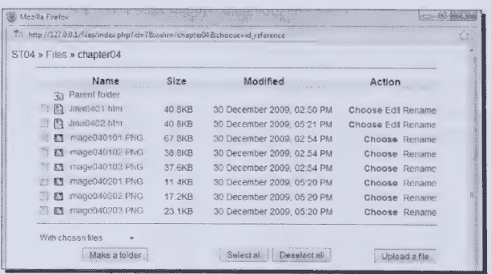

- 10. Moodle 将在 **文件名** 文本框中显示 chapter04/jmix0402.htm。这是运行之前使用 JMix 创建的练习的网页。
- 11. 向下滚动并点击网页底部的 **保存并显示** 按钮。Web 浏览器将显示该练习，其中包含三个打乱的金字塔部分，必须通过拖放操作从左到右构建金字塔。

### 刚才完成的操作

我们将这个内容丰富的搭建金字塔练习添加到了 Moodle 课程中。现在，学生们可以通过点击相应周次中的超链接来运行该活动。

我们使用了之前创建的文件夹 chapter04。我们上传并解压了一个 ZIP 文件，其中包含之前使用截图工具捕获的三张图片（分别代表金字塔的各部分），以及使用 JMix 创建的 HTML 文件（jmix0402.htm），以制作拖放活动。这个 HTML 文件通过 HTML 代码链接到插入到 JMix 中的三张图片，用于定义 Moodle 将要打乱、学生需要排序的各个元素。

### 动手实践——通过鼠标拖放图片来排列顺序

现在是以学生身份运行活动，并以教师身份检查结果的时候了。

- 1. 点击课程名称（Supermarket），并将你的角色切换为学生。
- 2. 点击相应周次中的 **“按尺寸对金字塔中的图片进行排序”** 链接。Web 浏览器将显示金字塔的三个部分，并让学生通过拖放格式解决练习。
- 3. 将金字塔的每个部分拖放到相应的位置，以从左到右组成金字塔，同时考虑金字塔的形状以及每个部分内部图片的尺寸，如下一张截图所示：

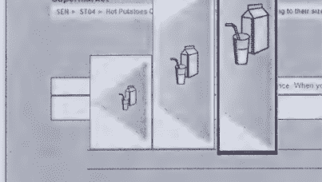

4. 将金字塔的所有部分拖放到相应位置组成金字塔后，点击“检查”按钮来测试结果。

5. 如果学生的得分为 100%，Moodle 将保存结果并返回课程网页。

6. 用不同的错误答案运行练习，并每次点击“检查”按钮。Moodle 将显示学生排出的错误金字塔形状，以及答案中位置正确的部分，如下一张截图所示。此外，它会让你再次运行该活动。但它会保存学生每次尝试的结果。

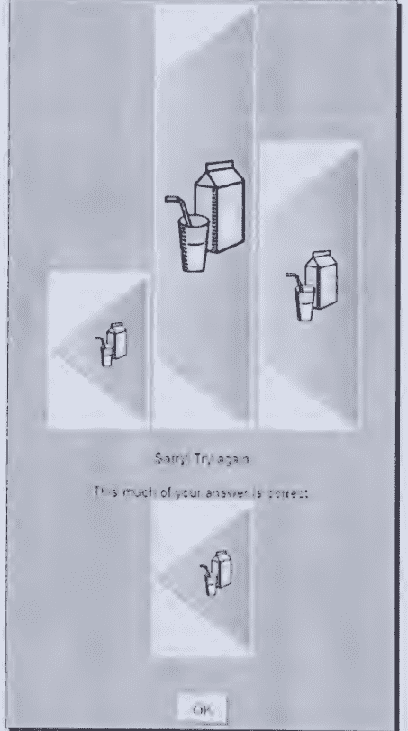

## 动手实践——使用多点触控屏幕执行练习

在多点触控屏幕上执行此练习，也可以使其更具吸引力。

你需要一台兼容 Moodle Web 浏览器要求的多点触控屏幕设备，才能完成此活动。

- 1. 点击课程名称（Supermarket），并将你的角色切换为学生。
- 2. 点击相应周次中的 **“按尺寸对金字塔中的图片进行排序”** 链接。Web 浏览器将显示金字塔的三个部分，并让学生通过拖放格式解决练习。
- 3. 将一根手指指向金字塔的每个部分，拖到相应的位置，以从左到右组成金字塔，如下一张图片所示。

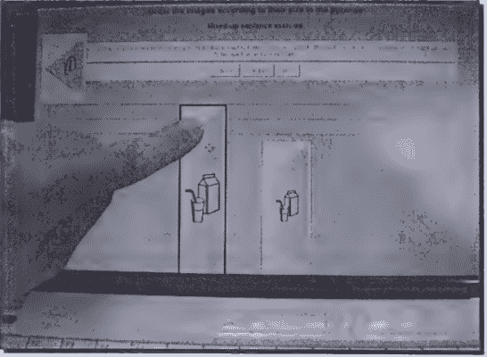

- 4. 拖动完每个部分后，可以通过将手指从屏幕上移开来放下它。
- 5. 使用手指拖放金字塔的所有部分到相应位置组成金字塔后，点击 **检查** 按钮来测试结果。

> 点击（tap）是一种与鼠标单击等效的手势。要进行点击，你必须将手指放在所需元素上，按压屏幕，然后将手指从屏幕上移开。

## 刚才完成的操作

我们利用流行的多点触控屏幕，将手指用作鼠标指针。因此，你可以毫无问题地用手指执行练习。

患有手部运动障碍（manual dyspraxia）的儿童在协调和排序手势、指向和手语等任务所需的动作方面存在困难。因此，使用多点触控屏幕可以帮助他们分步骤协调这些复杂动作。他们可以多次尝试将一根手指指向大图片并放下。由于该练习使用大图片，通过这类活动配合多点触控屏幕更容易改善手势。

> 如今，多点触控屏幕比几年前更普及。因此，它们不那么昂贵，也容易找到。它们对于帮助在使用传统鼠标方面有困难的儿童非常有用。不过，练习必须耐心完成。

## 高手挑战——通过创建更复杂的金字塔来提高技能水平

你可以增加上一个练习的复杂度，让孩子们锻炼模式识别和尺寸概念。

创建一个由五个部分组成的金字塔。在金字塔的每个部分内使用大数字。这样，孩子可以借助数字对金字塔进行排序。

创建一个由七个部分组成的金字塔。在金字塔的每个部分内使用不同尺寸的不同图片。这样，孩子可以借助每张图片的不同尺寸对金字塔进行排序。但是，在这种情况下，练习更复杂，因为所有图片都不同，所以孩子必须更加注意识别尺寸差异。

将序列组合到金字塔的四个部分中。这样，孩子将运用以上两个练习中解释的所有资源。


## 测验 – 开发视觉丰富的排序活动

- 1. JMix 允许你：
  - a. 绘制图片以创建视觉丰富的混合练习。
  - b. 使用 Visual Basic 代码定义句子的每个单词。因此，你可以创建视觉丰富的混合练习。
  - c. 使用 HTML 代码定义句子的每个单词。因此，你可以创建视觉丰富的混合练习。

- 2. 如果学生在 Moodle 中使用错误的解法运行 JMix 练习并点击检查按钮，Moodle 将：
  - a. 显示学生排列出的错误序列以及答案中已在正确位置的部分。
  - b. 显示完整的正确序列。
  - c. 再次显示练习而不提供任何额外提示。

- 3. 为了用乱序图片解决 JMix 拖放练习：
  - a. 学生必须点击每张图片，Moodle 会将其放置在第一行的对应位置，从左到右创建有序序列。
  - b. 学生必须按下每张图片旁边的数字。这样，Moodle 会将其放置在第一行的对应位置，从左到右创建有序序列。
  - c. 学生必须将每张图片拖放至第一行的对应位置，从左到右创建有序序列。

- 4. 多点触控屏幕允许你使用以下方式拖放元素：
  - a. 键盘。
  - b. 你的手指。
  - c. 鼠标。

- 5. 使用 HTML 代码，你可以：
  - a. 仅将 JMix 句子的每个单词定义为纯文本。
  - b. 将 JMix 句子的每个单词定义为图片。
  - c. 仅将 JMix 句子的每个单词定义为图片。

- 6. **轻点是：**
  - a. 手势相当于用鼠标双击。
  - b. 手势相当于用鼠标单击。
  - c. 手势相当于用鼠标丢弃元素。

## 总结

在本章中，我们学习了如何：

- 开发多种视觉丰富的排序活动，结合几何形状、图片和文本
- 利用 JMix 的功能使用 HTML 代码添加可供学生拖放的图片
- 使用多个应用程序创建代表乱序时间序列的图片
- 使用 Edraw 创建结合剪贴画的金字塔并将其拆分为许多不同的图片
- 利用多点触控屏幕允许孩子们用手指拖放元素

现在我们已经学会了使用排序活动，我们就可以为短期和长期记忆提升创建练习，这就是下一章的主题。
