## 5 创建练习以提升短期记忆

> 我们可以用多种创意方式组织信息，并结合动画和精美的特效。可以使用多种不同的应用程序创建练习，挑战学生在短时间内记忆不同种类的视觉元素。这样，我们可以在不同场景下帮助他们提升短期记忆。

在本章中，爱丽丝有很多生日派对。我们将学习如何创建与她的派对相关的丰富活动。通过阅读本章并完成练习，我们将：

- 学习如何创建动画虚拟卡片
- 创建视觉活动以寻找匹配的配对
- 提升短期记忆管理
- 练习音频模式识别和匹配
- 创建带动画的幻灯片并将其转换为视频
- 创建记忆单词、图片或声音的活动

### 寻找匹配的动画配对

大日子终于到来了。今天是爱丽丝的生日！

她的母亲非常忙于组织她的派对。

一切必须在孩子们到来之前准备好，她的母亲想。爱丽丝和她的朋友们放学后就到了，以便一起庆祝、玩乐、吃甜点并吹灭蜡烛。那天他们玩得很开心，直到天空变暗开始下雨。多么伤心！他们不能在花园里玩；因此，爱丽丝有一个想法——为什么不在雨停之前玩一个找匹配配对的游戏呢？多有趣！

### 动手时间 – 生成动画虚拟卡片

我们首先要下载并安装 JClic Author 0.2.0.5。然后我们将搜索动画图形，以便为我们的找匹配配对练习创建虚拟卡片。

- 1. 在 Windows 资源管理器中创建一个新文件夹（C:\Birthday party）。
- 2. 启动 Word 2007 并最小化它。你稍后会用到它。
- 3. 从其网页（http://clic.xtec.cat/en/jclic/download.htm）运行 JClic Author 0.2.0.5，点击 JClic Author 超链接。你也可以通过点击其中一个 Installers 超链接来下载并安装它，而不是从网页运行。

> JClic 需要免费的 Java 运行时环境（也称为 JRE）供教师和学生的电脑使用。你可以从 http://java.sun.com 下载并安装其最新版本。

- 4. 如果你决定下载并运行独立安装程序，你将必须通过点击其图标来启动 JClic Author。
- 5. 第一次运行此应用程序时，它会要求你输入一个用于存储数据文件和程序设置的文件夹名称。默认文件夹是 C:\Program Files\JClic。点击确定或指定不同的文件夹。
- 6. 从 JClic 的主菜单中选择 File | New Project。会出现一个新对话框。输入以下每个文本框的值，如下一张屏幕截图所示，然后点击确定：
  - 在 Project name 中输入 jclic0501。
  - 在 File name 中输入 jclic0501。JClic 将在压缩文件 jclic0501.jclic.zip 中保存完整项目。
  - 在 Folder 中输入之前创建的文件夹中的一个新 jclic0501 子文件夹，C:\Birthday party\jclic0501。

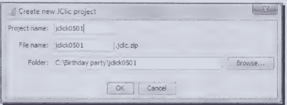

- 7. 点击 Project 选项卡。在 Title 文本框中输入 Finding the matching pairs。
- 8. 在 User interface 下激活 Event sounds 复选框。默认情况下，此选项将在活动期间播放与许多事件相关的声音。
- 9. 接下来，启动 Word 2007。你将在一个新空白文档中工作。
- 10. 点击 Insert | Clip Art。Clip Art 面板将出现在主窗口的右侧。
- 11. 点击 Search in 组合框并激活 Everywhere 复选框。点击 Results should be 组合框并停用所有选项。接下来，在 All media types | Movies 中激活 Animated GIF (*.gif) 复选框，如下一张屏幕截图所示。这样，Word 将在所有可用集合中搜索动画位图文件，包括 Web Collections。

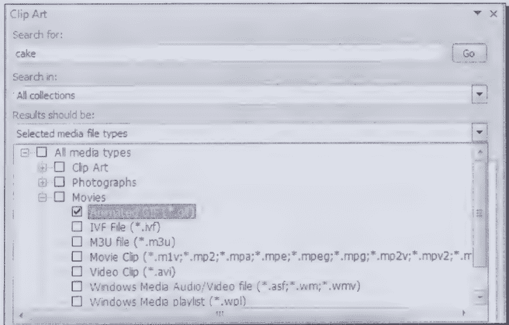

- 19. 返回 Word 2007，并关闭 Preview/Properties 对话框。
- 20. 对要作为游戏虚拟卡片添加的每个动画位图重复上述步骤（9 至 19）。下图显示了搜索以下关键词后得到的两种可能动画的第一帧：
  - Balloons
  - Gift

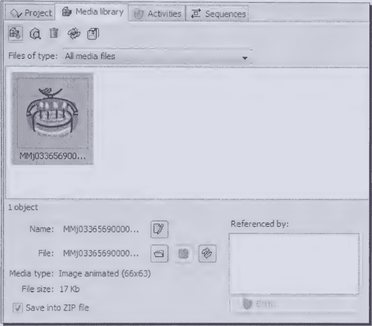
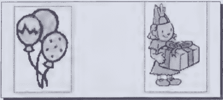

### 刚才发生了什么？

我们运行了 JClic Author 0.2.0.5。此软件允许我们创建多样化的丰富多媒体教育活动。

我们在 **Office Online Clip Art & Media** 中搜索了动画图形，并将 Word 创建的临时文件导入到 JClic 的媒体库中。

我们现在在媒体库中有以下三个动画图形可供用作游戏的虚拟卡片：

- 一个生日蛋糕
- 气球
- 一个礼物

> 这些图形是动画 **Graphics Interchange Format (GIF)** 文件。这种具有无损压缩的位图图像格式通过在单个文件中定义多帧来支持动画。由于 JClic 也支持动画 GIF 文件作为多媒体资源，我们可以使用这些文件在找匹配配对练习的每个虚拟卡片中重现简单的动画。

使用这些动画图形，练习看起来会很漂亮，而且比显示静态图像的虚拟卡片更具吸引力。

> 在这种情况下，我们没有为图片使用命名约定，因为它们是此项目 JClic 媒体库的一部分，并且保存在同一个 ZIP 文件中。因此，不需要将许多不同的文件上传到 Moodle。然而，如果你在同一个项目中开发许多活动，你将改用命名约定重命名多媒体资源。

### 动手时间—组织虚拟卡片

我们现在将把之前添加的多媒体资源关联到一个新的找配对活动。

- 1. 保持在 JClic Author 中。
- 2. 点击 Activities 选项卡并从主菜单中选择 **Insert | New activity**。在 **New activity** 对话框中显示的列表中选择 Finding pairs。在 **Name** of the activity 文本框中输入 `Finding pairs of matching animations` 并点击确定。JClic 将把新活动添加到项目中，并显示带有数十个选项的新选项卡，如下一张屏幕截图所示：

## 创建练习以提高短期记忆

7. 单击位于**图像**标签右侧的按钮。将出现**多媒体对象选择**对话框。单击列表中显示的不同动画图形，并选择显示生日蛋糕动画预览的那个，如下一张截图所示：
   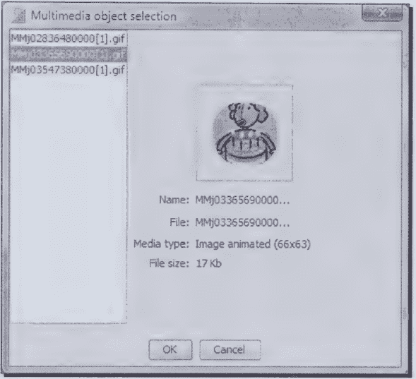
8. 单击**确定**，然后在**单元格内容**对话框中单击**确定**。左上角的单元格将在顶部显示**蛋糕**文本，并在中间显示所选动画位图。
9. 接下来，对另外两个动画位图重复上述步骤（5 到 8），将它们显示在不同的单元格中并带有相应的文本。下一张截图显示了三个带有文本和动画位图的单元格以及一个空单元格。
   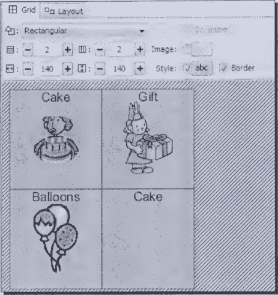
10. 从 JClic 的主菜单中选择**文件 | 保存**。将出现一个对话框，询问您是否要将活动添加到序列中。单击**是**，JClic 将创建一个包含该活动的新序列。
11. 单击**序列**选项卡。在**前进箭头**下的**操作**组合框中选择**退出 JClic**，并激活**自动继续**复选框。这样，活动结束后 JClic 将结束。在**后退箭头**下取消激活**显示**按钮复选框。
12. 从 JClic 的主菜单中选择**文件 | 保存**以保存对项目所做的更改。
13. 接下来，选择**视图 | 预览活动**。JClic 将显示一个新窗口，其中有八个灰色单元格。它们代表八张翻转的虚拟卡片。单元格数量是之前创建的四个单元格的两倍，因为您必须配对（4 x 2 = 8）。每次预览活动时，JClic 都会打乱虚拟卡片并随机顺序显示。
14. 单击其中一个灰色单元格。卡片将翻转，并显示隐藏的动画位图及其对应的文本。请记住将有两个空单元格。
15. 现在您必须单击另一个灰色单元格来翻转虚拟卡片并找到匹配的一对。新卡片将翻转。如果它是先前翻转卡片的配对，它们将保持翻转状态，您可以继续处理其他单元格。如果不是配对，先前翻转的卡片将再次翻转，您必须尝试为新卡片找到配对。下一张截图显示了所有配对均已找到的已完成活动：
   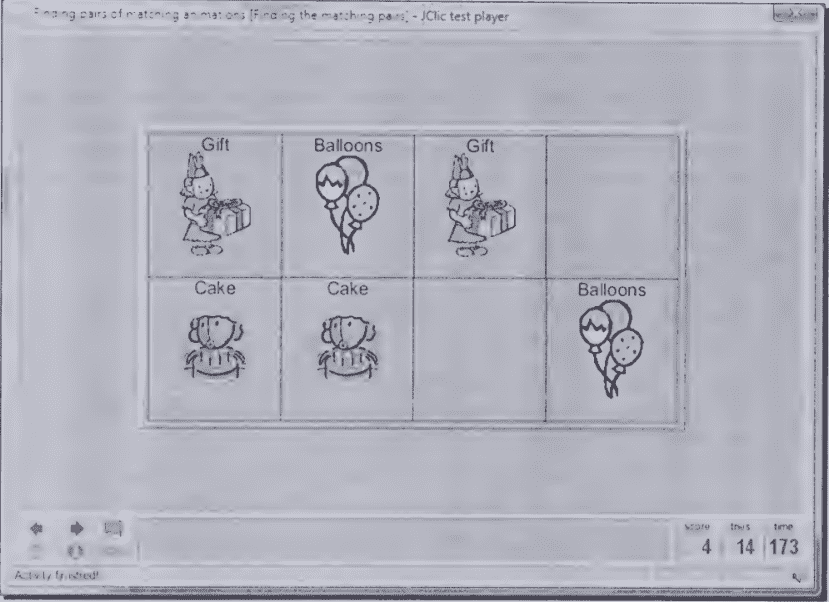

### 刚刚发生了什么？

我们使用 JClic 和之前添加的动画位图创建了一个配对活动。我们利用 JClic 提供的功能为练习创建了视觉丰富的虚拟卡片，混合了文本和动画图形。由于虚拟卡片是动画的，因此比使用静态图片更难以完成练习。

我们添加了文本并将每个动画位图链接到每个单元格。JClic 在预览面板中显示了每张虚拟卡片所做的更改。如前所述，每次学生使用随机生成的顺序运行练习时，JClic 都会打乱虚拟卡片。

### 动手实践 – 安装模块以集成 JClic 和 Moodle

我们现在必须将“找到匹配对”练习添加到现有的 Moodle 课程中。首先，需要安装一个 JClic 模块，以便将 JClic 项目和活动添加到 Moodle 并分析其执行结果。要安装可访问您的 Moodle 服务器的 JClic 活动，必须执行以下步骤。

1. 登录您的 Moodle 服务器。
2. 在站点管理面板中，单击**模块 | 活动 | 管理活动**。如果 JClic 名称未作为活动模块出现，请按照下一步骤操作。如果名称出现，只需确保它显示一个睁开的眼睛图标，不要按照给出的步骤操作，因为该模块已安装在您的 Moodle 服务器中。
3. 打开您的默认 Web 浏览器并转到 `https://projectes.lafarga.cat/projectes/jclicmoodle/downloads/files`。此网页允许我们下载适用于 Moodle 的不同版本的 JClic 模块。
4. 下载适用于 Moodle 的最新版本 JClic 模块。在本例中，我们将使用版本 0.1.0.10，其文件名为 `jclicmoodle-0.1.0.10.zip`。
5. 将下载的压缩文件复制到临时文件夹并解压缩其内容。接下来，复制解压缩 zip 文件内容后产生的 `jclic` 文件夹。
6. 转到您的 Moodle 服务器主文件夹。我们使用 `C:\Moodle` 作为 Moodle 服务器文件夹的示例位置；请将其替换为您的文件夹。
7. 接下来，转到位于 Moodle 服务器主文件夹中的 `server\moodle\mod` 文件夹，在我们的示例中为 `C:\Moodle\server\moodle\mod`。
8. 粘贴之前复制的 `jclic` 文件夹。因此，您将在 mod 子文件夹中看到一个新的 `jclic` 文件夹，在我们的示例中为 `C:\Moodle\server\moodle\mod`。
9. 以**管理员**（Admin 用户）身份登录您的 Moodle 服务器。
10. 在**站点管理**下单击**通知**。
11. Moodle 将在底层数据库中创建所有必要的新表，以满足新模块的要求。完成后，它将显示一条消息，如下一张截图所示。单击**继续**。
    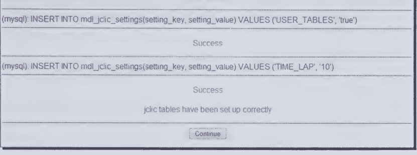
12. 在站点管理面板中，单击模块 | 活动 | 管理活动。您应该会看到 JClic 被列为活动模块之一，如下一张截图所示：
    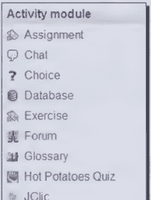

### 刚刚发生了什么？

我们安装了一个模块，使 Moodle 能够添加 JClic 活动并检查这些练习的结果。现在，我们将能够添加之前创建的“找到匹配对”练习以及使用 JClic 创建的许多其他新活动。

> 前面解释的步骤需要一些有关 Moodle 管理过程的知识。*Moodle 管理*由 *亚历克斯·比希纳* 所著，Packt Publishing 出版，深入描述了 Moodle 的配置和自定义。

### 动手实践 – 将活动添加到 Moodle 课程

现在我们已经确定 JClic 模块已安装，可以将之前创建的活动添加到现有的 Moodle 课程中。

1. 登录您的 Moodle 服务器。
2. 单击所需课程名称（`Birthday party`）。您可以创建新课程或使用现有课程。
3. 按照之前学到的知识，按照必要的步骤编辑所需周的摘要。在**摘要**文本框中输入 `Exercise 1` 并保存更改。
4. 单击所选周的**添加活动**组合框，然后选择 JClic。
5. 将出现一个新网页，显示标题“向周添加新的 JClic”。
6. 在**名称**文本框中输入 `Finding the matching pairs`。
7. 在**描述**文本框中输入 `Click on each card and find its matching pair`。为此文本选择所需的字体和颜色。
8. 单击**选择或上传文件**按钮；将出现熟悉的显示文件和文件夹信息的弹出窗口。
9. 按照必要的步骤创建一个新文件夹 `chapter05`，然后单击其超链接。
10. 单击**上传文件**按钮，然后单击**浏览**。浏览到包含 JClic 项目的文件夹（`C:\Birthday party\jclic0501`）并选择要上传的文件 `jclic0501.jclic.zip`。然后依次单击**打开**和**上传此文件**按钮。
11. 接下来，将鼠标指针移动到 `jclic0501.jclic.zip` 名称上，然后水平移动到同一行中的**选择**操作超链接。然后，单击“选择”，如下一张截图所示：
    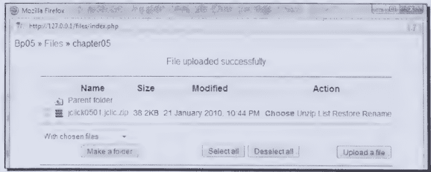

12. Moodle 将在 **File name** 文本框中显示 `chapter05/jclic0501.jclic.zip`。这是包含 JClic 项目及其活动所有文件的 ZIP 文件。

13. 在 **Maximum number of trials** 中选择 1。

14. 向下滚动并点击网页底部的 **Save and return to course** 按钮。

## What just happened?

我们已将动画找配对练习添加到 Moodle 课程中。学生现在可以通过在对应周的超链接点击来运行该活动。

我们创建了一个新的文件夹 `chapter05`。该文件夹将存放与生日派对访问相关的活动所需的所有文件。

然后我们仅上传了一个 ZIP 文件，其中包含许多包含多媒体资源和 JClic 项目及单个活动定义的压缩文件。该文件包含三个动画位图图形；因此，无需单独上传这些文件。

## Time for action – finding the matching pairs by flipping virtual cards

现在是时候以学生身份运行活动并以教师身份检查结果了。

- 1. 点击课程名称（`Birthday party`）并将你的角色切换为学生。
- 2. 点击对应周的 **Finding the matching pairs** 链接。网页浏览器将显示练习。显示活动的 JClic 面板加载可能需要一些时间。

3. 点击其中一个灰色单元格并尝试找到其配对，如下一张截图所示：

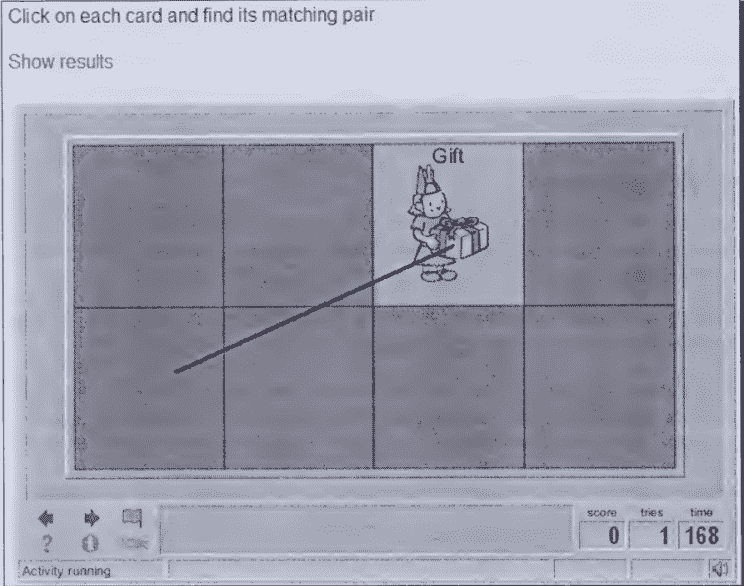

4. 每次配对失败时，JClic 应用程序都会播放表示错误的音效。每次配对成功时，它会播放表示操作成功的音效。

5. 全部配对完成后，活动将结束，你可以通过点击 Show results 来检查你的结果。

6. 你可以返回到正常角色并像之前活动那样检查尝试次数。请记住，它们将以 JClic 活动的分组形式出现。

## What just happened?

在此活动中，我们使用与生日派对相关的典型情况的动画图形创建了虚拟卡片。孩子需要发现每个虚拟卡片中隐藏的动画和文字并找到其配对。

此外，你可以通过在 Cell contents 对话框中点击 Active content 按钮，然后点击 Play sound 并选择之前已添加到 JClic 媒体库的音频文件，来为每个虚拟卡片关联一个音效。

创建一个上一个练习的不同版本，以便让孩子练习音频模式识别和匹配。不要在每个虚拟卡片中添加文字，而是关联在翻转虚拟卡片时播放的音效。这样，孩子就可以记住每个卡片相关的图像和关联音效。

## Working with a list of words organized in rows

Alice 和她的小弟弟 Kevin 想为她母亲的生日准备一个惊喜派对。

他们整个下午一起工作，烹饪和装饰生日蛋糕。如果想让派对变得精彩，还需要一些其他东西。因此 Alice 决定准备一份购物清单，列出缺失的东西。这将是对他们母亲的一个大惊喜，也将是一个难忘的派对。

## Time for action – creating an animation with a list of words

我们首先要创建一个包含许多按不同行组织的单词的动画幻灯片。

- 1. 启动 PowerPoint 2007。你将在一个全新的空白演示文稿中工作。

> Microsoft PowerPoint 2007 是一款商业产品，是 Microsoft Office 2007 的一部分，包含家庭和学生等不同版本。然而，如前所述，试用版提供 60 天的免费完全功能版本。你也可以使用其他工具如 OpenOffice Impress 来创建演示文稿。

- 2. 点击 Home | Layout | Blank 选项卡。这样，幻灯片上的文本块将消失，你将能够使用空白幻灯片进行工作。
- 3. 点击 Insert | WordArt 选项卡。会出现一个包含许多带漂亮效果的字体下拉列表。选择所需的效果和颜色，点击相应的装饰字母 A。幻灯片上会出现一个新的 WordArt 文本块，显示 Your Text Here。
- 4. 选择块中的上述文本并输入以下单词，按 Enter 以为每个单词创建新行：
  - Hat
  - Gift
  - Balloon
  - Confetti
  - Mask

5. 将文本块拖放到幻灯片中央，如下一张截图所示。你也可以通过点击 Format | Align | Align Center，然后点击 Format | Align | Align Middle，在选项卡上实现此目标。

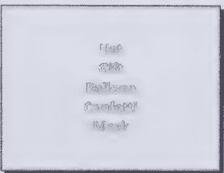

6. 保持文本块被选中并点击选项卡上的 Animations。然后在 Animate 下拉列表中选择 Fade 下的 By 1st Level Paragraphs。点击 Preview 按钮，你将看到动画效果的预览。每个单词将一个接一个地以淡入效果出现。动画结束后，所有单词都将在幻灯片中可见。

7. 接下来，点击 Animations | Custom Animation 选项卡。一个新面板将出现。

8. 在 Custom Animation 面板中点击 Hat 后的展开按钮。面板现在将显示五个单词，如下一张截图所示：

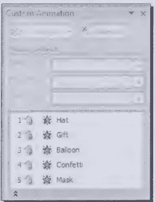

9. 接下来，选择 Custom Animation 面板中列表中显示的五个单词。然后在 Start 中选择 After Previous，在 Speed 中选择 Slow。这样，单词将一个接一个地缓慢淡入。

10. 在幻灯片上点击所选的文本块。

11. 点击 Add Effect | Exit | Blinds。Add Effect 按钮位于 Custom Animation 面板的左上角。

12. Mask 之后将列出一个新的动画。点击 Custom Animation 面板列表底部的展开按钮。面板现在将显示退出动画效果的五个单词，如下一张截图所示：

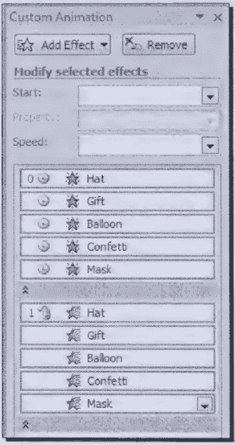

13. 接下来，选择 Custom Animation 面板中退出动画效果列表中显示的五个单词。然后，选择 Start 中的 After Previous，Direction 中的 Horizontal 和 Speed 中的 Slow。这样，单词将一个接一个地缓慢被百叶窗遮挡。

14. 点击 Preview 按钮，你将看到进入和退出动画效果的预览。每个单词将一个接一个地以淡入效果出现。

15. 动画结束后，所有单词都将在幻灯片中可见，然后它们将一个接一个地以百叶窗效果消失，如下序列所示：

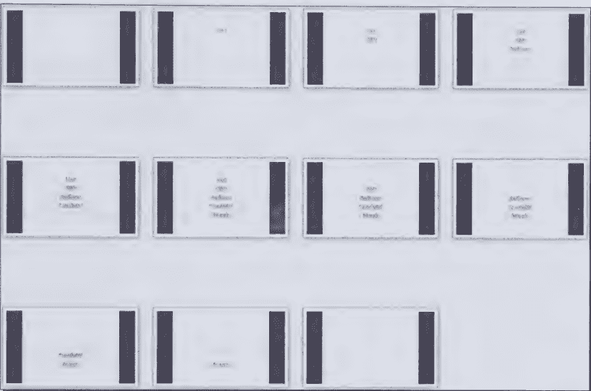

16. 点击窗口左上角的 office 按钮并选择 *Save*。将文件保存为 powerpoint0502.pptx 到之前创建的文件夹 C:\Birthday party。

## What just happened?

我们使用 PowerPoint 创建并预览了一个幻灯片放映，显示按行组织的五个单词列表。幻灯片放映使用淡入效果来动画化每个单词的展示。这样，学生将能够在单词出现时阅读五个单词，然后幻灯片放映应用百叶窗效果来动画化每个单词的消失。

## Time for action – exporting a video with animated words

在网页浏览器中显示 PowerPoint 中创建的带动画的幻灯片放映非常困难。因此，将 PowerPoint 幻灯片放映转换为与 Moodle 默认安装中可用的多媒体插件兼容的视频文件是方便的。

我们首先要下载并安装 Wondershare PPT to Video 6（6.0.3.11）。然后我们将加载之前创建的 PowerPoint 2007 文件到此软件，并将视频导出为 **Flash Video (FLV)** 格式。

- 1. 关闭 PowerPoint 2007。在运行转换过程之前必须关闭它。
- 2. 如果你还没有，下载并安装 Wondershare PPT to Video 6 的免费试用版（http://www.ppt-to-dvd.com/ppt-to-video-overview.html）。
- 3. 启动 Wondershare PPT to Video 6。一个新对话框将显示试用版到期的剩余天数。如果使用试用版，点击 **Evaluate**，一个新窗口将出现，显示两个大按钮。
- 4. 点击 **Convert to Video Files From PowerPoint**。一个新的转换向导将出现，显示将现有 PowerPoint 幻灯片放映转换为视频文件的三个步骤：**Import**、**Settings** 和 **Export**。
- 5. 点击 **+ Add** 按钮。选择 `C:\Birthday Party` 中之前创建的 PowerPoint 幻灯片 `powerpoint0502.pptx` 并点击 **Open** 按钮。幻灯片的缩略图表示将添加到要导入的文件列表中。点击 **Next**。
- 6. 在 **Format** 中选择 **PowerPoint to FLV**，在 **Resolution** 中选择 **640 x 480**，如下一张截图所示。然后点击 **Next**。

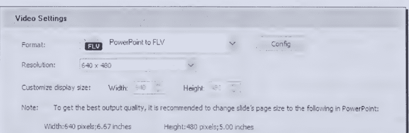

- 7. 选择 `C:\Birthday Party` 作为导出视频的 **Output folder**。然后，点击 **Start**。Wondershare PPT to Video 将执行转换过程，并在之前指定的文件夹中创建一个包含转换日期和时间的子文件夹，以保存新的视频文件。例如，如果转换于 1 月 24 日下午 6:57 完成，新文件将为 `C:\Birthday Party\01-24 18 57\powerpoint0502.FLV`，如下一张截图所示。

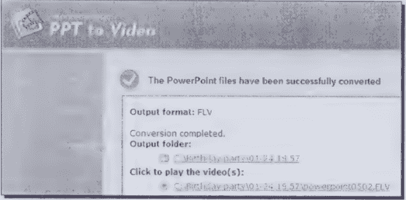

8. 最后，点击**关闭**。

## 刚才发生了什么？

我们安装了 Wondershare PPT to Video 6 的免费试用版。该软件允许我们将 PowerPoint 幻灯片转换为多种视频格式。免费试用版会在导出的视频中添加水印，并且仅限使用 30 天。不过，它对于完成本次练习的视频制作非常有用。如果你喜欢这个试用版，可以购买完整版。

我们将之前创建的 PowerPoint 幻灯片（包括其所有动画和特效）转换成了 Flash 视频（FLV）格式。我们选择这种格式是因为它很容易集成到 Moodle 练习中。

## 动手实践 – 将活动添加到 Moodle 课程中

由于我们要将上述视频文件添加到 Moodle 的练习中，我们必须确保其多媒体插件已启用。我们在前面的章节中已经学习了如何为 MP3 音频文件启用该插件。然后，我们需要上传视频文件，以便将练习添加到现有的 Moodle 课程中。

1. 登录你的 Moodle 服务器。
2. 按照之前学过的步骤，确保多媒体插件已启用。
3. 接下来，在站点管理面板中点击**模块 | 过滤器 | 多媒体插件**。
4. 确保**启用 .flv 过滤器**复选框已激活。如果没有，请激活它，然后点击**保存更改**按钮。
5. 点击所需的课程名称（*生日聚会*）。你可以创建一门新课程，也可以使用现有课程。
6. 按照之前学过的步骤，编辑所需周的摘要。在摘要文本框中输入“练习 2”，然后保存更改。
7. 点击所选周的“添加活动”下拉框，然后选择**在线文本**。
8. 在“作业名称”中输入“处理按行排列的单词列表”。
9. 在字体中选择 Verdana，在字号中选择 5（18）——即“描述”下方的头两个下拉框。
10. 为文本选择你喜欢的颜色。
11. 点击“描述”下方的大文本框，输入“写下你在视频中看到的单词”。这是对学生本次练习目标的描述。
12. 按回车键，然后输入“观看视频”。接着选中这段文本，点击**插入网页链接**按钮（一个链环图标）。将出现一个新网页，显示标题“插入链接”。
13. 点击**浏览**按钮，导航到之前创建的文件夹 chapter05。
14. 点击**浏览**按钮，浏览到存放之前导出的视频文件的文件夹（C:\Birthday Party\01-24 18 57），选择要上传的文件 powerpoint0502.flv。然后依次点击**打开**、**上传**，再点击文件名链接。
15. Moodle 会在 URL 文本框中显示该视频文件的 URL。在标题文本框中输入“观看视频”，然后点击**确定**。
16. 在线文本作业将显示带有超链接的标题和副标题，如下一张截图所示：

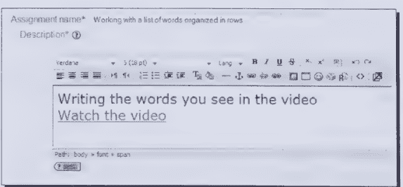

17. 最后，向下滚动并选择**保存并返回课程**。

## 刚才发生了什么？

我们将“处理按行排列的单词列表”练习添加到了 Moodle 课程中。现在，学生可以通过点击对应周次中的超链接，在观看视频后写出他们记住的单词。

我们上传了 Flash 视频（FLV）文件，然后为这个文件添加了一个标题和一个超链接。由于我们已经确保所需的多媒体插件已启用，Moodle 将显示一个媒体播放器，让学生能够在浏览器中观看视频文件。

在线文本作业让我们能够描述最初通过 PowerPoint 幻灯片创建的活动目标。

## 动手实践 – 写出记住的单词

现在，让我们以学生身份运行该活动，并以教师身份检查结果。

1. 点击课程名称（`生日聚会`），然后将你的角色切换为学生。
2. 在对应周次点击**处理按行排列的单词列表**链接。网页浏览器会在副标题的右侧显示一个带媒体播放器的视频。点击视频面板左下角的**播放**按钮。你将能够观看带有动画单词的视频文件，如下一张截图所示：

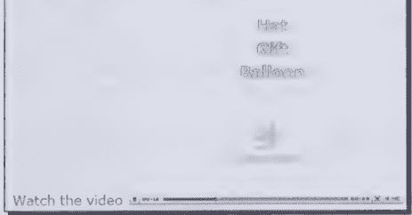

> 由于我们使用的是 Wondershare PPT to Video 6 的试用版，视频中添加了带有软件制造商名称的水印。

3. 观看视频并尝试记住这五个单词。你也可以通过点击音量控制左侧的按钮，以全屏模式观看视频。
4. 点击**编辑我的提交**按钮。Moodle 将显示一个带有 HTML 编辑器的大文本区域。
5. 在字体中选择 Verdana，在字号中选择 5（18）。
6. 写出你记住的单词，如下一张截图所示：

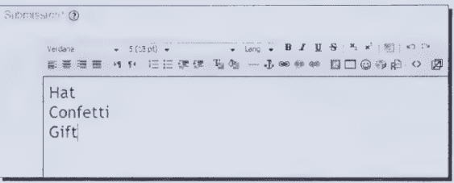

7. 点击**保存更改**按钮。这样，Moodle 将保存本次练习的结果。
8. 别忘了按照之前学过的方法检查本次练习的结果。

## 刚才发生了什么？

在这个活动中，我们使用了一个视频，它按行显示一组单词，并让这些单词出现和消失。目标是让孩子记住所显示的单词，并让他/她写出记住的单词。孩子可以观看视频，在单词出现时进行阅读和记忆，然后在治疗师或家庭成员的帮助下写出记住的单词，从而完成练习。

这项活动包括阅读和书写单词。我们应用了以下概念和资源：

- **短期记忆。** 孩子必须记住视频中出现的单词。然后，他/她需要在没有时间限制的情况下写出记住的单词。因此，孩子会充分锻炼自己的短期记忆。
- **阅读理解。** 孩子必须在短时间内阅读、理解并记住每个单词。
- **动机。** 这项练习具有挑战性，并配有吸引人的动画和特效。由于练习使用的单词与生日聚会相关，通常对孩子很有吸引力。
- **注意力刺激。** 孩子必须尽快集中注意力记住每个单词。由于练习使用动画而不是静态单词，他们需要更加集中注意力，而且练习也更有趣。

对于某些孩子来说，这项练习可能太难完成，尤其是那些在书写方面有困难或阅读理解有问题的孩子。在这些情况下，在治疗师或家庭成员的帮助下进行练习非常重要。

## 自我挑战 – 添加图片并使用网络摄像头录制结果

将上一个练习创建为一个“上传单个文件”作业的不同版本，以便孩子能够使用网络摄像头及其内置麦克风录制结果。这样，他们就不必通过编辑在线文本作业的提交内容来书写单词，而是可以在“上传单个文件”作业中录制并上传他们说出记住单词的语音。

孩子可以使用 Windows 录音机（开始 | 所有程序 | 附件 | 录音机）录制自己的声音，如下一张截图所示：

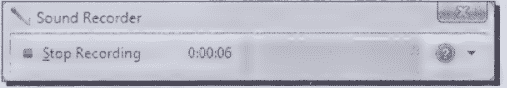

你也可以使用 Audacity，这是一款允许录制和编码声音的免费软件。我们将在第 9 章“编写引导句和段落”中学习使用该软件。

创建另一个使用图片代替单词的版本。你可以像之前对文本块所做的那样，将相同的动画效果应用到 PowerPoint 幻灯片中的图片上。

## 快速测试 – 发现新工具和活动

1. **一个动画 GIF 文件：**
   a. 通过在单个文件中仅定义两帧来支持动画。
   b. 通过在多个文件中定义多帧来支持动画。
   c. 通过在单个文件中定义多帧来支持动画。

2. **JMatch 允许你通过其以下功能将多媒体文件添加到活动中：**
   a. 媒体库。
   b. 剪贴画库。
   c. 多媒体资源管理器。

3. JClic 创作器：
   a. 允许您自定义活动中每个事件相关的声音。
   b. 为活动中的每个事件提供默认声音，您无法更改它们。
   c. 允许您自定义与出错结束的活动相关的声音。您无法自定义与其他事件关联的声音。

4. 一个 JClic 项目文件可以包含：
   a. 只要一个活动。
   b. 许多压缩的活动及其相关的多媒体资源。
   c. 只是一个活动的多媒体资源。活动保存在以 .act 扩展名标识的不同文件中。

5. JClic 需要：
   a. 教师和学生的电脑上都需要免费的 Java 运行时环境（也称为 JRE）。
   b. 教师的电脑上需要免费的 Java 运行时环境（也称为 JRE）。学生的电脑不需要安装 JRE。
   c. 教师和学生的电脑上都需要特殊 HTML 解释器（也称为 SHI）。
