## 运用出色的专注力练习减轻注意力缺陷障碍

我们可以通过处理各种视觉丰富的拼图来减轻注意力缺陷障碍。可以使用许多不同的应用程序来创建练习，帮助学生在短时间内提高专注于实现特定目标的能力。这样，我们就能帮助他们在不同情境下减轻注意力缺陷障碍。

在本章中，爱丽丝参观了水族馆。我们将学习如何创建与她旅程相关的视觉丰富的拼图。通过阅读本章并完成练习，我们将：

- 学习如何基于照片创建拼图的虚拟碎片
- 创建交换拼图
- 使用多点触控设备解决拼图，并提高学生执行练习的兴趣
- 创建视觉和互动活动，在字母网格中查找单词
- 结合视频、声音、照片、字母和单词来改善长期记忆管理

### 解拼图

爱丽丝和她的小弟弟凯文去了水族馆。他们到处看到令人兴奋的鱼。此外，他们还喜欢观看人工湖中色彩绚丽的鸭子。

爱丽丝此次参观最喜欢的事情之一是一只鸭子的羽毛，所以她就这只鸭子拍了一张照片。你想用这张照片来解拼图吗？

#### 动手实践——选择适合拼图的高清图片

我们将在专门的网页上搜索与水族馆相关的免版税高清照片。然后我们将使用其中一张来创建拼图。

1. 在 Windows 资源管理器中创建一个新文件夹（C:\Aquarium）。
2. 打开默认的 Web 浏览器，访问 http://animalphotos.info。这个网页允许我们搜索免版税的高分辨率动物照片。我们需要能在一个水族馆里找到的动物。
3. 在文本框中输入 duck，然后点击 Search 按钮。与输入的关键字相关的可用照片缩略图将出现。上下滚动，然后点击所需的一张鸭子的照片。将出现一个新的网页，显示所选图像的更高分辨率版本，如下图所示：

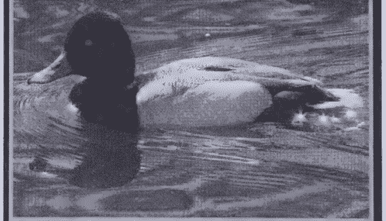

这张具有知识共享许可的图片的原始 URL 是：http://farm3.static.flickr.com/2320/2312123237_d6464e7874.jpg。

4. 右键单击照片，并在出现的上下文菜单中选择“属性”。将出现一个新的对话框，显示图像的属性。检查其尺寸或分辨率。它应高于 600 x 400 像素，如以下截图所示：

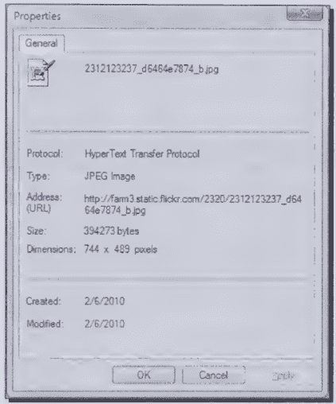

5. 如果所选图片的分辨率低于 600 x 400 像素，则应选择另一张分辨率更高的图片。如果分辨率高于 900 x 700 像素，您可以缩小 Web 浏览器窗口的大小，并再次检查属性，直到显示的尺寸低于此值且至少为 600 x 400 像素。

> 大多数现代 Web 浏览器在图片大于窗口时，会根据窗口大小缩小此页面中显示的图片尺寸。因此，当您拥有的图像分辨率高于拼图所需的分辨率时，可以利用此功能。

6. 启动截图工具（开始菜单 | 所有程序 | 附件 | 截图工具），并按照之前学到的方法捕获图像。将文件以便携式网络图形文件（PNG）格式保存为 image060101.png，放在之前创建的文件夹 C:\Aquarium 中。这样，我们就拥有了一张分辨率合适、可用于创建拼图的漂亮鸭子图像。

6. 单击 **活动** 选项卡，然后从主菜单中选择 **插入 | 新建活动**。在 **新建活动** 对话框中显示的列表中选择 **交换拼图**。在 **活动名称** 文本框中输入 Puzzle，然后点击 OK。JClic 将向项目添加新活动，并显示包含数十个选项的新选项卡，如以下截图所示：

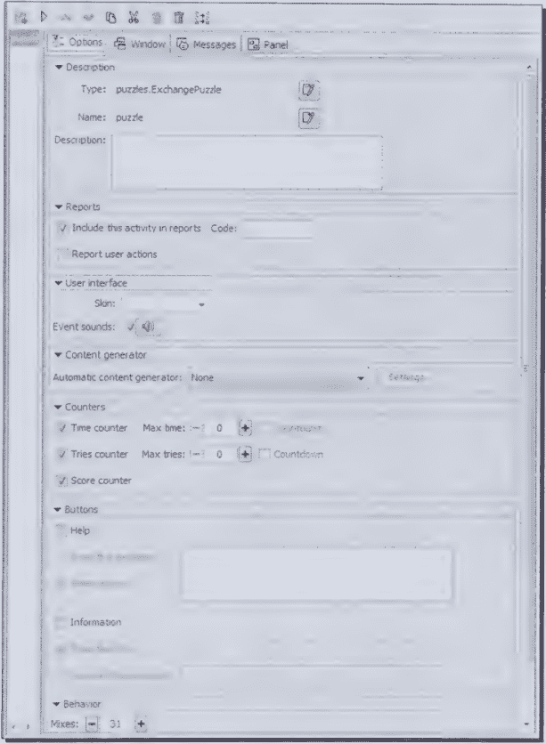

7. 单击与新活动相关的 **面板** 选项卡。

8. 单击 **图像** 标签右侧的按钮。将出现 **多媒体对象选择** 对话框。选择鸭子照片（`image060101.png`），然后点击 **OK**。

9. 在组合框中选择 **带曲线连接的拼图**（或曲线边缘），在行数中输入 2，列数中输入 3，宽度中输入 247，高度中输入 245。JClic 将显示鸭子被分割成六块带曲线连接的拼图（2 行 3 列），如下图所示：

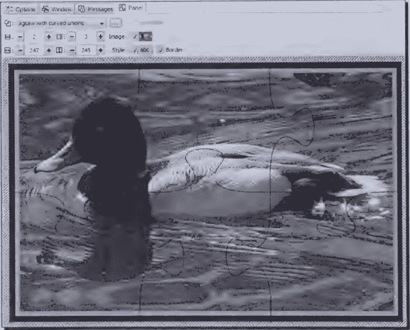

10. 从 JClic 的主菜单中选择 **文件 | 保存**，以保存对项目所做的更改。

11. 单击 **序列** 选项卡。在 **前进箭头** 下方的 **操作** 组合框中选择 **退出 JClic**，并激活 **自动继续** 复选框。这样，活动一结束，JClic 就会退出。停用 **后退箭头** 下方的 **显示** 按钮复选框。

12. 再次从 JClic 的主菜单中选择 **文件 | 保存**。

13. 接下来，选择 视图 | 预览活动。JClic 将显示一个新窗口，其中包含鸭子照片的六个打乱的碎片。它们代表拼图的六块。每次预览活动时，JClic 都会打乱虚拟碎片，并以随机顺序呈现，如下图所示：

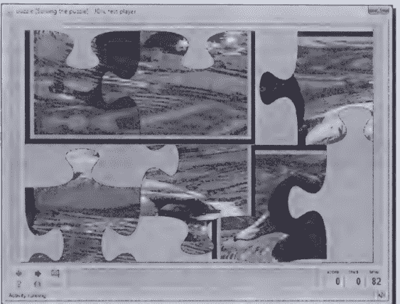

14. 将每个碎片拖放到其对应的位置以完成拼图。当某块碎片被放到正确位置时，如果该位置已有另一块碎片，JClic 会将其移到另一个位置，以避免未放对的碎片被隐藏，如下图所示：

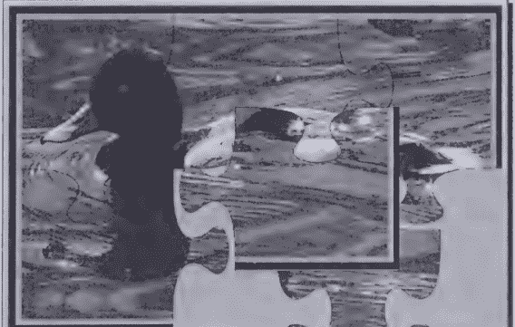

#### 刚才发生了什么？

我们使用 JClic 和之前选择的鸭子照片创建了一个交换拼图活动。我们利用 JClic 提供的功能，为拼图制作了带有卡齿的视觉丰富虚拟碎片。由于鸭子照片有粗黑边框，因此可以将其作为寻找每块碎片正确位置的参考。

我们将鸭子照片与交换拼图活动关联起来，配置了所需的碎片形状、数量和拼图在屏幕上的尺寸。JClic 在预览面板中显示了每个参数所做的更改。如前所述，每次学生运行练习时，JClic 都会使用随机生成的顺序打乱虚拟碎片。

#### 动手实践——将活动添加到 Moodle 课程中

现在我们必须将交换拼图添加到现有的 Moodle 课程中。

1. 登录到您的 Moodle 服务器。
2. 确保已安装允许将 JClic 项目和活动添加到 Moodle 的模块。执行安装的必要步骤已在*第 5 章，创建练习以改善短期记忆*中说明。
3. 单击所需的课程名称（Aquarium）。您可以创建新课程或使用现有课程。
4. 按照之前学到的方法，执行必要的步骤来编辑所需周的摘要。在 **摘要** 文本框中输入 `Exercise 1` 并保存更改。
5. 单击所选周的 **添加活动** 组合框，然后选择 **JClic**。将出现一个新的网页，显示标题 **向该周添加新的 JClic**。
6. 在 **名称** 文本框中输入 `Solving the puzzle`。
7. 在 **描述** 文本框中输入 `Drag and drop each part to its right place to solve the puzzle`。为此文本选择所需的字体和颜色。
8. 单击 **选择或上传文件** 按钮，将出现我们已经很熟悉的、显示文件和文件夹信息的弹出窗口。
9. 单击 **上传文件** 按钮，然后点击 **浏览**。浏览到存放 JClic 项目（`C:\Aquarium\puzzle0601`）的文件夹，并选择要上传的文件 `puzzle0601.jclic.zip`。然后点击 **打开** 和 **上传此文件** 按钮。

- 10. 接下来，将鼠标指针移到 **puzzle0601.jclic.zip** 名称上，并水平移动到同一行中的 **选择** 操作超链接。然后，点击 **选择**，如下一张截图所示：

  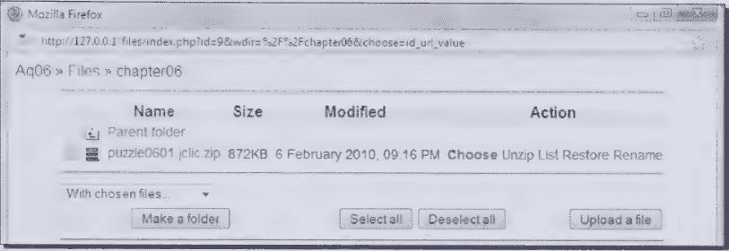

- 11. Moodle 将在 **文件名** 文本框中显示 chapter06/puzzle0601.jclic.zip。这就是包含 JClic 项目及其活动（拼图）所有文件的 ZIP 文件。

- 12. 在 **宽度** 中输入 750，在 **高度** 中输入 550。

- 13. 在 **最大尝试次数** 中选择 1。

- 14. 向下滚动，点击网页底部的 **保存并返回课程** 按钮。

## 刚才发生了什么？

我们将交换拼图练习添加到了 Moodle 课程中。现在，学生们可以通过点击相应周次中的超链接来运行该活动。

我们创建了一个新文件夹 chapter06。这个文件夹将保存与参观水族馆相关的活动所需的全部文件。

然后，我们只上传了一个 ZIP 文件，其中包含许多压缩文件，包括鸭子的照片以及 JClic 项目和单个活动的定义。

## 动手实践——使用游戏手柄解拼图

现在是时候以学生身份运行活动，并以教师身份检查结果了。使用鼠标也可以运行该活动；不过，这一次我们将利用游戏手柄来解拼图。

- 1. 配置游戏手柄的映射，以简化解练习时使用的拖放过程。第 1 章“匹配图片”中介绍了执行此配置所需的步骤。

- 2. 点击课程名称（Aquarium）并将角色切换为学生。

- 3. 点击对应周次中的“解拼图”链接。Web 浏览器将显示该练习。显示活动的 JClic 面板可能需要一些时间来加载。

- 4. 移动游戏手柄的左侧小摇杆，将鼠标指针定位到所需的虚拟拼块上。

- 5. 按下游戏手柄的 1 号动作按钮（位于右上方）。

- 6. 移动游戏手柄的左侧小摇杆，虚拟拼块将随小摇杆的移动而改变位置。使用小摇杆将虚拟拼块放置到正确位置，如下一张图所示：

  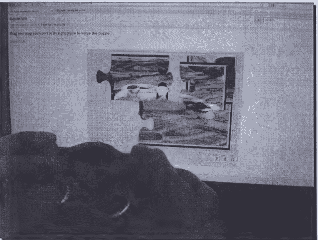

- 7. 按下游戏手柄的 1 号动作按钮（位于右上角）以将虚拟拼块放置在选定位置。每次将虚拟拼块放到正确位置时，JClic 应用程序都会播放提示操作成功的声音。每次将虚拟拼块放到错误位置时，JClic 应用程序都会播放提示错误的声音。

- 8. 解完拼图后，活动将结束，你可以点击“显示结果”查看结果。

- 9. 你可以像之前活动那样返回正常角色并查看尝试次数。请记住，这些尝试次数将分组显示在 JClic 活动中。

## 刚才发生了什么？

在此活动中，我们使用与水族馆相关的图像创建了拼图的虚拟拼块。孩子必须通过拖放虚拟拼块来解拼图，发现完整图像。

我们应用了以下概念和资源，以帮助减少注意力缺陷障碍：

- 注意力刺激。孩子必须专注于为每个虚拟拼块找到正确的位置。游戏手柄要求孩子同时操作摇杆和按钮。这样，孩子通常会认为活动很有趣。

- 动机。该练习是一款具有挑战性的传统游戏，即拼图游戏。

- 照片。它完美呈现了真实生活场景，本例中是一只鸭子在水族馆的人工湖中。孩子必须解拼图才能发现鸭子。

- 模式识别。孩子必须将不同的虚拟拼块组合起来构建完整图像。

> 如前所述，我们也可以使用鼠标或触摸屏来代替游戏手柄解练习。在这种情况下，使用游戏手柄会使活动更具吸引力，并且需要更加专注才能完成。

## 动手实践——使用多点触控设备解拼图

使用多点触控设备作为多点触控鼠标来执行此练习，也可以使练习更具吸引力。我们必须首先下载并安装 Logitech Touch Mouse Server。然后，我们将使用多点触控设备解拼图。

> 要完成此活动，你需要一台通过 Wi-Fi 或任何其他兼容网络连接到计算机的 iPhone、iPod Touch 或 iPad。以下说明介绍了在 Windows 上运行此软件所需的步骤。不过，你也可以在 Mac OS X 上运行它。

- 1. 转到 **控制面板 | 系统**，将出现一个新窗口，显示有关计算机的基本信息。检查 **系统类型** 中显示的值。可能的值为 **32 位操作系统** 或 **64 位操作系统**，如下一张截图所示：

  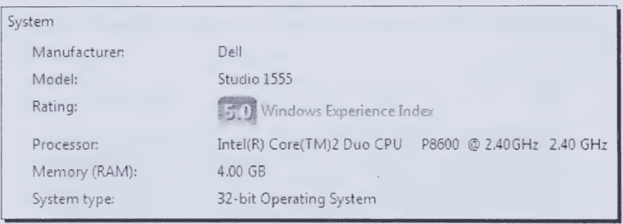

- 2. 打开默认的 Web 浏览器，访问 http://www.logitech.com/touchmouse。此网页允许我们下载不同版本的 Logitech Touch Mouse Server。该软件允许你使用 iPhone、iPod Touch 或 iPad 来控制计算机的鼠标。

- 3. 点击 **下载**，然后点击 **选择操作系统**，选择你的 Windows 版本。然后，点击 **选择文件**，并根据操作系统（32 位或 64 位）选择文件，同时考虑前面步骤 1 的结果。例如，对于 Windows 7 32 位，你必须选择 **touchmouse1.0.exe（32 位）**，如下一张截图所示：

  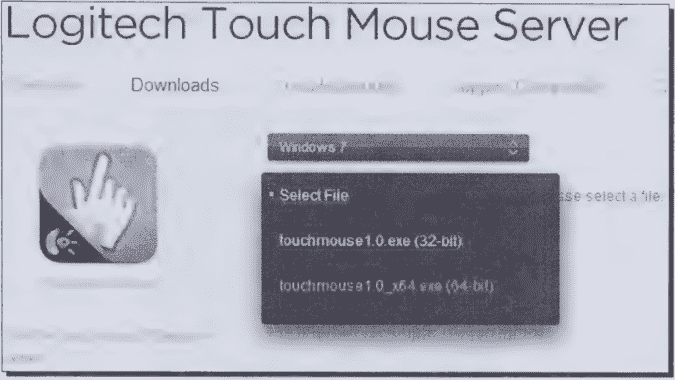

- 4. 向下滚动，点击 **下载软件** 按钮。启动下载的安装程序，并按照步骤完成安装过程。默认情况下，Logitech Touch Mouse Server 应用程序会在操作系统启动时自动启动。你可以通过双击其托盘图标并取消激活 **Windows 启动时自动启动此应用程序** 选项来更改此配置。

- 5. 接下来，在 iPhone、iPod Touch 或 iPad 上安装 Logitech Touch Mouse 应用程序。然后在该设备上启动此应用程序。

- 6. 选择所需的服务器，本例中为运行前面所述服务器软件的 PC 名称，如下一张图所示：

  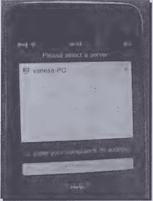

- 7. 服务器连接后，设备上会出现一个面板，让你可以用手指控制计算机的鼠标指针，如下一张图所示：

  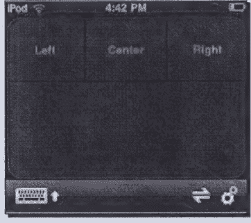

- 8. 按照上一节中的步骤以学生身份启动交换拼图活动。拼图显示后，拿起多点触控设备，在之前显示的深色面板上拖动手指来控制鼠标指针。

- 9. 用手指将鼠标指针定位到所需的虚拟拼块上，如下一张图所示：

  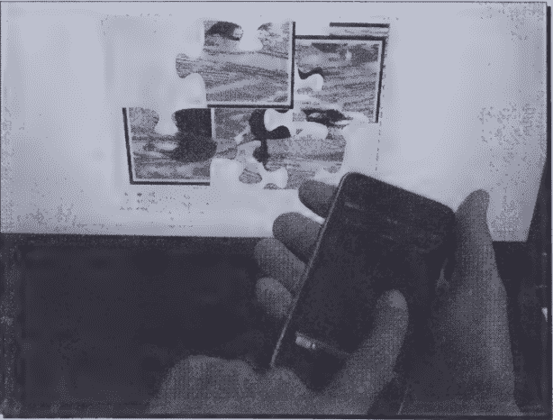

- 10. 点击设备左上角出现的左键按钮。

- 11. 在深色面板上拖动手指，虚拟拼块将随手指的移动而改变位置。用手指将虚拟拼块放置到正确位置。

- 12. 再次点击左键按钮，将虚拟拼块放置在所需位置。

- 13. 解完拼图后，活动将结束，你可以通过轻点或点击“显示结果”来查看结果。

## 刚才发生了什么？

我们利用 iPhone、iPod Touch 和 iPad 提供的流行多点触控屏幕，将手指用作远程鼠标。因此，你可以用手指解拼图。

这些设备非常流行。借助 Logitech 创建的免费软件，你可以利用该设备提供另一种富有创意且具吸引力的方式来解交换拼图。

## 英雄试炼——基于矢量图形创建拼图

JClic Author 提供了自定义交换拼图虚拟拼块形状的可能性。你可以通过点击形状类型选择组合框右侧的 ... 按钮来完成此操作。

Shaper 属性对话框允许你指定齿高和齿宽。此外，你还可以激活“随机分布”复选框，以创建具有随机齿分布的形状。

你也可以通过在形状类型选择组合框中选择以下选项之一来更改虚拟拼块的形状：

- ◆ 切割
- ◆ 曲线接合拼图
- ◆ 矩形接合拼图
- ◆ 三角形接合拼图
- ◆ 矩形

> 该软件将拼块的边缘称为“接合”。

使用可缩放矢量图形并将其导出为位图图像，如第 1 章《匹配图片》中“匹配复合图片”部分所学。 使用此图像创建一个新的交换拼图，包含八个虚拟块并选择上述形状类型之一。

一旦你使用 JClic Author 创建了交换拼图，点击每个虚拟块（单元格）并添加一个作为其关联文本的数字。 数字可以帮助学生解决拼图。 例如，如果拼图有两行四列，则每个块中显示的数字与其对应的图像部分相对应，如下表所示：

| 1 | 2 | 3 | 4 |
|---|---|---|---|
| 5 | 6 | 7 | 8 |

## 在字谜中寻找单词

水族馆里阳光明媚的一天。

爱丽丝和凯文玩得很开心。 他们喂了海豚，和海豹打篮球，并观看鲸鱼摆动尾巴。

她不想忘记他们在水族馆里看到的动物。 因此，她使用许多动物的名字创建了一个字谜。 你想玩吗？

### 操作时间 – 通过合并两张图片创建背景图片

我们首先将合并两张图片，为我们的字谜创建一个背景图片。

1. 打开默认网页浏览器并访问 http://animalphotos.info。 在此情况下，搜索以下动物在水族馆中的照片，捕获并以以下表格中所示的名称保存图像文件到之前创建的文件夹 `C:\Aquarium` 中。 下一张截图显示了两张图像的示例：

   | 搜索 | 图片文件名 |
   |---|---|
   | dolphin | image060201.png |
   | whale | image060202.png |

   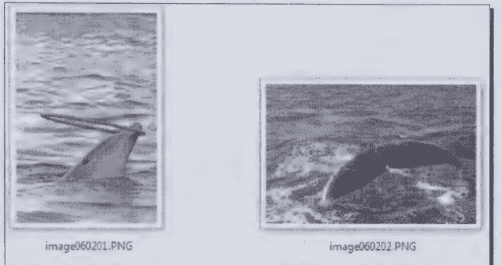

2. 启动 Paint（`Start Menu | All Programs | Accessories | Paint`）。
3. 在 Paint 中打开第一个图像文件，`C:\Aquarium\image060201.png`。
4. 选择 `Edit | Paste from` 并选择第二个图像，`C:\Aquarium\image060202.png`。 此图像将带虚线边框出现。
5. 接下来，将第二个图像拖动到一个位置，使海豚和鲸鱼都可见于合并的图片中，如下一张图像所示：

   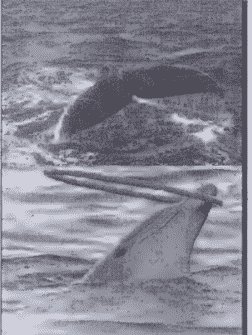

6. 从 Paint 的主菜单中选择 `File | Save as`。 在 `Save as type` 组合框中选择 `PNG (*.PNG)` 并将文件保存为 `image060203.png` 到之前创建的文件夹 `C:\Aquarium`。

### 发生了什么？

我们搜索了与水族馆相关的两张免版税照片，并使用 Paint 将它们合并成一张图像。 我们现在有一张包含海豚和鲸鱼的数字照片，可用作字谜的背景。 孩子需要找到与背景图片相关的单词。

### 操作时间 – 使用字母和图片生成字谜

我们现在将使用海豚和鲸鱼的照片以及我们熟知的 JClic Author 生成一个字谜。

1. 从其网页运行 JClic Author 0.2.0.5 或通过点击其图标运行。
2. 从 JClic 的主菜单中选择 `File | New Project`。 将出现一个新对话框。 为每个文本框输入以下值，然后点击 `OK`：

   - `word0602` 在 `Project name` 中。
   - `word0602` 在 `File name` 中。 JClic 将在压缩文件 `word0602.jclic.zip` 中保存完整项目。
   - 在 `Folder` 中，之前创建的文件夹 `C:\Aquarium` 中的新 `word0602` 子文件夹，`C:\Aquarium\word0602`。
3. 点击 `Project` 选项卡。 在 `Title` 文本框中输入 `Finding the words related to the background picture`。
4. 点击 `Media library` 选项卡。
5. 从主菜单中选择 `Insert | New media object`。 选择之前保存的图像 `image060203.png` 在 `C:\Aquarium` 中并点击 `Open` 按钮。 JClic 将要求你确认将文件复制到项目文件夹；点击 `Yes`。 包含海豚和鲸鱼的照片将出现在 JClic 的媒体库中，将用作背景。
6. 点击 `Activities` 选项卡并从主菜单中选择 `Insert | New activity`。 在 `New activity` 对话框中显示的列表中选择 `Word search`。 在 `Name of the activity` 文本框中输入 `Word` 并点击 `OK`。 JClic 将新活动添加到项目中并显示数十个选项的新选项卡。
7. 点击与新活动相关的 `Window` 选项卡。
8. 点击 `Image` 标签右侧的按钮。 将出现 `Multimedia object selection` 对话框。 选择之前添加的照片，`image060203.png`，并点击 `OK`。 激活 `Tiled` 复选框并在 `Game window` 下选择 `Absolute position`。 窗口的预览将出现，鲸鱼和海豚作为背景，如下一张截图所示：

   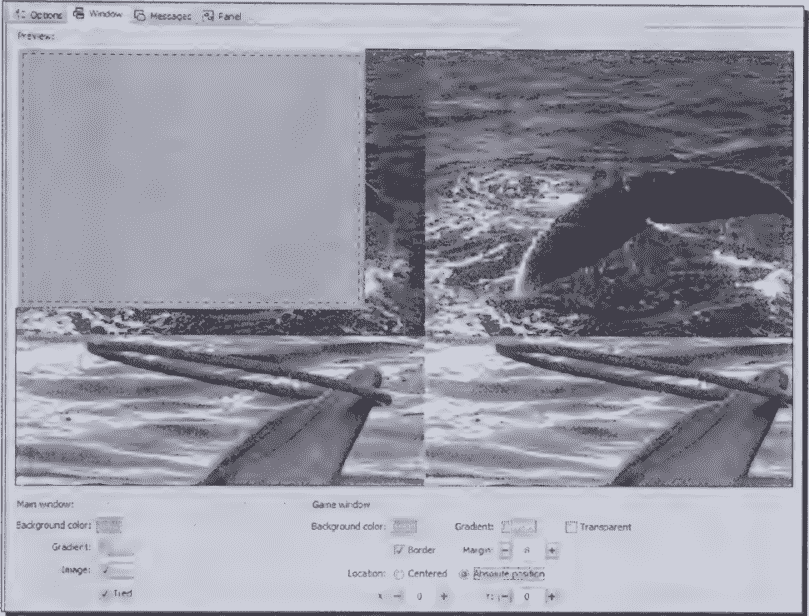

9. 接下来，点击与新活动相关的 `Panel` 选项卡，然后点击其中的 `Grid A` 面板。
10. 为行和列都输入 8，为宽度和高度都输入 45。 JClic 将显示一个包含 64 个字母的网格，用通配符（`*`）填充，在活动执行时将被随机字母替换。
11. 点击 `Hidden words` 列表下方的 `Add a new list element (+)` 按钮。 输入 `DOLPHIN` 并点击 `OK`。 新单词将出现在此列表中。
12. 重复上述步骤以将 `WHALE` 添加到隐藏单词列表中。
18. 点击其中一个隐藏单词的第一个字母，`DOLPHIN` 或 `WHALE`，然后点击最后一个字母。 JClic 将反转网格中发现的单词的颜色，如下一张截图所示：

    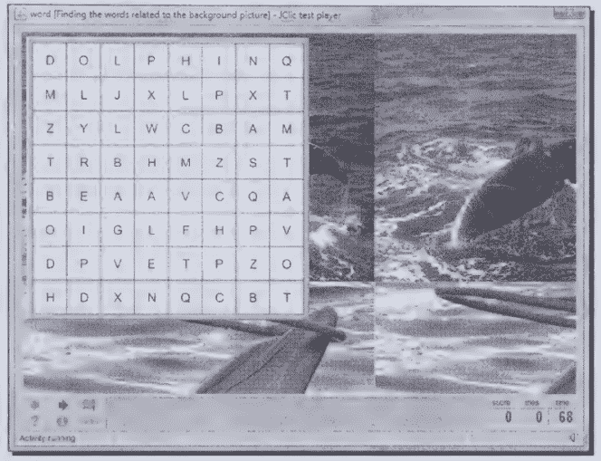

    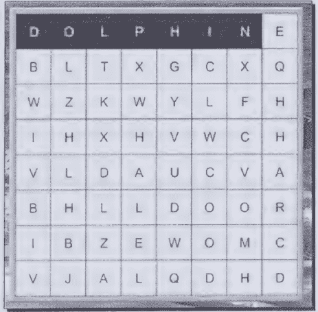

### 发生了什么？

我们使用 JClic 和之前创建的包含海豚和鲸鱼的背景图片创建了一个字谜活动。 我们利用 JClic 提供的功能创建了一个包含 64 个字母和 2 个隐藏单词的网格，浮动在背景之上。 背景中发现的动物可作为找到网格中两个隐藏单词的指南。

我们将背景照片链接到窗口的背景，配置了网格，定义了隐藏单词列表，并在网格中输入了它们对应的字母。 JClic 在预览面板中显示了所做的更改。 如前所述，JClic 将在学生每次运行练习时用随机生成的字母替换通配符字符（`*`）。

### 操作时间 – 将活动添加到 Moodle 课程

我们现在必须将字谜添加到现有的 Moodle 课程中。

1. 登录你的 Moodle 服务器。
2. 确保已安装允许将 JClic 项目和活动添加到 Moodle 的模块。
3. 点击所需课程名称（`Aquarium`）。 你可以创建一个新课程或使用现有课程。
4. 如我们之前所学，遵循必要的步骤编辑所需周的摘要。 在 `Summary` 文本框中输入 `Exercise 2` 并保存更改。
5. 点击所选周的 `Add an activity` 组合框并选择 `JClic`。 将出现一个新网页，显示标题 `Adding a new JClic to week`。
6. 在 `Name` 文本框中输入 `Looking for words in a word search puzzle`。
7. 在 `Description` 文本框中输入 `Look at the picture at the background and find two animals. Then, find the two words with these animal's names in the grid`。 选择此文本所需的字体和颜色。
8. 点击 `Choose or upload a file` 按钮，已知的文件和文件夹信息弹出窗口将出现。
9. 点击 `Upload a file` 按钮然后点击 `Browse`。 浏览到保存 JClic 项目的文件夹（`C:\Aquarium\word0602`）并选择要上传的文件，`word0602.jclic.zip`。 然后点击 `Open` 然后点击 `Upload this file` 按钮。
10. 接下来，将鼠标指针定位在 `word0602.jclic.zip` 名称上并水平移动到同一行中的 `Choose action` 超链接。 然后点击 `Choose`，如下一张截图所示：

    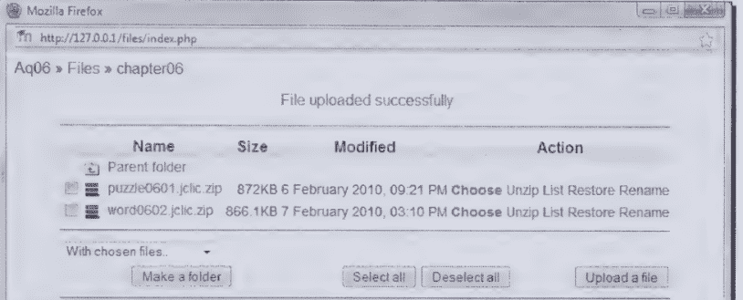

11. Moodle 将在 `File name` 文本框中显示 `chapter06/word0602.jclic.zip`。 这是包含 JClic 项目及其活动、字谜的所有文件的文件。
12. 在 `Width` 中输入 800，在 `Height` 中输入 560。
13. 选择 1 作为 `Maximum number of trials`。
14. 向下滚动并点击网页底部的 `Save and return to course` 按钮。

### 发生了什么？

我们将字谜练习添加到 Moodle 课程中。 学生现在可以通过相应周上的超链接点击运行该活动。

我们使用了之前创建的文件夹 `chapter06`。 我们只上传了一个 ZIP 文件，其中包含许多包含背景图像和 JClic 项目及单个活动定义的压缩文件。

# 操作时间 – 解决单词搜索谜题

让我们看看爱丽丝登录时看到了什么：

1. 点击课程名称（Aquarium），然后将你的角色切换为学生。
2. 点击对应周次的“Looking for words in a word search puzzle”链接。Web 浏览器将显示该练习。显示活动的 JClic 面板可能需要一些时间才能加载。
3. 点击其中一个单元格。现在当你移动鼠标指针时，JClic 应用程序将绘制一条线。点击另一个单元格。每次你画出的线条经过的字母并不构成隐藏单词时，JClic 应用程序都会播放一个声音，表示出错。
4. 接下来，点击 WHALE 这个单词的第一个字母，该单词是从上到下书写的。JClic 应用程序将绘制一条线。点击这个单词的最后一个字母，如下一张截图所示。JClic 应用程序将播放一个声音，表示操作成功。

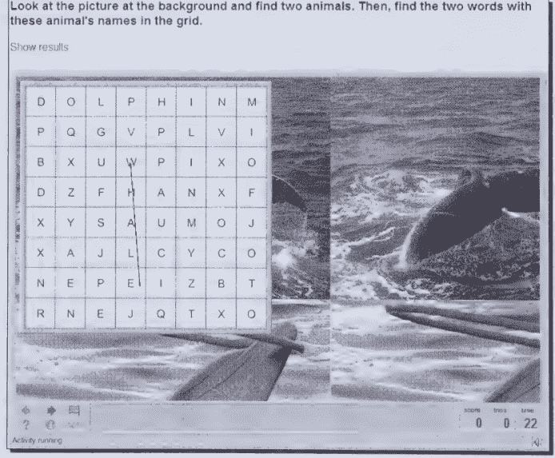

5. 找出所有隐藏的单词后，活动将结束，你可以通过点击“Show results”来查看你的结果。
6. 你可以返回自己的正常角色，并像之前的活动一样检查尝试次数。请记住，它们将以“JClic activities”分组显示。

## 刚才发生了什么？

在这个活动中，我们创建了一个包含 64 个字母的网格，其中隐藏了与水族馆相关的两个单词。孩子必须观察图片和窗口背景，找到两种动物。然后，孩子必须找出网格中隐藏的单词。

为了帮助减少注意力缺陷障碍，我们应用了以下概念和资源：

- 阅读理解。孩子必须根据背景图片找出隐藏的单词。
- 照片。它提供了一个真实场景的完美呈现，在本例中是一只海豚和一条鲸鱼。孩子必须注意组合照片中可见的部分，以找到与照片中所示动物相关的单词。
- 注意力刺激。孩子必须专注于找出组成单词的不同字母。
- 长期记忆。孩子必须识别背景照片中出现的动物。他/她必须思考自己知道的所有存在于水族馆中的动物，然后将其与网格中可能显示的隐藏单词联系起来。

## 高手进阶 – 为单词搜索谜题添加辅助效果和声音

有时，仅有一张背景照片不足以帮助学生找到隐藏的单词。

创建一个新的单词搜索谜题，包含以下隐藏单词：

- DUCK
- PENGUIN
- SEAL

在 JClic 活动描述中，为每个隐藏单词添加一个带声音的视频。你已经学会了如何为其他类型的活动添加视频。这样，学生就可以播放视频并听到每种动物的声音。这些线索将为他们提供视觉丰富的活动，并帮助他们将视频和声音与每个隐藏单词联系起来。

## 速答测验 – 处理不同类型的谜题

1. 当你使用 JClic Author 创建一个交换谜题时：
   a. 你可以自定义虚拟碎片的形状
   b. 你只能选择矩形的虚拟碎片
   c. 你只能选择带曲线连接的拼图式虚拟碎片
2. 使用 JClic Author 创建的交换谜题：
   a. 不能在每块虚拟碎片中混合文本和图像
   b. 只能在每块虚拟碎片中显示文本
   c. 可以在每块虚拟碎片中混合文本和图像
3. 在 JClic Author 中的单词搜索活动：
   a. 显示一个包含隐藏单词的字母网格
   b. 显示一个在其字幕中包含隐藏单词的视频
   c. 以大字体在视频中显示单词
4. 在 JClic Author 中显示单词搜索活动的窗口：
   a. 无法自定义
   b. 无法显示背景图像
   c. 可以显示背景图像
5. 当你使用 JClic Author 中的带曲线连接的拼图式虚拟碎片创建交换谜题时：
   a. 你不能自定义插齿高度
   b. 你还可以自定义插齿高度和宽度
   c. 你不能自定义插齿宽度

## 总结

在本章中，我们学习了如何：

- 创建结合了数字照片、虚拟碎片、字母和单词的视觉丰富的谜题
- 创建带有曲线边缘的拼图形状的虚拟碎片
- 设计一个单词搜索谜题，将多张照片组合到单个背景中，并在网格中添加每个单词的字母
- 使用多种工具创建逼真的活动，这些活动可以减少学生的注意力缺陷障碍，并改善他们的长期记忆管理

既然我们已经学会了如何创建减少注意力缺陷障碍的练习，我们接下来准备制作与数学运算相关的练习，这是下一章的主题。
