# 玩转数学运算

> 我们可以通过创建不同类型的视觉丰富活动来玩转数学运算。可以使用许多不同的应用程序来创建练习，帮助学生使用图像和符号而非数字和符号来解决简单的数学运算。这样，我们可以帮助他们在解决数学运算时提高注意力。

在本章中，爱丽丝去了一个农场。我们将学习如何创建与她的旅程相关的视觉丰富活动来玩转数学运算。在本章中，我们将：

- 准备一个带有背景图片和许多动物的场景，让学生数一数它们
- 创建一个带有视觉描述和多个图像答案的多项选择题
- 创建视觉和交互式活动来解决简单的数学运算
- 创建一个复杂的关联活动，包含视觉数学运算及其可能的结果
- 学习如何结合图片和符号，以提高处理数学运算时的注意力

## 用多个图像解决多项选择题

爱丽丝和她的小弟弟凯文去了美国堪萨斯州叔叔的农场。他们对谷仓感到惊讶，发现了许多动物：母鸡、奶牛、猪，还有蜜蜂在蜂巢里辛勤工作。

他们花了很多时间玩耍，并数每种动物的数量。我们来帮帮他们吧？

## 操作时间 – 准备一个场景来数元素

我们将使用一张背景图片，然后在其中添加其他动物剪贴画，来准备一个与农场相关的场景。然后我们将使用这个场景来数其中动物的数量。

1. 在 Windows 资源管理器中创建一个新文件夹（C:\Farm）。
2. 启动 Inkscape，并将其最小化。稍后你将使用它。
3. 启动 Word 2007。你将在新的空白文档中工作。
4. 点击“插入 | 剪贴画”。剪贴画面板将出现在主窗口的右侧。
5. 点击“搜索范围”组合框，并勾选“所有位置”复选框。这样，Word 将在所有可用的集合中搜索剪贴画，包括 Web 集合。
6. 点击“搜索文字”文本框，输入 Bee。
7. 点击“转到”按钮。
8. 将鼠标指针悬停在所需剪贴画的缩略图上。
9. 右键点击所需剪贴画的缩略图，并在出现的上下文菜单中选择“预览/属性”。Word 将显示一个新的对话框，其中显示可缩放剪贴画的更大预览以及一个临时文件名。
10. 三击“文件”后面显示的长路径和文件名。这样，你就能确保选中临时文件的完整路径。然后右键点击它，并在出现的上下文菜单中选择“复制”。
11. 接下来，激活 Inkscape——记住它一直在最小化运行。你可以使用 Alt + Tab 或 Windows + Tab。不要关闭剪贴画的预览窗口。


- 19. 接下来，返回 Word。搜索与单词 **barn**（谷仓）相关的剪贴画并预览。由于你希望使用 Inkscape 更改图片大小而不损失质量，请务必确保它是一个 **WMF** 或 **EMF** 文件。
- 20. 接下来，启动 Inkscape 并按照先前说明的步骤导入预览过的剪贴画。之前预览的剪贴画，也就是我们场景的背景，将出现在 Inkscape 的绘图区域中并被选中。
- 21. 由于你希望它成为农场动物的背景，请从 Inkscape 的主菜单中选择 **对象 | 降低到最底层**。这样，动物将出现在新背景图片的上方。
- 22. 调整背景图片的大小，使其能够作为所有动物的背景。
- 23. 点击蜜蜂，然后从 Inkscape 的主菜单中选择 **编辑 | 复制**。这样，Inkscape 将创建该元素的一个新副本。但是，两只蜜蜂会出现在相同的位置，一只叠在另一只上面。
- 24. 将选中的蜜蜂移动到不同的位置。
- 25. 重复上述步骤（23 和 24），添加第三只蜜蜂和第二头猪，如下图所示：

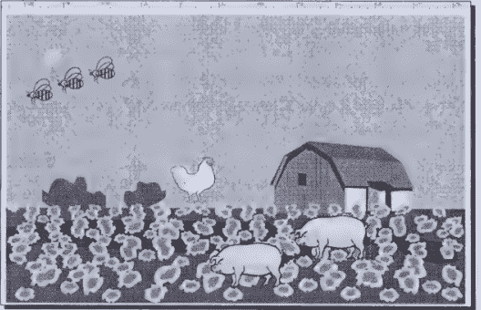

- 26. 从 Inkscape 的主菜单中选择 **文件 | 另存为**。将文件保存为 `image070104.svg`，放在之前创建的文件夹 `C:\Farm` 中。
- 27. 选择 **文件 | 导出位图**。将出现一个显示许多导出选项的对话框。在 **位图大小** 下的 **宽度** 文本框中输入 **800**。这样，导出位图的宽度将设置为 800 像素。
- 28. 点击“绘图”按钮，然后点击“导出”。Inkscape 将以 PNG 格式导出场景。包含农场场景、三只蜜蜂、两头猪和一只母鸡的导出位图图形将保存到 `C:\Farm\image070104.png`。

## 刚才发生了什么？

我们使用 Inkscape 和可缩放矢量剪贴画创建了一个农场场景的表示。我们首先添加了每一只动物，并将它们分别导出为 PNG 格式。现在我们有了以下三张位图图像，可用于视觉多项选择题：

- image070101.png：一只蜜蜂
- image070102.png：一头猪
- image070103.png：一只母鸡

然后我们添加了一张背景图片，添加了某些动物的副本，并将它们分布到农场中。最后，我们将生成的图像导出为 PNG 格式。

## 动手操作 – 创建包含多只动物的视觉多选题

我们现在必须准备一个视觉多项选择题，以不同数量的动物作为可能的答案，结合文本和图像。

- 1. 登录你的 Moodle 服务器。
- 2. 点击所需的课程名称（Farm）。你可以创建一门新课程或使用现有课程。
- 3. 按之前所学，按照必要步骤编辑所需星期的概要。在“概要”文本框中输入“Exercise 1”并保存更改。
- 4. 点击所选星期的“添加活动”组合框，然后选择“测验”。
- 5. 在“测验名称”中输入“Visual multiple choice”，然后点击“保存并显示”按钮。Moodle 将显示该测验的题库。
- 6. 点击“新建题目”组合框并选择“描述”。将出现一个新页面，要求输入添加多选描述所需的信息。
- 7. 在“题目名称”中输入“Look at this picture”。
- 8. 点击“题目文本”标签下方的文本框。使用不同的字体和颜色输入定义目标的句子：Count the pigs, hens and bees in this farm.
- 9. 点击“题目文本”标签下方的文本框。
- 10. 点击“插入图片”按钮（一座山）。将出现一个新网页，显示标题“插入图片”。
- 11. 在“创建文件夹”按钮左侧的文本框中输入 `chapter07`，然后按下该按钮。接着点击新文件夹的超链接。
- 12. 按照必要步骤将文件 `image070104.png`（农场场景）上传到之前创建的文件夹 `chapter07` 中。记得输入替代文本，带有动物的农场将出现在“题目文本”下方。
- 13. 向下滚动并点击网页底部的“保存更改”按钮。
- 14. Moodle 将显示一个题库以及该测验的题目。现在，激活与之前创建的描述行（Count the pigs, hens and bees in this farm）对应的“操作”复选框。然后，点击“添加到测验”按钮。Moodle 将把该描述添加到我们的测验中，如以下截图所示：

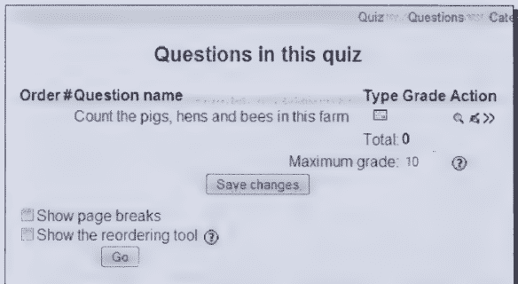

- 15. 点击“新建题目”组合框并选择“选择题”。将出现一个新页面，要求输入添加选择题所需的信息。
- 16. 在“题目名称”中输入“Counting bees”。
- 17. 点击 **题目文本** 标签下方的文本框。使用不同的字体和颜色输入定义目标和需要使用视觉多项选择题回答的问题：`How many bees do you see in the farm?`
- 18. 向下滚动并转到名为 **选项 1**（第一个可能答案）的部分。
- 19. 在 **选项 1** 部分内的 **答案** 文本框中输入“One bee”。
- 20. 点击 **选项 1** 部分内 **反馈** 标题下方的 **插入图片** 按钮（一座山）。将出现一个新网页，显示标题 **插入图片**。
- 21. 按照必要步骤将文件 `image070101.png`（蜜蜂）上传到之前创建的文件夹 `chapter07` 中。记得输入替代文本。
- 22. 蜜蜂将出现在大的 **反馈** 文本框中。点击 **选项 1** 部分内 **反馈** 标题下方的 **切换 HTML 源代码** 按钮（带有 `<>` 标签的那个）。文本框将显示 HTML 代码，一行类似于下面的内容：

```html

<br />
```

- 23. 从第一个 < 选择文本直到第一个 />，然后按 Ctrl + C。我们要复制显示上传图片的代码，但不包含 <br />。将复制类似于下面一行的代码：

```html

```

- 24. 点击 **选项 1** 部分内的 **答案** 文本框。按 End 键，然后按 Ctrl + V。此文本框中的文本现在将类似于：

```html
One bee

```

- 25. 在名为 **选项 1** 的部分下的“分数”组合框中选择“无”，因为这是一个错误答案。
- 29. 在“分数”组合框中选择 100%，因为这是正确答案，如以下截图所示：

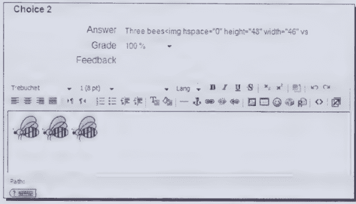

- 30. 向下滚动并转到名为“选项 3”（第三个可能答案）的部分。
- 31. 在“选项 3”部分内的“答案”文本框中输入“Two bees”，然后按 Ctrl + V 两次，因为在这种情况下必须出现两张蜜蜂图片。此文本框中的文本将类似于：

```html
Two bees


```

- 32. 点击“选项 3”部分内“反馈”标题下方的大文本框，然后点击“切换 HTML 源代码”按钮（带有 `<>` 标签的那个）。选择所有文本并按 Ctrl + V 两次。
- 33. 在名为“选项 3”的部分下的“分数”组合框中选择“无”，因为这是一个错误答案。
- 34. 向下滚动并点击网页底部的“保存更改”按钮。


**35.** Moodle 将显示题库和测验的题目。现在，请激活与标签为之前创建的题目“**数蜜蜂**”的行对应的“**操作**”复选框。然后点击“**添加到测验**”按钮。Moodle 会将描述添加到我们的测验中。

**36.** 对于另外两个关于在农场中看到的动物数量的问题，重复前述步骤（15 至 35）。请记住，按照第 29 步的解释，根据之前添加到场景中的动物数量选择正确答案。下表显示了动物、问题名称、图片文件名和正确答案。最后，Moodle 将显示我们测验的描述和三个问题，如下面的截图所示：

| 动物 | 问题名称 | 图片文件名 | 正确答案 |
| --- | --- | --- | --- |
| 猪 | 数猪 | image070102.png | 两头猪 |
| 母鸡 | 数母鸡 | image070103.png | 一只母鸡 |

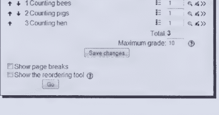

**37.** 点击“**保存更改**”按钮。以动物图片作为可选答案的视觉多选题练习就准备好了。

## 刚才发生了什么？

我们创建了一个视觉多选题，由以下元素组成：

- * 描述，显示带有动物的农场图片
- * 关于蜜蜂数量的问题
- * 关于猪数量的问题
- * 关于母鸡数量的问题

# 1
分值 - 1
你在农场里看到多少只蜜蜂？

选择一个答案

- a. 两只蜜蜂
- b. 三只蜜蜂
- c. 一只蜜蜂

# 2
分值 - 1
你在农场里看到多少头猪？

选择一个答案

- a. 两头猪
- b. 四头猪
- c. 一头猪

# 3
分值 - 1
你在农场里看到多少只母鸡？

选择一个答案

- a. 两只母鸡
- b. 一只母鸡
- c. 三只母鸡

5. 点击正确答案对应的单选按钮。然后，点击位于题目区域左下角的“提交”按钮。Moodle 将显示反馈，告知你选择的答案是否正确。

6. 接下来，点击每个正确答案对应的单选按钮。然后，向下滚动并点击位于网页底部的“**全部提交并完成**”按钮。Moodle 将像我们之前在布尔多选题中学到的那样，显示该活动的结果审阅。下面的截图显示了结果审阅，其中三个正确答案带有绿色背景及反馈。

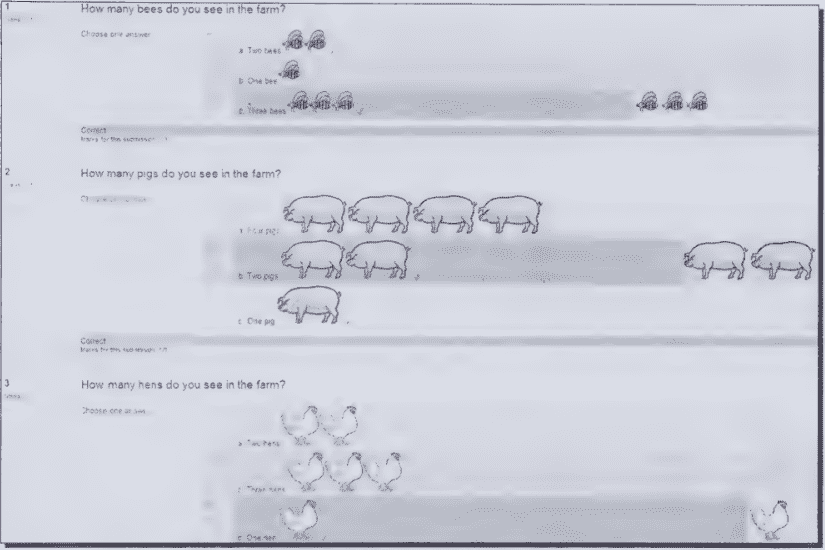

- 7. 点击“**完成审阅**”按钮。
- 
- 8. 退出登录，然后使用你的普通用户和角色重新登录。返回 Moodle 课程。
- 
- 9. 在“活动”面板中点击“**测验**”。尝试次数将显示在“**尝试次数**”列中。
- 
- 10. 接下来，点击与“**视觉多选题**”活动对应行上的“**尝试次数**”链接，Moodle 将显示所有尝试的详细信息，并按用户名分组。

农场是我们练习的主要场景。它为有趣练习提供了大量资源和创意。

我们可以使用相同的模式，用不同种类的事物创建视觉多选题。这类视觉丰富的活动对孩子们非常有吸引力。

## 挑战一下——准备更多视觉多选题

你已经了解了动画 GIF 文件中的动画图形。创建一个新的视觉多选题，场景由背景图和许多元素组成。然后使用动画 GIF 文件将答案中的文本与动画图形结合起来。这样，学生将必须识别场景中元素的动画版本。

结合我们在上一章学到的所有内容与视觉多选题，你可以创建更复杂的运算练习。

## 完成一个视觉数学运算网格

今天又是一个在农场度过的美好日子。爱丽丝和她的玛丽姨妈今天花了一个小时从苹果树上摘苹果。她们的篮子里有很多苹果。我们能数出苹果的总数吗？

## 动手实践——结合图片与数学符号

我们要创建许多由苹果和符号组成的视觉数学运算。然后，我们要创建不同数量苹果的可能结果。之后，我们将使用这些合成图片来填充网格的每个单元格。

- 1. 启动 Inkscape 并将其最小化。你稍后会用到它。
- 2. 启动 Word 2007。你将在新的空白文档中工作。
- 3. 按照必要的步骤搜索一个苹果的剪贴画图片。
- 4. 右键单击所需剪贴画的缩略图，并在出现的上下文菜单中选择“预览/属性”。Word 将显示一个新的对话框，展示可缩放剪贴画的更大预览图和一个临时文件名。

5. 三击“文件”后面显示的长路径和文件名。这样，你就能确保临时文件的完整路径已被选中。然后右键单击它，并在出现的上下文菜单中选择“复制”。

6. 接下来，激活 Inkscape——记住它是最小化运行的。你可以使用 Alt + Tab 或 Windows + Tab。不要关闭剪贴画的预览窗口。

7. 从主菜单中选择“文件 | 导入”。点击“键入文件名”按钮（带有纸张图标的铅笔），然后将之前复制的临时文件完整路径粘贴到“位置：”文本框中。该路径类似于 C:\Users\vanesa\AppData\Local\Microsoft\Windows\Temporary Internet Files\Content.IE5\QBDKECTZ\MCj04417080000[1].png。

8. 点击“打开”按钮。之前预览过的剪贴画——一个适合我们数学运算的漂亮苹果——将出现在 Inkscape 的绘图区域中并被选中，如下图所示：

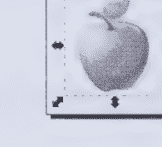

9. 点击苹果，然后从 Inkscape 的主菜单中选择“编辑 | 复制”。这样，Inkscape 将创建该元素的新副本。但是，两个苹果会出现在相同位置，一个叠在另一个上面。

10. 将选中的苹果移到右侧，在两个苹果之间留出一个空间，用于放置一个大的 + 号。

11. 点击“创建和编辑文本对象”按钮（带有光标的大写 A 图标），或按 F8。此功能允许你在 Inkscape 的绘图区域中添加不同字体和颜色的文本。

12. 使用窗口左上角、主工具栏下方出现的两个组合框，选择所需的字体和字号。

13. 输入 + 号作为新文本。这样，你将得到第一个视觉数学运算：一个苹果加一个苹果，如下图所示：

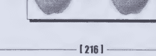

## 刚才发生了什么？

我们使用 Inkscape 将位图剪贴画图像的多个副本与一个符号组合，创建了两个包含视觉数学运算的位图图形：

- - `image070201.png`：一个苹果 + 一个苹果
- - `image070202.png`：两个苹果 + 一个苹果

然后，我们组合了位图剪贴画图像的多个副本，为上述数学运算表示四种可能的视觉结果：

- - `image070203.png`：两个苹果
- - `image070204.png`：三个苹果
- - `image070205.png`：一个苹果
- - `image070206.png`：四个苹果

使用这些带有美味苹果的数字视觉表示，练习看起来会很好，并且比显示数字和符号的单元格更有吸引力。

## 动手实践——生成带有图片和数学符号的网格

我们现在要生成两个网格，涉及我们的两个视觉数学运算、四种可能的视觉结果以及我们熟悉的 JClic Author 之间的复杂关联。

- 1. 从其网页或点击图标运行 JClic Author 0.2.0.5。
- 2. 从 JClic 的主菜单中选择“文件 | 新建项目”。将出现一个新的对话框。为每个文本框输入以下值，然后点击“确定”：
  - 在“项目名称”中输入 `complex0702`。
  - 在“文件名”中输入 `complex0702`。JClic 会将完整项目保存为压缩文件 `complex0702.jclic.zip`。
  - 在“文件夹”`C:\Farm\complex0702` 中，在之前创建的文件夹 `C:\Farm` 下新建一个 `complex0702` 子文件夹。
- 3. 点击“项目”选项卡。在“标题”文本框中输入“选择关联结果”。
- 4. 点击“媒体库”选项卡。


+   5. 从主菜单中选择 **Insert | New media object**。选择之前创建的其中一个带有视觉数学运算的位图图形，`image070201.png` 在 `C:\Farm` 中，然后单击 **Open** 按钮。JClick 会询问您是否确认将文件复制到项目文件夹；单击 **Yes**。将被转换为视觉单元的 `one apple + one apple` 运算将出现在 JClick 的媒体库中。

+   6. 对要作为复杂关联的单元添加的每个视觉数学运算和结果重复上述步骤（5）。下图显示了媒体库中添加了所有图像的情况：

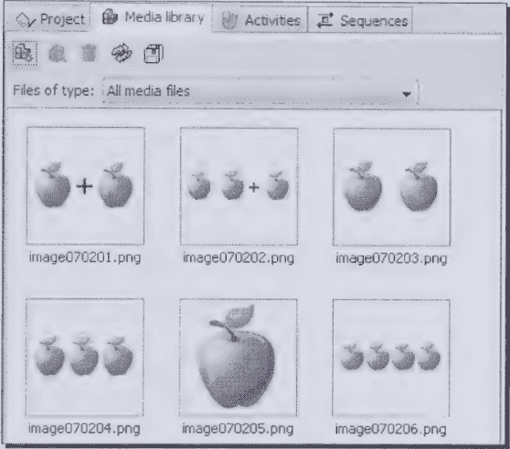

+   7. 单击 **Activities** 选项卡并从主菜单中选择 **Insert | New activity**。在 **New activity** 对话框中显示的列表中选择 **Complex association**。在 **Name of the activity** 文本框中输入 `Grids` 并单击 **OK**。JClick 将新活动添加到项目中并显示数十个选项的新选项卡。

+   8. 单击 **Activities** 选项卡并从主菜单中选择 **Insert | New activity**。在 **New activity** 对话框中显示的列表中选择 **Exchange puzzle**。在 **Name of the activity** 文本框中输入 `Puzzle` 并单击 **OK**。JClick 将新活动添加到项目中并显示数十个选项的新选项卡。

+   9. 接下来单击与新活动相关的 **Panel** 选项卡，然后单击其中的 **Grid A** 面板。此网格将显示两个视觉数学运算。

17. 单击 **Image** 标签右侧的按钮。**Multimedia object selection** 对话框将出现。选择第一个可能视觉结果的位图图形，`image070203.png`，然后单击 **OK**。然后，在 **Cell contents** 对话框中单击 **OK**。顶部单元将显示所选位图图形的视觉结果。

18. 对第二、第三和第四个单元重复上一步（17），使用其余三个视觉结果的位图图形，`image070204.png`、`image070205.png` 和 `image070206.png`。下图显示了四个包含可能视觉结果的单元：

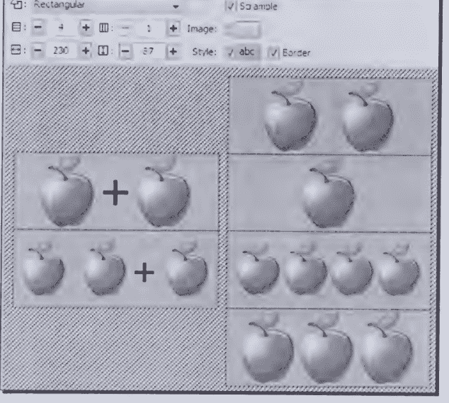

19. 现在有必要告诉 JClick 每个视觉数学运算的正确答案。这可以通过在左侧网格中的一个单元和右侧网格中的一个单元之间建立关系来实现。单击 **Relationship** 面板。

20. 单击左侧网格中的第一个单元。接下来将鼠标指针定位到该数学运算结果的单元上，即右侧网格中的第一个单元。单击它，JClick 将从左侧单元向右侧单元显示一个箭头。

21. 对第二个视觉数学运算及其结果重复上一步（20）。JClic 将显示两个箭头以说明关系，如下图所示：

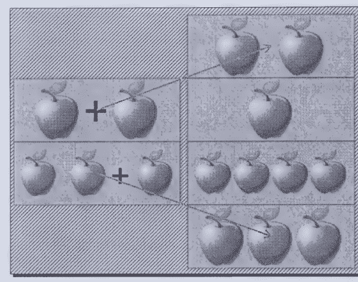

22. 从 JClic 的主菜单中选择 File | Save 以保存对项目的更改。

23. 单击 Sequences 选项卡。在 Forward arrow 下的 Action 组合框中选择 Exit JClic 并激活 Move on automatically 复选框。这样，活动完成后 JClic 就会结束。取消选中 Back arrow 下的 Show button 复选框。

24. 再次从 JClic 的主菜单中选择 File | Save。

25. 接下来，选择 View | Preview Activity。JClic 将显示一个新窗口，其中包含两个包含视觉数学运算及其可能视觉结果的乱序网格。每次预览活动时；JClic 都会打乱单元并以随机顺序呈现它们。

26. 单击每个视觉数学运算，然后单击其视觉结果。当所选结果正确时，视觉数学运算将从左侧网格中消失，如下图所示：

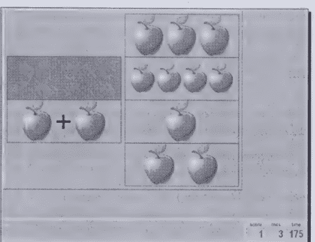

## What just happened?

我们使用 JClic 和之前创建的两个视觉数学运算和四个可能视觉结果的位图图形创建了一个复杂关联活动。我们利用 JClic 提供的功能创建了两个网格，让学生能够解决视觉数学运算。

我们将每个位图链接到一个单元，然后建立关系以指示每个数学运算的正确结果。JClic 在预览面板中显示了每个单元所做的更改。如前所述，每次学生运行练习时，JClic 都会以随机生成的顺序打乱两个网格中的单元。

## Time for action – adding the activity to a Moodle course

我们现在必须将带有视觉数学运算的网格添加到现有的 Moodle 课程中。

-   1. 登录到您的 Moodle 服务器。
-   2. 确保已安装允许将 JClic 项目和活动添加到 Moodle 的模块。执行安装所需的步骤已在前几章中解释。
-   3. 单击所需的课程名称（Farm）。您可以创建新课程或使用现有课程。
-   4. 如前所述，按照编辑所需周次摘要所需的步骤进行操作。在 Summary 文本框中输入 Exercise 2 并保存更改。

5. 单击所选周次的 Add an activity 组合框并选择 JClic。会出现一个新网页，显示标题 Adding a new JClic to week。

6. 在 Name 文本框中输入 Completing a grid of visual mathematical operations。

7. 在 Description 文本框中输入 Click on each visual mathematical operation at the left and then on its correct result at the right。选择此文本所需的字体和颜色。

8. 单击 Choose or upload a file 按钮，已知的信息弹出窗口将显示文件和文件夹的信息。

9. 单击 Upload a file 按钮，然后单击 Browse。浏览到存放 JClic 项目的文件夹（C:\Farm\complex0702）并选择要上传的文件 complex0702.jclic.zip。然后，单击 Open 和 Upload this file 按钮。

10. 接下来，将鼠标指针定位到 complex0702.jclic.zip 名称上并水平移动到同一行中的 Choose action 超链接。然后，如下图所示单击 Choose：

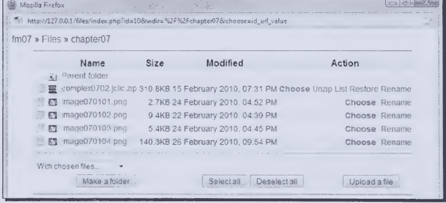

11. Moodle 将在 File name 文本框中显示 chapter07/complex0702.jclic.zip。这是包含 JClic 项目及其活动 complex association 的所有文件的 ZIP 文件。

12. 在 Width 中输入 600，在 Height 中输入 400。

13. 选择 1 作为 Maximum number of trials。

14. 向下滚动并单击网页底部的 Save and return to course 按钮。

## What just happened?

我们将包含两个网格的复杂关联练习添加到 Moodle 课程中。学生现在可以通过在相应周次上单击其超链接来运行活动。我们刚刚上传了一个 ZIP 文件，其中包含六个位图图形以及 JClic 项目和单个活动的定义等多个压缩文件。

## Time for action – solving the visual mathematical operations

是时候帮助 Alice 解决有关苹果的视觉数学运算了。

-   1. 使用具有学生角色的用户登录到您的 Moodle 服务器。
-   2. 单击课程名称（Farm）。
-   3. 单击相应周次上的 Completing a grid of visual mathematical operations 链接。Web 浏览器将显示练习。显示活动的 JClic 面板加载可能需要一些时间。
-   4. 单击带有视觉数学运算的其中一个单元并尝试找到其结果。
-   5. 每次选择错误结果时，JClic 应用程序都会播放表示错误的音效。每次选择正确结果时，它都会播放表示成功操作的音效。当您单击视觉数学运算时，JClic 会绘制一条线，直到您单击其中一个可能结果，如下图所示：

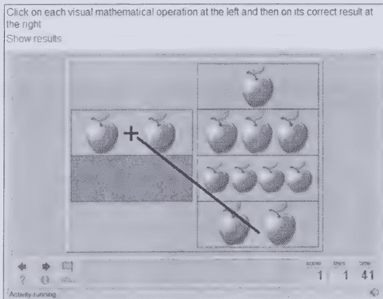


然后添加以下可能的结果：

- 1个苹果
- 2个苹果
- 3个苹果
- 4个苹果
- 5个苹果
- 6个苹果
- 7个苹果
- 1个橘子
- 2个橘子
- 3个橘子
- 4个橘子
- 5个橘子
- 6个橘子
- 8个橘子

这样，学生将必须理解用苹果和橘子进行数学运算之间的区别，因为在这种情况下，结果中会出现两种水果。

## 小测验——处理可视化数学运算

- 1. 当你需要为Moodle多选题添加描述时：
  a. 你可以添加一个新的多选题类型问题。
  b. 你可以添加一个新的描述类型问题。
  c. 你可以添加一个新的选择通用描述类型问题。
- 2. 在Moodle多选题中，当用户提交错误答案时：
  a. 正确答案的反馈会出现在正确答案的右侧。
  b. 正确答案的反馈不会出现。
  c. 错误答案的反馈会出现。

3. 在Moodle多选题中：

  a. 你可以通过添加包含指向多个不同WMF文件的链接的HTML代码来添加带动画的图形。Moodle会将每个WMF用作动画的一帧。
  b. 你可以通过添加指向GIF动画文件的HTML代码来添加带动画的图形。
  c. 你可以通过添加包含指向多个不同PNG文件的链接的HTML代码来添加带动画的图形。Moodle会将每个PNG用作动画的一帧。

4. 当你使用JClic Author创建复杂关联活动时：

  a. 你只能指定网格A的行数。
  b. 你只能指定网格B的行数和列数。
  c. 你可以自定义两个网格中每一个的行数和列数。

5. JClic Author中的复杂关联活动：

  a. 显示一个包含隐藏单词的字母网格。
  b. 显示两个网格，这些网格中的某些单元格之间存在关系。
  c. 显示三个网格，这些网格中的某些单元格之间存在关系。

## 总结

在本章中，我们学习了如何：

- 结合场景、动物图片、苹果图像和符号，进行数学趣味练习
- 创建可视化选择题，让学生数一数农场里的动物，然后通过查看每个可选答案中显示的动物数量来选择可视化答案
- 使用多种工具，创建以农场为背景、上面有许多动物的复杂场景
- 创建一对网格，让学生将可视化数学运算与其可视化结果关联起来
- 使用Inkscape将图片与符号组合，以表示每个可视化数学运算及其可能的结果，从而让学生通过视觉丰富的活动来练习简单的数学运算

现在我们已经学会了如何创建数学运算练习，我们准备制作语言心智操作练习，这是下一章的主题。
