## 语言心智操作

> > *我们可以通过创建各种视觉丰富的活动来练习语言心智操作。我们可以使用许多不同的应用程序来创建练习，帮助学生理解和组织视觉信息。这样，我们可以帮助他们在进行语言心智操作时提高注意力。*

在本章中，我们将：

- 使用具有多个元素和图层的图像，为视觉序列准备图片
- 创建视觉和交互式活动，以理解和排列视觉序列
- 使用图像处理软件调整颜色饱和度水平
- 准备不同色调的图像，用于彩色序列
- 学习创建双重拼图
- 通过考虑感官知觉资源来组织序列

在本章中，爱丽丝去购物。我们将学习如何创建视觉丰富的活动，以练习与她的旅程相关的心理操作。

### 完成视觉序列

圣诞节快到了。爱丽丝和她的妈妈去购物，因为他们需要买很多礼物。爱丽丝一直对为所有礼物准备包装、丝带和蝴蝶结时组合不同颜色的过程感到惊奇。她喜欢准备包装，今年他们买了非常大的礼物，需要额外的工作。我们来帮帮她好吗？

## 动手实践——生成视觉序列的图片

我们将搜索与圣诞包装相关的现有2D矢量剪贴画。然后，我们将删除此矢量剪贴画的部分内容，以创建用丝带和蝴蝶结准备包装的视觉序列的四个部分。然后，我们将使用Inkscape功能将每个剪贴画图像导出为2D位图图像。

- 1. 在Windows资源管理器中创建一个新文件夹（C:\Shopping）。
- 2. 启动Inkscape并将其最小化。稍后你会用到它。
- 3. 启动Word 2007。你将在一个新的空白文档中工作。
- 4. 单击“插入 | 剪贴画”。剪贴画面板将出现在主窗口的右侧。
- 5. 单击“搜索范围”组合框，并激活“所有位置”复选框。单击“结果应为”组合框，并取消所有选项。然后在“所有媒体类型 | 剪贴画”中激活“Windows图元文件（*.wmf）”复选框。这样，Word将在所有可用集合（包括Web集合）中搜索可缩放的矢量剪贴画文件。
- 6. 单击“搜索文字”文本框并输入Package。
- 7. 单击“开始”按钮。
- 8. 将鼠标指针移动到所需剪贴画的缩略图上。
- 9. 右键单击所需剪贴画的缩略图，然后在出现的上下文菜单中选择“预览/属性”。Word将显示一个新对话框，其中显示可缩放剪贴画的更大预览和临时文件名。
- 10. 三击“文件”后面显示的长路径和文件名。这样，你将确保选中临时文件的完整路径。然后右键单击它，并在出现的上下文菜单中选择“复制”。
- 11. 接下来，激活Inkscape——记住它是以最小化状态运行的。你可以使用Alt+Tab或Windows+Tab。不要关闭剪贴画的预览窗口。
- 12. 从主菜单中选择“文件 | 导入”。单击“输入文件名”按钮（带有纸张图标的铅笔），然后将先前复制的临时文件的完整路径粘贴到“位置：”文本框中。该路径将类似于C:\Users\vanesa\AppData\Local\Microsoft\Windows\Temporary Internet Files\Content.IE5\0B60XKF0\MCJ02322010000[1].wmf。
- 13. 单击“打开”按钮。先前预览的剪贴画——一个适合我们序列的精美包装——将出现在Inkscape绘图区域中并处于选中状态。

14. 右键单击最近添加的图片，然后在上下文菜单中选择“取消组合”选项。这样，我们将能够操纵构成图片的每个单独元素，如下一个截图所示：

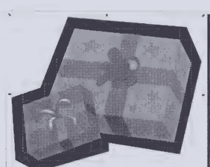

15. 从Inkscape的主菜单中选择“文件 | 另存为”。将文件保存为image080104.svg，保存在之前创建的文件夹C:\Shopping中。这张图片将成为我们视觉序列的最后一张图片。

16. 选择“文件 | 导出位图”。将出现一个显示许多导出选项的对话框。单击“绘图”按钮，在“宽度”文本框中输入200，然后单击“导出”。Inkscape将以PNG格式导出最近导入的剪贴画。导出的位图图形文件将是C:\Shopping\image080104.png。

17. 接下来，从Inkscape的主菜单中选择“编辑 | 取消选择”。单击两个包装后面的黑色阴影，然后按键盘上的Delete键。Inkscape将擦除阴影。

18. 然后点击右侧包装上出现的深绿色星星之一。Inkscape将选择这个单独的元素，如下面的截图所示：

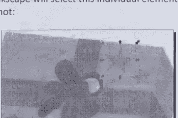

- 19. 按下 Delete 键，选中的星星将被擦除。重复该操作，删除右侧包裹上的所有星星。

- 20. 从 Inkscape 主菜单中选择“文件 | 另存为”。将文件保存为 image080103.svg，保存到之前创建的文件夹 C:\Shopping。这张图片将作为我们视觉序列中的第三张图片，如下图所示。

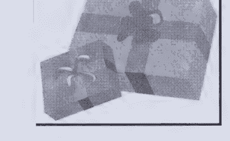

- 21. 选择“文件 | 导出位图”。单击“绘图”按钮，在“宽度”文本框中输入 200，将“文件名”改为 image080103.png，然后点击“导出”。Inkscape 会将修改后的图片以 PNG 格式导出。导出的位图图形文件将是 C:\Shopping\image080103.png。

- 22. 接下来，重复之前说明的步骤删除图形中的星星，但这一次要删除构成蝴蝶结和绳结的所有元素，如下图所示：

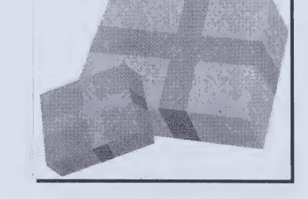

- 23. 从 Inkscape 主菜单中选择“文件 | 另存为”。将文件保存为 image080102.svg，保存到之前创建的文件夹 C:\Shopping。这张图片将作为我们视觉序列中的第二张图片。

- 24. 选择“文件 | 导出位图”。单击**绘图**按钮，在**宽度**文本框中输入 200，将**文件名**改为 `image080102.png`，然后点击**导出**。Inkscape 会将修改后的图片以 PNG 格式导出。导出的位图图形文件将是 `C:\Shopping\image080102.png`。

- 25. 最后，重复之前说明的步骤删除图形中的星星，但这一次要删除构成丝带的所有元素，如下图所示：

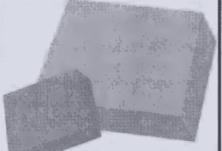

- 26. 从 Inkscape 主菜单中选择“文件 | 另存为”。将文件保存为 `image080101.svg`，保存到之前创建的文件夹 `C:\Shopping`。这张图片将作为我们视觉序列中的第一张图片。

- 27. 选择“文件 | 导出位图”。单击**绘图**按钮，在**宽度**文本框中输入 200，将**文件名**改为 `image080101.png`，然后点击**导出**。Inkscape 会将修改后的图片以 PNG 格式导出。导出的位图图形文件将是 `C:\Shopping\image080101.png`。下面的截图显示了构成该视觉序列的四张图片，展示了包裹的准备过程：

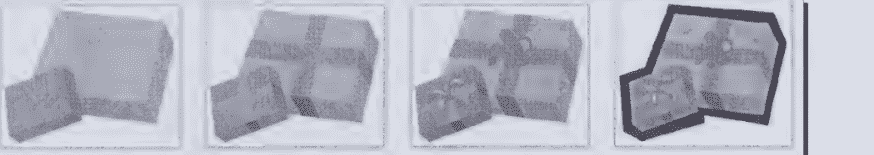

## 刚才发生了什么？

我们选择了一幅可缩放矢量剪贴画图像，作为视觉序列的基准图。我们将图片导入 Inkscape，并删除了构成原始剪贴画的不同元素组，以呈现包裹准备的不同阶段。我们创建了几个 Inkscape 文件，然后将它们导出为 PNG 格式。现在，我们有以下四张位图图形可用于练习：

- image080101：两个盒子
- image080102：两个带丝带的盒子
- image080103：两个带丝带、蝴蝶结和绳结的盒子
- image080104：两个带丝带、蝴蝶结、绳结、星星贴纸和阴影的盒子

## 动手实践——生成初始视觉序列

现在，我们将使用之前创建的视觉序列中的不同图片，以及我们熟悉的 JClic Author 来生成一个交换拼图。

- 1. 通过其网页或单击其图标运行 JClic Author 0.2.0.5。
- 2. 从 JClic 主菜单中选择“文件 | 新建项目”。将出现一个新对话框。在每个文本框中输入下列值，然后点击“确定”：
- 3. 在“项目名称”中输入 exchange0801。
- 4. 在“文件名”中输入 exchange0801。JClic 会将完整项目保存为压缩文件 exchange0801.jclic.zip。
- 5. 在“文件夹”中，于之前创建的文件夹 C:\Shopping 下输入新的子文件夹 exchange0801，即 C:\Shopping\exchange0801。
- 6. 点击“项目”选项卡。在“标题”文本框中输入“排列视觉序列”。
- 7. 点击“媒体库”选项卡。
- 8. 从主菜单中选择“插入 | 新建媒体对象”。选择 C:\Shopping 中之前保存的四张图片：image080101.png、image080102.png、image080103.png 和 image080104.png，然后点击“打开”按钮。JClic 会要求你确认将之前选择的每个文件复制到项目文件夹；单击“是”四次。组成该序列的四张图片将出现在 JClic 的媒体库中，如下面的截图所示。
- 13. 对接下来三个单元格重复上述步骤。按下表为每个单元格选择图片文件名：

| 列号 | 图片文件名 |
|---|---|
| 2 | `image080102.png` |
| 3 | `image080103.png` |
| 4 | `image080104.png` |

- 14. 从 JClic 主菜单中选择**文件 | 保存**，以保存对项目所做的更改。
- 15. 点击**序列**选项卡。在**前进箭头**下方的**动作**组合框中选择**退出 JClic**，并勾选**自动前进**复选框。这样，活动结束后 JClic 就会退出。取消勾选**后退箭头**下方的**显示按钮**复选框。
- 16. 再次从 JClic 主菜单中选择**文件 | 保存**。
- 17. 接下来，选择**视图 | 预览活动**。JClic 将显示一个新窗口，其中包含视觉序列中被打乱的部分。每次预览活动时，JClic 都会打乱这些图片，并以随机顺序呈现，如下面的截图所示：

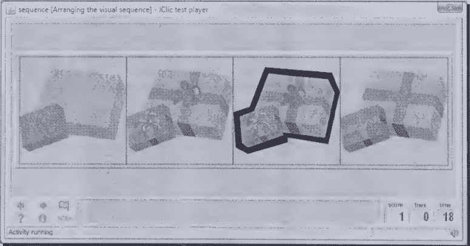

- 18. 将序列中的每个部分拖放到其对应位置，以排列视觉序列。当一张图片被放到正确位置时，JClic 会将其与该位置的图片交换，如下面的截图所示。

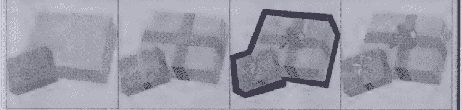

## 刚才发生了什么？

我们创建了一个交换拼图，其矩形块排列在 1 行 4 列的网格中。我们将之前创建的位图图形分别添加到每个部分，以交换拼图的形式组织视觉序列。我们利用 JClic 提供的功能创建了一个网格，让学生能够排列视觉序列。

我们按必要的顺序将每张位图链接到一个单元格，以呈现正确的序列。JClic 在预览面板中显示了每个单元格所做的更改。如前所述，学生每次运行练习时，JClic 都会使用随机生成的顺序打乱这些单元格。

## 动手实践——将活动添加到 Moodle 课程

现在，我们必须将这个带视觉序列的交换拼图添加到现有的 Moodle 课程中。

- 1. 登录你的 Moodle 服务器。
- 2. 确保已安装允许将 JClic 项目和活动添加到 Moodle 的模块。执行安装所需的步骤已在前面章节中说明。
- 3. 单击所需课程名称（Shopping）。你可以创建新课程，也可以使用现有课程。
- 4. 按之前学到的内容，按必要步骤编辑所需周的摘要。在“摘要”文本框中输入“练习 1”并保存更改。
- 5. 单击所选周的“添加一个活动”组合框，并选择 JClic。将出现一个新网页，显示标题“向周中添加新的 JClic”。
- 6. 在“名称”文本框中输入“排列视觉序列”。
- 7. 在**描述**文本框中输入“将每张图片拖放到正确位置，以创建正确的包裹准备视觉序列”。为此文本选择所需的字体和颜色。
- 8. 单击**选择或上传文件**按钮，将出现那个熟悉的、显示文件和文件夹信息的弹出窗口。
- 9. 单击**上传文件**按钮，再单击**浏览**。浏览到存放 JClic 项目的文件夹（C:\Shopping\exchange0801），选择要上传的文件 `exchange0801.jclic.zip`。然后依次单击**打开**和**上传该文件**按钮。
- 10. 接下来，将鼠标指针移到 `exchange0801.jclic.zip` 名称上，然后水平移动到同一行的**选择操作**超链接上。然后，单击**选择**，如下图所示：

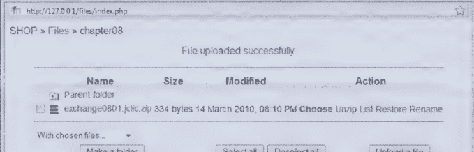

- 11. Moodle 会在**文件名**文本框中显示 `chapter08/exchange0801.jclic.zip`。这个 ZIP 文件包含 JClic 项目及其活动（拼图）的所有文件。
- 12. 在**宽度**文本框中输入 `760`，在**高度**文本框中输入 `400`。
- 13. 在**最大尝试次数**中选择 `1`。
- 14. 向下滚动并点击位于网页底部的**保存并返回课程**按钮。

## 刚才发生了什么？

我们将“排列视觉序列”练习添加到了 Moodle 课程中。现在，学生可以通过单击对应周中该活动的超链接来运行它。

我们创建了一个新文件夹 `chapter08`。该文件夹将保存与购物相关的活动所需的全部文件。

然后，我们只上传了一个 ZIP 文件，其中包含许多压缩文件，里面有组成序列的四张图像，以及 JClic 项目和单个活动的定义。

## 动手实践——通过拖放图像排列序列

现在是时候帮助 Alice 通过拖放将每张图像放到正确的位置了。

- 1. 使用具有学生角色的用户登录你的 Moodle 服务器。
- 2. 单击课程名称（Shopping）。
- 3. 单击对应周次上的“排列视觉序列”链接。Web 浏览器将显示该练习。显示活动的 JClic 面板可能需要一些时间才能加载。
- 4. 将鼠标指针悬停在需要移动到视觉序列中其他位置的所需图像上。
- 5. 单击该图像。图像现在会随着鼠标移动而改变位置。使用鼠标将图像放到正确的位置，如下面的截图所示：

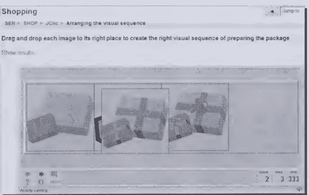

- 6. 单击将图像留在所选位置。原来位于该位置的图像将被移到被重新定位图像的原始位置。每次将图像放到正确位置时，JClic 应用程序都会播放一个声音表示操作成功。每次将图像放到错误位置时，JClic 应用程序都会播放一个声音表示出错。
- 7. 排列好视觉序列后，活动将结束，你可以通过单击 **显示结果** 来查看结果。
- 8. 注销，然后用你的普通用户和角色登录。你可以像之前活动一样查看尝试次数。请记住，它们将分组显示在 JClic 活动中。

## 刚才发生了什么？

在此活动中，我们创建了准备两份礼物包装袋的序列的四个部分。孩子必须通过拖放图像来排列这个序列。

为了帮助练习思维操作，我们应用了以下概念和资源：

- **逻辑序列排序。** 孩子必须根据包装袋完成的程度，从左到右排列图像序列。
- **感官知觉资源。** 我们使用了表现包装准备过程的图像。孩子必须注意每张图像中出现的元素数量，以理解其在序列中的正确位置。
- **由多个图层组成的图像。** 每张图片都由多个图层中的许多元素组成。孩子可以在解决练习时与准备包装的场景产生共鸣，并发挥自己的想象力。

## 使用上网本的触摸板排列序列

上网本及其触摸板等新硬件技术通常会给孩子带来额外的动力。孩子可以用手指在触摸板上移动鼠标指针来排列序列。

在许多情况下，上网本的触摸板会使活动更具吸引力，而且通常需要孩子使用两根手指：一只手的一根手指移动鼠标指针，另一只手的一根手指按触摸板按钮。而孩子使用鼠标时，只需要一只手。

## 完成彩色序列

圣诞节两周后，Alice 和她的妈妈又去购物了。这一次，她们想为 Alice 的弟弟 Kevin 寻找一份完美的生日礼物。她们在购物中心花了两个小时，但没有找到合适的礼物。

最后，Alice 盯着一家体育用品店的橱窗，因为她看到了一个颜色炫目的惊艳足球。这正是送给 Kevin 的完美礼物。

## 动手实践——使用 GIMP 准备多张不同颜色的图像

我们首先要下载并安装 GIMP 2.6.8。然后，我们将搜索一张与足球相关的现有位图图像，并准备五张具有不同颜色饱和度等级的位图图像。

- 1. 如果尚未安装，请从 http://www.gimp.org/downloads/ 下载并安装 GIMP 2.6.8。
- 2. 启动 GIMP 并最小化其主窗口。稍后你还会用到它。
- 3. 启动 Word 2007。你将在新的空白文档中工作。
- 4. 单击“插入 | 剪贴画”。剪贴画面板将出现在主窗口的右侧。
- 5. 单击“搜索范围”组合框，并勾选“所有位置”复选框。单击“结果应该是”组合框，取消选中所有选项。然后在“所有媒体类型 | 照片”中勾选“PNG（可移植网络图形）(*.png)”复选框。这样，Word 将在所有可用的集合中搜索 PNG 位图图像文件，包括 Web 集合。
- 6. 单击“搜索文字”文本框，输入 Football。
- 7. 单击“转到”按钮。
- 8. 将鼠标指针悬停在所需的剪贴画缩略图上。
- 9. 右键单击所需的剪贴画缩略图，然后在出现的上下文菜单中选择“预览/属性”。Word 将显示一个新的对话框，其中显示可缩放剪贴画的更大预览和临时文件名。
- 10. 三击“文件”后面显示的长路径和文件名。这样，你可以确保选中临时文件的完整路径。然后右键单击它，并在出现的上下文菜单中选择“复制”。
- 11. 接下来，激活 GIMP——记得它一直在最小化运行。你可以使用 Alt + Tab 或 Windows + Tab。不要关闭剪贴画的预览窗口。
- 12. 从主菜单中选择“文件 | 打开位置”。在“输入位置 (URI)”文本框中粘贴之前复制的临时文件完整路径。该路径将类似于 C:\Users\vanesa\AppData\Local\Microsoft\Windows\Temporary Internet Files\Content.IE5\0B6OXKF0\MCJ04417880000[1].png，如下面的截图所示：

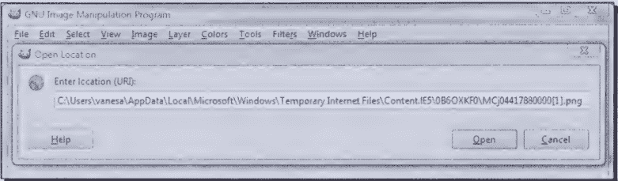

- 13. 单击“打开”按钮。之前预览过的位图图像——一个适合我们彩色序列的漂亮足球——将出现在 GIMP 的图像窗口中并处于选中状态，如下一张截图所示：

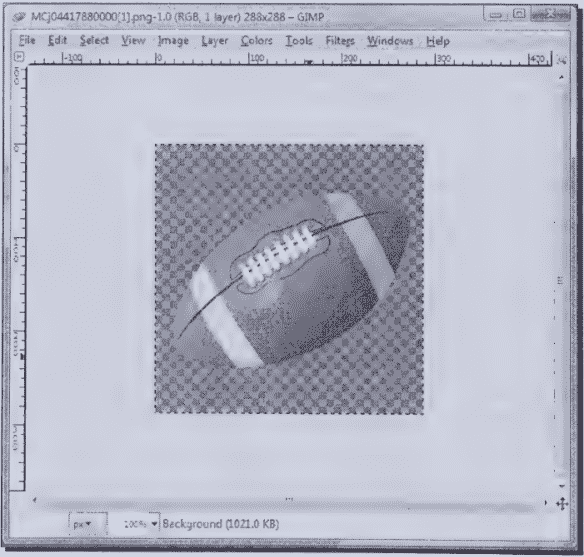

- 14. 从 GIMP 的主菜单中选择“文件 | 另存为”。将文件保存为 image080205.png，放在之前创建的文件夹 C:\Shopping 中。此图像将成为彩色序列中的最后一张图像，即颜色真实的足球。
- 15. 接下来，从 GIMP 的主菜单中选择“颜色 | 色相-饱和度”，将出现“色相-饱和度”对话框，其中显示许多滑块。在“饱和度”中输入 -30。GIMP 图像窗口中显示的足球将改变其颜色饱和度水平，并显示为较暗的颜色，如下一张截图所示：

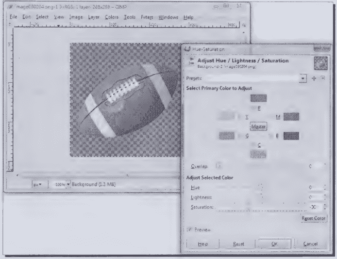

- 16. 从 GIMP 的主菜单中选择“文件 | 另存为”。将文件保存为 image080204.png，放在之前创建的文件夹 C:\Shopping 中。此图像将成为彩色序列中的第四张图像。
- 17. 重复上述步骤（15 和 16），每次将颜色饱和度降低到 -30，并按下表所示名称保存图像文件：

| 彩色序列中的位置 | 图片文件名 |
|---|---|
| 第三 | image080203.png |
| 第二 | image080202.png |

- 18. 接下来，从 GIMP 的主菜单中选择“颜色 | 色相-饱和度”，并在“饱和度”中输入 -100。GIMP 图像窗口中显示的足球将显示为灰度，如下图所示：

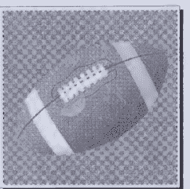

- 19. 从 GIMP 的主菜单中选择“文件 | 另存为”。将文件保存为 image080201.png，放在之前创建的文件夹 C:\Shopping 中。此图像将成为彩色序列中的第一张图像。下一张图显示了组成足球颜色序列的五张图像：

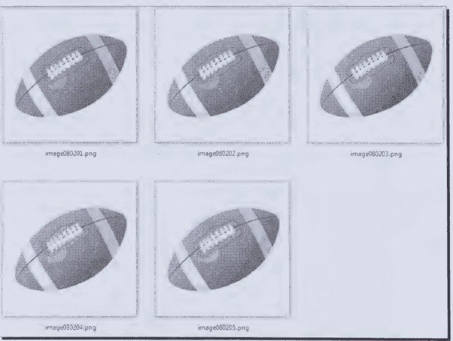

## 刚才发生了什么？

我们首先安装了 GIMP，这是一个非常强大的开源图像处理程序。我们选择了一张位图图像作为颜色序列的基准。我们将图片导入 GIMP，并修改其颜色饱和度级别，以生成从灰度到足球真实颜色的不同饱和度添加阶段。我们创建了五张位图图形，可用于练习中：

- `image080201`：灰度足球
- `image080202`：比 `image080203` 颜色饱和度更低的足球
- `image080203`：比 `image080204` 颜色饱和度更低的足球
- `image080204`：比 `image080205` 颜色饱和度更低的足球
- `image080205`：真实颜色的足球

## 动手实践——生成初始颜色序列

现在，我们将使用组成之前创建的颜色序列的不同图像以及我们熟悉的 JClic Author 来生成一个双重拼图。

- 1. 从其网页或通过单击图标运行 JClic Author 0.2.0.5。
- 2. 从 JClic 的主菜单中选择“文件 | 新建项目”。将出现一个新的对话框。为每个文本框输入以下值，然后点击“确定”：
  - 在 **项目名称** 中输入 `double0802`。
  - 在 **文件名** 中输入 `double0802`。JClic 将把完整项目保存到一个压缩文件 `double0802.jclic.zip` 中。
  - 在 **文件夹** 中输入 `C:\Shopping\double0802`，即在之前创建的文件夹 `C:\Shopping` 中新建一个 `double0802` 子文件夹。
- 3. 单击 **项目** 选项卡。在 **标题** 文本框中输入 `Arranging the color sequence`。
- 4. 单击 **媒体库** 选项卡。

- 5. 从主菜单中选择 Insert | New media object。选择 C:\Shopping 中之前保存的四张图片：image080201.png、image080202.png、image080203.png、image080204.png 和 image080205.png，然后单击 Open 按钮。JClic 会询问你是否确认将每个已选文件复制到项目文件夹中；连续单击五次 Yes。构成序列的五张图片将出现在 JClic 的媒体库中，如下图所示：

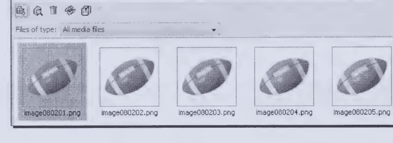

- 6. 单击 Activities 选项卡并从主菜单中选择 Insert | New activity。在 New activity 对话框中显示的列表中选择 Double puzzle。在 Name of the activity 文本框中输入 Sequence，然后单击 OK。JClic 将新活动添加到项目中，并显示数十个选项的新选项卡。

- 7. 单击与新活动相关的 Panel 选项卡。

- 8. 在组合框中选择 Rectangular，输入 1 作为 rows，5 作为 columns，150 作为 width，150 作为 height。JClic 将显示一个包含一行五列的单元格。

- 9. 单击 Style 按钮，将出现一个对话框。单击显示当前 Background 颜色的方块，将出现颜色选择对话框。选择白色而不是默认的灰色背景，然后单击 OK。这样，白色背景将使学生更容易发现色调的差异。

- 10. 接下来，单击第一个方块（第一个单元格）。将出现 Cell contents 对话框。单击 Image 标签右侧的按钮。将出现 Multimedia object selection 对话框。选择颜色序列的第一张图片 image080201.png，单击 OK，然后再次单击 OK。第一个单元格将在白色背景的中央显示所选位图。

- 11. 对接下来的四个单元格重复上述步骤。按照下表中所示为每个单元格选择图片文件名：

| Column number | Picture file name |
| --- | --- |
| 2 | image080202.png |
| 3 | image080203.png |
| 4 | image080204.png |
| 5 | image080205.png |

- 12. 单击 Layout 选项卡并单击带有 A 在 B 上方的按钮，如下图所示。这样，显示彩色序列打乱图片的第一个面板将出现在顶部，而容纳排列好的彩色序列的面板将出现在底部。

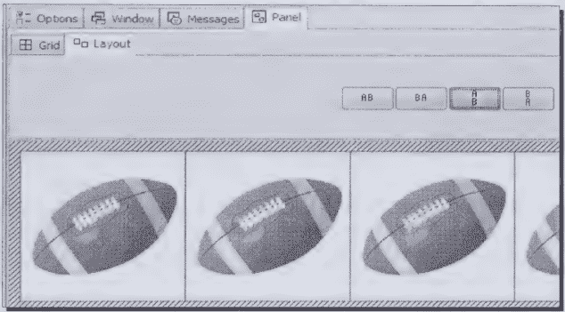

- 13. 从 JClic 的主菜单中选择 File | Save 以保存对项目的更改。

- 14. 单击 Sequences 选项卡。在 Forward arrow 下的 Action 组合框中选择 Exit JClic 并激活 Move on automatically 复选框。这样，活动完成后 JClic 将结束。取消选中 Back arrow 下的 Show button 复选框。

- 15. 再次从 JClic 的主菜单中选择 File | Save。

## Mental Operations with Language

- 16. 接下来，选择 View | Preview Activity。JClic 将显示一个新窗口，窗口顶部显示视觉序列的打乱部分。每次预览活动时，JClic 都会打乱图片并以随机顺序呈现，如下图所示：

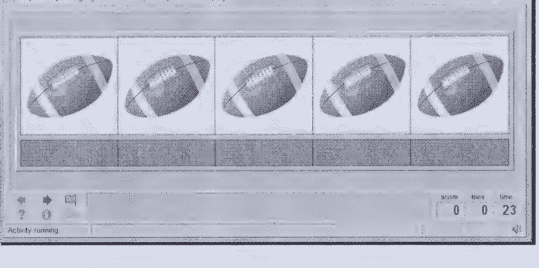

- 17. 将序列的每个部分拖放到底部面板的对应空单元格中，以创建从灰度到真实颜色的颜色序列。当图片被放置到正确位置时，JClic 将其保留在单元格中，如下图所示：

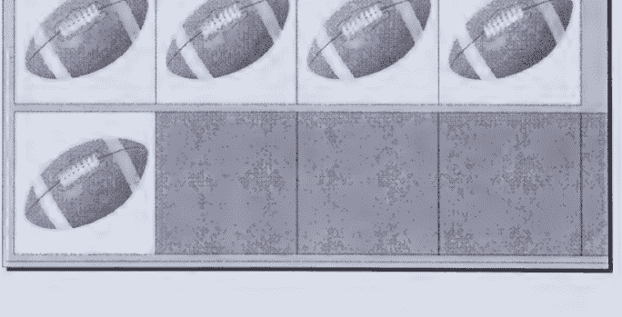

### What just happened?

我们创建了一个包含五张图片的双拼图，需要按照其色彩饱和度水平进行排序。我们将每个之前创建的位图图形添加到每个部分，以便在顶部面板中以打乱的方式呈现。我们利用 JClic 提供的功能创建了两个网格，允许学生排列颜色序列。

我们将每个位图链接到单元格中的必要顺序，以表示正确的序列。JClic 在预览面板中显示了每个单元格所做的更改。如前所述，每次学生运行练习时，JClic 都会使用随机生成的顺序打乱顶部面板中的单元格。

### Time for action – adding the activity to a Moodle course

我们现在必须将带有颜色序列的双拼图添加到现有的 Moodle 课程中。

- 1. 登录到你的 Moodle 服务器。
- 2. 单击所需的课程名称（Shopping）。你可以创建新课程或使用现有课程。
- 3. 如前所述，按照必要的步骤编辑所需周的摘要。在 Summary 文本框中输入 Exercise 1 并保存更改。
- 4. 单击所选周的 Add an activity 组合框并选择 JClic。会出现一个新网页，显示标题 Adding a new JClic to week。
- 5. 在 Name 文本框中输入 Arranging the color sequence。
- 6. 在 Description 文本框中输入 "Complete the panel at the bottom with a colored sequence, from black and white to the vivid colors. Drag and drop each image from the top to the corresponding position at the bottom." 为此文本选择所需的字体和颜色。
- 7. 单击 Choose or upload a file 按钮，已知的弹出窗口将显示文件和文件夹的信息。
- 8. 单击 Upload a file 按钮，然后单击 Browse。浏览到保存 JClic 项目的文件夹（C:\Shopping\double0802）并选择要上传的文件 double0802.jclic.zip。然后单击 Open 和 Upload this file 按钮。
- 9. 接下来，将鼠标指针定位在 double0802.jclic.zip 名称上并水平移动到同一行的 Choose action 超链接。然后单击 Choose，如下图所示：

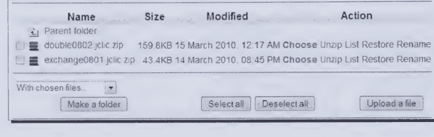

- 10. Moodle 将在 File name 文本框中显示 chapter08/double0802.jclic.zip。这是包含 JClic 项目及其活动、双拼图的所有文件的文件。
- 11. 在 Width 中输入 760，在 Height 中输入 580。
- 12. 在 Maximum number of trials 中选择 1。
- 13. 向下滚动并单击网页底部的 Save and return to course 按钮。

### What just happened?

我们将排列颜色序列练习添加到 Moodle 课程中。学生现在可以通过在对应周上单击其超链接来运行活动。

我们上传了一个包含许多压缩文件的单个 ZIP 文件，其中包括构成彩色序列的五张图片，以及 JClic 项目的定义文件，以及双拼图作为单个活动。

### Time for action – arranging the sequence with different color tones by dragging and dropping images

现在是时候以学生身份运行活动并以教师身份检查结果了。

- 1. 使用具有学生角色的用户登录到你的 Moodle 服务器。
- 2. 单击课程名称（shopping）。
- 3. 单击对应周上的 Arranging the color sequence 链接。网页浏览器将显示练习。
- 4. 将鼠标指针定位在顶部网格上的某张图片上。
- 5. 单击该图片。图片现在将根据鼠标指针的移动改变位置。使用鼠标将图片定位到底部面板的正确位置，如下图所示：

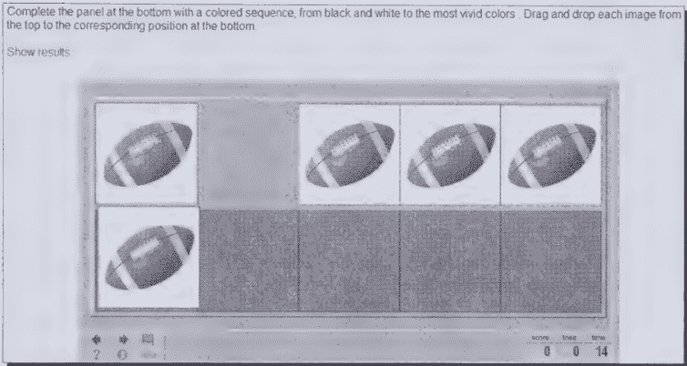

- 6. 单击以将图片留在底部面板所选位置。每次将图片放置到底部面板的正确位置时，JClic 应用程序会播放表示操作成功的声音。每次将图片放置到错误位置时，JClic 应用程序会播放表示错误的提示音并将图片返回到顶部面板的原始位置。
- 7. 排列完颜色序列后，活动将结束，如下图所示。然后你可以通过单击 Show results 来检查你的结果。

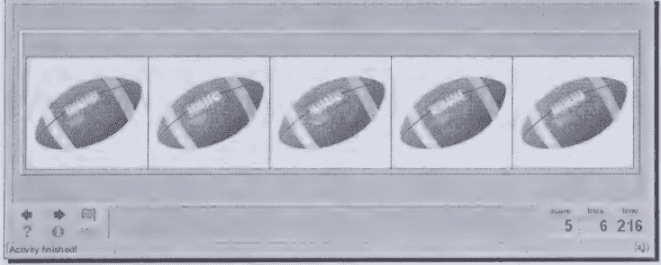

## 本章小结

在本章中，我们学习了如何：

- 通过语言进行思维操作练习
- 使用不同的图片素材创建视觉序列
- 利用多种工具以矢量图形为基准，然后擦除其原始构图中的元素
- 使用单个网格让学生排列视觉序列
- 使用 GIMP 对现有的足球图像创建多个不同版本，修改其颜色饱和度级别，让学生排列颜色序列；这样，学生就能通过视觉丰富的活动进行思维操作

现在我们已经学会了如何创建思维操作练习，接下来可以准备更高级的练习，让学生写出有引导的句子和段落，这是下一章的主题。
