## 9

## 编写引导式句子和段落

我们可以通过创建不同类型的活动来引导孩子写出简单的句子和段落。此外，我们可以使用许多不同的应用程序让学生录制句子而不是书写句子。这样，我们就能评估他们的技能，并创建激励性的练习，为他们提供更好的指导，以写出更简单或更复杂的句子。

在本章中，爱丽丝去看了马戏团表演。我们将学习如何创建与她的旅程相关的简单写作活动。通过阅读本章并跟随练习，我们将能够：

- 使用许多预定义单词准备并录制一个句子
- 录制、编码并上传数字化的语音，作为 Moodle 练习的结果
- 准备将剪贴画图片与几何图形相结合的图像
- 学习如何创建能让学生描述物体之间空间关系的练习
- 使用不同的多媒体资源来激励学生写出有引导的句子和段落

### 用特定单词造句

上周六，爱丽丝和妈妈去了马戏团。今天是普里西拉的生日，爱丽丝迫不及待地想告诉朋友们她在马戏团看到的滑稽而惊险的事情。

当她看到狮子跳过燃烧的火圈时，她真的很害怕。她喜欢那些跳跃旋转的小狗，还有旋转球的大海豹。然而，她需要记住一些表演。我们帮帮她好吗？

### 动手实践——选择并准备用于造句的单词

我们首先要选择要用于句子中的单词，然后向现有的 Moodle 课程中添加一项新的“高级文件上传”活动。

- 1. 登录你的 Moodle 服务器。
- 2. 点击所需的课程名称（马戏团）。按照之前学过的方法，按照必要的步骤编辑所需周的摘要。在“摘要”文本框中输入“练习 1”并保存更改。
- 3. 在所选周的“添加活动”组合框中点击，选择“高级文件上传”。
- 4. 在“作业名称”中输入“用特定单词造句”。
- 5. 在字体中选择“Verdana”，在字号中选择“5 (18)”——即“描述”下方的两个组合框。
- 6. 点击“字体颜色”按钮（一个带有六个颜色框的 T 形图标），为文本选择所需的颜色。
- 7. 点击“描述”下方的大文本框，输入以下关于学生本练习目标的说明。你可以使用放大的编辑器窗口，如下一个截图所示。分别用不同的字体颜色标注三个单词：Lion（狮子）、Hoops（火圈）和 Flaming（燃烧的）。
- 8. 关闭放大的编辑器窗口。在“最大大小”中选择“10MB”。这是每个学生针对此活动可以上传的文件的最大大小。然而，非常重要的是要向你所在 Moodle 服务器的管理员确认服务器提供的可能性。
- 9. 在“最大上传文件数”中选择“1”。

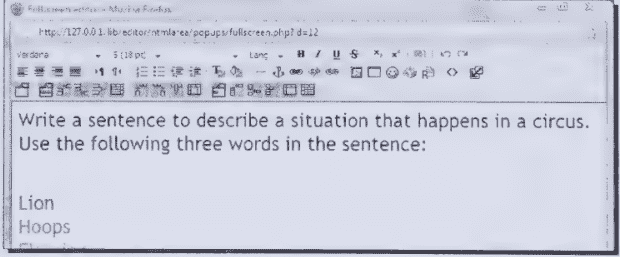

**10.** 在“允许备注”中选择**是**。这样，学生就能在备注中添加包含句子的说明。

**11.** 向下滚动，点击**保存并显示**按钮。Web 浏览器将显示高级文件上传活动的说明。

### 刚才发生了什么？

我们向一个 Moodle 课程添加了高级文件上传活动，该活动将允许学生写出一个句子，句子中必须包含备注区指定的三个单词。现在，学生可以通过点击相应周次中的超链接来阅读此活动的目标。然后，他们将写出句子，并上传带有情境描述的语音。

我们使用在线文本编辑器功能，以自定义的字体和颜色添加了目标描述和句子中要使用的三个单词。

### 动手实践——写出并录制句子

我们首先必须下载并安装 **Audacity 1.2**。然后，我们将帮助爱丽丝写出一个句子、朗读它，并使用 Audacity 的功能录制她的声音。

- 1. 如果还没有安装，请下载并安装 Audacity 1.2（http://audacity.sourceforge.net/download/）。该软件将允许学生录制自己的声音，并将录音保存为与之前解释的 Moodle 多媒体插件兼容的 MP3 文件。

> 在这里，我们介绍的是 Audacity 1.2 的基本安装和用法。关于 Moodle 中声音和音乐元素的集成，包括 Audacity 的高级用法，在 João Pedro Soares Fernandes 所著、Packt Publishing 出版的《Moodle 1.9 Multimedia》中有深入描述。

- 2. 启动 Audacity。
- 3. 接下来，需要下载 LAME MP3 编码器，使 Audacity 能够将录制的音频导出为 MP3 文件格式。打开你的默认 Web 浏览器，访问 Audacity 网页，该网页显示了安装正确版本的 LAME MP3 编码器的说明，网址为 http://audacity.sourceforge.net/help/faq?s=install&i=lama-mp3。

14. 一旦你读完了句子，点击“停止”按钮（黄色方块）。Audacity 将停止录制你的声音。

15. 从 Audacity 的主菜单中选择“文件 | 导出为 MP3”。将 MP3 音频文件保存为 `mysentence.mp3`，存放在你的文档文件夹中。

16. Audacity 将显示一条消息，表明它使用免费提供的 LAME 库来处理 MP3 文件编码，如下一个截图所示：

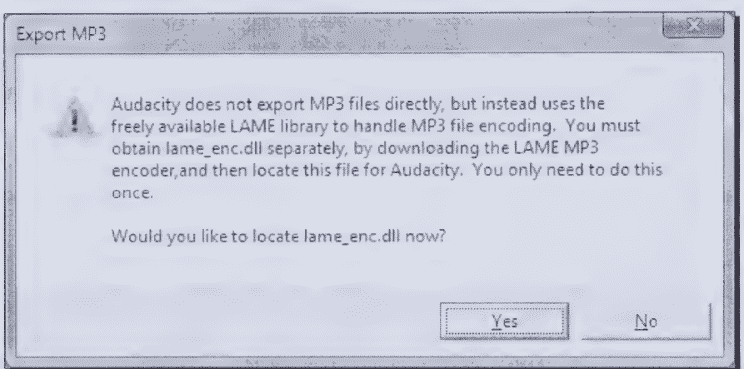

17. 点击“是”，并浏览到你安装 LAME MP3 编码器的文件夹，默认情况下是 `C:\Program Files\Lame for Audacity`。点击“打开”，Audacity 将显示一个对话框，用于编辑 MP3 文件的某些属性。点击“确定”，它将把 MP3 文件 `mysentence.mp3` 保存到你的文档文件夹中。

18. 接下来，返回带有 Moodle 活动的 Web 浏览器，向下滚动，点击“保存更改”按钮。

19. 点击“提交草稿”下方的“浏览”按钮。浏览到存放你录制了句子的 MP3 音频文件的文件夹（即你的文档文件夹），选择要上传的文件 `mysentence.mp3`，然后点击“打开”。接着，点击“上传此文件”，将 MP3 音频文件上传到 Moodle 服务器。如果 MP3 文件顺利完成上传，文件名 `mysentence.mp3` 将出现在“提交草稿”下方，如下一个截图所示。接下来，点击“继续”。

写出一个描述马戏团中发生的情境的句子。在句子中使用以下三个单词：

Lion（狮子）
Hoops（火圈）
Flaming（燃烧的）

可用时间：2010年5月19日（星期三）下午 5:25
截止日期：2010年5月26日（星期三）下午 5:25

# 提交草稿

mysentence.mp3

# 备注

狮子跳过燃烧的火圈。

编辑

提交作业以供评分

送交评分

20. 点击“送交评分”，然后点击“是”。一条新消息“作业已提交供评分，无法更新”将出现在包含句子的“备注”部分下方。

21. 注销，然后用你的普通用户和角色登录。你可以通过点击相应周次中的“用特定单词造句”链接，然后点击“查看 x 份已提交作业”来检查已提交的作业。Moodle 将显示每位提交该作业的学生的备注和上传文件的链接，如下一个截图所示。

| 名字 / 姓氏 | 分数 | 评语 | 最近修改（学生） | 最近修改（教师） | 状态 | 最终分数 |
|---|---|---|---|---|---|---|
| 爱丽丝 爱丽丝 | - | - | 备注 mysentence.mp3 2010年5月19日（星期三）晚上 10:07 | - | 评分 | - |

22. 你可以通过点击相应的链接来阅读笔记并收听录制的句子。

23. 检查完结果后，在网格中对应行的 **Grade** 上点击。会出现一个反馈窗口，其中包含文本编辑器和包含可能成绩的下拉列表。

24. 在 **Grade** 下拉列表中选择成绩，并在文本编辑器中写下任何反馈，如下一张截图所示。然后点击 **Save changes**。最终成绩将出现在网格中对应的单元格中。

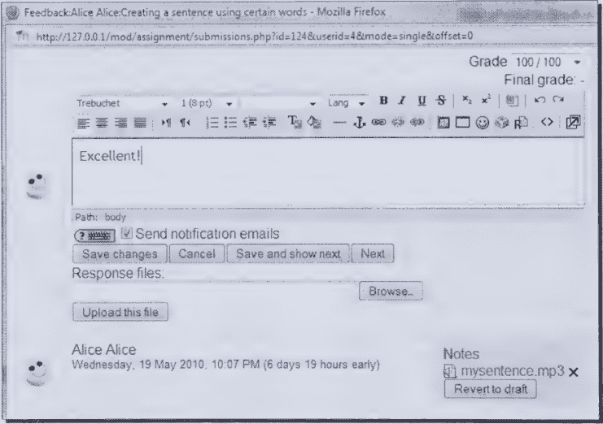

## What just happened?

在此活动中，我们定义了一个简单的单词列表，并要求学生写一个简单的句子。在这种情况下，没有图片或多媒体资源，因此他们必须发挥想象力。

孩子必须阅读并理解三个单词。他/她必须将它们关联起来，想象一个情境并说出和/或写出一个句子。有时，孩子写句子会太困难。在这种情况下，他/她可以与治疗师或家庭成员一起合作，运行前面解释过的软件并录制句子。这样，即使学生无法用这些单词写出完整的句子，也能评估此练习的结果。

## Have a go hero – discussing the results in Moodle forums

使用额外的软件录制声音来完成练习对学生及其家长来说可能具有挑战性。在 Moodle 提供的论坛中准备常见问题的答案。

这样，你就可以通过 Moodle 中的其他渠道与学生及其家长互动，提供不同的反馈方式。

你可以通过在活动面板中点击 Forums 来访问每个 Moodle 课程的论坛。

## Have a go hero – working with images instead of words

一些学生阅读和理解书面单词有很大困难。通过使用多张图片代替单词，创建一个先前练习的新版本。通过使用图片，学生可以通过观察图片来录制句子，然后在治疗师或家庭成员的帮助下完成活动。

创建一个新的活动，要求学生观看视频并录制他/她关于该视频的自己的故事。

## Time for action – installing a NanoGong assignment to set speaking homework

我们也可以利用提供 NanoGong 作业类型的非标准模块。该作业是布置口语作业的绝佳方式，无需使用 Audacity 等额外应用程序进行数字语音录制过程。NanoGong 是一款由兰卡斯特大学网络服务有限公司（LUNS）的 Dan Poltawski 开发的语音录制 Java 小程序，提供了一种新的作业类型。

首先，有必要安装允许我们向 Moodle 添加 NanoGong 作业并分析其执行结果的模块。你需要以管理员身份访问你的 Moodle 服务器，按照以下步骤操作。

1. 打开默认网页浏览器并前往 http://moodle.org/mod/data/view.php?d=13&rid=2882。此网页允许我们下载 Moodle 的 NanoGong 作业类型模块的最新版本。

2. 通过点击 Download the latest version 链接下载此模块的最新版本，如下一张截图所示。在这种情况下，我们将使用 `nanogong.zip`。

   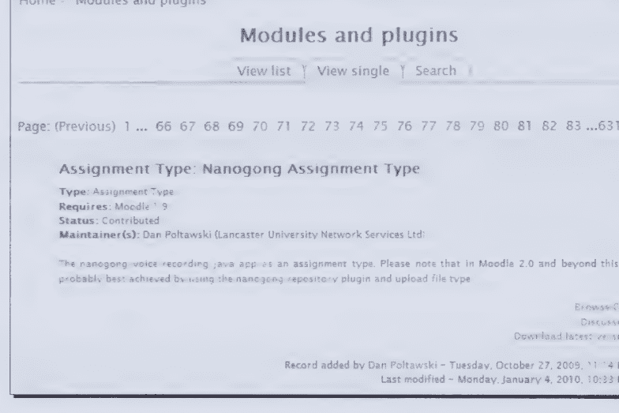

3. 将下载的压缩文件复制到临时文件夹并解压其内容。然后复制解压后创建的 `nanogong` 文件夹。

4. 前往你的 Moodle 服务器主文件夹。我们将以 `C:\Moodle` 作为 Moodle 服务器文件夹的示例；将其替换为你的文件夹。

5. 接下来，进入 Moodle 服务器主文件夹中的 `server\moodle\mod\assignment\type` 文件夹，在我们的示例中为 `C:\Moodle\server\moodle\mod\assignment\type`。

6. 粘贴之前复制的 `nanogong` 文件夹。结果你将在 `type` 子文件夹中看到一个新的 `nanogong` 文件夹，在我们的示例中为 `C:\Moodle\server\moodle\mod\assignment\type`，如下一张截图所示。

7. 点击所选周的 Add an activity 下拉框并选择 NanoGong。名称出现在 Assignments 类别下，如下一张截图所示。

   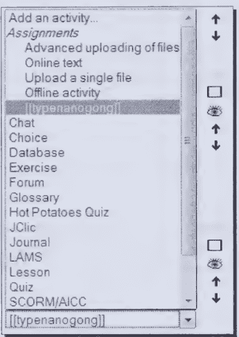

8. 在 Assignment name 中输入 `Recording a sentence using certain words`。

9. 在字体中选择 Verdana，大小选择 5 (18)——描述下方的前两个下拉框。

10. 点击 Font Color 按钮（带六个颜色框的 T）并为文本选择你想要的颜色。

11. 点击描述下方的较大文本框并输入本次练习学生目标的以下描述。你可以使用下一张截图中显示的放大编辑器窗口：

## Time for action – recording the sentence with the NanoGong recorder

我们现在将帮助 Alice 使用 NanoGong 录音机录制她的声音。

1. 使用学生角色登录你的 Moodle 服务器。

2. 点击课程名称（`Circus`）。

3. 点击对应周的 **Recording a sentence using certain words** 链接。网页浏览器将显示活动的描述和用于句子的三个单词。

4. 点击录音机底部的 **Record** 按钮（灰色圆圈）并开始朗读句子。录音机将显示绿色条，表示正在录制的声音输入电平，如下一张截图所示：

   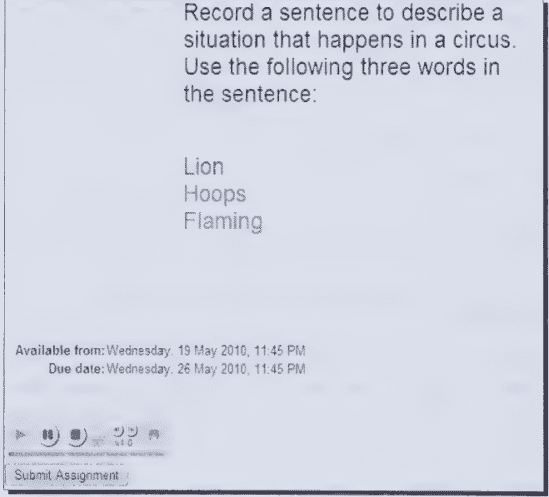

   你需要将麦克风连接到计算机才能使用 NanoGong 录音机录制你的声音。

5. 朗读完句子后，点击 **Stop** 按钮（灰色正方形）。NanoGong 录音机将停止录制你的声音。

6. 点击录音机上的 **Play** 按钮（灰色三角形）并检查你的声音是否按预期录制。

7. 点击录音机下方的 **Submit Assignment** 按钮。

8. 注销并使用你的正常用户角色登录。你可以通过点击对应周的 **Recording a sentence using certain words** 链接，然后点击 **View x submitted assignments** 来检查已提交的作业。x 是迄今为止学生提交的作业数量。Moodle 将为提交此作业的每个学生显示已上传录音的 NanoGong 录音机，如下一张截图所示：

   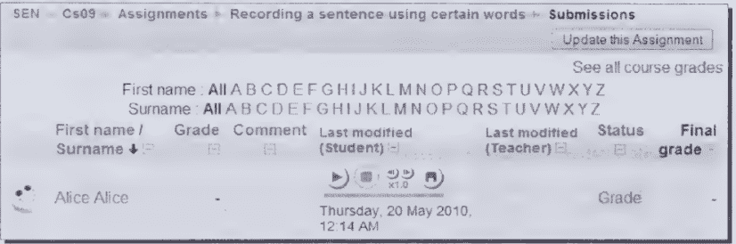

9. 你将能够点击 **Play** 按钮并在不离开网页的情况下收听录制的句子。

10. 在网格中对应行的 **Grade** 上点击。会出现一个反馈窗口，其中包含文本编辑器、包含可能成绩的下拉列表以及 NanoGong 录音机。你将能够点击此播放器上的 **Play** 按钮并收听学生录制的句子。

11. 在 **Grade** 下拉列表中选择成绩，并在文本编辑器中写下任何反馈，如下一张截图所示。然后点击 **Save changes**。最终成绩将出现在网格中对应的单元格中。

    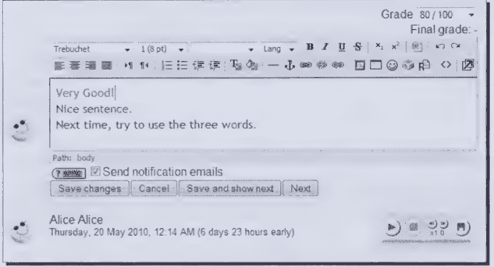

## What just happened?

在此活动中，我们定义了一个简单的单词列表，并要求学生使用内置语音录音机录制一个简单的句子。在这种情况下，由于我们使用了 NanoGong 作业，学生录制声音更容易。对教师来说检查结果也更容易。

## Describing spatial relationships between different objects

马戏团是学习几何和重力的好地方。一位才华横溢的杂技演员能够抛接数十个球超过五分钟，一个骑在球上的小丑与大象玩耍，一只不可思议的孟加拉虎跳过一个圆环。

Alice 希望她父亲画出一个骑在球上与大象玩耍的小丑。由于她父亲不记得这个表演，她必须向他描述这个场景，包括小丑、球和大象的位置。

## 动手实践——创建包含与几何形状相关的2D图片的场景

我们现在要创建一个包含小丑、大象和圆的场景。

1. 如果尚未完成，请在 Windows 资源管理器中新建一个文件夹（C:\Circus）。
2. 启动 Inkscape 并将其最小化。稍后会用到它。
3. 启动 Word 2007。你将在新的空白文档中操作。
4. 单击“插入 | 剪贴画”。主窗口右侧将出现“剪贴画”面板。
5. 单击“搜索范围”组合框，并勾选“所有位置”复选框。这样，Word 将在所有可用的集合中搜索剪贴画，包括 Web 集合。
6. 单击“搜索文字”文本框并输入 Clown。
7. 单击“转至”按钮。
8. 将鼠标指针悬停在所需剪贴画的缩略图上。由于你想使用 Inkscape 在不损失质量的情况下更改图片大小，请确保它是 WMF 或 EMF 文件。
9. 右键单击所需剪贴画的缩略图，并在出现的上下文菜单中选择“预览/属性”。Word 将显示一个新的对话框，其中包含可缩放剪贴画的更大预览和临时文件名。
10. 三击“文件”后显示的长路径和文件名。这样可以确保选中临时文件的完整路径。然后右键单击它，并在出现的上下文菜单中选择“复制”。
11. 接下来，激活 Inkscape——记住它正在最小化运行。你可以使用 Alt + Tab 或 Windows + Tab。不要关闭剪贴画的预览窗口。
12. 从主菜单中选择“文件 | 导入”。单击“键入文件名”按钮（带纸张图标的铅笔），并将之前复制的临时文件完整路径粘贴到“位置：”文本框中。该路径类似于 C:\Users\vanesa\AppData\Local\Microsoft\Windows\Temporary Internet Files\Content.IE5\R7ZPXDXQ\MCj02792460000[1].wmf。
13. 单击“打开”按钮。之前预览过的剪贴画（即我们场景的背景）将出现在 Inkscape 的绘图区域中。
14. 返回 Word 2007，并关闭“预览/属性”对话框。
15. 重复上述步骤（5 到 13），向 Inkscape 的绘图区域添加一头大象。下面的截图显示了小丑和大象可能的图片：

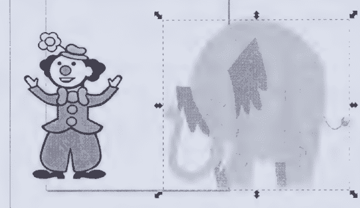

16. 单击“创建圆形、椭圆形和弧形”按钮（一个粉色圆形）或按 F5。此功能允许你在 Inkscape 的绘图区域中添加具有不同描边和填充颜色的圆形、椭圆形或弧形。
17. 圆形必须位于小丑下方。将鼠标指针放在圆形的左下角，然后向上拖动鼠标到右上角。因为我们想要创建的是圆形而非椭圆形，请按住 Ctrl 键以保持对称的长宽比。
18. 右键单击 Inkscape 绘图区域底部颜色中所需的圆形填充颜色，并在出现的上下文菜单中选择“设置填充”。
19. 接下来，单击“选择和变换对象”按钮（第一个按钮，一个黑色箭头）或按 F1。此功能允许你选择和移动对象。
20. 将小丑放在圆形上，大象放在右侧，如下图所示：

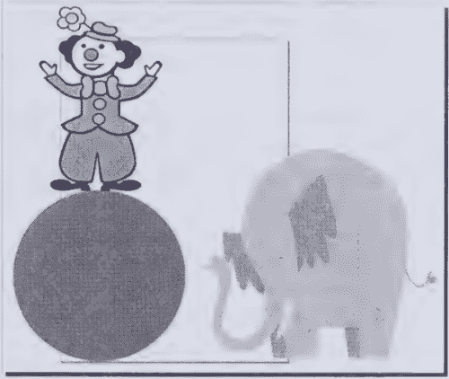

21. 从 Inkscape 的主菜单中选择**文件 | 保存**。将文件保存为 `image090201.svg`，放在之前创建的文件夹 `C:\Circus` 中。
22. 选择**文件 | 导出位图**。将出现一个显示许多导出选项的对话框。单击**绘图**按钮，在**宽度**文本框中输入 780，然后点击**导出**。Inkscape 会将最近导入的剪贴画以 PNG 格式导出。导出的位图图形文件将是 `C:\Circus\image090201.png`。

## 刚刚发生了什么？

我们使用 Inkscape、可缩放矢量剪贴画和一个几何形状（圆形）创建了一个马戏团场景的表示。现在，我们有一个站在球（圆形）上的小丑和一头在右侧的大象。最后，我们将生成的图像导出为 PNG 格式。

## 动手实践——将场景上传到 Moodle

现在，我们需要上传之前导出的位图图像，以便将我们的练习添加到现有的 Moodle 课程中。

1. 登录你的 Moodle 服务器。
2. 单击所需的课程名称（`Circus`）。你可以创建新课程，也可以使用现有课程。
3. 按照之前学过的步骤，编辑所需星期的摘要。在**摘要**文本框中输入**练习 2**，然后保存更改。
4. 在所选星期的“添加活动”组合框中单击，然后选择“日志”。
5. 在“日志名称”中输入 Describing spatial relationships between objects。
6. 在字体中选择 Verdana，在字号中选择 5 (18)——“日志问题”下方的前两个组合框。然后为文本选择所需的颜色。
7. 单击“日志问题”下方的大文本框，并输入：

    - 描述小丑的位置。
    - 描述大象的位置。

8. 按 Enter 键，并单击“插入图片”按钮（一座山）。将出现一个新的网页，显示标题“插入图片”。
9. 按照必要步骤创建一个新文件夹，chapter 09。然后点击 chapter09 文件夹链接，再点击“浏览”按钮。浏览到保存导出图纸的文件夹，并选择要上传的文件 image090201.png。然后点击“打开”和“上传”按钮。“文件上传成功”标签将出现在文件浏览器框中。
10. 接下来，点击最近上传文件的名称 image090201.png。图片将出现在“预览”框中。
11. 在“替代文本”中输入 clownandelephant，然后点击“确定”。图片将出现在之前输入的标题下方。请记住，你可以点击“放大编辑器”按钮以查看屏幕上的更多信息，如下一张截图所示。

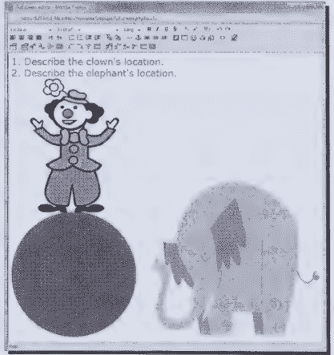

7. 然后写出第二个问题的答案，描述大象与蓝色球之间的空间关系。

    2. 大象在蓝色球的旁边，如下一张截图所示：

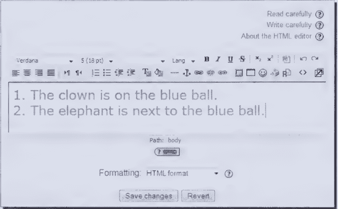

8. 点击**保存更改**按钮。这样，Moodle 将保存此练习的两个答案。
9. 注销，然后以你的正常用户和角色登录。不要忘记按照之前所学检查此练习的结果。

## 刚刚发生了什么？

在此活动中，我们将可缩放矢量剪贴画与几何形状混合在一起。孩子必须理解不同元素之间的空间关系，并用简单的句子进行描述。孩子可以独立完成，也可以在治疗师或家庭成员的帮助下完成，以便理解和运行该练习。

孩子必须描述每个对象的相对位置。他/她必须专注于理解构成场景的不同元素，并且必须运用语言技能写出每个句子。

我们可以通过添加更多元素和多种几何形状来增加此练习的复杂性。

## 小测验——使用音频

1. Audacity 允许你：
    - a. 从连接到计算机的麦克风录制音频
    - b. 拍摄矩形快照
    - c. 导入和操作 Word 可缩放矢量剪贴画
2. Inkscape 允许你：
    - a. 导入 Word 可缩放矢量剪贴画，但无法绘制几何形状
    - b. 绘制椭圆，但绘制圆形确实很困难
    - c. 绘制圆形、椭圆形和弧形
3. 当你在 Moodle 的日志中上传使用 Inkscape 创建的场景时：
    - a. 你可以将其导出为兼容的 EMF 格式
    - b. 你可以将其导出为兼容的 WMF 格式
    - c. 你可以将其导出为兼容的 PNG 格式
4. 当你在 Moodle 中创建 NanoGong 作业时：
    - a. 学生可以使用网络摄像头录制视频
    - b. 学生可以在答案中录制自己的声音
    - c. 学生可以记录自己的按键操作
5. 如果你想使用 Audacity 将录制的音频保存为 MP3 文件：
    - a. 有必要在其安装向导的其中一个步骤中激活 LAME MP3 编码器复选框
    - b. 有必要下载 WMF 编码器
    - c. 有必要下载 LAME MP3 编码器

## Summary

In this chapter, we have learned how to:

- Prepare exercises that motivate children to write guided sentences and paragraphs
- Create a list of words related to a scene in a circus and work with specialized software, Audacity, to allow the students to upload an audio file with their sentences
- Create new NanoGong assignments to allow students to record their voice with the answers without requiring the installation of additional software on their computers
- Create a scene and combine it with questions to motivate the students to describe spatial relationships between pictures and geometric shapes

Now that we have learned how to create exercises to write guided sentences and paragraphs, we're ready to use Moodle to run cognitive evaluation tests, which is the topic of the next chapter.
