## Running Cognitive Evaluation Tests

Flowers and their related household items are also useful to test the comprehension of simple and complex instructions.

## Time for action – generating pictures to prepare the instructions

We are first going to search for existing 2D clipart related to the different elements mentioned in each step. We will then convert them to 2D bitmap images using our well-known Snipping Tool.

1. Create a new folder in Windows Explorer (C:\Home).

2. Open your default web browser and go to http://office.microsoft.com/en-us/clipart/default.aspx. This web page allows us to search for free clipart in **Office Online Clip Art & Media**.

3. Enter vases in the textbox and click on the **Search** button. The available clipart thumbnails related to the entered keyword will appear.

4. Click on the zoom icon located below the desired clipart thumbnail. A new window displaying a small preview of the clipart will appear.

5. Click on **Bigger preview** and this label will change to **Smaller preview**. We want to use the big preview to take snapshots of the clipart images using the same size.

6. Use Snipping Tool to take a snapshot of the clipart preview and save the file as `image100101.png` in the previously created folder, `C:\Home`.

7. Next, go back to the web browser and repeat the aforementioned steps (3 to 6) to capture the bitmap images of another clipart. In this case, repeat those steps searching for the following things and saving the image files with the names as shown in the next table. The next screen shows four images representing different elements of the simple instructions that we are going to create.

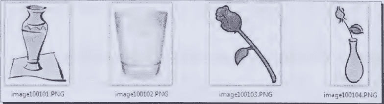

| Search for | Picture file name |
|---|---|
| Water | Image100102.png |
| Rose | Image100103.png |
| Roses | Image100104.png |

## What just happened?

We searched for clipart previews in Office Online Clip Art & Media, through our web browser. Instead of working with Inkscape, this time we used the Snipping Tool application to capture the portion of the screen that showed the desired clipart's preview. This way, we could save the necessary images in the PNG format following just a few simple steps.

We now have the following four bitmap graphics ready to be used in our simple and complex instructions exercise:

- Image100101.png: A flower vase
- Image100102.png: A glass of water
- Image100103.png: A rose
- Image100104.png: A rose in a flower vase

## Time for action – using pictures to prepare the instructions

We are now going to prepare the instructions to test the students' skills in following simple instructions.

1. Log in to your Moodle server.

2. Click on the desired course name (Home). As previously learned, follow the necessary steps to edit the summary for a desired week. Enter Exercise 1 in the Summary textbox and save the changes.

3. Click on the Add an activity combo box for the selected week and choose Upload a single file.

4. Enter Testing simple instructions in Assignment name.

5. Select Verdana in font and 4 (14) in size—the first two combo boxes below Description.

6. Click on the Font Color button (a T with six color boxes) and select your desired color for the text.

7. Click on the big text box below **Description** and enter the description of the student's goal for this exercise. Upload and insert the corresponding picture for each of the elements that have a bitmap representation. Include these pictures enclosed in parentheses after their name appears in each sentence. Resize each clipart image as shown in the next screenshot. Remember that you can use the enlarged editor window. Select a bigger font and a different color for each step number.

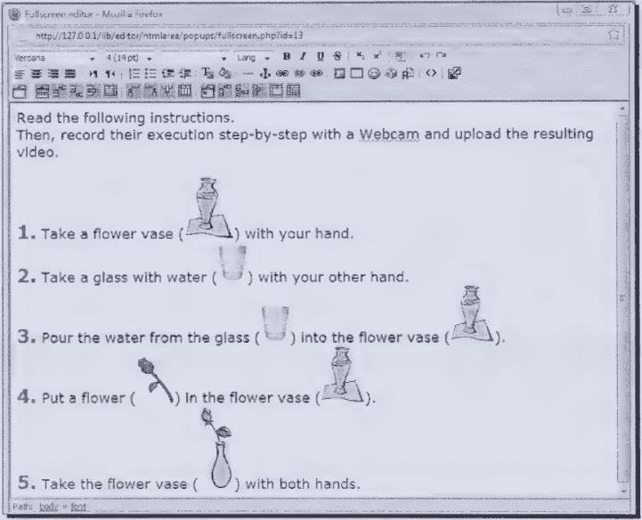

8. Select **10MB** in **Maximum size**. This is the maximum size for the video file that each student is going to be able to upload for this activity. However, it is very important to check the possibilities offered by your Moodle server with its Moodle administrator.

9. Close the enlarged editor's window, scroll down, and click on the **Save and display** button. The web browser will show the description for the upload a single file activity.

## What just happened?

We added an upload a single file activity to a Moodle course that will allow a student to read, understand, and follow the explained instructions, record the results using a Webcam, and then upload the video to Moodle.

We added pictures of the different elements that appear in each step. This way, it is going to be easier to understand the instructions. Additionally, we used the editor features to resize the uploaded and inserted pictures.

## Time for action – using a Webcam to record the results of executing the exercise

It is time to help Alice use a Webcam to solve this exercise.

1. Log in to your Moodle server using a user with the student role.

2. Click on the course name (Home).

3. Click on the **Testing simple instructions** link on the corresponding week. The web browser will show the description for the activity, including the five steps to record with the Webcam. The next screenshot shows the page that appears displaying the text **Upload a file** and two buttons, **Browse** and **Upload this file**, located at the bottom.

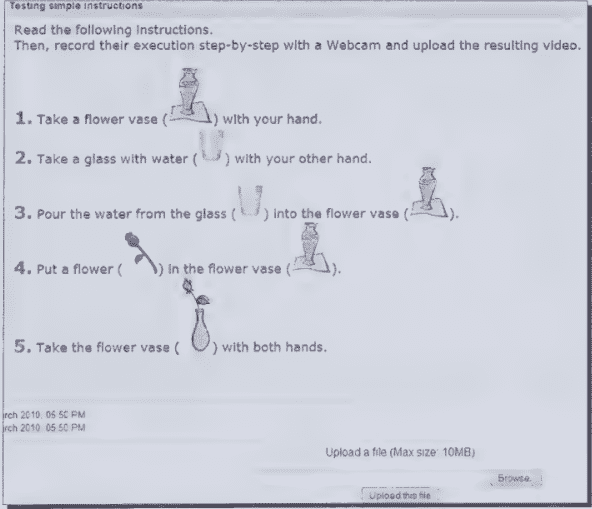

4. Start the software that allows you to record videos with your Webcam. This software could vary according to the Webcam manufacturer.

5. Start recording a video with a 640 x 480 resolution in any of the following video formats supported by Moodle and follow the instructions, as shown in the next screenshot:

- AVI
- FLV
- MPG
- MOV
- WMV

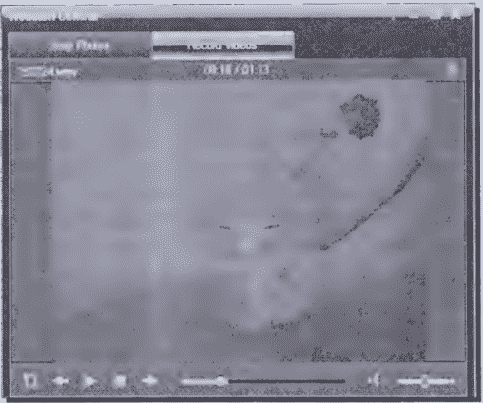

6. Once you finish recording the execution of the instructions, go back to your web browser and click on Browse. Browse to the folder where you saved the video file, select it, and click on Open. Then click on Upload this file to upload the video file to the Moodle server. A File uploaded successfully message such as the one shown in the next screenshot will appear if the video file is uploaded without any problems. Then click on Continue.

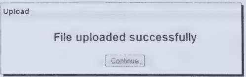

7. Next, the previously uploaded video file will appear below the instructions, as shown in the following screenshot with the name **192224.wmv**:

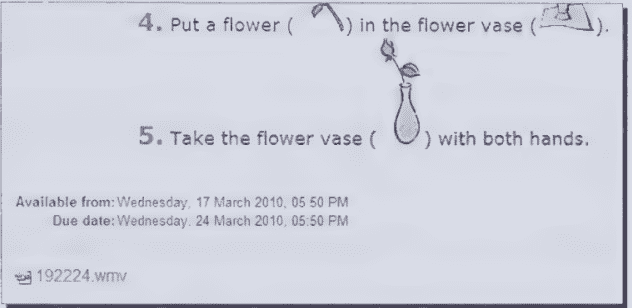

8. Finally, you will be able to watch the recorded and uploaded video by clicking on the link that appears at the bottom of the page. You are going to be able to download and watch the video with Windows Media Player, VLC Media Player, or any other video player software, as shown in the next screenshot.

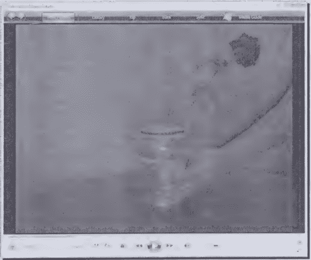

## Testing the comprehension of different situations

Alice likes scrambled eggs for breakfast. However, Kevin doesn't like eggs at all. Children usually find it easy to explain situations that happen in the kitchen. Thus, it is possible to ask them questions about chefs.

## Time for action – generating a questionnaire related to a situation

We are first going to search for existing 2D clipart to represent a situation and we are then going to record each query of a questionnaire.

1. Open your default web browser and go to http://office.microsoft.com/en-us/clipart/default.aspx. This web page allows us to search for free clipart in Office Online Clip Art & Media.

2. Enter cooker in the textbox and click on the Search button. The available clipart thumbnails related to the entered keyword will appear.

3. Preview the desired clipart of a chef cooking eggs and use Snipping Tool to take a snapshot of the clipart preview and save the file as image100201.png in the previously created folder, C:\Home. The following image shows an example of one suitable clipart image:

4. Log in to your Moodle server.

5. Click on the desired course name (Home). As previously learned, follow the necessary steps to edit the summary for a desired week. Enter Exercise 2 in the Summary textbox and save the changes.

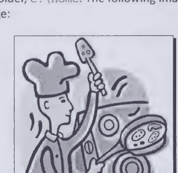

+   6. 点击所选周的“添加一个活动”下拉框并选择上传单个文件。
+   7. 在“作业名称”中输入 `Testing the comprehension of different situations`。
+   8. 在字体中选择 Verdana，在大小中选择 4（14）——描述下方的前两个下拉框。
+   9. 点击字体颜色按钮（带六个颜色框的 T）并为文本选择您想要的颜色。
+   10. 点击描述下方的较大文本框，插入之前创建的位图文件 `image100201.png`，并按下一张截图所示输入问题。记住你可以使用放大的编辑器窗口。为每个步骤编号选择更大的字体和不同的颜色，如下一张截图所示：

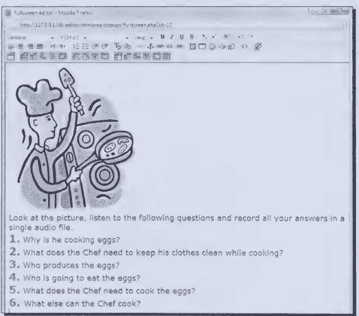

11. 接下来，使用 Audacity 或任何其他音频录制软件为每个问题录音并将其保存为 MP3 文件，使用下一张表中显示的文件名。

| Question # | Audio file name |
|---|---|
| 1 | question100201.mp3 |
| 2 | question100202.mp3 |
| 3 | question100203.mp3 |
| 4 | question100204.mp3 |
| 5 | question100205.mp3 |
| 6 | question100206.mp3 |

12. 为每个问题插入指向相应 MP3 文件的网页链接。这样，学生就可以通过按下每个嵌入式音频播放器上的播放按钮来重放每个问题的音频。

13. 在最大大小中选择 10MB。这是每个学生为此活动可以上传的结果视频文件的最大大小。但是，检查您的 Moodle 服务器提供的可能性与您的 Moodle 管理员非常重要。

14. 关闭放大的编辑器窗口，向下滚动，然后点击保存并显示按钮。Web 浏览器将显示上传单个文件活动的描述。

## What just happened?

我们向 Moodle 课程添加了一个上传单个文件活动，该活动将允许学生阅读、理解并收听六个问题。然后他/她可以使用网络摄像头或麦克风录制这些问题的答案，并将生成的视频或音频文件上传到 Moodle。

我们添加了一张关于厨师煮鸡蛋的简单情况的图片，并利用了 Moodle 多媒体插件提供的嵌入式音频播放器。这样，学生收听每个问题就变得很简单。

## Time for action – recording the answers

我们在上一章已经了解了 Audacity 1.2。我们现在将帮助 Alice 使用 Audacity 功能为六个问题的答案录制她的声音。

+   1. 使用学生角色登录您的 Moodle 服务器。
+   2. 点击课程名称（Home）。

3. 点击相应周上的 **Testing the comprehension of different situations** 链接。Web 浏览器将显示活动的描述和需要回答的六个问题，并附带嵌入式音频播放器，如下一张截图所示：

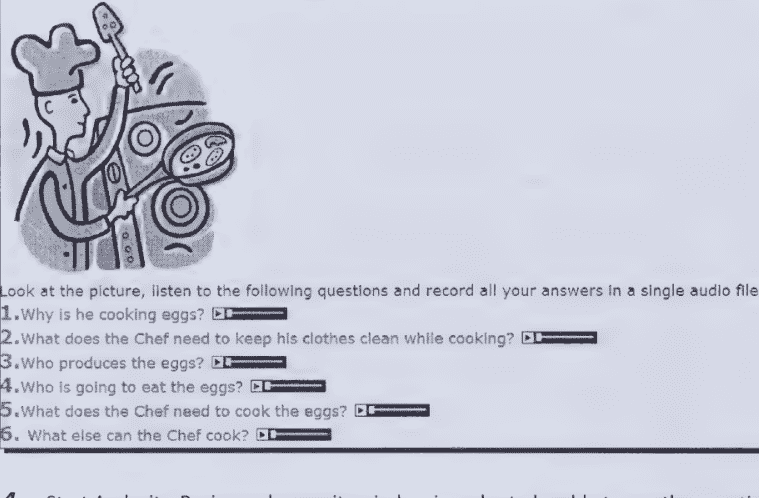

4. 启动 Audacity。调整其窗口大小和位置，以便能够看到问题。你可以在使用 Audacity 录制声音的同时点击每个问题的播放按钮。

5. 点击 **Record** 按钮（红色圆圈）并开始朗读句子。Audacity 将显示正在录制的音频轨道的波形。

6. 听取不同的问题并回答它们。

7. 回答完问题后，点击 **Stop** 按钮（黄色方块）。Audacity 将停止录制你的声音。

8. 从 Audacity 主菜单中选择 **File | Export As MP3**。将 MP3 音频文件保存为 `myanswers.mp3` 到你的文档文件夹中。

9. 接下来，返回到带有 Moodle 活动的 Web 浏览器。点击 **Browse**。浏览到你保存音频文件的文件夹，即你的文档文件夹，选择它，然后点击 **Open**。然后点击 **Upload this file**，视频文件将被上传到 Moodle 服务器。如果音频文件能够在没有任何问题的情况下完成上传过程，将出现 **File uploaded successfully** 消息。点击 **Continue**。

**10.** 之前上传的音频文件现在将出现在问题下方，如下一张截图所示，名称为 **myanswers.mp3**：

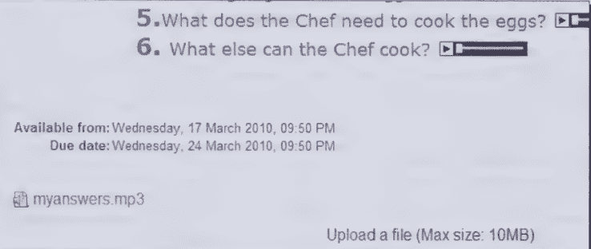

**11.** 最后，你将能够通过点击页面底部的链接来收听已录制并上传的音频。你将能够使用 Windows Media Player、VLC Media Player 或任何其他音频播放器软件下载和收听答案，如下一张截图所示。

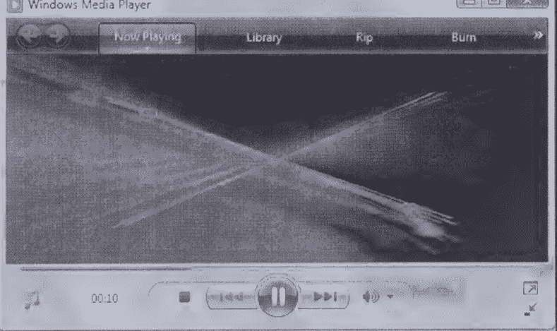

## What just happened?

在此活动中，我们使用了一张代表特定情况的图片，即厨师煮鸡蛋。六个问题使我们能够评估孩子理解情况的方式。每个问题评估一个方面，如下表所总结：

| Question | Aspect being judged |
| --- | --- |
| Why is he cooking eggs? | Causality |
| What does the Chef need to keep his clothes clean while cooking? | Functionality |
| Who produces the eggs? | Origin |
| Who is going to eat the eggs? | Purpose |
| What does the Chef need to cook the eggs? | Functionality |
| What else can the Chef cook? | Creativity |

## Pop quiz – uploading files

+   1.  Moodle 中的上传单个文件活动允许你：
+       a.  定义最大上传大小
+       b.  定义最大上传文件数
+       c.  定义可以上传的文件格式列表
+   
+   2.  当你创建上传单个文件活动时：
+       a.  你不能添加描述
+       b.  你可以添加包含文本和图像以及其他 HTML 资源 的描述
+       c.  你可以添加仅包含纯文本、没有 HTML 资源的描述
+   
+   3.  当你想要录制视频时：
+       a.  你可以使用网络摄像头制造商提供的应用程序
+       b.  你可以使用 Moodle 上传单个文件活动中包含的特殊按钮
+       c.  你可以使用 Moodle 上传单个文件活动中包含的嵌入式录音机

## Summary

在本章中，我们学习了如何：

+   - 准备练习以测试对简单和复杂指令的理解程度
+   - 通过结合文本和图片创建带有简单指令的上传单个文件活动
+   - 测试网络摄像头生成自然和适当反馈的可能性
+   - 创建与厨房、家庭中发生的典型情况相关的问卷
+   - 添加音频资源让学生收听每个问题并录制他们的答案
+   - 评估许多简单的认知方面

现在我们已经学会了如何使用 Moodle 结合许多不同的工具创建数十种不同的丰富练习，我们准备好使用 Moodle 来帮助特殊教育儿童。他们的反馈是创建最令人兴奋练习的巨大动力。

## Pop Quiz Answers

## Chapter 1—Matching Pictures.

| 1 | a |
|---|---|
| 2 | c |
| 3 | b |
| 4 | a |
| 5 | c |
| 6 | a |
| 7 | c |

## Chapter 2—Working with Abstraction and Sequencing Disabilities.

| 1 | a |
|---|---|
| 2 | c |
| 3 | a |
| 4 | c |
| 5 | b |

## Chapter 3—Associating Images with Words.

|  |  |
|---|---|
| 1 | a |
| 2 | b |
| 3 | c |
| 4 | c |
| 5 | a |

## Chapter 4—Developing Sorting Activities, Mixing Shapes and Pictures.

|  |  |
|---|---|
| 1 | c |
| 2 | a |
| 3 | c |
| 4 | b |
| 5 | b |
| 6 | b |

## Chapter 5—Creating Exercises for Improving Short-term Memory.

|  |  |
|---|---|
| 1 | c |
| 2 | a |
| 3 | a |
| 4 | b |
| 5 | a |

## Chapter 6—Reducing Attention Deficit Disorder Using Great Concentration Exercises.

| 1 | a |
|---|---|
| 2 | c |
| 3 | a |
| 4 | c |
| 5 | b |

## Chapter 7—Playing with Mathematical Operations.

| 1 | b |
|---|---|
| 2 | a |
| 3 | b |
| 4 | c |
| 5 | b |

## Chapter 8—Mental Operations with language.

| 1 | a |
|---|---|
| 2 | b |
| 3 | b |
| 4 | a |
| 5 | c |

## Chapter 9—Writing Guided Sentences and Paragraphs.

| 1 | a |
|---|---|
| 2 | c |
| 3 | c |
| 4 | b |
| 5 | c |

## 第10章—运行认知评估测试

| 1 | a |
|---|---|
| 2 | b |
| 3 | a |
