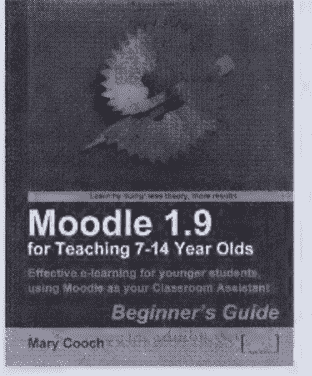
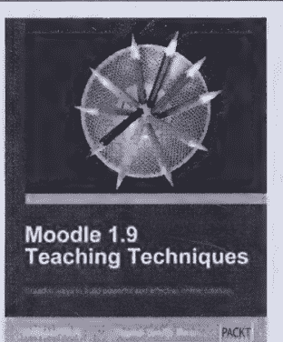
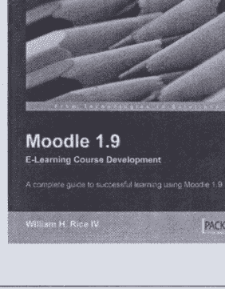
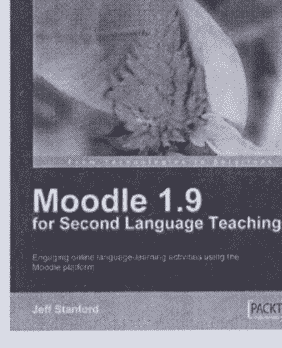

## 索引

### 符号

- **2D 可缩放剪贴画**
  - 在 Inkscape 绘图区中组合 10-14
  - 编辑，Inkscape 使用 16-18
  - 工具，用于操作 8

- **3D 模型**
  - 在 Inkscape 绘图区中组合 35-38
  - 创建 35
  - 渲染 35
  - 在 Google 3D 仓库中搜索 35

- **3D 场景**
  - 与 2D 图像匹配 62

### A

- **排列颜色序列练习**
  - 关于 240
  - 添加到 Moodle 课程 249
  - 使用基本语音识别 252
  - 位图图像，使用不同颜色准备 241-244
  - 图像，拖放 250-252
  - 生成初始颜色序列 245-248

- **排列视觉序列练习**
  - 关于 229
  - 添加到 Moodle 课程 237, 238
  - 图像，拖放 239
  - 生成初始视觉序列 234-236
  - 使用笔记本触摸板 240
  - 生成图片 230-233

- **有吸引力的内容**
  - 为儿童创建 62, 63

- **Audacity 1.2**
  - 下载 257
  - 安装 257

### B

- **背景绘画**
  - 数字笔，使用 76, 77

- **布尔多项选择练习**
  - 关于 84

- **准备布尔问题** 84-86
  - 执行 90, 91
  - 准备图像 84-86
  - 添加两个可能答案 87-90

- **布尔问题**
  - 准备 84-86, 93

### C

- **颜色和字体**
  - 定义，使用 HTML 标签 22

- **漫画条**
  - 创建 52

- **根据图片完成虚线练习**
  - 关于 66
  - 添加到 Moodle 课程 72, 74
  - 准备句子 69-72

- **复合 3D 模型**
  - 组织到渲染的 2D 盒子中 39

- **复合图片**
  - 组织 24-26

- **理解不同情况练习**
  - 关于 287
  - 记录答案 289-291
  - 生成问卷 287-289

- **自定义颜色**
  - 定义 22, 23

### I

- **图像**
  - 为布尔多项选择练习准备 84-86

- **Inkscape**
  - 2D 可缩放剪贴画，组合 10-14
  - 2D 可缩放剪贴画，编辑 16-18
  - 下载链接 8
  - 安装 9

- **说明**
  - 为绘画练习准备 78-80

- **说明测试练习**
  - 关于 279
  - 测试复杂说明执行 286
  - 使用复杂说明测试 279
  - 生成图片 280, 281
  - 使用图片 281, 282
  - 记录结果，使用网络摄像头 283
  - 记录结果，使用网络摄像头 284, 285
  - 使用简单说明测试 279

### J

- **JClic**
  - 与 Moodle 集成 154

- **JClic Author 0.2.0.5** 234
  - 下载 144
  - 安装 144

- **JClic 模块** 154

- **JCloze** 69, 73

- **JCloze 练习** 见丰富填空练习

- **JMatch** 19

- **JMix** 132

- **JQuiz** 40

### L

- **LAME MP3 编码器**
  - 下载 257

### M

- **匹配复合图片练习**
  - 添加到 Moodle 课程 28-31
  - 添加不同大小的复合图片 24-27
  - 运行 32, 34
  - 准备句子 19, 20

- **Microsoft Office 2007**
  - 下载链接 8
  - 安装 9

- **Microsoft PowerPoint 2007** 160

- **Moodle**
  - JClic，集成 154
  - 发现与 3D 场景相关的句子 35
  - 根据对话框绘制插图 51
  - 创建 NanoGong 作业 265-267
  - 安装 Moodle NanoGong 作业 263, 264

- **Moodle 课程**
  - 添加查找匹配对练习 156, 157
  - 添加排列颜色序列练习 249
  - 添加排列视觉序列练习 237, 238
  - 添加发现句子练习 43, 44
  - 添加绘画练习 55-57
  - 添加交换拼图练习 180, 181
  - 添加匹配复合图片练习 28-31
  - 添加将词语放入结构化图像中练习 111
  - 添加视觉数学运算练习 223
  - 添加单词搜索拼图练习 194, 195
  - 添加使用两张图像写句子练习 103
  - 添加排序临时序列练习 122, 123
  - 添加绘画练习 80, 81
  - 添加丰富搭建金字塔练习 134
  - 添加丰富填空练习 72, 74
  - 添加使用按行组织的词列表练习 165, 166

- **多个文件**
  - 在 ZIP 文件夹中上传 32

- **多点触控屏幕**
  - 用于执行丰富搭建金字塔练习 138

### N

- **NanoGong 作业**
  - 创建 265-267
  - 安装 263, 264

- **NanoGong 录音机**
  - 记录句子 268, 269

### O

- **排序临时序列练习**
  - 关于 118
  - 添加到 Moodle 课程 122, 123
  - 为混合临时序列组织图像 120, 121
  - 创建混合临时序列 120, 121
  - 运行 124, 125
  - 搜索三张位图图形 118, 119

### P

- **Paint** 78

- **绘画练习**
  - 关于 76
  - 添加到 Moodle 课程 80, 81
  - 背景绘画，数字笔使用 76, 77
  - 创建 76
  - 执行 81, 82
  - 准备说明 78-80
  - 绘画剪影 83
  - 使用 Tux Paint 84

- **PNG** 18

- **将词语放入结构化图像中练习**
  - 关于 105
  - 添加到 Moodle 课程 111
  - 向图像添加浮动标签 108
  - 将图片拖放至场景 115
  - 运行，使用笔记本触摸板 112, 113
  - 创建场景 105, 107
  - 将场景上传到 Moodle 109-111

### R

- **丰富搭建金字塔练习**
  - 关于 126
  - 添加到 Moodle 课程 134
  - 创建复杂金字塔 139
  - 执行，使用多点触控屏幕 138
  - 组织图像 131-133
  - 搭建金字塔 126-130
  - 运行 135, 136

- **丰富填空练习**
  - 将动物和自然的 2D 剪贴画转换 66
  - 搜索动物和自然的 2D 剪贴画 66-69
  - 添加到 Moodle 课程 72, 74
  - 创建 66
  - 执行 74
  - 组织图像 69-72
  - 准备句子 69-72

### S

- **句子创建练习**
  - 创建 255
  - 使用图像 263
  - 创建 NanoGong 作业 265-267
  - 安装 NanoGong 作业 263
  - 在论坛中讨论结果 263
  - 记录句子 257-262
  - 使用 NanoGong 录音机记录句子 268, 269
  - 书写句子 257-262
  - 准备词语 256
  - 选择词语 256

- **句子**
  - 为匹配复合图片练习准备 19, 20

- **剪影**
  - 绘画 83

- **Snipping Tool** 69
  - 关于 69

- **对话框**
  - 创建 52-54
  - 输入文本 52-54

### T

- **文本块**
  - 更改颜色 40-42
  - 创建 40-42

- **工具，用于 2D 可缩放剪贴画操作**
  - Inkscape 8
  - 安装 8-10
  - Microsoft Office 2007 8

- **描摹绘画** 61

- **Tux Paint** 78

### V

- **视觉数学运算练习**
  - 关于 215
  - 添加到 Moodle 课程 223, 224
  - 求解复杂数学运算 226, 227
  - 生成网格 218-222
  - 将图片与数学符号组合 215-218
  - 求解 225, 226

- **视觉多项选择练习**
  - 关于 202
  - 执行 211-214
  - 准备场景 202-204
  - 使用许多动物创建视觉多项选择 205-211

### W

- **WMF (Windows Meta-File)** 11

- **Wondershare PPT**
  - 下载 164
  - 安装 164

- **单词搜索拼图练习**
  - 关于 188
  - 添加到 Moodle 课程 194, 195
  - 创建背景图片 188, 189
  - 使用字母和图片生成 190-194
  - 添加帮助效果 197
  - 求解 196, 197
  - 添加音效 197

- **使用按行组织的词列表练习**
  - 关于 160
  - 添加到 Moodle 课程 165, 166
  - 创建带词列表的动画 160-162
  - 添加图片 169
  - 记录结果，使用网络摄像头 169
  - 运行 167, 168
  - 导出带动画词语的视频 163-165

- **使用两张图像写句子练习**
  - 关于 96
  - 添加到 Moodle 课程 103
  - 在 Moodle 中激活 MP3 播放器 100
  - 书写句子 103, 104
  - 搜索音效文件 98, 99
  - 搜索两张图像 96, 97
  - 集成视觉和听觉资源 101, 102

### Z

- **ZIP 文件夹**
  - 关于 32
  - 上传多个文件 32

## 感谢您购买

Moodle 1.9 for Teaching Special Education Children (5-10 Year Olds): Beginner's Guide

## 关于 Packt Publishing

Packt，读作 'packed'，于 2004 年 4 月出版了首本图书 "Mastering phpMyAdmin for Effective MySQL Management"，随后继续专注于出版关于特定技术和解决方案的高度聚焦的书籍。

我们的书籍和出版物分享了您同行 IT 专业人士在适应和定制当今系统、应用程序和框架方面的经验。我们的解决方案型书籍为您提供定制您正在使用的软件和技术以完成工作的知识和能力。Packt 的书籍比您过去看到的 IT 书籍更具体、更少泛化。我们的独特商业模式使我们能够为您提供更集中的信息，让您获得所需了解的更多内容，而非不需要的内容。

Packt 是一家现代而独特的出版公司，专注于为开发者、管理员和新手社区生产高质量的尖端书籍。如需更多信息，请访问我们的网站：www.packtpub.com。

## 关于 Packt Open Source

2010 年，Packt 推出了两个新品牌 Packt Open Source 和 Packt Enterprise，以便继续专注于专业化。本书是 Packt Open Source 品牌的一部分，该品牌收录了基于开源许可构建的软件书籍，并为从高级开发者到初级网页设计师的任何人提供信息。Open Source 品牌还运营着 Packt 的 Open Source 皇家<|start|>ty 计划，通过该计划，Packt 会向因销售书籍而提及的每个开源项目支付版税。

## 为 Packt 撰写

我们欢迎所有有兴趣撰稿的人的咨询。图书提案应发送至 author@packtpub.com。如果您的图书想法仍处于早期阶段，您希望在撰写正式图书提案前先讨论，我们会联系您；我们的其中一位委托编辑会与您联系。

我们不仅寻找已出版的作者；如果您拥有强大的技术技能但没有写作经验，我们经验丰富的编辑可以帮助您发展写作事业，或仅仅为您提供专业知识的额外回报。

## Moodle 1.9 教学应用（面向7-14岁儿童）：初学者指南

ISBN：978-1-847197-14-6 平装本：236页

利用Moodle作为你的课堂助手，为低龄学生打造高效在线学习体验

- 1. 聚焦低龄学习者的独特需求，创造一个有趣、生动、互动且信息丰富的学习环境，让学生每天乐于参与
- 2. 通过全班可以共同参与的游戏、测验、电影和播客，吸引并激励你的学生
- 3. 实现无纸化！将课程内容上传到网上，随时随地评分

## Moodle 1.9 教学技巧

ISBN：978-1-849510-06-6 平装本：216页

构建强大而有效的在线课程的创意方法

- 1. 激励来自不同背景、代际和学习风格的学生
- 2. 何时以及如何运用不同的学习解决方案，提供变通方法并给出替代方案
- 3. 借助截图和示例，以易于操作的逐步说明呈现Moodle的强大功能
- 4. 特别适合大学和职业教师

有关我们图书的信息，请查看**www.PacktPub.com**

## Moodle 1.9 在线课程开发

ISBN：978-1-847193-53-7 平装本：384页

使用Moodle实现成功学习的完全指南

- 1. 针对Moodle 1.9版本进行了更新
- 2. 全面覆盖Moodle系统的安装与使用
- 3. 在所有学习环境中运用Moodle功能
- 4. 独特的基于课程的方法，帮助你将精力集中在设计结构良好、互动性强且成功的课程上

## Moodle 1.9 第二语言教学

ISBN：978-1-847196-24-8 平装本：524页

利用Moodle平台开展引人入胜的在线语言学习活动

- 1. 一本使用Moodle 1.9创建语言活动的“菜谱”式指南
- 2. 充分利用Moodle 1.9的功能，创建有趣、实用的语言学习活动
- 3. 创建一个集阅读、写作、口语、听力、词汇和语法活动于一体的在线语言学习中心
- 4. 增强你的活动，使其在视觉上更具吸引力，并充分利用音频和视频活动

有关我们图书的信息，请查看www.PacktPub.com

## Moodle 1.9 特殊教育儿童教学（5-10岁）：初学者指南

使用这本面向教师和治疗师的友好、非技术性指南，为特殊教育需求儿童开发互动性强、功能丰富的在线内容

本书提供了为5至10岁特殊教育需求儿童开发互动课程和疗法的解决方案。它教授如何将Moodle 1.9与Web 2.0提供的机会、免费和商业软件以及通用硬件设备结合起来。

## 这本书将为你带来……

- 创建将复合图片与句子匹配的活动，以及丰富的练习，以激发注意力和专注力
- 搜索并整理3D模型来创建3D场景，并使用颜色来定义技能水平
- 结合视频、声音、照片、字母和单词，改善长期记忆管理
- 学会结合图片和符号，提高数学运算时的专注力
- 创建练习，帮助特殊教育需求儿童的家长与他们互动

## 初学者指南的特点……

- 为最实用的任务提供清晰的逐步指导
- 边做边学——立即开始动手
- 省去枯燥的内容
- 启发性的、贴近实际的示例，为你的工作提供灵感
- 通过任务和挑战鼓励实践探索

