# 1 走向电子化

> 想象一个世界，你可以给学生布置测验，而测验交回来时已经批改好了。想象一个时代，学生可以以数字方式提交课程作业和项目，而不是纸质方式。我们不仅能拯救大量树木，而且还不会再有“打印机没墨了”之类不按时交作业的借口。要是有一个系统，能让学生和教师通过一个精心管理、完全自动化的数字框架来交换作业，你就再也不用担心学生的作业会弄丢了。

这些系统确实存在，它们被称为虚拟学习环境（VLEs）或课程管理系统（CMSs），取决于你问谁。Moodle 是众多系统之一，但毫无疑问，它是目前在各级教育（包括基于工作的学习）中最受欢迎的系统。

技术的进步正在推动 Moodle 的使用。低成本迷你笔记本电脑（例如 Dell Latitude 或 Asus EEE PC）的兴起，使得为每个学生配备一台便携式可上网设备在许多学校成为切实可行的现实。再加上这样一个简单的事实：如今的年轻人发现 IT 作为一种学习工具更具吸引力。

毫无疑问，这些只是你发现自己想知道如何开始将教学转换到 Moodle 的部分原因。也许你想知道如何在你的学校倡导使用 Moodle。也许你的学校正在转换到 Moodle，而你担心自己会落后。

你目前是否只在教室或讲堂进行面对面教学？也许你正在使用另一个受管学习环境（如果是这样，那你真不知道自己错过了什么！）并且需要转换。问题是：我如何转换到 Moodle？这正是本书要回答的问题。

为了帮助我们了解即将使用的工具，我们首先来看一些 Moodle 的背景故事。但我们会尽快登录系统，四处转一转，然后让所有人知道我们已经来了。

在本章中，我们将：

- 了解 Moodle 为何被创建以及它是如何开发的
- 学习如何登录和退出
- 探索 Moodle 界面并开始学习一些 Moodle 术语
- 配置我们的用户配置文件

那么让我们开始吧。

### Moodle 能为我做些什么

Moodle 为你提供了存储和呈现音乐、演讲、视频，进行在线群聊、测验，以及（如前所述）管理作业提交的工具。让我们来看看转换到 Moodle 的几个优势。

我们大多数人都有共享的在线区域，可以在那里向学生分发工作表和讲义。然而，这些共享区域通常无法从家里访问。Moodle 解决了这个问题。共享区域也可能会变得杂乱无章。使用 Moodle，你可以轻松地管理和组织资源共享。你还可以让分发作业的方式在视觉上更具吸引力；这个过程对谨慎的学生来说也变得更加友好。

第三方内容提供商已经意识到了学习平台的理念，他们提供的更多资源是专门为 Moodle 这类环境设计的。

但 Moodle 不仅仅是一个资源库。Moodle 中的“M”代表“模块化”，有一些 Moodle 模块允许你布置作业并完全在线评分（由 Moodle 为你管理分数），还有一些模块允许你设置测试并自动评分。事实上，如果你想让 Moodle 做某事，而“开箱即用”的安装并不支持，那么很可能有一个模块可以启用或安装，提供你所需的功能。例如，当我的管理员在我们学校的 Moodle 中启用数学符号支持时，文本编辑器中出现了一个新按钮，让我可以轻松创建数学符号：

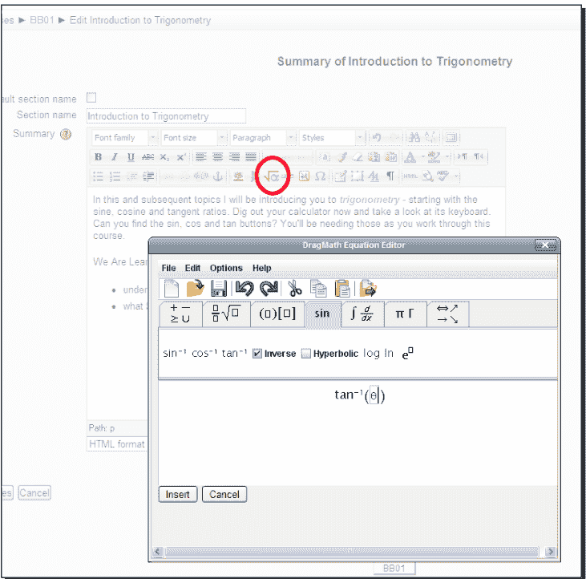

由于 Moodle 在有互联网接入的任何地方都可用，因此 Moodle 可以用来支持因任何原因无法来到教室的学生。也许他们生病了，也许他们在另一所学院上课，或者他们正在进行基于工作的培训，而你需要在他们培训期间继续你的教学。

Moodle 是你教师工具箱中的另一个工具。我不希望你认为迁移到 Moodle 会给你带来更多工作。这正是本书的价值所在。我将向你展示如何快速轻松地将你现有的教学材料放到网上。在书的结尾，如果你正在开发新的学习资源，那么与其在 Word 中创建讲义或在 PowerPoint 中创建演示文稿，不如想想 Moodle 中无数的功能（我将向你介绍其中的一小部分），以及你如何在教学中使用这些功能。

### 对学生的好处

Moodle 提供了一致的“用户界面”。我这么说是什么意思？嗯，虽然比我年轻的几代人非常熟悉计算机，但他们往往只知道如何使用某些程序和应用程序（即时通讯和社交网络是最受欢迎的），却不知道如何使用其他任何东西。Moodle 包含许多不同的学习工具，但由于它们都有一致的用户界面，如果你学会了如何使用其中一个，那么开始使用其他工具并不需要花费太多额外的努力和理解。到目前为止，我从未需要向学生演示如何使用 Moodle。

始终可用意味着 Moodle 可以在放学铃响之后继续支持学生。如果需要在周末、假期或学生考试假期间继续学习，那么 Moodle 可以提供这种支持。那些在课堂上不愿发言的学生，往往非常乐意在网上发表意见。

因为 Moodle 可以在学生参加测试后立即评分，所以他们可以即时获得关于自己作业的反馈。

### 开源的优势

Moodle 是开源的，也就是说，它基本上是免费的。但不要因为它是免费的就望而却步。这绝对是一个优势。Moodle 有一个紧密的开发者网络支持，他们努力确保 Moodle 安全、可靠和稳健。有关 Moodle 开发如何进行的更多信息，请参见 http://docs.moodle.org/en/Development:Overview。我们已经了解了 Moodle 中的“M”代表模块化。如果你熟悉 Web 开发，那么你总有机会创建自己的 Moodle 模块。你一眼就能看出，我是开源软件的忠实粉丝。如果你具有技术背景，那么你可以试验 Moodle，而完全不必担心软件许可费用。许多教师下载了自己的免费 Moodle 副本，尝试新的教学想法（参见 http://docs.moodle.org/20/en/Windows_installation_using_XAMPP）。许多学校还会保留一份用于开发目的的 Moodle 副本。

有关开发自己的自定义 Moodle 插件的更多信息，请参阅 *Moodle 1.9 扩展开发*，Jonathan Moore 和 Michael Churchward，Packt Publishing。

### 这本书是写给谁的

本书面向教育工作者。我们假设你的工作是教学，而不需要搭建 Moodle 站点（我们假设这已经为你完成了）。我们还假设，如果有任何需要执行的管理任务（需要调整的设置或需要打开的开关），你的 Moodle 管理员会为你完成。如果你确实需要在设置和配置站点方面获得支持，请参阅 *Moodle 管理*，Alex Büchner，Packt Publishing。

## 我们将一起做些什么

在本章中，我们将一起了解 Moodle 的历史——它从哪里来，以及哪些因素影响了它的发展。这一点之所以重要，是因为 Moodle 只是一个完成工作的工具。如果我们能理解 Moodle 为何这样设计，那么当我们试图以它并不适用的方式使用它时，我们就会知道自己的方法为什么可能行不通。然后，我们会了解如何登录和退出 Moodle、如何修改用户资料，以及（重要的是）在需要时如何修改密码。我们还将探索 Moodle 的用户界面——构成一个 Moodle 页面各元素的名称（这样当人们提到“面包屑导航”和“版块”时，你就知道他们在说什么了）。

本书的其余部分分为两部分。

### Moodle 课程转换：第 1 部分

在第 1 部分中，我们将学习如何把文档和讲义转换到 Moodle。

我们的第一个任务是建立并配置一个 Moodle“课程”。我们要把自己的文档和讲义放在这里，同时也要在这里设置测验等。这些内容将在*第 2 章，设置你的课程*中介绍。

在*第 3 章，添加文档和讲义*中，我们将学习如何将文档导入 Moodle，以及如何让学生访问这些文档。并非所有学生都能打开我们的文档（这取决于他们计算机上安装的软件），因此我们将介绍一些技巧和方法，确保无论学生安装了何种软件，我们的资源都能被所有人访问。

一旦我们在网上布置了作业，就需要为学生提供一种提交已完成作业的途径。在附加章节*通过 Moodle 提交作业*中，我们将看到即使是年龄很小的学生也能通过 Moodle 快速轻松地上传作业。这样一来，我们也可以在线管理他们的成绩。这个附加章节为*第 6 章，管理学生作业*奠定了基础，该章将介绍如何将整个项目和作业转换到 Moodle（见第二部分）。

转换到 Moodle 意味着我们可以轻松地加入视频和音频。在*第 4 章，声音与影像——加入多媒体内容*中，我们将学习如何利用声音和影像，使教学材料对学生更具吸引力。

在*第 5 章，Moodle 大变身*中，我们会花时间回顾并实践目前为止所学的内容，了解如何让课程更加精致。

道吉亚马斯的成长背景对 Moodle 有着重要的影响。马丁在西澳大利亚的沙漠中长大。他就读的小学是“空中学校”（School of the Air），这是一所函授学校，课程由一千公里外的一所学校通过业余（短波）电台讲授。马丁的班级每年只聚一次（参加学校嘉年华），他的学习材料由一架四座塞斯纳飞机每两周投递到他家，同时收走作业。如果你想了解更多，可以观看迈克尔·费尔德斯坦（Michael Feldstein）对马丁的采访：http://mfeldstein.com/interview-with-martin-dougiamas/。

## 一种新的学习教学法

Moodle 与其他虚拟学习环境（VLE）最大的不同，在于它所支持的学习方式。该系统（正如其博士论文标题所揭示的）被设计用来支持“社会建构主义认识论”。换句话说，学生通过分享知识来共同学习。这就是为什么你在 Moodle 中会看到这些工具：

- **鼓励讨论**：论坛和聊天
- **支持协作**：维基
- **管理同伴评审与评估**：工作坊

尽管你会发现大量文献鼓励你以某种特定方式使用 Moodle（即支持社会建构主义教学法），但绝没有阻止你使用 Moodle 来支持其他学习风格。Moodle 非常适合远程学习者（例如，英国开放大学现在正在使用 Moodle 支持其 25 万名远程学习者），而且它的结构确实围绕某种特定教学法而设计，但正如我们将在本指南中看到的，Moodle 内置了出色的功能和工具，能够支持各种教学风格。有关 Moodle 如何支持不同学习风格的更多信息，请参阅《Moodle 教学技巧：使用 Moodle 构建在线学习解决方案的创造性方法》（William Rice 著，Packt Publishing 出版）。

## 发展与支持

自 1999 年以来，Moodle 的使用量急剧增长（相关数据见 http://moodle.org/stats/）。因此，将你的课程转换到 Moodle，你会成为这个庞大群体中的一员。要加入日益壮大的全球“Moodler”社区——讨论你的工作、寻求帮助、学习更多最佳实践——请访问 http://moodle.org。我的背景是数学和科学，你经常能在数学工具论坛上找到我。

事实上（也许并不令人意外），Moodle.org 本身就是一个 Moodle。这意味着，如果你对 Moodle 还不熟悉，Moodle.org 可能会让你有点望而生畏。如果你是 Moodle 新手，我建议你先对这个系统多积累一些经验，然后再访问 Moodle.org。

## 走向电子化

## 随堂测验

Moodle 是一个首字母缩略词，但它代表什么？当你希望 Moodle 能满足你的教学需求时，为什么 Moodle 中的“M”如此重要？

## 开始登录

理论部分大概已经足够了，让我们开始使用 Moodle 吧。

## 登录

我假设你的 Moodle 管理员已经给了你用户名和密码。也许它就是你用来访问所在机构其他服务的同一个用户名和密码。根据你的网络环境，你可能会自动登录 Moodle。现在我们假设你需要登录。

## 操作时间——登录 Moodle

- 1. 进入 Moodle 网站首页，寻找一个写着**登录**的链接。这取决于你的 Moodle 网站所使用的“主题”，但可以查看页面中下方或右上角（如果你实在找不到这个链接，请联系你的 Moodle 管理员）。点击**登录**链接，打开登录页面：

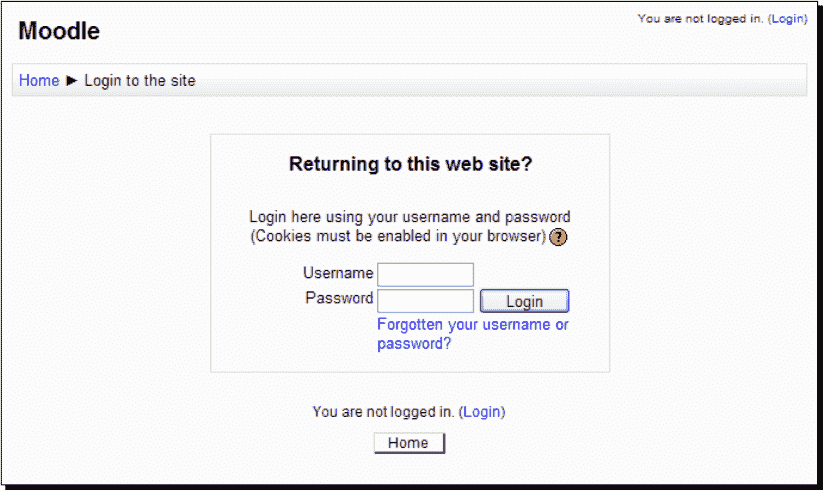

## 刚才发生了什么？

你刚刚登录了 Moodle。如果这是你第一次登录，系统可能会要求你修改密码：

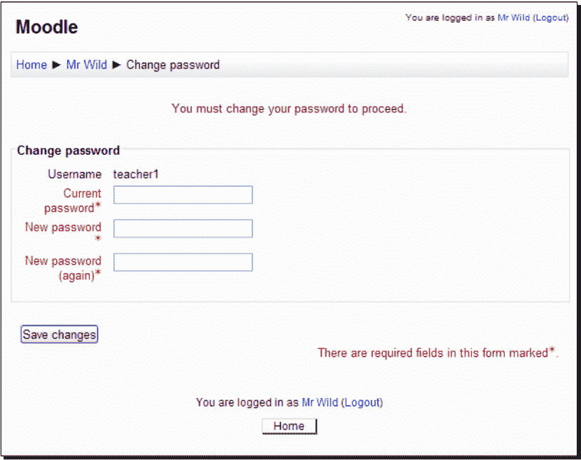

只需按照屏幕上的说明操作即可（我们将在本章后面介绍如何修改密码）。

每个用户都有一个个人资料，你可以在其中向大家介绍自己。在下一节中，我们将学习如何修改个人资料。

## 操作时间——编辑个人资料

- 1. 找到**设置**版块，在上面的截图中，它是左侧底部的一个方框。点击**编辑个人资料**链接。此时会显示**编辑个人资料**页面：

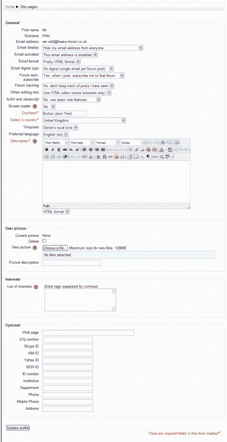

- 2. 请注意，我的管理员已将 Moodle 配置为禁止我修改**名字**、**姓氏**和**电子邮件地址**。这没什么问题，而且在我使用过的大多数 Moodle 网站上都很常见。你也许可以修改这些信息。基本上，如果你的个人资料页面和我的不完全一样，不用担心。

- 3. 下面来修改我们的个人资料描述。向下滚动到**描述**框（**描述**这个词是红色的，旁边有一个红色小星号），然后输入一段关于你自己的描述：

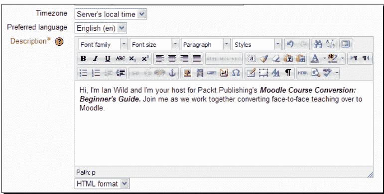

- 4. 如果你习惯使用文字处理软件，那么编辑器顶部的这些按钮对你来说（大部分）会比较熟悉。在阅读本书的过程中，我们会逐步了解这些按钮的功能。

- 5. 当你对个人资料设置满意后，向下滚动到页面底部，按下**更新个人资料**按钮。不必担心在个人资料页面中修改设置，你随时可以回来再次更改。

- 6. 就这样，完成了！

### 刚才发生了什么？

将课程转换到 Moodle，意味着我们将拥有一个“Moodle 身份”，也就是我们的 Moodle 个人资料。我们刚刚修改了个人资料页面，通过**描述**设置，让我们的 Moodle 同伴对我们有更多了解。

## 动手实践

你的 Moodle 管理员是否允许你上传自己的照片？返回你的**编辑个人资料**页面，找到**用户图片**框：

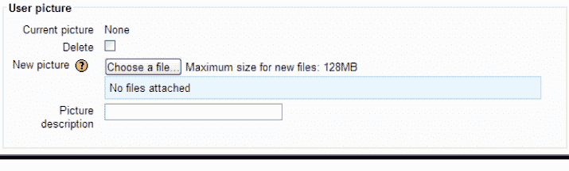

点击**浏览**按钮，在电脑上寻找合适的图片。不用担心尺寸（最好是100x100像素），如果图片太大，会被裁剪。

> **找不到“用户图片”设置？**
> 
> 我遇到过很多学生要么“发挥创意”（我该这么说吗）地使用从 Moodle 获取的头像，要么上传不太适合自己个人资料的照片。所以，如果这个设置被关闭了，不用太担心；而且如果你觉得学生们可能会决定开始美化你的照片，那么你的个人资料最好不要选自己的照片！

## 修改密码

假设你的 Moodle 管理员允许你修改密码，如果你需要更改密码，只需返回你的个人资料页面（记住，无论在哪里看到你的名字，点击它就会显示你的个人资料页面）。在你的个人资料页面上，你会看到**修改密码**链接（在**设置**区块中）：

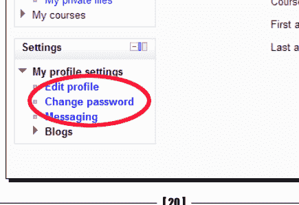

## 做好你的工作 – 你的角色

本书面向教育工作者。Moodle 用“教师”一词来描述布置作业并评分的人。但就 Moodle 而言，只有当你身处一门需要布置作业和评分的课程中时，你才是一名“教师”。用 Moodle 的话说，你扮演的是“教师”这个角色。如果你认为仅仅因为自己是教师（也就是说，这是你的工作）就会在登录 Moodle 后成为任何 Moodle 课程中的教师，那就大错特错了。这就像说你可以走进某位同事的教室，开始上他们的课。你不会那样做，Moodle 里的道理也是一样的。

## 谁决定课程由谁授课

通常来说，在 Moodle 课程中让你成为教师的人就是创建该课程的人，通常是你的部门负责人或 Moodle 管理员。也许你被赋予了创建课程的任务，这就是 Moodle “课程创建者”的角色。他们可以创建课程并分配角色。有趣的是，他们不能删除课程，他们没有这个权限。角色的概念与权限的概念密切相关。让我们在下一节看看权限。

## 权限

Moodle 在“责任划分”原则上非常严格，不同的角色拥有不同的权限：

- **管理员**：对 Moodle 安装拥有完全的、神一般的权力。可以说，能做任何事情。但如果你请求他做某事，他大概不会做。
- **经理**：比管理员的权力稍小。这个角色相当于副校长或校长助理。可以创建和删除课程，并将用户分配到课程中。有些事情他们不能做，例如更改 Moodle 的站点配置设置。
- **课程创建者**：可以创建新课程并编辑它们。有趣的是，他们没有删除课程的能力。
- **教师**：可以编辑和使用现有课程，但不能创建新课程。他们可以给学生提交的作业评分。
- **无编辑权限教师**：可以评分和教学，但不能编辑课程。
- **学生**：可以提交作业、参加测验，可以在论坛和聊天中与其他课程成员互动。学生不能编辑课程、布置或批改作业。

你的角色取决于你在哪里。例如，我白天是一名教师，但晚上我在夜校是一名学生。我的角色取决于“情境”（在一个地方是教师，在另一个地方是学生）。Moodle 也是如此，确保你不要把自己的职务头衔与特定情境中的角色混淆。我以用户身份登录 Moodle，而不是以教师身份。让我们在下一节看看情境。

## 情境

Moodle 中有哪些不同的情境？以下是基本场景：

- ♦ 我刚登录 Moodle。在这种情况下，我是一个已认证用户。
- ♦ 我刚选了一门课。我不得不选课这一事实表明，在这种情境下我是学生。如果我的 Moodle 管理员让我在这门课上担任教师，那么在这种情境下我就是一名教师。
- ♦ 课程可以包含在类别中。类别是分组 Moodle 课程的一种方式。当我查看一个类别时，我发现自己可以创建课程。在课程类别情境中，我是课程创建者。请注意，我不能创建类别，我没有这种权限。如果你需要创建类别却发现自己不能，你需要找的第一位联系人就是你的 Moodle 管理员。

你的 Moodle 管理员或经理（从现在开始，我将用“管理员”一词来指代这两种角色）可以在特定情境中授予你特定角色。仅仅因为你在一种情境中是课程创建者，并不意味着你在另一种情境中也是课程创建者。

## 小测验 – 我的角色是什么？

我刚刚点击了一个类别来查看其中的课程。我看到有一个标有“添加新课程”的按钮。在这种情境下，我的角色是什么？

- ♦ 教师
- ♦ 访客
- ♦ 课程创建者
- ♦ 学生

## 我为什么提到这一切

嗯，你可以看到，运营一个 Moodle 站点有很多不同的方式，所以我们在写这本书时不得不做一些假设。这本书的目标读者是希望（或需要）将课程迁移到 Moodle 的教育工作者。因为你是这样的角色，我假设如果有任何需要执行的管理任务，你的 Moodle 管理员会代你执行；我假设 Moodle 管理不是你的工作。这就是为什么在某些章节末尾，你会看到一个名为“问问管理员”的特殊部分。

不仅仅是角色和权限会随着你的 Moodle 站点而改变。站点的外观和感觉也可能不同。让我们花点时间看看 Moodle 的用户界面。

## Moodle 外观与感觉

正如我们已经讨论过的，Moodle 的一大优点是其一致的用户界面。我这么说是什么意思呢？一种理解 Moodle 的方式是把它看作一套教学工具：一个论坛、一个维基、一个聊天工具等等。因为用户界面是一致的，你学会如何使用一个工具后，就能轻松掌握其他工具的使用方法。你会发现所有 Moodle 站点都有一种熟悉的感觉：它们看起来不同，但使用方式都一样。那如何让它们看起来不同呢？

## Moodle 主题

你可以为 Moodle 设置主题，这意味着你可以应用自定义颜色和页面设计（几乎就像换了一层新皮肤）。你可以在页面顶部指定自己的横幅，在底部指定自己的页脚。你可以重新排列页面上的项目。但你无法改变 Moodle 站点的行为方式。Moodle 的行为方式始终如一，当你看到一个 Moodle 站点时，你会认出它来。

本书图片中你会看到的 Moodle 主题（我的 Moodle 的主题）叫做“标准”。你的管理员很可能在使用不同的主题。别让这影响你。请记住，主题只是改变了 Moodle 的外观，而非其行为方式。

所有 Moodle 页面，无论主题如何，都包含某些“标准”元素。在下一节中，我们将全面了解它们。

## 一个 Moodle 页面

构成 Moodle 页面的部分有哪些？让我们从页面顶部开始，一直往下看。

## 面包屑导航

在页面顶部，你会看到一串链接，告诉你当前在 Moodle 站点中的位置：

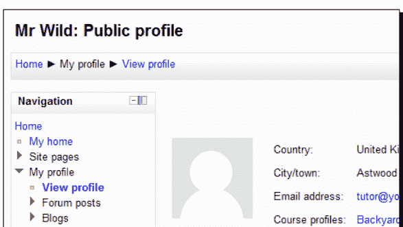

它被称为面包屑导航（也称为“导航栏”），是返回已知位置的便捷方式。例如，如果我点击面包屑导航中的**查看个人资料**，就会进入我的**个人资料**页面。如果我点击面包屑导航中的**首页**，就会返回站点首页。

## 区块

让我们看看 Moodle 课程首页：

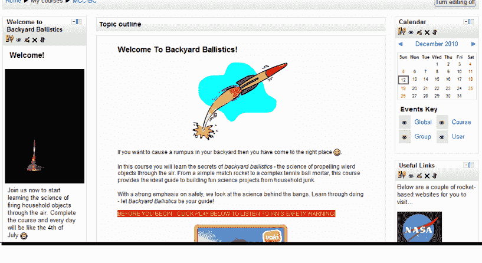

## 走向电子化

在页面的左侧和右侧你可以看到区块，例如右上角的 **Calendar** 区块。你可以在课程首页上包含若干标准区块。管理员也可以安装自定义区块。在 Moodle 中你会经常看到使用的区块是 HTML 区块。这种类型的区块允许我们在页面的左侧和/或右侧包含我们自己的基于网络的内容。上一张截图中的 **Welcome** 和 **Useful Links** 区块就是 HTML 区块。

中间是主要的课程区域，这里是你会找到主要资源和活动的地方（区块通常用于补充信息或支持）。

如果你使用的是笔记本或屏幕较小的笔记本电脑，那么你可能会觉得课程页面有点拥挤。每个区块都有一个隐藏图标：

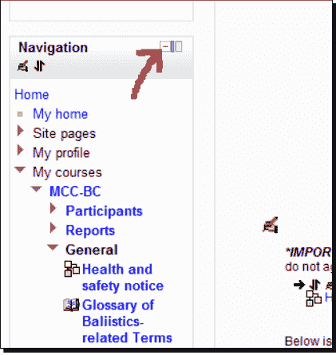

例如，点击隐藏 Navigation 区块图标会折叠该区块：

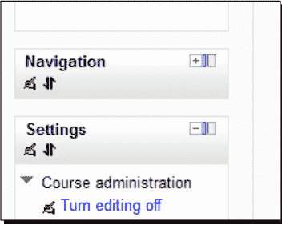

在每个隐藏图标旁边是移动到停靠栏的图标：

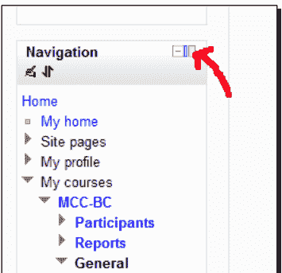

停靠栏非常适合屏幕较小的笔记本或笔记本电脑，因为它会将侧边区块移开，而不会完全隐藏它们：

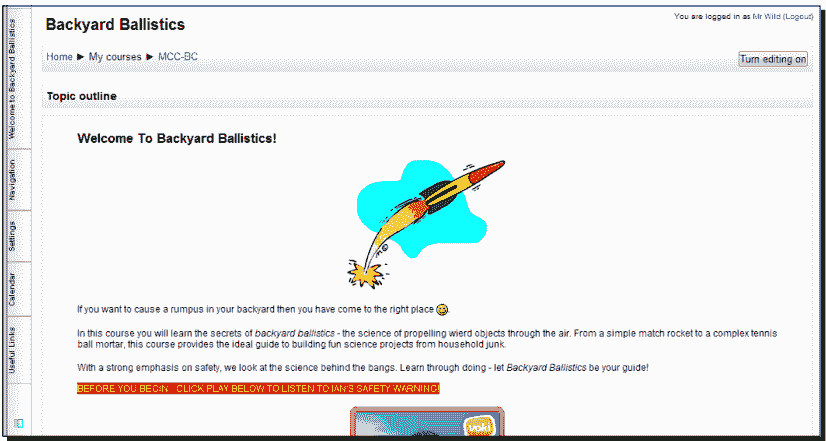

将鼠标悬停在停靠栏中列出的区块名称上，该区块就会显示出来（同时也会显示取消停靠此项和删除图标）：

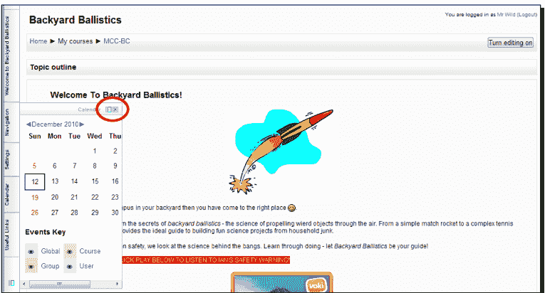

## Footer

页面的底部是页脚：

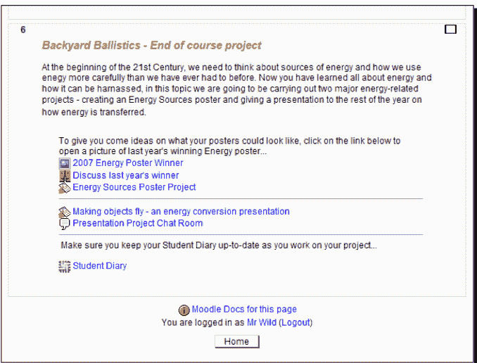

## Summary

现在我们与 Moodle 的旅程已经开始，我们已经对该系统有了很多了解。

具体来说，我们涵盖了：

- **The origins of Moodle**：我们了解到 Moodle 是由一位在家上学的人构想出来的。Martin Dougiamas 设计了一个系统，通过分享知识来支持协作和学习。虽然这是其底层教学法，但我们了解到 Moodle 可以支持许多不同的学习风格。
- **How to log on to Moodle**：我们学习了如何更改密码，并介绍了在忘记密码时需要做什么。我们还介绍了如何确保你已注销。我们不希望学生能够冒充你进入系统。
- **Modifying our user profiles**：我们看到 Moodle 管理员可以“锁定”我们用户资料的某些方面（我的 **First name**、**Surname** 和 **Email** 字段已被锁定）。但我仍然可以修改我的描述，我们也看到了如何做到这一点。
- **Roles and capabilities**：我们看到不同角色具有不同的能力，并且你的角色取决于上下文。例如，我在自己教授的课程中是教师，但在我注册的课程中我是学生。
- **Moodle look-and-feel**：我们一起了解了构成 Moodle 页面不同元素的知识。

我们还简要讨论了我们将在本书其余部分涵盖的内容。

现在我们对 Moodle 有了感觉，我们准备配置一个 Moodle 课程，这是下一章的主题。
