# 2 设置你的课程

在上一章中我们开始了 Moodle 之旅。在本章中，我们将了解如何为将部门的课程迁移到 Moodle 奠定基础。本章中我们将：

- 学习如何将学术课程大纲映射到若干 Moodle 课程
- 创建一个新的 Moodle 课程并为其命名和描述
- 为课程设置合适的结构
- 为课程分配教学人员
- 为课程设置注册方法

到本章结束时，你的课程将被设置好，并准备好开始填充内容。

### From curriculum to courses: What counts as a Moodle course

让我们从我描述我将与大家一起在本書中转换到 Moodle 的课程开始。该课程名为“Backyard Ballistics”，它是一门科学课程，是应用物理资格认证的一部分。该课程全部关于用你能在普通家庭厨房和花园棚中找到的化学品和设备，将奇怪的物体通过空气发射的艺术。

## Setting up your Courses

我无法将该课程的某些方面转换到 Moodle。我希望我的学生通过使用家中随处可见的日常用品“动手做”科学，来领略能量和动力学的精髓，这是一种动觉学习。但目前我尝试使用学院服务器上的“共享驱动器”以电子方式分发大量支持材料、手册、图表和测验。然而，我的学生永远找不到我告诉他们去寻找的材料。至少，这是他们的借口。但我必须承认，经过几年的使用，我们的共享驱动器开始变得有点乱糟糟。正如你在接下来的几章中会看到的，将这些资源迁移到 Moodle 绝对会解决这个问题。

但我把这些资源放在 Moodle 的哪里？答案是，你把它们放到一个 Moodle 课程中。以下是 Moodle 课程的一个片段的截图：

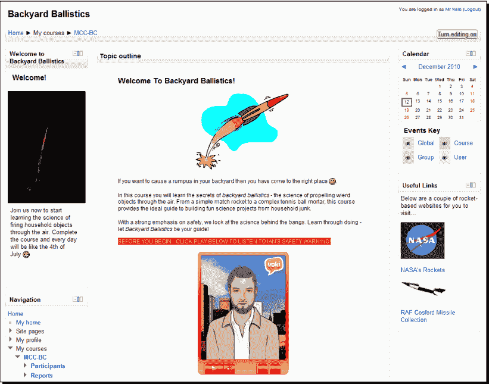

我将我的课程分为六个主题：

- Getting Things Flying
- Lighter Than Air: Hydrogen Filled Balloons
- Fire Kites
- Basic Rocketry: The Match Rocket
- The World Famous Tennis Ball Mortar!
- Backyard Ballistics: End of Course Project

我选择将 Backyard Ballistics 转换为主题的原因部分是因为我就是这样教授它的，部分是因为我很乐意让学生“深入”我已转换到 Moodle 的资源和活动。我将在本章后面谈论如何将课程内容分解为主题（这不是唯一的方式：你也可以按周来分解课程）。在我们查看如何获取课程并开始添加内容之前，我们确实需要了解 Moodle 认为课程是什么以及 Moodle 如何组织它们。

## What is a Moodle course

你现在可以清楚地看到，最基本地说，Moodle 课程是资源和活动的占位符。显然它远不止于此，正如你在阅读本书时会学到的。Moodle 相对于共享驱动器的一个明显优势是，资源和活动的链接可以与文本和图形交织在一起，使体验更具视觉吸引力和吸引力，并且我上传的资源易于查找（我现在不再接受任何借口）。

## How Moodle organizes its courses

让我们快速看看如何在 Moodle 中组织课程。

为了帮助组织课程，Moodle 有类别和子类别的概念：

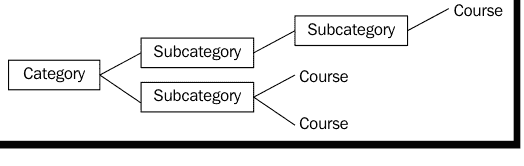

请记住，你只会在 Moodle 课程中找到资源和活动。类别和子类别仅用于帮助你组织和管理课程的组织。

那么在实践中是如何运作的呢？例如，我在 **Physics** 部门工作，属于 **Faculty of Science**。我的 **Backyard Ballistics** 课程支持 **Applied Physics** 资格认证。这就是我们如何安排类别和子类别的：

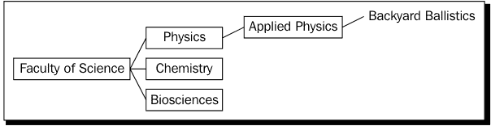

我相信你能为你的学科领域想到例子。你可以有一个名为 English 的类别，其中包含两个子类别 Literature 和 Language。在文学中，你可以对所教授的指定文本的特定方面开设短期课程。你可以有一个 20th Century History 类别，其中包含 Britain、Germany、France、Italy 和 USA 的子类别。每个国家子类别可以包含进一步的子类别，如 Politics、Society 等等。

由于这是在你首次开始使用 Moodle 时的关键问题，让我们花点时间研究一下在将面对面教学转换为 Moodle 时常见的几种方法。

## Breaking up is hard to do

你如何拆分面对面、传统教授的课程，取决于你工作的年龄组和学科领域，所以让我们研究一些例子。

较年幼的孩子通常对所有科目都有同一位老师。在这种情况下的学校通常会根据年级对 Moodle 课程进行分类，而在年级内，每位教师都会拥有自己的子类别，在该子类别中他们可以自由创建和删除课程：

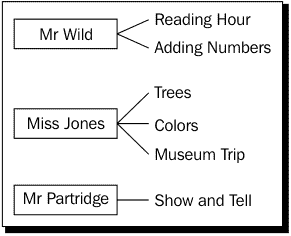

每位教师都有自己的 Moodle 课程，这样孩子们更容易找到已上传的资源和为他们创建的活动。

随着孩子们年龄的增长，你可以根据孩子的年龄和能力，为不同科目开设不同的 Moodle 课程。现在，我可以为每个年级建立一个类别，并在其中为每个学科领域建立子类别：

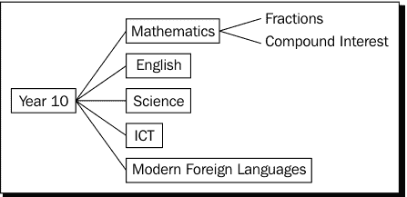

数学教师不必只教一门课程，而是可以在九年级教一门，十年级教两门，十二年级再教一门。随着学科领域的扩展和需要讲授的内容不断增加，你可能需要考虑为特定学科领域（尤其是学生容易遇到困难的领域）建立 Moodle 课程。

随着学生年龄的增长，事情往往会变得更容易，因为由外部考试机构考核的资格证书会有自己的教学大纲。仔细阅读教学大纲，你通常能立刻看出如何将学科分解为若干门 Moodle 课程。例如，数学自然可分为以下几类：

- 数
- 代数
- 几何（形状、空间和度量）
- 数据处理与统计

在每个类别中，学科领域之间也会自然地形成划分。看看你是否能在自己的学科领域中发现类似的模式。

对于年龄更大的学生（即大学或学院年龄段的学生），科目通常已经按单元进行教学。例如，一个为期 10 周的短期单元就是 Moodle 课程的理想候选。

在结束本节之前，我再给你几点想法。其一，Moodle 课程也可以用于培养学生的关键技能。关键技能的例子包括：

- 沟通交流
- 数字应用
- 信息与通信技术
- 问题解决
- 协作

其二，Moodle 课程并非一成不变；一旦创建，你可以根据需要随时修改。稍后你还会在本书中看到，Moodle 课程不同方面的职责可以下放给你的学生，让所有人共同协作来完善你的课程页面。

## 动手实践——培养关键技能

尝试找出支持培养某一关键技能的课程。如果关键技能是你所在学校或学院的重点，那么你手头肯定已经有很多基于技能的教学材料，可以将它们转化为 Moodle 课程。

## 如有疑问，召开会议

在本节中，我们一直在探讨如何拆分传统面授课程，以及找出哪些内容可以转化为 Moodle 课程。你可以按照传统思路进行拆分，也可以从关键技能或学习风格的角度来解决问题。这是一个极其复杂的问题，无疑需要与系里的同事讨论。我强烈建议你召开一次 Moodle 会议，首先讨论要创建哪些课程。利用这个机会讨论由谁教授这些课程，以及它们应该归入哪些类别。在你开始在 Moodle 中进行任何操作之前，尽量做好规划。

记得让 Moodle 管理员也参加这些会议，特别是当管理员负责创建类别和课程时。

既然我们已经知道了需要哪些 Moodle 类别和课程，就可以专注于创建和运行这些课程了。

## 让我们开始：设置课程

本书的其余部分将只专注于一门课程。如果你要把整个系都放到 Moodle 中，那么你将有很多课程需要处理。这就是为什么将课程创建工作分配给其他教学人员、让他们分担工作会如此有用。我们也会向你展示如何做到这一点。

## 创建你的课程

在开始构建课程之前，需要先在 Moodle 中“创建”课程。如果你在学校或大学工作，可能的创建方式有三种：

- 管理员已经创建：有时，管理员会为一所学校开设的所有正式课程创建空白课程。
- 提交请求：在其他情况下，管理员要求教师申请新课程；管理员批准后，课程即被创建。
- 自己创建：在其他情况下，你可能拥有自行创建课程的权限。如果是你自己安装的 Moodle，那么你肯定有创建课程的权限。

为什么你不能创建课程，而你的同事却可以？我们将在下一节中讨论这个问题。

## 你需要自己创建课程吗

你可能会很幸运，管理员可能已经把你设为经理或课程创建者，这意味着你可以创建自己的课程。请注意，经理比课程创建者拥有稍多的权限。例如，经理可以创建和删除课程，而课程创建者只能创建课程。要判断自己是否是课程创建者或经理很容易：只有当你查看 Moodle 类别，或点击**所有课程**按钮来显示 Moodle 中的全部课程时，你才会看到**添加新课程**按钮。一旦找到**添加新课程**按钮，只需按下它即可创建新课程，你会立刻进入新课程的设置页面。

## 设置你的课程

## 如果已经有人为你创建了课程

眼前的问题是如何找到它。回到你的网站首页。你能看到**导航**版块吗？（默认情况下，导航版块位于页面左上角）。点击**我的课程**链接，就会显示出你的课程列表：

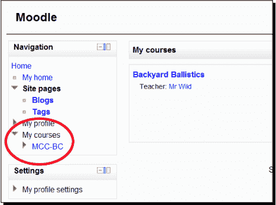

如果你的网站首页没有**导航**版块，最简单的办法是点击你的姓名（通常可以在页面顶部的右侧找到），随后会显示你的用户资料。你的资料中会列出你参与的课程：

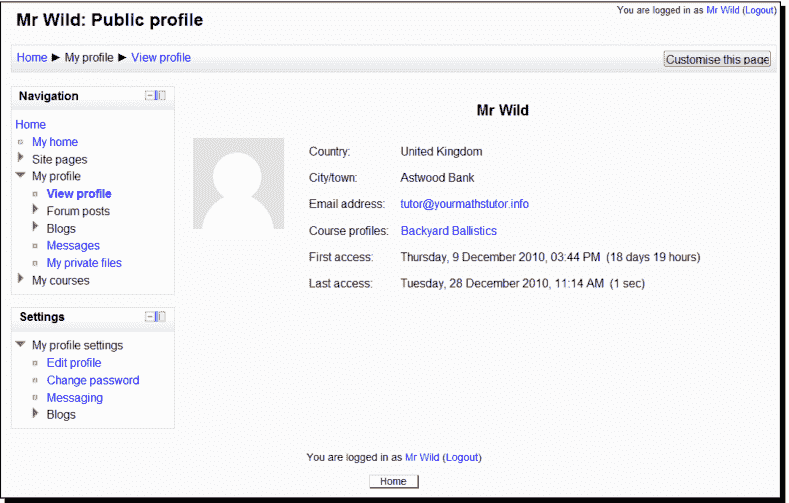

课程名称**Backyard Ballistics**是一个链接，我点击它来查看我在课程中的角色。从下面的截图可以看到，我的系主任已让我担任**Backyard Ballistics**课程的教师：

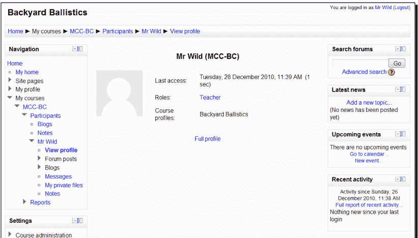

就我而言，我可以点击**导航**版块中**我的课程**下的**MCC-BC**链接。如果没有**导航**版块，我也可以点击屏幕顶部导航栏中的面包屑导航：

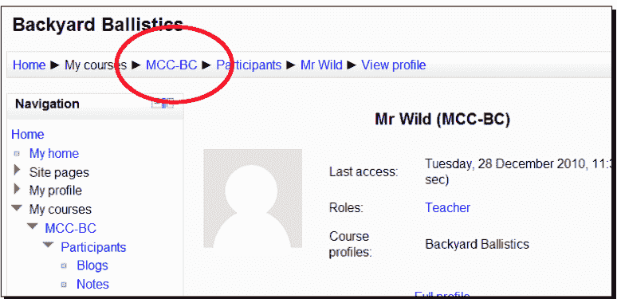

## 设置你的课程

我现在来到了我的课程页面。这是一个基于 10 周结构的空白课程，已经可以开始配置了：

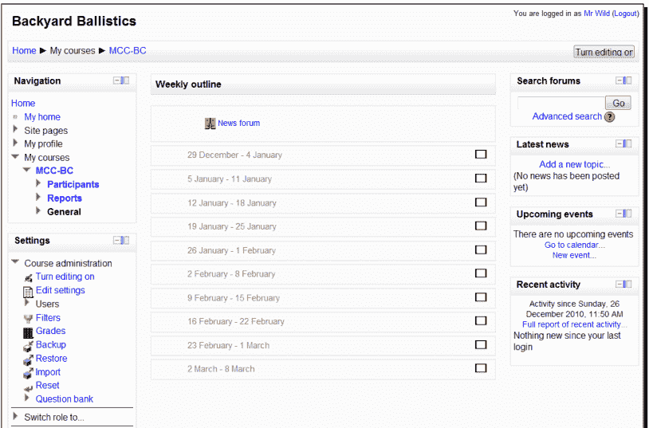

## 小测验

课程创建者和经理之间有什么区别？

## 配置你的课程

现在让我们来配置一个名为 Backyard Ballistics 的基于主题的课程。在“课程管理”下的“设置”版块中，点击“编辑设置”。这会带你进入课程设置页面：

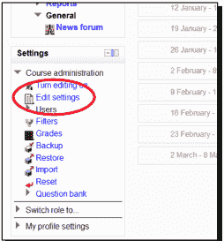

## 实际操作——配置 Backyard Ballistics 课程

让我们从创建我的 Backyard Ballistics 课程开始。我现在并不太担心微调问题，只想让它先运行起来；等基础功能就绪后，我们再进行微调：

1. 在“课程全称”旁输入课程标题：Backyard Ballistics。
2. 输入课程简称。该简称必须完全唯一（如果另一个课程使用了相同简称，Moodle 会报错）。我将指定为 MCC-BC。
3. 使用 WYSIWYG（所见即所得）HTML 编辑器输入课程摘要。可以看到，我们可以像使用文字处理器一样对描述进行格式化：

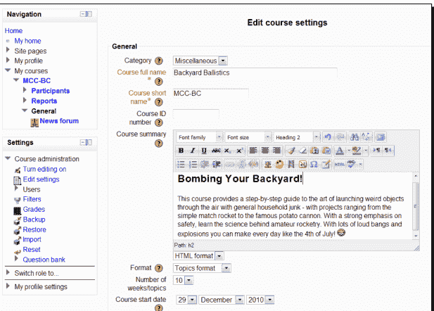

+   4. 找到**格式**设置（几乎就在**课程摘要**编辑器正下方）。点击下拉菜单并选择**主题格式**。
+   
+   5. 因为我们刚刚创建课程，暂不希望学生选课，所以向下滚动到可用性选项。点击**可用性**下拉列表，选择**本课程对学生不可用**。
+   
+   6. 设置基础课程所需做的就这些。滚动到底部并点击**保存更改**。

如果你是从零创建这门课程，现在会进入**已选课用户**界面。我们暂时不讨论角色，因此现在请点击屏幕底部包含课程短名称（现在是 **MCC-BC**）的按钮，前往课程主页。如果你是在配置已有课程，无论如何你都会直接返回课程页面。

## 刚才发生了什么？

我们创建了一门新课程，并为其设置了全称、简称和摘要。我们还配置了课程，使其按主题来划分（新安装 Moodle 的默认格式是每周）。其他所有设置保持默认，以便稍后修改。现在你已经有了一门分为 10 个“主题”的课程，可以随时添加内容。

然而，并非每门课程都能正好划分为 10 个主题。所以下一项任务是确保我们的课程结构正确。我们将在下一节来做这件事。

但在那之前，关于创建课程，你还需要了解几点：

- 为课程摘要选择有效的描述
- 使用编辑器
- 获取 Moodle 设置方面的帮助
- 返回课程设置界面

现在让我们来看这些内容。

## 为课程摘要选择有效的描述

每当你的课程与其他课程一同列出时，摘要都会显示，因此如果你希望课程脱颖而出，请尽量用简短直接的方式描述它。摘要通常是学生在选课前最先接触到的课程内容，所以你应该利用摘要让课程尽可能有吸引力。另外，要记住你的目标受众：如果你使用 Moodle 课程仅仅是为了辅助课堂教学，那么摘要的重要性远不如你想吸引潜在学生或其家长关注时那么高。

## 使用编辑器

习惯使用编辑器很重要，因为我们以后会经常用到它。大多数按钮与你在任何文字处理器中看到的相同，而且我假设你已经相当熟悉文字处理器，所以不会逐一介绍所有“标准”格式化按钮（包括插入符号和拼写检查）。以下四个“非标准”按钮会很有用：

| 图标 | 功能 | 用途 |
|---|---|---|
| [笑脸图标] | 插入笑脸 | 有时学生很难判断你写的话是玩笑还是讽刺。使用笑脸可以强调你的认真程度：如果是开玩笑，就插入一个眨眼表情；如果是讽刺，就插入一个咧嘴笑的表情。 |
| [从 Word 粘贴图标] | 从 Word 粘贴 | 如果你从 Word 粘贴，往往无法让文本正确格式化。“从 Word 粘贴”按钮可能会解决这个问题。 |
| [清理杂乱代码图标] | 清理杂乱代码 | 如果你不是从 Word 而是从其他应用程序（比如 PowerPoint 或网页）粘贴，同样可能遇到粘贴文本无法正确格式化的问题。粘贴文本后，点击“清理杂乱代码”按钮即可修正。 |
| [粘贴为纯文本图标] | 粘贴为纯文本 | 如果你在编辑粘贴后的文本时仍有问题，可以尝试用此按钮粘贴到编辑器中。它只粘贴你复制的文本，不包含任何格式（因此在粘贴到编辑器后，你需要重新排版）。 |

另一个有用的控件（而不是按钮）是编辑器右下角的调整大小控件：

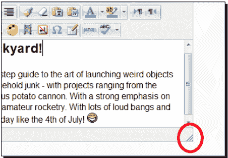

用鼠标光标单击编辑器一角并拖动，即可放大或缩小编辑器。

记住：你只能将其他软件程序中的文本剪切并粘贴到编辑器中。不要尝试剪切和粘贴图片。图片需要复制到运行 Moodle 的计算机上。我们将在*第 4 章“声音与视觉——包含多媒体内容”*中讨论上传图片。

我们会在需要时逐一介绍其余“非标准”按钮。

## 获取 Moodle 设置方面的帮助

我在课程设置页面中故意跳过很多选项，并且在设置课程的过程中也会继续这样做。不过，Moodle 在帮助您理解每个单独设置方面做得很好。你可以点击附近的问号图标获取任何 Moodle 功能的帮助。

例如，如果你点击了**课程简称**旁边的 ?，你会看到如下内容：

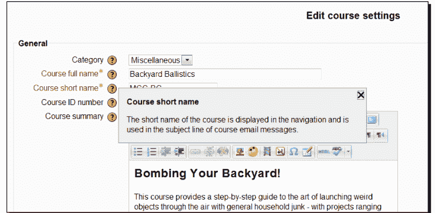

## 更多文档

如果这些帮助还不够，你可以在 Moodle 的大多数页面底部获取整页帮助。只需滚动到页面底部，点击**本页的 Moodle 文档**。这会带你进入 Moodle 网站的文档部分，那里有最新且不断扩充的文档：

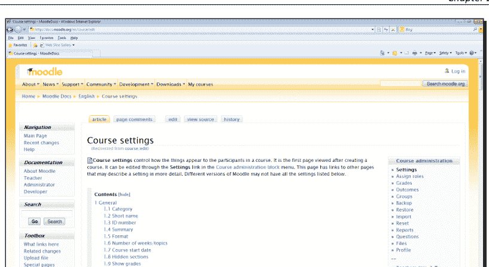

## 返回课程设置界面

请记住，Moodle 中没有什么是不可更改的。如果你想修改已创建课程的设置，可以随时返回。在查看课程时，点击屏幕左侧“课程设置”版块中的“编辑设置”。然后你就会回到课程设置界面，在那里可以更改标题、描述和其他设置。

## 课程结构与格式

课程分为多个部分。一个部分的具体含义取决于课程的格式。如果你是 Moodle 新手，有两个重要的主要格式：

- 每周格式：每个部分代表一周的学习内容
- 主题格式：每个部分代表一个特定主题或课程的一个方面

对于你的前几门课程，尤其是基于现有非电子学习材料的课程，你可能只会用到这两种。不过还有其他格式：

- SCORM：第三方电子学习材料很可能会以 SCORM 格式提供给你（SCORM 是一种教育资源“标准”格式，就像文档以“.DOC”格式提供一样）。如果你知道 SCORM 是什么，那么这是一种有用的课程格式类型。如果你从未听说过 SCORM，也不必担心。

- **社交格式**：整个课程围绕一个论坛展开。这在用 Moodle 管理并非严格意义上的课程时很有用。你可以用它来建立系部公告栏，或者为课后俱乐部、复习活动建立讨论论坛，或者（正如我曾就职的一所学校那样）用来帮助组织 11 年级的毕业舞会。

要将课程放入 Moodle，你需要选择适合课程结构和材料的格式。

## 我们应该使用哪种格式：每周格式还是主题格式

首先，以下是每周格式和主题格式的主要区别。

主题格式：

- 由可以任意长度的已命名部分组成
- 可以有一个主题、三个主题或 20 个主题
- 每个主题可以包含任意数量的信息
- 每门课程最多可有 52 个主题

每周格式：

- 由固定数量的周组成——每个部分正好持续一周
- 有明确的开始日期——每周对应一组精确日期，不是“第 1 周”“第 2 周”等，而是“3 月 3 日–10 日”
- 每门课程最多可有 52 周
- 如果课程跨越两个学期，请记得把学期休息时间也包含在内。

那么，每种格式分别适合什么时候使用呢？

主题格式通常在以下情况下最合适：

- 学生按自己的节奏学习，或在学习中自我指导——他们会从整个课程中挑选资源，而不受任何特定顺序的约束
- 课程被划分为一个接一个的主题，但每个主题并不都持续一周
- 有些主题是可选的，不是所有学生都会学习，或者会在不同时间学习
- 不同的学生群体会在不同时间使用该课程

每周格式通常在以下情况下最佳：

- 有一个明确定义的时间表
- 课程有明确的开始日期
- 你想用特定的截止日期来强化学生的学习（尽管在每周格式的课程中，你仍然可以随时访问所有材料和活动）

如果你是 Moodle 的新手，那么至少起初，我建议你坚持使用主题格式课程。我第一次开始教学时，我会尝试计划该学期要教授的内容，但很快就全部脱离轨道了，因为我必须判断接下来要进入哪些主题，这完全取决于班级对我们迄今为止所学内容的掌握情况。Moodle 也是如此，这也是为什么在学校或学院中很少能找到使用每周格式的 Moodle 课程。

每周格式非常适合你将一门需要学生为自己安排时间的课程转换过来，并且你作为教师，知道课程中接下来会有什么内容以及何时出现。有了每周课程，你的学生有机会提前查看，他们会知道何时需要为困难/额外的工作做好准备。同样，如果你正在将课程转换为支持学徒制或在职实习的学生，请考虑每周格式课程是否会是更好的选择。

## 快速测验

如何将你的课程格式从主题更改为每周？

## 将课程拆分为主题

你现在已经确定了课程，但需要将课程拆分为 Moodle 主题。实现此目的最常见的方法有：

- **按顺序**：某种叙述性顺序。基本上，遵循读者应学习的顺序
- **按资源类型**：练习表、手册、网络资源
- **按“真实主题”**：每个部分收集课程中一个主题的资源，即使课程不一定按这些主题的顺序进行

每种方法都有利有弊。每种方法在特定情况下都是理想的。

你甚至可以组合它们，例如，建立一组映射到有序单元集的主题，并在末尾添加一些无序单元，涵盖例如贯穿整个课程的个人研究项目相关的资源。

我将我的《后院弹道学》课程拆分为五个主题，因为在转换为 Moodle 之前它就是这样构建的，五个主题是自然的契合。

如果你担心在转换为 Moodle 时应如何构建课程，请记住你随时可以回来更改。经常更容易开始将课程转换为 Moodle，而这样做的过程本身会帮助你看到事物应如何组织。

## 设置课程格式

正如你已经看到的，我的《后院弹道学》课程围绕六个主题构建。让我们看看如何使用 Moodle 设置这种课程结构。

### 行动时间 – 设置课程格式

1. 返回课程设置屏幕。
2. 从格式选项中，选择主题格式或每周格式。对我来说，我将选择主题格式：

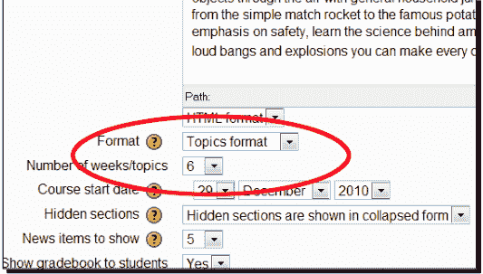

3. 选择主题/周数。我已为我的课程计划了六个主题。
4. 对于每周课程，请确保设置开始日期。
5. 现在滚动到页面底部并按下保存更改按钮以返回课程页面：

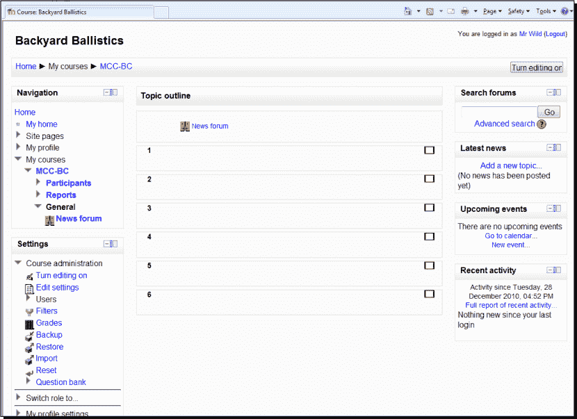

### 刚才发生了什么？

我刚刚将我的《后院弹道学》课程拆分为五个“主题”，即五个编号的框，因为这就是现实世界中我的课程结构。同样，五个主题是自然的契合。

在课程填充内容后，你仍然可以调整课程中主题/周数。然而，如果你减少数量，则后面的主题将消失。因此，如果你有 10 个主题，后来减少到 8 个，你添加到第 9 和第 10 个主题中的任何内容都将从视图中消失，但仍然存在（并且如果有人为其添加了书签，仍然可以访问）。这是一种技术，你可以用它在面对面教学进展时揭示教学材料和活动（这样你的学生就不会在你尚未教授的主题上提出大量问题）。

你也可以随时在每周和主题视图之间切换。

## 定义每个主题/周

Moodle 现在为你提供了正确数量的部分或“插槽”来填充课程内容。但每个主题都是空白的，它缺乏任何标题或描述，更不用说教育内容了。

让我们为课程中的每个部分添加描述。

### 行动时间 – 定义每个周/主题

1. 返回你的课程页面。确保你已打开编辑模式，通过点击屏幕右上角的打开编辑按钮或点击设置块中的打开编辑链接：

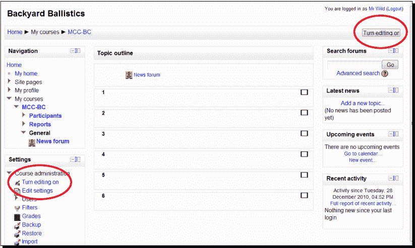

2. 点击你想要编辑的主题编号旁边的手和笔图标（将鼠标悬停在图标上会显示有用的“编辑摘要”提示）：

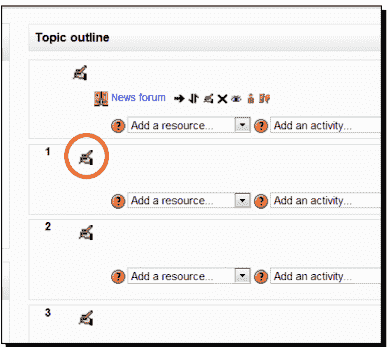

3. 现在输入主题的简短摘要。此摘要也必须用作主题标题。你可能想使用富文本格式来区分标题和其余文本：

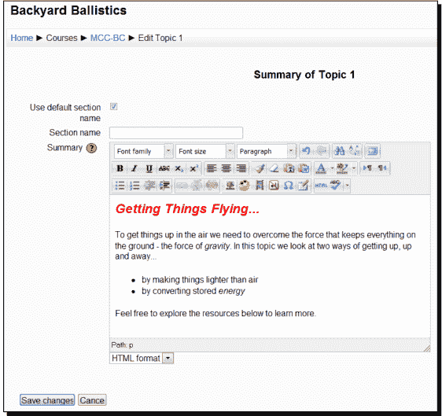

4. 完成后，按下保存更改按钮，你将返回课程，新的摘要已就位。如果你想取消更改，只需按下取消按钮即可。

这将现在出现在课程顶部：

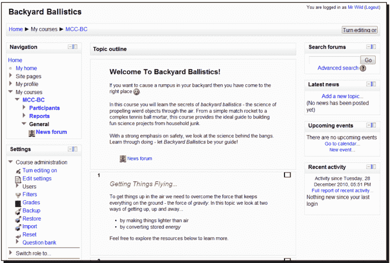

### 主题/周的更多设置

除了添加摘要外，当你在主页上且处于编辑模式时，我们还可以对每个主题做其他事情：

| 图标 | 功能 | 用途 |
| --- | --- | --- |
| ↑ ↓ | 更改主题顺序 | 点击上下箭头重新排序你的主题。  请注意，对于每周课程，主题会移动，但与主题关联的日期不会立即更改。重新加载课程页面将确保所有周都被正确“重新编号”。 |
| □ | 显示所有主题或一次只显示一个 | 此按钮让你选择是整页显示整个课程，还是一次只显示一个主题。当每个主题开始包含大量资源和活动时，一次只显示一个主题可能很有用。  学生也可以使用此按钮，并且即使你不在编辑模式下也能工作。如果你惊慌失措，担心自己不小心删除了除一个之外的所有主题，很可能你点击了此按钮。再次点击它，一切应该都会恢复正常。 |
|  | 隐藏主题 | 点击一个睁开的眼睛使特定主题不可见。主题将显示为对学生“不可用”，他们无法看到其任何信息或资源，或完全隐藏，这取决于课程设置页面中的**隐藏部分**选项。 |

最后，也是最重要的，我们可以向我们的课程添加资源和活动。在后面的章节中，我们将看到如何将现有的课程材料转变为 Moodle 资源并通过我们的课程提供它们。

## 分配教学人员

如果你独自在自己的 Moodle 上教学，就不必担心与同事合作。Moodle 中的每位员工通常会落入以下类别之一：

- **管理员**：对 Moodle 有完全控制权。相当于首席执行官或学校校长。
- **经理**：可以创建和删除课程。他们有进入你的课程并做你的工作的选项，但如果他们是传统的经理，他们可能不知道怎么做。
- **课程创建者**：可以创建新课程并编辑它们。默认情况下，课程创建者实际上不能删除课程。
- **教师**：可以编辑和处理现有课程，但不能创建新课程。此角色可以添加新资源和活动，更改主题和设置。
- **非编辑教师**：可以评分作业和教学，但不能编辑课程。此角色只有在我们进入后面的章节中的交互式课程内容时才会变得相关。

这取决于你在学校或学院的管理结构，但根据我的经验，最有效的方法是让系主任/院系负责人/团队负责人/Moodle 倡导者，根据需要删除，担任其 Moodle 类别中的 Moodle 经理。然后他们为教学人员创建课程。如果你是课程创建者，那么我不需要告诉你不要在未经他们事先讨论的情况下将 Moodle 课程简单地丢给你的同事。我知道这种情况发生过，它只会引起大量敌意和相当多的反 Moodle 情绪。

我们来看一个例子。在本书的其余部分，我们将研究如何将《Backyard Ballistics》课程转换到 Moodle 中。不过，物理教学大纲中还有其他课程需要转换，包括《Jet in a Jam Jar》。作为课程创建者，你可以创建一个课程，然后将其分配给另一位教师，由该教师从那时起“开发”这个课程。

我打算创建一个新课程，然后将其分配给 Wild 先生作为编辑教师。

## 动手操作——分配角色

- 1. 使用之前描述的过程，在你的 Moodle 中添加一门新课程。
- 2. 在新课程页面的“设置”版块中，点击“用户”，然后点击“已选课用户”：

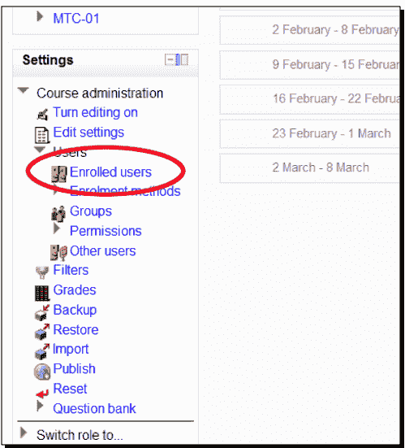

5. 你需要从潜在教师列表中选择你希望成为课程编辑教师的用户。如果你没有立刻在列表中找到你的同事，可以尝试使用对话框底部的搜索框：

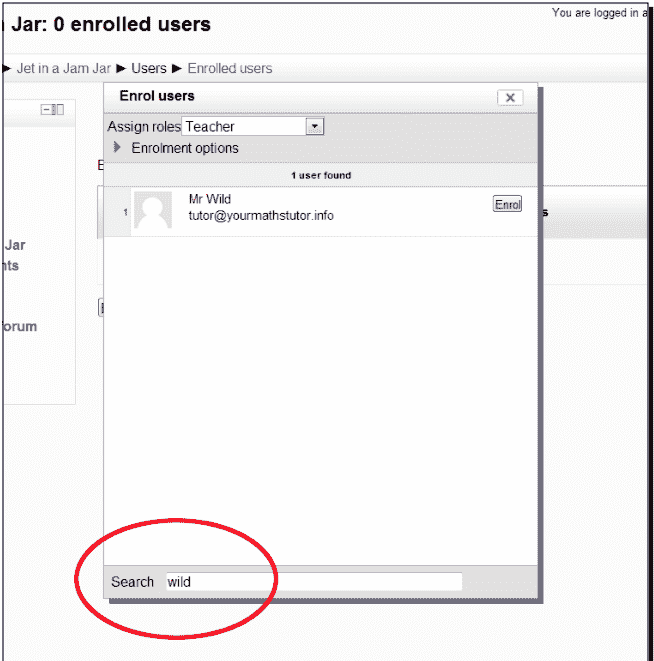

6. 如果你需要的教职员工没有列出，那么他们需要一个登录账号（如果你的 Moodle 较新或尚未使用，这可以实现）。这是 Moodle 管理员的职责（不在本书讨论范围内）。

## 设置课程

7. 要为你的同事选课，请按下其姓名右侧的 **选课** 按钮：

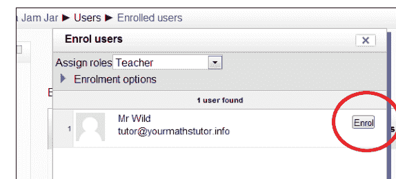

8. 完成更改后，点击“选课用户”对话框窗口右上角的关闭按钮。你的同事现在将作为教师列在课程中：

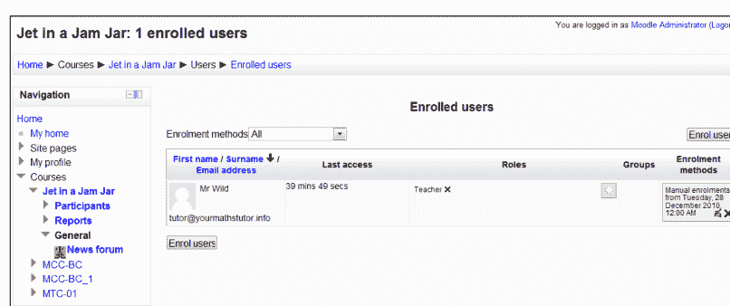

9. 在这门新课程中，是否有助教或学习辅导员与学生一起工作？你也许想将他们添加到所谓的“非编辑教师”列表中。你可以用完全相同的方式将用户分配到不同角色。

暂时不用担心在课程中分配学生。我们将在下一节讨论这个主题。

## 刚才发生了什么？

如果你不是唯一参与课程的教职员工，那么你会希望将同事分配为教师（既可以像你一样编辑课程，也可以是所谓的“非编辑”教师）、学习辅导员或课堂助理。我们探讨了如何通过课程“设置”版块中可用的“已选课用户”选项来实现这一点。

到目前为止，我们已经配置了课程结构并分配了教学人员。在下一节，我们将讨论如何让学生在课程中选课。

## 放学生进来：让学生在课程中选课

你的课程是由管理员为你创建的吗？你甚至可能已经进入“已选课用户”页面，发现你的课程中已有学生选课。如果没有关于让学生在 Moodle 课程中注册的通用策略，那么你有多种选择。让我们来看看。

## 使用选课密钥选课

让一个班级选课到课程上的最简单方法是设置一个选课密钥。这就像课程密码。然后每个学生尝试注册课程时，会被要求输入密钥。他们输入密钥后，嘿，转眼间就选课成功了。

## 动手操作——指定课程选课密钥

- 1. 在你的课程“设置”版块中点击“用户”，然后点击“选课方法”：

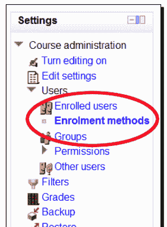

**2.** 点击眼睛图标来启用 **自助选课（学生）** 方法（确保眼睛处于睁开状态）：

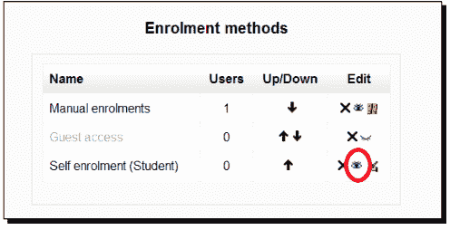

**3.** 点击 **自助选课（学生）** 的编辑图标（拿着铅笔的手）以打开 **自助选课** 配置页面：

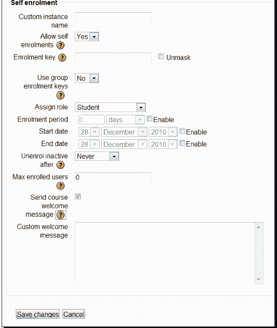

4. 此页面上的大多数设置不言自明（你还记得如何查找特定设置的帮助吗？）但务必确保你已将 **允许自助选课** 设置为 **是**，并指定了选课密码。你可以根据需要将密码设置得简单或复杂：

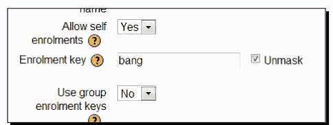

5. 完成后，滚动到页面底部并按下 **保存更改** 按钮。

6. 就这样，完成了！

## 刚才发生了什么？

我们刚刚为课程指定了一个选课密钥。如何把密钥告诉学生完全由你决定。当需要让学生选课时，我通常会把密钥写在白板上。大约一周后，我会回到课程设置并更改密钥（我通常只是在该密钥前加上字母“X”；如果我的学生中有人读到这本书，我以后不会再这样做了）。显然，更改密钥可以防止其他学生选课（尽管我努力尝试，但从未成功阻止学生互相传递密钥，而且如果我特别告诉他们不要传，他们似乎更愿意传）。

## 动手挑战——用密码让教师选课

不仅学生可以使用密码自助选课。你是否注意到 **自助选课** 配置页面中的 **分配角色** 设置？也许你课程的所有成员都需要教师权限。这并不罕见，我最近遇到的两个例子是：一个供讲师使用的“教师休息室”课程，所有讲师都希望在该课程上拥有教师权限；另一个是为当地医院医务人员提供的支持课程。我们将在本书后面学习如何做到这一点。

## 其他选课选项

到目前为止，我们已将课程配置为允许学生自动选课。但这并不是让学生选课的唯一选择。让我们看看其他选项。

## 教师手动为学生选课

与其让学生自己选课（通常使用密钥），我们可能需要在课程中手动添加学生（如果不管出于什么原因，他们来晚了）。过程与我们分配教师时完全相同，因此我在这里简略介绍一下。在“设置”版块中点击“用户”，然后点击“已选课用户”以显示“已选课用户”页面。按下任一“选课用户”按钮以显示“选课用户”对话框。在对话框顶部的下拉菜单中选择你要分配的角色（例如，学生或教师），然后按下你希望分配该角色的用户姓名旁的“选课”按钮。

这往往是说起来容易做起来难。首先，你必须从列表中找到正确的学生。然后，你必须对课程中想要的每个学生都执行此操作。这可能需要很长时间。我不会推荐这个选项。如果注册不是自动的，让学生自己选课要好得多。

## 小组与小组选课

你有没有和学生一起开展小组活动？在 Moodle 中你也可以这样做。我们将在第9章“整合在一起”中学习如何对学生进行分组，包括如何向不同小组分配不同任务的信息。

## 自由注册：让任何人选课

如果你不指定密钥，那么任何注册用户都可以选课。这不是我推荐的选项，除非你的课程是你很乐意让任何人加入的课程，或者你的课程是每个注册用户都必须完成的必修课程。例如，你可以开设关于学校计算机使用政策的课程，或者开设强制性的健康与安全培训课程。

如果你的课程并非所有用户都必须修读，那么我强烈建议使用课程或小组选课密钥。你会发现，有些学生会把选课密钥传给朋友，或者（这往往更常见）传给家长，然后他们选课进来只是为了随便看看。这可能很麻烦，因为你会发现自己需要定期检查课程参与者名单，将那些不应该在那里的学生取消选课。解决这个问题的方法是，在课程开始大约一周后禁用选课。你还可以考虑制定不允许把密钥传给其他学生的规则，尽管制定这类规则往往会鼓励学生尝试去打破它们。

## 添加一个群组

也许你的Moodle管理员已经将学生放入了一个群组。群组是一个全站范围的学生组。我们需要将课程配置为与一个或多个群组“同步”，这意味着如果学生属于正确的群组，他们就会自动注册到我们的课程中。同样，当他们被移出群组时，也会自动从我们的课程中取消注册。如果你的 Moodle 启用了群组（这必须由你的 Moodle 管理员完成），那么你会看到**群组同步**出现在**注册方法**列表中（在**课程管理 | 用户 | 注册方法**下的**设置**块中）：

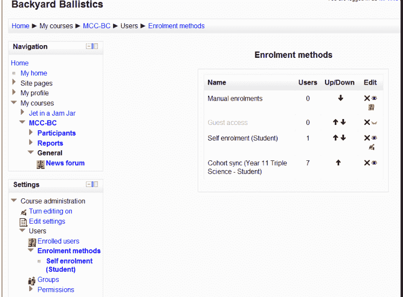

再说一次，管理群组并不是我们教师需要过多操心的事情；我们可能需要了解它们，但那些对Moodle管理负有更大责任的人（例如经理或管理员）需要创建群组并将其分配到课程中。

有关管理群组的更多信息，请参阅《*Moodle 2.0 First Look*》，*Mary Cooch* 著，*Packt Publishing* 出版（详见 https://www.packtpub.com/moodle-2-0-first-look/book）。

## 设置你的课程

### 从学校的教务管理系统（MIS）自动注册

你的Moodle可能已配置为根据学校或学院的教务管理系统中指定的时间表自动创建课程（在英国，主要是Capita SIMS.net或Serco CMIS Facility）。并非所有这些系统都能做到，但此类系统确实会将正确的用户分配到正确的课程并赋予适当的权限。在我工作过或设计过的系统中，我使用过三个此类系统：

-   **用户管理资源管理员（UMRA）**，来自Tools4ever（`http://www.tools4ever.com`），它不仅可以自动创建课程并将正确的用户分配到正确的课程并赋予正确的权限，还可以为家长创建账户并将孩子与其家长关联起来。
-   **Groupcall Xporter**（`http://www.groupcall.com`），在英国经常被地方教育当局用来从学校的MIS中提取学生出勤数据，英格兰最大的教育当局伯明翰就是如此。
-   **ZiLink**，来自SchoolsICT（构建于Groupcall Xporter之上）。更多信息请访问 `http://schoolsict.net`。

如果你喜欢冷知识，或者你是一位有一定年纪（咳咳）且还记得1985年Live Aid演唱会的读者，你可能会感兴趣地得知，Groupcall的原始投资者之一是诺贝尔和平奖得主鲍勃·格尔多夫爵士（我的出版商不必担心：我在上述任何公司中都没有股份）。

### 允许访客访问

如果你希望所有人（不仅仅是注册的Moodle用户）都能查看你的课程，那么请允许访客访问。从课程**设置**块中点击**编辑设置**，向下滚动到课程的**访客访问**选项。在那里你会看到**允许访客访问**选项。点击下拉列表并选择**是**。同样，在某些情况下你会需要这样做，例如作为学校或学院VLE的广告。然而，访客在课程中能做的操作是有限的。

现在我们知道如何让学生注册到你的课程了。在撰写本文时，最流行的方法是发放注册密钥——可以是课程注册密钥，或者更常见的是小组注册密钥。如果你乐意让任何人加入你的课程，那就不必担心设置密钥。问题是，你的课程中可能注册了很多学生，但你却不知道他们是谁。你随时可以通过**已注册用户**页面仔细查看谁注册了你的课程。

## 总结

你在本章中已经取得了不少成就。这才仅仅是*第2章*，而你已经：

-   创建了一门课程，并配置了正确的简称、全称、描述和格式
-   组织好了你的课程，创建了一组单独的主题（或周），并附有描述，也许还加上了一条欢迎消息
-   指派了其他教学人员来帮助你管理课程

设置了一个注册密钥，你可以在适当时机交给学生。

当然，现在注册到你的Moodle课程的学生还学不到太多东西，但这种状况即将改变。所以暂时请对注册密钥保密。到*第3章“添加文档和讲义”*结束时，你将拥有在线内容，并可能准备好让学生开始使用它。
