# 3 添加文档和讲义

你的新Moodle课程已经配置好，可以上传教学材料了。现在让我们开始吧！在本章中，我们将涵盖：

-   将文件上传到Moodle以及如何有效地组织它们
-   如何向学生展示文档和讲义
-   上传图片以及如何将它们包含在任何文本中
-   了解哪些类型的文件最适合放入课程，以及如何创建它们。我们还将学习如何将部门文档转换为wiki，以便你和同事可以协作处理。

到本章结束时，你将用静态内容填充课程，供学生访问。显然，我们的目标是创建更有吸引力和交互性的课程，我将资源描述为“静态内容”可能听起来不那么鼓舞人心，但正如你将在本章及后续章节中看到的那样，当我们转换为Moodle时，我们可以对我们的“静态”资源做很多事情，使它们变得引人入胜且有趣。

### 上传文件

一如既往，我想先向你展示简单的方法，将现有课程材料放入Moodle的最简单方法就是直接按原样上传文件。

但是，请记住，你的学生可能没有读取你想上传到Moodle的文件所需的所有软件。在本章中，我将主要使用Microsoft Word文档和PowerPoint演示文稿，但我将概述并我们一起实践的过程同样适用于任何类型的文件。在本章后面，我们将了解如何确保你的文档采用任何学生使用任何电脑都能下载和使用的格式。

不过现在，让我们看看如何将任意文件上传到Moodle。

> 上传意味着将文件从你的计算机放到服务器上。学生和其他员工随后可以将文件下载到他们自己的计算机上查看。

如果你和我一样，你的所有教学资源都存储在U盘、移动硬盘上——或者你可能将它们保存在学校或学院服务器上。我们现在需要将它们上传到Moodle，以便将资源包含在课程首页上。

我们每个人在Moodle中都有自己的“我的私有文件”区域，其他用户（学生和同事）无法访问。我们可以将文件上传到“我的私有文件”区域，然后从我们讲授的任何课程提供指向该文件的只读链接。例如，我将向你展示如何上传一份“能源来源”讲义——一个Word文档（DOC文件）——这是我在教“Backyard Ballistics”时使用的。实际上，我在Moodle教的另一门课中也使用这份讲义，但将文件放在“我的私有文件”中意味着我可以轻松地从另一门课程创建指向它的链接。

> 尽管你是在“我的私有文件”区域中创建指向文件的链接，但在撰写本文时，Moodle会复制文件放入你的课程中。这意味着如果你修改了“我的私有文件”中的文件，当你从课程中点击指向该文件的链接时，你不会看到这些更改。更多信息请参阅这里的讨论：http://moodle.org/mod/forum/discuss.php?d=168495#p739240。

还要注意，在下面的示例中，我本可以使用任何类型的文件——我们将在本章后面更详细地讨论文件格式。

### 动手实践——上传文件

1.  选择要上传的文件，并记下它当前存储的位置。
2.  返回网站首页，在导航块中选择“我的个人资料 | 我的私有文件”：

- 3. 现在你位于“我的私人文件”区域。请记住：此区域只有你自己可以访问，但你可以将上传到这里的文件链接提供给你所教的任何课程。点击“管理我的私人文件”按钮：

    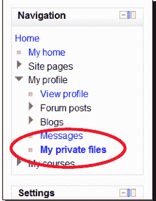

    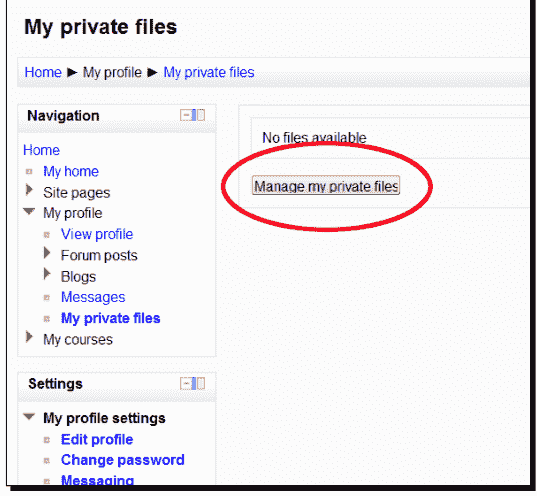

## 添加文档和讲义

- 4. 此时会显示一个新页面，允许我们管理“我的私人文件”区域中的文件。请注意，此屏幕上会显示你可以上传的文件大小上限（本章后面还会详细讨论最大文件大小）。点击“添加”按钮以打开“文件选择器”对话框：

    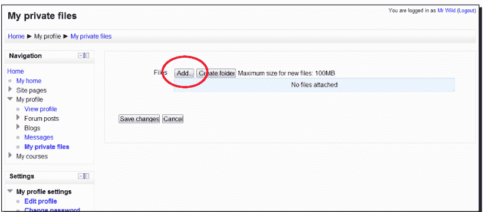

- 5. 确保你点击了“文件选择器”左侧的“上传文件”。

- 6. 按下“浏览”按钮（或“选择文件”，具体取决于你的浏览器），我们就可以选择在第 1 步中选定的文件。点击“浏览”按钮打开“选择要上传的文件”对话框。选择你要上传的文件，然后按“打开”按钮：

    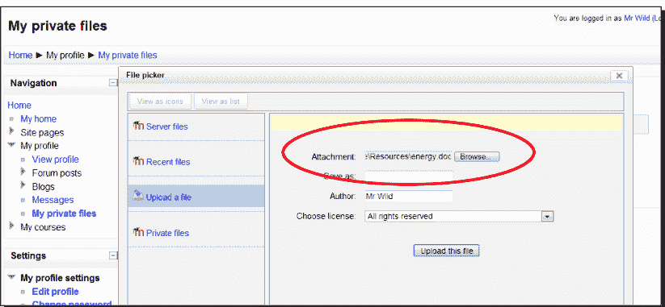

- 7. 选择文件后，按下**上传此文件**按钮以关闭“文件选择器”对话框。此时你会返回到“我的私人文件”页面，并看到刚刚上传的文件已列在列表中：

    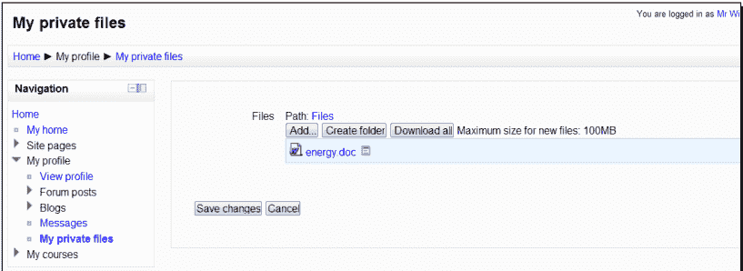

- 8. 按下**保存更改**按钮进行提交。“我的私人文件”区域现在看起来像这样：

    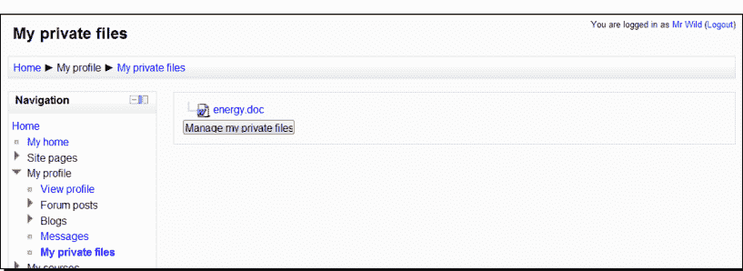

- 9. 就这样，完成了！你的文件现在已存储在你的“我的私人文件”区域中，随时可以被包含到你的任何课程中。

## 刚才发生了什么？

我们刚刚学习了如何获取教学资源并将其上传到 Moodle。但我们还没有让学生可以使用它。在此之前，我们先来谈谈几乎所有教师在开始转换课程时都会遇到的一个问题，尤其是在全新安装的 Moodle 上——文件大小问题。

## 你的文件有多大？

你可能遇到的一个主要问题（而且如果你遇到了，你并不孤单）是 Moodle 中的最大文件上传大小设置得太小。事实上，这通常不一定直接是 Moodle 的问题，还与 Moodle 的安装方式以及 Moodle 所依赖的软件有关。新服务器上运行的全新 Moodle 的默认大小为 2 MB。坦白说，这太小了（我见过比这个大小大 25 倍的 PowerPoint 演示文稿，不过我现在要提一下，有一些技术可以在不影响质量的情况下大幅缩小大型 PowerPoint 文件，我们将在本章后面的部分中看到）。如果你要上传的文件太大（而你不是 Moodle 管理员），那么你基本上有三个选择：

-   请管理员增加最大文件上传大小。
-   请管理员为你上传文件。因为增加上传限制可能存在潜在问题（除非你的 Moodle 运行在合适的硬件上，并且 Moodle 依赖的上传文件软件配置正确）。根据我的经验，大多数管理员不愿意将最大限制提高到大约 32 MB 以上。事实上，你的管理员可能会（在你提出要求之前）建议由他们为你上传文件。如果是这样，不要反对。
-   在上传之前压缩文件（我们将在下一节中花时间研究压缩文件）。

值得一提的是，你为什么会开始收到关于上传大量大文件的抱怨：如果你的 Moodle 运行在你所在学校或学院租用的服务器上，那么需要的存储空间越大，租赁成本就越高。即使你的学校运行自己的服务器，显然也需要承担你计划占用的所有空间的成本。

## 一次上传大量文档

如果你和我一样，有很多文档需要上传，而且不想花大量时间逐个上传。更好的选择是将所有文档打包成一个文件，把这个单一文件上传到 Moodle，然后在另一端再解包这些文档。你几乎可以把任何文件打包进 ZIP 文件（包括其他 ZIP 文件）。如果你有一个太大而无法上传的文件（例如那些大型 PowerPoint 演示文稿之一），那么你可以只把那个单一文件压缩成 ZIP 文件（这是我们上一节末尾提到的克服最大文件上传大小问题的三个选项中的第三个）。

- 3. 由于 ZIP 文件是打包了其他文件的特殊文件，我可以用“解压缩”选项（即，解包其中的所有文档）。在上下文菜单中选择“解压缩”：

    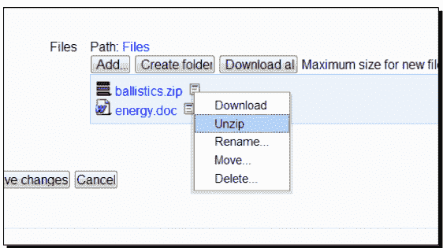

- 4. Moodle 会显示它从 ballistics.zip 中解包出来的文件和/或文件夹：

    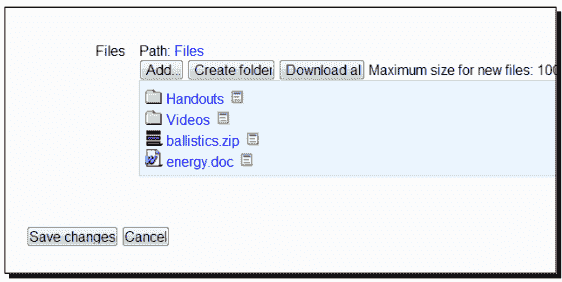

- 5. 按下“保存更改”按钮。

- 6. 就这样，我们完成了！已创建两个新文件夹：Videos 和 Handouts，其中包含我所有的文件：

    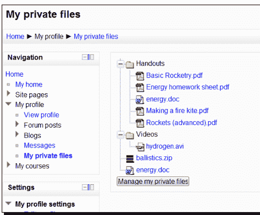

### 刚才发生了什么？

我们上传了一个包含大量资源文件的 ZIP 文件，然后在 Moodle 服务器上解压缩了它。

ZIP 文件是一种特殊类型的文件，其中可以包含许多其他文件。这意味着我们可以利用它将大量文件移入 Moodle，而无需一次上传一个。而且不仅仅是文件可以打包进 ZIP。你也可以将整个文件夹结构压缩成 ZIP。

Moodle 能够将该 ZIP 文件重新转换为一组单独的文件。当我们点击**解压缩**时，Moodle 会将所有文件从 ZIP 文件中取出，并将它们添加到当前文件夹中。

### 处理过大的 ZIP 文件

我们已经了解了如何将所有需要的文件打包到一个单一文件中（如果我们幸运的话，热心的管理员会替我们做这件事），这样我们就可以一次性上传大量文件。

我们仍然需要注意文件大小的限制，如果最大文件上传大小对你刚刚创建的 ZIP 文件来说太小，那么你可以：

-   创建多个 ZIP 文件。
-   向管理员寻求建议（管理员很可能必须为你上传文件）。如果所有内容都打包在一个 ZIP 文件中，而你的管理员可以一次性上传，他们可能不会太介意。事实上，有许多方法可以将大量文件上传到 Moodle，如果这是一个频繁出现的问题，你的管理员可能需要考虑实施其中一种方法（例如 WebDAV）。

> 如果 Moodle 试图解包/解压特别大的文件（但这些文件小于 Moodle 的文件上传限制），那么解包文件可能会超时。解决办法是将文件打包进 ZIP 时不要压缩它们。这需要使用能够做到这一点的压缩工具，例如 WinZip。如果你遇到了问题，并且不确定自己能做些什么来解决，请与你的 Moodle 管理员沟通。

## 压缩文件夹

如前所述，ZIP 也可以包含文件夹和子文件夹，因此你可以在自己的计算机上将所有课程材料整理到整齐的子文件夹中，全部放在一个“resources”文件夹内，然后将整个内容压缩成 ZIP。当你解压缩时，Moodle 会为你重新创建文件夹结构。

现在我们已经上传了文件，让我们整理一下课程文件区域。

## 解包后删除 ZIP 文件

ZIP 文件在解包时不会自动删除，即使我们已经不再需要它们。我们需要手动删除它们，这将在下一节中介绍。

## 删除文件

除了删除多余的 ZIP 文件之外，显然总有一天你需要从课程文件区域中删除某个文件（也许你刚刚上传了一个你并不想上传的文件）。从课程文件区域中删除文件很容易。事实上，还记得我一次性上传了一堆文件时提到过，用完后需要删除 ZIP 文件吗？我们现在就来这样做。

## 操作时间——删除文件

我要删除 ballistics.zip，因为所有文件都已从中解包，它现在只是占用空间：

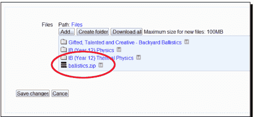

+   3. 点击**保存更改**按钮：

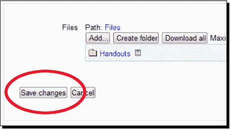

+   4. 就这样，完成了！新文件夹现在列在**我的私人文件**区域中：

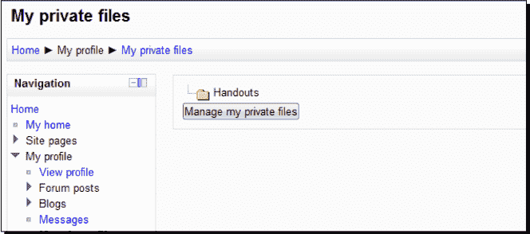

## 刚才发生了什么？

我们刚刚在课程的文件区域中创建了一个新文件夹，准备放入一些文件。只需点击文件夹名称前面的加号即可查看其内部（如果你正在实际管理文件，那么可以点击文件夹名称本身）。当然，目前它是空的。点击“父文件夹”返回你刚刚所在的文件夹，这样你就能再次看到“讲义”文件夹。

现在，让我们往里放一个文件。

## 动手实践——把文件放到我们想要的位置

移动文件分两个阶段。首先，我们需要选择要移动的文件。然后，我们需要选择要移动到的位置。点击**管理我的私人文件**按钮开始操作：

+   1. 点击文件名旁边的上下文菜单图标选择要移动的文件，然后从菜单中选择**移动...**：

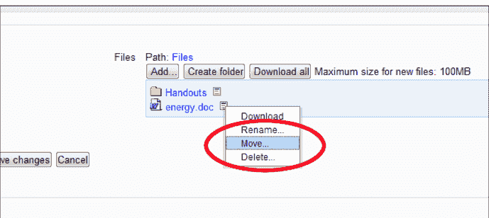

+   2. 此时会显示**移动**对话框。点击目标文件夹将其选中，在我的例子中是**讲义**。确保双击该文件夹以选中它：

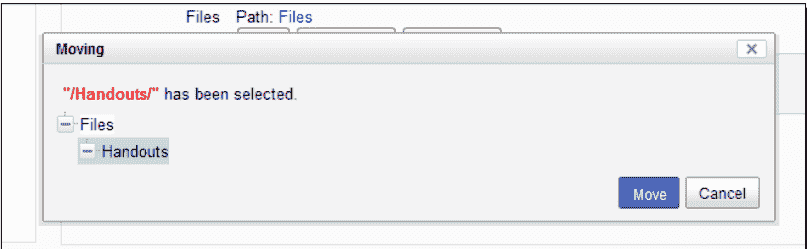

3. 点击**移动**按钮。现在你已经把文件移到了正确的位置！

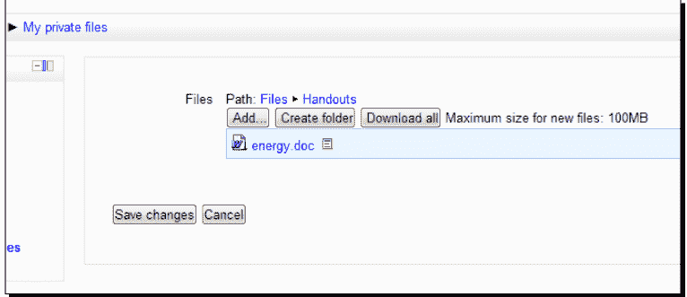

## 刚才发生了什么？

我们不仅知道如何将文件上传到系统，还知道如何整理文件以便轻松查找。当然，先创建文件夹再直接上传到其中更有意义——而不是先上传资源再试图整理一切。

尽管我将文件上传到“我的私人文件”区域，而且我们的教学同事无法直接访问该区域，但值得注意的是，我们的同事可以获取这些文件的副本（我们将在本章后面学习如何操作）。

在本节结束时，我们简要看看如何整理私人文件，以及文件夹和文件的命名约定。首先，我为所教授的课程创建了文件夹。在“Backyard Ballistics”文件夹中，我选择将所有讲义放在一个“讲义”文件夹中：

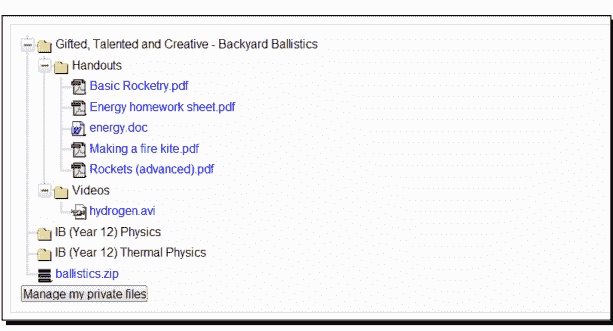

你也可以根据自己的课程设置为每周格式或主题格式，将文件组织到名为“第1周”、“第2周”或“主题1”、“主题2”等文件夹中。这样你就可以快速确定哪些文件需要放在哪些主题/周中。如果你在不同的周/主题中重复使用相同的资源，那么创建一个讲义文件夹会很好。当然，这取决于需要上传多少文件。

## 分发资料

现在我已经上传了文件，整理好了“我的私人文件”区域，接下来我想把它们分发给学生。没有其他人可以直接访问“我的私人文件”区域，所以我必须从课程主页提供文件链接。

> > 请记住，向 Moodle 用户提供资源是一个两阶段的过程。首先，文件上传到 Moodle（正如我所演示的，上传到“我的私人文件”区域）。然后，将这些文件的链接添加到课程首页。

那么现在让我们回到那里，在课程中添加一个我刚上传的文件的链接。

## 动手实践——向学生提供单个文件

+   1. 转到课程页面，选择要添加文件的主题。我将把讲义添加到主题1（**让东西飞起来...**）。
+   2. 在课程主页上能看到**添加资源...**和**添加活动...**选项吗？

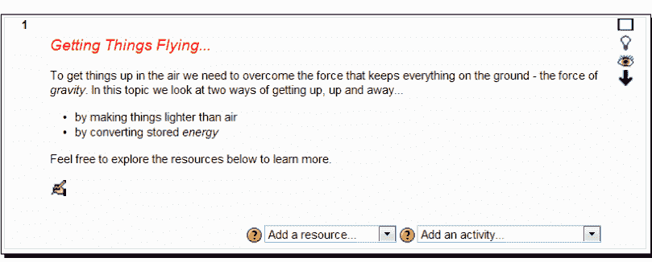

如果没有，你需要开启编辑模式（点击**开启编辑**按钮——通常位于页面右上角）。

+   3. 点击**添加资源**并选择**文件**。这将显示**添加新文件...**页面：

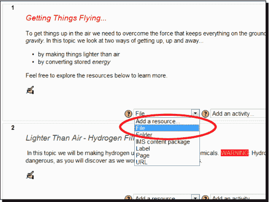

+   4. 在“常规”框中，我将此资源命名为**能源来源**（这就是讲义的內容）。你还需要输入描述（注意：描述可长可短，随意即可）：

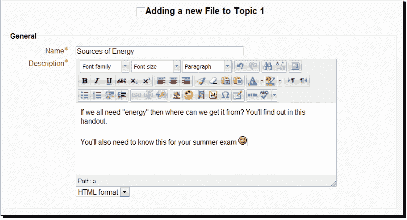

## 添加文档和讲义

5. 在“内容”框中点击**添加...**按钮：

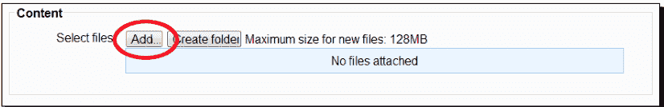

6. 此时会显示文件选择器对话框。点击对话框左侧的“私人文件”链接：

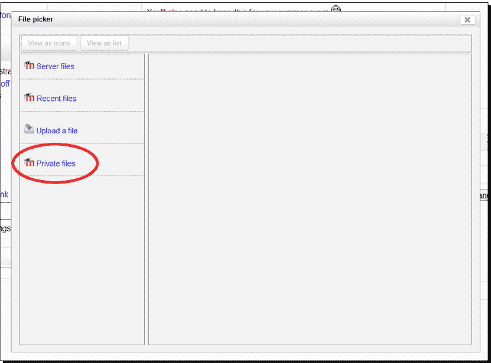

9. 文件现在已选入“内容”框中：

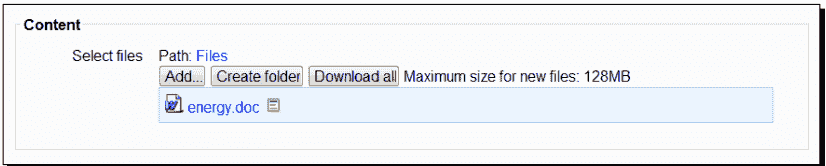

10. 在“选项”框中，使用“显示”下拉菜单选择文件的显示方式。我倾向于选择“弹出窗口”（本节稍后会详细介绍不同的显示类型）：

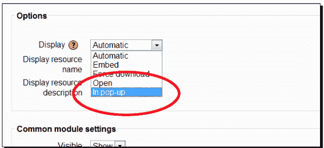

11. 点击**保存并返回课程**按钮（如果你点击“保存并显示”且电脑上安装了弹出窗口阻止程序，文件将不会显示）。

12. 现在你已经回到课程主页。应该会有一个 Word 图标（如果你上传的是 Word 文档），以及紧挨在“主题1”描述下方的资源名称：

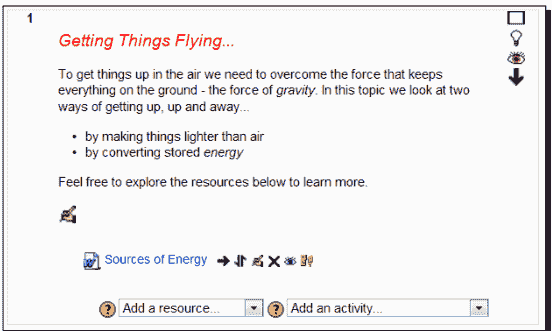

13. 点击资源链接，文档应该会在新窗口中加载。

## 刚才发生了什么？

我们学习了如何上传文件以及如何将其包含在课程中。请注意，虽然学生可以从“我的私人文件”区域下载文件（正如其名称所示），但他们不能上传。你不必担心学生修改你的文件（如果你想上传一份供学生修改的文档，我们将在本书后面讨论这项任务）。

## 访问文件集合

假设你有很多文件要提供（比如学校旅行的照片）。我有一些往年与学生一起进行的实验照片，希望分享出去。这些图片保存在我的笔记本电脑上的目录中——每年一个目录：

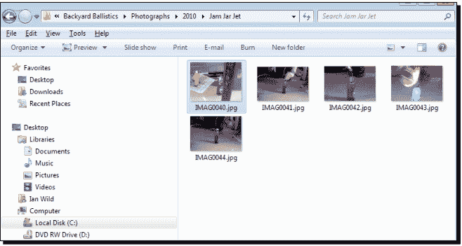

## 添加文档和讲义

……我已经使用目前学到的技巧将它们上传到“我的私人文件”：

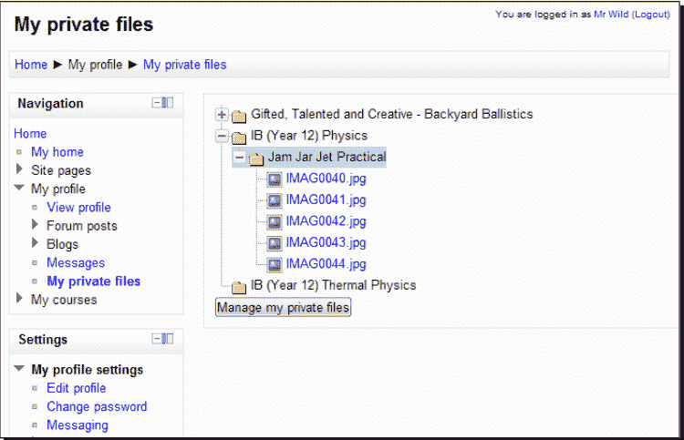

现在我将从课程主页显示指向这些文件的链接。方法如下：

## 动手实践——显示文件夹

+   1. 在课程中选择一个主题（我将选择“基础火箭技术”），然后点击**添加资源...**（如果看不到此选项，请检查是否已开启编辑）。
+   2. 从列表中选择**文件夹**。
+   3. 为这个新链接命名。我将把链接命名为**果酱罐喷气发动机实践（2010）**。输入简短描述。
+   4. 在**内容**框中，点击**添加...**按钮。在文件选择器对话框中，从左侧可用存储库列表中点击**私人文件**存储库。选择要显示的文件。注意，你需要一次添加一个文件（如果你是老版 Moodle 用户，你可能习惯于直接在课程文件区域选择一个文件夹，但你会看到 Moodle 不再是这样操作了）：

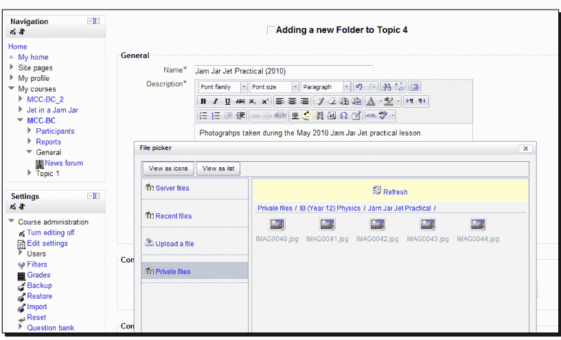

5. 将要在文件夹中显示的文件会列在“添加新文件夹”页面上：

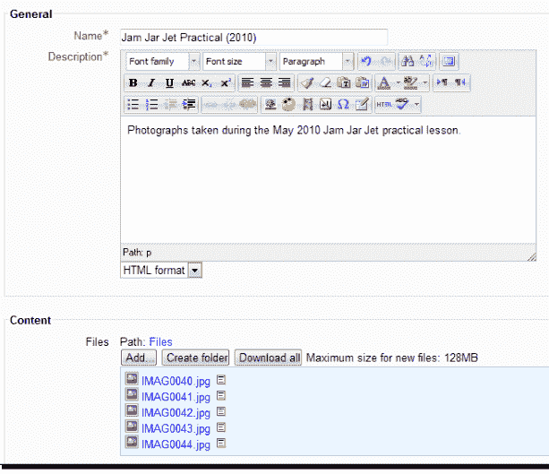

6. 点击**保存并返回课程**按钮。一个新文件夹将被添加到你的课程中：

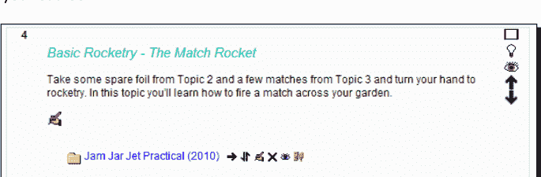

7. 如果我点击新的“果酱罐喷气发动机实践（2010）”链接，会看到如下内容：

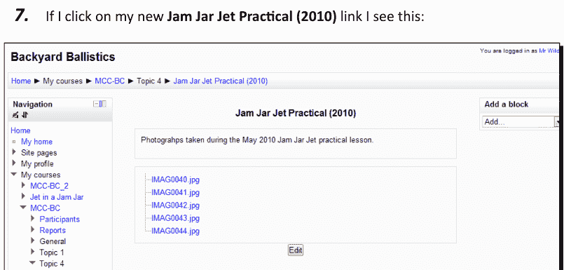

## 刚才发生了什么？

我们不仅可以从课程主页提供单个文件的链接，还可以将文件收集到文件夹中。我将所有要分发的图片上传到了“我的私人文件”区域的一个文件夹中。请注意，我添加到课程页面的文件夹可能包含来自“我的私人文件”中不同文件夹的文件。这样做有利有弊。例如，我现在可以将 2010 年果酱罐喷气发动机实验的所有照片提供给学生，而不必为每个照片单独创建链接。但是，当我打开文件夹时，看到的是一个文件名列表，名称毫无意义。然而，另一个优点是学生只能对文件进行只读访问——他们不能上传或删除文件。

默认的 Moodle 安装不支持缩略图，如果你刚给一个装满图片的目录授予了访问权限，这可能会成为一个问题。但不用担心：请联系你的 Moodle 管理员，他们能够从 Moodle.org 安装众多图片幻灯片插件中的一个。

## 仓库

Moodle 设计为虚拟学习环境/课程管理系统。但仅仅把 Moodle 用作存储文件的仓库也没什么问题：一个明显的优势是你能轻松控制谁有权访问文件，并且访问可以在任何时间、任何地点进行（不像你学校或工作场所的共享驱动器）。Moodle 可以像文件仓库一样工作，但更巧妙的是，Moodle 还可以连接到专门设计的文件仓库。我是什么意思呢？你用过 YouTube 吗？那就是视频文件的仓库。你有没有把图片上传到 Flickr？那就是图片的仓库。要理解 Moodle 如何连接到外部仓库，让我们再看一下文件选择器对话框。回想一下，文件选择器左侧的链接就是指向仓库的链接：

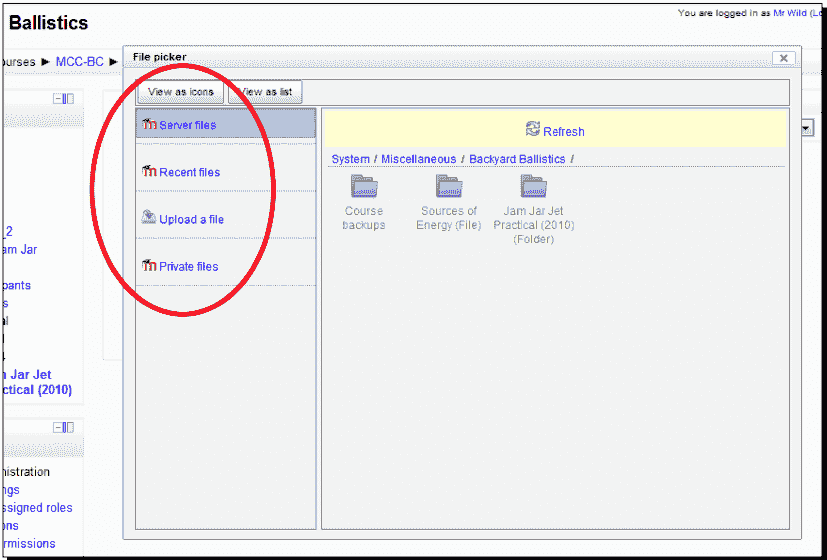

## 添加文档和讲义

你可能会在文件选择器中看到更多指向“仓库”的链接。例如，照片分享网站 Flickr（http://www.flickr.com）可以配置为仓库。你使用 Dropbox（http://www.dropbox.com）在家和工作之间共享文件吗？我们学校的管理员为我们设置了一个，以便我们部门的员工可以共享文件——并且也能轻松地在家访问。如果你的情况类似，那么 Dropbox 也可以添加为仓库。如果我请我的 Moodle 管理员在 Moodle 中启用 Flickr 和 Dropbox 仓库，那么我的文件选择器现在看起来是这样的：

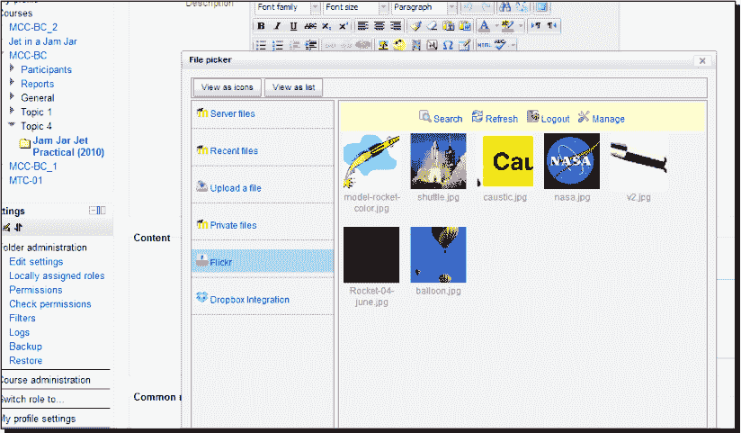

如果我愿意，我现在就可以在上一节《动手时间》创建的文件夹中包含来自 Flickr 的文件：

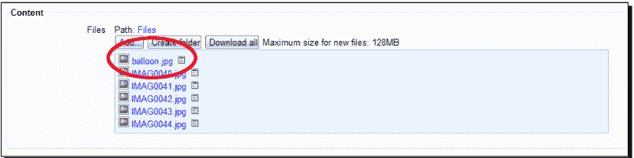

我已将来自 Flickr 仓库的热气球图片添加到文件夹中。值得注意的是，Moodle 已为该图片制作了自己的“内部”副本并将其添加到文件夹中（而且不幸的是，我们并没有因为 Jam Jar Jet 实验而一起坐上热气球）。

## 快速测验

你的学生可以直接访问你的私人文件区域吗？你如何为私人文件区域中的文件提供链接？

## 文档和讲义：哪种格式

你现在就可以把所有文件上传，提供课程主页中的链接并立即让学生进入课程。如果你愿意的话。但先等等。我们还没有真正考虑过应该上传哪种类型的文件。

以下部分的一些内容出于必要，技术性稍强。如果你对任何内容不确定，请咨询你的管理员、技术人员或 IT 帮助台（如果你有的话）。

你使用 Microsoft Word 创建文档吗？以下是分发 Microsoft Word 文档可能是一个坏主意的几个原因：

- 错误地假设学生会在他们的电脑上安装 Word。
- 如果学生安装的 Word 版本比你的旧，那么他们可能无法打开它。这在文档文件名以 .docx 结尾时尤其如此。那是较新的 Microsoft Word 2007 格式，与以前版本的 Word 不兼容。微软提供了免费的兼容性软件（http://office.microsoft.com/en-us/word/HA100444731033.aspx），但你不能假设所有用户都已安装——并且在没有安装的情况下知道如何安装。

解决方案是将 Word 文档转换为每个人都能打开的格式。而且这只是 Word 的一些问题。让我们来看看最受欢迎的文档类型，并研究如何将它们转换为最适合 Moodle 的格式。

### Microsoft Word

你可以看到，我在上传到课程的第一个文件之一就是 Word 文档，这可能给我带来问题。如果你发现自己有这个问题，那么一个解决方案是将 Word 文档转换为便携式文档格式（PDF）。过去创建 PDF 文档相当困难（基本上你必须购买 Adobe Acrobat、购买 PDF 打印机软件，或尝试找到一个不错的开源 PDF 打印机）。

然而，今天创建 PDF 文档变得更容易了。如果你有 Microsoft Word 2007 或更高版本，你可以安装 Save as PDF Add-In，直接从 Microsoft 网站获取。OpenOffice，Microsoft Office 的免费替代品，有一个名为 Writer 的文字处理器，它内置了创建 PDF 文件的选项（只需从主菜单中选择 **File | Export As PDF...**）。如果你确实转换为 PDF，那么在上传之前检查文档是值得的，因为转换过程通常会改变文档的格式。此外，如果你想创建 PDF 表单，那么你可能需要考虑购买专门的 PDF 创建工具。

如果你的学生电脑上没有安装 PDF 阅读器（这种情况极不可能），当他们尝试打开你的 PDF 文档时，电脑会提示他们安装一个。

> Adobe PDF 阅读器可以从 http://get.adobe.com/reader 下载

如果你无法使用任何 PDF 创建工具，请选择富文本格式（RTF）。在 Word 中，选择 **File | Save As...** 并在 **Save As** 对话框的 **File Type** 菜单中选择 **Rich Text Format (*.rtf)**。但是，请注意，如果你将文件转换为 RTF，文档格式会受到很大限制。例如，你不能像使用 PDF 文档那样创建 RTF 表单。

我们将在本章后面进一步探讨将 Word 文档转换为更适合 Moodle 的格式的其他选项。

### 图片

虽然可以选择的图像文件格式很多，但真正需要我们关注的只有三种：JPEG（读作“jay-peg”）、PNG（读作“ping”）和 GIF（本意是用硬 g 发音，如 George，但常被用软 g 如 Graphics 发音）。PNG 文件在网页上用于线条图和剪贴画非常好。如果你有包含文字的图片，请选择 PNG（如果保存为 JPEG，文字可能会变得模糊）。JPEG 对于照片非常出色（JPEG 中的 PEG 代表摄影专家组，所以他们在照片方面应该知道自己在做什么）。GIF 是互联网上最早使用的图像格式之一，因此在网上搜索图片很可能会找到很多 GIF 文件——尤其是动画 GIF。

> 你也可能会遇到 PNG-24 图像格式。
> 这种格式对于照片也很不错。

有太多工具可用于在不同图像格式之间转换，我就直接把你指给管理员、帮助台或技术人员，如果你不确定使用哪个转换工具（如果你询问，通常会有你所在机构期望你使用的标准工具）。

你不必只在课程首页提供图片链接。你也可以将它们包含在文本中，就像在文档中一样。我收集了不少作为我的 Backyard Ballistics 课程一部分的图片，所以我现在要上传这些图片。不仅如此，我还想在页面顶部的“General 概要”（未编号主题）中包含其中一张图片，以使我的课程首页对学生更具吸引力。

### 动手时间 – 上传图片并将其包含在概要中

1. 确保你的图片文件在正确的仓库中（例如，我的私人文件或 Flickr）。
2. 返回课程首页并点击 Summary of General 编辑概要图标。
3. 在编辑器中，通过点击插入/编辑图片按钮打开插入图片对话框。那就是包含小树的按钮：

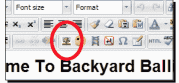

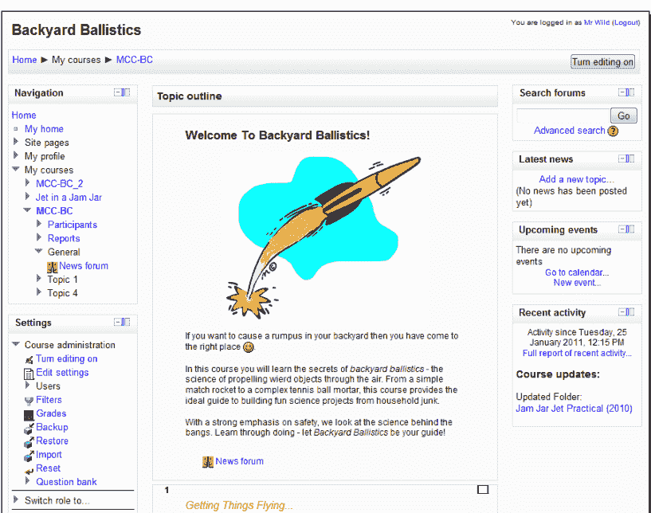

## 刚才发生了什么？

我们刚刚看到，在 Moodle 中为任何文本添加图片是多么简单。我们将在第 5 章“Moodle 大变身”中更详细地探讨如何排列图片。现在，你可以试着返回“插入/编辑图片”对话框，查看“外观”（Appearance）选项卡中的设置。随意摆弄一下这些设置吧，请记住：你不会搞坏任何东西的！

## 动手实践——玩转图片

返回“插入/编辑图片”对话框，然后点击“高级”（Advanced）选项卡。利用高级设置，你可以让图片在鼠标指针移过时发生改变，再在鼠标指针移开时变回原样。例如，你可以让学生将鼠标指针移到人物照片上，从而揭示电影或戏剧中角色的名字。

PowerPoint 几乎已经成为教学材料的默认格式。但一个大问题是，PowerPoint 演示文稿往往体积很大，经常会超过默认的 2 MB 上传大小限制。另一个问题是，你无法假定所有学生都能打开 PowerPoint 文件并查看（他们家中可能没有安装正确的软件）。

接下来，我们看看上传演示文稿时你有哪几种选择。

## 原样上传

不必担心把文件转换成其他格式。直接把 PPT 文件原样上传，然后在课程首页创建一个链接指向它。你也可以将文件另存为 PowerPoint 放映（PPS）格式并原样上传。即便如此，学生仍然需要一个兼容的查看器（微软当然提供了免费的查看器可供下载）。

但如果你发现演示文稿实在太大了，学生抱怨下载要花上很长时间，该怎么办呢？

## 为 Moodle 准备你的 PowerPoint

你的演示文稿里是不是包含大量图片？如果是的话，我们可以借助 PowerPoint 来保持较小的文件体积。让我们看看如何在 PowerPoint 2007 中做到这一点：

## 动手操作——压缩图片

- 1. 浏览你的演示文稿，找到一张图片（任意图片即可）。找到后，点击它。功能区中会出现**图片工具**（Picture Tools）工具栏，并显示在标题栏中：

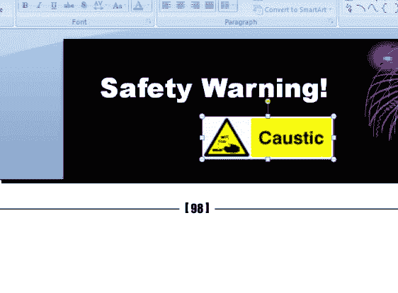

2. 点击“图片工具”，在功能区中显示“格式”工具栏：

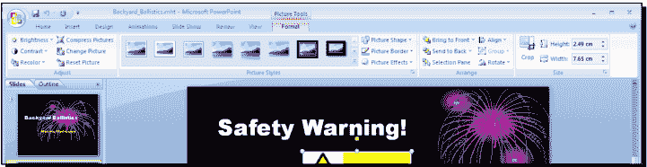

3. 在“格式”工具栏中，按下“压缩图片”按钮：

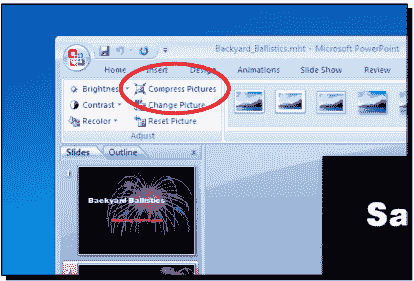

4. 系统会显示“压缩图片”对话框。我们想要压缩并裁剪演示文稿中的所有图片。确保“仅应用于所选图片”复选框未被勾选（因为我们想压缩所有图片），然后按下“选项…”按钮。确保选中“保存时自动执行基本压缩”和“删除图片的裁剪区域”。为了在图像质量无明显下降的情况下获得最大限度的压缩，请将分辨率更改为“屏幕（150 ppi）”：

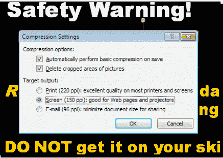

- 5. 按下**确定**按钮。再次按下**确定**按钮。
- 6. 就这样，完成了！

## 刚才发生了什么？

如果超大、未压缩的图片让你的 PowerPoint 演示文稿变得非常臃肿，那么我们可以轻松地在把资料分发给学生之前，先对图片进行裁剪和压缩。

如果你上传文件时仍然遇到体积问题（也许你的演示文稿中并没有大尺寸图片），那么也许是时候考虑在上传到 Moodle 之前，把演示文稿转换成另一种文件格式了。

## 转换为文档

如果你使用的是 Microsoft Office 2007 或更高版本，或者 OpenOffice，那么可以将演示文稿导出为 PDF 文件。这样做通常会尽量保留布局和格式，不过你可能会丢失那些漂亮的动画和效果，因为我们转换成了静态格式（技术一直在变化，所以最好亲自尝试一下转换，看看效果如何）。

对于 OpenOffice 用户，请从主菜单中选择**文件 | 导出为 PDF...**。在 Microsoft Office 2007 中，点击屏幕左上角的 **Office** 按钮，将鼠标悬停在 **另存为...** 选项上，然后选择 **PDF**。请注意，可能需要先安装 Office 的 PDF 专用插件。如果没有安装，请按照屏幕上的说明操作。

如果你想尝试将 PowerPoint 转换为 PDF，但又不是 OpenOffice 或 Office 2007 用户，那么你可以试试众多 PDF 打印机中的一款（以免费软件形式提供，不会花费你任何费用）。PDF 打印机的工作原理是：你选择**文件 | 打印**，然后不选择普通打印机，而是选择 PDF 打印机。这个“打印机”并不会打印出演示文稿的纸质版，而是生成一个 PDF 文件。如果你认为这种方法值得进一步研究，那么也许可以和你的管理员商量一下。

如果你使用的是较早版本的 Microsoft Office，请从主菜单中选择**文件 | 另存为...**，显示**另存为**对话框。点击该对话框底部的**保存类型**列表。你会看到很多不同的选项。要将文件保存为文档，请选择**大纲/RTF**。请注意，这里说“大纲”就真的是大纲。你不仅会丢失所有漂亮的动画和效果，还会丢失所有格式和图片，基本上只剩下纯文本（甚至可能连纯文本也会丢失，这取决于文本在页面上的放置方式）。将文档保存为 RTF 文件应当是万不得已的选择。

## 转换为图片

如果你不希望学生轻易地复制和粘贴文本，这是一个很有用的选项。

在所有版本的 Microsoft Office 中，都可以在“另存为”对话框中查看“保存类型”选项。

在 OpenOffice 中，从主菜单中选择“文件 | 导出...”，点击“文件格式”列表以显示不同的图像选项。

在 OpenOffice 和 Microsoft Office 中，如果保存为图像，请记得在 PNG 和 JPEG 之间做出选择（请参阅前面关于图像的讨论，了解为什么这两种类型是所有可选类型中最好的，以及如何在它们之间进行选择）。

## 随堂测验

PowerPoint 文件的大小可以通过裁剪和压缩演示文稿中的图片来大幅减小。你还记得压缩图片的步骤吗？

## 转换为网页

这个选项有一点技术含量，但也许值得一试。在 Microsoft Office 和 OpenOffice 中将文件另存为网页都很简单。在 Microsoft Office 中，请确保在“保存类型”列表中选择“网页”（不要选择“单个文件网页”）。在 OpenOffice 中，你需要从主菜单中选择“文件 | 导出...”，然后在“文件格式”列表中选择“HTML 文档”。

使用这两种工具中的任何一种，都会生成一组网页及其相关文件（图片等），并全部存储在特定的文件夹结构中（具体取决于你使用的工具，但我们不需要了解这一点）。我们需要将所有这些文件和文件夹上传到 Moodle。如果你对自己上传文件的能力没有信心，请联系你的 Moodle 管理员、帮助台或技术人员。文件上传完成后（务必保持文件夹结构），你需要创建指向那个以 .htm 结尾的文件的链接，该文件名应与原始 PowerPoint 演示文稿同名。

## 借助 Moodle“页面”成为复制粘贴达人

如果你有一些需要经常修改的文档，你会发现必须反复下载文档、编辑，然后重新上传。解决这个问题的办法是：将文档复制到一个 Moodle“页面”中。请注意，这不同于之前所述的网页转换。Moodle 的“网页”——简称为“页面”——是我们可以用 Moodle 内置的 HTML 编辑器创建的网页。我保存了一份氢气球实验设备供应商名单（学生需要自带设备）。我不仅仅上传文档，而是打算把这份名单转换成一个网页。

## 行动时间 – 创建网页

1. 返回课程首页并确保已打开编辑模式。
2. 在要添加新网页的主题中，点击 **Add a resource...** 并从列表中选择 **Page**。
3. 为新网页命名并指定描述。
4. 将原始文档中的文本复制并粘贴到新网页中（“Page content”区域）。
5. 在页面底部，按下 **Save and display** 按钮。

## 发生了什么？

我们可以将文档转换为网页。这仅适用于较小的文档，如果文档经常更改则非常有用，因为它可以节省你下载、更改、保存然后再次上传的步骤。另一个明显的好处是，学生无需安装任何额外软件即可阅读。

> **不要犯这个错误：剪切粘贴图片不起作用**
> 
> 请记住，图片必须上传到 Moodle（到我的私人文件或通过存储库），然后使用插入/编辑图片按钮将其包含在网页中。你不能剪切粘贴它们。

## 清理混乱的代码

Moodle 页面基本上是一个网页（请记住你正在将文本粘贴到 HTML 编辑器中）。如果你从 Microsoft Word 剪切粘贴到网页中，Word 会试图变得聪明并尝试将你的文本转换为网页代码（它这样做是为了让文本上应用的任何格式保持不变）。问题是这种网页代码可能非常特定于 Microsoft（包含大量 Microsoft 特定的格式信息），这会破坏 Moodle 的内置编辑器。（请注意，这不仅仅是 Moodle 的问题，许多不同的软件应用程序都使用 Moodle 使用的相同文本编辑器。你甚至可能从你使用的其他软件工具中认出 Moodle 的编辑器）。如果你从 Word 粘贴，请尝试使用“从 Word 粘贴”按钮。如果你从其他应用程序粘贴，那么在这样做之后按 **Cleanup messy code** 按钮是值得的：

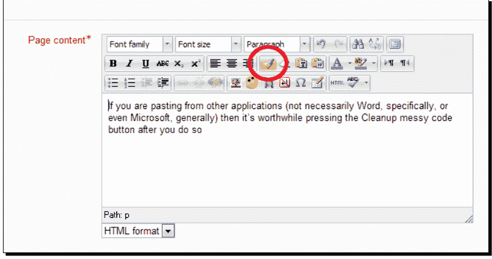

## 将大型文档转换为 wiki

我的物理系有一个系部手册，其中描述了系部的组织结构、其目标、系部政策和实践的细节等等。维护手册存在很多问题。我们试图确保系部的不同成员完成不同的部分，但当它们被写成后，将它们汇编起来非常困难。我们如何才能真正实现对该文档的集体所有权？整理我们的手册以及我们需要的其他所有文档的任务，往往会让我们分心于真正的工作（教学！——但鉴于我们被期望做的事情太多，有时很难记住这一点）。我们如何向学科检查员展示我们作为一个团队真正共同创建系部文档？

一个优雅的解决方案是将系部文档转换为 wiki。“Wiki”是夏威夷语中快速的意思（参见 http://en.wikipedia.org/wiki/Wiki），wiki 是创建网页并将它们链接起来的快速方法。不仅如此，你还可以与同事协作在网页上工作（允许同事贡献或修改内容）——这将真正给检查员留下深刻印象。此外，系统内置了审计跟踪。这意味着你可以查看谁在何时修改了什么。它还意味着你可以恢复到以前的版本并轻松比较一个版本与另一个版本。

为了向你展示创建 wiki 是多么容易，我将使用它而不是上传我为我的 Backyard Ballistics 课程准备的教师笔记。

> 到目前为止，我们添加到课程中的所有静态内容都已使用 Moodle 资源转换为 Moodle。wiki 是一个活动，因为你期望用户一起在 wiki 内容上工作。这是资源和最好描述为活动的边界变得模糊的一个实例。

首先，我将在我的课程末尾添加一个名为“TEACHER DOCUMENTATION”的新主题，用于教师文档。我将把这个主题及其内容对学生隐藏。

## 行动时间 – 添加隐藏主题

1. 返回课程首页。在设置块中的课程管理下点击编辑设置链接。
2. 点击周数/主题列表并添加另一个主题。
3. 滚动到页面底部并按下保存更改按钮。
4. 编辑新主题的摘要，告诉你的同事（和检查员）该主题专门用于教师文档，不用于其他用途。
5. 通过点击右侧的睁开眼睛来隐藏主题对学生可见。眼睛关闭表示主题已隐藏：

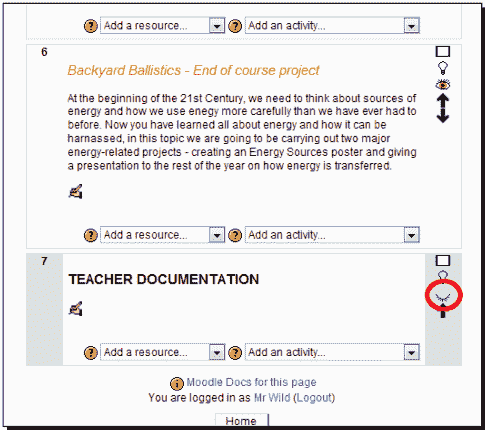

6. 完成！

## 发生了什么？

我刚刚在我的 Backyard Ballistics 课程中添加了一个新主题，我将在其中放置教师文档。我只希望我的同事查看此信息，所以我已将主题对学生隐藏。

## 行动时间 – 添加 wiki

1. 在教师文档主题中，点击 Add an activity... 并从列表中选择 Wiki。
2. 我新 wiki 的名称将是 Backyard Ballistics Guidelines。输入你的 wiki 名称。
3. 写下 wiki 的简要摘要。这显示在每个页面上方。保持简短且描述性。
4. 为 wiki 的第一页选择一个名称（我的第一页将是目录）。
5. 确保 Wiki 模式设置为 **Collaborative wiki**（意味着每个人都有平等的编辑权限，但请记住我们已隐藏了它所在的主题）：

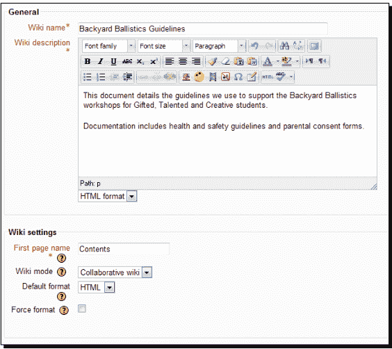

6. 滚动到页面底部并按下 **Save and return to course** 按钮。

## 发生了什么？

你现在已从课程到一个新、空的 wiki 的链接——但你仍然需要将文档放入其中。

点击课程首页上新 wiki 的链接。我们现在准备在 wiki 中创建第一页。确保已选择 HTML 格式并按下创建页面按钮：

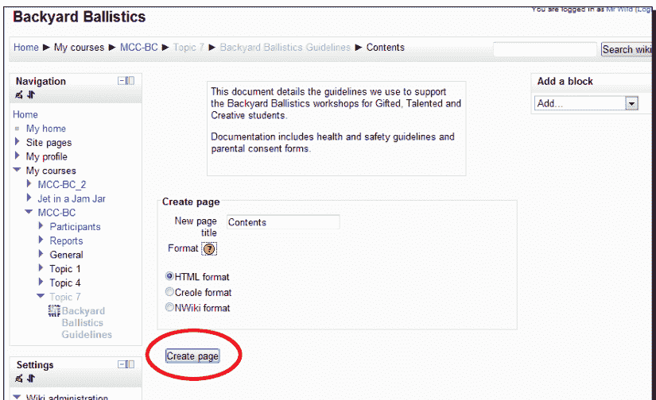

让我们通过创建目录页开始开发 wiki。

## 行动时间 – 创建 wiki 目录页

1. 我最初将教师指南写成 Word 文档。我将把这些文档的目录页剪切粘贴到 wiki 的目录页中：

   > ### Contents
   > 
   > Editing this page 'Contents'
   > 
   > ### Practical Activities
   > 
   > 1. [[Hydrogen Filled Balloons]]
   > 2. Fire Kites
   > 3. Match Rockets
   > 4. Tennis Ball Mortar
   > 
   > ### Health and Safety
   > 
   > 1. Parent Consent Form

2. 如果你从其他应用程序剪切粘贴（不一定只是 Word），请记住按下清理混乱代码按钮。另请注意，我已为标题“Practical Activities”和“Health and Safety”使用了标题 1 样式。这样做意味着 wiki 系统会将它们识别为章节标题，并在该页面的“目录”框中包含指向它们的链接（你很快就会看到）。

3. 你可以指定标签——这些是与 wiki 页面关联的词，可以稍后用于帮助查找信息（而不是在文本中搜索某个词）。由于这是我的 wiki 的目录页，我不会担心为其添加标签。

4. 点击保存。

5. 就这样。完成！

## 添加文档和讲义

## 发生了什么？

我刚刚创建了一个 wiki 目录页：

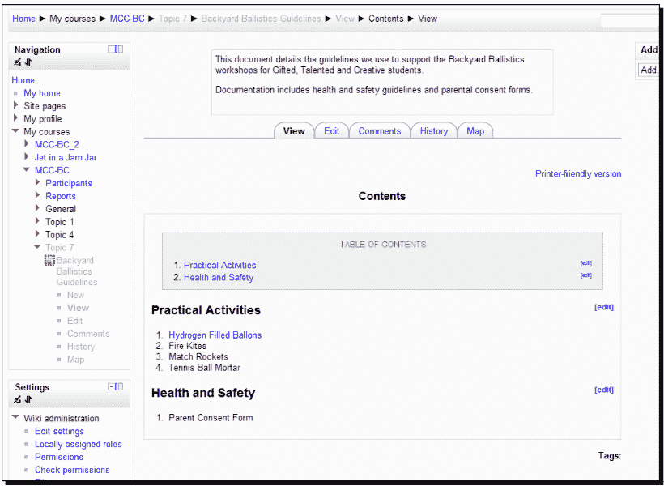

然而，我不想简单地将整个文档复制粘贴到单个 wiki 页面中。相反，我希望能够将目录中的每个项目变成一个链接，然后带我到相关页面。页面创建后，我只需从原始文档中剪切粘贴页面。聪明的部分是：一旦我告诉 wiki 我想要一个指向新页面的链接，wiki 就会为我创建它。我只需要复制我的文本。方法如下...

## 行动时间 – 添加新的 wiki 页面

1. 点击页面顶部的编辑选项卡：

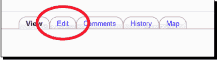

2. 我想将“氢气球”条目变成指向新页面的链接。为此，我将用双方括号把这几个词括起来：

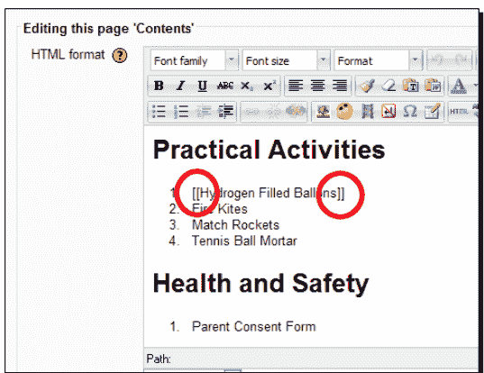

3. 按下“保存”按钮。

4. 在继续之前，看看我们括在方括号里的这些词。它们现在变成了红色斜体：

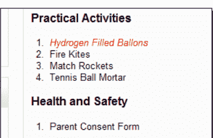

5. “氢气球”现在是一个链接。点击该链接，wiki会自动询问你是否要创建新页面（你需要再次按下“创建页面”按钮）——这就是“快速”之处。我将把“氢气球”实验的教师笔记内容复制到该页面中（重复之前使用的过程）。

6. 创建完新页面后，按下“保存”按钮。

7. 就这样。新页面已经创建好了。要试用新wiki并测试你的新链接是否有效，请返回课程主页面，点击wiki，就会显示wiki的内容页面：

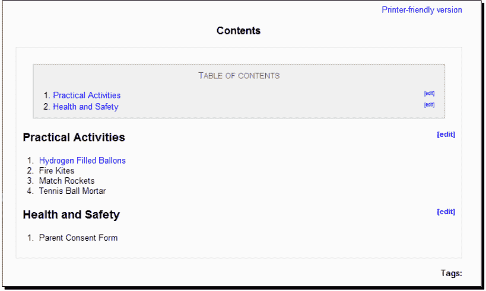

8. “氢气球”现在是一个链接，我可以点击它跳转到教师笔记中的那个页面。

### 刚才发生了什么？

我们已经看到，使用wiki创建相互链接的页面是多么容易。对于冗长的课程甚至部门文档来说，这是一个理想的解决方案。

你注意到每个页面上方出现的“历史记录”标签了吗？它显示页面的审计跟踪。我们来看看wiki内容页面的审计跟踪：

### 小结

我想你会同意，我们在Moodle课程上进展神速。仅仅是这一章，我们就：

- 向Moodle上传文件并有效地组织它们
- 学会了如何向学生展示文档和讲义
- 上传图片并将其包含在文本中
- 包含PowerPoint演示文稿，并学会处理学生无法查看时该怎么做
- 学会了如何使用wiki
- 现在知道了哪些类型的文件最适合包含在课程中，以及如何创建它们

现在，我们的课程已经填充了静态内容。在这个阶段，你甚至可能想让学生进入你的课程。他们一定会对你目前所做的工作留下深刻印象！记住，如果你设置了选课密钥，你需要将其发给学生。

在下一章中，我们将学习如何通过声音、视频和多媒体让课程更具吸引力和趣味性。
