# 4 声音与视觉——包含多媒体内容

> 在前几章中，我们看到了通过Moodle发布作业是多么容易。这是一个不错的开端，但我想让我的课程既实用又有趣。我还有很多多媒体内容想要加入：例如，我有大量音频和视频文件——其中许多存放在YouTube等文件共享网站上。

让我们在第三章“添加文档和讲义”的基础上，学习在本章中将声音和视觉内容导入课程的最佳方式。在本章中，你将学习如何：

- 将音频和视频导入课程
- 体验Moodle播放多媒体文件的不同方式，并体会每种方式的优缺点
- 嵌入来自其他网站（如YouTube、TeacherTube和Vimeo）的视频
- 使用Slide.com创建照片蒙太奇

回顾第三章“添加文档和讲义”，我们将文档和讲义上传到自己的个人“我的私人文件”区域，并在课程页面上插入指向这些文件的链接。我们还学习了如何包含来自其他资源库的文件——请记住，我们可用的资源库取决于Moodle的配置方式。

本章开始时，我们直接从课程主页创建指向外部网站的链接。你可能认为我应该在前几章就介绍如何创建指向课程首页外部网站的链接。我把这个讨论推迟到本章，因为它是我们接下来要开展的工作的基础。在开始之前，值得指出的是，直接链接外部网站是我们利用Moodle创建引人入胜的多媒体课程的一种简便方式——这也是摆脱将Moodle仅用作简单资源库的第一步。

### 链接到其他网站

如果你和我一样，那么你会有一堆包含大量精彩内容的网站列表，并想把它们加入课程中。我把所有网址都保存到了一个Word文档中，但让我们看看如何将它们转移到Moodle中。我的选择如下：

- 直接上传Word文档。我们已经在*第三章“添加文档和讲义”*中学习过如何操作。
- 在课程主页上制作一个链接列表。
- 创建一个Moodle网页并把链接包含在其中。

我们已经在上一章中讨论过上传Word文档的问题，尽管很方便，但将我的链接列表放在Moodle中远比放在一个技术上位于Moodle之外的文件中要好。原因如下：

- 学生可能没有安装正确的文件查看器（这是我们在前几章中讨论过的一个重要问题）
- 我们更方便学生找到链接
- 我可以将外部网站的链接与上传文件的链接无缝混合
- 如果我们从Moodle链接到外部网站，我们可以监控哪些学生访问了哪些网站

相反，我们先把链接直接放到课程主页上。

### 在课程主页中添加链接

是时候行动了。让我们看看在课程主页上添加外部网站链接是多么简单。

4. 或者，你也可以通过按下“选择链接...”按钮来查找“链接”。这会打开文件选择器，但只显示外部网站上文件存储库。还记得在第三章“添加文档和讲义”中，我请Moodle管理员配置了YouTube和Flickr存储库吗？由于这些是外部网站，这些存储库会显示在我的文件选择器中：

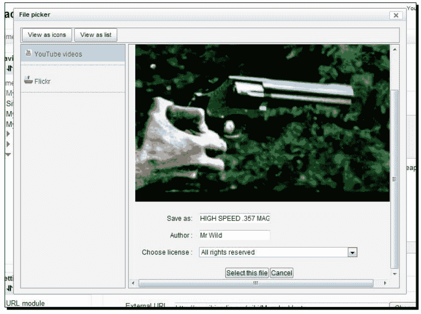

5. 记得在“选项”配置框中指定“弹出窗口中显示”。只需点击“显示”下拉菜单并选择“弹出窗口中显示”：

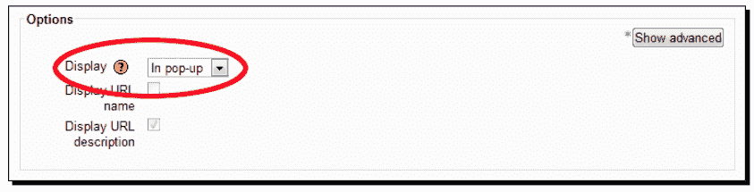

6. 滚动到页面底部，按下**保存并返回课程**按钮。

7. 就这样！完成了。

你现在已经在课程首页添加了一个指向网页的链接：

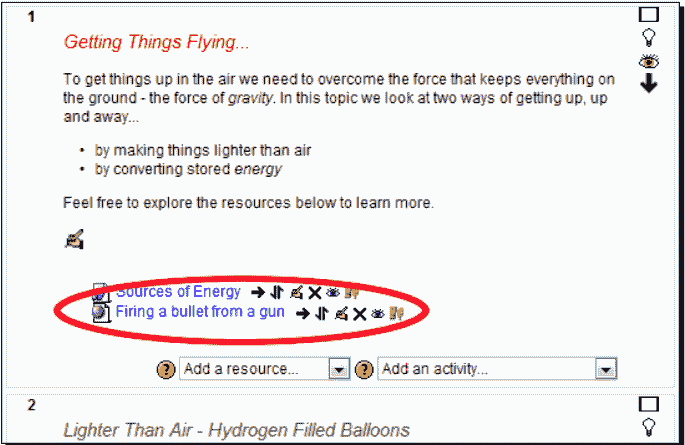

### 刚才发生了什么？

与我们前几章中添加指向文档或讲义的链接的方式一样，我们刚刚添加了一个指向外部网站的链接。但想象一下，如果你想用这种方式共享大量链接会怎样？用不了多久，课程主页就会变得笨拙——一个主题中除了长长的一列链接外什么也没有。幸运的是，我们可以通过将链接包含在Moodle网页中来绕过这个问题，这正是下一节要讨论的主题。

### 将文本转换为网页链接

另一种替代上传包含一长串链接的文件（例如Word文件）的方法，是创建一个Moodle网页并将链接包含在其中（还记得我们在*第三章“添加文档和讲义——成为剪贴粘贴高手”*中讨论过将文档转换为Moodle网页）。与其让页面仅仅成为一个长链接列表，我可以通过插入图片，并利用更大的空间来布置页面布局，使链接更易于查找，从而让页面更吸引人。而且，为了便于转换，我可以从原始文档中复制粘贴。现在让我们来做这件事。

### 操作时间——在Moodle网页中放置链接

为方便转换，试着安排你的桌面，让Word文档和带有Moodle的浏览器并排显示。这样你就不用在Moodle和原始文档之间反复切换了。

1. 返回课程首页，并确保已打开编辑功能。
2. 选择要包含链接的主题，点击**添加资源...**，然后从列表中选择**页面**。
3. 输入新页面的名称。
4. 输入简短描述。这是必填项，但长度随你意愿。
5. 我们现在准备复制Word文档中的信息。返回原始文档，选择并复制需要的链接。
6. 返回Moodle，将刚复制的文本粘贴到“页面内容”编辑区域：

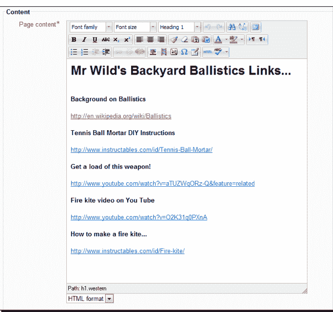

7. 按下 **Cleanup messy code** 按钮（带刷子图标的按钮），以确保我们不会包含任何特殊的文字处理格式——现在我们要在浏览器中显示文本，这些格式是不需要的。
8. 滚动到页面底部并按下 **Save and return to course** 按钮。
9. 通过课程首页的链接查看你的新网页：

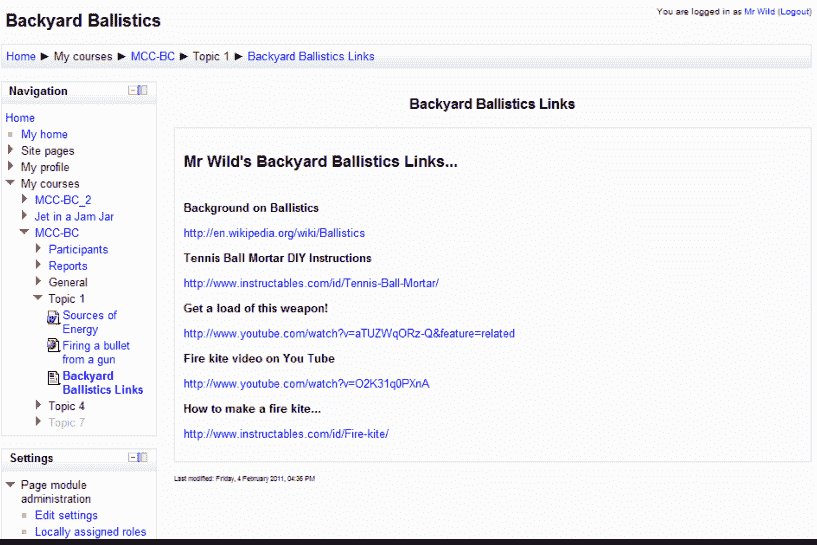

### What just happened?

我们刚刚创建了一个包含我之前在 Word 文档中记录的链接的 Moodle 网页。与其直接上传原始文档——这可能会引入我们在奖励章节 *Handing in Work through Moodle* 中讨论的问题——我们将其转换成了 Moodle 网页。立即打开新页面。尝试点击一个链接，你将被导航到外部网站。

## Manually adding links to Moodle web pages

现代文字处理器在处理链接时对你非常友好。如果你文档中包含看起来像链接的内容，文字处理器通常会将其解释为链接并相应地格式化。这意味着当你将文本复制到 Moodle 时，它会保留文字处理器添加的格式，Moodle 仍会将文本识别为链接。这在 Moodle 中也适用：如果我直接在 Moodle HTML 编辑器中输入链接，Moodle 会将文本识别为网页链接并自动将其转为链接。如果我们不想让学生点击实际的网址，如：

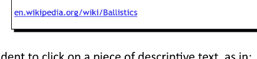

...而是想让学生点击一段描述性文字，如：

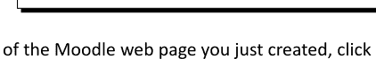

在你刚刚创建的 Moodle 网页名称旁边，点击 Update 图标以打开资源配置页面。让我们看看如何选择一个词或文本片段并将其转为链接。

### Time for action – making a link out of text

我列出的第一个链接是通往 Ballistics 在 Wikipedia 词条的链接。我希望学生点击短语 "Click here to look at what Wikipedia has to say on Ballistics"，并让其跳转到正确的页面。我还希望新页面在不同的窗口中显示，以“阻止 Wikipedia 让 Moodle 消失”，这是我的一名学生的话。

1. 输入你想要转为链接的文本并确保已选中它。
2. 按下 **Insert/edit** link（看起来像三条链环）按钮。Insert Web Link 对话框将会出现。请注意，在编辑器中选中内容之前你无法按下该按钮：

### What just happened?

我们刚刚将一段文本转为链接，但你无法在滚动到页面底部并按下 Save and return to course 按钮之前点击新链接。打开网页并点击该链接以确认其有效。当你将文本转为链接时，你按下了 Insert/edit link 按钮以显示 Insert/edit link 对话框。你是否注意到 Browse... 按钮：

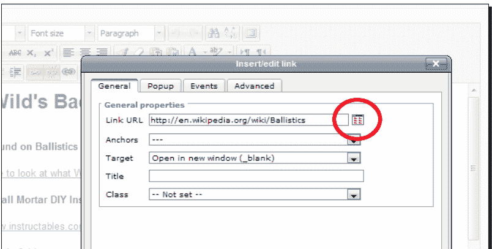

此按钮允许你将一段文本转为指向你 My private files 区域或其它存储库中文件的链接。这让你能够在一个页面中混合外部网站链接和上传到 Moodle 的文件链接。

### Have a go hero – doing more with your links

你可以使用 Moodle 网页中的链接链接到课程中的其它文档。尝试创建一个文档索引。通过包含图片使该索引更具吸引力（参见第 5 章 Moodle Makeover，获取让 Moodle 网页更具视觉吸引力的技巧）。

## Importing videos

在课程中包含视频（例如 AVI、MOV、FLV 或 WMV 文件）与将文件上传到课程文件区域并在课程主页面创建指向它的链接一样简单，请遵循 *Chapter 3, Adding documents and handouts* 中的说明。

我将在本节后面讨论视频文件格式。现在，让我们直接开始在课程中包含视频文件...

### Time for action – including a video on your course front page

在课程首页包含视频的方法与我们在 *Chapter 3, Adding Documents and Handouts* 中练习的包含文档和讲义的方法完全相同。让我们再次回顾一下该流程以提醒自己：

1. 将视频上传到你的私有文件区域（有关更多详情，请参阅 *Chapter 3, Adding Documents and Handouts* 中的 *Uploading Files* 部分）。请记住视频文件可能非常大，因此值得检查上传限制。
2. 选择一个主题并点击 **Add a resource...** 然后选择 **File** 以显示 **Adding a new File...** 页面。
3. 指定一个名称（学生点击以观看视频的链接）和简短描述。
4. 滚动到 Content 部分并按下 **Add...** 按钮，File picker 将显示。从 File picker 左侧的存储库列表中，点击 **Upload a file**。在 Attachment 框旁边，按下 **Browse...** 按钮。
5. 找到文件或选择所需文件后，按下 File picker 的 **Upload this file** 按钮。文件将列在 **Content** 部分：

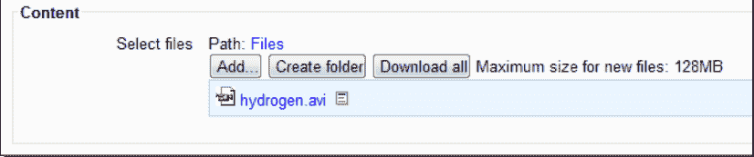

我还可以让学生留在 Moodle 上并专注于学习（而不是发送他们到 YouTube，在那里他们会被诱惑观看其他视频）。他们还可以同时阅读支持文本并观看视频。通过让 Moodle 处理视频播放，我可以避免学生不知道如何使用其计算机上安装的视频播放器的问题（可能是众多播放器之一）。

在我开始之前，有两件事我需要对我的视频做：

1. 确保文件格式正确（参见本章后面的 *Choosing a video file format*）。
2. 按照 *Chapter 3, Adding Documents and Handouts* 中的说明上传视频。我已在我的 My private files 区域中创建了一个单独的 Videos 文件夹来存储所有视频。

### Time for action – embedding a video into a Moodle Page

1. 创建一个新的 Page 资源并为其命名并添加简短描述。我将我的命名为 Instructions For Making Hydrogen。
2. 我已开始向我的说明中添加一些文本和图片，现在我希望在此处包含一个视频：

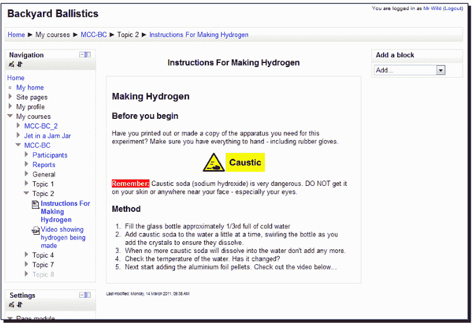

3. 让我们插入我刚刚上传的视频文件。为此，我将把光标定位在编辑框底部，然后按下 **Moodle Media** 按钮以显示 **Insert/edit embedded media** 对话框：

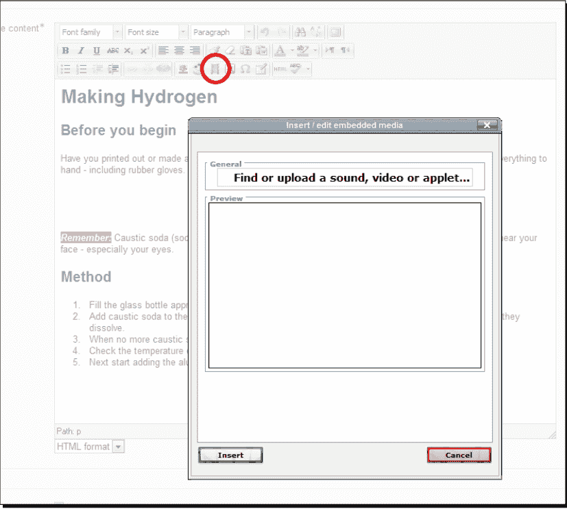

6. 如果一切正常，则会显示你的视频文件的预览：

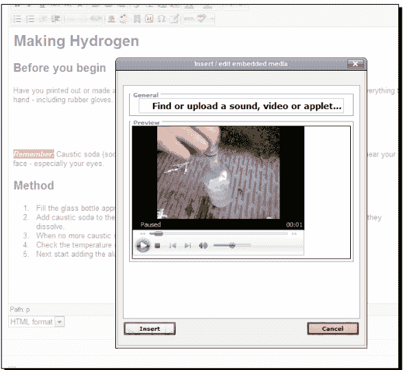

7. 点击 Insert 按钮。视频的链接现在已添加到你的文本中：

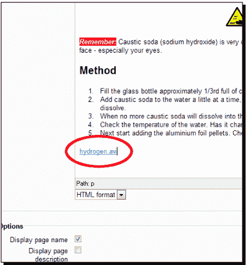

8. 滚动到页面底部并按下 **Save and return to course** 按钮。点击页面链接并检查视频是否正确显示：

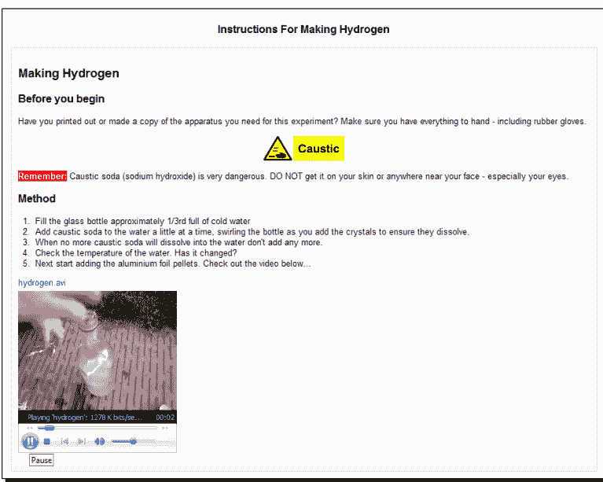

9. 在之前的屏幕截图中，你可以看到链接和 Moodle 的嵌入式视频播放器。如果只看到链接，则说明多媒体插件未打开。要启用它们，你需要联系管理员（你将在本章后面了解更多）。

### What just happened?

我们刚刚将上传的视频包含到 Moodle 网页中。其优点在于，与仅从课程首页提供链接相比，我们可以：

- 用解释性文本和支持图片补充视频
- 避免学生不知道如何使用其计算机上安装的视频播放器的问题（可能是众多播放器之一）

- 它让学生留在课程中并专注于学习（而不是被诱惑去开始观看其他视频）
- ...并且他们可以同时阅读和观看

视频是否正常播放？视频播放器是否只给你一个黑框，而不是播放你的视频？计算机对视频文件格式可能会有点挑剔，因此有些格式有时比其他格式更好用。在下一节中，我们将研究视频文件格式的选项。

## 选择视频文件格式

最好将视频转换为常见的视频文件格式之一——这些格式通常可以通过其文件扩展名来区分。扩展名是文件名中句点后的三个字母。如果你选择这些常见类型之一，那么：

- 当您将文件上传到“我的私人文件”区域时，Moodle 会识别该文件并为其提供合适的图标。目前这可能不是特别重要，但如果那里有很多文件并且您想一眼找到特定类型的文件，这就很重要了。
- 该视频可以在大多数现代计算机上播放，无需任何特殊操作。
- 正如我们将在接下来的章节中很快看到的，Moodle 将允许您将此类型的文件嵌入到 Moodle 网页中。

如果你的视频文件不属于这些格式之一（例如它们可能是 MP4），那么可以试试免费在线文件转换工具，例如 zamzar.com。

## Moodle 视频故障排除

你是否看到视频链接却没有视频播放器？你可能会看到这样：

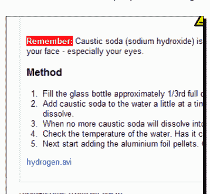

也就是说，只有链接而没有播放器，而你想要看到的是这样：

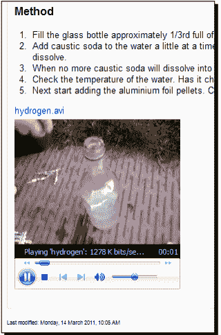

让我们逐一进行故障排除步骤。每完成一步，就在旁边打个勾。

### 动手实践 – 让视频在 Moodle 中播放

1. 确保你使用的是常见的视频文件格式之一（见前面的讨论）。
2. 确保你的链接设置正确。尝试点击链接，确保你的计算机视频播放器能播放你的视频。编辑文本时链接可能会意外断开，所以我们可以尝试重新链接视频。在重新开始之前，要断开链接，请按编辑器的“移除链接”按钮：
    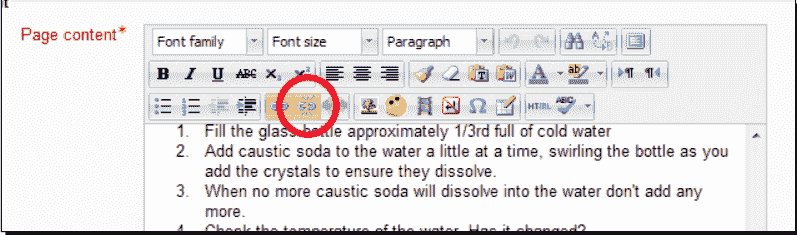
3. 旧链接被移除后（文本将恢复默认颜色和格式）；按照 *将文本转换为网页链接* 中概述的步骤将链接重新放回。
4. 如果你已经走到最后一步，视频播放器仍然没有显示，那么看起来 Moodle 的配置不符合我们的需要。请查看本章末尾的 *询问管理员* 部分。

### 试试身手 – 用视频做更多事

你显然可以有一个只包含视频的 Moodle 网页，但这并不是很有趣。在前面的示例中，我把视频作为说明页面的一部分。我还加入了一些图片，试图让页面更生动一些。现在，我们的课程正开始成为真正的多媒体体验——让学生们感到更加兴奋。

## 从视频分享网站嵌入视频

这并不是将视频嵌入课程的唯一方法。和我一样，你可能在 YouTube 上找到了想用于教学并希望包含在课程中的视频。或者，如果你想嵌入视频，但无法说服管理员开启多媒体过滤器（或提高最大文件大小），那么 TeacherTube 可以解决问题。TeacherTube 的运作方式很像 YouTube，但完全专注于教育内容。因此，你通常可以在学校内访问它——这是放置教学视频的好地方。为什么要把视频上传到 YouTube 或 TeacherTube？如果很多学生同时在学校观看同一视频，他们很可能会让运行 Moodle 的计算机——以及/或者为 IT 机房提供网络的设备——陷入瘫痪。如果运行 Moodle 的计算机（“Moodle 服务器”）的空间是个问题，那么将它们上传到 YouTube 或 TeacherTube 是值得的。

> 记住：你可能没有权限将学生的图片和视频上传到第三方计算机系统。请查看你所在机构关于学生图片和视频使用的政策。

YouTube 和 TeacherTube 都允许你将特殊的视频播放器嵌入到网页中，直接从它们各自的网站播放视频。如果我们嵌入来自 YouTube 的视频，并且全班每人一台电脑同时尝试播放该视频，那么承受压力的是 YouTube，而不是 Moodle 机器。

> 记住：在你考虑将 YouTube 或 TeacherTube 的视频嵌入课程之前，请确保学生可以在你的机构内访问这些网站。它们可能会被过滤屏蔽。还要记住，YouTube 视频可能随时被下架。如果被下架，那么你的链接将无法使用。

让我们先看看如何包含来自 YouTube 的视频。

### 从 YouTube 包含视频

如果我们要在课程中包含来自 YouTube 的视频，基本上有四个选项：

- 使用 YouTube 的特殊播放器，直接从 YouTube 嵌入视频。
- 如果 YouTube 被屏蔽，那么从 YouTube 提取视频并上传到我们的课程，然后像上一节那样嵌入视频（记住，在做这件事之前，你应该联系视频作者）。
- 如果我们不想给运行 Moodle 的计算机带来太大压力，我们可以从 YouTube 提取视频，然后上传到 TeacherTube。但你需要为自己创建一个 TeacherTube 账户才能这样做（同样，在做这件事之前，请记得与原始视频的创建者确认——当然，除非你就是创建者）。
- 输入 YouTube 视频的直接链接，让 Moodle 的多媒体过滤器将链接转换为嵌入播放器（这意味着你必须确保管理员已开启多媒体过滤器并正确配置）。

让我们看看如何将 YouTube 视频播放器嵌入到我们的课程中。为什么要详细解释一个可能行不通的过程？因为从 TeacherTube 嵌入视频的过程完全相同。

### 动手实践 – 将 YouTube 播放器嵌入你的课程

第一项任务是搜索你想包含的视频。一个不错的做法是同时打开 Moodle 和 YouTube。如果你的网络浏览器支持标签页，你可以在它们之间切换。如果不支持，那么在一个浏览器中打开 Moodle，在另一个浏览器中打开 YouTube。

这是我在 YouTube 上找到的一个关于发射火柴火箭的视频：

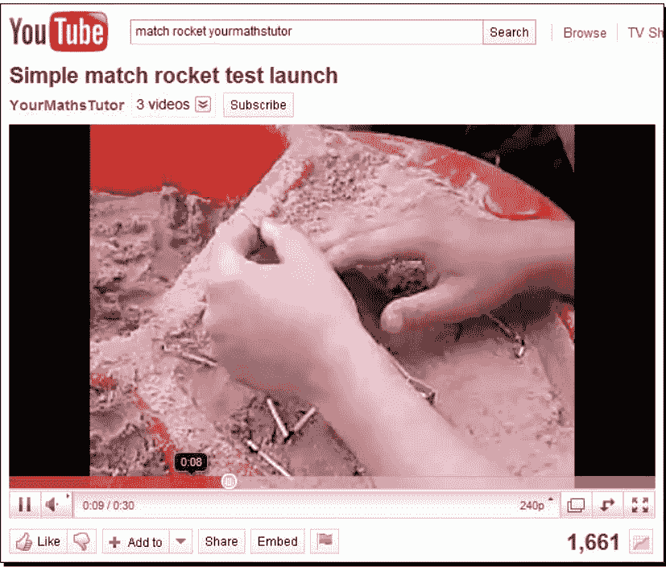

以下是你需要将其嵌入 Moodle 网页的步骤。

1. 选择你想包含视频的主题，点击“添加一个资源...”并选择“页面”。
2. 添加一小段介绍性文字。我打算写“从 YouTube 观看这段视频，展示火柴火箭试射”。
3. 然后，点击编辑器的特殊 **编辑 HTML 源代码** 按钮：
    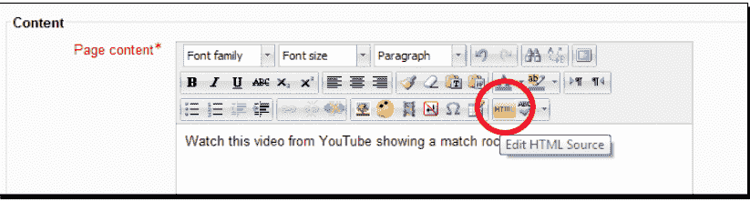
4. 网页是用一种名为 HTML 的特殊代码编写的，这个按钮允许你在页面代码（编辑器为我们创建的）和页面的实际外观（所见即所得——简称 WYSIWYG）之间切换。此时会显示一个 HTML 源代码编辑器：
    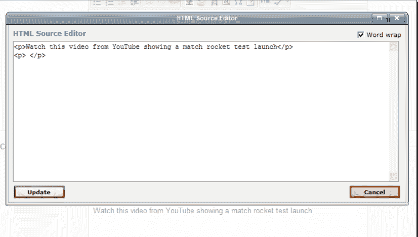
5. 现在切换到 YouTube 和你想要包含的视频。在页面上查找“嵌入”一词。点击它，你需要复制到 Moodle 的文本会被高亮显示。正如你所看到的，这段文本几乎无法理解。实际上，它是一段网页代码片段。别担心：我们不需要操心它看起来什么样或有什么用。右键单击这段代码，选择“复制”：
    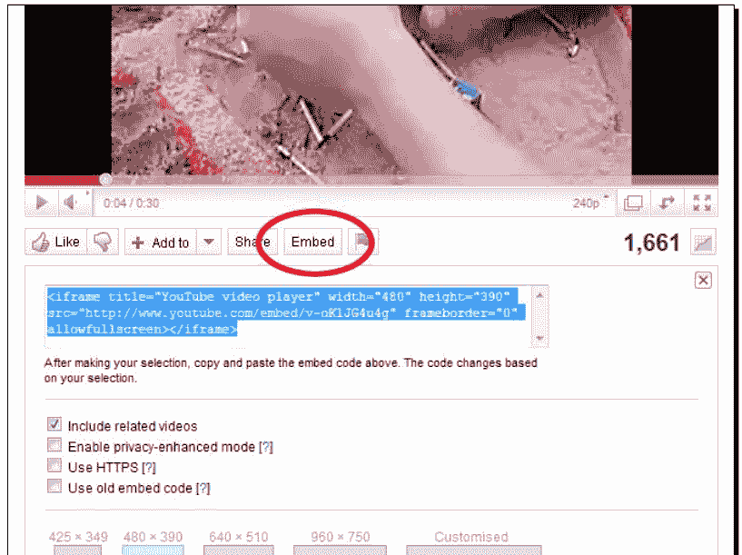
6. 切换回 Moodle。右键单击 HTML 源代码编辑器，选择“粘贴”。来自 YouTube 的特殊代码现在已复制到编辑器中。我们刚刚复制的代码看起来很难看，但同样，在这个阶段我们不需要担心它长什么样：
    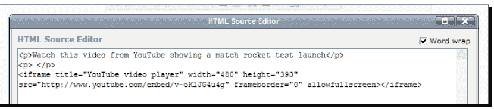

7. 现在按下HTML源代码编辑器上的“更新”按钮，切换回网页实际显示的样子，而不是其编写代码。此时你会看到YouTube视频已嵌入到你的Moodle网页中：

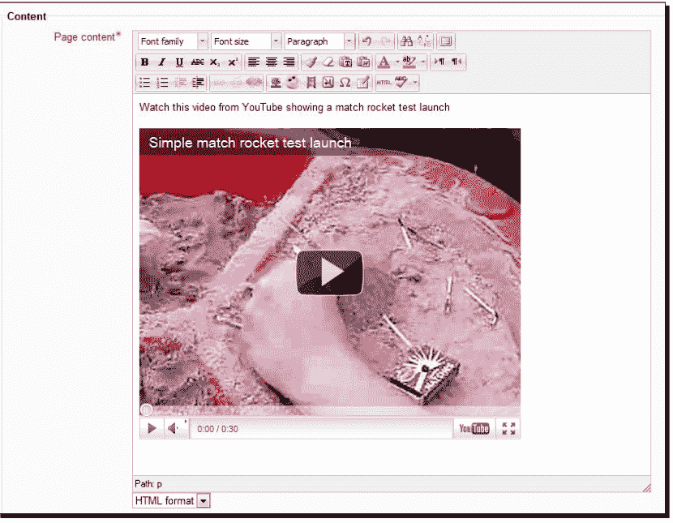

## 刚才发生了什么？

我们刚刚看到，利用YouTube提供的代码，将特殊的YouTube视频播放器嵌入到Moodle网页中是如此简单。这很棒，因为如果我们希望所有学生同时观看视频，YouTube能够应对大量用户同时观看同一个视频。问题是，YouTube经常被屏蔽，学生无法访问。

让我们通过从YouTube提取视频来解决这个问题。请注意，在执行此操作之前，你可能需要获得视频作者的许可。

## 从YouTube提取视频

有许多专门从YouTube提取视频的网站——`zamzar.com` 和 `keepvid.com` 是两个很好的例子。与其详细解释如何使用这些网站，不如让您回到YouTube，搜索有关zamzar和keepvid的视频。您很快会找到大量教学视频（通常由工具的实际开发者制作），演示如何从YouTube提取视频。

提取视频后，只需按照嵌入视频的说明操作（参见*动手实践——将视频嵌入Moodle页面*）。

## 包含来自TeacherTube的视频

Vimeo和TeacherTube都提供特殊代码，允许你嵌入它们各自的视频播放器，过程完全相同。由于TeacherTube专注于教育，让我们快速浏览一下从TeacherTube嵌入视频的过程。

## 动手实践——从TeacherTube嵌入视频

同时打开Moodle和TeacherTube会更容易，就像我们处理YouTube时那样。找一个你喜欢的视频。这里再次出现了火柴火箭测试发射视频：

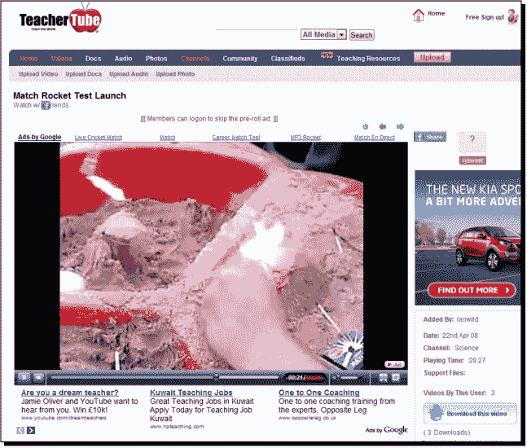

- 1. 在Moodle中，返回课程首页，点击**添加资源...**并选择**页面**。
- 2. 输入一些介绍性文字，向学生介绍你的视频，然后按下**编辑HTML源代码**按钮。
- 3. 切换到TeacherTube，查找**可嵌入播放器**：
- 4. 右键点击网页代码（就像我们对YouTube所做的那样），然后点击**复制**。
- 5. 现在返回Moodle，确保编辑HTML源代码编辑器仍处于打开状态，然后粘贴我们刚刚从TeacherTube复制的代码：

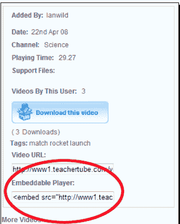

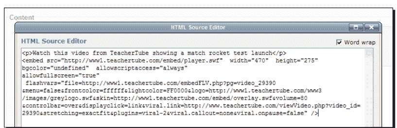

现在，我们的课程中包含了相同的视频，但这次是从TeacherTube播放的。

## 声音与视觉——包含多媒体内容

## 刚才发生了什么？

从TeacherTube嵌入视频非常简单——与我们用于从YouTube嵌入视频的过程几乎相同。使用TeacherTube的好处是，学生通常无法访问YouTube。

如果YouTube被屏蔽，我们可以选择的一个办法是从YouTube提取视频，然后将其上传到TeacherTube或Vimeo（一个致力于协作和分享的网站）。如果我们不想让运行Moodle的计算机承受任何压力，尤其是如果我们希望所有学生同时在各自的计算机上观看视频，这是理想的选择。如果你在运行Moodle的计算机上没有太多空间（如果你用视频塞满Moodle服务器，Moodle管理员可能会开始抱怨），这也是一个很好的解决方案。在开始将视频上传到TeacherTube之前，你需要先注册一个TeacherTube账户。

## 小测验

你能概述将所有视频存储在互联网上的文件共享网站（例如YouTube）上的优缺点吗？

## 播放音频

在Moodle中，包含音频的方式有三种，正如包含视频的方式也有三种：

- 1. 在课程首页添加音频文件的链接。
- 2. 将音频文件嵌入到Moodle网页中——与视频一样，这需要管理员启用多媒体过滤器。
- 3. 将音频上传到音频分享网站，并从那里流式播放该文件。

> 当你在课程中尝试包含视频时，你可能已经发现，并非所有学校和大学的计算机都出于可理解的原因启用了音频（有些学校甚至剪断了耳机插孔的线）。在你阅读以下关于嵌入音频的指南时，请记住，如果扬声器孔或耳机插孔没有声音传出，请告诉你的技术人员或帮助台。你的电脑没有声音很可能是故意设置的。

## 选择音频文件格式

始终转换为常见的音频文件格式之一。与视频文件格式一样（参见*选择视频文件格式*的讨论），这些格式可以通过其文件扩展名来区分。但是，对于音频，请选择MP3，或者退而求其次，选择OGG。如果你选择MP3，那么：

- 当你将文件上传到课程文件区域时，Moodle会识别该文件并为其添加适当的图标。与视频一样，目前这可能不是特别重要，但如果那里有很多文件，并且你想一眼找到特定类型的文件，这就很重要了。
- 该文件可以在大多数现代计算机、手机和便携式播放器上轻松播放，无需任何特殊操作。
- 与视频一样，Moodle允许你将此类文件嵌入到Moodle网页中，我们将在接下来的部分中很快看到。

如果你的音频文件不是MP3格式，可以尝试使用免费的在线文件转换工具，例如 zamzar.com、Audacity，或者如果你使用iTunes，也可以使用它。

## 让Moodle处理你的声音

用于嵌入音频的许多过程，无论是通过上传音频文件，还是通过使用音频分享网站，都与用于包含视频的过程非常相似，所以本节比上一节短得多，只是因为很多技术是相同的。让我们首先看看Moodle如何将其自己的音频播放器嵌入到Moodle网页中。

## 动手实践——嵌入音频片段

- 1. 选择一个你想要添加音频文件的主题，并从**添加资源...**列表中选择“页面”。
- 2. 我有一个关于火箭历史的音频文件想要添加。首先，我要添加一段简短的介绍文字：“收听这个关于火箭的节目...”。
- 3. 然后，我将使用**Moodle媒体**按钮插入我的音频文件。有关如何使用“插入/编辑嵌入媒体”对话框的详细信息，请参阅*动手实践——将视频嵌入Moodle页面*。我将使用文件选择器上传我的音频文件，然后选择它。完成后，点击**插入**按钮。
- 4. 向下滚动到“编辑资源”页面底部，然后按下**保存并返回课程**按钮。
- 5. 从课程首页点击新Moodle网页的链接。Moodle会将音频播放器嵌入到你的网页中：

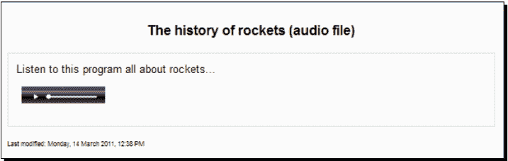

## 刚才发生了什么？

嵌入音频文件与嵌入视频文件非常相似。再次强调，与视频一样，让Moodle嵌入音频播放器意味着你无需担心学生是否知道如何使用他们已安装的音频播放器。

## 音频故障排除——如果Moodle没有嵌入播放器怎么办

如果你只看到音频链接，而没有链接和那个小播放器，该怎么办？那么，你需要与管理员讨论重新配置Moodle。有关详细信息，请参阅本章末尾的“询问管理员”部分。

## 从音频分享网站嵌入音频

为什么要使用音频分享网站？这里有一些很好的理由……

- 如果音频文件很大，那么如果有几个学生同时尝试收听，你可能会给Moodle计算机带来很大压力
- 你的课程空间可能有限（这个问题也适用于视频）
- 你的管理员不想启用多媒体插件

值得关注的音频分享网站包括SoundCloud (http://www.soundcloud.com)、Soundboard (http://www.soundboard.com/) 和 FindSounds (http://www.findsounds.com/)。当然，Soundboard提供了一个可嵌入的音频播放器，你可以将其包含在Moodle页面中。有关使用SoundCloud、Soundboard和FindSounds的更多信息，请查看YouTube。你会找到大量教学视频。

> 如果你选择使用音频分享网站，请记得检查学生是否可以在你所在机构的计算机上访问它。通常，这些网站也可能被屏蔽。

## 动手实践——创建播客

互联网上有很多网站可以让你创建播客，比如 Huffduffer（http://huffduffer.com/）。你可以在授课或讲课时录音，然后创建一个专门的课程播客。请记住，与视频一样，如果学生的声音能被清晰听到，你可能需要确认是否已获得上传这些音频的许可。如果你特别热衷于尝试播客，那么你的管理员可以在 Moodle 中安装专门的播客模块。

## 更多嵌入相关内容

在本章中，我们一直在研究嵌入视频和音频。说到多媒体，我们当然可以上传 PowerPoint 或 Photostory（www.microsoft.com/windowsxp/using/digitalphotography/PhotoStory/default.mspx）文件。但这些都是微软专用的，Moodle 用户需要在其计算机上安装相应的查看器才能使用。为了克服这个问题，有很多视频和音频分享网站可供选择——但请记住，要确认你的学生能够访问这些网站（并且没有被你所在机构的网页过滤软件当作“不合适”内容过滤掉）。一个流行的照片分享网站（也是 Photostory 的替代方案）是 Slide.com，你可以用它把上传的图片制作成可嵌入的相册视频。现在我们来看看具体怎么做。

### 使用 Slide.com 进行图片展示

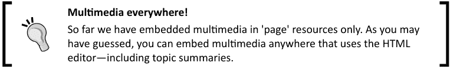

> **多媒体无处不在！**
>
> 到目前为止，我们只在“网页”资源中嵌入多媒体。你可能已经猜到了，你可以在任何使用 HTML 编辑器的地方嵌入多媒体——包括主题摘要。

我打算重新看一下我关于制作火柴火箭的说明。我想在页面顶部加入一个相册视频——一系列照片，下方配有说明文字，展示制作火箭的实际过程——有点像 PowerPoint 演示文稿，但完全以图片为中心。

Slide.com 是一项照片分享服务，我可以利用它创建我想要风格的摄影幻灯片。有很多相册设计可供选择（如果我想的话，还可以加入音乐！）。创建好演示后，该服务会提供一小段网页代码，就像我们在本章中看到的许多服务一样，我们可以将其嵌入到 Moodle 页面中。而且，与我们研究过的所有其他分享服务一样，如果你不想，完全可以不公开你的相册视频。现在让我们看看如何使用 Slide.com 添加幻灯片……

### 动手实践——添加幻灯片

如果你打算使用 Slide.com，那么你需要一个 Slide.com 账户（请注意，这类网站有很多，但只要你用过其中一个，就能轻松使用其他同类网站）。注册是免费的，而且该服务提供全面的在线帮助。正如我们之前发现的，执行以下操作时，最好打开两个浏览器窗口，或者，如果你的浏览器支持标签页，可以在一个标签页中打开你的 Moodle 课程，在另一个标签页中打开 Slide.com。

1. 在 Slide.com 中创建你的相册视频。只需按照 Slide.com 在线帮助中的说明操作即可。
2. 你的幻灯片会附带自己的可嵌入代码：

   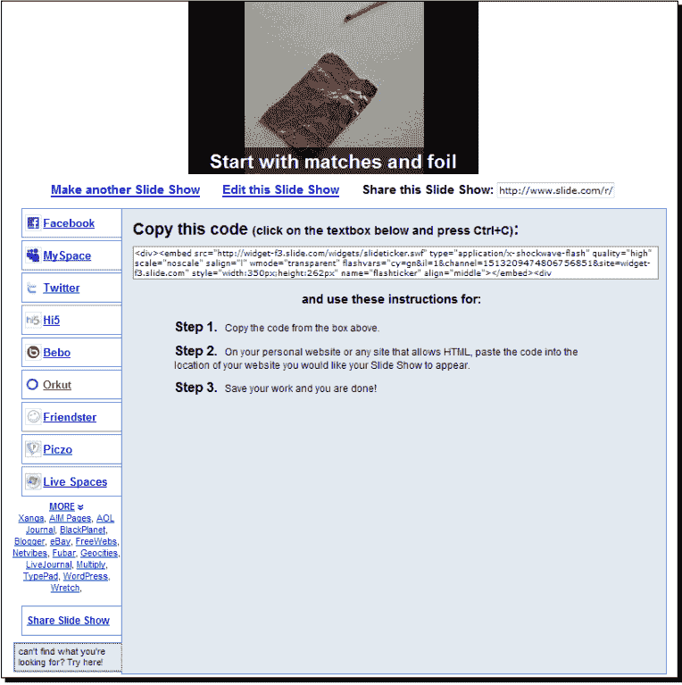

3. 右键单击代码，然后点击“全选”。再次右键单击并选择“复制”。
4. 返回你的 Moodle 课程，找到你想加入相册视频的位置。我想把它放在包含火柴火箭制作说明的 Moodle 网页顶部。我想更新这个资源，所以需要点击“更新”图标：

   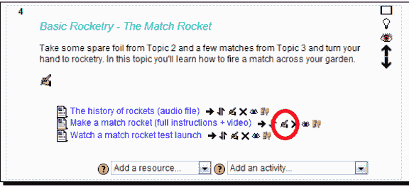

5. 点击 **编辑 HTML 源代码** 按钮，打开 HTML 源代码编辑器。
6. 右键单击编辑器，然后点击“粘贴”，将 Slide.com 提供的代码粘贴进去。
7. 点击 **更新** 按钮，关闭 HTML 源代码编辑器，返回正常浏览模式，相册视频现在已嵌入到你的 Moodle 页面中：

   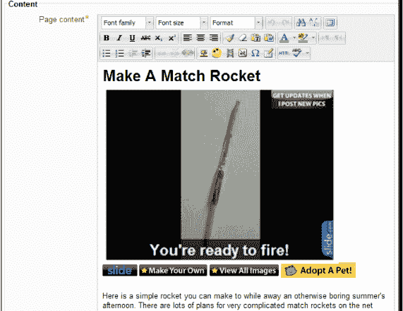

### 刚才发生了什么？

我想在火柴火箭制作说明中加入一个相册视频。我使用 Slide.com 完成了这项工作，这是一项免费的在线服务，允许我上传照片（包括说明文字）并创建幻灯片。使用 Slide.com，我们可以运用大量引人入胜的视觉效果，实现从一张照片到另一张照片的淡入淡出过渡。Slide.com 还允许你在相册视频显示时播放音乐。

> 不希望你的幻灯播客底部出现广告？
> 在编辑器中选择这些图片，然后按 Delete 键。

### 询问管理员

在本章中，我们在课程中加入了多媒体文件，而让 Moodle 正确设置为处理多媒体非常重要。接下来的几句话你可能不太明白，但如果 Moodle 无法为你播放音频或视频，那么你需要与管理员协商，启用所谓的“多媒体插件”过滤器，并确保所有功能（包括播放 Flash 动画——同样，即使你不确定这是什么意思，也要向管理员重复说明）都已启用。没有理由不应该启用这些功能——这就是 Moodle 的默认工作方式。

### 如果不启用多媒体插件会发生什么

当然，你可以在课程中加入多媒体文件，只需像我们在第 3 章“添加文档和讲义”中所做的那样直接上传，然后在课程首页添加指向这些文件的链接——就像我们在那一章后面所做的那样。问题在于，学生电脑上需要安装媒体播放器，他们才能看到或听到文件中的具体内容。这个播放器可能是 Windows Media Player、RealPlayer、Apple QuickTime，或者学生、家长或学校技术员可能安装了其他各种多媒体播放器。

如果你不让 Moodle 播放你的文件，那么学生尝试使用任何播放器时都会给你带来铺天盖地的问题。而这与 Moodle 无关。说服你的 Moodle 管理员启用多媒体插件，意味着 Moodle 会替我们处理媒体播放器。不仅如此，实际的视频或音频会被嵌入到网页中，而不是在单独的播放器中播放。这样就不会出现很多学生不知道如何使用他们电脑上恰好安装的媒体播放器的情况。目前，Moodle 自带以下文件类型的多媒体插件（你可以将此列表作为可上传到 Moodle 的文件类型参考）：

- MP3（音频文件）
- SWF（Flash 动画）
- MOV（电影文件）
- WMV（Windows 电影文件）
- MPG（MPEG 视频文件）
- AVI（视频文件）
- FLV（Flash 视频）
- RAM（RealAudio 音频片段或片段序列）
- RPM（音频文件）
- RM（音频文件）
- YouTube 链接（Moodle 可以识别 YouTube 页面的链接并自动嵌入视频）
- OGG（音频文件）
- OGV（视频文件）
- 支持自动嵌入链接的图片（Moodle 识别图片链接并自动嵌入图片）

## 小结

在本章中，我们让课程变成了真正的多媒体体验：

- 在课程中加入多媒体非常简单。只要管理员设置得当，Moodle 甚至可以为我们把音频和视频嵌入到网页中。
- 从 YouTube 和 TeacherTube 嵌入视频很简单，使用它们提供的网页代码片段即可；不过，你必须确保你的学生也能访问你嵌入视频的任何网站。
- 多媒体不仅仅局限于视频和音频。在本章最后，我们使用 Slide.com 在课程中加入了一个很棒的免费相册视频。我甚至在相册播放时配了背景音乐——但这只能由你亲自尝试才能体会！

本章中我们讨论了很多关于教师使用互联网存储内容的内容。有必要提一下，这样做有利也有弊。你需要记录自己在互联网上放置资源的位置。你可能会发现，最好尽可能多地把内容放在 Moodle 中，这样你可以确保学生能够访问并查看内容，而且他们看到的内容是安全的。

如果你将音频或视频上传到 Moodle，学生可以根据需要从 Moodle 下载这些文件。这可能有助于你决定如何将视频/音频放入 Moodle。

现在我们已经到了这本书的中途，我想你也会同意，我们的课程看起来已经相当不错了。在第 5 章“Moodle 大变身”中，我们将了解一些技巧和方法，让我们的课程从“看起来不错”变成“看起来很棒”。

## Moodle 改造

我们已经在前五章中走了很长一段路。我们已经把所有资源都上传到了 Moodle，并且在上一章中我们看到了从静态的、基于文本和图像的资源转变为将课程变成完整的多媒体体验是多么容易。事实上，你现在几乎可以邀请学生进来，我相信他们会对我们迄今为止的工作成果印象深刻。

由于我们一直在努力工作，并且在进入本书的后半部分并查看如何转换测验和学生项目之前，让我们休息一下，看看一些建立在我们迄今为止所学和所取得成就之上的技术，这些技术可以让 Moodle 课程更具吸引力和趣味性。重新整理和重新排列资源并改进呈现方式肯定会提高功能性和易用性。在本章中我们将：

- 不仅仅让每个主题都成为一份冗长的资源列表。使用标签资源和 Moodle 的缩进工具来改变这一点：

  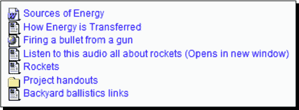

  变为这样：

  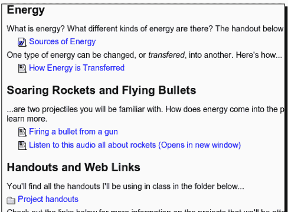

- 找到可以为我们的课程获取大量免费图片的地方
- 探索使用 HTML 使我们的课程更具吸引力的不同方法
- 包含一个会说话的角色，一个使用 Voki.com 的动画头像：

  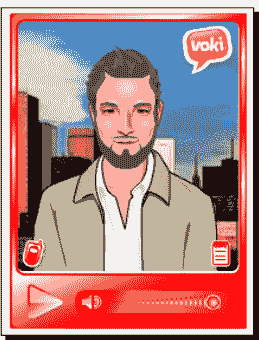

- 备份我们迄今为止所做的一切工作！如果因为电脑故障而丢失所有辛苦的工作，那就太糟糕了！

在第 3 章《添加文档和讲义》中，我们将文档和讲义导入到我们的私有文件区域，并看到了对它们进行排序和组织是多么容易。到目前为止，我一直在课程主页面上添加资源链接，而没有太多考虑链接本身在页面上的组织方式。现在让我们把这个问题解决一下！

### 安排你的资源

为什么要花一点时间安排主题中的资源很重要？这不只是视觉效果吗？让我们来看看我的主题 1：

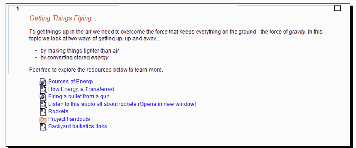

我有一个漂亮的彩色标题，有一些介绍主题的文字，然后是一长串资源，坦白说，看起来就像我在共享驱动器上用来向学生分发文档和讲义的文件列表。如果主题看起来像下面的截图会怎样：

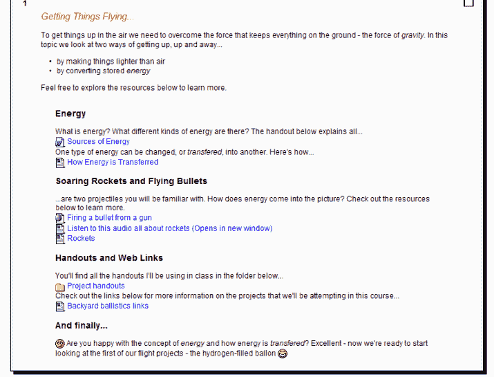

### 将你的资源排序

这正是我们需要的效果。我重新排列了我的资源并加入了一些标签，这样学生更容易找到资源。在本节中，我们将学习如何为主题带来一些秩序。

共享驱动器和 Moodle 之间一个明显的差异是，在 Moodle 中你可以按你想要的顺序放置资源，而不是按电脑坚持的顺序（通常是数字/字母顺序）。然而，在 Moodle 中，任何新添加的资源都只是排在主题的末尾。这意味着我的 **Getting Things Flying** 主题中的资源并不完全按合理的顺序排列，只是按我添加它们的顺序排列。我现在要采取行动来纠正这个问题。

### 行动时间 – 安排你的资源

1. 请记住，在开始之前你需要打开编辑模式。
2. 选择你想要移动的资源。我要把我的 Backyard Ballistics 链接资源移动到主题末尾。为了开始这个过程，我需要“拿起”该资源。我点击移动图标：

   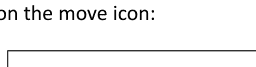

3. 这会导致两件事发生。首先，我想要移动的资源消失了。别担心，想象你已经把它拿在手里，准备放回课程中。其次，现在出现的方框代表了你可以把手中的资源移动到的所有位置：

   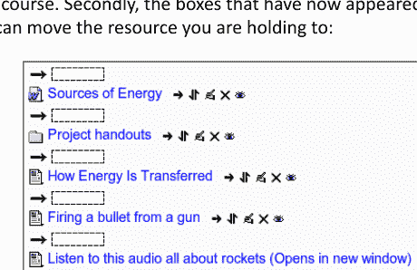

4. 选择你想要移动资源的位置。我希望我的链接列表在最后，所以我要点击底部的方框。方框消失了，我的资源已被重新排列：

   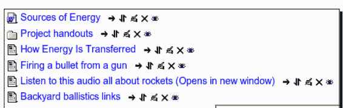

### 刚才发生了什么？

Moodle 中的资源列表不仅仅是像共享驱动器上那样的一份文件列表。一个明显的差异是，在 Moodle 中你可以按你想要的顺序排列资源，我们刚刚看到了实现这一点是多么容易。

> 找不到移动图标？
>
> 你的站点可能配置为可以拖放资源。在这种情况下，移动图标旁边你会看到十字准星。要移动资源，请点击十字准星并保持左鼠标按钮按下，将资源拖到新位置。寻找背景中的线条，这告诉你资源将被放置的位置，然后在找到位置后松开鼠标按钮。

现在我已经把资源按我想要的顺序排列了，我必须说我的主题看起来就像另一个资源堆，这正是我想要避免的。

还记得 *Arrange your resources* 部分中的截图吗？如果我能用一段简短的文字为每个资源做介绍，资源会更容易使用：

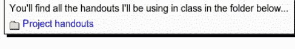

用简短的介绍来介绍资源是改善课程视觉吸引力的好方法。实现这一点的工具称为标签资源，使用方法如下。

5. 点击相关方框放置你的标签。完成！

   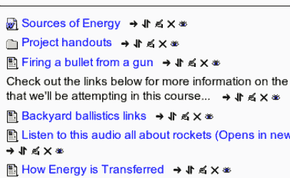

> 如果你没有移动图标，你会在标签旁边看到十字准星，可以点击它将标签拖到正确位置。

### 刚才发生了什么？

在我们迄今为止使用 Moodle 的经验之后，使用标签资源会相当直接。明智地使用标签意味着我们的课程主题不必仅仅是一长串资源。请记住将标签视为引导学生进入资源的手段。标签不是为内容设计的，所以尽量保持标签简短，最好最多两到三句话。标签就像粘合主题的胶水。你不希望胶水太厚。

看起来更好了，但我的主题仍然显得有点平淡。你可以通过点击资源旁边的向右移动图标来缩进你的资源：

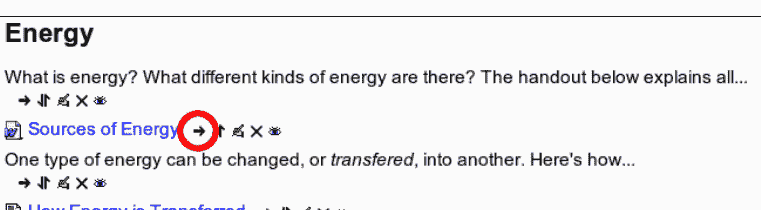

下面的截图显示了在稍作缩进后事物的外观：

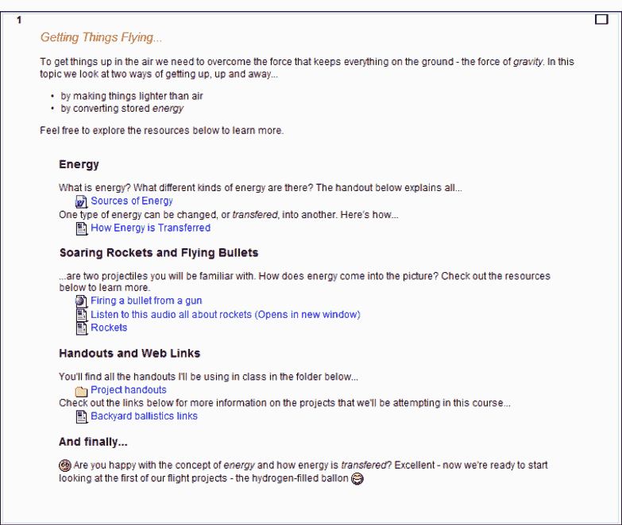

### 从学生的角度看课程

作为教师，你会在屏幕上看到很多学生看不到的选项。为了清楚地了解学生会如何看到课程，请使用课程 **Settings** 块中的 **Switch role to...** 选项。从此列表中选择 **Student**，你就会像学生一样看到课程。

完成后，点击 **Return to my normal role** 即可恢复正常视图。你还需要打开编辑模式以恢复编辑控件。

### 催眠般的 HTML：润色你的网页和描述

你可以看到我的 **Getting Things Flying** 主题仍然主要是文字。我里面唯一的图片就是 Moodle 图标，用来表示资源或活动类型。我真的想用图片和动画让它变得生动起来，但我可以在哪里获取图形，以及最好的包含方式是什么？

### 寻找装饰性图片

互联网上有一些获取免费图片以包含在课程中的精彩资源。以下是其中一些更受欢迎的资源。

### Google 图片搜索

它非常适合查找几乎任何东西的图片。请注意版权问题（稍后会详细介绍）。图片质量参差不齐，你必须准备好四处寻找。但它们很有趣，非常适合让原本枯燥的课程变得生动起来。

访问 http://images.google.com/ 进入 Google 图片搜索主页面。

我要找一张自制火箭的图片。我在搜索框中输入“DIY Rocket”并点击 **Search Images** 按钮。我看到一个页面，上面满是 Google 找到的原始图片的微缩版本：

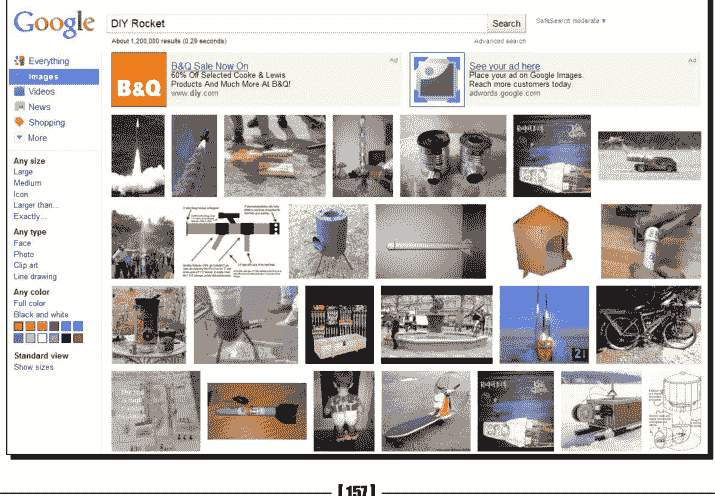

## Microsoft Office 剪贴画库

Microsoft 在 Office 中内置了大量精彩的剪贴画图片。例如，在 Word 2003 中，单击主菜单中的**插入**，向下滑动到**图片**，再横向滑动到**剪贴画...**，即可打开**剪贴画**侧边栏。我在其中搜索“rocket”，找到了无数的剪贴画图片、真实照片和动画。你可以将搜索范围限定为特定媒体类型。若要向文档添加剪贴画，只需双击缩略图即可。这样，我们就可以整理出一份仅包含课程所需剪贴画图片的单独文档。

现在，我们已经把剪贴画收集到了一个 Word 文档中，那么抓取这些图片的最佳方法是什么？如果你已有一个文档或 PowerPoint 演示文稿，其中包含你想要抓取的图片（包括动画图片），你也会遇到同样的问题。

### 动手实践——从 Word 文档中抓取图片

在*第 4 章，通过 Moodle 提交作业*中，我们学习了如何将 Microsoft Word 和 PowerPoint 演示文稿转换为网页，以解决学生家中电脑可能未安装 Office 而无法查看文档的问题。如果你将文档另存为网页，抓取图片就非常容易：

- 在 Word 2003 中，从主菜单选择**文件**，向下滑动到**另存为...**。此时会显示**另存为**对话框。
- 在**另存为**对话框底部，单击**保存类型**下拉列表。选择**网页，仅筛选 (\*.htm; \*.html)**。
- 确保你确认 Word 即将把文档保存到正确的文件夹，并且文件名也令你满意。单击**保存**按钮。
- 不要理会下一个对话框中的内容。单击**是**。
- 转到你刚刚保存文档的文件夹。在那里，你应该会找到一个以“_files”结尾的文件夹。你的图片就在里面：

  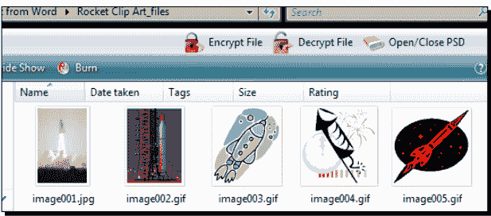

### 刚才发生了什么？

通常情况下，你可能已经有一个包含所需图片的 Word 文档或 PowerPoint 演示文稿，希望将其加入课程。我们刚刚创建了一个新的 Word 文档，从 Office 剪贴画库中收集图片，然后看到通过将文档保存为网页来抓取图片是多么容易。对于 PowerPoint 演示文稿，你也可以轻松地执行同样的操作。

### 版权注意事项

在上一章（*从 YouTube 或 TeacherTube 提取视频是否合法？*）中，我们已经遇到过版权问题。现在让我们重新审视这些问题。

由于我们身处教育领域，并且只要我们不打算利用别人的图片赚钱，版权问题就不会太严重。事实上，我从未遇到过版权问题；如果你不清楚网站上哪些内容可以复制、哪些不可以，那么你只需询问版权所有者即可。根据我的经验，向大型企业索取图片时，他们往往会给你发送更多图片。如果你仍然不确定，而且很幸运地有图书馆管理员在你所在机构工作，那么他们应该清楚什么能复制、什么不能复制，以及这些内容如何使用。

另一个需要考虑的问题是在课程中放入教职员工和学生的照片（或一般人的照片）。在课程中使用他们的肖像是否需要获得他们的许可？

## HTML 编辑器技巧与诀窍：表情符号和其他花招

如果你真的想让自己的课程脱颖而出，并且在寻找合适的工具，那么你不需要再找别的，我们一直使用的 HTML 编辑器就是最好的工具。这款编辑器能帮助我们轻松改进课程的外观和感觉，并帮助我们创建引人入胜的 Moodle 页面。让我们用本节的剩余时间，花一点时间探索一些新思路。

### 表情符号

你试过**插入表情符号**按钮了吗？这是为文本增添一点表现力的非常简单的方法。想表达讽刺，但又不希望学生误解？那就添加一个：

想表达你有多开心？插入一个：

## 编排你的 HTML

在我忙于整理和编排时，我突然想到，到目前为止我并没有过多考虑页面上的文本和图片如何排列（尽管你可能早就想到了）。目前我的形式是文本然后图片、文本然后图片，依次上下排列。其实不必如此，因为我还可以使用无边框表格并排排列图片：

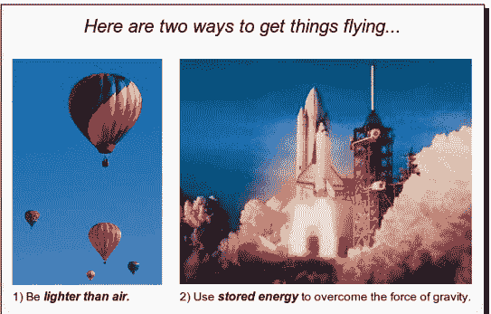

### 动手实践——并排显示内容

让我们尝试在主题中添加一个新网页。确保你有一些可以并排显示的图片：

- 创建新网页后，我们首先需要插入一个表格。单击“插入表格”按钮，显示“插入表格”对话框：

  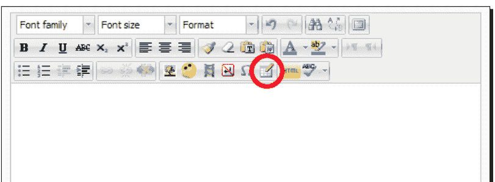

- 现在你可以指定表格所需的列数和行数。如果你不确定需要多少，不必担心，因为你以后随时可以更改。我打算并排放置两张图片，每张图片下方都有一段文本。这意味着两行两列。当你首次插入表格时，边框厚度为 1。如果你想要无边框表格，则必须将边框设置为 0。
- 在新表格顶行的两个单元格中各插入一张图片：

  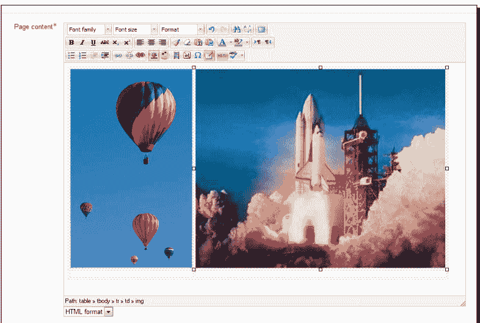

- 如果你想查看页面完整视图以便定位图片，请记住你可以拖动编辑器右下角，或者单击“切换全屏视图”按钮打开全屏视图：

  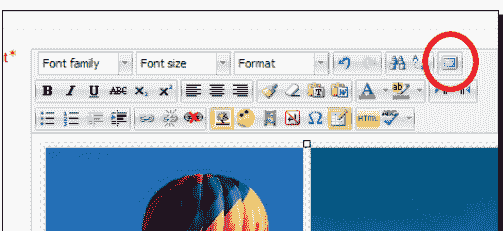

- 然后，我将在每张图片下方的单元格中输入一些文本，给页面加上标题，就这样！我完成了：

  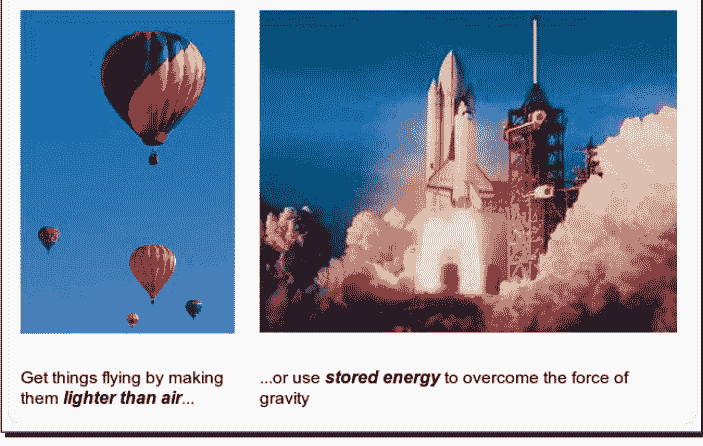

### 刚才发生了什么？

通过使用无边框表格来编排 HTML，我们可以极大地提高网页的视觉吸引力。我们可以将项目排列在表格的单元格中，而不是让文本、图片、文本、图片在页面上依次重复。正如我们所见，添加表格非常容易，如果你发现内容需要更改，以后重新配置表格也很简单。

记住：如果你想要无边框表格，则必须将边框设置为 0。

## 动起来：添加一个会说话的动画角色

如今，多媒体并不仅限于音频和视频。在课程中加入自己定制的动画角色怎么样？免费在线服务 Voki 可能并不适合所有人，但能带来很多乐趣（在撰写本文时，Voki 网站上现在有一个专门的“Voki for Education”专区）。

Voki 角色是屏幕上可说话动画头像，既可以使用计算机生成的语音，也可以使用录音或上传的文件。更多信息请访问 http://voki.com。

你最终需要创建一个 Voki.com 帐户，但只要你访问 Voki.com，就可以立即开始创建动画角色。还记得我们在第 4 章“声音与视觉——包含多媒体内容”中嵌入多媒体内容的情形吗？同样，Voki 会为你提供一段网页代码，我们可以将这段代码嵌入到添加到课程中的任何 HTML 中。

如何创建 Voki 角色超出了本书的范围，但 Voki 网站包含大量相关指导。

在下面的截图中，我编辑了课程摘要，并添加了一个 Voki 版本的我（算是吧！）在发出重要的安全警告：

## HTML 块：侧边栏的一点内容

自从我们在第 2 章“设置你的课程”中首次查看构成 Moodle 页面的所有组件以来，我们已经走了很长的路。还记得我们开始时讨论的块（blocks）吗？就是页面左右两侧那些小方框。我提到过你可以添加自己的块，并按你的意愿放置它们。现在让我们来看看具体操作，因为你可以添加的块之一就是 HTML 块。

让我们使用 HTML 块为学生创建一条欢迎消息。

## 操作时间 – 添加欢迎信息

1. 确保已开启编辑功能，滚动课程主页，找到“添加一个版块”版块，通常位于页面右侧最后一个版块下方：

2. 点击“添加...”并从列表中选择“HTML”。Moodle 将向页面添加一个新的 HTML 版块：

3. 要配置新的 HTML 版块，请点击配置图标：

4. 然后你会进入“配置（新的 HTML 版块）版块”页面。为你新加的版块设置一个标题，然后添加内容。完成后，按下“保存更改”按钮。下面是我的新欢迎消息（包括一个动态 GIF）：

5. 但欢迎消息藏在课程主页的右下角可不太好。再次点击配置图标，向下滚动到“此页面上的位置”区域。要将欢迎消息放在页面左上角，我需要将区域指定为左侧，并设置权重为 -10（也就是说，轻如鸿毛，而不是像大象般沉重的 +10）：

6. 现在，我可以把消息放到我想要的位置了：

## 刚才发生了什么？

我们向课程主页添加了一个新的 HTML 版块，用于向学生显示欢迎消息。你可以在其中添加任何 HTML。很棒的一点是，你可以在课程首页上添加任意数量的 HTML 版块。

## 动手实践 – 用 HTML 块做更多事

如果你已经熟悉 HTML 版块，那么这里还有一些想法可以尝试：

- 把你收藏的有用链接列表移动到一个 HTML 版块中，这样学生更容易找到它们：

- 你有没有在课程中添加过 Voki？把你的 Voki 角色放入一个 HTML 版块中。学生可以通过点击版块角落的隐藏图标来隐藏该角色：

- 如果你没有看到隐藏图标，请联系你的 Moodle 管理员。你的 Moodle 可能不支持隐藏图标。

- 如果你的学生是在小屏幕笔记本上查看你的课程，他们可以将版块停靠到停靠栏中：

你可以看到 Moodle 已将你的整个课程备份到一个单独文件中，并放在你的私有备份文件区域。这当然很好，但如果运行 Moodle 的计算机出了问题，这种备份就没什么用了。点击 **下载** 链接。你可以选择打开文件或保存文件。点击 **保存** 并将文件保存到你的电脑、U盘或便携式硬盘上。请妥善保管：

## 刚才发生了什么？

我想，如果到目前为止我所做的所有工作都丢失了，我可能会放声大哭。谢天谢地，备份我的课程很简单。我只需从课程的 **设置** 版块中选择 **备份**，然后按照说明操作即可。有很多设置可以让我选择实际备份的内容，但目前我只想备份所有内容，这样做真的没有任何坏处。记住：我们会在本书后面再次讨论备份和恢复的用法。

## 总结

在本书的前半部分中，我们学习了 Moodle 的基础知识，并了解了如何把我们一直在使用的资源导入到 Moodle 课程中。我们遇到了许多可以用来实现这一目标的不同技巧，并且我们利用这一章额外花了一些时间来练习和巩固我们到目前为止在本书中学到的想法。

具体来说，我们涵盖了：

- 在主题内安排资源，使主题在视觉上更具吸引力。我们使用“标签”资源作为粘合剂将资源聚合在一起。
- 我们全面了解了可以用来让课程对学生更有吸引力的技巧和诀窍。
- 我们使用 Voki.com 添加了一个动画角色，并获得了更多使用嵌入代码的练习。还有其他免费的动画角色可用（例如 http://digimi.com）。
- 我们使用一个 HTML 版块向学生提供欢迎消息。

我们已经涵盖了将授课课程中所谓的“静态”元素从教室搬到计算机上的内容。但我的教学不仅仅是制作 PowerPoint 演示文稿和分发信息表。我会给学生布置项目和作业。在课程进行过程中，我会给他们一些小测验。下一章中，我们将学习如何完全在线管理学生作业。
