## 6 管理学生作业
# 

_我想你会同意，在本书的前半部分我们已经取得了很大的进展。我们上传了所有的文档、讲义、视频和音频文件。在上一章中，我们探讨了许多让课程对学生更有吸引力和趣味性的方法。你查看过 Packt Publishing 网站上免费下载的《Moodle 2.0 课程转换》样章吗？这个样章简要介绍了学生如何通过 Moodle 提交作业。在本章中，我们将扩展这个主题，学习如何全面管理学生需要交给我的在线作业。_

目前，在我的“Backyard Ballistics”课程中，我布置了两个大型期末项目：

- 一张关于能源的海报
- 一个关于物体在空中飞行时能量如何传递的 PowerPoint 演示文稿

这两个任务分别评分。

作业提交存在许多令人头疼的问题：文件（如 PowerPoint 演示文稿）会丢失。学生声称已经通过电子邮件发送了文件，但你从未收到。学校技术员担心学生用 U 盘带作业会带来病毒威胁。我们没有快速的方法知道哪些学生还没有交作业。评分可能需要在纸上做笔记，并需要一套系统将这些笔记与存储在其他地方的作业数字照片关联起来。我们需要一个系统，让我们能够在一个自包含的工具中管理学生提交的作业——一个可以在师生之间交换文件、而无需借助其他远不那么可靠的工具的系统。此外，如果能有一个工具让我们在同一个平台下进行评论（包括图片、视频——实际上任何我们喜欢的数字文件）和评分，那岂不是很好？

除此之外，你可能还需要根据关键技能（计算能力、读写能力和信息技术应用）对学生进行评分。而这些技能不一定是你专门为某个项目设置的。在这种情况下，我们需要一种方法，将这些方面的评分与任何具体项目的评分分开进行。这又是一个令人头疼的问题！

通过转换到 Moodle，我们可以轻松找到所有这些问题及更多问题的答案。

在本章中，我们将：

- 演示如何在线管理项目和作业
- 学习如何在线批改学生项目，包括指定你自己的自定义成绩
- 学习如何管理学生成绩，包括根据他们的关键技能进行评分
- 展示如何在线在师生之间传递作业，而无需借助电子邮件、刻录光盘/ DVD，或让学生用 U 盘带作业

那么让我们开始吧，把我的海报项目和 PowerPoint 作业转换到 Moodle 中……

## 转换项目和作业

在本书前面，我向你介绍了开箱即用的 Moodle 提供的四种在线管理学生作业的方式。回想一下，有四种类型的作业活动，它们可以匹配你为学生布置的任何类型的项目。像我们在第5章“Moodle 改版”中所做的那样，开启编辑功能，进入任何主题并点击“添加一个活动”列表。在这个列表中，你会看到 Moodle 支持的四种不同类型的作业。它们是：

- **离线活动**：如果你的学生项目无法上传到 Moodle，因为学生的提交不是电子形式的（就像我的海报项目），那么你可以使用这种作业类型来管理成绩和学生的作业笔记。
- **在线文本**：学生将使用 Moodle 内置的文本编辑器创建作业提交内容。这就是我们到目前为止用来创建课程的编辑器。
- **上传单个文件**：学生只能上传一个文件。这就是我们在本书前面用来让学生把家庭作业交给我们的活动。

- **高级文件上传：** 学生可以上传多个文件。作为教师，你也可以使用Moodle作为一种在学生之间交换文件的机制，而不是使用电子邮件（不可靠）或U盘（有病毒风险）。

现在来看看这些作业类型。在开启编辑功能后，点击**添加活动...**并选择任意一种作业类型。这样，在我们开始之前，你就能对将要处理的设置类型有所了解。

> 记住：如果在尝试不同作业类型时，你不小心向课程中添加了一个作业，只需点击作业名称旁边的删除图标，即可轻松删除。

## 在线组织转换后的项目和作业

对于较大的项目或作业，通常最好有一个自包含的主题，其中包含实际作业本身以及所有支持材料。你可以加入范例（例如，前几年的作品示例），并让学生有机会一起讨论。本书后面还会介绍更多使用Moodle在线讨论范例的内容。将作业及其所有支持材料放在同一个主题中，意味着我可以先将作业对学生隐藏，直到他们该尝试完成作业的时候。

为了演示如何进行，首先我们需要向课程添加一个新主题，然后添加一个作业活动。

### 向课程添加新主题

我打算在课程中专门为学生项目添加一个新主题。然后我会将该主题隐藏，直到我们完成课程。还记得我们之前在这本书中是如何隐藏“仅供教师”的主题的吗？我将对我的项目及其相关支持材料采取同样的做法。你不必以这种方式处理作业：在浏览Moodle作业的设置时，你会注意到你可以指定这些作业可用的时间段（这是我们稍后将讨论的一个设置）。我决定要确保学生在开始尝试完成任何作业之前专注于前期工作，因此我将完全向他们隐藏这一部分。

### 操作时间 – 添加主题并隐藏它

1. 返回课程首页，然后从“设置”区块中选择“编辑设置”。
2. 向下滚动到“每周/主题数”设置，然后更改下拉列表中的数字，为课程添加另一个主题：
3. 在页面底部，按“保存更改”按钮。就这样，我们完成了——现在在课程末尾会有一个新的空主题。
4. 目前，我想向学生隐藏该主题。点击右侧的眼睛图标以隐藏该主题：
5. 这取决于你所用的主题（theme），但为了表示某个主题（topic）已隐藏，会在该主题的左右两侧显示两个灰色的条：

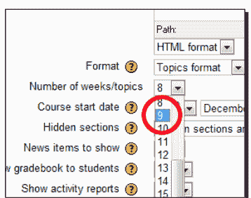

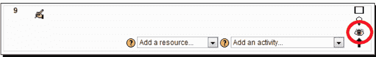

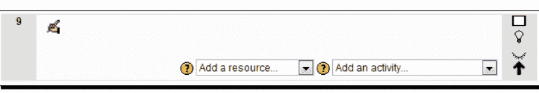

### 刚才发生了什么？

现在我们的课程中新增了一个空主题。我不希望学生在一切准备就绪之前看到作业，所以暂时对他们隐藏了这个主题。

### 哪种作业类型

为了我的项目，我将只研究两种不同的作业活动类型——但通过现在查看这两种类型，以及本书前面已经学习过的“单文件作业”，我们将获得技能和信心来轻松使用所有可用的类型。值得注意的是，因为Moodle是模块化的，软件作者提供了其他作业类型：在任何Moodle中，一个受欢迎的附加组件（尤其是在语言教师中）是Nanogong作业（http://gong.ust.hk/nanogong/index.html）。同样，凭借在这里获得的经验，你很快就能熟练掌握在Moodle中发现的任何自定义作业模块。

### 使用离线作业将项目转换为Moodle

第一个项目——海报项目——将转换为使用“离线活动”作业类型。我将使用Moodle来管理学生成绩，并整理我对他们作品的笔记和评论。让我们看看添加离线活动是多么简单。

### 操作时间 – 添加离线活动作业

1. 请确保你仍然开启编辑功能。在你要添加新作业的主题中（在我的例子中是我新隐藏的主题），点击“添加活动...”并从列表中选择“离线活动”。现在你会进入“编辑作业”页面。
2. 为你的作业命名。在“描述”框中输入任务的简短描述。如果框看起来有点小，不用担心。我们可以将所有支持材料连同作业活动本身一起放在课程首页的主题中：

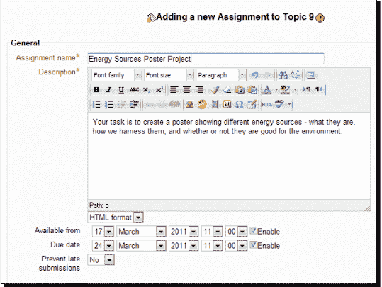

3. 使用“成绩”设置指定此作业的最高分。我将把“成绩”设置保留为100（意味着我可以在100分中为这个作业评分）。也许你的作业是总成绩的一部分，你需要用较少的分数来评分。你可以选择如何给作业评分。你甚至可以选择创建自己的自定义成绩（例如A、B、C、D、E或F），这将在本章后面学习。
4. 选择你希望作业何时可用。我想同时隐藏作业以及支持资源和材料，所以这个选项是多余的。我可以选择禁用此设置，所以在这种情况下我会这样做。如果你没有隐藏作业，“可用开始时间”和“截止日期”设置是防止学生在你就绪之前向你提交作业的有用方法：

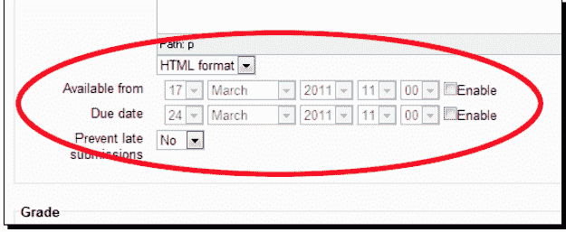

5. 就这样！我们完成了。按下“保存并返回课程”按钮。刚刚向课程中添加了一个新作业：

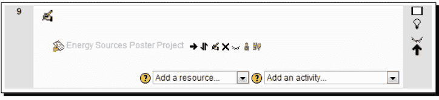

### 刚才发生了什么？

将我的海报项目转换为Moodle，就像向我的Backyard Ballistics课程添加离线活动作业一样简单。现在点击该作业，看看会发生什么。你会看到一个屏幕，显示你刚刚设置的任务，并且在右上角你会看到一个“还没有人尝试过此作业”的链接：

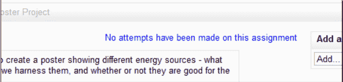

现在点击该链接。你将看到一个已注册你的课程的学生列表。如果你的课程没有注册任何学生，那么你将看到以下内容：

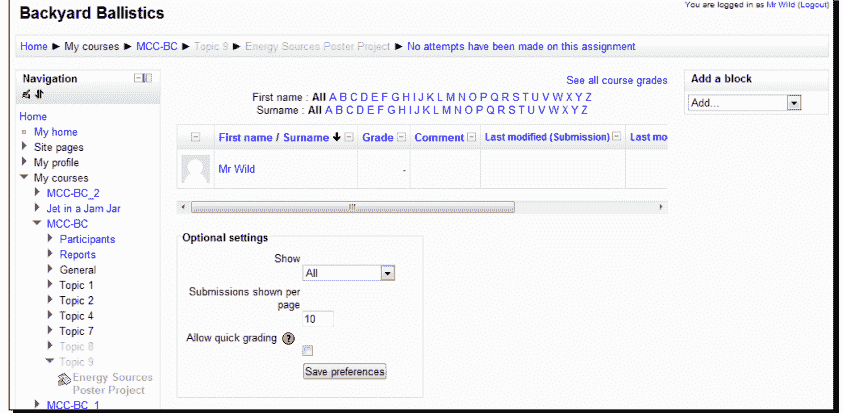

我是我的课程中唯一“注册”的人（作为教师）。在我确定课程已按我期望的方式设置好之前，我还不想让学生注册到我的课程中。在Packt Publishing网站提供的免费附加章节中，我演示了如何在Moodle课程中引入一个“对照学生”。我将再次这样做，以测试我新加入的作业。但在那之前，我需要考虑需要转换的第二个作业——学生需要制作一个PowerPoint演示文稿。

### 使用高级文件上传作业将项目转换为Moodle

我将让学生使用“高级文件上传”作业类型提交他们的PowerPoint文件。为什么不使用单个文件上传？使用高级文件上传作业有以下优点：

- 学生可以上传多个文件（总数量由我控制）
- 我的学生和我可以在线交换作业，而不必求助于U盘和电子邮件

现在让我们快速了解添加高级文件上传作业的过程...

### 操作时间 – 添加高级文件上传作业

在开启编辑功能后，在你要添加新作业的主题中，点击**添加活动**并选择**高级文件上传**。现在你位于**编辑作业**页面。与离线作业相比，此活动有更多的配置选项，但目前我只关心重要的选项。请记住，如果有关于特定设置的更多信息，请查看页面底部的针对此页面的Moodle文档链接——如果需要，你随时可以返回并在以后更改设置。

1. 为你的作业命名并填写描述。
2. 使用**成绩**设置指定此作业的最高分。我将把成绩设置保留为100（意味着我可以在100分中为这个作业评分）。也许你的作业是总成绩的一部分，你需要用较少的分数来评分。你甚至可以选择创建自己的自定义成绩（例如A、B、C、D、E或F），这将在本章后面学习。
3. 向下滚动到**高级文件上传**选项框：

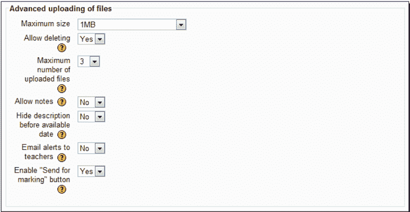

- 4. 由于这是一个 PowerPoint 演示文稿，我期望学生上传它。我会据此设置最大文件大小。并且我会允许学生删除他们已上传的内容（以防他们不小心传错了文件）。

- 5. 如果你希望允许学生在提交时附带简短说明，请确保将 **允许备注** 设置为 **是**：

  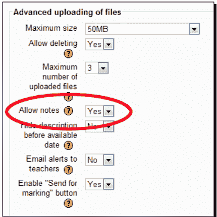

- 6. 因为我打算在准备好之前隐藏这两个项目，所以我可以将 **在可用日期之前隐藏描述** 设置为 **否**。如果你没有像我这样隐藏整个作业，而是使用 **可用起始时间** 和 **截止日期** 设置，那么请将 **隐藏描述** 设置为 **是**。这样学生会知道他们有一个作业要交，但描述只有在到达 **可用起始时间** 时才会显示。

- 7. 将 **向教师发送电子邮件提醒** 设置为 **是**，以便在学生提交作业时及时得知。请谨慎使用此设置：如果你是一位教师，但对该课程中提交的作业并不感兴趣，那么收到数十封告知学生作业已提交的邮件会让人厌烦（甚至令人恼火）。

- 8. 滚动到页面底部，点击 **保存并显示**。你的新作业现在就配置好了：

  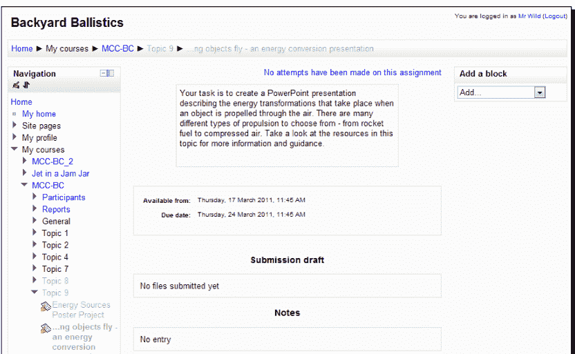

## 刚才发生了什么？

我们刚刚完成了两种作业类型的添加：**离线活动** 和 **高级文件上传** 作业。我们还没有涉及 **在线文本** 作业类型，但凭借你目前已掌握的技巧和经验，你也能轻松使用这些类型。在我们学习如何在 Moodle 中批改作业之前，为什么不花点时间现在看看 **在线文本** 作业呢？

## 在你的课程中引入一名学生

你已经看到了我们向课程中添加作业和项目工作是多么简单。然而，我们确实需要体会一下学生使用 Moodle 提交作业、并在提交后查看成绩和教师反馈的感受。与本书前面部分一样，此阶段我们需要的并非真实学生。我们需要一个“测试学生”，幸运的是，我的 Moodle 管理员已经为我创建了一个（参见 Packt Publishing 网站上提供的 Moodle 2.0 Course Conversion 免费附加章节下载）。这让我可以以测试学生身份登录。

## 注册学生

我的 Moodle 管理员为我创建了一个测试学生，并提前将该学生注册到了我的课程中。假设你有权限注册学生（如果不确定，可以咨询你的 Moodle 管理员），以下是如何注册你自己的学生：

### 操作时间 – 在你的课程中注册一名学生

- 1. 在 **设置** 板块中，找到 **课程管理** 下的 **用户** 链接并点击它——然后点击 **已注册用户**：

  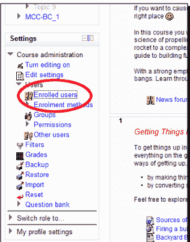

- 2. 此时会显示 **已注册用户** 屏幕。要注册新用户，请点击任意一个 **注册用户** 按钮：

  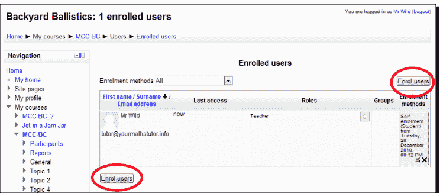

- 5. 点击学生姓名右侧的 **注册** 按钮，将该用户注册为学生。他们的姓名会缩进显示，并且 **注册** 按钮会消失：

  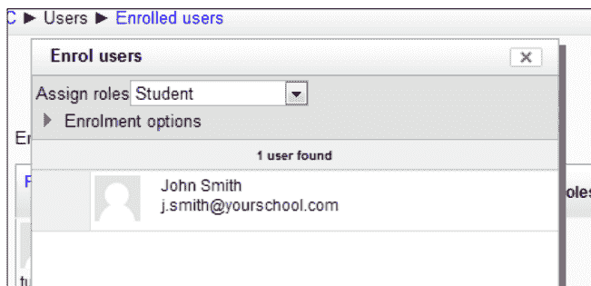

- 6. 点击弹出窗口右上角的关闭图标，即可关闭对话框并实际完成学生注册。随后你会看到该学生显示在 **已注册用户** 页面中：

  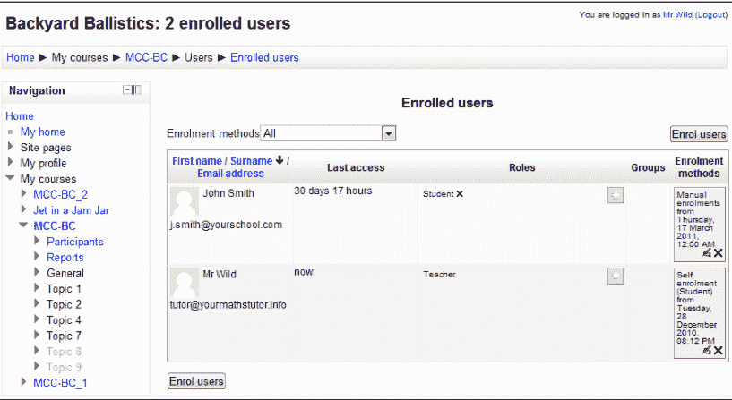

- 7. 就这样！我们完成了。

## 刚才发生了什么？

我没有去麻烦 Moodle 管理员为我的课程注册测试学生，而是自己将该用户注册为学生。掌握了这个知识后，如果我想的话，就可以将整个班级注册到我的课程中。但管理注册的方式多种多样（包括让学生使用我设定的密码自行注册），我们将在后续章节中探讨。

记住：在以学生身份登录之前，我需要先显示作业主题。如果我没有显示，而我是学生，那么我会看到以下内容：

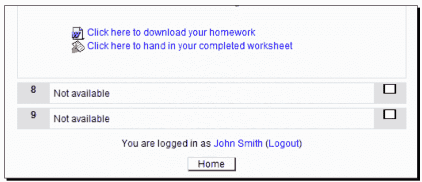

主题不可用。请确保在退出登录之前，点击闭合的眼睛图标以睁开眼睛并显示主题。

## 作业在学生眼中的样子

我已退出登录，然后以学生 John Smith 的身份重新登录。对于离线活动而言，它们是在现实世界中完成的。在这种情况下，Moodle 用于管理成绩和备注。如果我点击我的离线活动，我只会看到作业的描述：

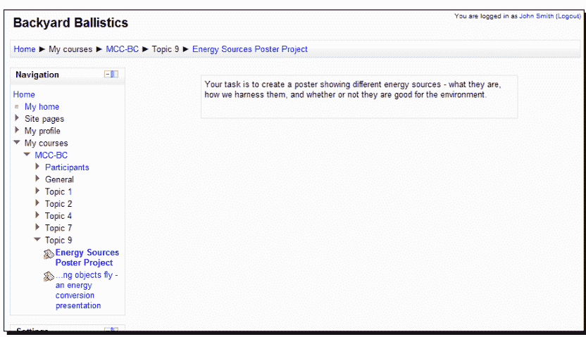

我的第二个作业要求学生上传文件。在下一节中，我们将体验一下作为 Moodle 学生尝试将项目文件提交到 Moodle 时的感受。

## 站在学生的角度 – 上传项目文件

当我们要求学生在线向我们提交项目作品时，非常有必要了解我们期望他们做什么。至少，当我们要求学生将项目作品上传到 Moodle 时，我们需要知道自己在说什么，以防他们有任何疑问。如果你没有学生登录账号，或者你仍以自己身份登录并请同事检查你的作业是否设置正确，那么在他们执行以下步骤时，你最好在一旁仔细观察。让我们一起看看学生必须如何向我们上传文件。

### 操作时间 – 上传文件到作业

我只有一台电脑可用，所以首先要做的是退出登录，然后以我的模拟学生“John Smith”身份重新登录。如果你有幸拥有两台相邻的电脑，那么你可以在其中一台以自己身份登录，同时在另一台以模拟学生身份登录。你也可以在同一台电脑上安装两个不同的浏览器（例如 Firefox 和 Internet Explorer）。如果是这样，你可以一个浏览器以教师身份登录，另一个以学生身份登录。不要尝试在同一台电脑上使用同一个浏览器以两个不同身份登录——这是行不通的。现在，你已经以学生身份登录了。

- 1. 返回课程主页面，点击你之前添加的 **高级文件上传** 作业。你会看到以下页面：

  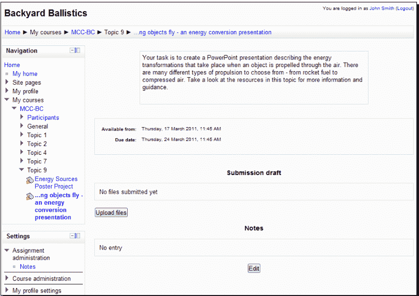

  页面上半部分是我们在作业中的描述。下半部分允许我们上传文件，并且因为我将活动配置为允许学生在提交时附上评论，所以还有一个填写备注的区域。学生可以像我们向课程文件区域上传教学材料一样，浏览并上传文件。如果他们想要添加备注，则需要点击 **编辑** 按钮（见上一张截图底部）。

- 2. 现在点击 **上传文件** 按钮。在接下来的屏幕上，点击 **添加...** 按钮以显示文件选择器对话框。这允许我们选择要上传的文件。现在你可以随便选一个文件，只是为了证明这一点。我快速用记事本创建了一个名为 `example_submission.txt` 的文本文件。使用文件选择器（通过左侧的 **上传文件** 链接）选择你要上传的文件：

  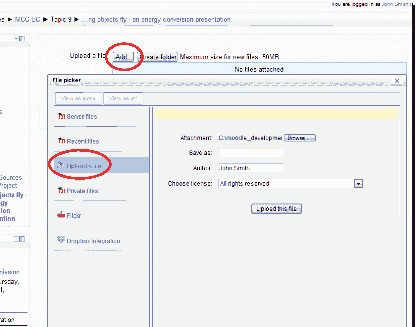

- 3. 点击 **上传该文件** 按钮。然后点击 **保存更改** 按钮。现在你会看到该文件显示在 **提交草稿** 框中：

  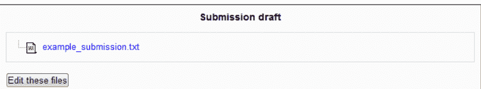

  你可能已经注意到，如果需要，你可以使用文件选择器上传多个文件。

- 4. 要为提交内容添加备注，我可以点击页面底部的 **编辑** 按钮。现在就试试留下一条备注吧。（如果你的作业配置为禁止学生留下备注，你就不会有这个选项。）

- 5. 如果我觉得这是项目的最终版本，并希望将其送去批改，那么我可以点击页面底部的 **发送以批改** 按钮。点击此按钮后，我将无法再上传更多文件：

  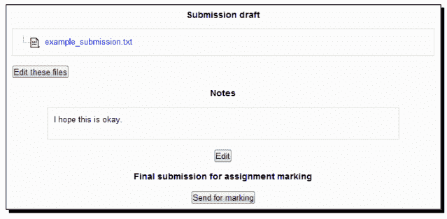

- 6. 就这样。我们完成了：

  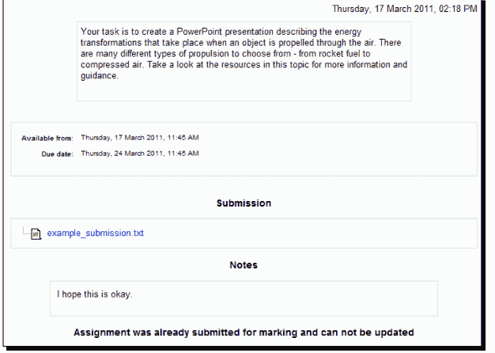

## 刚刚发生了什么？

我们很容易将作业转换为 Moodle。现在我们已经看到学生将作业提交转换为使用 Moodle 是多么容易。我们实际上也有一份作业需要批改（尽管是假的），我已准备好开始批改。

在继续下一部分之前，请确保你是以自己的身份登录，而不是以学生的身份登录。

## 批改作业

管理学生成绩以及与学生提交作业相关的文书工作是我最大的头疼问题之一。通过转换为 Moodle，我可以避免所有这些问题。让我们看看在 Moodle 中批改作业是多么容易。

### 批改离线作业

我的离线作业，海报项目，是在现实世界中进行的。目前，我拍摄海报的数码照片，并在单独的纸张上记录我的评论和成绩。让我们看看我如何将其转换为 Moodle...

### 动手时间 – 批改一份离线作业

1. 从课程首页，点击你的 **Offline assignment**。
2. 点击页面右上角的 **No attempts have been made on this assignment/View 0 submitted assignments** 链接。你现在将被带到提交页面。我课程中只注册了一名学生——我的管理员为我创建的假学生并注册到我的课程——所以我看到的是：

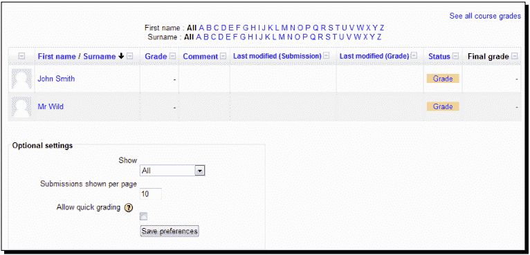

3. 要给 John Smith 的作业评分，我需要在状态列中点击 Grade 链接。反馈页面显示：

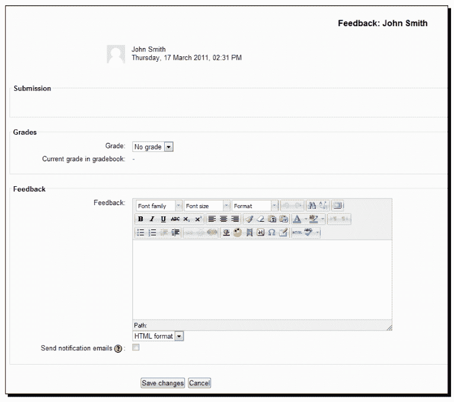

4. 我可以使用此屏幕对学生的作业进行评论。此时，如果我想的话，我可以在评论中包含海报的照片（或者我可以让学生拍摄他们海报的照片并将其作为在线提交的一部分上传）。

5. 如果作业已完成并准备好批改，我可以使用成绩部分中的下拉列表指定成绩（在我这里是满分 100 分）：

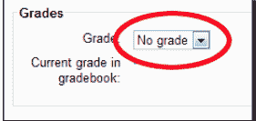

6. 当你完成评论和/或评分后，按下 **Save changes** 按钮。提交表会相应更新：

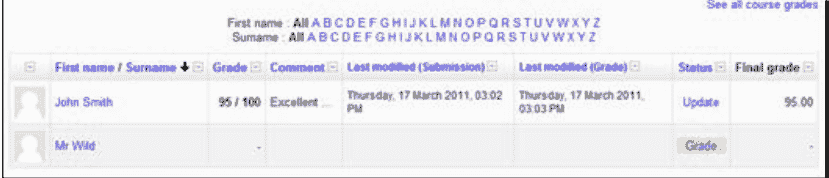

按下 **Save changes** 后会发生什么？从教师的角度来看，**No attempts have been made on this assignment** 链接会变为 **View 1 submitted assignments**。如果你是学生，那么你可能会收到一封电子邮件，通知你已收到作业反馈（取决于你的 Moodle 设置方式）。

### 刚刚发生了什么？

我们已经看到将 Moodle 用于管理学生成绩和我对“离线”海报项目的学生作业评论是多么容易。请记住，与 Moodle 中的其他任何事物一样，如果你以后需要更改评论甚至成绩，你可以回来并非常轻松地进行相关更改。

现在让我们继续查看我们的高级文件上传作业。首先要了解的问题是如何从教师的角度处理学生提交的作业。

### 处理学生提交的作业

返回你的课程首页并点击你的 **Advanced uploading of files assignment**。以学生身份注册时，我已向此活动提交了作业。现在查找页面右上角的链接：

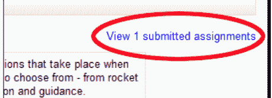

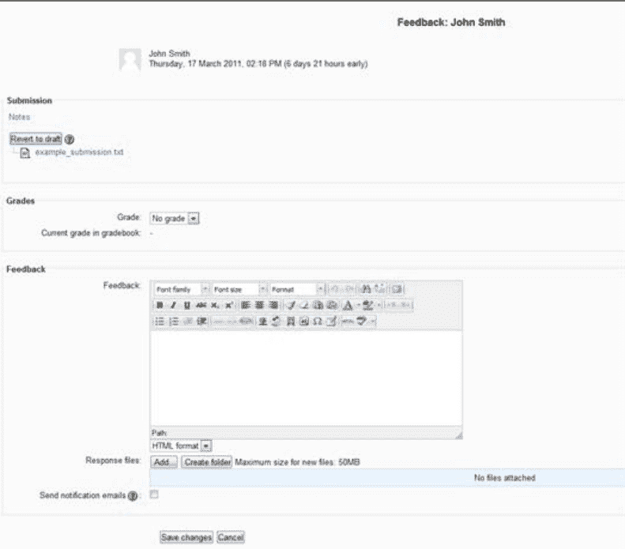

2. 页面顶部将列出学生上传的文件（在本例中，只有一个）。请回忆，当我以学生身份登录时，我按下了 **Send for marking** 按钮。这是为了确认我认为我已完成作业，并且还阻止我上传或修改文件。因为我不认为这个学生实际上已经完成，所以我可以按下 **Revert to draft** 按钮以允许学生再次修改和提交文件。如果显示，请按下 **Revert to draft** 按钮：

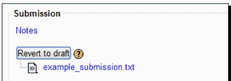

3. 反馈屏幕的下半部分有一个区域，允许我以响应文件（Response files）的形式向学生提供反馈：

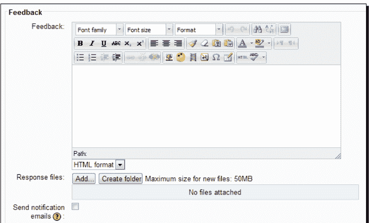

4. 在 Response files 旁边：点击 Add... 按钮。使用文件选择器对话框选择 example_submission_v2.txt。一旦文件被选中（通过文件选择器左侧的 Upload a file 链接），文件现在已上传到 Moodle：

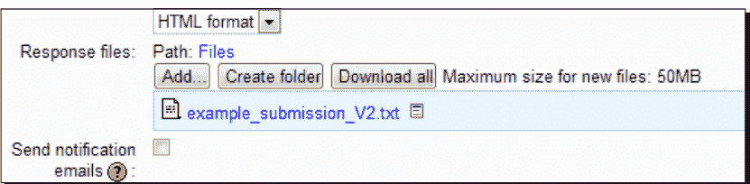

5. 在编辑器中输入你对这项工作的评论。完成后，按下页面底部的 Save changes 按钮。

6. 提交页面会相应更新，我们就完成了：

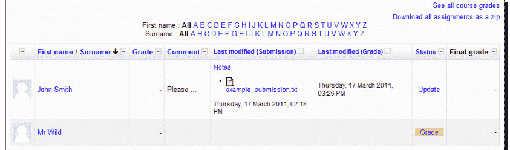

### 刚刚发生了什么？

当我们将 Moodle 用于课程作业时，对学生提交的作业提供反馈很容易。我们不必担心发送电子邮件（取决于 Moodle 的设置方式，学生会被发送电子邮件通知你已提供反馈）或担心通过使用存储棒传播病毒。所有内容都在线保存在 Moodle 中。但当我们向他们提供反馈时，学生看到的是什么呢？

### 确认我们的反馈已被接收

此时再次以学生身份登录是个好主意，这样我们可以体验一下作为接收教师反馈的学生是什么感觉。

再次以学生身份登录 Moodle 并点击我的高级文件上传作业，我看到以下页面：

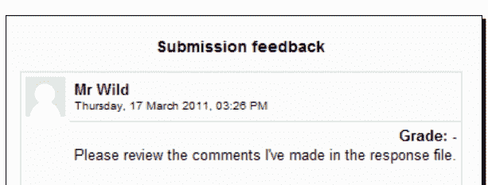

我的备注显示出来，学生有机会下载我上传的已更正文件。

### 批改学生提交的作业

批改高级文件上传活动中的学生提交作业的过程与批改离线活动基本相同。从提交页面，点击学生姓名旁边的 Grade 链接。反馈对话框显示。要了解有关设置最终成绩的更多详细信息，请按照动手时间 – 批改一份离线作业中的说明进行操作。

### 指定自定义成绩

目前，我的项目是按 100 分制评分，但正如我之前提到的，这并不是他们被评分的方式。根据教学大纲，我只能给学生四种成绩之一：Distinction、Merit、Pass 和 Referral。那么你如何指定自己的成绩呢？让我们现在学习如何做到这一点。

### 动手时间 – 创建自定义成绩等级

返回你的课程首页并在设置块中查找 Grades：

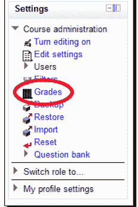

点击 Grades，你将被带到 Grader report 页面。我们现在进入了 Moodle 成绩簿。我现在不会太担心成绩簿中的所有功能——但在那里时，你可能想花一点时间看看。就像 Moodle 中的其他任何事物一样，你不会因为不小心做错什么而造成任何损害。

尽管我指定了一个，但如果你不想的话，你不必担心描述——它是可选的。你在此处指定的成绩是否用于其他课程的评分？如果勾选 Standard scale 框，则你的等级将提供给所有课程的教师。

完成后，按下 Save changes 按钮。你的新等级列在等级页面上。因为我没有将我的新等级设为标准等级，所以它被列为自定义等级：

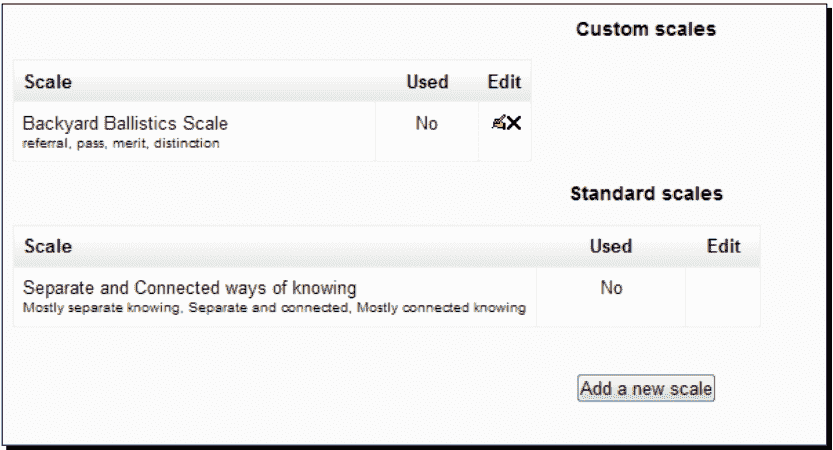

### 刚刚发生了什么？

我不会给 Backyard Ballistics 项目的学生一个数值成绩。教学大纲要求的是定性成绩，但幸运的是系统使创建我自己的自定义成绩等级变得很容易。现在我需要做的就是修改我的两个作业活动以使用新的等级。这只需要几次点击，让我们现在就做...

### 动手时间 – 使用自定义等级进行评分

1. 返回你的课程首页并点击你想要更改为使用新自定义等级的作业旁边的更新图标。编辑作业页面显示。
2. 滚动到 Grade 下拉列表。点击该列表。如果需要，向上滚动，因为我们想要使用的自定义等级将在最顶部附近。

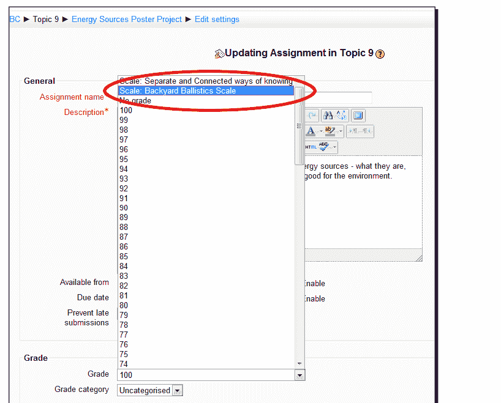

+   3.  选择新的评分量表后，向下滚动到页面底部，然后按**保存并返回课程**按钮。
+   4.  就这样。您现在可以使用新的评分量表为您的项目评分了。

## 刚刚发生了什么？

我们刚刚修改了作业，使其使用我们的新评分量表。现在剩下的就是演示如何使用它了。既然我们已经回到了课程首页，请点击作业本身的链接以显示作业的主页面（显示我们设置的任务描述）。点击页面右上角的**查看已提交的作业**链接，进入提交页面。

管理学生作业

选择一名学生，然后在“状态”列中点击**评分**链接。如果您已经为该学生评分，那么该链接将显示为**更新**：

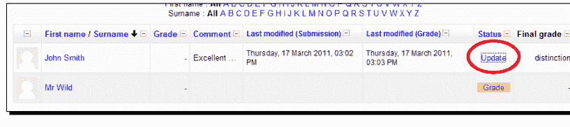

点击该链接打开**反馈**页面。在**成绩**部分点击**评分**：下拉列表，以显示您可以为此项作业给出的成绩。列表中显示的成绩来自我们新的自定义评分量表：

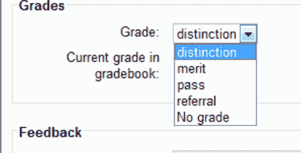

## Moodle 作业的更多用途

我们不必将四种作业活动仅限于用于大型项目。以下是一些更多关于使用作业活动将您当前的教学转换为 Moodle 的想法。

+   1. 包含一个在线文本作业，以支持学生可以使用 Moodle 的文本编辑器撰写提交内容的任务，例如写短篇故事或简短的论文作业任务。
+   2. 如果您能够在教学时间向全班展示单文件作业的提交页面，请在学生提交作业时不断刷新页面。您很快就会发现，学生们会争相第一个交作业。您可以轻松地将其变成年幼学生的游戏。
+   3. 使用离线活动来管理您为学生设置的任何任务的成绩——例如，以纸质形式提交的作业。您不必仅限于项目。

关于最后一点，还有另一种直接管理成绩的方法。我们在设置自定义评分量表时已经简要介绍了 Moodle 成绩报表。让我们重新访问该页面，看看如何设置自定义评分项目。

## 基于核心能力为学生评分

作为教育工作者，我们经常需要根据核心能力（也称为关键技能或目标）来评定作业。这当然适用于我的教学大纲：我课程最终成绩的一部分包括计算能力、读写能力和信息通信技术使用能力的分数。因为我们正在转换为 Moodle，而在 Moodle 的术语中，我正在评分的这些能力被称为“成果”，所以在最后一节中，我们将学习如何指定我们需要评分的核心能力，以及如何据此为学生评分。转换为 Moodle 有利有弊，具体来说：我可以选择在每项作业的基础上启用成果，但您不能使用默认的数字评分量表来评定成果，只能使用标准和自定义评分量表（例如我在*行动时间——创建自定义评分量表*中创建的自定义 Backyard Ballistics 量表）。

## 配置成果

让我们先看看为作业指定学习成果有多么容易。

## 行动时间——在成绩报表中创建自定义评分项目

+   1. 返回您的课程首页，然后点击**设置**区块中的**成果**链接：

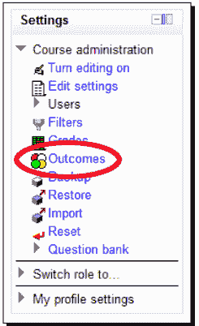

## 看不到“成果”链接？

如果您看不到“成果”链接，那么您需要与您的管理员联系以启用此功能。请查看本章末尾的“询问管理员”部分。

2. 您现在被带到课程中使用的成果页面。如果您需要评分的成果未列在“标准成果”框中，那么我们需要添加它们。假设情况如此，请点击“课程中使用的成果”下拉列表并选择“编辑成果”：

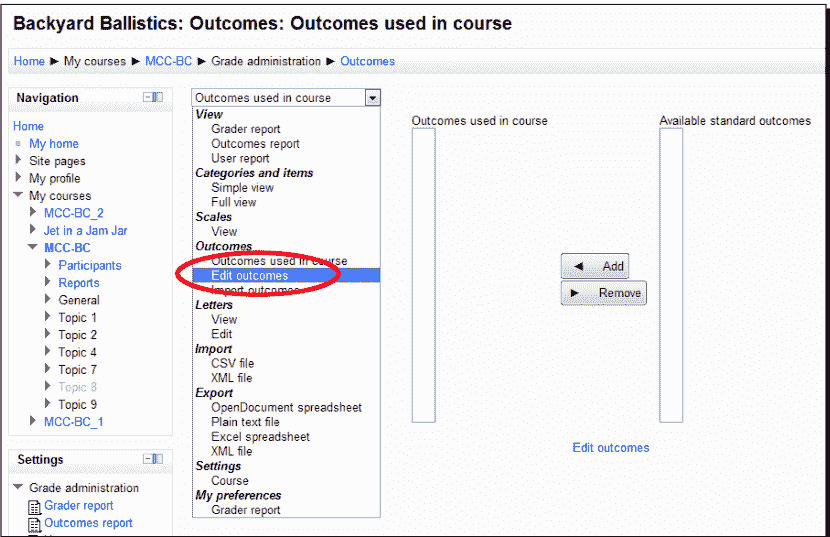

3. 按“添加新成果”按钮。为您的成果指定一个名称、一个简称，并选择您想用来评定此成果的量表。请记住：如果需要，您可以创建自己的自定义量表来评判成果。完成后，按页面底部的“保存更改”按钮，随着您添加更多成果，您将开始建立一个成果列表：

## 自定义成果

| 全名 | 简称 | 量表 | 项目 | 编辑 |
|---|---|---|---|---|
| 计算能力 | 计算能力 | Backyard Ballistics 量表 | 0 | ✖ |
| 读写能力 | 读写能力 | Backyard Ballistics 量表 | 0 | ✖ |
| 信息通信技术使用 | 信息通信技术使用 | Backyard Ballistics 量表 | 0 | ✖ |

添加新成果
导出所有成果

4. 完成后，点击“编辑成果”下拉列表并选择“课程中使用的成果”，您将看到您的新成果已列出：

# 成果：课程中使用的成果

C-BC ▶ 成绩管理 ▶ 成果

课程中使用的成果

课程中使用的成果
自定义使用（不可移除）
计算能力
读写能力
信息通信技术使用

可用的标准成果

◀ 添加
▶ 移除

编辑成果

## 刚刚发生了什么？

我们刚刚看到了为课程定义成果（核心能力）有多么容易。现在成果已经定义好了，我们需要在每项作业的基础上指定我们要评定哪些成果。

我将修改我的海报项目作业。这是一个离线作业活动，但这可以是任何类型的作业活动……

## 行动时间——在作业中评定核心能力

+   1. 返回您的课程首页，然后点击您想要更改的作业旁边的更新图标，打开“编辑作业”页面。

+   2. 向下滚动页面并寻找“成果”框。如果您需要请管理员为您启用成果，那么这个框是“编辑作业”页面的新增内容：

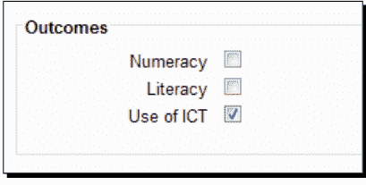

+   3. 我已经勾选了我想要为学生评定的能力（仅“信息通信技术使用”）。向下滚动到页面底部，然后按“保存并显示”按钮。

## 刚刚发生了什么？

我已经配置了我的离线作业，现在我可以根据计算能力、读写能力和信息通信技术这三项核心能力为学生评分了。

那么，我们如何为学生评分呢？如果您按了“保存并显示”按钮，您现在应该位于作业主页面。如果您已返回课程首页，请现在点击您刚刚重新配置的作业。点击页面右上角的“查看已提交的作业”链接。

显示学生提交内容的表格现在包含一个新列：“成果”。如果您为学生评分，您将在“成绩”部分看到新的选项，用于对您已勾选的成果进行评分。现在就来看看这些新选项，例如：

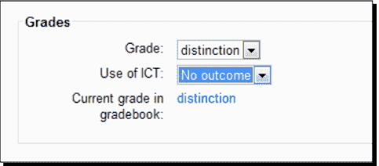

## 询问管理员

在我们可以指定核心能力之前，我们需要确保 Moodle 成果已启用——这是只有我们的 Moodle 管理员才能完成的工作。我们需要的设置可以通过**设置**区块下的**站点管理**访问，然后点击**高级功能**。您的管理员需要确保**启用成果**选项已被勾选。

## 总结

在本章中，我们学到了很多关于在 Moodle 中管理学生作业的知识。

具体来说，我们涵盖了：

+   - 如何使用 Moodle 在线组织转换后的项目和作业。我们讨论了如何向课程添加新主题，以及这样做如何允许我们隐藏作业及其辅助参考材料，直到学生准备好开始他们的项目工作。
+   - 将四种 Moodle 作业活动之一与您的课程作业或项目相匹配。我们讨论了如何使用每种活动将家庭作业任务以及更大型的项目转移到线上。
+   - 从学生的角度看作业是什么样子。我们讨论了了解学生如何提交作业的重要性，以便在学生开始在线学习时您准备好提供帮助和指导。
+   - 如何在线批改作业。我们看到了在 Moodle 中管理项目成绩有多么容易。

我们还讨论了如何使用 Moodle 来评定核心能力——展示了如何在每项作业的基础上进行配置。

现在我们已经学习了如何管理学生作业，我们准备继续学习如何在线与学生讨论作业——这是下一章的主题。

