# 7 在线沟通

在上一章中我们看到了如何将项目和作业转换为 Moodle，但这只是故事的一部分。当我们布置作业时，很少只是把作业发给学生就让他们去做。作业工作会得到讨论的支持，既有我们作为教师的讨论，也有学生之间建设性的（我们希望如此）交流。如果我们要将项目工作搬到线上，那么不仅将这些类型的讨论搬到线上是有意义的，而且这样做还有明显的优势。本章我们将介绍：

- 论坛
- 在线聊天室
- Moodle 消息

### 在 Moodle 中沟通

Moodle 中的双向沟通有三种形式：

- **实时、同步聊天**：Moodle 自带即时消息系统（例如 MSN），允许我们在学生（或我们）不在教室时与学生交谈：

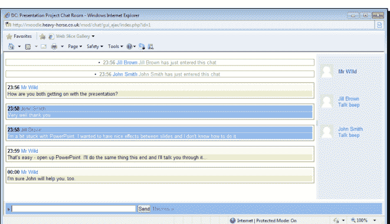

- **论坛**：就像老式的留言板。你发布一个问题或评论，后来有人发布回复：

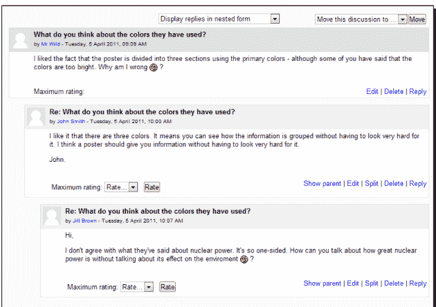

- **消息**：不要被名字混淆；Moodle 消息服务允许你向任何其他 Moodle 用户发送消息。这与聊天不同，因为它更像电子邮件消息，而不是即时消息。Moodle 消息系统是你员工和学生信箱的在线替代品：

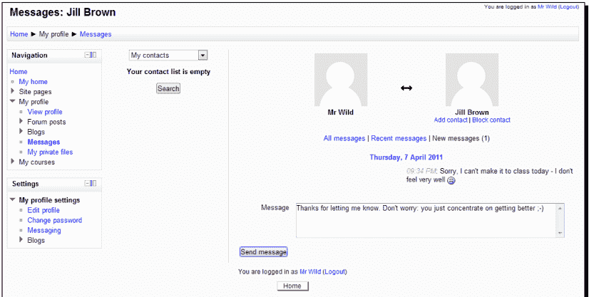

在本章中，我们不仅将学习如何设置它们，还将学习在教学环境中每种工具的最佳实践。具体来说，在本章中你将：

- 创建一个 Moodle 论坛并探索它可以使用的各种方式。
- 开启一个聊天室，允许学生在实时在线交谈。我们将探讨这种工具的利弊。
- 学习如何将 Moodle 消息推送到学生的信箱中。
- 看到所有学生评论都被完整记录并可追溯到发表评论的学生。Moodle 提供了支持你机构数据保护或电子安全政策所需的所有工具。

在上一章中我们将作业转换为 Moodle，所以让我们在此基础上，通过了解论坛如何支持和鼓励学生在项目工作中取得好成绩。

### 论坛

在第 6 章《管理学生作业》中，你与我一起为我的课程项目工作创建了一个新的隐藏主题。我认为将一个项目范例上传到 Moodle 并让学生讨论他们认为该作品的优点会很棒。这是我在课堂上已经做的事情，但在线进行意味着：

- 学生可以花时间研究示例作品并在没有坐在教室里的压力的情况下形成答案。在课堂上害羞的学生在网上并不总是感受到同样的社交压力。
- 论坛帖子可以保留你想要的任意长时间（即使发布帖子的学生已经离开），因此学生回复始终可供参考。好的论点或想法会保留在网上供学生回溯参考。
- 我们可以同时在线进行多个讨论。在线时我们可以更轻松地涵盖更多主题。
- 论坛帖子在发布后只有相对较短的时间内可以被编辑或删除（这与典型的在线论坛有所不同），这强化了参与 Moodle 论坛类似于在线对话的理念。

过不了多久你会发现，当学生发布问题时，是其他学生在帮助他们。这确实是我自己的经验。

### 在你的课程中添加论坛

让我们看看在 Moodle 课程中创建论坛有多容易。实际上 Moodle 支持四种不同类型的论坛，但我稍后会谈到这些。让我们在课程中添加一个论坛。要添加一个简单的论坛，我们只需要担心几个设置。

我做的第一件事是上传范例，按照第 3 章《添加文档和讲义》中“Time for action – uploading a file”部分中的说明进行。然后我使用主题摘要（第 2 章《设置你的课程》中“Time for action – defining each week / topic”部分）和标签（第 5 章《Moodle Makeover》中“Time for action – inserting a label”部分）提供了简要介绍。所以，这是我的起点：

### Backyard Ballistics - 课程结束项目

进入 21 世纪，我们需要比以往任何时候都更仔细地思考能源来源以及我们如何使用能源。现在你已经了解了所有关于能量及其如何被利用的知识，在本主题中我们将进行两个主要的能源相关项目——制作一个能源来源海报并向全年级做一次关于能量如何转移的演讲。

为了给你一些关于你的海报可能是什么样子的想法，点击下面的链接打开去年获奖能源海报的图片...

- [2010 Energy Poster Winner]
- [Energy Sources Poster Project]
- [Making objects fly - an energy conversion presentation]

点击下面的链接了解更多关于你被布置任务的信息：

现在，为了让学生讨论去年的海报获奖者，让我们添加一个论坛。

### Time for action – 添加一个论坛

1. 在你想要添加论坛的主题中，点击 **Add an activity...** 列表（如果看不到此选项，请检查是否已打开编辑）。从列表中选择 **Forum**：

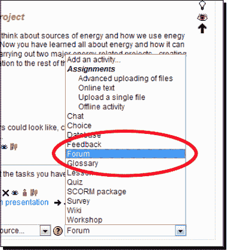

2. 将论坛类型保留为 Standard forum for general use。有关不同类型论坛的更多信息将在本章后面介绍。

3. 为你的新论坛命名并提供简要介绍：

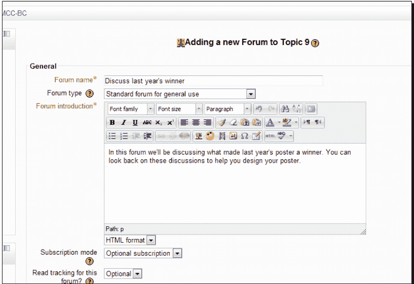

4. 滚动到页面底部并按下 Save and display 按钮。就这样，我们完成了：

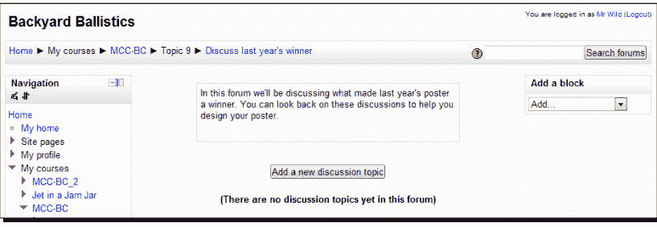

3. 选项相当自解释，但要强制每个人每次有人发帖时都收到电子邮件，请选择 **Forced subscription**。如果你想允许学生取消订阅（他们可能会抱怨收到太多电子邮件），则选择 **Auto subscription**。从列表中选择你的订阅选项，滚动页面并按下 **Save and return to course** 按钮。

4. 就这样。你完成了！

### 刚刚发生了什么？

我们刚刚配置了论坛，以便学生每次开始新的讨论线程时都会收到电子邮件。我强制订阅，这样我的学生就没有任何借口错过论坛中正在进行的讨论。在课程开始时，你可以强制用户订阅新闻论坛。如果临近考试时间，你可以强制用户订阅专门的“Exams FAQ”论坛（请注意，这只有在你的学生已在 Moodle 中启用活动电子邮件地址时才有效）。

在进入下一部分之前，我快速说明一下术语问题。将学生“订阅”到论坛并不意味着你让每个人加入论坛，他们通过在你的课程中就已经是论坛成员。将用户订阅到论坛意味着他们每次有新活动时都会收到电子邮件。

我们的下一个任务是鼓励学生开始发帖，而如果我们要鼓励和管理辩论，我们就需要承担版主或主席的角色，即 Moodle 用语中的“forum moderator”。在下一部分我们来看看这涉及什么。

### 版主论坛

论坛版主需要：

- 开始讨论
- 确保讨论保持聚焦
- 确保讨论易于跟进

让我们现在逐一查看这些方面。

### 开始讨论

开始对话最简单的方法是提问。我将在我的论坛中发布初始帖子，询问学生对我上传的示例海报中使用的颜色发表评论：

# 行动时间 – 开始一个讨论

+   1. 按下 **Add a new discussion topic** 按钮：

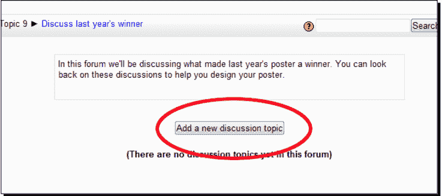

+   2. 你现在会被带到 **Add a new discussion topic** 页面。你的新论坛帖子需要一个主题行，并且有一个框供你创建你的信息。这是我的：

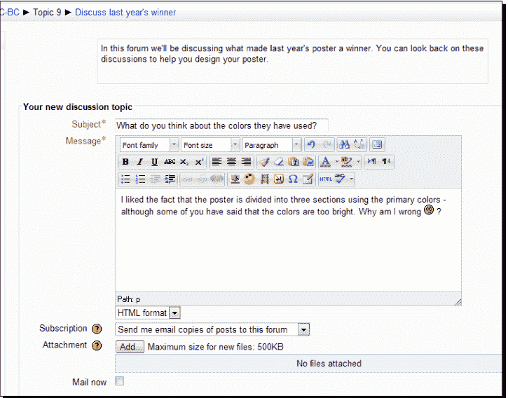

**3.** 在页面的底部你会看到有一个选项可以为你的帖子添加附件。这非常有用：学生可以扫描他们卡住的工作并将扫描的图像附加到帖子上。在我们尝试论坛帖子时，你可以尝试附加一个文件（任何东西都可以，Moodle 不挑剔）。记住，你不会破坏任何东西。

**4.** 一旦你对即将发布的内容感到满意，请按下 **Post to forum** 按钮。在确认信息之后（提醒你只有很短的时间可以改变你刚刚写的内容的主意），你会被带回论坛，你的新帖子会被列出：

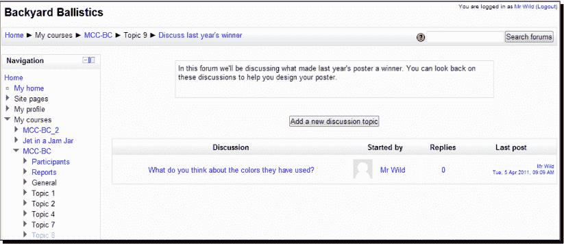

## 发生了什么？

在课堂上开始对话通常很困难，有时当你转为在线教学时你会有同样的问题。可以肯定的是，一个开始为空的论坛会保持为空，所以我总是用一个问题（或有时是一个有争议的陈述！）来引球滚动，我知道这会让我的学生做出回应。

一旦你开始了讨论，你经常会发现会有最初的帖子热潮，然后迅速消退，因为每个人都决定他们已经说了他们要说的一切。如果学生可以看到距离上一次帖子已经有一段时间了，那么他们就不太愿意自己发帖。此外，随着论坛的增长，讨论有时会偏离主题。让我们看看一些保持讨论集中的技巧。

## 保持讨论集中 – 管理讨论

管理论坛所需的努力比你最初想象的要少得多。以下是一些提示和技巧，帮助你应对可能遇到的一些问题：

- 如果学生认为没有人会回应他们，发帖的频率可能会下降。最好说明你多久访问一次论坛以及你打算何时回答帖子，特别是如果你添加了一个论坛来支持在周末或假期进行的工作。
- 对帖子做出积极的反馈。感谢你的学生发帖，这会鼓励他们再发帖。

当谈到管理时，你需要决定要行使多少管理权。作为教师，你可以编辑甚至删除帖子，但过多的管理可能会扼杀辩论并疏远熟悉论坛的学生。太少可能会让某些学生主导并疏远那些不熟悉论坛的学生。总是可以选择设置发帖阈值来限制你更热情的学生。也许你希望学生对论坛承担一定的责任，就像你希望他们对自己的工作承担责任一样。在这种情况下，过多的管理可能会被视为干涉。

## 应对粗鲁和不守规矩的行为

这很少是个问题，但有些学生在论坛上会说出他们在现实中永远不会说的话。如果你担心你的论坛可能会失控，那么在开始之前制定一套规则。让学生在你的课程中清楚地了解行为准则。使用评分量表，这些可以规范学生的行为，特别是如果他们的最终成绩取决于从教师或其他学生那里获得良好的评分。

> 如果你决定宁愿在消息发布前检查其适用性，那么请查看 Moodle.org 并搜索 "approve forum post" 或类似内容。有各种解决方案可用，尽管你需要与你的 Moodle 管理员讨论实施问题。

一种开箱即用的解决方案是给帖子评分。如果它完全不合适，那么显然你需要完全删除它。

## 在线沟通

## 行动时间 – 评分论坛帖子

+   1. 我们需要重新配置我们的论坛以允许我们评分帖子。如果你已返回到课程首页，请点击新论坛旁边的更新图标：

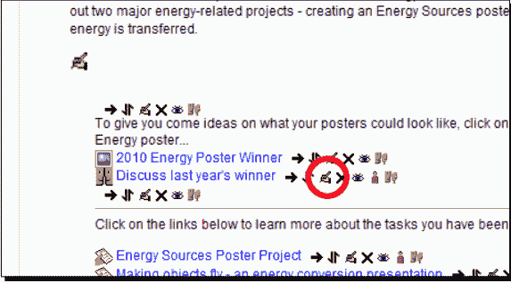

+   2. 如果你没有离开你的论坛主页面，则在 **Settings** 块中，点击 **Forum administration** 下的 **Edit settings**：

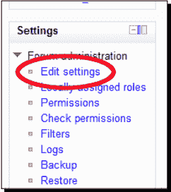

+   3. 在 **Editing forum** 页面上，滚动到 **Grade** 框。从聚合类型列表中选择你希望如何对帖子进行评分。对帖子给出的成绩用于为学生提供论坛活动的总体成绩。选项应该是自解释的。

+   4. 选择你想要使用的评分量表。你可以使用自定义评分方法（如果需要的话，参见 *第 6 章，管理学生作业* 中的 *行动时间 – 创建自定义评分量表* 部分）。我将允许 10 分制的评分。

5. 最后，如果你想让学生专注于特定帖子，你可以限制评分的日期范围。你会在 Grade 框的底部找到这些设置。

6. 就这样。我们完成了！现在，根据你限制评分的日期范围，你会得到对帖子进行评分的选项：

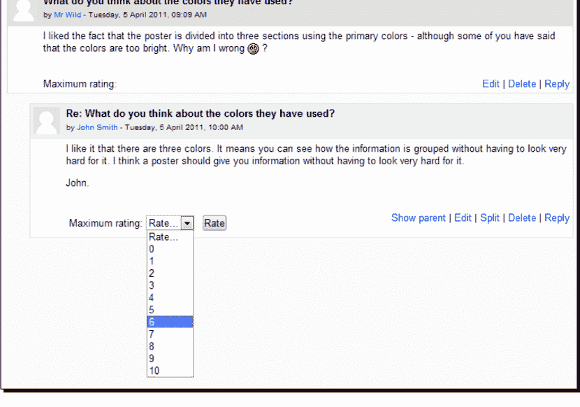

## 发生了什么？

将我们的课程转换为 Moodle 的好处是，你可以比在教室或讲堂中更轻松地对学生对讨论的投入进行评分。知道他们的帖子很可能会被评分可以防止讨论失控。但如果讨论偏离到另一个主题，但新主题仍然是需要讨论的主题怎么办？我们将在下一节中讨论这个问题。

## 确保讨论易于跟进

我已经推广论坛作为讨论主题的绝佳方式，因为有了论坛，很容易回顾讨论以找到论证充分的观点或论证充分的案例。但这只有在讨论线程保持有序时才有效。这是论坛中经常发生的事情。例如，我的海报论坛中的一个讨论从关于颜色变成了核能：

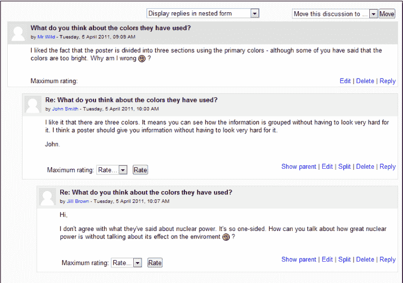

## 行动时间 — 分割一个讨论

1. 选择你想要分割讨论的主题并点击 **Split**：

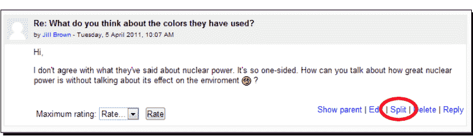

2. 为讨论线程选择一个新名称；我将我的命名为 "Nuclear power: Is the poster balanced?"。选择新标题后按下 Split 按钮。

3. 你现在创建了一个新的讨论线程，并且两个讨论现在都更容易跟进：

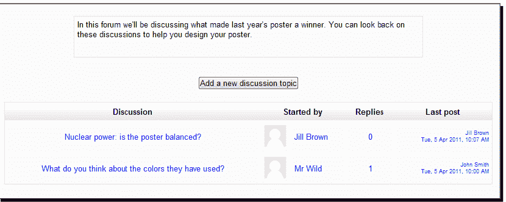

## 发生了什么？

在 Moodle 中管理论坛就是让讨论易于跟进，并且以后易于参考。但我们刚刚看到管理讨论非常容易。这是将你的课程搬到线上的优势之一。

现在我们已经基本了解了 Moodle 的标准论坛用于一般用途的所有知识。但那种论坛并不适合你可能想要在线进行的每种讨论或辩论。但这不是问题，因为 Moodle 提供了四种不同的论坛类型。

## 论坛类型

到目前为止，我们一直在使用标准论坛用于一般用途，大多数时候这将满足你的需求。但还有另外四种类型可供选择：

- 一个简单的单一讨论，只允许一个讨论线程。如果你想让讨论简短而切中要害，那么这就是你应该选择的论坛类型。
- 每人发布一个讨论，每个学生只允许开始一个讨论，但可以在任何其他讨论中自由回复。它用于学生只允许发表单一陈述或评论的情况，例如在线辩论。

- 标准论坛以博客式格式显示，将讨论线程显示为你在博客底部看到的评论，或可能更熟悉你的学生，就像在 Facebook 墙上一样。
- 问答论坛，学生自己发帖之前无法看到其他帖子。常用于你不希望学生互相抄袭作业（语言教学）或思想观点的情况。它也可以用于在线版的“传阅”教学练习，我提出一个问题，由第一个学生回答。然后他们提出一个问题，由下一个学生回答。如此往复。

当我们在本章的开头首次向课程添加论坛时（*Time for action – Adding a forum to your course section*），我建议将 **Forum type** 设置保持为 **Standard forum for general use**。正是这个设置（在论坛配置页面上）允许你指定论坛类型。

正如你所见，转换为 Moodle 为讨论打开了新的可能性，并且请记住 Moodle 很容易让你将讨论延续到课堂之外。

关于你可以用论坛以不同方式支持教学，有什么想法呢？让我们在下一节中看一些论坛技巧和窍门。

## Forum tips and tricks

论坛是管理讨论和辩论的好方法。以下是你可以在教学中使用 Moodle 论坛的几个想法：

- 你有需要在周末或假期期间完成的项目作业吗？使用论坛在课堂或讲堂之外支持你的学生。
- 如果你的学生作为一个群体在一起相处的时间很少，那么创建一个社交论坛，让你的学生在线上更好地互相了解。
- 请记住，有很多不同的课程格式可供选择。如果你选择 Social 格式，那么你的课程就只是一个大论坛。有关指定课程格式的更多信息，请参阅第 2 章 *Setting up your Courses* 中的 *Time for action – setting up the course format section*。
- 如果你教授外语，并且不希望学生复制彼此的帖子，那么试试使用 Q and A 论坛；他们在自己发帖之前无法看到其他帖子。
- 对于简短、有针对性的小组作业，创建一个论坛并在交互式白板上显示帖子。利用这些帖子在课堂或讲堂中支持口头讨论。

为了让讨论线程更容易跟随，你可以使用显示回复下拉菜单更改它们在屏幕上的显示方式。请注意，这是一个个人设置，而不是可以为他人更改的东西：

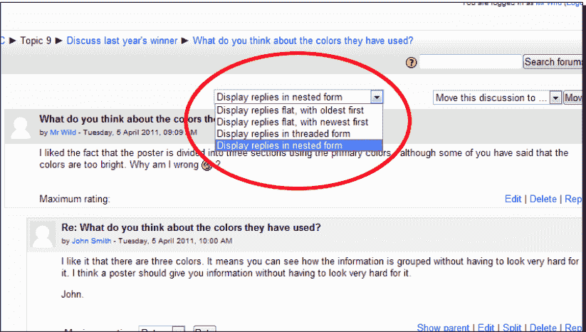

- 创建一个常见问题论坛来支持大型项目作业。保存此论坛供以后年份使用。你将更容易看到学生遇到困难的领域。
- 小组工作的学生可以拥有自己的讨论论坛，以便他们可以一起沟通和协作（本书后面会详细介绍如何设置学生小组）。
- 通过在编辑论坛页面上使用 Post threshold for blocking 设置，防止过于热心的学生发布太多帖子。
- 请记住，论坛帖子都有时间戳和日期戳。如果他们看到你在凌晨 4.00 发帖到论坛，学生就会知道你的睡眠习惯。同样，如果他们也这样做，你就会知道你的学生的学习习惯！

### Have a go hero – creating a school leavers book

为即将毕业的学生创建一个论坛，让他们发布告别留言和照片。这些论坛总是非常受欢迎。有些学校甚至会复制留言和照片并打印出来，让学生在离开时带走。

## The News forum is not really a forum

每个课程都有一个 News 论坛，但这个名字具有误导性。News 论坛实际上是教师的公告板，是你发布最新课程新闻的地方。重要的是，只有教师可以发帖，所以不要期望学生在那里回应你。你发布到 News 论坛的任何帖子都会出现在 Latest News 块中，因此你可以使用 News 论坛来宣布课程变更、项目截止日期、考试日期。

论坛是支持讨论和辩论的绝佳工具。然而，有时你需要为学生提供实时聊天环境。在下一节中我们将介绍 Moodle 聊天。

## Online chat rooms

如果你需要支持不在课堂上的学习者，那么聊天室是理想的方式：

- 创建一个考试复习聊天室，在考试前夜或早晨花一个小时与你的学生一起。
- 支持生病的学习者。如果他们可以访问电脑，他们仍然可以参与课堂讨论。
- 通过聊天会话支持周末或假期期间的项目工作。这将减少你周一早上返回工作时需要补做的作业量。
- 如果你和你的学生发现安排一个大家可以面对面在一起的时间和地点很困难，可以举行在线辅导课程。
- 邀请嘉宾演讲者进入你的聊天室。通过邀请他们在线加入你的班级，你可以大幅削减你的费用账单！
- Moodle 聊天室是安全的，只有注册你的课程的人才能进入。

并且在 Moodle 中使用聊天室意味着用户不必学习如何使用又一个“聊天客户端”，它们被称为这样。

但聊天室也有其缺点：

- 因为在线聊天缺乏手势和语言线索，很容易产生误解。使用表情符号（或笑脸）可以帮助防止这个问题。
- 聊天室总是开放的，24/7。可能在你不知情的情况下发生不当行为。

年轻学习者可能非常习惯聊天，并且经常会开始“sup? who u lovin?”之类的无聊对话。聊天会话会被记录下来，如果必要的话可以显示在交互式白板上供全班查看。与论坛一样，最好在让暴民进入之前先设定好行为规则。

聊天室的另一个特点是隐藏聊天室会使其关闭。

当我们了解更多关于 Moodle 聊天时，我们将研究所有这些问题。让我们从学习如何向你的课程添加聊天室的下一节开始。

## Adding a chat room to your course

向你的课程添加聊天室很容易。你需要做的只是选择你想要添加聊天室的话题，点击 Add an activity... 并选择 Chat。

我想加入一个聊天室，让学生讨论他们必须做的演示。这对他们来说都是一个相当令人担忧的事情，当他们一起工作来克服可能遇到的任何困难时是很好的。与其使用论坛，学生说过论坛在等待回复发布时似乎相当孤立，我将使用 Moodle 聊天。

### Time for action – adding a Moodle chat

1. 决定你想要包含聊天室的话题。开启编辑后点击 Add an activity 并选择 Chat。

2. 为聊天室命名并提供一段简短的介绍文字：

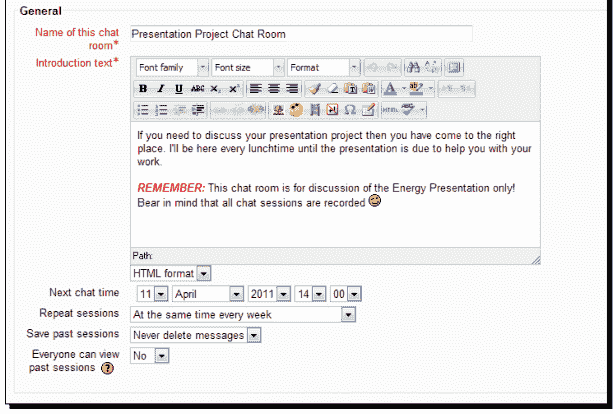

3. 目前默认设置就足够了。只需滚动到页面底部并按下 Save and display 按钮：

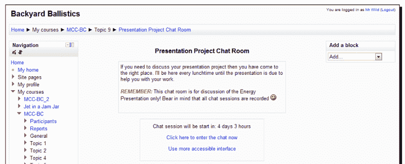

### What just happened?

我们刚刚向课程添加了一个聊天室！非常容易，只需几次点击就完成了。要进入聊天室，只需点击 Click here to enter the chat now 链接。邀请一名学生或同事加入你。你可以在屏幕右侧看到是否还有其他人与你同在聊天室：

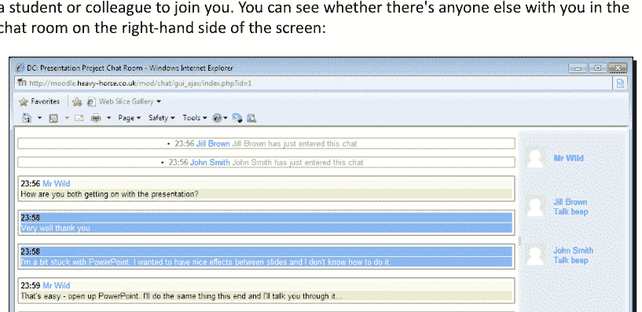

## Being understood – Using emoticons

正如我们已经提到的，没有视觉线索、面部和手势，很容易在聊天室中被误解。出于这个原因，表情符号，或笑脸，被发明出来。你试过使用 HTML 编辑器插入笑脸吗：

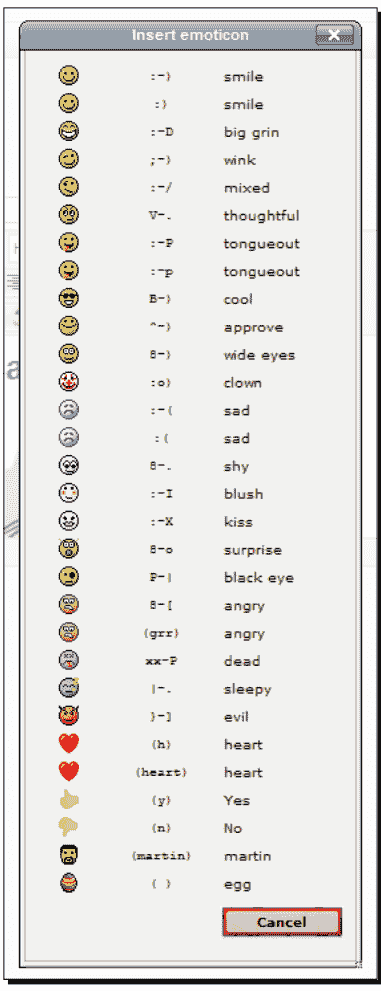

该对话框在 Moodle 聊天中并不存在，但你可以使用 HTML 编辑器对话框中每个图片旁边显示的键盘快捷键，在聊天时使用那个笑脸。例如，输入以下内容：

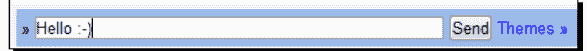

它会被显示为：

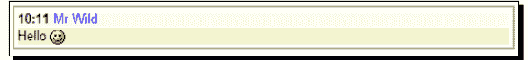

## 查看过去的聊天会话

聊天可以以光速进行。然而，默认情况下它们始终会被记录，所以如果讨论中有什么内容需要回头参考，只需点击 查看过去的聊天会话 即可查看聊天记录：

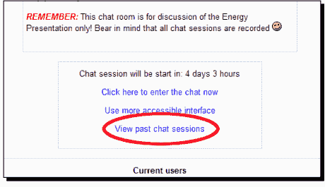

作为教师，你现在可以选择查看过去的会话或在不再相关时删除它们：

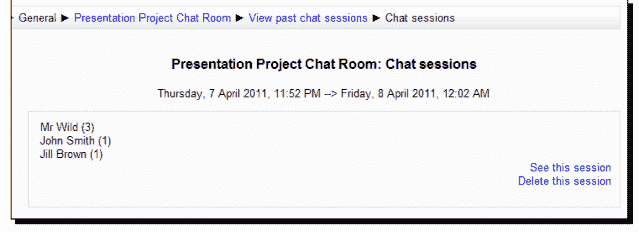

点击 查看此会话 以查看聊天。

## Have a go hero – 使用聊天和论坛做更多事情

如果聊天中提出了需要进一步阐述的重要观点，或许对某个特定的学习目标至关重要，那么就使用论坛来进一步讨论该问题。你甚至可以将过去的聊天会话中的聊天内容复制到论坛帖子中。你可以编辑掉姓名以保护当事人！

## 告知学生你何时有空

聊天室始终开放，但你可以指明你将会在什么时候在场与学生交谈，就像你可能已经猜到并且我之前也做过那样，使用 下一次聊天时间 设置。让我们现在更新我们的聊天室。

## Time for action – 告知学生我们何时在场

- 1. 如果你在课程首页上，则点击聊天室旁边的更新图标。如果你是在聊天室页面上，则在设置区块的 Chat administration 下选择 编辑设置。
- 2. 向下滚动 编辑聊天 页面，直到看到聊天时间设置（在 General 框中）：
- 3. 我最初将聊天室配置为发布聊天时间（你可以在之前的截图中看到效果）。我希望每周一午餐时间都有相同的聊天时间，所以：
- 4. 滚动到页面底部并按下 保存并返回课程 按钮。就这样。完成了。

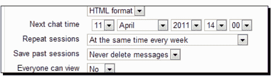

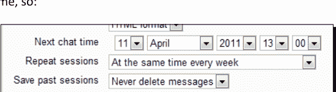

## What just happened?

我们刚刚指定了我们将要进行聊天的时段，但学生们怎么会知道呢？一种方法是查看课程首页上的 即将发生的事件 区块（通常位于课程主页面右侧）：

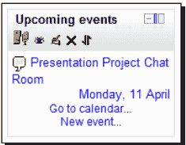

试着点击区块中的 Go to calendar... 链接。课程日历将被显示：

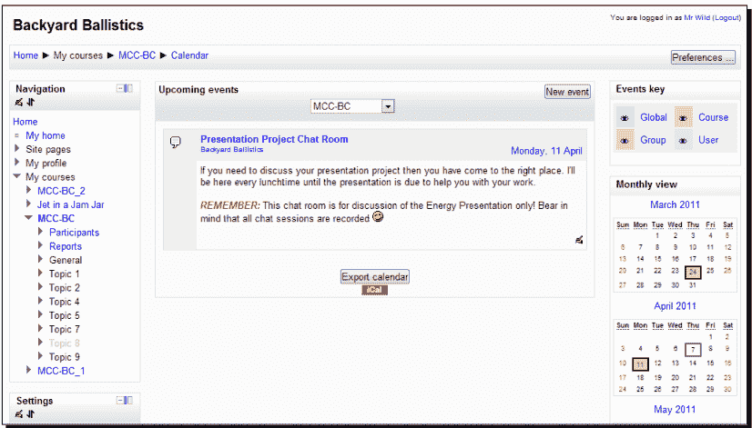

你可以看到课程日历是一个多么强大的工具。你可以添加新的事件，无论是提醒自己还是课程事件，在其中你可以让学生知道即将到来的考试。对于真正喜欢冒险的人，日历可以导出并上传到你的手机、iPad 或你选择的 PDA/平板设备。

你甚至可以在课程首页上显示一个迷你日历。我知道本章是关于沟通的，但因为我想让我的学生知道我何时会为聊天提供服务，现在是我想在我的课程中加入一个事件日历的时候了。让我们看看如何做到这一点。

## 在课程首页添加日历

将日历添加到你的课程首页完全是添加 Calendar 区块的问题：

## Time for action – 添加日历

- 1. 返回你的课程首页并在编辑模式下打开，点击 Blocks 区块中的 Add...。然后选择 Calendar：

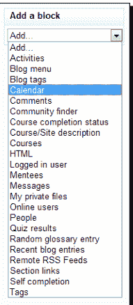

- 2. 日历现在已添加到你的课程首页。你可以通过使用移动图标来重新定位它：

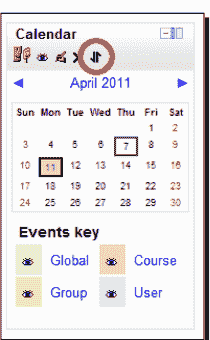

或者，如果你看到的不是箭头而是十字准线，则可以通过点击区块并拖动它。

- 3. 一旦你将日历放在想要的位置（我喜欢将 **Calendar** 区块和 **Upcoming events** 区块放在彼此旁边）那么你就完成了。

### What just happened?

日历是让学生知道课程上即将发生什么事情的绝佳工具，我们刚刚学习了如何将迷你日历添加到我们的课程首页。

日历上之前显示的课程事件（我能判断它是课程事件因为背景是粉红色的）是为了表明我将在下午 1:00 在海报展示聊天室。如果我将鼠标指针悬停在 7 月 7 日上，我会看到这个：

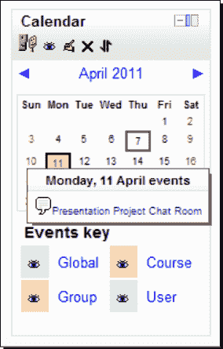

## Have a go hero – 日历事件

在 *Chapter 5, Moodle Makeover* 中，我们看到了如何将我们的项目和作业转换为 Moodle。记住你也可以指定 Moodle 作业的可用时间。配置 Available from 和 Due date。作业将被添加到你的日历中。

## 聊天室技巧和窍门

在我们离开聊天室之前，这里有一些在课程中使用聊天室的想法：

- 让学生加入聊天室，以便他们在见面之前互相认识并认识你。
- 使用隐藏的聊天室与同事举行关于课程的会议。
- 邀请嘉宾进入你的聊天室，也许是来自你当地学院或大学的专家。
- 你的学校“结对”了吗？也就是说，它是否与另一所学校（甚至可能是另一个国家的学校）有特殊联系？使用 Moodle 与结对学校进行聊天。我们曾使用聊天来分享 Backyard Ballistics 轶事！

我们将在本章剩余部分研究 Moodle 消息传递，Moodle 自带的消息系统。

## Moodle 消息传递

论坛和聊天主要是教学工具。另一方面，Moodle 消息是当你想要向学生发送消息时理想的课程管理工具。随着我们继续将课程转换为在线运行，我们在处理本节时将会发现，学生也可以相互发送消息，进一步支持协作工作。

请注意，我把这个主题的讨论留到本章末尾，因为通常 Moodle 消息传递是关闭的。在继续阅读之前，确实值得检查一下你的 Moodle 中是否启用了消息传递。

## 发送欢迎消息

我认为给所有新学生发送一条欢迎消息，感谢他们加入我的 Backyard Ballistics 课程是个好主意。让我们看看现在有多容易：

## Communicating Online

## Time for action – 向学生发送消息

- 1. 在 **Navigation** 区块中，在你的课程下，点击 **Participants**：
- 2. 在参与者列表下，按下 **Select All** 按钮。
- 3. 点击 **With selected users...** 下拉菜单并从列表中选择 **Send a message**：

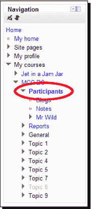

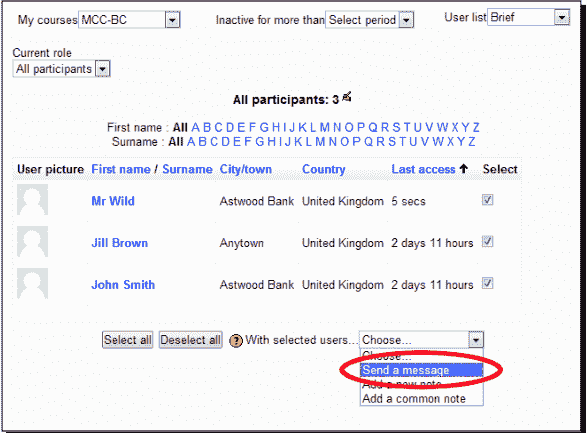

- 4. 在消息框中输入你的消息：

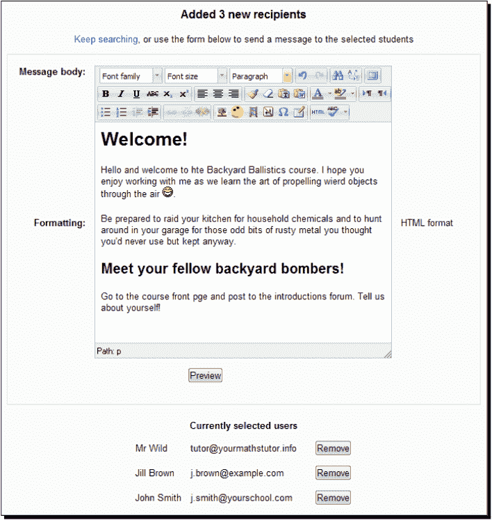

- 5. 查看页面底部的当前选定用户列表。你可以通过按下他们姓名旁边的 **Remove** 按钮来移除在上一屏幕中意外选择的用户。请注意，我故意将消息发送给自己。如果我的学生声称他们没有收到消息而我收到了，那么我知道这不是 Moodle 的问题。
- 6. 当你对消息满意时，按下 **Preview** 按钮。
- 7. 如果你想做更改，请按下 **Update** 按钮。如果满意则按下 **Send**。
- 8. 就这样。完成了！

## Communicating Online

## What just happened?

我们刚刚向所有学生发送了一条欢迎他们加入我们课程的消息。向学生发送消息很容易，你只需从课程参与者列表中选择你想要发送消息的学生。

## Are you getting the message

我怎么知道我有消息？如果有人给我发送消息，则在第一次登录时或，如果我已经登录，则每当收到新消息时都会出现弹出消息对话框：

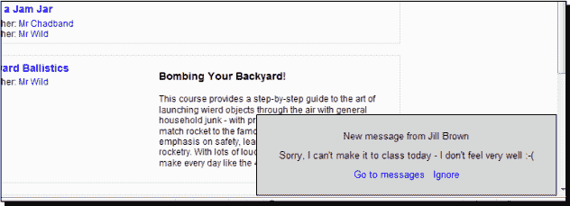

如果你可以，请在继续阅读前请同事或你的学生之一给你发送消息。

> **收到消息但看不到消息对话框？**
> 
> 那么很可能是弹出窗口被阻止了。请联系你的 IT 帮助台或技术人员寻求帮助。

我刚刚收到 Jill Brown 的消息。如果我点击 **Go to messages** 链接，我可以在 **Messages** 屏幕中看到我有一个传入联系人。我将点击 **Incoming contacts** 列表中的 Jill 的名字：

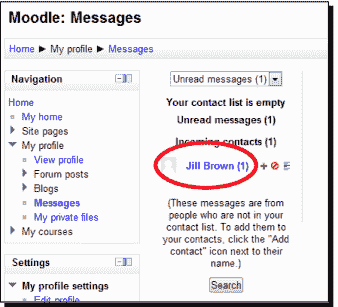

在下一个屏幕上，有一个框供我给吉尔回复消息：

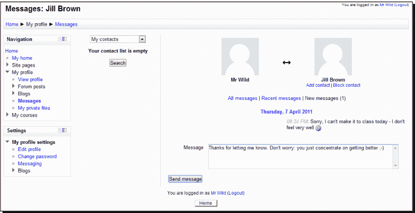

如果你在退出登录时收到消息，那么你也可能会收到一封电子邮件。默认设置是：如果你离线超过10分钟，Moodle 会向你发送一封电子邮件。你可以通过单击“设置”区块中的“消息”来更改此行为。下次你收到消息或使用消息功能时，可以查看一下设置，了解消息功能是如何配置的。你会看到你还可以：

-   输入一个专门用于 Moodle 消息的电子邮件地址。
-   使用 Jabber 聊天客户端接收消息，例如，在手机上接收消息时，你需要安装 Jabber（现在已更名为 XMPP）服务器，并将你的 Moodle 配置为与之通信，因此你可能还需要与你的 Moodle 管理员沟通。请让他们查看 Prosody IM（详情请参见 http://prosody.im），因为它是最紧凑且最容易安装的。
-   阻止不在你联系人列表中的用户发送的消息，以及除此之外的许多其他设置。

让参与者之间的消息传递更简单的一种方法是将“消息”区块添加到课程首页。让我们来看看具体怎么做：

## 刚才发生了什么？

我们刚刚将**消息**区块添加到课程首页，以使参与者之间的消息传递更加简便。学生可能不想在论坛上发帖或加入聊天室，但既然我们现在正将课程转换到 Moodle，我们希望学习者之间的沟通尽可能直接。

## 管理你的联系人

在最后这一部分中，我们将看看如何管理你的联系人，尤其是当你已将消息功能配置为阻止不在联系人列表中的用户发送的消息时。如果你已将**消息**区块添加到课程首页，那么现在请单击**消息...**。

## 操作时间 – 添加联系人

1.  在**导航**区块中，单击**个人资料**下的**消息**链接：

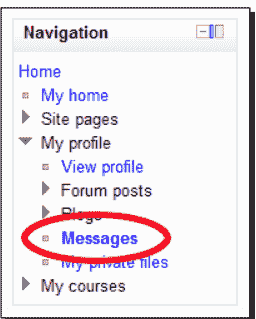

2.  你可以搜索用户，也可以列出你所注册课程中的参与者。我将使用**搜索人员和消息**选项，输入我想添加到联系人列表中的人的名字：

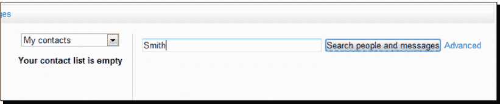

如需更多搜索选项，请单击“高级”链接。

3.  按下“搜索人员和消息”按钮。如果找到用户，他们将被列出。要将该用户添加到你的联系人列表，请单击“添加联系人”图标：

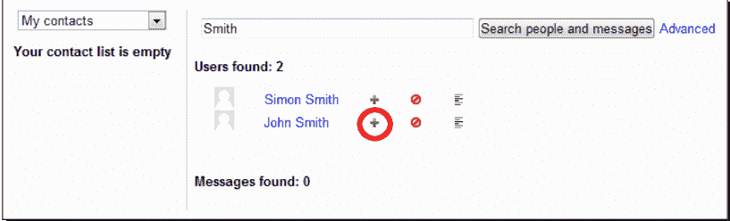

4.  现在，你的联系人列表中已经添加了一个新联系人：

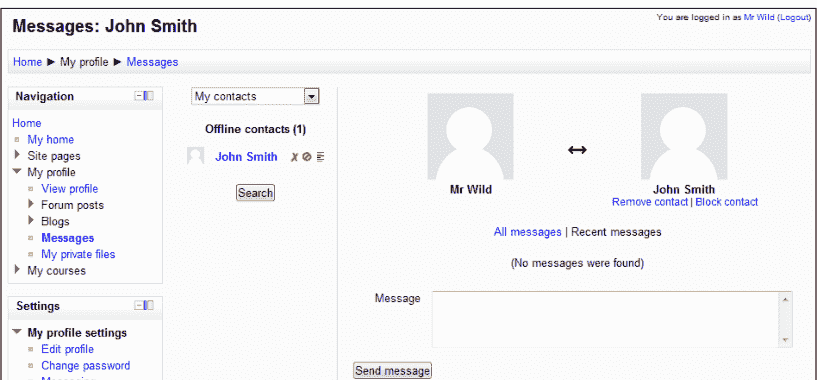

## 刚才发生了什么？

添加联系人很简单，只需搜索用户并单击“添加联系人”图标即可。你也可以通过单击“阻止联系人”图标来阻止联系人：

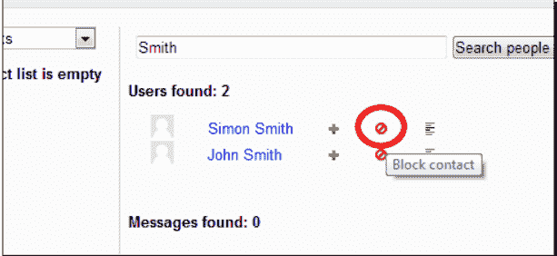

## 总结

在本章中，我们学到了很多关于在线交流的知识。如果我们要将课程转换到 Moodle，那么沟通和良好的沟通比以往任何时候都更加重要。你将无法使用在现实世界中与人交谈时通常使用的手势、表情和口头暗示。我们了解了如何将论坛和聊天室用作教学工具，以及将 Moodle 消息用作课程管理工具。

具体来说，我们涵盖了：

-   如何使用 Moodle 自带的即时消息系统（如 MSN）向 Moodle 课程添加聊天室。Moodle 聊天室允许学生在他们（或我们）不在教室时进行实时交谈。我们探讨了使用此活动的优缺点。
-   你可以宣布何时有空进行聊天，我们还学习了如何在课程首页添加迷你日历，以便学生轻松查看即将发生的课程相关事件。
-   如何使用论坛在网上进行辩论和讨论。我们了解到有四种不同类型的论坛，以及每种论坛如何支持不同类型的讨论。
-   如何将教职员工和学生的“信箱”转换为使用 Moodle 消息功能，以及如何向学生发送欢迎消息。

我们还讨论了如何让自己更容易被理解，特别研究了如何使用表情符号来表明你的真实意图。

现在我们已经了解了沟通，接下来准备深入研究如何利用其他 Moodle 活动（如测验和 wiki）来增强教学。我们将在下一章中介绍这些内容以及更多内容。
