## 8 增强你的教学

# 

> 在这个阶段，我相信你已经迫不及待地想尝试一些更高级的 Moodle 活动，而这正是我们将在本章中要做的事情。

在本章中，我们将：

-   学习如何创建 Moodle 测验。将你的测试转换到 Moodle，并让它们自动批改后返回给你！
-   将角色扮演和情景模拟转换为 Moodle 课程（Lesson）。
-   使用 workshop（互评）活动鼓励同伴评审，并帮助培养提供建设性批评的技能。
-   让学生使用 Moodle wiki 在线协作完成项目工作。
-   使用 Moodle 术语表创建在线多媒体词典。
-   使用 choice（投票/选择）活动将快问快答和快速民意调查转换到 Moodle。

你是否希望阻止学生访问某个活动或资源，直到他们完成某项前置任务？例如，我需要所有学生先同意一项健康与安全免责声明（以让我的保险公司满意），然后他们才能正式开始课程。我们可以通过 Moodle 的“条件活动”功能来实现这一点，在本章中我们将学习如何操作。

在本章中，我们有一些令人兴奋且有趣的工作要做。我们会遇到许多可以调整的配置设置——请记住：如果你不确定某个设置的作用，请单击该设置旁边的带问号的黄色圆圈。如果你对按下某个按钮或选择某个选项感到犹豫，请记住：你不会弄坏任何东西。尽管试试，看看会发生什么！

让我们直接开始全面了解 Moodle 测验...

## 测验

在我教授“后院弹道学”课程时，我经常一边上课一边向学生提问——以衡量他们的理解程度、强化特定学习目标相关的主题，或者仅仅是为了娱乐。然后我会安排一次最终测试，以确保我所教的内容已经被学生消化吸收。

那么，我为什么要把我的快问快答和最终测试转换到 Moodle 呢？因为这样做可以解决两个问题：

-   管理我的问题：
    我在 Word 文档中保存了一个问题库，每个我教授的科目都有一个。我还有其他的文档，其中包含学生为了我的课堂比赛而自己编写的问题：我经常把全班分成两个小组，让每个小组向另一个小组提问——而且学生的问题往往比我的问题更具挑战性和尖锐性！
-   批改测试：批改测验和测试占用了我的大量宝贵时间。

将测验转换到 Moodle 是一个两步过程。第一步是将我的问题上传到 Moodle。然后，一旦问题进入问题库，你就需要从问题库中将问题添加到你的测验中。

## 使用 Moodle 内置的问题编辑器

为什么包含测验需要两步？将问题保存在单独的问题库中有许多优点：

-   重复使用问题很容易。从问题库中选择问题意味着，如果我想提出某些问题以强化某个特定知识点，我可以在整个课程中重复使用同一个问题。
-   拥有问题库使与同事分享问题变得更加容易。

让我们先从向课程问题库添加一个简单的问题开始。最简单的是判断题（True/False）问题...

## 操作时间 – 向问题库添加问题

1.  在课程首页上，单击“设置”区块中的“问题库”。将显示你课程的问题库。
2.  单击“创建新问题”按钮，在“选择要添加的问题类型”对话框中，选择“判断题（True/False）”并按下“下一步”。

3. 给问题命名。

命名问题时要小心……
这个问题将存入题库。不要将它命名为“1”或“a”，因为我们现在还不会将此问题添加到测验中，也不知道它会出现在测验的哪个位置。我们需要给这个问题起一个对我们有意义的名称——如果我们日后选择共享问题，对同事也有意义。

4. 在“问题”文本框中，你需要写出要提出的问题。请注意我们正在使用 HTML 编辑器来编辑问题。这意味着我们可以运用到目前为止学到的所有思路和技巧，使问题文本更加有趣一些：

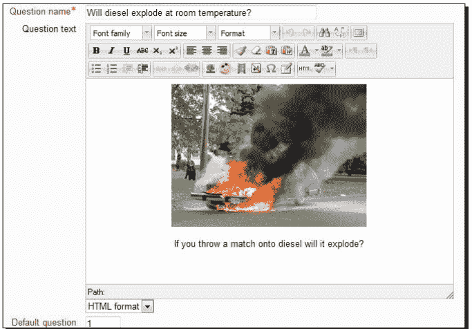

5. 向下滚动到“正确答案”设置，并指定你的问题的正确答案是对还是错。

这样足以配置一个判断题。我们可以忽略此页面上的其他设置，直接滚动到页面底部并点击“保存更改”按钮。但当我的学生回答这个问题时，我可能不在场，因此我想根据他们的答题表现给他们一些鼓励和指导。让我们添加一些反馈。

## 提升你的教学

+ 6. 向上滚动到**常规反馈**框。如果有一个学习目标或某个特定要点，无论学生答对还是答错，你都需要强调，那么就将其写在这里：

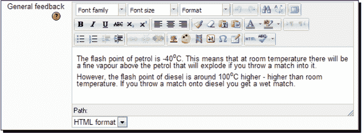

+ 7. 你也可以为正确或错误的答案指定反馈。

+ 8. 当你对反馈内容满意后，向下滚动到页面底部并点击**保存更改**按钮。你的新问题现在将出现在题库中。

## 刚才发生了什么？

我们刚刚看到了向题库添加问题是多么容易。然而，你可以想象，向题库添加大量问题可能会花费一些时间。

现在让我们看看可以添加到题库的其他类型的问题。判断题可能是你可以向学生提出的（在设置方面）最直接的问题。你还可以使用：

+ - **选择题**：学生从多个选项中选择一个答案。实际上，选择题有两种类型——单项选择和多项选择（参见 `http://docs.moodle.org/en/question/type/multichoice`）。
+ - **简答题**：学生用一个单词或短语作答。你需要使用通配符指定正确答案，以便 Moodle 能从学生键入的答案中识别出正确答案。更多信息请参阅 Moodle 文档（`http://docs.moodle.org/en/question/type/shortanswer`）。
+ - **数值题**：如果你提出的问题期望以数字作为答案（甚至包含单位），请选择此题型。你还可以指定该数字可接受的误差范围。更多信息请参见 `http://docs.moodle.org/en/question/type/numerical`。

+ - **描述**：实际上不是问题，而是一种分隔问题的方式——可能是在学生尝试一组问题之前提供一些文本/图形或视频演示。
+ - **计算题**（包括计算选择题和简单计算题）：计算题使用通配符，Moodle 会用“随机”数字替换这些通配符（不过你需要指定 Moodle 可从中选择的数字）。更多详情请访问 http://docs.moodle.org/en/question/type/calculated。
+ - **论述题**：学生的答案以文章格式呈现。如果你要给学生布置作业，那么（显然）应使用作业活动——参见*第 5 章，管理学生作业*。请注意，这些问题的答案需要手动评分。有关作业的更多信息，请参阅 http://docs.moodle.org/en/question/type/essay。
+ - **匹配题**：向学生展示若干问题，每个问题都有一个可能答案的下拉列表。学生必须为每个问题匹配正确的答案。更多详情请参阅 http://docs.moodle.org/20/en/Matching_question_type。
+ - **随机简答匹配题**：你可以从可用的简答题中（随机）选择多少道“子问题”。详情请参阅 http://docs.moodle.org/en/question/type/randomsamatch。
+ - **内嵌答案（完形填空）**：这是一种填空练习，但通过“计算机化”而得到了极大增强。Moodle 向用户显示一段包含内嵌问题的文本，学习者用他们的答案补全文本（详情请参阅 http://docs.moodle.org/en/question/type/multianswer）。

由于这是一本入门指南，我并未涵盖所有配置。不过，Moodle 文档中提供了更多细节（请查看之前提供的链接以及 http://docs.moodle.org/20/en/Question_types）。在 YouTube 上搜索也能找到大量演示如何配置 Moodle 问题的教学视频。最好自己尝试那些你认为可能有用的题型。

如果你有大量问题需要转换为 Moodle，那么有一些方法可以帮助完成转换：

+ - **导入问题**：这些可以是其他人为你创建的问题，或者你使用自己更熟悉的其他工具创建的问题。
+ - **共享问题**：同样是使用其他人编写的问题，但从你的 Moodle 站点其他部分共享而来。

让我们用本小节的剩余部分来看看这些替代方案。

## 导入问题

一次一个问题地输入题库可能是一个缓慢的过程。幸运的是，我们可以从其他来源导入问题。

我们如何知道哪些类型的文件可以导入？答案是点击“设置”版块中“题库”下的**导入**链接。

在“导入”页面上，你立即可以看到多种可以转换为 Moodle 的问题来源：

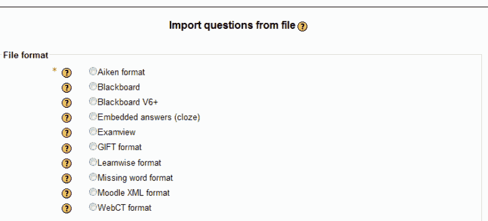

从列表中可以看到，如果你想从其他学习管理系统（例如 Blackboard 或 WebCT）转换问题，可以使用导入功能来完成。更多详情请参阅 Moodle 文档中的 <http://docs.moodle.org/en/question/import>。

## 管理问题

现在，我们已经开始将问题转换到 Moodle，那么我们需要简要提一下如何管理它们。Moodle 允许你对问题进行分类。这样做有什么好处？我的科学课同事正在编写关于化学反应和能量转化的问题，我很想在我的课程中使用。数学系有一批关于轨迹的问题，我可不想重新编写。同样，数学系和科学系也想在我的课程中使用我的问题。现在，我们都在转换到 Moodle，我们可以非常轻松地共享问题，这就是对问题进行分类的好处。让我们看看这有多简单：

## 动手实践 – 对问题进行分类

第一个任务是创建一个新类别：

+ 1. 返回课程“设置”版块，在**题库**下点击**类别**链接。
+ 2. 让我们为与燃烧化石燃料相关的问题创建一个新类别——我知道科学系对这些问题感兴趣。为你的新类别命名。
+ 3. 选择**父级**类别（你可能暂时还不需要担心这个）。例如，能量问题可能归类在“物理”下，而“物理”又归类在“科学”下。
+ 4. 虽然不是必须的，但请为你的类别提供一个有意义的描述。如果你决定与同事共享，这会使你的新类别对他们更友好。
+ 5. 当你对新类别的设置感到满意时，点击**添加类别**按钮。**编辑类别**页面将更新，以显示你的新类别及其在其他类别层级中的位置。例如，我的新类别的父级基本上是我的课程：
+ 6. 括号中的数字表示该类别中有多少问题。
+ 7. 点击课程“设置”版块中**题库**下的**问题**链接，以返回题库。要将问题移动到某个类别，你首先需要从**类别**下拉列表中选择包含该问题的类别。
+ 8. 点击要移动的问题旁边的复选框以选中它。

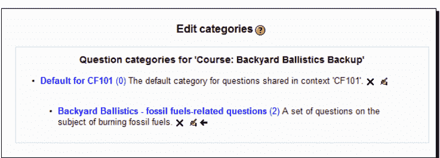

**9.** 选中问题后，我们想将其移动到新类别。从**移动到**下拉列表中选择您想要将问题移动到的类别：

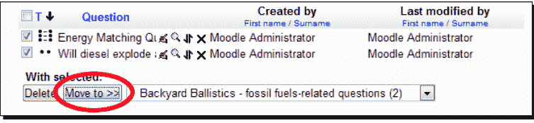

**10.** 按下**移动到 >>**按钮，将选中的问题（或问题组）移动到所选类别。

## 刚才发生了什么？

我们刚刚看到了如何管理题库中的问题。您可以使用类别来组织题库。但如何与其他课程共享类别呢？

默认情况下，教师只能看到自己课程题库中的问题。他们无法看到其他课程的题库，也无法在课程之间共享问题。如果您确实需要这样做，那么首先要与管理员沟通，请求他们提供课程外部共享的问题类别。更多信息请参阅本章末尾的*咨询管理员*部分。

以下是在我的 Moodle 站点上，Backyard Ballistics 课程在课程和课程类别结构中的位置：

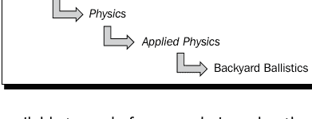

以下是我的管理员进行更改之前，我可用的类别：

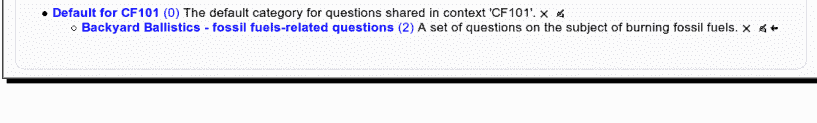

这是更改后的样子：

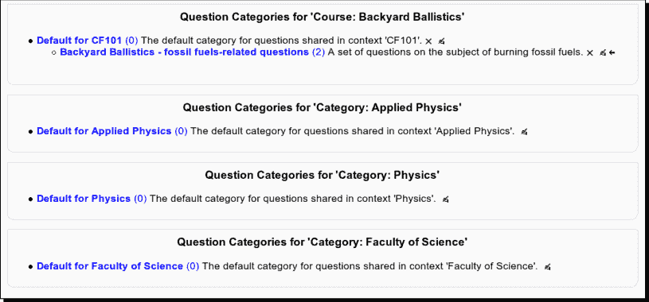

您可以看到，我现在可以访问整个理学院的题目了。

现在，我们已经向题库添加了题目，接下来可以在课程中引入一个 Moodle 测验，并开始为学生设置在线测试。

## 设置测试

一旦题库中有了一个或两个题目，或者您能够访问同事编写的题目，那么设置测试就很简单了。具体方法如下：

## 动手实践——向课程添加测验

- 1. 选择您要添加新测验的主题。确保已开启编辑模式，点击**添加活动…**并从列表中选择**测验**。
- 2. 为您的测验命名，如果需要，还可以编写简短的介绍。
- 3. 如果您想要一个限时测验，请勾选**常规**框中的**时间限制**设置。如果您有兴趣设置限时测验，但不确定任何设置，请记住，如果需要额外帮助，可以点击带有问号的黄色圆圈。
- 4. 按下**编辑测验**按钮。
- 5. 我们本可以研究很多设置。现在让我们开始操作，滚动到页面底部并按下**保存并显示**按钮。

- 6. 现在您会看到一个分屏视图：左侧是（空的）测验，右上角是课程题库的链接。

- 7. 点击“题库内容”旁边的[显示]链接。题库将显示出来：

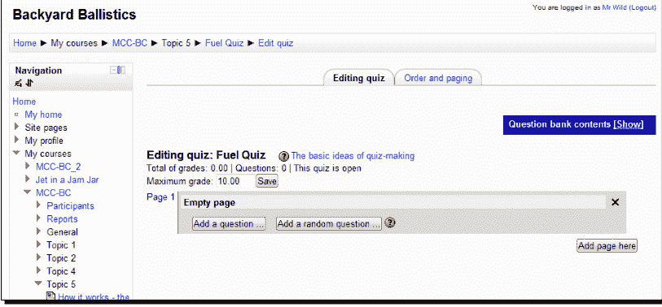

- 8. 从“选择类别”下拉列表中选择包含您想添加题目的类别。

- 9. 通过勾选来选择您要添加到测验中的题目，然后点击“添加到测验”按钮：

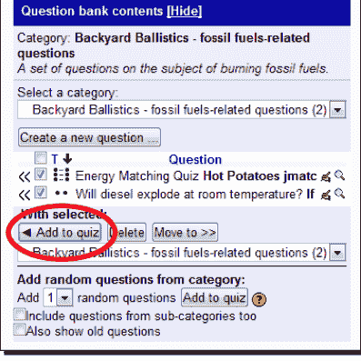

10. 您将看到该题目现在已包含在测验中，显示在页面左侧：

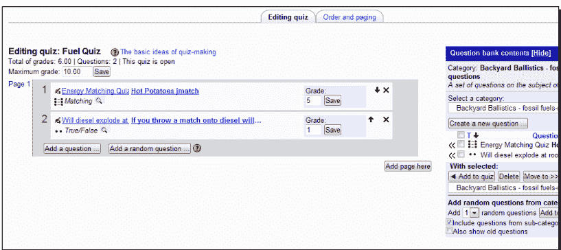

11. 向测验添加题目后，您可以使用设置区块中“测验管理”下的“预览”链接进行预览。

12. 就这样，完成了！

## 刚才发生了什么？

我们刚刚看到，向课程添加测验并从课程题库中引入题目是多么简单。如果管理员允许您访问同事的题目，您也可以轻松地将他们的题目添加到自己的测验中。

如果您想查看测验结果，请点击导航区块中的“结果”链接。您将看到所有提交记录的列表。

## 课件活动

教师通常认为这个活动是某种课程规划工具。实际上，Moodle 课件是一个用于创建“行动迷宫”的工具：它是探索场景和决策树、提出难题以及进行交互式案例研究的理想工具。

可以把课件想象成一种基于文本的冒险游戏，或者类似于上世纪80、90年代流行的《选择你的冒险之旅》丛书：你发现自己身处某个情境，需要决定下一步做什么——你在一个黑暗的地牢里。你是走左边的门吗？你要捡起那把血迹斑斑的斧头吗？你要从睡着的巨魔那里拿走那袋金币吗？

## 提升你的教学

这类场景通常出现在健康与安全培训中。想象一下，你看到一段视频：有人正在仓库里工作，她的同事把一个箱子撞到了她头上，把她打昏了。然后问你：这起事故谁负责——员工还是雇主？你的选择可能会引导你进入另一个视频，以及另一组决策或问题。作为用户，在探索场景时，我可以走多条路径之一，用Moodle的话说就是“分支”/“答案”。

## 构建 Moodle 课件

Moodle 课件基本上由一系列网页组成。在每个页面底部，你可以设置按钮或一个问题。根据按下的按钮，或你对问题的回答，你会被带到另一个网页。

> 我们一直在学习如何运用图形和多媒体使内容对学生更具吸引力和趣味性。我们完全可以在 Moodle 课件的页面中运用这些技巧。

## 为什么要包含课件

课件在课堂上的成功应用方式有很多。以下是我遇到过的几个成功转换为 Moodle 课件的课堂活动示例：

- “猜猜是谁？”游戏。让学生从故事中的多个角色里选择一个。计算机提出一系列问题来确定那个角色是谁。
- 探索场景。正如我们已描述的，课件是探索特定场景的理想方式：法律、科学、健康与安全等。
- 角色扮演。你是查理一世，个人统治时期已经开始。绅士们正在撰写小册子，反对你对坎特伯雷大主教的任命。你会：a) 屈服于他们的要求，更换大主教？b) 非常恼火，把他们的耳朵割掉？c) 无视他们，因为你是掌权者，所以无所谓？（事实上，查理割了他们的耳朵）。
- 医学诊断。给定一组症状，你能正确诊断疾病吗？作为医生，你能提出正确的问题吗？
- 虚拟游览。与你的学生一起创建战场或中世纪村庄的虚拟游览。全班共同创建 Moodle 课件可以分担制作所需的努力。

## 用课件支持课堂教学

除非你让全班同学帮忙（见前面提到的虚拟游览示例），否则一个有意义的课件活动可能需要花些时间来搭建。如果你花了一晚上精心构建一个详细的场景，然后看着学生几分钟就草草完成，确实会有点令人沮丧。

不过，可以考虑将课件作为集体活动，与全班一起探索想法。如果课堂上有投影仪或交互式白板，可以与学生们一起完成课件。这是确保不遗漏任何学习目标的比较简单的方法之一。

## 在课程中引入课件

不要将课件仅仅视为教学工具。我相信你们对课件活动有很多好主意。对我来说，我需要我的学生在加入我的课程之前，先阅读一系列健康与安全通知，并同意某些“条款与条件”。在本节的剩余部分，我将把这些书面材料转换到 Moodle 中。

## 配置课件

我将首先向课程首页添加一个课件，并配置基本设置：

### 动手实践——配置课件

- 1. 返回课程首页，选择一个要添加课件的主题，点击**添加活动...**并从列表中选择**课件**。
- 2. 为你的新课件命名。
- 3. 向下滚动，你会看到有很多可选选项。我现在不打算关注这些，而是直接向下滚动并按下**保存并返回课程**按钮。
- 4. 就这样。完成了！

## 刚才发生了什么？

我们刚刚配置了一个新课件（这相当简单，因为默认选项完全足以让我们入门）。但现在我有一个空的课件需要填充内容。

## 提升你的教学

## 添加内容页 – 页面底部带按钮的网页

我健康与安全通知的第一部分是三页，概述了我对学生的行为期望。让我们从一开始就把第一页转换过来。

## 行动时间 – 添加内容目录

1. 从课程首页点击你新课程的名称（不要点击更新图标，因为这会带你回到课程配置页面）。Moodle 现在询问我下一步想做什么。五个选择是：
   
   - **导入问题：** 这是将问题导入课程，而不是导入课程题库。两者是分开的。
   - **导入 PowerPoint：** 此时，教师会很兴奋。然而，导入 PowerPoint 演示文稿是一个繁琐的过程：将你的演示文稿转换为一组网页，将它们压缩成 ZIP 文件，上传到 Moodle，然后为你创建课程。随后，你会发现所有令人印象深刻的过渡和效果都丢失了。非常适合将简单的幻灯片集转换为 Moodle 课程，但并不那么高级。
   - **添加内容页：** 另一个命名不当的选项。实际上是添加一个网页，底部带按钮，让你选择下一步去哪个页面。
   - **添加集群：** Moodle 会从一组页面中随机选择——这是一种确保你的课程每次学生探索时都有趣且不同的好方法。
   - **添加问题页：** 这正是它所说的那样。你添加一个网页，并在底部配置一个问题。

我的健康与安全通知目前是一个 Word 文档。它以介绍页开始，我在那里设定基调。现在让我们把它转换到 Moodle：

2. 点击 **Add a content page**。

3. 为你的新页面指定一个标题并撰写页面内容。我将从原始 Word 文档中复制粘贴。我是通过 **Paste from Word** 按钮粘贴的。请记住，你可以轻松地在页面中包含图形和多媒体。

4. 这就是底部带按钮的页面类型，我现在需要指定按钮。向下滚动页面，直到到达 **Content** 框列表（在 **Add a content page** 框下方）。在这里，我们指定页面底部想要哪些按钮。这里又有另一个略显误导的配置选项：如果你在 **Content 1** 框中指定 **Description**，这实际上就变成了页面底部第一个按钮上的文字。所以：

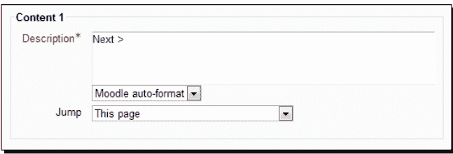

变成：

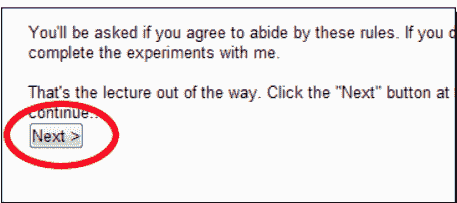

5. 不用担心指定按钮跳转到哪个页面（“Jump”设置）。最好先添加所有页面，然后再将它们连接起来。

6. 当你指定了所需的所有按钮后，按页面底部的 **Add a content page** 按钮。

7. 你的新内容页（即底部带按钮的网页）现在已添加到你的课程中。

## 提升你的教学

## 刚才发生了什么？

我刚刚添加了一个内容页——Moodle 所称的底部带按钮的网页。我将健康与安全通知的第一页转换到了 Moodle。要添加另一页，只需点击 **Add a page...** 下拉菜单并从列表中选择 **Add a content page**。转换了另外两页后，我的课程大纲如下：

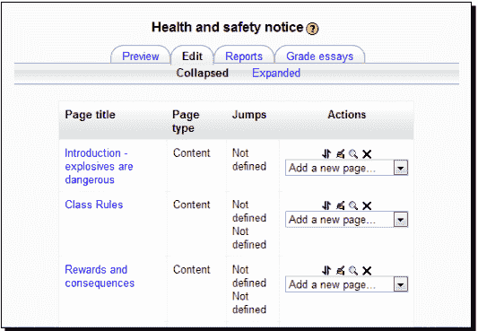

## 添加问题页

我纸质文件中的最后一页是学生必须同意规则的地方。对于这一页，我将添加一个问题页。过程大同小异，现在就做吧。

## 行动时间 — 插入问题页

1. 点击 **Add a page...**，这次在列表底部选择 **Question**。
   
2. 通过从下拉列表中选择来选择你想要添加的问题类型。我想添加一个 **True/false** 问题，所以：

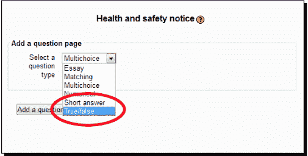

3. 无论问题类型如何，我们都需要为页面指定一个标题并提供一些内容。

4. 完成之后，我们需要配置页面底部出现的问题。对于我的 **True/False** 问题，这意味着提供两组答案和响应。请注意，我给“同意”响应分配了 1 分。你大概能猜到这稍后会很重要：

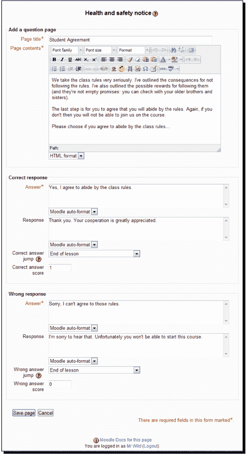

5. 就这样。你可以看到可以根据问题的回答跳转到不同的页面，但同样，我现在还不想担心这个问题。所以现在就到此为止。按页面底部的 **Save page** 按钮。

## 刚才发生了什么？

我刚刚向我的课程添加了一个简单的问题页，一个我要求学生确认他们同意遵守课堂规则的真/假问题。

到目前为止，我忽略了将页面连接起来。让我们现在学习如何做到这一点。

## 整合 – 链接课程页面

让我们返回课程编辑页面：

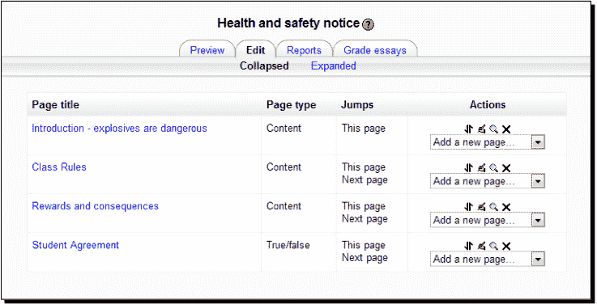

你可以在表格中看到我课程中包含的页面类型（**Page Type** 列）和它们链接到的页面（**Jumps** 列）。我希望我的课程安排如下：

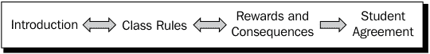

一个基本的线性安排，你可以在课程页面之间双向移动。在《课堂规则》页按 **Next** 会带你到《奖励与后果》。但点击 **Previous** 会带你回到《介绍》。只有当你到达《学生协议》时，我才希望你最终对我的课程做出承诺（或不承诺）。现在让我们让这些按钮跳转。

## 行动时间 – 配置页面跳转

1. 返回课程 **Edit** 选项卡。点击第一个页面的更新图标：

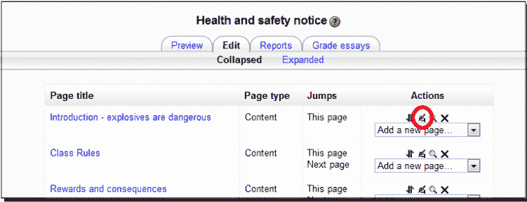

2. 向下滚动页面到 **Content** 框。我需要配置 **Next>** 按钮跳转到 **Class Rules** 页面。我点击 **Jump** 下拉菜单并从列表中选择 **Class Rules**：

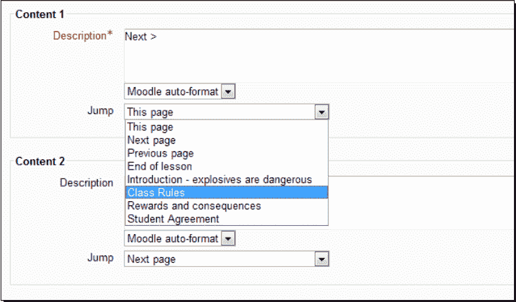

3. 向下滚动到页面底部并按 **Save page** 按钮。

## 提升你的教学

4. 课程已成功更新：

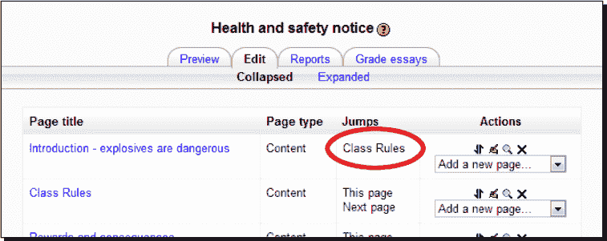

5. 我需要对 **Class Rules** 页面和 **Rewards and Consequences** 页面重复该过程。

6. 我不需要最后的 **Student Agreement** 页面再跳转到任何地方。从 **Jump** 页面列表中选择 **End of lesson** 选项：

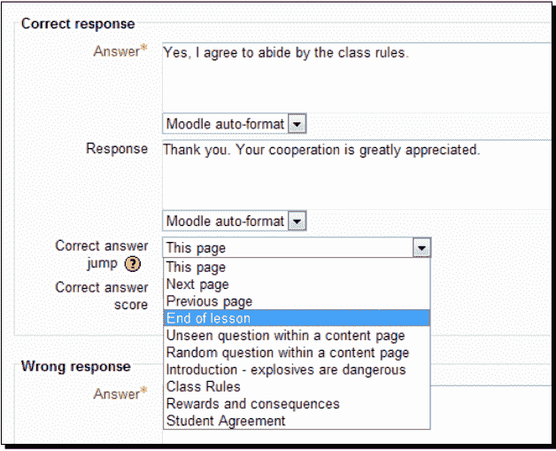

7. 就这样。我的所有页面跳转现在都已完全配置：

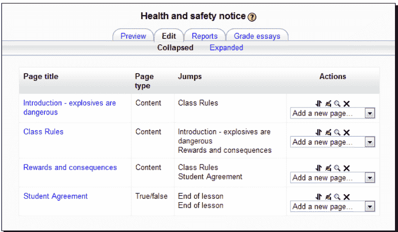

## 刚才发生了什么？

我刚刚配置了所有页面跳转，让学生能够在新转换的学生协议中导航。这就是全部：我已完成将健康与安全协议转换到 Moodle，并准备让学生逐步完成并同意遵守规则（我希望如此）。

> 如果你想测试你的课程是否配置正确，点击课程配置页面顶部的预览选项卡。

但我如何知道学生是否已阅读这份文件并做出了最终协议？让我们接下来看看这一点。

## 监控学生通过课程的进度

将我的纸质文件转换到 Moodle 意味着我可以非常轻松地检查学生是否同意了我制定的规则。从课程首页点击你课程的链接。点击报告选项卡。

你会看到课程尝试情况的细分。立刻，我就能看到学生是否同意遵守我的课程规则（他们在课程中得分为 100%）：

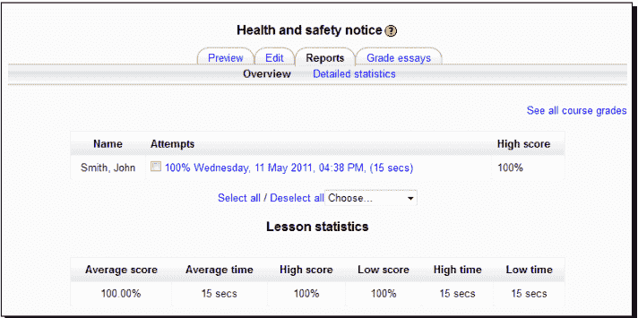

## 仔细规划你的 Moodle 课程

关于课程的最后一点：我相信你能看出，一个好的 Moodle 课程始终是基于一个好的计划而开发的。始终先草拟你的课程，不要试图有机地开发课程。我见过很多人尝试过，最终失败，然后得出结论 Moodle 课程太复杂而无法用于在线教学。计划要周全，不要过度复杂化，并确保始终牢记课程学习目标。

## 研讨会 – 同行评审和评估

研讨会活动对 Moodle 来说并不新鲜——在 Moodle 2.x 之前的版本中它默认是禁用的。话虽如此，如果你熟悉之前版本的 Moodle 研讨会，那么你会注意到外观和感觉上有不少改进。让我们花点时间简要了解一下。

什么是研讨会？Moodle 研讨会是一种同行评审活动。例如，我可以让学生通过 Moodle 提交项目作业以供同行评审，并使用 Moodle 记录班级成员对彼此作业的评论和建议。如果我愿意，我可以上传一个范例，让班级仅对该范例发表评论。我可以上传项目评审员的评论，然后学生可以将自己的评审与这些评论进行比较。正如你所能推断的，这是一个非常强大的工具。

正如我们很快会看到的，Moodle 研讨会活动支持三种评审类型：

- ♦ 评审上传的范例：学生可以评审范例并将其评审与参考评审（例如评审员的评论）进行比较

## 提升你的教学

- **同伴互评：** 学生互相评审彼此的作业。请注意，学生既可以根据其评审的质量获得评分，也会为其提交的作业获得评分
- **自我评估：** 用户可以评审自己的作业，并根据该评审的质量获得评分

> 请注意，这些类型的评审并非互斥。你可以启用这些选项的组合（或全部）。

我非常喜欢学生互相评论彼此作业的做法。这目前还不是教学大纲的一部分，但同伴互评正成为我教学中的重要组成部分——迄今为止，我一直通过论坛来支持这一做法。

### 行动时间 – 添加工作坊

1. 确保已开启编辑，并在课程的相关部分中，点击 **添加活动...** 下拉菜单并从列表中选择 **工作坊**。
2. 为活动命名，并在需要时提供介绍：

   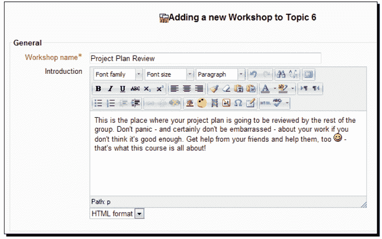

3. 在 **工作坊设置** 框中，你可以启用相关的同伴互评功能。我希望我的学生互相评审彼此的作业，因此我只会勾选 **学生可以评估他人的作业** 选项：

   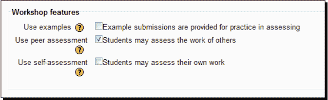

4. 我现在需要配置提交和评估选项。这就是我指定在学生上传作业供评审时以及他们进行评审时所给出的说明的地方：

   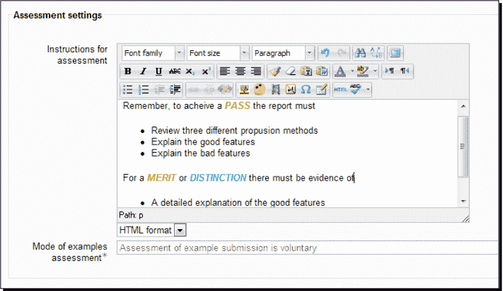

5. 滚动到页面底部并按下 **保存并显示** 按钮。**项目计划评审**（这就是我给它的名字）工作坊规划器将被显示：

### 发生了什么？

我们刚刚为同伴互评配置了一个 Moodle 工作坊。我忽略了相当多的设置，但它们都很容易理解，例如成绩设置——你可以在其中指定评审质量所获分数与上传作业所获分数之间的分配——以及访问控制选项——我们在其中配置可以上传作业的时间窗口、评审必须进行的时间等。

现在工作坊规划器已显示在屏幕上，你可以看到我已完成的任务以及仍需完成的任务。例如，我尚未完成设置阶段，因为我需要编辑评估表：

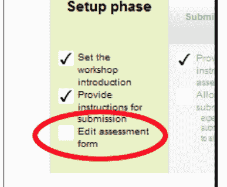

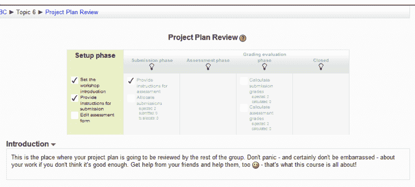

**编辑评估表** 这一文字是一个链接。点击该链接。现在我可以创建一个学生在评审彼此作业时填写的表单。创建后，可以预览此页面：

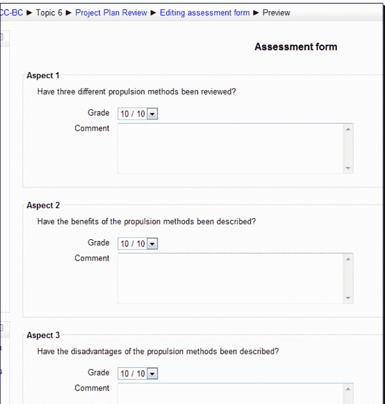

当你返回工作坊规划器页面时，你会发现编辑提交表单任务现在已被勾选：

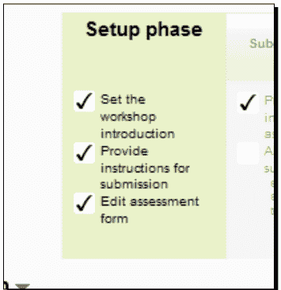

这意味着设置阶段现已完成。

现在我们准备进入提交阶段。我们需要在提交阶段列顶部的阶段切换图标上点击：

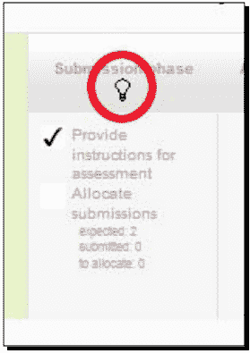

我们会被警告即将进入下一阶段——这正是我们想要的，因此点击继续按钮。你将被返回到工作坊规划器页面，其中提交阶段列现在已被高亮显示：

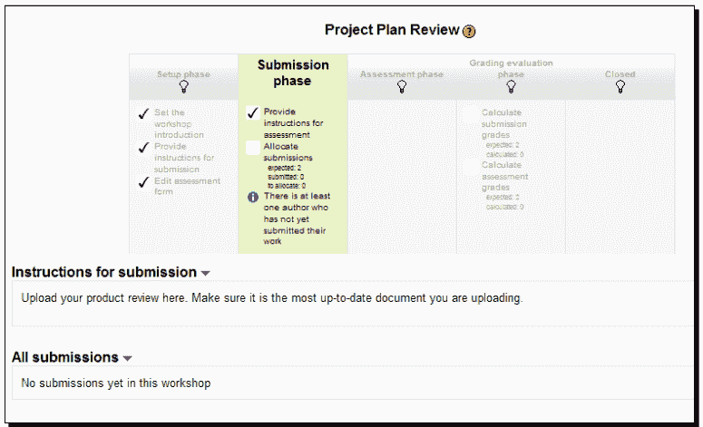

工作坊规划器不仅允许我们从一个阶段移动到另一个阶段，规划器对于快速查看哪些步骤已完成、哪些尚未完成也非常有用。例如，一旦学生开始上传作业，我就可以分配提交作业。这就是学生在上传提交作业时所看到的内容：

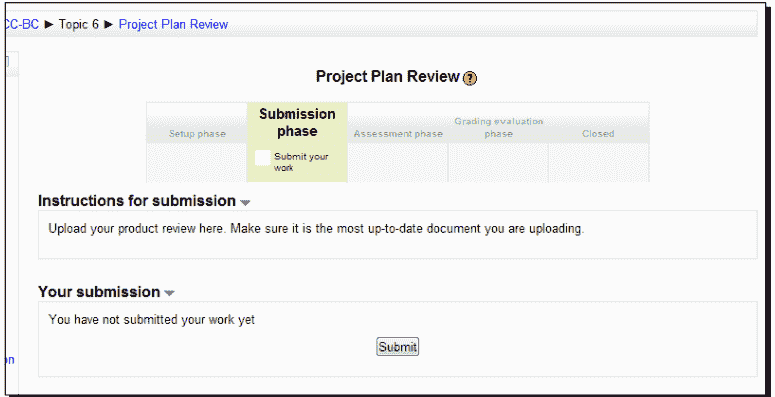

一旦作业已上传，我就可以将其分发以供评审。你需要在工作坊规划器中点击分配提交作业链接：

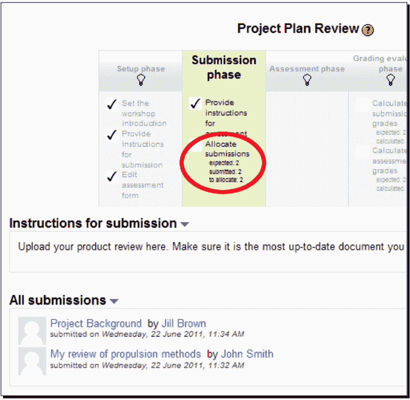

**提交说明**

在此处上传你的产品评审。确保它是最新版本的文档

**所有提交**

Jill Brown 的项目背景
于 2011 年 6 月 22 日星期三，上午 11:34 提交

John Smith 对推进方法的我的评审
于 2011 年 6 月 22 日星期三，上午 11:32 提交

作业分配可以是手动的也可以是随机的。你只需点击相关标签即可。

学生如何评审一份提交作业？他们需要点击 **工作坊活动** 的链接，然后他们将被呈现评估页面，其中包含他们需要评估的提交作业列表：

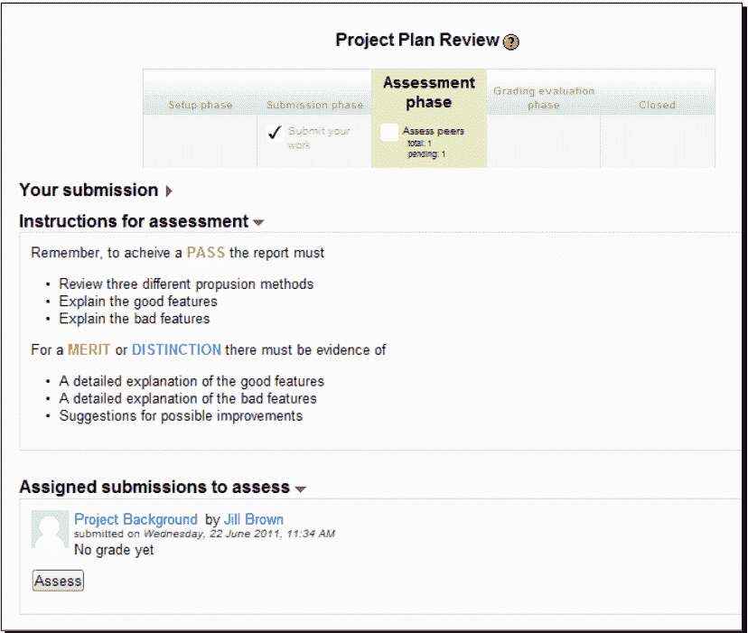

按下 **评估** 按钮后，他们就可以使用在设置阶段指定的标准（“方面”）进行评估。

一旦评估完成，我们就可以进入成绩评估阶段（请记住，你需要在工作坊规划器中点击 **成绩评估阶段** 列顶部的阶段切换图标）：

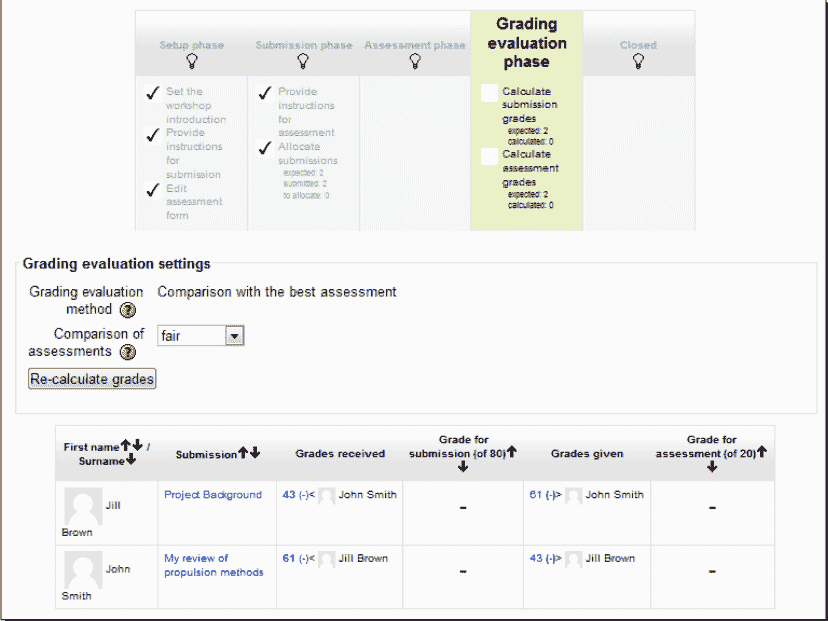

在 **已给出的成绩** 列中，我可以研究每个学生所给出的评审（可以说是评审的评审），如果我认为它们具有可比性和公平性，我可以点击 **重新计算成绩** 按钮来完成评分过程：

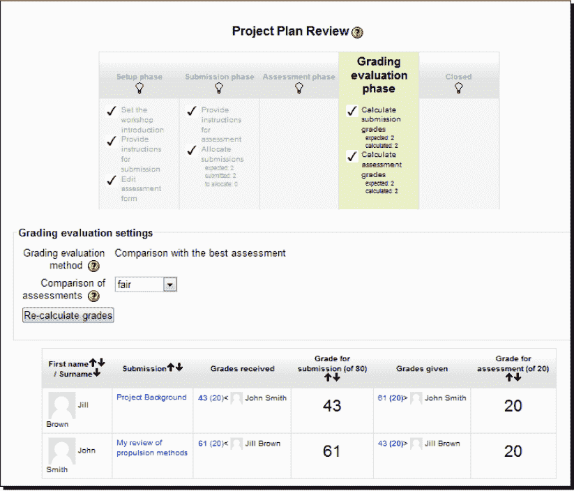

最后一步——表明工作坊已完成——是在规划器中点击已关闭列标题下方的阶段切换图标。

> 你可以通过点击工作坊规划器中的相关阶段切换图标随时在各个阶段之间切换（包括切换回之前的阶段）。

本节仅对这一功能强大的教学工具进行了最简要的概述。有关 Moodle 工作坊活动的更多信息，请参阅 Moodle 文档中的 `http://docs.moodle.org/20/en/Workshop_module`。

## Wiki

我在第 3 章《添加文档和讲义》中首次向你展示了 Moodle Wiki，当时我们看到你可以将部门文档转换为 Moodle。Wiki 是夏威夷语中“快速”的意思。人们经常听到 Wiki 这个词就认为 Wiki 必须是在线百科全书（对于这一点，维基百科要负很大责任）。但事实并非如此。Wiki 的设计目的是：

- 允许用户协作地在网页上工作，以及
- 快速创建网页（因此得名）

如果你要与其他人协作一个网页，那么必须有某种审计跟踪，以便你可以知道谁在何时做了什么更改。这不是问题：这样一个系统已经内置于 Moodle 的 Wiki 系统中。为了让你能够快速创建网页，Moodle 的 Wiki 系统为你提供了一种内置的格式语言。但不要因此而却步。正如本节所示，格式非常简单。

### 我的 Wiki 选项有哪些

即使 Moodle 内置了单一的 Wiki 系统，你也可以以两种不同的方式使用它：

1. 协作 Wiki。你只有一个 Wiki，所有人（教师和学生）一起在上面工作。
2. 个人 Wiki。每个学生都有自己的 Wiki，只有他们自己和教师可以查看和编辑。学生既不能查看也不能编辑彼此的 Wiki。

### Wiki 可以用来做什么

以下是 Wiki 在课程中使用的几个示例：

- 使用协作 Wiki 进行协作项目计划和项目撰写。
- 使用个人 Wiki 进行学生日记。
- 项目撰写，可使用协作或个人 Wiki。
- 网页链接列表。与其维护一个文本文档（每次更改都需要重新上传），不如将你的网页链接列表保存在 Wiki 中。
- 小说中的人物，由班级学生开发的群组 Wiki。

就管理维基而言，除了确保内容合适并且学生不会开始创建愚蠢的条目外，我们唯一需要注意的问题就是可能出现两名学生试图编辑同一篇维基页面而产生的拉锯战。可能会发生一名学生做出另一名学生不喜欢的更改，然后他们反复互相修改对方的工作，反复来回。这听起来很奇怪，但这种情况经常发生。

在我的课程中，到了最终的实践作业时，我班上的所有学生都必须在两周内完成他们的项目，并且在完成过程中需要填写一份学生记录。处理这些文书工作很尴尬：不幸的是，学生经常会弄丢它，而且如果他们没有弄丢，那么等到交上来时，记录表看起来就像被野狗撕咬过一样。我将使用一个学生维基将我课程的这一部分转换为 Moodle。让我们在这一节的剩余部分学习如何操作。

## 添加维基

第一个任务是向我们的课程中添加一个维基。因为我希望我的每个学生都有自己的维基（每个人都有自己的记录卡），所以我也知道这将是一个个人维基：

## 动手时间 – 添加维基

- 1. 选择你想要添加新维基的主题，点击 **Add an activity...** 并从列表中选择 **Wiki**。
- 2. 我新维基的名称将是 "Student Diary"。输入你的维基名称。
- 3. 写下维基的简要摘要。这会显示在每页上方。尽量保持简短且描述性。
- 4. 我将点击 **Type** 选项并从列表中选择 **Individual**。选择最适合你需求的维基类型。
- 5. 滚动到页面底部并按下 Save and return to course 按钮。你会在课程首页看到你的新维基：

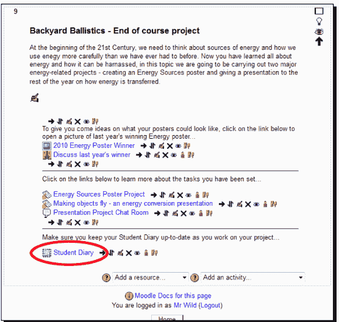

## 刚才发生了什么？

我现在有一个新的维基。如果我点击课程首页上的维基链接，我会看到一个创建新空白页面并为其命名的选项：

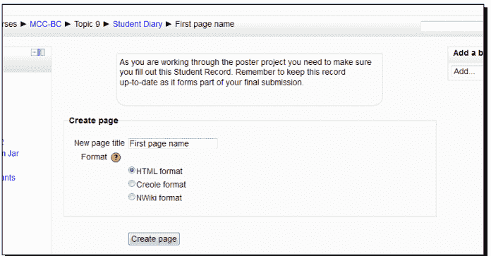

我将我的新页面命名为 "Student Diary Introduction"（而不是 "First page name"），将格式保留为默认的 HTML 格式，然后按下 Create page 按钮。

那么你如何开始编辑维基呢？

## 编辑维基页面

我们看到的页面基本上是维基的第一页。所有页面都将从这个“首页”链接。因此，有时最好将此初始页面视为目录页，并可能按此方式结构化。如何编辑它？只需像平常一样使用编辑器输入你想要的文本即可。

> 请记住，因为我们使用的是 Moodle 编辑器来编辑维基页面，所以你可以通过在本书中学习过程中获得的技能和经验，让维基页面变得引人入胜且有趣。

## 创建新页面

创建新的维基页面很容易——如果你知道方法的话。你是否有一段想要变成新页面链接的文本？只需用双方括号 [[ ]] 包围该词或文本，如下所示：

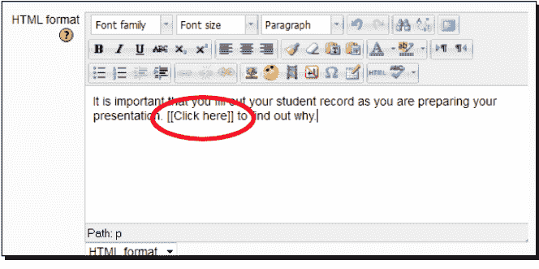

然后，点击编辑器正下方的 **Save** 按钮：

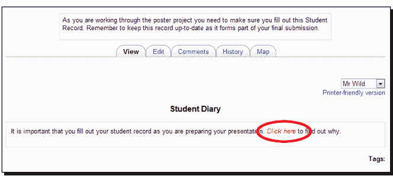

你可以看到我用方括号包围的短语现在被高亮显示了。这个高亮实际上是一个链接（将鼠标指针悬停在上面即可看到我的意思）。现在点击该链接。你会看到一个新页面即将创建。按下 **Create page** 按钮，你就可以开始向其中添加新内容了：

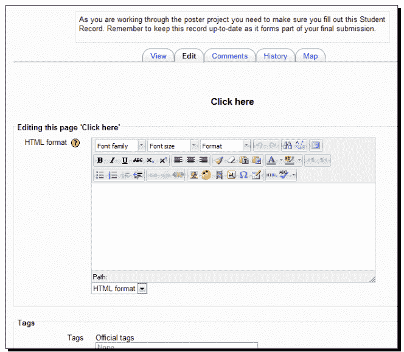

这就是创建新维基页面的简单方法。

## 查看页面的历史记录

如果维基页面很容易更改，并且我们足够勇敢让学生开始编辑它们，那么我们肯定想知道谁在更改它们以及何时更改。幸运的是，在 Moodle 维基系统中这不是问题：只需点击页面顶部的 History 选项卡即可查看完整的审计跟踪。

在历史页面中，你可以：

- 一目了然地看到谁在更改页面——以及他们何时进行更改
- 比较不同版本的页面（以查看发生了什么更改）
- 回滚到特定版本

我们已经了解到使用维基是多么容易，这很棒，但我仍然需要将我的学生记录表转换为 Moodle，为此我需要指定一个模板，让我的学生可以使用 Moodle 维基填写。我手头有原始文档的 Word 格式，所以现在让我们将其转换为 Moodle 维基模板。

## Have a go hero – 维基不仅仅是教学

请参阅第 3 章 Adding Document and Handouts，了解另一个维基创意。在该章节的结尾，我们看到了如何将部门文档转换为 Moodle 维基。通过这样做，不仅在线上使文档更容易供员工使用，作为维基也更容易修改文档。而且当你修改文档时，每页都有自己的审计跟踪，因此你可以轻松看到谁修改了文档以及何时修改。

## 术语表活动

我有一份与弹道学相关的术语表，我目前作为欢迎包的一部分提供给学生。这基本上是我多年前用 Microsoft Word 编写的、发给学生的纸张。幸运的是，我可以轻松将其转换为 Moodle。将术语表转换为 Moodle 的好处在于：

- 术语表条目可以远不止文本：你可以使用在本书中学习过程中获得的技能和经验来包含图形和嵌入多媒体。
- 学生可以向术语表添加条目。通过转换为 Moodle，我可以让创建和完善我的术语表成为一项班级活动。Moodle 通过允许我对术语表条目进行评分来进一步支持这一点。
- Moodle 可以配置为，只要我的课程中出现术语表中包含的任何单词或短语，该文本就会被高亮显示，我可以点击它，术语表条目就会显示出来。这称为术语表自动链接，我们将在本节后面查看如何设置它。
- 术语表可以导入和导出，这意味着它们易于与同事共享和开发。

术语表不一定只是课程相关技术术语的词典。以下是一些良好的 Moodle 术语表使用示例：

- 语言词典。例如，使用自动链接来高亮英语中的单词和短语，并用西班牙语翻译填充术语表。术语表条目可以包含该词翻译的嵌入式音频文件，然后可能跟上包含该词的上下文句子。
- 收藏网站术语表。另一种替代上传的 Word 文档或维基的方法是建立一个网站链接术语表。
- 测验问题。让你的学生添加包含他们编写的测验问题的术语表条目。这里的巧妙之处在于：你可以导出术语表，然后通过对导出的文件进行少量调整，将问题重新导入你的测验题库。
- 术语表解释学生在撰写作业时需要理解的术语的含义——例如，在撰写报告的上下文中，“interpret” 或 “demonstrate your understanding” 的含义。

让我们现在就开始将我的术语表转换为 Moodle。

## 添加术语表

添加术语表很容易。配置稍微微妙一些，但我会在过程中解释一切。我先提一下，你可以在课程中包含两种类型的术语表：

- **Main glossary**：每个课程只允许一个，学生不允许编辑它，只有教师可以编辑。
- **Secondary glossary**：你可以拥有任意多个，任何人都可以编辑它们。

为什么要有二级和主术语表？这样学生就可以向二级术语表添加内容，然后教师可以从中挑选最佳条目并将其包含在主术语表中。你不必以这种方式使用术语表：如果只想要一个基本术语表，那就坚持使用二级术语表。

解释完这些后，让我们现在在课程中添加一个二级术语表——一个任何人都可以编辑的术语表。

## 操作时间 – 包含术语表

1. 确保已开启编辑功能，选择要添加术语表的话题，点击“**添加活动...**”，然后从列表中选择“**术语表**”。

2. 你需要为术语表命名并描述其用途。我的术语表收录与弹道学相关的术语，帮助你在学习本课程时参考。在描述中，我还会提到所有人都可以向此术语表添加内容。

3. 其余术语表配置设置可以保留默认值，但如果你想尝试修改，请记住你不会破坏任何东西。对设置满意后，点击“**保存并显示**”按钮。你的新术语表现在就可以添加词条了：

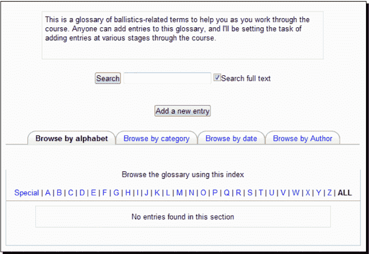

### 刚才发生了什么？

我们刚刚为课程添加了一个术语表——这是一个次级术语表，所有人都可以向其中添加词条，我还进行了配置，使所有人都可以对词条进行评分。

如何向术语表中添加词条？

## 操作时间 – 添加术语表词条

1. 点击“**添加新词条**”按钮。

2. 概念（Concept）是你想要解释的单词或短语。

3. 使用“**定义框**”给出你的解释。记住，你可以运用目前已学到的技能，将一个简单的术语表词条变成真正的多媒体体验。

4. 你是否希望这个特定词条自动链接，以便学生在课程中任何地方看到它时都可以点击并显示你的解释？如果是，请确保勾选“**此词条应自动链接**”。

5. 准备就绪后，滚动到页面底部，点击“**保存更改**”按钮。现在你的术语表中已经添加了一个新词条：

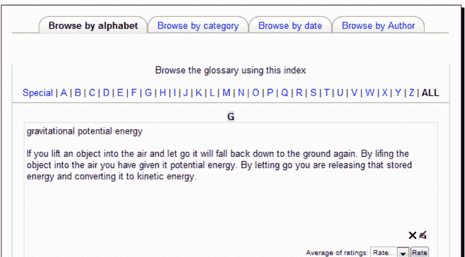

### 刚才发生了什么？

我们刚刚看到向术语表添加词条是多么容易。尽量保持术语表词条简明扼要。如果你的术语表词条开始变得复杂，超过几句话、一两张图片，或许还有一些嵌入式多媒体内容，那么建议改用 wiki。

## 术语表自动链接

当你添加第一个术语表词条时，是否为该词条启用了自动链接？如果一切正常，那么每当概念（代表术语表词条的单词或短语）出现在课程中时，它就会（默认）以浅灰色背景高亮显示：

> 当球飞向空中时，动能（KE）转化为重力势能（GPE）。当所有动能都转化为重力势能时，球在半空中短暂停留。

点击高亮文本，术语表词条将显示在弹出窗口中。

但在某些情况下，自动链接无法正常工作：

- 管理员尚未为你的站点启用术语表自动链接。如果遇到这种情况，请查看本章末尾的“*询问管理员*”部分。
- 自动链接不适用于外部网站上的文本以及上传文档中的文本。Moodle 并不了解这些文档内部的实际内容，因此无法将你的术语表与之链接。

## 术语表版块

如果你返回课程首页，并在开启编辑功能后，可以向课程首页添加一个新的“**随机术语表词条版块**”。该版块顾名思义，会从你指定的术语表中随机选择一个词条并显示出来。如果你的术语表包含励志名言、班级正在阅读的书中人物传记或图文词汇表，那么随机术语表词条版块会是一个有趣且富有吸引力的工具。

## 动手实践 – 允许学生评分词条

由于学生正在向此术语表添加词条，我打算允许他们对所有词条进行评分（我需要保持警惕，确保没有偏袒或特殊交易），最高“评分”为5分。

在“**设置**”版块的“**术语表管理**”下，点击“**编辑设置**”。在“**评分**”框中，选择一种聚合类型，然后确保“**量表**”为5分制。

要允许学生对词条评分，请点击“设置”版块中的“权限”，向下滚动到“评分词条”能力（列在“活动：术语表”下），然后点击“允许”图标：

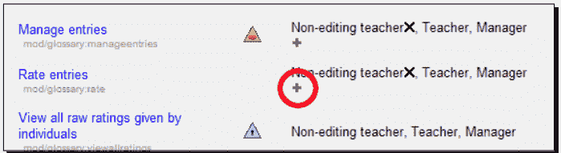

在下一页中，确保在“选择角色”下拉菜单中选择“学生”，然后点击“允许”按钮。

## 投票

一个简单、强大但经常被忽视的活动：投票活动。

我经常在课堂上使用民意测验来激发思考。例如：如果我在太空中点燃一支蜡烛，火焰会是什么形状？然后我在交互式白板上显示一系列选项。对每个选项进行投票，并花时间讨论每个答案。

将这样一个简单的活动转换到 Moodle 有什么好处？以下仅列举几点：

- 更容易记录哪个学生做出了哪个选择：民意测验中的投票可以是匿名的，也可以是记名的。
- 选项可以更新，允许学生在获得一点时间思考答案后改变主意。
- 很容易看出哪些学生完全没有回答这个问题。

那么我该如何将我的蜡烛问题转换到 Moodle 中呢？

## 操作时间 – 添加投票活动

1. 开启编辑功能后，选择一个话题，然后点击“添加活动...”并从列表中选择“投票”。

2. 给新活动命名。

3. 在“投票文本”框中输入问题。

4. 使用“**选项**”框指定你希望学生选择的可能答案。

5. 在“**杂项设置**”框中，你可以配置结果的显示方式、是否向学生显示结果，以及——如果向学生显示——是否匿名显示结果：

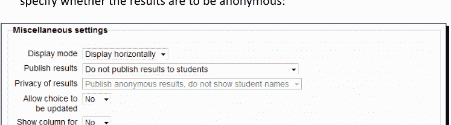

6. 完成后，点击页面底部的“**保存更改**”按钮。

### 刚才发生了什么？

我们刚刚通过投票活动向课程中添加了一个民意测验。我使用民意测验来激发思考。点击“**页面右上角的链接**”：

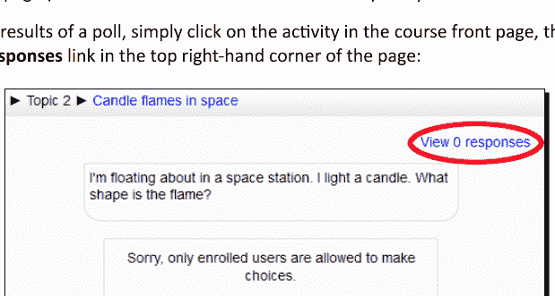

## 学习旅程

一门 Moodle 课程以指向其他资源的链接列表开头完全没问题，例如上传到 Moodle 的资源或互联网上已有的资源——事实上，我们这本书就是这样开始的。当我们想要加入测验、论坛或同伴互评工作坊时，就变得更为关键的是，我们要注意让学生形成一种更正式的“学习旅程”，而不是让学生随意从知识池中舀取自己喜欢的东西。我们如何知道学生已经查看了某个资源或尝试了某项活动？这就是完成跟踪功能的目的。我们如何引导学习者踏上他们的学习旅程？这就是条件活动的目的。完成跟踪和条件活动将在接下来的两个部分中描述。

## 完成跟踪

完成跟踪包含两个部分：

1. 完成一个资源或活动
2. 完成课程

让我们配置 Moodle 课程，使学生在认为自己已准备好继续学习下一个资源或活动时，可以将其标记为“已完成”。

> 在撰写本文时，完成跟踪功能默认是禁用的。你需要请求 Moodle 管理员为你启用此功能。请参阅本章末尾的“*询问管理员*”部分。

返回你的 Moodle 课程主页，在“**设置**”版块的“**课程管理**”下，点击“**编辑设置**”。向下滚动到“学生进度”部分。点击“**完成跟踪**”下拉菜单，从列表中选择“**启用，通过完成和活动设置控制**”：

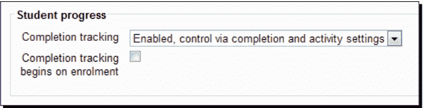

## 提升你的教学

我不会在我的课程中强制执行课程（而非活动——我们稍后会讲到）完成跟踪，简单来说；我的课程不是那种类型的课程。然而，确实有一些很好的例子说明你希望默认启用课程完成跟踪：其中一个就是工作场所学习（而非学校）中的任何 Moodle 课程。想象一下我的课程是关于手动搬运的——所有新员工都必须参加并通过的强制性课程……如果我们的学生已完成每个活动并通过完成跟踪功能表明他们已阅读并消化了每个静态资源，那么这就成为他们员工记录的重要组成部分。

滚动到《编辑课程设置》页面的底部并按下“保存更改”按钮。

在“设置”区块下，在“课程管理”中新增了一个链接：完成跟踪。现在点击它以显示《编辑课程完成设置》页面。

因为我不会从学生注册的那一刻起就强制他们使用完成跟踪功能，所以我将启用“手动自完成”功能：

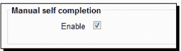

就此页面的内容到此为止。有关此页面上众多其他设置的更多信息，请记得查看 Moodle 文档 http://docs.moodle.org/20/en/course/completion。我将滚动到页面底部并按下“保存更改”按钮。

最后一步是在课程页面上添加“自完成”区块，因为如果没有它，课程完成跟踪就无法按我想要的方式完全启用。确保已打开编辑模式，然后从“添加一个区块”中从下拉列表中选择“自完成”：

添加后，我将把“完成跟踪”区块移动到页面的左侧，位于“导航”区块正下方：

这样学生就可以在 Moodle 中声明他们认为已完成课程。我们将在本章后面再次回到这个区块。但关于单个活动呢？这需要在每个活动的基础上进行配置。例如，我如何允许学生标记他们已阅读《能源来源》讲义？

### 动手时间 – 在活动上启用完成跟踪

1. 打开编辑模式后，点击《能源来源》链接旁边的“更新”图标。
2. 现在我们已在课程上启用了完成跟踪，可以滚动到 **活动完成** 部分：

   

3. 从“完成跟踪”下拉菜单中，我将选择 **学生可以手动将活动标记为已完成**：

   

4. 滚动到页面底部并按下“保存并返回课程”按钮。

5. 就这样！我们完成了。

### 刚才发生了什么？

现在我们已返回课程页面，将光标移至《能源来源》资源右侧，你会看到一个小灰色复选标记：

这就是从学生角度来看的完成跟踪。例如，一旦他认为已阅读，John Smith 就可以点击复选框：

我可以通过课程报告跟踪哪些学生已表明他们已阅读《能源来源》讲义。在“导航”区块下，在“我的课程”中，点击你的课程的简称并选择“报告”。然后，点击“活动完成”：

你会看到已注册学生的列表以及谁完成了哪个活动的指示：

查看活动完成报告下载选项（见上一个截图）。如果需要更详细地分析活动完成数据，例如在 Excel 中，这些选项非常有用。

### 自动活动完成

在我的课程中，我很乐意让学生自行表明他们已完成一个活动。我所在的学生群体动态是这样的，很快就会很明显有人没有做作业（主要是因为人数少）。那 Moodle 能否自动将活动标记为已完成呢？Moodle 可以自动将活动标记为已完成，但显然，你所定义的“完成”取决于活动。例如，对于我的《能源来源》讲义，Moodle 可以在学生查看过讲义时将活动记录为已完成：

然而，对于论坛活动，我们可以指定学生必须发帖的数量才能“完成”任务。我们还可以区分发起新讨论和回复其他帖子：

请注意，我们还可以指定完成截止日期，以真正让学生保持警惕。

与其尝试描述 Moodle 中所有可用资源和活动的大量不同完成选项，我将引导你查阅 Moodle 文档 http://docs.moodle.org/20/en/Teacher_documentation。

### 更多关于课程完成的信息

我已将课程配置为学生可以通过在 **自完成** 区块中点击 **完成课程** 来表明他们认为已完成课程：

点击该链接允许学生指定他们是否已完成课程（显示两个按钮，“是”和“否”）。但现在我开始在课程中的单个任务上配置活动完成（例如，阅读《能源来源》讲义和在论坛发帖），现在我可以根据需要配置自动课程完成。在 **设置** 区块下，在 **课程管理** 中，点击 **完成跟踪**。滚动到 **已完成的活动**，你将看到已启用活动完成的任务列表：

请注意，如果你在课程页面上保留“自完成”区块，学生仍可以记录他们已完成课程。

### 条件活动

当然，有指导的学习不仅仅是我们坚持要求学习者在尝试活动之前必须理解一个概念（例如，如果你不理解变化率，就没有必要学习微积分）。与我们在课堂上引导学生去做他们可能感兴趣的其他活动——或丰富他们当前理解的方式一样，我们也可以在 Moodle 中做到这一点。此外，不要一定把条件活动看作是课程活动的替代品。课程主要用于探索场景。条件活动是用于学习之旅。

那么，我们如何配置一个活动的访问以取决于完成另一个活动呢？首先，你必须确保你的 Moodle 已启用条件活动。查看本章末尾的“询问管理员”部分。假设我想确保学生在获得《从枪中发射子弹》链接的访问权限之前已阅读《能源来源》讲义：

我们可以基于成绩、日期或完成情况来控制对任务的访问。我希望确保《能源来源》讲义至少已被点击查看，因此我将基于学生已查看《能源来源》的情况来配置对《从枪中发射子弹》的访问。请注意，我需要在《能源来源》讲义上启用活动完成，才能执行下一步动手时间中概述的步骤。

### 动手时间 – 配置条件活动

1. 打开编辑模式后，点击《从枪中发射子弹》资源旁边的“更新”图标。

2. 向下滚动到**限制访问**部分（请注意，仅当您的 Moodle 中开启了条件活动功能时，此部分才可用）：

3. 从**活动完成条件**下拉菜单中，我将选择“能源来源”，其状态为“必须标记为完成”：

4. 滚动到页面底部，然后按**保存并返回课程**按钮。

5. 我们可以看到，对“从枪中发射子弹”资源的访问现在已受到限制：

## 刚刚发生了什么？

我刚刚将某个资源的访问权限配置为以查看另一个资源为条件。可以想象，配置条件活动的方式有无数种，所以我认为最好向您展示最简单的访问控制方式——也就是说，如果不尝试 B，就不能执行 A。

请注意，您可以配置多个条件——这意味着如果不尝试 X、Y 和 Z，就不能访问 A；或者 A 的成绩条件必须高于某个水平，并且您已尝试访问 B。

与所有旅程一样，建议您在开始在 Moodle 中配置学生的学习旅程之前，先规划好它。

## 动手实践英雄——仅在学习者同意规则后才允许访问资源和活动

阻止学习者访问资源和活动，直到他们同意班级规则，这是合理的。请尝试配置您的课程以实施这一限制。

## 询问管理员

在本节中，您将找到相关指导，了解在需要允许教师访问其 Moodle 课程之外题库中的问题、开启对词汇表自动链接的支持，以及启用完成跟踪和/或条件活动以呈现您的 Moodle 课程时，应向管理员询问什么。

## 允许教师访问其课程之外的问题

您的管理员需要在课程类别级别授予您教师角色。您的管理员需要：

+   1. 返回设置区块，在**站点管理**下点击**用户 | 权限 | 定义角色**。
+   2. 按**添加新角色**按钮。
+   3. 创建一个名为**共享问题用户**的新角色，该角色可在类别上下文中分配：

+   4. 向下滚动能力列表并允许：
+       - moodle/question:add
+       - moodle/question:useall
+       - moodle/question:usemine
+       - moodle/question:editall
+       - moodle/question:editmine
+       - moodle/question:viewall
+       - moodle/question:viewmine
+       - moodle/question:moveall
+       - moodle/question:movemine
+       - moodle/question:managecategory

## 总结

在本章中，我们学到了很多关于使用一些更高级的 Moodle 模块来增强教学的知识。

具体来说，我们涵盖了：

+   - 如何使用测验活动将测试转换为 Moodle 测验。我们了解到每门课程都有自己的题库，并且在课程中包含测验涉及将问题添加到题库，然后将题库中的问题添加到测验中。这样我们可以轻松复用问题——也可以轻松地与同事共享问题。
+   - 如何使用课程活动将角色扮演游戏、难题和情景转换为 Moodle。课程设置可能需要一些时间，因此通常最好使用它们来支持课堂教学。
+   - 允许学生使用 wiki 活动在线协作完成项目工作。我们看到了 wiki 系统如何使创建新页面变得快速而简单。我们还了解到您可以指定模板：如果学生需要填写表格并且您想提供指南，这会很有用。
+   - 使用词汇表活动设置在线多媒体词典。我们看到，我不仅可以将弹道学术语讲义转换为更有吸引力的内容，学生还可以在 Moodle 词汇表上共同协作，使我能够将其转变为一项教学活动。
+   - 如何使用选择活动将民意调查转换为 Moodle。通过转换为 Moodle，我可以更好地监控哪些学生积极参与课堂，以及哪些学生可能需要更多鼓励。

在此过程中，我们讨论了如何使用新磨练的技能使在线内容具有吸引力和趣味性——尤其是在配置本章中我们一直在学习的活动时。

既然我们已经了解了 Moodle 的更高级活动，我们就可以开始将它们整合起来——这是下一章的主题。
