## 9 整合起来

# 

*想想我们在前几章中一起涵盖的所有内容。*

*我们从第 2 章“设置课程”开始，学习如何配置 Moodle 课程以及如何为我们的教学材料做好准备。*

*在第 3 章“添加文档和讲义”中，我们开始了将教学材料转换为 Moodle 的过程，并了解到通过这样做，我们不仅可以更轻松地存储和管理这些材料，还看到了从课程首页向学生分发资源是多么容易。*

*在学习了如何在 Moodle 中分发作业之后，我们在附赠章节“通过 Moodle 提交作业”中了解了如何让学生通过 Moodle 轻松提交作业，这个主题我们在第 6 章“管理学生作业”中详细回归。*

*在第 4 章“声音与视觉——包含多媒体内容”和第 5 章“Moodle 改造”中，我们看到了如何使用图形、视频和音频使我们的 Moodle 课程更具吸引力和趣味性。*

*我们不仅可以将资源转换为 Moodle，还在第 6 章“管理学生作业”中了解到我们也可以在线管理学生作业。*

*我们还可以使用论坛和聊天将课堂讨论转换为 Moodle，并在第 7 章“在线交流”中探讨了这样做的一些好处。*

在上一章中，我们只看了 Moodle 提供的众多活动模块中的五个。我们将它们视为增强在线教学的好方法：

+   - 测验
+   - 用于探索情景的 Moodle 课程
+   - 用于同行评审的工作坊
+   - 用于协作工作的 Wiki
+   - 词汇表
+   - 选择

在本章中，我们将把所有这些整合起来，并研究构建已转换为 Moodle 的课程的可能方式。

在本章中，我们将回答一个关键问题：我接下来该往哪里去？我们将关注：

+   - 构建在线课程以支持面对面教学（所谓的“混合学习”）
+   - 将小组工作转换为 Moodle，如何在线管理小组
+   - 如何检查学生进度
+   - 确保我们不会丢失所有辛勤工作
+   - 如何备份和恢复课程。

有很多内容要涵盖，所以让我们先看看如何使用 Moodle 支持面对面学习。

## 使用 Moodle 进行混合学习

混合学习是指您使用在线资源和活动来支持面对面教学。在本节中，我们将学习如何使用到目前为止所学的技能和技术来实现这一点。

## 为什么采用混合学习

在这本书中，我们一直在一起合作，因为我一直在将我的“后院弹道学”课程转换为 Moodle。我另一个与学生一起开设的课程是为期两周的喷气发动机项目，最终以我们建造可工作的脉冲喷气发动机并维护/开发台式涡轮喷气发动机而告终。

我可能希望如何用 Moodle 支持该项目？嗯，通过转换为 Moodle，我可以：

+   在一个地方管理我所有的教学资源，并完全控制它们如何呈现给学生（第 3 章“添加文档和讲义”、第 4 章“声音与视觉——包含多媒体内容”和第 5 章“Moodle 改造”）

+   使用我们在第 7 章“在线交流”中体验过的在线交流技能鼓励讨论和辩论

我的喷气发动机课程的学生在课程开始前彼此不认识。Moodle 提供了理想的介绍方式（我可以在他们报名参加课程时在 Moodle 上注册他们），也是他们在面对面课程结束后进行交流的好方法。

因为我们在一起的时间很短，他们可以使用第 7 章“在线交流”（论坛和聊天）以及附赠章节“通过 Moodle 提交作业”和第 6 章“管理学生作业”（我们学习了如何管理学生作业）来获得关于他们为获得最终证书而必须开展的项目工作的指导和支持。

我已经和我的 Moodle 管理员谈过为我创建一个新课程；她已经完成了这件事，现在我可以开始转换了。

## 构建您的课程——修改课程设置

第一项任务是调整课程设置，以适应我们即将开设的课程。我的管理员基本上只是将新课程添加到科学学院类别中，并让我成为教师。这意味着在我开始上传资源之前，还有一些设置工作要做。

## 行动时间——新课程快速配置

+   1. 转到您的课程首页。在课程设置区块中，在管理区块下点击编辑设置。

+   2. 为您的新课程设置一个名称和一个简称。请记住简称必须是唯一的。

> 您是否与同事讨论过课程简称的命名约定？如果没有，那么这可能是个好主意。有约定将使学生在您的 Moodle 站点中导航更容易。如果您的管理员将来希望自动将学生选入课程，这也会更容易。

### 3. 为新课程撰写一段简介。尽量让它吸引人，这是学生在正式选课之前最先看到的内容。不要写得过于花哨，你知道如何使用 Moodle 编辑器，也知道如果愿意，可以在课程摘要中加入图形、音频和视频。尽量克制不要在课程摘要中过度使用这些技术，否则学生在浏览我们课程分类中的课程列表时会感到厌烦。我加入了一个动画 GIF，但我调整了布局，让它显示在摘要的右侧：

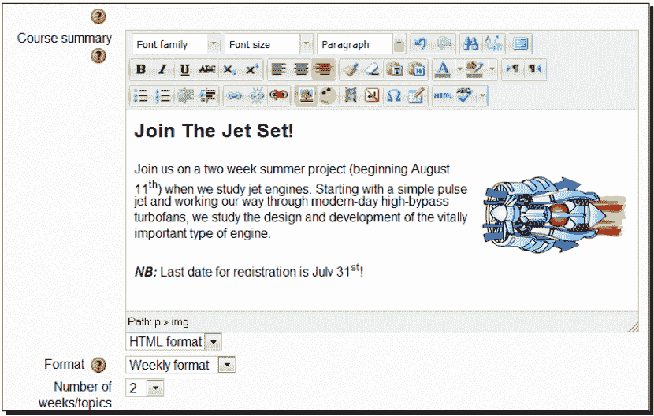

当我的课程出现在该分类的课程列表中时，图片位于右侧可以使课程列表更容易阅读。

4. 设置课程格式。我的课程是一个为期两周的课程，从八月开始。我将按此进行相应配置：

**注意：** 注册截止日期是7月31日！

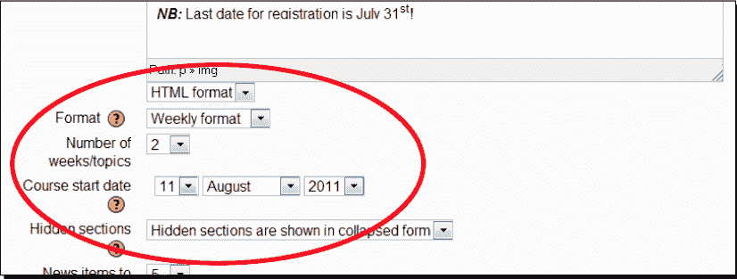

5. 滚动到页面底部，点击**保存更改**按钮。这样课程就按我的需求设置好了，以下是我的新课程与其它课程一起在网站首页上的显示方式：

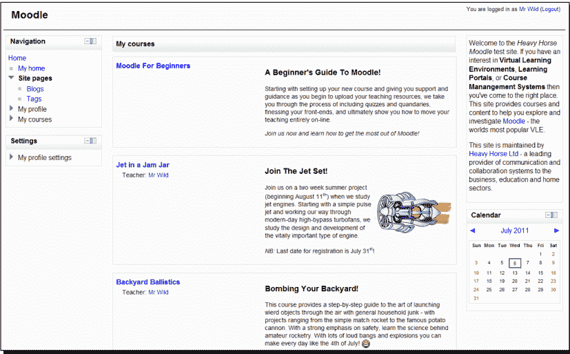

6. 接下来，我需要指定一个选课密钥。返回课程，在“课程管理”下的“设置”板块中，点击“用户”，然后点击“选课方法”：

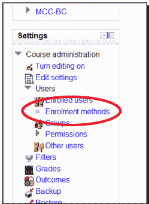

7. 确保“自助选课（学生）”已启用（点击它），然后点击编辑图标：

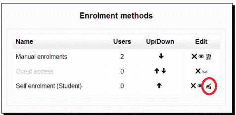

8. 指定一个选课密钥：

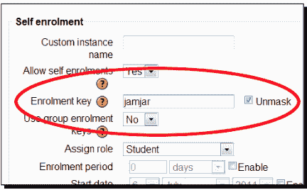

9. 滚动到页面底部，点击**保存更改**按钮。

10. 完成了！搞定！

## 刚才发生了什么？

我已经设置好了我的新课程，准备开始上传资源。我为课程添加了一段简短摘要，保留了每周格式，但将其缩短为两周。我还指定了一个选课密钥，这样新学生就无法进入。我没有对学生隐藏这门课程：我本可以这样做，但我想让学生知道课程已经存在（阻止他们进入的是他们不知道选课密钥）。我想让学生对这门课程产生兴趣。

## 介绍你的课程

我们在*第2章 设置你的课程*中看到，将“**常规摘要**”（Moodle 对课程页面最顶部区域的称呼）打造成一个学生可以了解课程以及相互了解的地方是一个好主意。

请参阅*第4章 声音与视觉——包含多媒体内容*，我们在其中使用`Slide.com`创建了一个照片蒙太奇（参见使用`Slide.com`的幻灯片展示）。我有很多往年运行这个项目时拍摄的照片。我已将这些照片上传到`Slide.com`，并打算在“常规摘要”中包含一个`Slide.com`幻灯片展示，这样我的新学生就能知道他们将参与什么：

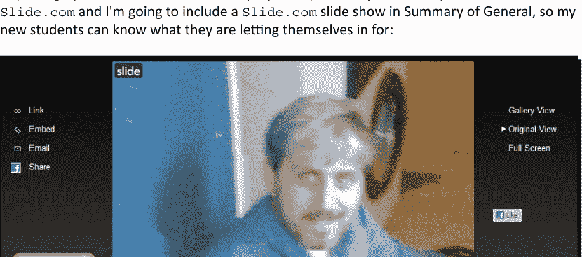

## 整合在一起

我还打算添加一个“介绍”论坛（参见*第7章 在线交流*），这样在成员们第一次见面之前，小组的所有成员都有机会相互了解（也了解我）。仅仅三十分钟后（我知道，因为我计时了），使用我们在本书中学到的所有技巧来创建我的“常规摘要”，我的课程现在（对学生而言）是这样的：

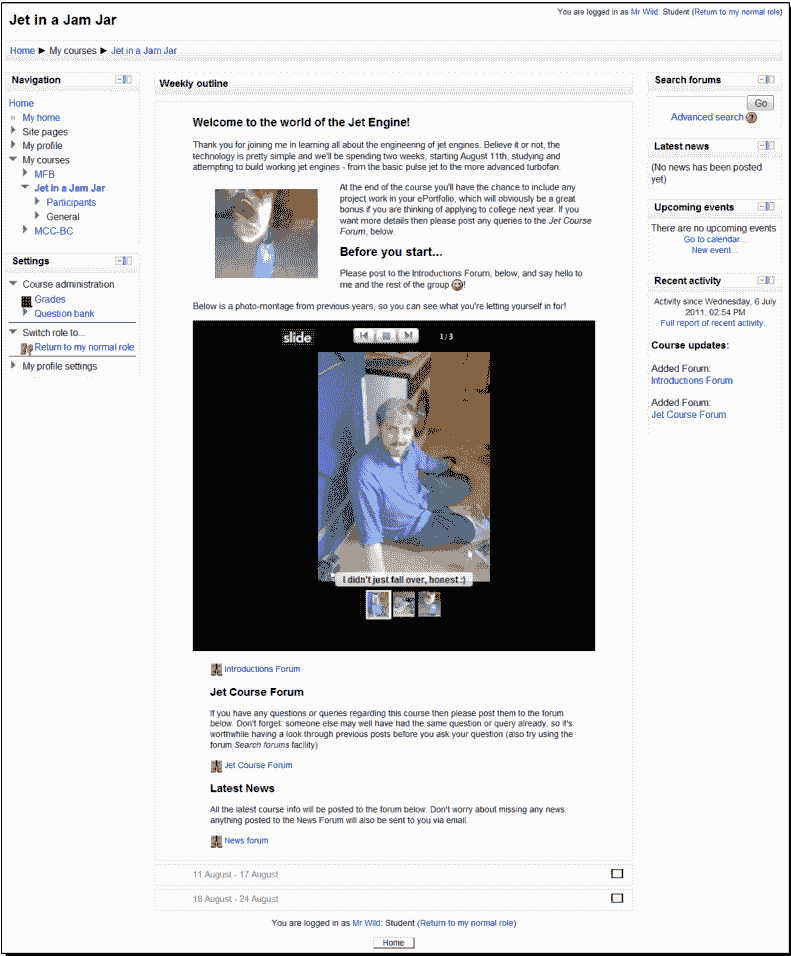

## 快速测验——使用标签

还记得我们在*第5章 Moodle 改造*中讨论过如何使用标签吗？我们看到标签是将课程粘合在一起的胶水。你能看出我在“常规摘要”中哪里使用了标签吗？

## 使用多媒体分享服务

我在前面的示例中使用了`slide.com`，但当然，还有许多其它在线分享网站可以分享各种类型和形式的多媒体内容。想一想使用 Google Picasa、Flickr 和 YouTube 等服务的可能性。请记住，要确保你选择的服务实际上可供你的学生使用。例如，学生通常被禁止访问 YouTube，即使教职员工可以访问。请参阅*第4章 声音与视觉——包含多媒体内容*，获取有关在课程中包含多媒体的更多建议。

## 安排活动

让我们看看我如何安排第1周（我将以大致相同的方式安排第2周）。让我们从在线活动开始，先向学生提一个简单的问题来测试他们的理解，给他们一个选择。我们在*第8章 提升你的教学*中看到了如何包含和配置“选择”活动。我的问题是：“液体必须高度易燃才能爆炸吗？”以下是我创建的“选择”活动：

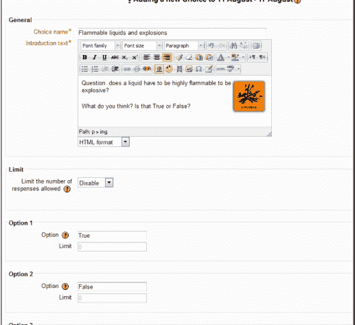

## 动手实践——将填字游戏转换为 Moodle

1. 首先，使用 JCross 创建你的填字游戏：

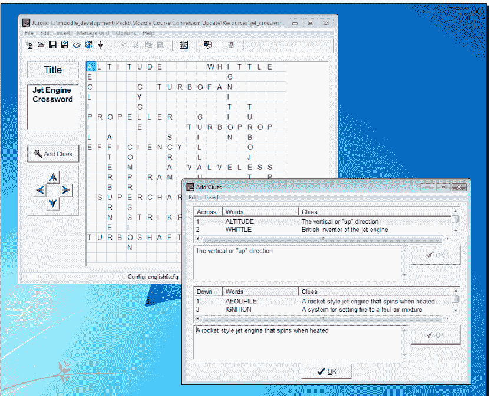

2. 接下来，我们需要将填字游戏导出为 SCORM 活动。从 JCross 主菜单中选择“文件”，然后向下滑动到“创建 Scorm 1.2 包”。

3. 回到你的 Moodle 课程中，在正确的周次，我需要点击“添加活动...”下拉菜单，然后选择“SCORM 包”。

4. 在**常规**框中，为活动指定名称和描述，然后选择我们刚刚创建的 SCORM 包文件：

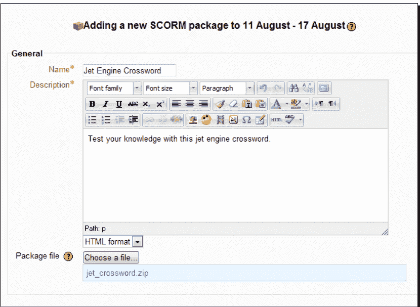

5. 滚动到**其它设置**，然后点击**显示高级**按钮。我将在一个新窗口中显示填字游戏，并允许调整该窗口的大小。

6. 滚动到页面底部，点击**保存并显示**按钮。

7. 以下是我的填字游戏转换为 Moodle 后的样子：

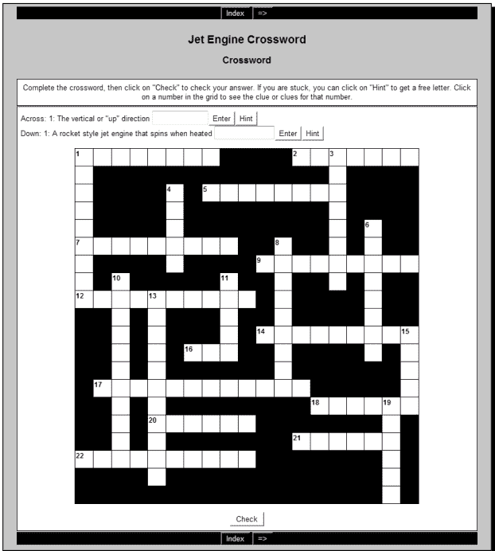

### 刚才发生了什么？

我们刚刚跟随了我将我的“喷气发动机填字游戏”转换为 Moodle 的过程。这样做的好处如下：

- 我不必担心收集纸张、保管它们、批改它们，然后再把它们发还回去
- 填字游戏会自动评分
- 通过课程管理板块中的**成绩**，我可以一目了然地看到谁尝试了填字游戏以及他们表现如何（本章后半部分有更多关于课程成绩册的内容）

## 整合在一起

现在我的学生已经开始思考与喷气发动机相关的技术术语（如果你以前没接触过，很多术语相当复杂），他们可以一起创建一个在线词汇表。让我们添加一个次级词汇表，我将允许对词汇表条目进行评论，并允许学生对条目进行评分（满分5分）：

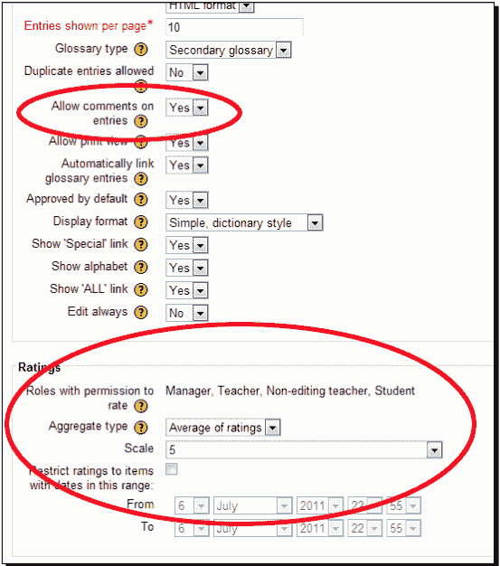

请注意，我通过“词汇表管理”下的“设置”板块中的“权限”屏幕，允许学生对词汇表中的条目进行评分。

我们将从空词汇表开始，这样我们可以在第1周一起进行时逐步填充它。

我还希望我们一起制作一个脉冲喷气发动机 Wiki，这可以作为学生电子档案袋的一部分。我已经有了一个他们可以遵循的文档结构，所以我将按照*第8章 提升你的教学*中的说明，这次创建一个“小组 Wiki”，同时指定一个起始页面，以便学生有结构可循（这对他们的电子档案袋很重要）。

最后，由于这是一门我使用 Moodle 支持的相当实践性的课程，我想给学生一个上传照片的机会。目前他们把 USB 记忆棒、数码相机的存储卡交给我，或者，如果我们特别有冒险精神，他们会尝试通过蓝牙把图像文件发给我。让我们用“作业”把这件事转换成 Moodle。实际上，让我们使用我们在*第6章 管理学生作业*中第一次遇到的“高级文件上传”作业。其优点是：

- 如果学生有任何想给我的照片，他们可以直接上传到 Moodle
- 我可以管理每个学生上传了多少张照片，并轻松检查谁没有上传任何照片

但最重要的是：

- 我不必费心去弄明白如何使用他们的手机

目前，这就是我的“喷气发动机”课程中我想转换为 Moodle 的全部内容，所以我们先到这里，看看目前我的第1周的样子：

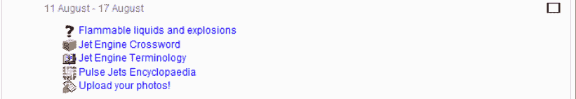

## 综合应用

这里缺少的是一个总结，以及向学生说明这些活动如何组合在一起的某种指示。让我们使用第5章《Moodle 改造》中的一些标签和技巧来优化我们的 HTML：

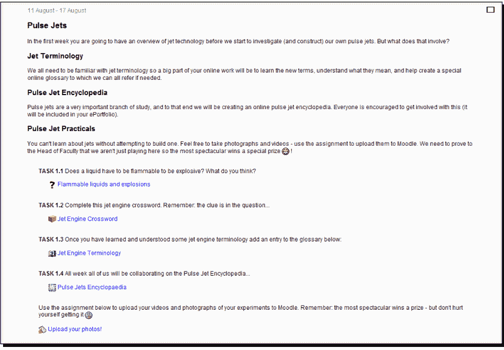

Moodle 的理念表明，学习者可以按照自己的选择在任何资源与活动之间自由漫步（或“moodle”）。然而，我想管理我的学生如何完成课程第一周的学习。最简单的方法是隐藏所有内容，然后按照我希望学生去做的顺序来展示。但请记住，在Moodle中，我可以让活动的访问取决于其他活动是否已完成，尽管这可能过于复杂。这种方法也可能与Moodle的基本教学法相矛盾，但我遇到了三个重要的理由来解释为什么你需要控制对作业的访问：

- 防止学生因看到未来将要学习的困难内容而感到焦虑
- 避免被问到尚未讲授过的话题
- 避免解答家长的疑问，他们查看课程是为了了解自己的孩子将要学习什么（听起来很奇怪，但我多次遇到过这个问题）

从上面的截图可以看出，实际上我并没有这样做。我给自己Moodle课程中的所有任务都编了号（1.1、1.2，等等），这样在与学生互动时就可以引用这些编号。

在本章的这一部分中，你看到的全部工作只花了一个多小时。开始转换到Moodle并不需要很长时间。这些工作我本来都不必使用Moodle（到目前为止我也没使用过）。但是，希望你能够看到，只需将课程中的几个方面转换到Moodle，我就能让自己的生活更轻松，同时让学生的学习体验更有趣。本章末尾还有更多关于转换到Moodle的建议。

## 转换为全在线课程

到目前为止，我们一直在讨论转换到Moodle，但始终假设教学中至少会保留一些面对面环节。然而，在现阶段，我们完全可以考虑将课程完全转为在线教学。在完全电子化之前，我们还需要解决两个进一步的问题：

- 如何对学生进行分组并在线管理
- 如何管理和组织成绩

让我们在下一节中来看第一个问题。

### 管理学生分组

如果我有一组学生（尤其是能力参差不齐的学生），我会倾向于把他们分成小组。这不仅仅是为了让我管理起来更方便，而且如果学生彼此还不太熟悉，我也会把他们分组（以此促进他们的社交融合）。无论你是否要全面转到在线教学，能够对学生分组，然后根据他们所在的小组分配作业，都是你很可能想要做的事情；在本节中我们将学习如何操作。

### 创建小组

我将把我“喷气发动机”课程的学生分成两组：“Turbo”组和“Pulse”组：

### 动手实践 – 创建学生小组

1. 返回课程首页。在“设置”面板的“课程管理”下，点击“用户”中的“分组”链接：

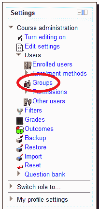

2. 点击“创建小组”按钮：

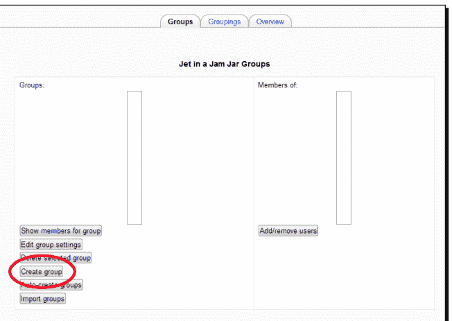

3. 为你的小组命名，并可选择添加描述（稍后会详细介绍）。

4. 你还可以指定一张图片作为小组的代表（同样，稍后会详细说明）。

5. 完成后点击**保存更改**按钮。你的新小组随即被添加到可用小组列表中（小组名称后括号中的数字表示小组内的用户数）：

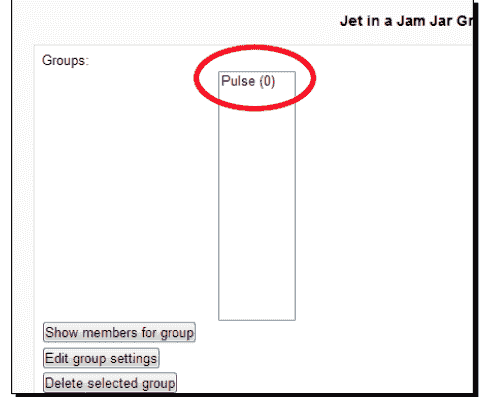

### 刚才发生了什么？

我们刚刚创建了一个新小组，尽管目前里面还没有成员。与Moodle中的大多数操作一样，配置设置时你不必立即做出最终决定。配置小组时，一旦小组有了成员，我通常会重新查看两个设置：

- 我一开始会将小组描述留空，然后在小组成员第一次集合时，询问他们希望如何描述自己。如果课程已转为完全在线，那么我们会进行聊天，或者（更常见的是）我会发起一个论坛讨论。
- 同样，对于小组图片，我可能拍摄一张小组照片，或者小组可以为自己选择一个吉祥物，然后我可以通过**新图片**设置来指定。

我将重复上述过程来创建“Turbo”小组，然后开始将学生添加到我的小组中（这是下一节的主题）。

### 向小组添加学生

可以通过两种方式实现：

- 我手动将学生添加到小组中
- 学生选课并自动加入对应的小组

现在让我们来看第一种方式。

### 动手实践 – 手动将学生添加到小组

1. 返回课程首页，从“管理”面板中选择“分组”。

2. 点击你想要添加成员的小组名称，然后按下“显示小组成员”按钮。

3. 点击“添加/移除用户”按钮。

4. 选择你想要添加到小组中的用户（可以一次选择多个），然后点击“添加”按钮：

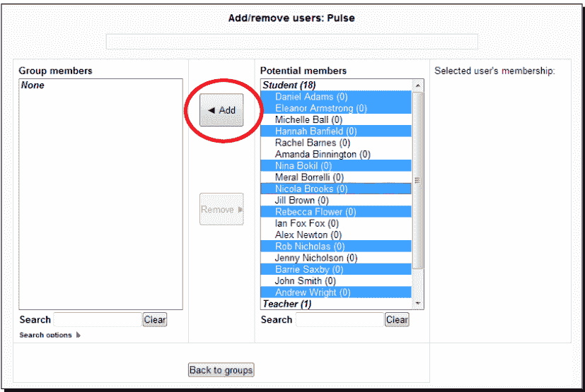

5. 请注意，用户立即被添加到小组中。如果你随后点击“返回小组”按钮，你会看到小组名称后的括号现在显示了小组中的用户数。如果我点击小组名称，则成员会列在“成员列表”中：

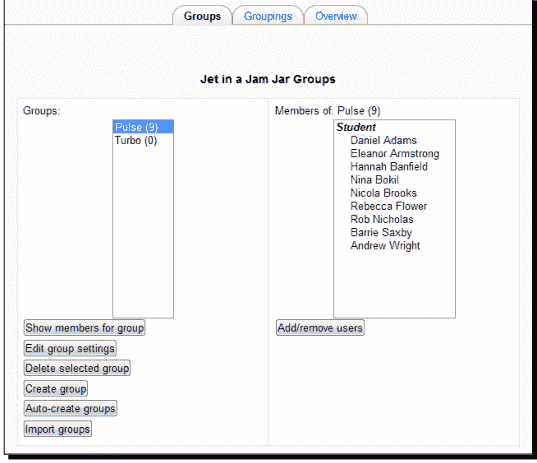

6. 就这样。我们完成了！

### 刚才发生了什么？

我们刚刚看到手动将学生添加到小组是多么容易，而将学生从小组中移除也同样容易（你在添加用户时注意到“移除”按钮了吗？）。

如果你有很多学生，那么这种方法可能会变得繁琐。更典型的分组方式是通过小组选课密钥。让我们现在来看如何实现。

### 动手实践 – 指定小组选课密钥

1. 返回课程首页，在“设置”面板的“课程管理”下，点击“用户”中的“分组”。

2. 选择你想要编辑的小组，并点击“编辑小组设置”按钮。

### 刚才发生了什么？

我们刚刚为小组指定了选课密钥。这意味着我可以将小组选课密钥交给学生，他们在选课时使用小组密钥（而不是课程密钥）来加入课程。这不仅会让他们完成课程注册，还会自动将他们添加到正确的小组中。

不同小组可以有不同的密钥，如果我不想让某些学生加入任何小组，那么我只给他们课程选课密钥即可。

但学生分组之后，我如何管理他们的作业呢？让我们看看如何将某个活动设置为分组活动。

### 小组协作

为了展示我们如何在Moodle中管理小组作业，我们需要查看一种协作活动。我们即将演示的过程适用于任何协作活动，但让我们以论坛为例：

### 动手实践 – 在论坛中进行小组协作

1. 在课程中选择一个主题或周次，在开启编辑模式后，点击“添加活动...”，并从列表中选择“论坛”。

2. 为论坛命名并添加简介。

3. 向下滚动到页面底部的“常用模块设置”区域。“小组模式”设置提供了三个选项：

- 不分组：这是默认设置。无论学生在哪个小组，都可以看到所有人的作业。
- 分隔小组：学生只能看到自己小组内学生的作业。对他们而言，他们拥有自己的论坛。
- 可见小组：学生可以看到其他小组学生的作业，但只能与自己小组的学生互动。这就像把一个班级一分为二，两个小组都能看到对方在做什么，但不能干扰对方的工作。

4. 指定一个小组选课密钥。可以是任意你喜欢的值。要显示你刚刚输入的密钥（以便你能看到），请确保勾选“Unmask”设置。在学校环境中，将其设为班级名称（例如9A、9B等）对任何课程都很有用。

5. 点击**保存更改**按钮，就完成了。

## 整合起来

- 2. 在**小组**页面顶部是否看到了一个**分组**选项卡？

  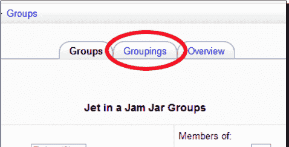

- 3. 如果没有，你需要联系你的 Moodle 管理员（请参阅紧随其后的*询问管理员*部分）。如果有，请点击它。

- 4. 按下**创建分组**按钮。

- 5. 为该分组命名，并可选择添加描述。

- 6. 按下**保存更改**按钮。

- 7. 现在，我们已经创建了一个分组，但其中还没有任何小组：

| 分组 | 小组 | 活动 | 编辑 |
|---|---|---|---|
| Turbo 小组的任务 | 无 | 0 |  |

- 8. 点击“在分组中显示小组”图标：

  

- 9. 在“潜在成员”列表中选择要添加到分组中的小组，然后按下“添加”按钮：

  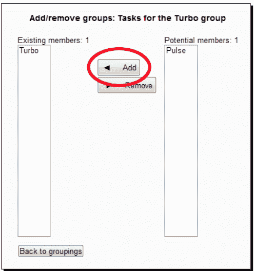

- 10. 完成后，按下“返回分组”按钮。

现在，我将返回刚刚创建的论坛，并按下“更新此论坛”按钮，回到“编辑论坛”页面。

- 11. 回到“编辑论坛”页面后，向下滚动到“通用模块设置”框，然后点击该框右上角的“显示高级”按钮：

  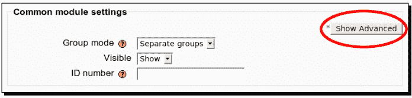

- **12.** 此时将显示**分组**设置。为了确保我的论坛只对特定分组中的学生可用，请从下拉列表中选择该分组，并确保勾选**仅对小组成员可用**：

  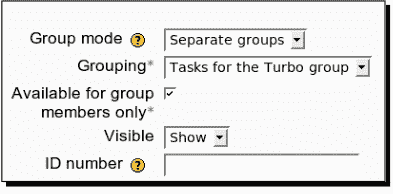

- **13.** 就这样！现在，这个论坛只对“Turbo 小组的任务”分组内各小组的学生开放。

### 刚才发生了什么？

我们刚刚将面对面小组教学中的一个重要环节——向不同小组分发不同任务——迁移到了 Moodle 中。

### 检查学生进度

即使你不打算将课程完全转为在线运行，在某些情况下你可能仍希望监控学生的活动。例如，如果你想在学生使用课程时不断改进课程，你可能会希望监控有多少学生在访问某个特定资源。那么，如何知道学生去过哪些地方，以及在那里停留了多长时间？

### 监控学生参与情况

返回课程首页，找到**人员**版块（它通常位于课程首页的左上角）。点击**人员**版块中的**参与者**链接。从参与者列表中选择一个名字，然后点击**活动报告**选项卡。**概要**报告会显示学生上次访问某个特定资源或活动的时间。点击**所有日志**选项卡，不仅可以显示学生访问特定资源的时间，还可以显示他们访问时所用计算机或互联网连接的 ID（称为 IP 地址）。**成绩**选项卡显示学生对课程中可评分活动所获成绩的概要报告。与其逐一检查每个学生的成绩，你可以使用 Moodle 成绩册查看课程中所有学生所得成绩的概况。

### 使用 Moodle 成绩册

让我们再次访问在 *第6章：管理学生作业* 中首次遇到过的成绩册。成绩册是 Moodle 的一个非常强大的功能；如果你打算将课程完全转为在线运行，就需要熟练掌握它的用法。话虽如此，成绩册的大部分功能都是一目了然的。当你向课程添加活动时，你会看到它们被添加到评分报告中，并看到学生的成绩显示在那里。大多数教育工作者都会乐于直接使用成绩册。不过，你也可以在成绩册中插入自定义成绩项（不仅限于已添加到课程中的活动），可以更改成绩的计算方式，还可以对成绩进行分类（将成绩分组，甚至计算该分类的总成绩）。

要访问课程的成绩册，你需要返回课程首页，然后在**设置**版块的**课程管理**下选择**成绩**。

进入**评分报告**页面后，点击**评分报告...**下拉菜单，查看可用的选项类型：

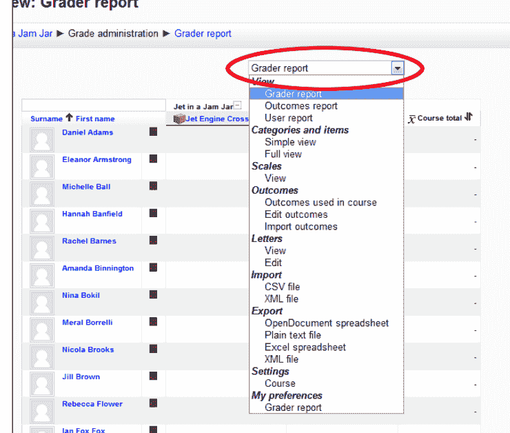

- 2. 为你的类别命名。我打算把它命名为“实践课分数”。

- 3. 按下**显示高级**按钮。你会看到一些额外设置出现。我现在不打算去管它们，但你可以随意研究。记住：你不会弄坏任何东西，而且你随时可以查阅 Moodle 文档获取指导。

- 4. 完成后，按下**保存更改**按钮。

- 5. 现在，我将重复这个过程，创建一个名为“Moodle 活动分数”的类别。我的类别和项目树现在如下图所示：

  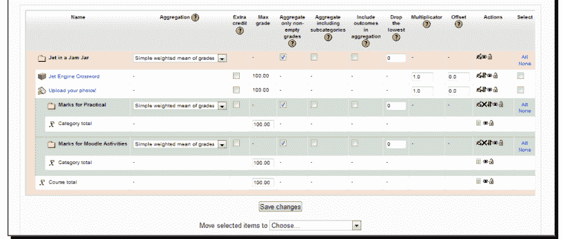

- 6. 使用移动图标（或单击并拖动，具体取决于你的站点设置方式），我可以将 Moodle 活动移到“Moodle 活动分数”类别下，这与我们在 Moodle 课程中拖放活动和资源的方式完全相同。这是我现在这棵树的样子：

  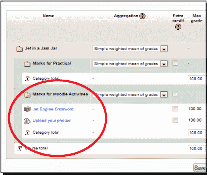

现在，我可以开始为学生将要完成的实践工作添加成绩项了。

- 7. 按下**添加成绩项**按钮。

- 8. 为成绩项命名，例如“规划与设计”。

- 9. 指定成绩类型。如果需要，你也可以使用自定义量表（参见*第6章：管理学生作业*）。

- 10. 使用“上级类别”下拉列表，指定你的成绩项要归入的类别。

- 11. 按下**保存更改**按钮。我的新成绩项现已添加到树中：

  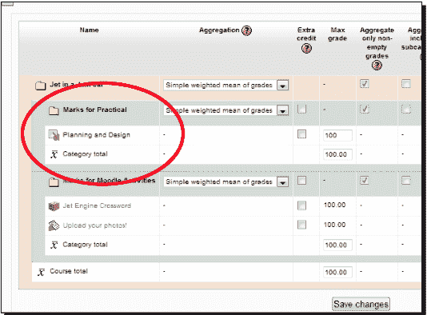

- 12. 如果随后我点击左上角的**选择一个操作...**下拉菜单，并选择**评分报告**（位于“视图”标题下），你就会看到我们是如何重新构建成绩册的：

  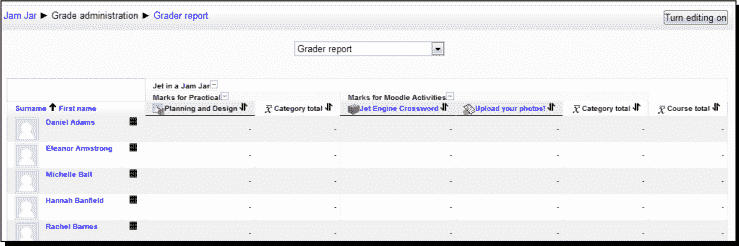

### 刚才发生了什么？

我刚才重新构建了课程成绩册，加入了“实践课分数”和“Moodle 活动分数”两个类别。你还看到了我如何添加自己的自定义成绩，这意味着我的成绩册不必只包含 Moodle 活动的成绩。如果你愿意，也可以添加自己的成绩。

### 高手挑战——加入自定义成果

你不仅可以添加自定义成绩，还可以加入自定义成果；如果你正在转换一门使用达标目标或学习描述符来评判学生成就的课程，这一点至关重要。

> 关于加入自定义成果的提示
> 在开始在成绩册中指定达标目标之前，你需要先创建自定义量表。详情请参阅第6章：管理学生作业。

返回“编辑类别和项目”页面。按下“添加成果项”按钮。看看你是否可以向成绩册添加一个自定义成果。记住，你需要先创建并配置自定义成果，然后才能开始。

### 备份与还原

我们一起的旅程已接近尾声，我现在最不希望发生的就是你丢失自己的所有成果（也包括我的！）。返回课程首页，查看“课程管理”下“设置”版块中的选项。列出的两个选项是“备份”和“还原”。选择“备份”（我们稍后会介绍还原），让我们把到目前为止完成的所有辛苦工作都备份起来；有备无患，总比事后后悔好。

### 备份课程

在执行备份过程时，你会发现有许多许多选项可以选择。在这个阶段，最好只是保留默认设置并备份所有内容。现在，让我们逐步完成这一过程：

### 动手实践——备份你的课程

- 1. 从“设置”版块选择“备份”后，你会进入备份向导的第一页（“初始设置”）。保持默认设置不变，滚动到页面底部，然后按下“下一步”。

2. 下一页（“Schema 设置”）允许你选择要备份的内容。同样，滚动到页面底部并单击“下一步”。

3. “确认和检查”页面允许你检查你的选择，也可以更改 Moodle 即将创建的备份文件的名称。如果一切正常，请按页面底部的“执行备份”按钮。备份完成后，按“继续”按钮，Moodle 现在会显示你的备份文件。你可以看到我已经备份了“Backyard Ballistics”和“Jet in a Jam Jar”两门课程：

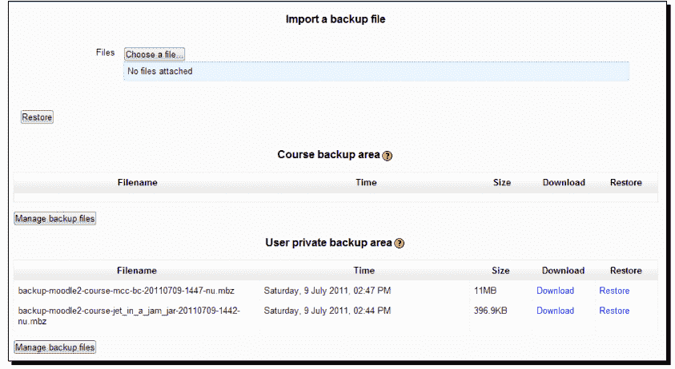

4. 你可以看到 Moodle 已将你的整个课程备份到单个文件中，并将其放入你的用户私有备份区域。这很好，但如果运行 Moodle 的计算机出现问题，那帮助不大。点击文件名旁边的“下载”链接。你可以在打开或保存之间进行选择。选择“保存”，将文件保存到你的计算机、U 盘或便携式硬盘上。妥善保管：

## 操作时间 – 恢复课程

1. 点击**设置**区块中**课程管理**下的**恢复**，将带你进入**导入备份文件**页面。

2. 如果需要，导入你的备份文件。上传此文件的过程与上传资源完全相同：

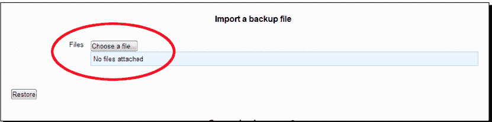

3. 文件上传后，按下**恢复**按钮。

4. 你将进入恢复向导的第一页（“**确认**”）。备份文件的内容会显示出来。如果你满意，滚动到页面底部并按下**继续**按钮。

5. 下一页允许你指定目标位置。重要的是，还会询问你是否想要：
   - 将备份的内容合并到课程中
   - 删除课程内容并用备份内容替换

   并且，如果你拥有课程创建者权限：

   - 创建一门全新的课程

   你需要确保选择了正确的选项。然后滚动到页面底部并按下相应的**继续**按钮：

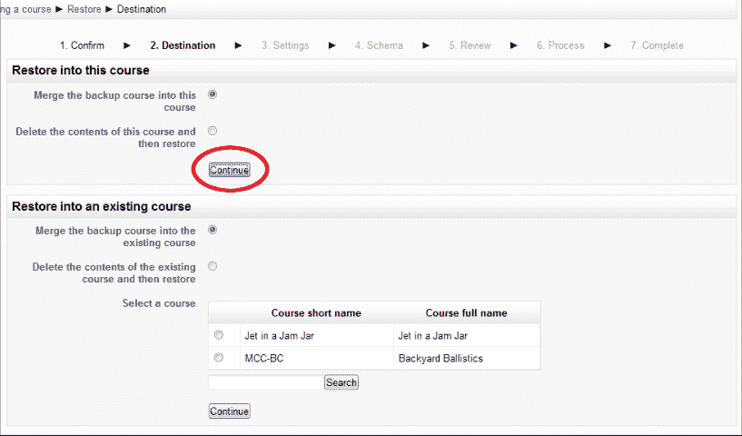

6. 确认设置并按下**下一步**按钮。

7. “Schema”页面允许你确认（或修改）课程名称和短名称（记住短名称必须唯一），还允许你选择将备份文件中的哪些资源和活动恢复到课程中。滚动到页面底部并按下**下一步**按钮。

8. 在按下页面底部的**执行恢复**按钮之前，检查你的选择。

9. 恢复完成后，按下**继续**按钮。此时你已返回课程首页。就这样，你完成了！

## 刚才发生了什么？

即使最糟糕的情况发生，我需要恢复课程，幸运的是这个过程很简单。只需点击**设置**区块中**课程管理**下的**恢复**，上传备份文件，点击**恢复**，按照说明操作，剩下的交给 Moodle 来完成。

备份和恢复的一大优点是它可以用来共享 Moodle 课程。如果同事给了你一个 Moodle 课程，而你想知道如何将该课程放到你的 Moodle 上，那么很可能你的同事给你的就是一个课程备份。

> **将活动从一个课程复制到另一个课程**
> 要快速将活动从一个课程复制到另一个课程，最好使用**导入**，它也可以在**设置**区块的**课程管理**下找到。

## 总结

在本章中，我们学到了很多关于如何通过转换到 Moodle 来支持面对面学习的内容。具体来说，我们涵盖了：

- 如何快速配置新课程，使其可以添加内容
- 如何构建课程，包括如何组织课程介绍以及如何安排活动
- 课程如何能迅速初具规模

我们还了解了如何转换为完全在线的课程，特别着重学习了如何将小组或团队协作转换到 Moodle 中，具体包括：

- 如何在线管理学生小组
- 如何创建小组以及如何将学生添加到小组中
- 如何分发小组特定任务（使用分组）

我们了解了如何监控学生的进度，以及如何查看学生在课程中的活动轨迹（甚至可以查看他们使用哪台计算机）。这引导我们讨论了 Moodle 的评分册。我们对这个工具的探索只是触及皮毛，但我们确实了解了如何对成绩进行分类，甚至可以添加自己的评分项（这样你就不仅限于课程活动的成绩）。

最后，我们学习了如何备份和恢复课程，这意味着你可以保留到目前为止所完成的所有辛勤工作！

## 随堂测验答案

### 第 1 章，走向电子化

- Moodle 是一个缩写，但它代表什么？当考虑你的 Moodle 能否满足你教学所需时，为什么 Moodle 中的“M”如此重要？
    - **答案：**模块化面向对象动态学习环境。Moodle 是“模”块化的，这意味着如果 Moodle 没有实现你需要的某个功能，那么很可能有一个可用的模块可以让你实现它。

- 我刚刚点击了一个类别来查看其中的课程。我看到有一个标记为**添加新课程**的按钮。在这种情况下，我的角色是什么？
    - **答案：**课程创建者

### 第 2 章，设置你的课程

- 课程创建者和管理者之间有什么区别？
    - **答案：**课程创建者的权限比管理者少。例如，课程创建者可以创建新课程，但管理者也可以删除它们！

- 如何将课程格式从“主题”更改为“每周”？
    - **答案：**转到**课程设置**页面（通过**设置**区块中的“**编辑设置**”）并从**格式**下拉列表中选择所需的类型。

### 第 3 章，添加文档和讲义

- 你的学生可以直接访问你的私有文件区域吗？你如何提供私有文件区域中文件的链接？
    - **答案：**学生无法访问你的私有文件区域。使用文件选择器选择你想要分发的文件。

- 通过裁剪和压缩演示文稿中包含的任何图像，可以大大减小 PowerPoint 文件的大小。你还记得压缩图像的步骤吗？
    - **答案：**回顾本章以检查你的知识。

- 如果你刚刚从 Word 文档中剪切并粘贴了文本，那么 HTML 编辑器中有一个特殊按钮值得你继续操作之前按下。这个按钮叫什么名字？
    - **答案：**你可以使用**清理杂乱代码**按钮。
