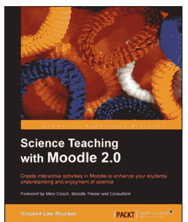
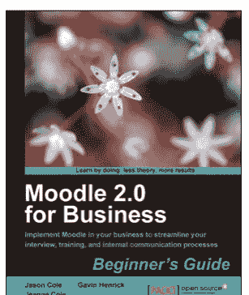
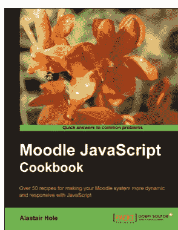
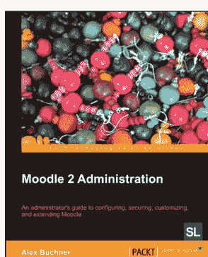

## 索引

### 符号

- .MBZ 文件 335

### A

- 活动安排
    - 关于 311, 312
    - 优点 315-319
    - 将填字游戏转换为 Moodle 313-319
- 添加新课程按钮 37
- 添加新成果按钮 204
- 添加新角色按钮 300
- 添加新量表按钮 199
- 添加按钮 327
- 添加类别按钮 330
- 添加联系人图标 242
- 添加成果项按钮 333
- 添加到测验按钮 254
- 管理员指南
    - 关于 299
    - 配置完成跟踪 301
    - 配置条件活动 301
    - 配置词汇表自动链接 301
    - 允许教师访问 300, 301
- Adobe PDF 94
- 高级链接 242
- 高级文件上传选项框 180
- 所有日志选项卡 328
- 作业
    - 创建自定义成绩量表 198-200
    - 指定自定义成绩 198, 200
    - 使用自定义量表评分 200-202
    - 确认反馈交付 197
    - 从学生角度 186, 187
    - 评分 191
    - 评分离线作业 191-193
    - 在线构建项目 175
    - 向课程介绍学生 182
    - 提供学生提交反馈 194-197
    - 处理学生提交 193, 194
    - 评分学生提交 198
    - 类型，高级文件上传 175
    - 类型，离线活动 174
    - 类型，在线文本 174
    - 类型，选择 177
    - 类型，上传单个文件 174
- 作业，从学生角度
    - 关于 186
    - 上传项目文件 187-191
- 分配角色下拉框 184
- 分配角色设置 61
- 音频
    - 嵌入音频片段 141, 142
    - 从音频分享网站嵌入 142
    - 选择文件格式 141
    - 包含方式 140
    - 开始播客 143
    - 故障排除 142
- 音频分享网站
    - 从中嵌入音频 142
    - 功能 142

- 按主题划分 47
- 格式 45
- 引言部分 52, 53
- SCORM 45
- 设置，修改 305-309
- 社交格式 46
- 主题格式 45
- 主题/周设置 53
- 每周格式 45
- 创建页面按钮 282

## D

- 装饰性图片
  - 图片，从 Word 文档抓取 159
- 装饰性图片搜索
  - 版权问题 160
  - Flickr 158
  - 通用剪贴画库 158
  - Google 图片搜索 157, 158
  - Microsoft Office 剪贴画库 159
- 删除键 146
- 文档，创建
  - 图片 94, 95
  - 使用 Microsoft Word 93
  - Moodle 网页 101
  - 网页，创建 102
- 下载链接 171, 334
- Dropbox
  - URL 92

## E

- 编辑测评表 270
- 编辑组设置按钮 323
- 编辑个人资料页面 18
- 编辑标签 108
- 启用完成跟踪选项 301
- 课程结束选项 264
- 报名按钮 62
- 已报名用户页面 59, 64

## F

- 文件组织
  - 关于 78
  - 创建文件夹按钮 78
  - 文件，移动到所需位置 80, 81
  - 创建讲义文件夹 78-81
- 文件
  - 上传多个文档 72
  - 组织 78
  - 删除 76, 77
  - 大小，确定 72
  - 上传 67
- 文件上传
  - 关于 67
  - 文件大小，确定 72
  - 文件，删除 76
  - 在 Moodle 中 68
  - 同时上传多个文档 72-75
  - 步骤 68-71
- 查找或上传图片按钮 96
- FindSounds 142
- Flickr
  - 页脚 28
  - URL 92, 158
- 课程结构格式
  - 关于 45
  - 选择 46
  - SCORM 45
  - 设置 48, 49
  - 社交格式 46
  - 主题，改为每周 47
  - 主题，功能 46
  - 主题 45
  - 主题，差异 46
  - 每周 45
  - 每周，差异 46
  - 每周，功能 47
  - 周/主题，定义 50-52
- 论坛
  - 关于 212
  - 添加到课程 212-215
  - 审核 216
  - 新闻论坛 226
  - 创建校友留言簿 225
  - 技巧 224, 225
  - 类型 223
  - 用户，订阅 215, 216
- 论坛，审核
  - 讨论，管理 219
  - 讨论，拆分 222, 223
  - 讨论，开始 216, 218
  - 帖子，评分 219-221
  - 创建简单讨论 222
  - 任务 216
- 在线课程完全转换
  - 关于 319
  - 使用 Moodle 成绩簿 329

## G

- 通用剪贴画库 158
- 词汇表
  - 添加 284

## H

- 隐藏部分选项 54

## I

- 图标 29
- 图片
  - 原样上传 98
- HTML 编辑器，提示
  - 添加欢迎信息 166-168

## J

## K

## L

- 课程活动
  - 监控学生进度 265
- 课程，纳入课程
  - 关于 257
  - 配置 257
  - 添加内容页 258
  - 链接课程页面 262-265
  - 添加问题页 260-262
- 登录链接 14
- 注销链接 29

## M

- **消息块**
  - 使用 241
- **Moodle 消息**
  - 关于 235
  - 添加联系人 241-243
  - 管理联系人 241
  - 检查投递状态 238-241
  - 添加消息块 240, 241
  - 使用消息块 240, 241
  - 发送欢迎消息 235-237
- **Microsoft Office 剪贴画库 159**
- **Microsoft Word**
  - 分发，限制 93, 94
  - 使用 94
- **杂项设置框 289**
- **Moodle**
  - 活动 8, 9
  - 增强外观 24
  - 作业转换 174
  - 包含音频 140
  - 混合学习 304
  - 使用内置问题编辑器 246
  - 能力 22
  - 选择活动 288
  - 通信 210
  - 完成跟踪 290
  - 条件活动 297
  - 条件跟踪 290
  - 上下文 23
  - 创建课程 37
  - 课程创建者 22
  - 组织课程 33
  - 设置课程 31
  - 自定义 149
  - 功能 13
  - 词汇表活动 283
  - 历史 12
  - 课程活动 255
  - 注销 21
  - 登录 14
  - 消息 235
  - 开源，优势 10
  - 链接到其他网站 114
  - 页面 24
  - 项目转换 174
  - 测验 246
  - 运行站点 23
  - 学生，优势 10
  - 主题 24
  - 播放视频 124, 125
  - 视频故障排除 130, 131
  - Wiki 278
  - 工作坊活动 266
- **Moodle 作业**
  - 用途 202, 203
- **Moodle 课程**
  - 关于 33
  - 拆分 34-36
  - 内容 31
  - 讨论 36
  - 培养关键技能 36
  - 组织 33
  - 嵌入资源 32
  - 分为部分 32, 33
  - 设置 37
- **Moodle 自定义**
  - 关于 149, 150
  - 备份课程 170
  - 安排资源 151
- **Moodle 成绩簿**
  - 访问 329, 330
  - 配置 330-333
  - 包含自定义成果 333
- **Moodle，登录**
  - 更改密码 20, 21
  - 编辑个人资料 18, 19
  - 步骤 14-16
  - 用户自我介绍 17
- **移动对话框 80**
- **多媒体**
  - 嵌入 143
- 同时上传多个文档
  - 关于 72
  - 文件打包在一起 73, 74
  - 压缩文件夹 76
  - 处理超大 ZIP 文件 75
  - 解压后删除 ZIP 文件 76
  - 上传 ZIP 文件 75
- 我的课程链接 38

## N

- 导航块图标 26, 236
- 新闻论坛 226
- 新图片设置 321
- 备注链接 194

## O

- 离线活动作业
  - 关于 174
  - 评分 191
- 在线聊天室
  - 关于 226
  - 添加到课程 227
  - 显示可用状态 231, 232
  - 添加到课程首页日历 233, 234
  - 日历事件 234
  - 缺点 226
  - 使用表情符号 229, 230
  - 查看过去聊天会话 230
  - 技巧 235
- 添加在线聊天室到课程
  - 添加 Moodle 聊天 227, 228
- 在线课程
  - 完全转换 319
- 项目在线结构化
  - 向课程添加新主题 175
  - 添加主题 176
  - 隐藏主题 176
- 选项框 86
- 链接到 Moodle 的其他网站
  - 优势 114
  - 在课程主页添加链接 114-117
  - 从文本创建链接 120-122
  - 在 Moodle 网页中插入链接 118, 119
  - 手动在 Moodle 网页中插入链接 120
  - 选项 114
  - 文本转换为网页链接 117
- 成果框 206
- 课程中使用的成果页面 204

## P

- 页面，Moodle
  - 块 25-28
  - 面包屑导航 24, 25
  - 页脚 28, 29
  - 图标 29
- 参与者链接 328
- 粘贴为纯文本 43
- 粘贴自 Word 图标 43
- 执行备份按钮 170, 334
- 执行恢复按钮 337
- Photostory 143
- 请输入文件夹名称对话框 78
- 发帖到论坛按钮 218
- PowerPoints 143
- 私人文件链接 84
- 个人资料页面 25
- 项目转换。*参见* 作业
- 项目转换，到 Moodle
  - 使用高级文件上传作业类型 179-182
  - 使用离线作业 177-179
- 项目
  - 在线结构化 175

## Q

- 添加问题到问题库
  - 计算型 249
  - 描述 249
  - 嵌入式答案 Cloze 249
  - 论文 249
  - 匹配 249
  - 多项选择 248
  - 数值 248
  - 随机简答匹配 249
  - 简答 248
- 测验
  - 添加到课程 253, 254, 255
  - 转换期末测试到 Moodle 246
  - 分类问题 251, 252
  - 导入问题 250-253
  - 设置测试 253

## R

- **重新计算成绩按钮** 276
- **删除按钮** 237
- **资源排列** 151, 152
- **排列资源**
  - 按顺序 152
  - 插入标签 154-156
  - 搜索移动图标 153
  - 步骤 152, 153
- **恢复按钮** 336, 337

## S

- **保存更改按钮** 48, 289, 301
- **SCORM** 45
- **搜索图片按钮** 157
- **搜索人员和消息选项** 241
- **选择此文件按钮** 85
- **自我完成块** 296
- **自我注册 学生 方法** 60
- **自我注册配置页面** 60
- **发送以评分按钮** 190
- **设置块** 59, 172, 301
- **共享问题用户** 300
- **显示高级按钮** 327, 331
- **站点管理菜单** 301
- **Slide.com**
  - 寻求管理员指导 146
  - 文件 146
  - 未启用多媒体插件 146, 147
  - 显示图片 143
  - 添加幻灯片 144-146
- **Soundboard** 142
- **SoundCloud** 142
- **学生课程注册**
  - 指定注册密钥 59-61
  - 选项 61
- **学生注册选项**
  - 从 MIS 自动注册 64
  - 队列 63
  - 组注册 62
  - 允许访客访问 64
  - 手动注册 62
- **学生组管理**
  - 指定组注册密钥 323, 324
  - 组内协作 324, 325
  - 创建组 319, 320, 321
  - 分发组特定作业 325-328
  - 手动添加学生 322, 323
  - 将学生添加到组 322
- **向学生介绍课程**
  - 注册学生 183-186
- **学生评分**
  - 关于 203
  - 寻求管理员指导 207
  - 评分核心能力 206
  - 在评分报告中创建自定义成绩项 203-205
  - 配置成果 203
- **提交阶段列** 271
- **订阅模式设置** 215
- **切换角色为选项** 156

## T

- **Teacher Tube**
  - 包含视频 138, 139
- **教学人员**
  - 管理员 54
  - 课程创建者 54
  - 管理员 54
  - 非编辑教师 54
  - 分配角色 55-59
  - 教师 54
- **Moodle 主题** 24
- **打开编辑链接** 50
- **论坛类型** 223

## U

- **即将发生的事件块** 232, 234
- **更新个人资料按钮** 19
- **上传文件链接** 189
- **上传文件按钮** 189
- **上传此文件按钮** 123, 189
- **用户管理资源管理员 UMRA** 64
- **用户**
  - 订阅论坛 215
- **用户图片框** 20

### V

- 视频文件格式
  - 选择 130
- 视频
  - 嵌入，来自视频分享网站 132
  - 嵌入，到 Moodle 页面 125-130
  - 从 YouTube 提取 138
  - 文件格式，选择 130
  - 导入 123
  - 包含，来自 TeacherTube 138, 139
  - 包含，来自 YouTube 133-137
  - 包含，在课程首页 123, 124
  - 播放，在 Moodle 中 131, 132
  - 故障排除 130, 131
- 视频分享网站
  - 视频，嵌入 132
- 查看已提交作业链接 194
- Vimeo 140
- 虚拟学习环境。参见 VLEs
- VLEs 7

### W

- 网页
  - 装饰性图片，搜索 157
  - HTML 编辑器，技巧 160
- Wiki
  - 添加 105, 106, 279-281
  - 功能 283
  - 隐藏主题，添加 104
  - 大型文档，转换 103
  - 选项，协作 Wiki 278
  - 选项，个人 Wiki 278
  - 页面，编辑 281
  - 任务 278
  - 用途 278, 279
- Wiki 页面
  - 新页面，创建 281, 282
  - 页面历史，查看 283
- 作业，分发
  - 文件集合，访问 87, 88
  - 文件夹，显示 88-90
  - 单个文件，分发 82-87
  - 资源库 91-93
- 工作坊
  - 关于 266
  - 添加 267-277
  - 评审 266

### Y

- YouTube
  - 视频，提取 138
  - 视频，包括来自 133-137

### Z

- ZiLink 64

## 感谢购买

## Moodle 2.0 课程转换初学者指南

## 关于 Packt Publishing

Packt，发音为“packed”，于 2004 年 4 月出版了其第一本书《Mastering phpMyAdmin for Effective MySQL Management》，此后一直专注于出版针对特定技术和解决方案的高聚焦度图书。

我们的图书和出版物分享您的 IT 同行在适配和定制当今系统、应用程序和框架方面的经验。我们的解决方案型图书为您提供定制当前正在使用的软件和技术以完成工作的知识与能力。Packt 的图书比您过去见过的 IT 图书更具体、更少泛泛而谈。我们独特的商业模式使我们能够为您带来更聚焦的信息，让您获得更多需要知道的内容，减少无关内容。

Packt 是一家现代而独特的出版公司，致力于为开发者、管理员和初学者等群体出版高质量、前沿的图书。如需更多信息，请访问我们的网站：www.packtpub.com。

## 关于 Packt Open Source

2010 年，Packt 推出了两个新品牌：Packt Open Source 和 Packt Enterprise，以继续专注于专业化。本书属于 Packt Open Source 品牌，该品牌出版围绕开源许可证构建的软件相关图书，为从高级开发者到新兴网页设计师的任何人提供信息。Open Source 品牌还运营 Packt 的开源版税计划（Open Source Royalty Scheme），根据该计划，Packt 会向每个其软件被写成图书并售出的开源项目提供版税。

## 为 Packt 撰稿

我们欢迎所有有兴趣写作的人士前来咨询。图书提案请发送至 author@packtpub.com。如果您的图书构思尚处于早期阶段，希望在撰写正式图书提案之前先进行讨论，请联系我们；我们的策划编辑将与您联系。

我们不仅仅在寻找已出版过作品的作者；如果您有扎实的技术能力但缺乏写作经验，我们经验丰富的编辑可以帮助您发展写作事业，或者仅仅让您的专业知识获得额外回报。

[PACKT] 开源
出版
社区经验凝练

## 使用 Moodle 2.0 进行科学教学

ISBN: 978-1-84951-148-3      平装：296页

在 Moodle 中创建交互式课程和活动，提升学生对科学的理解和乐趣

- 1. 遵循示例课程，了解课程、小组和论坛是如何创建的
- 2. 通过让学生在家观看视频、参与小组讨论和完成测验，使他们的家庭作业更有趣
- 3. 使用动画简化难懂的科学记数法教学
- 4. 使用成绩册监控学生的学习进度

## Moodle 2.0 商业初学者指南

ISBN: 978-1-84951-420-0      平装：324页

在您的企业中实施 Moodle，以简化面试、培训和内部沟通流程

- 1. 第一本展示如何在企业环境中使用 Moodle 的图书
- 2. 实用示例让您轻松地在企业中部署 Moodle
- 3. 已实施 Moodle 进行员工培训的知名企业以案例研究形式分享经验
- 4. 将 Moodle 用于招聘、培训、小组活动等更多场景

## Moodle JavaScript 实战手册

ISBN: 978-1-84951-190-2          平装：180页

使用 JavaScript 让您的 Moodle 系统更具动态性和响应性的 50 多个秘诀

- 1. 了解为什么、在哪里以及如何向 Moodle 站点添加 JavaScript
- 2. 充分利用 Moodle 内置的附加功能——Yahoo! 用户界面库（YUI）
- 3. 探索从 AJAX 到动画的各种现代交互功能
- 4. 将诸如 jQuery 框架等外部库与 Moodle 集成

## Moodle 2 管理

ISBN: 978-1-84951-604-4          平装：427页

面向管理员的 Moodle 配置、安全、自定义和扩展指南

- 1. 规划、安装、优化、自定义和配置 Moodle 的完整指南
- 2. 了解如何根据您的需求对 Moodle 进行联网和扩展，并与其他系统集成
- 3. 所有 Moodle 系统设置的完整参考资料

请查看 **www.PacktPub.com** 获取我们的图书信息

