# 1. 什么是 MuleSoft 平台？

在本章中，我们首先从高层视角审视 MuleSoft Anypoint Platform。然后我们将回顾不同集成方法的演变，以及现代集成方法如何融入 MuleSoft 平台。我们将了解构成 MuleSoft 核心构建块的不同组件，以及它们之间的关系。这些组件构成了该平台可用架构能力的基础。接下来，本章将描述这项技术在任何组织中的定位，特别是那些希望通过现代化、数字创新和业务转型来把握未来的组织。我们还将了解 MuleSoft 作为**集成平台即服务** 的能力，以及为什么 MuleSoft 在现代集成方法中至关重要。

在本章中，我们将涵盖以下主要主题：

- 什么是 MuleSoft 和 iPaaS？
- 集成方法是如何演变的？
- MuleSoft 的架构能力
- 解决现代集成挑战
- MuleSoft 架构如何交付现代集成

## 技术要求

本章讨论的许多 MuleSoft 组件和服务均可通过注册免费试用 MuleSoft 账户并下载 MuleSoft Anypoint Studio 获得。此外，您还可以在此处找到本章的 GitHub 仓库。

- 下载 MuleSoft Anypoint Studio（访问 [`www.mulesoft.com/lp/dl/anypoint-mule-studio`](https://www.mulesoft.com/lp/dl/anypoint-mule-studio)）。
- 填写表格，提供：
  - 电子邮件地址
  - 操作系统

*   查看您的电子邮件，获取最新版 Anypoint Studio 的下载链接。（请注意，该链接仅在 24 小时内有效。）
*   注册免费的 30 天 MuleSoft 账户，访问 [Anypoint.MuleSoft.com/login/signup](http://Anypoint.MuleSoft.com/login/signup)

## 什么是 MuleSoft 和 iPaaS？

试图定义 MuleSoft 平台要求我们通过几个不同的视角来审视它。在考察 `Anypoint Platform` 时有大量内容需要涵盖，因为它解决了 API 集成的许多方面，但其核心是一个 Mule，承载负载并完成大量繁重的工作。

从开发者的视角来看，MuleSoft 是：

*   一个全面的服务目录，
*   一个预构建的连接器，
*   一个构建模块，以及
*   一个强大的开发者门户。

它拥有一个可定制、可搜索的公共和私有 API 目录，称为 `Anypoint Exchange`。`Anypoint Design Center` 的集成工具使该平台能够使用所有行业标准语言设计、开发和版本化 API 规范，并通过模拟服务呈现它们以供测试，且可通过 Exchange 发布这些 API 规范，以便其他开发者能够找到并使用这些构建模块。

从架构师的视角来看，MuleSoft 运行时引擎是一个提供部署解决方案的平台，能够实现：

*   微服务风格的 API 和应用程序隔离，
*   水平和垂直扩展，
*   零停机部署，
*   基于容器的运行时，
*   本地部署和托管云运行时。

这些功能通过 `Anypoint API Monitoring` 和分析特性得到增强，它们共享一个运维视角。

从运维视角来看，MuleSoft 可以被视为：

*   一个 `API Security`（API 安全）和
*   `API Management`（API 管理）平台。

该平台拥有全面的管理工具和通用的 API 管理功能，可用于管理 `SLA`、版本控制和安全性，并将策略应用于 MuleSoft 开发的 API，以及使用其他工具开发并在远程环境中运行的非 Mule API。

`Anypoint Platform` 就是所有这些事物的集合。其在这些领域的表现是它经常在 Gartner 的企业 `iPaaS` 解决方案魔力象限以及全生命周期 API 管理解决方案魔力象限中被评为领导者的原因之一。

Gartner 首创了 `iPaaS` 这一术语，将其定义为“*一套云服务，支持开发、执行和治理集成流，连接个别组织内或跨多个组织中的任何本地和基于云的流程、服务、应用程序和数据的组合*。”（Gartner 词汇表）正如该定义所暗示的（云服务），MuleSoft `Anypoint Platform` 采用了 API 优先的设计方法进行开发，使上述所有服务（并在本书其余部分详述）本身均可作为 API 使用。

MuleSoft 是一个复杂、强大、动态且功能丰富的集成平台解决方案，为技术架构师提供了设计和交付复杂集成需求解决方案所需的工具和能力。

本书旨在供那些需要通过架构师视角审视该平台的人阅读。MuleSoft 平台架构师的工作是牢记平台的所有这些观点，并理解这些不同平台构建模块的组合和交互如何协同工作。这样做将使组织能够创建灵活、可扩展且可复用的解决方案，通过创新和数字化转型推动业务愿景向前发展。

## 集成方法是如何演变的？

`iPaaS` 是集成解决方案漫长演进历程中的最新一代。集成应用程序的需求实际上自第二个计算机系统开发完成以来就已存在，当时架构师意识到第一个系统提供的数据和功能将为第二个系统增加价值。让我们快速回顾一下集成方法如何跨越重大创新演变，从而催生出这代最新的 `iPaaS`。为了帮助我们直观理解不同的方法，请考虑以下简化的用例。

### J&J 音乐商店用例

J&J Music 是一家成立于 1970 年的企业，直接从出版商处采购唱片进行销售。他们定期从出版商处接收大批货物，这些唱片必须添加到可供销售的库存中。公司开发了一套 `Inventory System`（库存系统），使他们能够掌握店内唱片的数量。使用该系统，当新批次唱片到货时，他们能够增加手头数量。当唱片从货架上售出时，他们可以更新系统以反映新的数量。所有这些最初均由库存管理团队手动完成。另一个团队负责处理销售。

店内的销售人员最终意识到，他们也需要一个系统来帮助跟踪所有下单订单，因此他们构建了一个 `Sales System`（销售系统）来追踪订单和发票。随着商店规模扩大，销售人员发现他们经常不确定某产品是否有货可买。他们需要登录 `Inventory System` 检查数量，然后才能完成销售交易。然而，因为他们不属于库存管理团队，所以不更新库存数量。

这种方式维持了一段时间，但由于多名店员同时服务多位顾客，`Inventory System` 中的数量变得不可靠。公司随即决定集成这两个系统，以便每位店员看到相同的库存总数。此外，每当发生购买时，`Sales System` 会自动减少 `Inventory System` 中该产品的总数。这将使库存管理团队能够精简人员，因为他们现在只需在新产品到货时更新系统即可。

### 点对点

我们在几何课上学过，两点之间直线最短。在系统开发的早期，系统之间架构上的直线是集成它们最直接的方法。尽管技术不断进步，许多甚至大多数组织仍然有系统通过 `point-to-point`（点对点）集成连接。

思考前面描述的用例，一位架构师设计了一个 `point-to-point` 解决方案，如 `Figure 1.1`（图 1.1）所示，用于集成 `Inventory System` 和 `Sales System`。`Figure 1.1` 中的设计图展示了 `Inventory System` 和 `Sales System` 之间的关系。

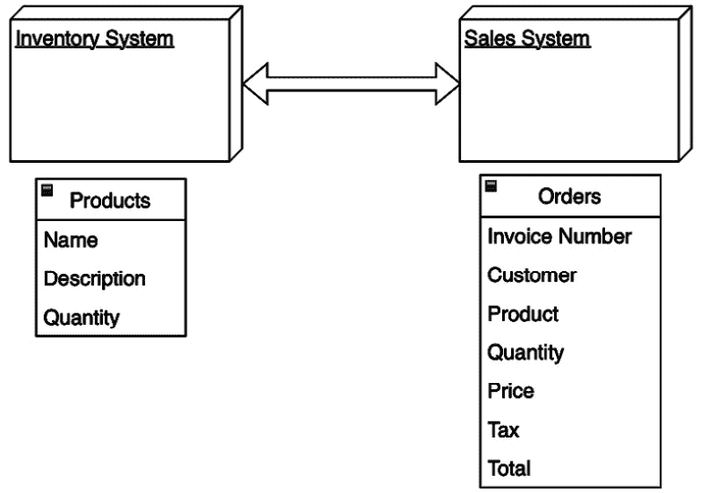

Figure 1.1 - Inventory and Sales Systems with example tables

正如您在该图中所见，从 `Inventory System` 到 `Sales System` 的连接是直接连接。J&J Music 的开发人员在 `Sales System` 中编写了新代码，以直接连接到 `Inventory System` 数据库。开发人员需要 `Inventory System` 的确切连接要求和协议详情，以及产品信息存储方式和位置的具体细节。您可以在图中看到表和字段也被捕获了。

这种集成方法开始时足够简单，但随着越来越多的系统被添加到系统全景中，每个系统都需要来自其他系统的数据，这种方法开始崩溃。即使没有额外的系统，这种方法也是脆弱的，因为它要求每个系统了解其将要连接的每个其他系统的详细信息。如果 `Inventory System` 更改了其中任何细节，集成将停止工作。

## 集成架构演进

### 点对点集成的挑战

假设库存系统决定对其数据库进行规范化，现在它们拥有一个产品主表和一个产品库存表。现在，随着数量移动到了产品库存表，每个集成都必须更新代码以适应这一集成点，才能继续工作。在*图 1.1*中，这对 J&J Music 的架构师来说似乎不是什么大问题，因为只有 1 个其他系统受到影响。然而，在点对点集成方法中，我们必须面对 `N(N-1)` 法则。该公式中 `N` 为被集成的系统数量，用于确定集成所需的总连接数。在*图 1.1*中，该数字为 `2(2-1) = 2`。现在让我们参考*图 1.2*，它引入了第三个系统——会计系统。

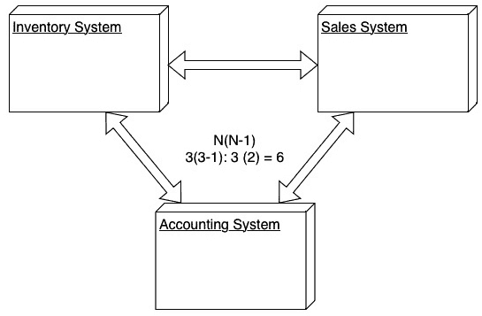

*图 1.2 - 新增会计系统与连接公式*

正如您在新架构图中所见，添加会计系统并将其与库存系统和销售系统集成，意味着我们有 6 个连接需要考虑：`3(3-1) = 6`。添加第 4 个系统会使总数达到 12 个，以此类推。随着每个新系统加入环境，采用点对点策略集成的系统进行变更所带来的复杂性呈指数级增长。如果考虑一个拥有数百个应用程序的组织，所有应用都使用此模式集成，就很容易理解为什么会创造出 *Big Ball of Mud*（大泥球） 这一架构术语。*图 1.3* 展示了一个并不罕见的 14 个系统点对点连接的场景。

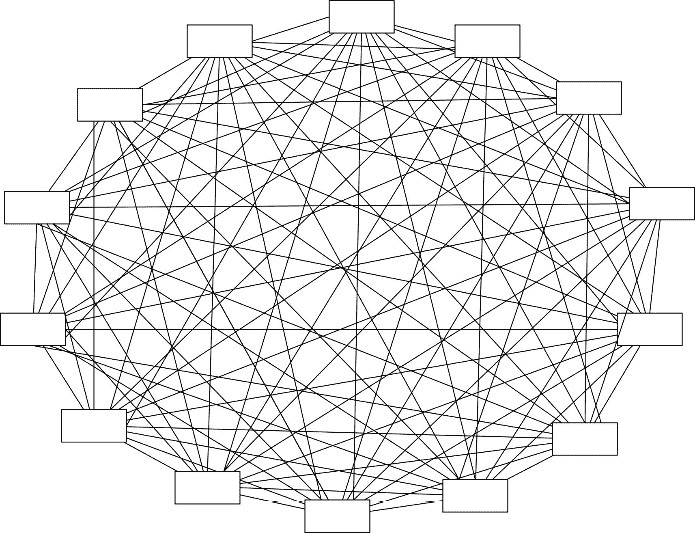

*图 1.3 - 大泥球架构*

在*图 1.3*中，拥有 14 个系统，需要管理的连接数量高达 182 个！

点对点集成的局限性包括：

*   **紧耦合**：每个系统都必须感知其他系统，对其中一个系统所做的任何更改都可能影响其通信的所有其他系统。
*   **可扩展性**：向这种集成中添加新系统和组件会导致这些系统的管理和维护复杂性增加。在某个临界点，这种架构被称为大泥球。
*   **互操作性**：每个系统可能都有其自己独特的技术栈，具有独特的协议和连接要求。这些差异使得建立点对点连接和集成变得越来越困难。

### 中间件与远程过程调用

随着大型企业和业务不断扩大其软件占用空间，点对点集成的局限性和问题变得更加突出。系统开始从大型机迁移到中型系统，如 IBM 的 AS/400，甚至迁移到使用客户端-服务器架构开发的桌面应用程序。

在此期间，开发了 `Remote Procedure Call (RPC)`（远程过程调用），旨在改进通过网络调用远程计算机系统时的通信细节依赖。对于发起调用的客户端而言，`RPC` 看起来像是一个本地函数调用。网络上的某些 `middleware`（中间件）使用 `RPC` 来处理来自客户端的请求。`RPC` 框架为协议和数据编码提供标准，并处理网络通信。

开发了标准来处理不同系统的不同数据编码要求。`Common Object Request Broker Architecture (CORBA)`（通用对象请求代理架构）和更现代的协议 `gRPC` 是这类标准的两个例子。`CORBA`（顾名思义）使用 `Object Request Broker (ORB)`（对象请求代理）来管理和标准化系统间的调用，于 1990 年代初由对象管理组织发布。

大致在同一时期，Microsoft 和 Java 发布了类似的协议。`Java RMI` 允许一个 Java 虚拟机 (VM) 中的对象调用另一个 VM 中对象的方法。它特定于 Java 编程语言，主要用于在 Java 中构建分布式应用程序。`DCOM` 是 Microsoft 开发的一种专有技术，用于在 Windows 平台上构建分布式应用程序。它是 `Component Object Model (COM)`（组件对象模型）的扩展，允许对象跨网络通信。`DCOM` 特定于 Windows 操作系统。

`gRPC` 是 Google 于 2016 年发布的现代 `RPC` 框架，使用 `HTTP/2` 作为通信协议，且与语言无关，这一特性它与 `CORBA` 共享。

### 企业服务总线

虽然 `RPC` 是一种通信方法，但 `Enterprise Service Bus (ESB)`（企业服务总线）是一种架构模式和软件基础设施，它通过通用的 `middleware`（中间件）层启用并促进应用程序间的通信。`ESB` 的概念和首批产品始于 2000 年代初。与依赖请求-响应交互的 `RPC` 方法不同，`ESB` 基于消息传递模式引入了广泛的集成功能，支持多种不同的通信方法，包括 `request-response`（请求-响应）、`publish-subscribe`（发布-订阅），甚至包括 point-to-point（点对点）。在许多情况下，产品包含消息转换、服务编排和消息路由。

`ESB` 还使企业开始考虑连接其许多遗留系统的方法，这些系统以前作为数据孤岛独立存在，同时也能连接外部合作伙伴。

Gregor Hohpe 和 Bobby Woolf 的开创性著作 *Enterprise Integration Patterns*（企业集成模式）于 2003 年出版，描述了这些基于消息的集成设计模式。这对许多产品和 `ESB` 产生了重大影响，但或许没有哪家像 MuleSoft 那样深受影响。2007 年，Ross Mason 和 Dave Rosenberg 推出 MuleSoft 作为一个轻量级 `ESB` 平台。从很早开始，该平台就包含了 Hohpe 和 Woolf 所描述模式的框架实现。

现在让我们回到 J&J Music 商店。开业约 35 年后，该店已成为全球性成功企业。所有权成功完成了向磁带和 CD 的过渡，并正在调查与设备制造商的合资企业，该设备允许用户随身携带数字音乐。多年来，集成需求显著增长。现在 CIO 决定购买 `ESB` 平台，以支持激进的计划来集成新的会计系统。请参考图 1.4，它展示了 J&J Music 商店的 `ESB` 架构。

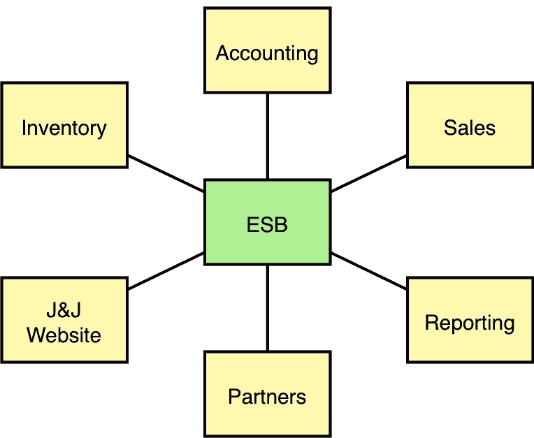

*图 1.4 - ESB 中心辐射型架构*

在*图 1.4*中，我们可以看到 `ESB` 作为消息代理执行。每个系统可以生成消息，这些消息被路由到消息代理。然后代理确定将消息转发给哪个系统。

一度，`ESB` 在企业 IT 中被广泛采用，因其有潜力简化不同系统之间的集成和通信。然而，有几个因素导致了传统 `ESB` 流行度的下降：

*   **复杂的配置**：设置和配置 `ESB` 可能很复杂。`ESB` 的配置和维护通常需要专业技能，这使得一些组织难以管理。
*   **性能开销**：`ESB` 引入了额外的层和处理步骤，可能导致性能开销。在高性能、低延迟通信至关重要的情况下，`ESB` 的开销成为一个问题。
*   **单体架构**：传统 `ESB` 通常遵循单体架构，使其不太适合面向微服务和更轻量级、模块化架构的现代趋势。微服务和容器化因其灵活性和可扩展性而流行，传统 `ESB` 难以适应这些趋势。

## 集成架构演进

### 传统 ESB 的衰退

**敏捷性需求**：现代企业需要敏捷性以快速适应不断变化的市场条件。传统 `ESB` 因其重量级和中心化的本质，可能会阻碍开发和部署流程的敏捷性。

**服务网格和 API 网关**：较新的方法，如 `Service Mesh` 和 `API Gateways`，作为替代方案出现，它们更专注于通信的特定方面，并且通常提供更灵活和去中心化的架构。

**集成模式的演进**：事件驱动架构和消息系统作为集成的替代方法而流行起来。这些架构通常专注于服务之间的轻量级通信，并采用更去中心化和可扩展的模式。

**云原生技术的兴起**：`Cloud-Native` 技术、容器化和无服务器计算的兴起，将重点转移到了更模块化和可扩展的解决方案上。`ESB` 设计于这些技术出现之前的时代，在适应新范式方面面临挑战。

**以 API 为中心的方法**：组织越来越多地采用 `API-Centric` 集成方法。`RESTful APIs` 和轻量级消息传递等技术成为连接应用程序和服务的主流方式。

虽然传统 `ESB` 失去了一些流行度，但集成的概念仍然至关重要。组织只是转向了更现代、更敏捷的集成方法，使其能够与不断演进的技术和业务需求格局保持一致。

### 面向服务的架构 (SOA)

大约在 `ESB` 平台被引入企业 IT 讨论的同时，`Service-oriented Architecture (SOA)` 也开始流行起来。在 20 世纪 90 年代末和 21 世纪初，企业应用程序被构建为使用 n 层设计的 Web 应用程序，并利用 `Model-View-Controller` 等模式。基于浏览器、`Java` 和 Microsoft 的前端处理瘦客户端 `UX` 功能，业务逻辑在运行于 Web 服务器上的 `Java` 和 Microsoft 应用程序中开发和运行，并使用数据库连接器在运行于不同服务器上的标准化关系型数据库管理系统 (`RDBMS`) 上运行 `SQL` 查询和存储过程。

企业刚刚度过 `Y2K` 危机，企业开始认真地从单体大型机系统迁移出去。`SOA` 是一种全新的方法，需要重大的范式转变，专注于从多个不同的服务开发应用程序。

与 `ESB` 一样，`SOA` 作为一种架构模式被提出，并没有附带普遍认可的协议或行业标准。`SOA` 经常被错误地仅与 `SOAP Web Services` 联系在一起。然而，`SOAP Web Services` 是一种消息协议，定义了如何描述与另一个系统中的对象进行交互。`SOA` 可以使用基于 `SOAP` 的服务和结构良好的 `XML` 来实现，也可以使用 `RESTful` Web 服务，或者两者兼用。`SOAP` 使用 `Web Services Definition Language (WSDL)` 作为描述 Web 服务所提供功能的标准。

`SOA` 通常被定义为包含 4 个主要组件：

*   服务提供者
*   服务代理
*   服务注册表
*   服务消费者

鉴于企业服务总线 (`ESB`) 作为一个平台被实现，用于跨通用中间件层启用和促进服务，`SOA` 通常使用 `ESB` 平台来实现。此外，值得一提的是，上述提到的服务注册表 `Universal Description, Discovery, and Integration (UDDI)`，在某种意义上是 API 门户的鼻祖。然而，与随后出现的其他目录相比，它的采用率有限。

### 表述性状态转移 (REST 服务)

`Representational State Transfer (REST)` 是一种构建基于网络系统的架构方法，主要由 Roy Fielding 博士在其 2000 年发表的论文“*Architectural Styles and the Design of Network-based Software Architectures”* 的 *第 5 章* 中定义。它常被滥用为仅基于 `JSON` 消息结构和 `HTTP` 动词的协议，事实上，在许多情况下，它似乎已经有了自己的生命。

用来描述 Fielding 对 `RESTful` Web 服务愿景的最常见意象，很贴切地是一个网站。每个页面代表系统的特定状态，响应参数和请求。并且每个页面都包含消费者可能希望导航去往何处的知识。例如，可能会为特定客户请求一张发票页面。生成的页面可能是发票上的产品列表。这里的导航可能指向发票上的特定产品。从那里，消费者可能能够导航到库存中该产品的数量。并从数量导航到缺货订购页面，在那里可以购买额外的产品。消息负载应包含超链接，指示 API 消费者可能希望采取的有效导航。

这种基于网络的方法为 MuleSoft 称为 `Application Network` 的集成方法提供了基础。`REST` 提供了一种通用机制，实际上是一种语言，用于以可重用的方式与组织系统和应用程序的数据和流程进行交互和集成。这种 `Application Network` 将在本书的 *第 4 章* 中更详细地讨论。

`SOAP` 可以用于任何传输层，而 `RESTful` Web Services 在 `HTTP` 上运行，并通常使用该协议定义的动词：`GET`、`POST`、`PUT`、`PATCH`、`DELETE`。与 `SOAP` 一样，`RESTful` Web 服务最初使用 `Swagger` 作为描述这些服务功能的标准。`Swagger` 最终演变为 `Open API Specification (OAS)`；你可以将其视为 `Swagger 2.0`。`RAML` 也被引入作为描述 `REST` 功能的标准。

### iPaaS

无论组织拥有点对点集成、最新的 `ESB` 技术，还是两者的某种组合，它们共同的一点都是：需要获取计算资源、将服务器部署到数据中心、安装和维护软件，并在尽量避免停机的情况下升级到更新版本的软件。`iPaaS` 应运而生。有了 `iPaaS`，组织可以快速实施 `RESTful APIs` 并创建可重用的构建模块。这些构建模块可以在本地运行的不同计算资源上以及云中运行。

2002 年，Jeff Bezos 发布了他现在著名的 `API Mandate` 备忘录，云竞赛正式拉开帷幕。正如 `SOA` 部分所述，企业正在从单体系统迁移出去。它们也开始从数据中心迁移到云端。

这种向云的迁移对某些组织来说是一个渐进的过程。例如，一家大型能源组织开始不再将特定的单个服务器分配给单个项目，而是转向虚拟计算以缩短从到货上架到投入使用的时间。虚拟计算仍在服务器和硬件上运行，在公司数据中心内部运行，仍然需要运维团队来管理计算、内存和存储分配。这也意味着运维团队必须提前应对新的硬件请求和生产系统增长。而且当开发或测试环境空闲时，它们无法轻松地将资源重新分配给其他用途。

对于其他公司而言，无需承担建设数据中心的成本即可获取计算服务，这提供了巨大的经济优势。一家主要的太阳能公司诞生于 `Salesforce` 云平台之上，从未需要开发自己的“本地”数据中心。如果需要额外的数据库、文件空间或 Web 应用，公司只需在他们占用的云空间中添加这些服务。几乎唯一的本地信息计算形式，就是公司笔记本电脑上的电子表格。

最终，云计算（如亚马逊的 `AWS`）意味着数据中心的方方面面都可以作为服务进行分配和配置。许多公司现在已将数据中心完全迁移到云端，而其他较新的公司则诞生于云端，从未拥有过自己的数据中心。需要 CPU？这是一项服务。需要更多内存？这是一项服务。私有网络？也是一项服务。消息队列？Web 服务器？IP 地址？数据库？服务、服务、服务、还是服务。需要一个系统来帮助管理客户 (CRM)？这是一项服务。最终，本地数据中心的方方面面都作为服务在云计算平台上提供。

MuleSoft 早期就利用了云计算，该平台面向集成的架构方法，使处于云计算各个阶段的公司都能开发解决方案，以助力其数字化转型。iPaaS 让公司能够通过订阅购买计算、存储、内存、运行时、监控、安全、消息传递、日志记录，以及调度、告警、编目和集成组件管理等服务。所有这些服务几乎都能在请求后立即提供，而且大多无需任何数据中心采购要求。

此前，我们概述了 ESB 作为集成解决方案开始失去流行度的一些原因。让我们快速看一下 iPaaS 接管部分流行度的原因，以及为什么它被认为比普通 ESB 更现代、更灵活的解决方案。

*   `云原生架构`：iPaaS 解决方案通常非常适合基于云的环境。传统 ESB 需要进行适配才能与云服务配合工作
*   `低代码/无代码`：MuleSoft 等 iPaaS 平台提供了通过点击而非编码来交付集成的方式。大多数 ESB 需要专业技能和复杂的配置。
*   `可扩展性`：iPaaS 解决方案生于云端且云原生，从设计之初就考虑了可扩展性，而 ESB 最初并未设计为跨分布式平台和云环境动态扩展。
*   `模块化与微服务`：在集成设计模式甚至协议方面，iPaaS 解决方案的设计具有极大的灵活性。
*   `专注于 API 中心方法`：iPaaS 平台强调使用 API 集成方法，实现前面提到的“基于网络”或应用网络概念。ESB 采用更传统的基于服务、通常基于发布/订阅的集成方法，不太容易与 API 方法对齐。

了解了我们刚才回顾的历史背景及多年来的集成方法，我们可以开始通过架构视角审视 MuleSoft 平台。这一视角将帮助我们识别当前组织中存在的差距、可能造成的问题，以及如何用新能力替换它们。但在我们从高层审视构成 MuleSoft Anypoint 平台的服务和能力之前，让我们先考虑一下组织在集成方面持续面临的挑战。

## 现代集成面临的挑战是什么？

几十年来，组织一直面临集成挑战。跨企业集成应用程序一直是一项复杂的任务，往往因早期的架构设计决策而变得更加困难。例如，本章前面所述的两个系统的点对点集成，在系统数量未超过两个时，看似是个有很多优点的好主意。

说实话，超出两个应用程序并非真正的问题。在许多组织中，真正的问题在于要么不将架构视为一项学科加以重视，要么采用“`这只是`”架构。即，“`这只是`多一个系统，继续让它连接数据库读取这个表”。因为集成三个系统似乎并不比集成两个系统复杂多少。而四个系统似乎也不比三个系统复杂多少。当然，问题在于不久之后，组织内就会有数百个关键系统，最终形成前面展示的`大泥球`架构，无法像业务期望的那样快速灵活地行动。IT 部门只能被迫勉强维持运转，没有能力承接新项目，也无法与业务部门接触，以了解他们日益增长的增值创意、创新和期望的业务成果。

幸运的是，由于集成工作固有的诸多挑战，关于企业级集成的著作汗牛充栋。有了这么多历史、模式、解决方案、技术、论文、架构、方法论和平台，我们现在可以断言集成挑战已得到解决！对吧？

遗憾的是，事实并非如此。让我们看看行业在集成方面尚未达到完全“开悟”的两个主要原因。

### 打破定律比你想象的更难

对于许多组织而言，Melvin Conway 于 1967 年提出的定律，被证明与牛顿 1687 年的万有引力定律一样难以克服。康威定律指出：系统的设计反映了组织的沟通结构。在许多我交谈过的关于集成的组织中，`人工搬运`或`转椅子`集成方法是连接应用程序的`模式`，因为应用程序存在于与操作该应用程序的组织相同的孤岛中。他们能指望的最好结果是一封电子邮件，最好带有电子表格附件，以便他们在自己的系统中捕获所需部分。这也是 Hohpe 和 Woolf 在其 2004 年出版的*《企业集成模式》*中观察到的挑战之一。他们建议，如果企业集成要成功，组织中的部门和 IT 团队必须改变彼此的互动方式。

改变这些政策需要非凡的努力。在一家公司，CIO 制定了一个三词战略：`最佳-of-breed`（最佳组合）。这一战略从业务和 IT 组织的高层一直贯彻到基层。该战略描述了一项政策，鼓励引入企业职能所需的最佳可用系统。如果现成产品找不到，就自行构建最佳系统。该战略还确立了一项政策，即开发一个中央架构团队和一个`企业应用集成 (EAI)`信息总线平台，能够使用异步消息传递和企业`规范`模型来集成这些最佳组合应用程序。

结果令人印象深刻。组织中的任务关键型应用程序能够发布和订阅广泛认可的数据结构。并且一个系统的数据能够以近实时的方式提供给其他系统。然而，这并非没有巨大的成本和缺点。EAI 平台的维护和升级成本，加上在市场无法提供所需的*最优*应用程序时构建的定制应用程序的成本超支，最终迫使组织放弃了该策略。新任 CIO 呼吁采取新策略，*适合目的*，建议业务部门寻找 COTS（商用现成软件）解决方案，这些方案将更多功能捆绑在一起，代价是其中任何一个功能可能都不如你自行构建或购买的最佳方案。

虽然每位 CIO 都有自己的理由和策略，但他们成功的关键在于他们能多好地推广新政策，并获得业务和 IT 部门所有相关利益相关者的支持。

### 技术债务速度下的业务创新

如果业务孤岛还不够具挑战性，企业仅为跟上步伐就必须进行创新的速度可能会让集成架构师应接不暇。然而，背负大量技术债务会显著降低创新速度。

在其开创性著作《创新者的窘境》中，克莱顿·克里斯坦森描述了计算机制造商、硬盘制造商和挖掘机制造商等各行各业的领先公司是如何被技术创新变革颠覆的。当这些拥有新技术的新公司开始从构想转变为市场领导者时，这些伟大的企业无一做好准备或能够迅速行动。正如克里斯坦森所描述的，传统企业是自身成功的受害者。而且在许多情况下，新公司或部门也不承担现有技术或公司所背负的技术债务。

如今，数字化转型正在推动大多数行业的创新。企业文化的数字化转型。供应链的数字化转型。销售和营销的数字化转型。客户关系的数字化转型。现在比以往任何时候都更需要在正确的时间从正确的地方获取正确的数据，这对业务的运营和长期成功至关重要，甚至是关键。

同时，许多公司要求 IT 部门以少做多。IT 被要求工作得更快、更努力（常表述为“*work hard play hard*”以缓冲压力）。他们被要求建立更好的自动化部署或将项目方法论改为更精益的模式。但 IT 往往只是在努力维持其职责范围内所有系统的基本运行。因此，业务部门会寻找变通方法，这可能涉及电子表格、加载文件、提取文件，甚至搭建一个简单的 Web 门户。几乎所有这些做法都属于技术债务，只会增加 IT 的工作量。

我观察到一个薪资流程，涉及一份从大型主机系统提取并手动修改后尝试加载到 PeopleSoft 的薪资电子表格。发放工资的来源是什么？是电子表格本身，在加载到 PeopleSoft 后，被发送给薪资公司。可能还要经过几次“*调整*”。这使得薪资的数字化转型变得困难，如果不是不可能的话，也是集成面临的一个艰巨挑战。

在某些情况下，IT 试图通过开启云迁移之旅来超前部署。将资产和资源转移到云提供商有助于消除维护数据中心内所有服务器和数据库相关的部分开销。云还可以帮助 IT 项目在几分钟或几小时内预配、启动和关闭服务器。这听起来很棒，运行也不错，直到收到将云中的新系统与数据中心中仍在运行的系统进行集成的请求。

如果复杂的孤岛式组织、孤岛式数据和技术债务阻碍了 IT 部门的创新，而业务领导层刚带着新想法出现，想用数字化创新来扭转低迷的销售和表现不佳的季度报告，该怎么办？接下来让我们看看 MuleSoft 平台中有助于解决这些问题的能力和服务，以及为什么 API 在跨业务集成系统的现代方法中如此重要。

## MuleSoft 的架构能力

MuleSoft Anypoint 平台可用于交付基于本地部署、云端或本地与云端混合架构的集成解决方案。后者称为 `hybrid IPaaS`。请注意，Anypoint 平台中可用的各个服务和功能取决于购买的订阅。

在本节中，我们将了解 Anypoint Platform 的组织结构。我们将查看平台中可用的选项，以确定在哪里运行集成应用程序以及在哪里管理平台。我们将简要探讨组织选择某个选项而非另一个选项的一些原因。

### 运行平面

MuleSoft Anypoint Platform 的组件和服务存在并运行于两个逻辑“平面”内：`Control Plane`（控制平面）和 `Runtime Plane`（运行时平面）。在图 1.5 所示的 Anypoint Platform 高层架构图中，我们可以看到上半部分包含控制平面的服务，下半部分包含运行时平面的服务。

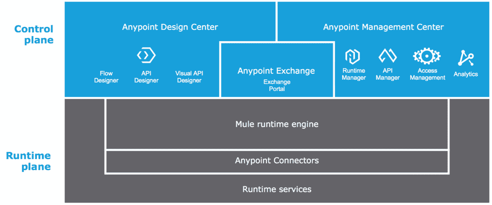

图 1.5 - Anypoint Platform 高层视图

控制平面是指用于以下目的的所有组件：

*   管理平台
*   开发代码
*   设计和发布 API 规范
*   与其他开发人员协作
*   配置和管理运行时设置
*   查看日志
*   管理 API

从本质上讲，控制平面是管理平台本身以及你开发的在某处运行的每个 API 或 Mule 应用程序的地方。“在某处运行”是运行时平面的领域。

运行时平面由许多负责运行 MuleSoft 应用程序的组件或服务组成，但其核心是 `Java Virtual Machine (JVM)`。这包括 Mule 运行时引擎，还包括可托管运行时引擎的服务，包括 Runtime Fabric 和 CloudHub。运行时平面还包括 MuleSoft 应用程序运行时使用的服务。这包括：

*   `Virtual Private Cloud (VPC)`
*   `Virtual Private Network (VPN)`
*   `Object Store V2`
*   `Anypoint MQ`
*   `Connectors` 和任何相关驱动程序
*   `DataGraph`
*   `Dedicated Load Balancers (DLB)`

当你在 Anypoint 中打开 Design Center 时，你是在控制平面内操作。当你通过 Anypoint 中的 Runtime Manager 界面或使用 `Anypoint CLI` 命令部署并启动 MuleSoft 应用程序时，你是在操作控制平面中的组件。正在运行的应用程序、它们可以使用的所有服务以及运行时引擎都属于运行时平面。

图 1.6 所示的界面运行在控制平面中，并承载了此处显示的所有服务。当你登录试用版 Anypoint Platform 时，可能会发现缺少一些组件。Anypoint MQ 和 Partner Manager 等组件需要额外的许可证。

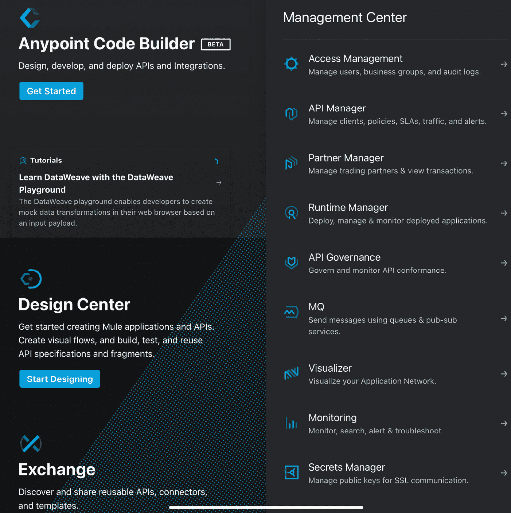

图 1.6 - Anypoint 控制平面及可用组件和服务

该图展示了 MuleSoft 中可用的许多服务，包括：

*   `Anypoint Code Builder (ACB)` – 一款基于 Visual Code 的新开发者 IDE 产品，能够完全在云端运行，无需任何安装。

## Anypoint Platform 架构

### 核心服务

*   **Design Center** – 一种基于云的开发工具，用于采用 `RAML`、`OAS` 和 `AsyncAPI` 构建 API 规范。
*   **Exchange** – 一个包含 API、连接器、模板、示例、代码片段和 `DataWeave` 的工件目录，所有这些都可以与其他使用者共享以支持重用。
*   **Management Center**（及其包含的所有控件）– 平台的所有控件和管理功能，包括：
    *   访问管理
    *   API 管理
    *   运行时管理
    *   治理
    *   Anypoint MQ 管理
    *   用于创建 API 视图的 Visualizer
    *   监控
    *   密钥管理

我们将在下一章详细了解这些不同的服务以及更多关于运行时平面的选项。但首先，让我们考虑一下拥有这两个平面的架构优势。

### 架构优势

*   **故障容错**：当控制平面宕机时，无论是由于中断还是升级，运行时平面和所有正在运行的应用程序都可以继续运行。同样，当控制平面识别出应用程序因某些原因未运行时，控制平面可以重启服务或尝试在不同的可用区中运行它。
*   **托管灵活性和法规合规性**：组织可以选择在云中运行控制平面，由 MuleSoft 负责安装、托管和管理所有内容。某些欧盟组织可能要求其所有资产、数据和元数据严格在欧盟范围内运行。这由欧盟托管的控制平面提供支持。需要 `FedRAMP` 合规性的组织可以在 MuleSoft 托管的 `AWS GovCloud` 中运行控制平面。某些组织可能有要求或法规，禁止其在云中拥有任何资产、数据和/或元数据。对于这些组织，Anypoint Platform 支持在自己的数据中心运行控制平面。
*   运行时平面可以由 MuleSoft 在 `AWS` 公有云、 `AWS VPC` 和 `AWS GovCloud` 上全托管。也可以选择在客户托管的基础设施上运行，直接在专门为 Mule Runtime 配置的服务器上运行 Mule 运行时引擎，或作为容器部署中的设备运行。根据控制平面和运行时平面的部署选择，Anypoint 服务配置的可用性可能会发生变化。

在下一节中，我们将探讨控制平面可以托管在哪里、运行时平面可以托管在哪里，以及一个平面的托管决策对另一个平面选项的影响。

## 平台部署选项

架构师的工作之一是检查并了解组织系统现状的当前状态。组织是否采用了云托管服务方法？组织是否仍在自己的数据中心拥有关键系统？接下来的章节将描述可用于托管平面的选项以及它们之间的关系。

### 控制平面托管

目前，MuleSoft 提供了 2 种用于运行控制平面的部署选项，第一种选项有 3 个部署位置：

*   **由 MuleSoft 托管和管理**
    *   美国 `AWS` 云
    *   欧盟 `AWS` 云
    *   `AWS GovCloud`
*   **在组织自己的硬件上本地运行控制平面功能**，由组织托管和管理。

在组织自己的基础设施上运行控制平面使用名为 Anypoint Platform **Private Cloud Edition (PCE)** 的产品。安装此产品需要在安装期间与 MuleSoft 专业服务团队合作。

### 运行时平面

如前所述，运行时平面是程序运行的地方。这是您添加到流中的 `HTTP` 连接器监听您指定端口的地方。这是 `DataWeave` 转换逻辑驻留等待重塑有效负载的地方。它也是 `Anypoint Object Store V2` 和 `Anypoint MQ` 的领域。

为了运行这些组件，我们必须拥有计算资源、内存资源、存储和网络资源。MuleSoft 提供了四种 MuleSoft 运行时引擎可以执行的选项：

*   **CloudHub**
*   **CloudHub 2.0**
*   **Runtime Fabric**
*   **Standalone**

后续章节将深入探讨这些运行时托管选项中的每一个。在*第 9 章和第 10 章*中，我们将了解 MuleSoft 托管的选项 CloudHub 和 CloudHub 2.0。在*第 11 章*中，我们将探讨使用 Runtime Fabric 容器化运行时平面的细微差别。最后在*第 12 章*中，我们将了解在组织获取和管理的基础设施上部署 MuleSoft 运行时引擎的自托管独立选项。

但仅仅因为这些都可以作为运行时引擎的宿主，并不意味着所有其他运行时平面组件都在每个环境中受支持。*表 1.1* 是一个矩阵，显示了运行时平面每个托管选项可用的运行时组件。

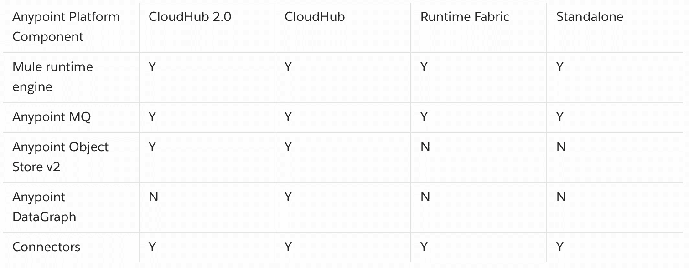

在此表中，我们可以看到 `DataGraph` 在 CloudHub 2.0、Runtime Fabric 或独立服务器中不可用。我们还可以看到 `Object Store v2` 在 Runtime Fabric 或独立服务器中不可用。我们还可以看到最灵活的运行时托管选项是 CloudHub 和 CloudHub 2.0。

在下一节中，我们将看到这些运行时托管选项的哪些组合可以与不同的控制平面选项一起使用。

### 组合控制平面宿主和运行时宿主

正如我们所说，控制平面负责管理运行时平面中运行的所有内容。因此，我们为托管控制平面所做的部署选择将影响我们可以在哪里托管运行时平面。

*表 1.2* 是一个矩阵，显示了控制平面托管选项和运行时托管选项之间的关系。

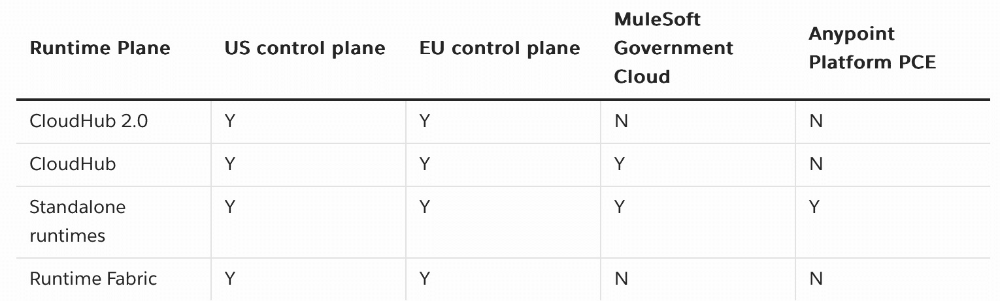

我们可以在表中看到：如果我们在美国或欧盟托管控制平面，则可以在前面确定的 4 个托管选项中的任何一个中托管运行时平面。但是，如果您在 GovCloud 中托管控制平面，则唯一的托管选项是 CloudHub 和独立服务器。CloudHub 2.0 和 Runtime Fabric 在 GovCloud 中不可用。如果您必须在自己的服务器和基础设施上托管控制平面 (PCE)，则只能在自己的服务器和基础设施上托管运行时平面。

有时组织在决定将控制平面和运行时平面部署在何处时必须做出艰难的选择。联邦和州政府通常需要遵守法规，并可能要求软件解决方案符合 `FedRAMP` 标准。MuleSoft 为此提供了一个称为 Government Cloud 的解决方案，但它也伴随着其他限制因素，且成本可能更高。使用 Government Cloud 时，运行时平面必须是 CloudHub、独立 MuleSoft 运行时或两者的组合（混合部署）。

同样，欧洲组织可能需要将所有软件完全保留在欧盟数据中心内。MuleSoft 提供了一个使用欧盟托管控制平面的选项。此控制平面还将 CloudHub 部署限制在欧盟区域和欧盟可用区内。

对于有授权将所有 IT 基础设施和系统保留在其直接控制下并位于其数据中心内的组织，可以选择安装 Private Cloud Edition 并在自己的硬件上运行控制平面和运行时平面。

在这些情况下，架构师的工作是理解如何驾驭这些差异。如果运行时主机不支持 `Anypoint DataGraph` 或 `Object Store v2`，我们还有什么替代选项？我们甚至需要 `DataGraph` 或 `Object Store v2` 吗？此外，如果一个组织从美国或欧盟控制平面运营，且所有选项均可用，什么业务标准、IT 策略、组织资源限制或其他众多环境变量会促使架构师选择 `CloudHub` 而非 `Runtime Framework`？什么因素会驱动架构师推荐将 `CloudHub 2.0` 与运行时引擎的独立实例相结合？

要回答这些问题，我们需要更详细地了解这些 MuleSoft 交付方式，看看它们能做什么、不能做什么。我们的应用程序将在何处执行，以及有哪些运行时平面功能可用，这很重要。*第 3 部分* 将详细探讨这些细节，以便我们作为架构师能够回答这些问题并提出建议。在下一节中，我们将首先了解平台中可用的具体功能和组件。

### MuleSoft 功能与组件

正如我们已经看到的，`Anypoint Platform` 提供了设计、部署和管理我们构建的 API 所需的组件。该平台还提供了组件，在许多情况下还提供了运行或执行这些应用程序所需的基础设施。让我们回顾一下支持 `API 优先开发` 生命周期各个阶段的不同组件。

#### 发现功能

`Anypoint Exchange` 可被视为一个目录或注册表，包含可在解决方案中使用的所有不同可复用组件或资产。该目录可按特定短语搜索，或基于预定义的资产类型或资产类别进行筛选。您可以列出来自自己组织的资产，或由 MuleSoft 开发的资产。您甚至可以根据资产所处的生命周期阶段进行筛选。

在图 1.7 中，我们可以看到 `Anypoint Exchange` 正在搜索 MuleSoft 提供的所有资产。

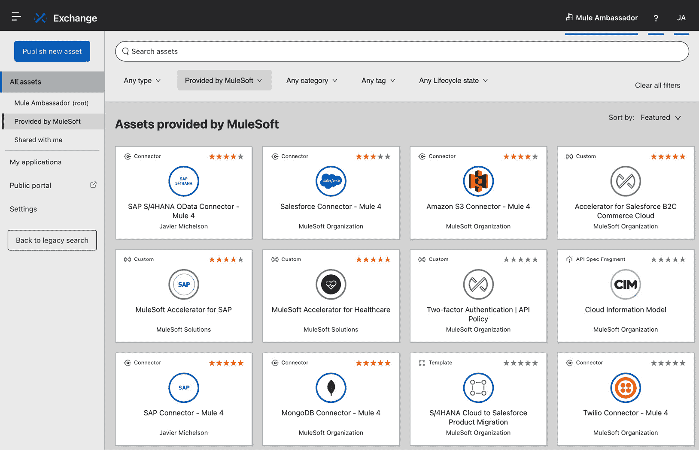

图 1.7 - 来自 MuleSoft 的 Anypoint Exchange 资产

查看该图中的不同资产，我们可以看到可在 `Anypoint Exchange` 中注册或发布的资产类型在过去 4 年中已大幅增长。最初 `Anypoint Exchange` 仅限于 `Connectors` 和 `API`。截至撰写本文时，`Anypoint Exchange` 已拥有 11 种不同类型：

*   `Connectors`：使用 `Mule SDK` 开发的组件，开发人员可在 MuleSoft 流中使用它们以原生方式连接并交互不同的系统。
*   `Dataweave Libraries`：开发人员可以构建可在其他集成中复用的 `Dataweave` 转换。
*   `Examples`：提供示例应用程序的资产，例如“如何使用 Snowflake 进行批量 ETL”。
*   `Policies`：管理 `API` 安全性的策略，通常在 `service mesh` 中运行。
*   `API Spec Fragments`：可在新 API 规范开发中复用的 `RAML` 或 `OAS` 可复用片段。
*   `REST APIs`：可供其他经批准的应用程序使用或消费的 API 规范。
*   `RPA Activity Templates`：MuleSoft `Robotic Process Automation (RPA)` 功能的模板。
*   `Rule sets`：`API governance` 的规则集。
*   `SOAP APIs`：可供其他经批准的应用程序使用或消费的 API。
*   `Templates`：可复制并为您的环境配置的模板。
*   `Custom`（例如加速器）。

#### 设计功能

API 设计始于 `API Specification`。无论组织已标准化采用 `Open API Specification (OAS, formerly known as Swagger)` 还是 `RESTful API Modeling Language (RAML)`，均可在 `Anypoint Platform Design Center` 中创建规范。`Design Center` 允许您设计规范、片段和 `AsyncAPI` 规范，如图 1.8 Design Center API Specification 所示。

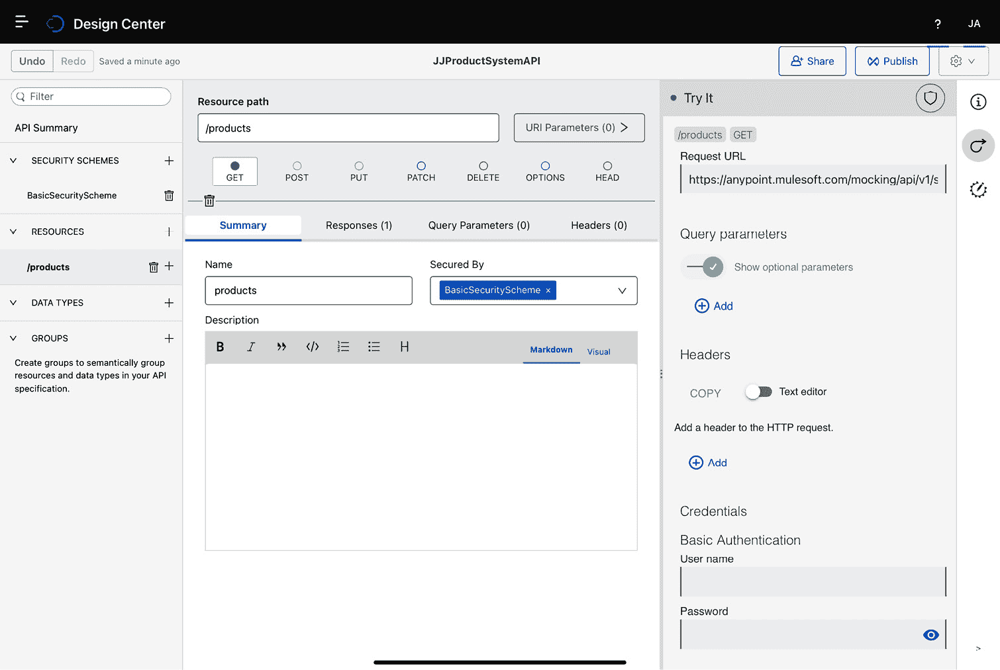

图 1.8 - Design Center API 规范

在此屏幕中，MuleSoft 可提供指南或“*脚手架*”，使规范开发变为“*低代码/无代码*”。此功能也在云端，因此设计人员无需在笔记本电脑或台式机上安装任何内容即可开始工作。

API 设计规范也可在两个主要开发工具 `Anypoint Studio` 和 `ACB` 中创建。这两个工具均允许您将 API 规范与 `Design Center` 同步。同样，对于在 `Design Center` 中启动的任何 API 规范，您也可以在 `Studio` 或 `ACB` 中打开并处理它们。

#### 管理功能

`Anypoint Management Center` 提供了多项 Anypoint 功能，专注于平台的运维和管理，以及正在运行的 API 应用程序。

图 1.9 显示了 Management Center 中的选项。

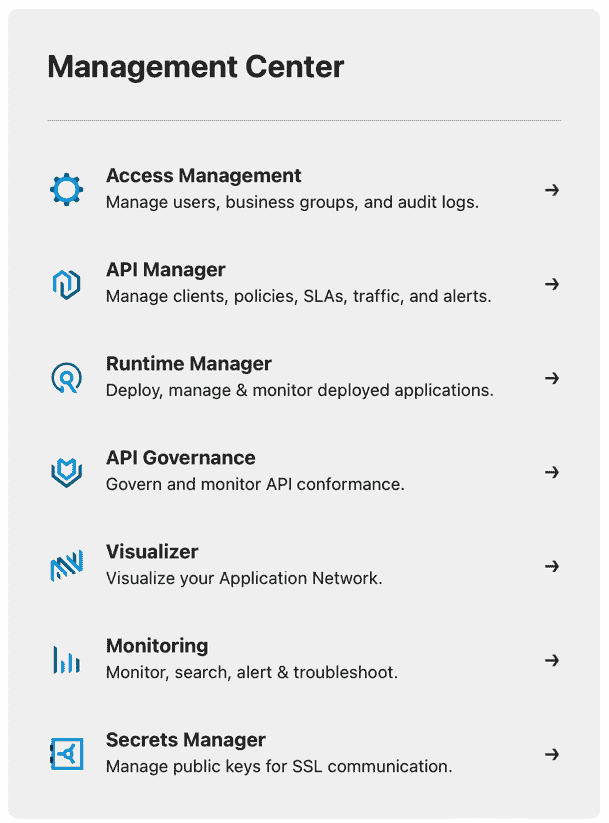

图 1.9 - Anypoint Management Center

图 1.9 中的管理功能列表定义如下。

*   `Access Management`：提供创建 `Anypoint Platform` 用户或设置外部身份提供商 (`IdP`) 的功能，以管理平台用户及其被授予的平台权限。它还公开审计日志，记录平台上执行的任何操作，从部署应用程序到发布 `API`。
*   `API Manager`：提供应用策略、设置服务级别协议 (`SLAs`) 和保护 `API` 的功能。`API Manager` 还用于管理两类 `API` 警报。针对 API 请求/响应/策略的警报，以及针对合同变更或违规的警报。`API Manager` 还管理并部署您需要关联到 API 以对其进行管理的任何代理 API 运行时。
*   `Runtime Manager`：提供管理 `Anypoint VPCs`、`Anypoint VPNs` 或 `Private Spaces`、`MuleSoft 应用程序`、负载均衡器、独立服务器和 `flex gateways` 的功能，覆盖不同环境。此外，应用程序部署、设置和管理均可通过 `Runtime Manager` 控制。
*   `API Governance`：赋予架构师定义 `API` 一致性规则集、监控合规性并发送通知给开发人员以解决合规问题的能力。
*   `The Visualizer`：通过三个视角（架构、故障排查和策略）提供部署到 `Runtime plane` 的 `API` 图形视图。应用程序视图显示应用程序网络中应用程序（节点）的关系。故障排查视图包含应用程序网络中所有节点的指标信息。策略视图允许您查看网络中 `MuleSoft 应用程序` 应用策略的概览。
*   `Monitoring`：提供查看性能仪表板、审查日志和 CPU/内存/磁盘消耗、并寻找已部署 `API` 趋势的功能。`Monitoring` 还允许运维人员根据性能和使用情况发现，查找任何 `API` 的稳定性问题。
*   `Secrets Manager`：为保存证书、密钥库和信任库、用户名/密码键值对提供安全保管库。`Security Manager` 是支持 `Runtime Framework` 运行时平面中边缘策略和令牌化的安全功能的一部分。

我们现在已经了解了 `Anypoint Platform` 的一些主要功能，其中许多我们稍后会更详细地介绍。有了不同集成方法的历史背景，以及现在所有这些新的 `iPaaS` 平台功能，让我们来看看组织今天面临的一些新旧困难。

## 为什么 API 在交付现代集成中如此重要？

API 从根本上将架构讨论从异步消息传递转变为同步会话式集成。它将范式从数据生产转移到了消费模式。

许多较新的 `商用现成系统 (COTS)` 在设计之初就考虑到了这一点，为客户提供某种形式的集成接口，以访问其系统内的流程和数据。基于云的 `SaaS` 系统（如 Salesforce、Fiserv 和 Workday）也通过强大的 `API` 暴露其流程和数据。其他 `SaaS` 系统则构建了 `SOAP` Web 服务接口来访问其数据。

`EDI` 事务持续简化 `B2B` 合作伙伴集成。许多业务合作伙伴通过提供专用 `API` 来丰富合作伙伴体验，允许合作伙伴开发自己的解决方案，而非强迫他们使用其 Web 门户。

不幸的是，此列表未涵盖企业内数百个遗留系统。这些系统通常作为孤岛开发，未考虑与其他系统集成。能够构建安全、可靠且高效的 `API` 以释放这些遗留系统中的数据，是向企业交付现代集成架构的重要第一步。

MuleSoft 平台通过提供构建统一访问方式所需的服务和组件，支持这种集成方法，无论数据源是基于云的 `SaaS`、`B2B`、`COTS` N 层设计软件，甚至是遗留大型机软件。这些 `API` 的发布反过来又增加了其在新旧开发工作中的可重用性。对 `API` 部署的细粒度控制（包括防火墙、端口安全、证书、`SSL` 和策略），使架构师能够以安全、合规的方式共享对系统数据的访问，符合治理、协议、策略，甚至在某些情况下符合法律法规。

能够使用低代码、`无代码` 工具设计和开发这些 `API`，也有助于 IT 更高效地向业务交付集成解决方案。特别是当业务用户和 IT 团队缺乏开发复杂、容错、高性能、可扩展的应用集成解决方案所需的技能时。

已故伟大的蒂娜·特纳写过一首名为“*We don’t need another hero*”（我们不需要另一个英雄）的歌，当我问其他架构师：我们需要另一个集成平台架构吗？这便浮现在脑海中。我们将在本书的其余部分开始回答这个问题。我们将更详细地研究 MuleSoft 的平台架构。我们将深入探讨 MuleSoft 的资源、加速器、设计方法和部署策略。我们将审视平台的运维和管理，它们与设计图和代码审查一样，都是架构师的责任。

简而言之，本书的其余部分将作为您了解 MuleSoft 平台架构以及采用 `API` 方法应对企业应用集成现代挑战的个人指南。

### 摘要

本章首先提供了 MuleSoft 的概述，并探讨了什么构成了 `iPaaS`。

随后，本章回顾了集成的历史，详细阐述了架构方法如何从点对点演进到 `SOA` 和 `REST`。

接着，本章介绍了 MuleSoft 中可用的构建模块、功能和服务。简要考察了 `控制平面` 和 `运行时平面`，以及支持两者不同配置和托管选项的方案。

然后，本章审视了集成面临的当前挑战。它探讨了企业在数字化转型中遇到的问题，以及 IT 在努力保持系统运行的同时，又要演进或转型系统以满足业务不断增长的需求时所面临的制约。

最后，本章探讨了 `API` 总体上以及 MuleSoft 平台特别是如何对于交付现代集成解决方案至关重要，在支持可重用性的同时，以安全的方式释放系统数据。

在下一章中，我们将更详细地考察基础组件和底层架构。

### 问题

1.  Anypoint Platform 运行在哪两个操作平面上？

2.  运行时平面有哪四种托管选项？

3.  能否说出使用 Runtime Fabric 托管运行时平面时不可用的两项功能？

4.  `iPaaS` 与其他集成方法有何不同？与点对点？与 `RPC`？与 `SOA`？

5.  您或您的组织面临过哪些问题，使得集成成为一项挑战？

### 答案

1.  `控制平面` 和 `运行时平面` 是 Anypoint Platform 运行的两个平面。

2.  `CloudHub`、`CloudHub 2.0`、`Runtime Fabric (RTF)`、`独立服务器` 是目前托管 MuleSoft 运行时平面的选项。

3.  在 `RTF` 中运行时，`Object Store v2` 和 `Anypoint DataGraph` 不可用。

4.  `iPaaS` 是一套全面的云服务，支持集成开发和治理，连接本地应用程序和数据与基于云的流程、服务、应用程序和数据。点对点涉及一个应用程序直接深入另一个应用程序以直接收集数据。`RPC` 是一种点对点架构，涉及在另一个应用程序中调用远程调用并获取数据。`SOA` 是一种面向服务的架构，没有全球公认的标准，它通过预定义服务提供对象交互的方法。

5.  您的答案应根据您组织的经验而异。我见过拥有旧大型机系统的组织，这些系统对过夜批处理数据进行复杂处理。这当然会影响实时查看数据的能力。

### 延伸阅读

*   Gartner 术语表：[`www.gartner.com/en/information-technology/glossary/information-platform-as-a-service-ipaas#:~:text=Integration%20Platform%20as%20a%20Service%20(iPaaS)%20is%20a%20suite%20of,individual%20or%20across%20multiple%20organizations`](https://www.gartner.com/en/information-technology/glossary/information-platform-as-a-service-ipaas#:~:text=Integration%20Platform%20as%20a%20Service%20\(iPaaS\)%20is%20a%20suite%20of,individual%20or%20across%20multiple%20organizations)。

*   *Architectural Styles and the Design of Network-based Software Architectures* by Thomas Fielding [`www.ics.uci.edu/~fielding/pubs/dissertation/top.htm`](https://www.ics.uci.edu/~fielding/pubs/dissertation/top.htm)

*   Enterprise Integration Patterns, Addison-Wesley 2004, pg 3, Gregor Hohpe, Bobby Woolf

*   Christensen, Clayton M. The Innovator's Dilemma: When New Technologies Cause Great Firms to Fail. Boston, MA: Harvard Business School Press, 1997
