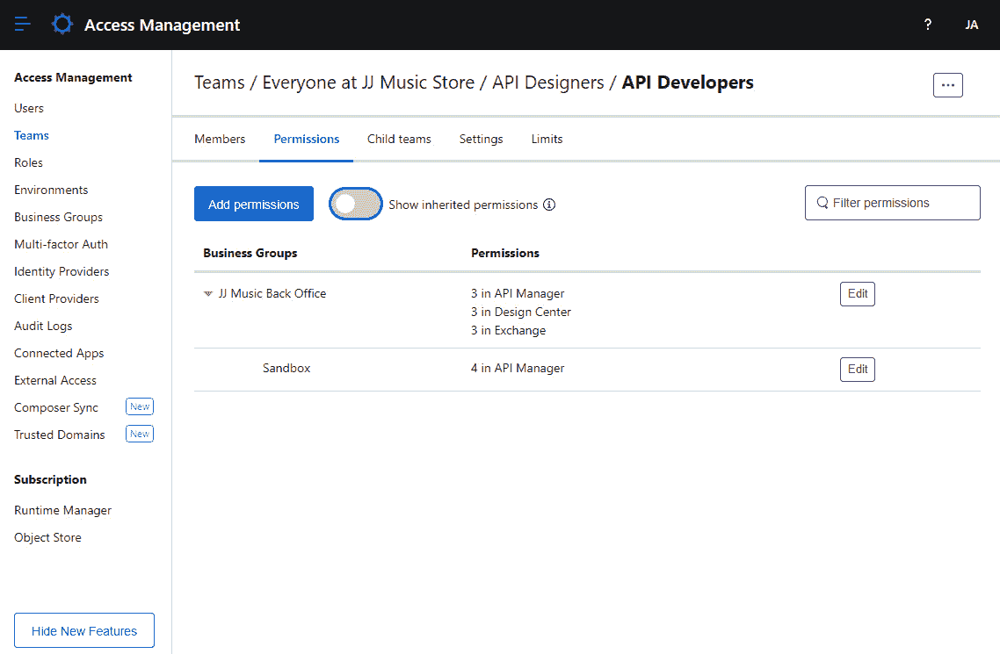
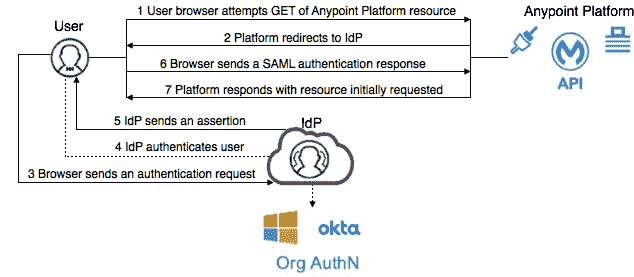
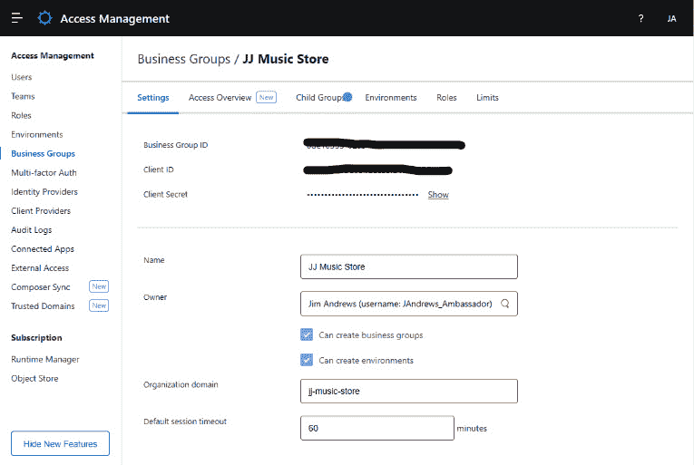
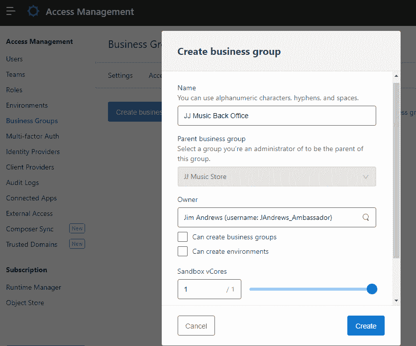
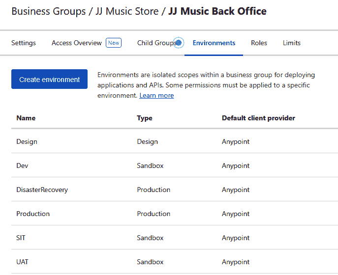
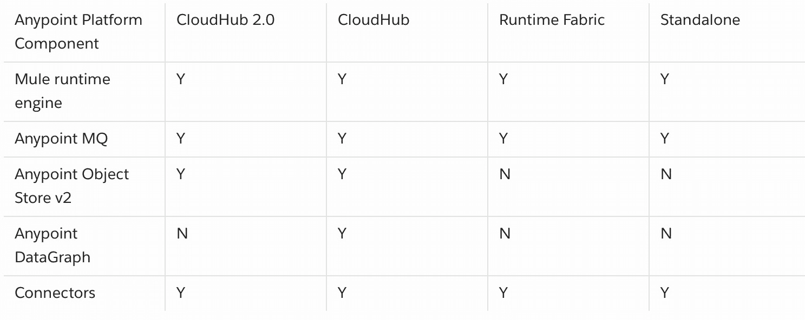
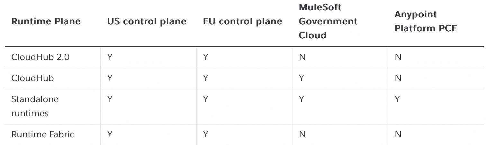
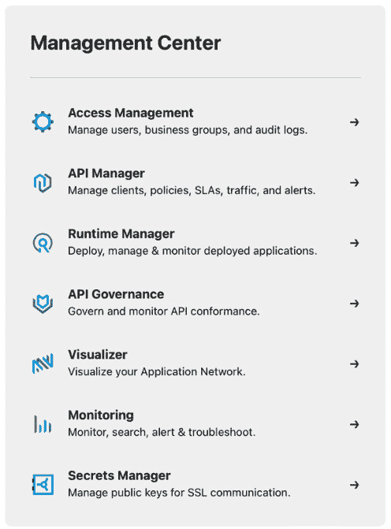
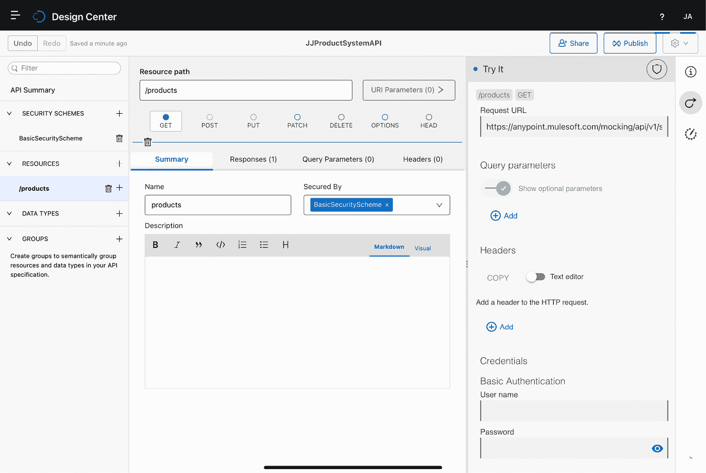
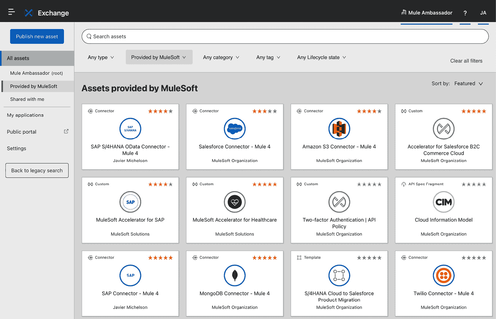

# 第 2 章：平台基础组件与底层架构

MuleSoft 平台不断扩展和演进，为架构师和设计师提供越来越多的能力、特性和功能。一些变化很微妙，而另一些则引入了全新的能力。这甚至还不包括触手可用的所有新连接器。

例如，仅在过去几年中，我们就有了以下变化：

*   容器化运行时 – 基于 `Kubernetes` 的运行时引擎
*   Composer 流程 – 由 Salesforce 平台驱动的 `无代码` 集成和开发能力
*   API Community Manager – 一个用户界面驱动的门户，用于管理使用组织 `API` 的内部和外部开发人员
*   API Experience Hub – 下一代 Community Manager，集成了 `Anypoint Exchange` 和 `Salesforce Experience Cloud`
*   DataWeave 模块 – 支持使用数组、二进制、日期、数学、加密等进行开发的附加功能库

## MuleSoft Anypoint Platform 架构

### MuleSoft 生态系统中的新功能

*   **DataGraph** – 一种用于**应用网络**中数据的低代码/无代码用户界面工具和查询功能，允许开发者通过 GraphQL 请求从数据服务中消费多个 API
*   **ServiceMesh** – 一个网关，提供在 Mule 和非 Mule 应用程序的扩展**微服务**网络中管理和保护 API 的能力
*   **Flex Gateway** – 一种轻量级**API 网关**，用于管理和保护在任何平台上运行的 API
*   **API Governance** – 一种自动化工具，确保 API 规范的开发人员遵循架构团队规定的标准、最佳实践和规则
*   **Robotic Process Automation (RPA)** – 一种低代码/无代码功能，使企业能够使用“机器人”自动化需要人工输入的流程和任务
*   **Anypoint Code Builder (ACB)** – 一款面向设计和构建 MuleSoft API 的开发人员的下一代**集成开发环境 (IDE)**

此列表仅代表 MuleSoft 生态系统中提供的最新功能和能力的一小部分。

### 平台组织与章节主题

从根本上说，平台的组织结构保持一致。正如上一章所述，MuleSoft Anypoint Platform 由控制平面和运行时平面定义。在本章中，我们将涵盖以下主要主题及其随附的 Anypoint 核心服务：

*   控制平面功能
*   运行时平面概述

我们将概述您作为架构师需要审查和理解的注意事项，以帮助组织选择合适的控制平面和运行时平面组合。我们还将初步了解平台的一些核心服务。

平台提供了极大的灵活性。集成平台架构师需要了解其组织的技术限制、法规责任、短期和长期目标，以及特定项目的业务需求和技术非功能性需求。我们将在本章中审视这些因素，以了解它们对 Anypoint Platform 架构的影响。

### 技术要求

在本章中，我们将使用在第 1 章中配置的 Anypoint Platform。

### Anypoint 控制平面

Anypoint 控制平面是一系列产品、工具和服务的集合，它们共同作为管理和治理 MuleSoft 应用程序运行时部署和 API 的中央枢纽。该控制平面被架构为一组微服务，使该中央枢纽具有可扩展性、高可用性和容错性。此外，这些服务采用 API 优先设计构建。这意味着开发团队和运维团队可以使用 API 与 Anypoint Platform 进行交互。事实上，与 Anypoint 控制平面中的服务和组件交互有三种方式：

*   标准 Web 前端
*   Anypoint Platform APIs
*   Anypoint Platform **命令行界面 (CLI)**

这些服务可以纳入您的 CI/CD 流水线，并通过警报和审计日志提供对其流程和性能的洞察。在本书中，我们将主要使用控制平面的用户界面 Web 前端。对 CLI 工具和平台 API 的深入探讨超出了本书的范围。

作为架构师，在设计 Anypoint Platform 架构时，我们需要考虑关于控制平面的三件事：

*   我们将在哪里托管它？
*   我们将如何保护对它的访问？
*   我们将如何组织它？

这些服务和管理工具必须运行在某处，所以在下一节中，让我们看看控制平面的托管选项。

#### 控制平面托管选项

架构师的工作之一是审视和了解组织系统现状的当前状态。组织是否采用了基于云的托管服务方法？组织是否仍在自己的数据中心拥有关键系统？上市时间有多重要？是否有需要注意的法规问题？有时我们自以为已经知道终点在哪里。业务告诉我们他们想要现代化，我们知道什么是现代系统，那么为什么不直接去构建它呢？但如果我们在架构过程中试图走捷径；如果我们不花时间去发现事物目前是如何布局的；如果我们不了解起跑线，我们将无法识别出将我们与未来状态架构分隔开的实际差距。这些差距将有助于识别，例如，MuleSoft 控制平面应解决什么数据和元数据问题。

目前，MuleSoft 提供了两种运行控制平面的部署选项。第一个选项有三个部署位置：

*   **由 MuleSoft 托管和管理：**
    *   美国 AWS 云，美国东部（弗吉尼亚北部）区域
    *   欧盟 AWS 云，欧盟（法兰克福）区域
    *   AWS GovCloud（仅限美国）
*   **由客户托管和管理：**
    *   这涉及在组织自己的硬件/基础设施上本地运行控制平面功能，由组织托管和管理。
    *   在组织自己的基础设施上运行控制平面使用一个称为 Anypoint Platform **Private Cloud Edition (PCE)** 的产品。安装此产品需要在安装期间与 MuleSoft 专业服务合作。

让我们考虑一些可能影响控制平面放置位置决策的问题：

*   **组织是否采用了基于云的托管服务方法？** 如果是，这通常使利用 MuleSoft 托管基础设施的选择变得简单直接。然而，如果组织尚未完全采用基于云的托管服务方法，这将是一个机会，让它开始了解这对其员工、运营和 IT 能力意味着什么。这本身当然并不自动指向 PCE。
*   **是否有需要注意的法规问题？** 欧洲的**通用数据保护条例 (GDPR)** 和美国的**联邦风险和授权管理计划 (FedRAMP)** 对信息技术安全要求产生了深远影响。此外，企业不断面临数据泄露和勒索软件的威胁，导致运营中断和声誉受损。如果您的组织需要 FedRAMP 合规，您将需要考虑 Government Cloud 或自托管选项。GDPR 可能要求将所有数据保留在欧盟，因此在某些情况下，同样可能需要基于欧盟的控制平面托管。
*   **上市时间有多重要？** 当然，没有任何选项能在关键的上市时间场景下击败 MuleSoft 托管的控制平面与 MuleSoft 托管的运行时平面相结合。
*   **组织是否有自己的策略，要求所有关键系统和数据保留在自己的数据中心，与外界隔离？** PCE 可以满足这一要求。请注意，虽然可以在 AWS、Azure 或 Rackspace 等云基础设施上安装 PCE，但这不满足将系统保留在组织数据中心并受其直接控制的要求。

其中一些问题可能会导致相互冲突的答案（例如上市时间非常重要，但组织需要内部数据中心解决方案）。架构师必须与业务和 IT 团队合作，了解任何相互竞争的优先级，并在推荐控制平面方法之前确认他们的假设。例如，可能会假设美国政府或州机构需要 FedRAMP 合规。然而，这并不总是如此，允许机构使用 **Runtime Fabric (RTF)** 或 CloudHub 1.0/2.0 的标准美国控制平面可能是最优解决方案。

在确定了控制平面的托管要求并完成了带有权利和许可的预配后，我们接下来需要了解如何保护对平台的访问。我们将在下一节中探讨这一点。

### 保护 Anypoint 控制平面

Anypoint 安全性在 Management Center（管理中心）的 Access Management（访问管理）中进行管理。在这里，管理员可以管理用户、业务组和审核日志。管理 Anypoint Platform 用户主要有两种方式：

*   Anypoint 托管用户（GovCloud 实现不可用）
*   外部 **身份提供商** 和 **单点登录 (SSO)**

在 Access Management 中，可以邀请用户加入 Anypoint Platform。使用此方法时，Anypoint 管理用户安全性。请注意，虽然用户可以使用注册其他 Anypoint Platform 实例时使用的相同电子邮件，但用户名对于每个帐户必须唯一。接受帐户邀请后，最佳做法是让用户启用 **多因素认证 (MFA)**，事实上，从 2023 年 8 月 1 日起，这已成为强制要求。

**注意**

MFA 在用户的个人资料页面中配置，而不是在 Access Management 的 **User（用户）** 选项卡中。

每个用户对平台所有资产、权利、功能和能力的访问均通过团队和权限进行控制，这些取代了现已弃用的角色功能。

我们可以创建团队以与特定团队成员负责的活动保持一致。然后，我们可以向每个团队授予权限，以访问平台的不同功能和能力，以及他们被允许执行这些活动的环境。我们将在下一节中探讨业务组和环境。

图 2.1 展示了一个名为 **API Developers（API 开发人员）** 的示例团队，它是 API 设计人员团队的子团队，并拥有 JJ Music Back Office 中某些活动和资源的权限。

*图 2.1 – Anypoint 中的团队权限*

您也可以在前图中看到，权限是从团队的父级继承的。

**注意**

团队权限是在确定要应用权限的业务组之前选择的。

用户也可以使用组织的 IdP 进行管理。将组织的 IdP 作为可验证应用程序连接到 Anypoint Platform 的设置位于 Access Management 的 **Identity Providers（身份提供商）** 菜单选项下。Anypoint 支持 OpenID Connect 和 SAML 2.0。每个提供商所需的信息会略有不同。使用 Okta 或 Microsoft **Active Directory (AD)** 等外部提供商会将用户管理的负担转移到单独的安全平台上，该平台负责验证用户身份并确认其对资产的访问权限。

下图摘自 MuleSoft Identity Providers 文档，展示了 SAML 流程：要求用户向 IdP 验证其凭据，IdP 随后向 Anypoint Platform 提供断言，告知平台用户是否被授权访问请求的资源。

*图 2.2 – Anypoint Platform 的 SAML 流程*

设置 Anypoint 的 SSO 需要与组织的安全团队协调。获取设置双方所需的某些信息可能类似于“鸡生蛋、蛋生鸡”的两难境地。通常，IdP 需要先完成其连接的设置，并将所需的公钥、元数据、登录和注销 URL 以及颁发者 ID 提供给 Anypoint 管理员。

IdP 还可用于将用户映射到 Anypoint 内的团队。团队仍必须在 Anypoint 中设置并配置适当的权限。但是，向 Anypoint 添加新用户的业务流程现在包括确定某人应被分配到哪个团队，从而决定其拥有何种访问权限。

**注意**

Access Management 中有两个外观相似的选项：**Identity Providers（身份提供商）** 和 **Client Providers（客户端提供商）**。Client Providers 允许架构师使用 OpenAM、PingFederate 或 OpenID Connect 设置 IdP，以授权访问 API 的客户端应用程序。IdPs 使用 OpenAM、PingFederate 或 OpenID 来授权对 Anypoint Platform 的访问。

现在正确的人员已获得 Anypoint 的访问权限，让我们看看用于组织和管理 Anypoint 控制平面的选项。

### 组织 Anypoint 控制平面

组织 Anypoint 有两种主要机制：业务组和环境。首先，让我们考虑业务组。

#### 业务组

业务组是 MuleSoft 资源的逻辑划分，允许将 vCore 和 VPC 等资源分配到部门业务单元级别。此外，使用上一节中提到的团队，业务组允许我们创建设计人员、开发人员、运维人员和管理员组，以管理特定部门内的资源。

然而，Anypoint 权利（通过许可证提供的组件和功能）是在根业务组级别管理的。假设一个组织购买了 10 个沙箱 vCore 和 5 个生产 vCore。这些 vCore 会分配给首次预配 Anypoint Platform 时创建的根组织。我们可以在图 2.3 中看到，当 JJ Music Store 的所有者将 MuleSoft 预配为其集成平台时，创建了根业务组。

*图 2.3 – Management Center 控制平面 – Access Management*

**注意**

只有拥有 Organizational Administrator（组织管理员）权限（以前称为角色）的用户才能打开 Business Units（业务单元）页面。

我们还可以在图 2.3 中看到业务组 ID、客户端 ID 和客户端密钥。组织的客户端 ID 和客户端密钥仅为支持向后兼容性而包含。应改用每个创建的环境的客户端 ID 和密钥，供非组织管理员的用户访问组织的资产。向下滚动，您还将看到任何 CloudHub 部署的默认区域。

**注意**

在试用帐户中，此默认值始终为 US-East（俄亥俄州）。

从组织角度来看，建立至少一个子业务组并从根业务组向该组分配资源和权利是一种良好的做法。在图 2.4 中，我们可以看到新组的详细信息已填写完毕，在本例中，JJ Music Store 组的所有 1 个 vCore 和 1 个设计 vCore 都已分配给子业务组。

*图 2.4 – 创建子业务组*

此时，JJ Music Store 业务组将有 0 个可用 vCore，因此无法部署任何应用程序。同样，这通常是作为最佳实践的首选。部署应与负责该部署的子业务组关联。如果需要并采购更多核心，vCore 将最初由 MuleSoft 分配给 JJ Music Store 业务组。

现在让我们看看环境在 Anypoint Platform 中的作用。

#### 环境

环境是用于分离部署和应用程序的逻辑分组，是在业务组的上下文中创建的。正如前面 *Business groups（业务组）* 一节中提到的，每个环境都有自己的客户端 ID 和客户端密钥。CI/CD 流水线可以使用这些来指导部署，开发人员也可以在 Anypoint Studio 中使用它们来标识 API Manager 环境。

最佳做法是定义环境以与组织的开发和测试方法保持一致。

例如，测试的一种常见方法论使用四个环境：开发、系统集成测试、用户验收测试或预发布，以及生产。通过建立环境以对应这些测试阶段中的每一个，我们现在可以在每个应用程序中开发环境属性文件，从而使我们能够对齐数据源和系统访问。当所有应用程序以相同的方式遵循测试方法论时，我们还可以避免当集成将来自一个环境的数据与连接到不同环境的另一个系统共享时导致的任何数据相关错误。

我们可以创建两种环境类型：

*   `Production`（生产环境）– 用于在生产实时环境中部署应用程序（使用生产 `vCores`）
*   `Sandbox`（沙箱环境）– 用于创建开发和测试环境（使用沙箱 `vCores`）

在图 2.5 中，我们可以看到为与 JJ Music 后台部门的测试方法保持一致而创建的环境列表。请注意，Design 类型的环境（连同 design `vCores`）用于使用 Flow Designer 从 Design Center 部署应用程序，该功能已被标记为生命周期结束。

图 2.5 – 与公司测试方法匹配的环境

在本节中，我们了解了控制平面的不同托管选项、使用控制平面保护平台的选项，以及允许我们跨不同部门和业务单元以及跨组织中使用的不同测试方法来组织平台的机制。这些环境还代表了 `vCores` 的分配、用于测试的应用程序分组以及将这些应用程序实际部署到 MuleSoft 运行时引擎之间的桥梁。这些运行时引擎在称为运行时平面的第二个平面内运行。下一节将介绍我们在 Anypoint Platform 中管理运行时平面的一些选项。

## 运行时平面概述

如前所述，运行时平面是您的程序运行的地方。这是您添加到流中的 HTTP 连接器监听您指定的端口的地方。这是 DataWeave 转换逻辑等待有效载荷以重塑形状的地方。它也是 Anypoint Object Store V2 和 Anypoint MQ 的领域。为了运行这些组件，我们必须拥有计算、内存、存储和网络资源。简而言之，运行时平面是用于运行您的应用程序的服务器或服务器集合。

> **注意**
>
> Anypoint Object Store V2 和 Anypoint MQ 的设置是从控制平面配置的。

平台架构师在设计运行时平面架构时必须考虑几个因素。让我们首先看看运行时部署选项。

### 运行时部署选项

MuleSoft 提供了四个用于执行 MuleSoft 运行时引擎的选项：

*   `CloudHub` – 运行在 MuleSoft 所属 AWS 组织中的 MuleSoft 托管基础设施
*   `CloudHub 2.0` – MuleSoft 托管的容器化基础设施
*   `Runtime Fabric (RTF)` – 共享责任的 Kubernetes 集群
*   `Standalone MuleSoft runtime engine`（独立 MuleSoft 运行时引擎）– 客户托管的基础设施

后续章节将更深入地探讨这些运行时托管选项中的每一项的功能。在第 9 章和第 10 章中，我们将介绍 MuleSoft 托管的选项 CloudHub 和 CloudHub 2.0。在第 11 章中，我们将探讨使用 Runtime Fabric 将运行时平面容器化的细微差别。最后，在第 12 章中，我们将介绍在组织获取并管理的基础设施上部署 MuleSoft 运行时引擎的自托管独立选项。

接下来，让我们考虑一下托管运行时平面的位置选项。

### 运行时平面托管

与控制平面一样，在托管 MuleSoft 运行时引擎的位置和方式方面，有两个选项：

*   由 MuleSoft 托管和管理：
    *   使用 `CloudHub` 和 `CloudHub 2.0` 在 MuleSoft 的 AWS 云上
    *   在 AWS VPC 上
    *   在 AWS GovCloud 上
*   由客户托管和管理：
    *   在组织的裸机基础设施、虚拟机、其数据中心或其自己的云平台基础设施（Azure、AWS 等）上手动设置 MuleSoft 运行时引擎
    *   Mule 运行时：
        *   客户托管 Kubernetes 上的 `RTF`
        *   VM/裸机上的 `RTF` 作为 MuleSoft 设备

当使用 MuleSoft 托管的 AWS 选项（`CloudHub` 或 `CloudHub 2.0`）时，AWS 区域取决于控制平面的托管位置（如前所述）：

*   美国控制平面允许使用以下 AWS 区域（假设未勾选全球部署）：美国东部和西部、加拿大、亚太地区、欧盟和南美洲，或包括 `RTF` 在内的独立 MuleSoft 运行时引擎
*   欧盟控制平面将部署限制在欧盟（法兰克福和爱尔兰）区域或包括 `RTF` 在内的独立 MuleSoft 运行时引擎
*   AWS GovCloud 控制平面将部署限制在 AWS GovCloud 区域或独立（非 `RTF`）MuleSoft 运行时引擎
*   PCE 控制平面需要独立 MuleSoft 运行时引擎，无法部署到 MuleSoft 托管的运行时选项

> **注意**
>
> 全球部署选项在美国控制平面中可用。要启用它，您可能需要联系您的 MuleSoft 客户经理。

接下来，让我们回顾一下这些运行时部署选项如何与核心 Anypoint 组件配合工作。

### 运行时平面中的核心组件

有几个核心组件和功能是 MuleSoft 的一部分并在运行时平面中运行：

*   Mule 运行时引擎
*   Anypoint MQ（单独授权的消息服务）
*   Object Store V2
*   DataGraph
*   Connectors（连接器）

> **注意**
>
> 虽然 MQ、DataGraph 和 Object Store 等组件在运行时平面中运行和操作，但这些组件的管理和配置发生在控制平面中。

这些核心组件中的一些的可用性取决于运行时的托管位置。下表是一个矩阵，显示了运行时平面每个托管选项可用的运行时组件。

表 2.1 – 运行时平面组件的托管选项

在前面的表格中，我们可以看到 DataGraph 在 CloudHub 2.0、Runtime Fabric 或独立服务器上不可用。我们还可以看到 Object Store v2 在 Runtime Fabric 或独立服务器上不可用。我们还可以看到最灵活的运行时托管选项是 CloudHub 和 CloudHub 2.0。

在下一节中，我们将看到这些运行时托管选项的哪些组合可以与不同的控制平面选项一起使用。

### 结合控制平面主机和运行时主机

如前所述，控制平面负责管理我们在运行时平面中运行的所有内容。因此，我们为托管控制平面所做的部署选择将影响我们可以在哪里托管运行时平面。

表 2.2 是一个矩阵，显示了控制平面托管选项和运行时托管选项之间的关系。

表 2.2 – 控制平面部署和运行时托管选项矩阵

正如我们在前面的表格中所看到的，如果我们在美国或欧盟托管控制平面，我们可以使用前面确定的四个托管选项中的任何一个来托管运行时平面。但是，如果我们在 GovCloud 中托管控制平面，唯一的托管选项是 CloudHub 或独立服务器。CloudHub 2.0 和 Runtime Fabric 在 GovCloud 中不可用。如果您必须在自己的服务器和基础设施上托管控制平面（PCE），那么您只能在自己的服务器和基础设施上托管运行时平面。

## 控制平面和运行时平面的部署选择

有时，组织在决定部署 `control plane` 和 `runtime plane` 的位置时，必须做出艰难的选择。

联邦和州政府通常需要遵守法规，并可能要求软件解决方案符合 `FedRAMP` 标准。

MuleSoft 为此提供了一个名为 `Government Cloud` 的解决方案，但它也伴随着其他限制因素，且成本可能更高。

使用 `Government Cloud` 时，所选的 `runtime plane` 必须是 `CloudHub`、独立 MuleSoft 运行时，或两者的组合（`hybrid`）。

同样，欧洲组织可能需要将所有软件完全保留在欧盟数据中心内。

MuleSoft 提供了一个使用 `EU-hosted control plane` 的选项。

此 `control plane` 还会将 `CloudHub` 部署限制在欧盟区域和 `EU Availability Zones` 内。

`GovCloud` 和 `EU control planes` 将在后续章节中进行更详细的探讨。

对于有授权将所有 IT 基础设施和系统保留在其直接控制下且位于自身数据中心内的组织，可以选择安装 `PCE` 并在自己的硬件上运行 `control plane` 和 `runtime plane`。

在这种情况下，架构师的工作是理解如何应对这些差异。

如果 `runtime host` 不支持 `Anypoint DataGraph` 或 `Object Store v2`，我们还有什么替代选项？

我们到底需不需要 `DataGraph` 或 `Object Store v2`？

`Object Store v2` 可以通过 `APIs` 访问，但考虑到需求和法规，是否允许这样做？

此外，如果组织在 `US` 或 `EU control plane` 上运行且拥有所有可用选项，什么业务标准、IT 政策、组织资源限制或其他众多环境变量会促使架构师选择 `CloudHub` 而非 `RTF`？

是什么因素会驱使架构师推荐将 `CloudHub 2.0` 与 `runtime engine` 的独立实例相结合？

为了回答这些问题，我们需要更详细地了解每种 `MuleSoft` 交付方法，并看看它们能做什么、不能做什么。

我们的应用程序将在哪里执行以及将有哪些 `runtime plane` 功能可用，这些都是重要问题。

*稍后在*本书中，我们将详细探讨这些 `runtime deployment` 选项，以便我们作为架构师能够回答这些问题并提出建议。

在下一节中，我们将初步了解 `control plane` 中可用的具体核心功能和组件。

## Anypoint 核心服务

正如我们已经看到的，`Anypoint Platform` 提供了设计、部署和管理我们构建的 `APIs` 所需的组件。

该平台还提供了运行或执行这些应用程序所需的组件，在许多情况下还提供基础设施。

让我们快速了解一下支持 `API development` 生命周期中每个阶段的不同组件。

### 管理能力

如前所述，我们将 `Anypoint Management Center`，特别是 `Access Management`，确定为用户管理和平台组织的核心服务。

`Management Center` 还是我们可以找到专注于平台运营和管理以及任何正在运行的 `API applications` 的核心服务的地方。

`Figure 2.6` 中的屏幕显示了 `Management Center` 中的选项。

图 2.6 – Anypoint Management Center

`Figure 2.6` 中的管理能力详述如下：

*   `Access Management`：这在前面的 `control plane` 部分已有描述。
*   `API Manager`：这提供了应用策略、设置 `service-level agreements (SLAs)` 和保护 `APIs` 的能力。
*   `API Manager` 还用于管理两类 `API` 警报：`API` 请求/响应/策略警报，以及合同变更或违规警报。
*   `API Manager` 还管理并部署您需要与 `API` 关联以对其进行管理的任何 `proxy API` 运行时。
*   `Runtime Manager`：这提供了跨不同环境管理 `Anypoint VPCs`、`Anypoint VPNs` 或 `Private Spaces`、`MuleSoft` 应用程序、负载均衡器、独立服务器和 `Flex Gateways` 的能力。
*   此外，应用程序部署、设置和管理都可以从 `Runtime Manager` 控制。
*   `API Governance`：这赋予架构师定义 `API` 一致性规则集、监控合规性并向开发人员发送通知以解决合规问题的能力。
*   `Visualizer`：这提供了部署到 `runtime plane` 的 `APIs` 的图形视图，通过三个视角观察：`Architecture`、`Troubleshooting` 和 `Policies`。
*   应用程序视图显示应用程序网络中应用程序（节点）之间的关系。
*   `Troubleshooting` 视图包含应用程序网络中所有节点的指标。
*   `Policy` 视图允许您查看应用于网络中 `MuleSoft` 应用程序的策略概览。
*   `Monitoring`：这提供了查看性能仪表板、查看日志和 CPU/内存/磁盘消耗，以及跨已部署 `APIs` 寻找趋势的能力。
*   `Monitoring` 还允许运维人员根据性能和使用情况发现，检查任何 `APIs` 中的稳定性问题。
*   `Secrets Manager`：这提供了一个安全的保管库，用于妥善保存证书、密钥库、信任库以及用户名/密码键值对。
*   `Security Manager` 是支持 `Runtime Fabric` `runtime plane` 中边缘策略和令牌化的安全功能的一部分。

### 设计能力

`API` 设计始于 `API specification`。

无论组织使用标准化的 `Open API Specification (OAS, 以前称为 Swagger)` 还是 `RESTful API Modeling Language (RAML)`，都可以在 `Anypoint Platform Design Center` 中创建规范。

`Design Center` 允许您设计规范、片段和 `AsyncAPI` 规范，如 `Figure 2.7` 所示。

图 2.7 – Design Center API 规范

在前面的屏幕截图中，`MuleSoft` 提供了一个指南或“脚手架”，允许对规范进行 `low-code/no-code` 开发。

此功能也在云端，因此设计人员无需在笔记本电脑或台式机上安装任何内容即可开始工作。

`API` 设计规范也可以在两个主要开发工具 `Anypoint Studio` 和 `Anypoint Code Builder (ACB)` 中创建。

这两个工具都允许您将 `API specification` 与 `Design Center` 同步。

同样，对于在 `Design Center` 中开始的任何 `API` 规范，您可以在 `Studio` 或 `ACB` 中打开并处理它们。

您投入了大量工作来确保契约看起来正确、参数定义良好、负载示例可靠，且 `mocking service` 似乎能让 `API` 按预期工作。

这里设计的 `APIs` 现在需要共享，以便其他人可以利用这些 `APIs` 做更大、更好的事情，而无需重新构建您已经构建的内容！

共享工作的地方称为 `Anypoint Exchange`，我们可以直接从 `Design Center` 发布到 `Exchange`。

在下一节中，我们将了解 `Exchange`。

### 发现能力

`Anypoint Exchange` 可被视为解决方案中可用的所有不同可重用组件或资产的目录或注册表。

可以搜索特定短语，或根据预定义的资产类型或资产类别对此目录进行筛选。

您可以列出自己组织的资产或 `MuleSoft` 开发的资产。

您甚至可以根据资产所处的生命周期阶段进行筛选。

在下面的屏幕截图中，我们可以看到 `Exchange` 显示了 `MuleSoft` 提供的一系列资产。

图 2.8 – Anypoint Exchange 来自 MuleSoft 的资产

### 摘要

在本章中，我们详细探讨了构成 Anypoint Platform 的控制平面和运行时平面。我们考虑了需要做出的一些架构决策，以及为这些决策提供依据的业务需求。

我们查看了控制平面和运行时平面的托管位置，并发现了两种控制平台访问的不同方式。我们还考虑了控制平面选项与这些选项对运行时平面的影响之间的关系。

然后我们快速浏览了 Anypoint Platform 中用于设计、管理和编目 API 的核心服务。

在下一章中，我们将了解 Catalyst 和 MuleSoft Knowledge Hub，并探讨如何利用 Catalyst 方法提高 API 项目的效率。

### 问题

1.  运行时平面有哪四种托管选项？
2.  能否说出使用 Runtime Fabric 托管运行时平面时不可用的两项功能？
3.  Anypoint Exchange 用于什么？
4.  在确定控制平面和运行时平面的托管位置时，需要考虑哪些因素？
5.  描述在 Anypoint Platform 中组织资源的最佳实践。

### 延伸阅读

*   MuleSoft 业务组文档：[`docs.mulesoft.com/access-management/business-groups`](https://docs.mulesoft.com/access-management/business-groups)

### 答案

1.  CloudHub、CloudHub 2.0、RTF 和独立服务器是托管 MuleSoft 运行时平面的当前选项。
2.  使用 RTF 时，Object Store v2 和 Anypoint DataGraph 不可用。
3.  Anypoint Exchange 作为可复用资产的目录，包含 API、连接器、加速器、DataWeave、RAML 片段等。
4.  数据法规、数据邻近性和云就绪度。
5.  创建子业务组并与这些组共享资源。为项目中包含的每个测试阶段和/或对应您的测试方法创建一个环境。
