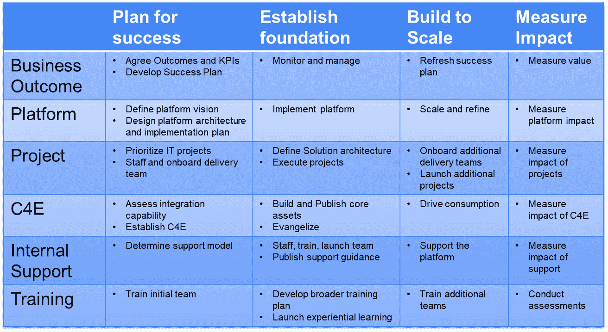
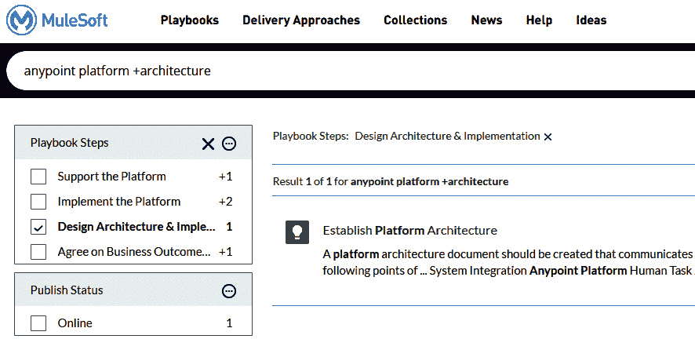
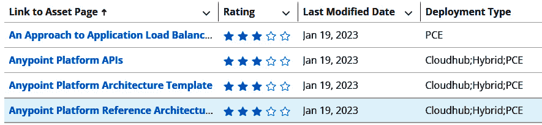
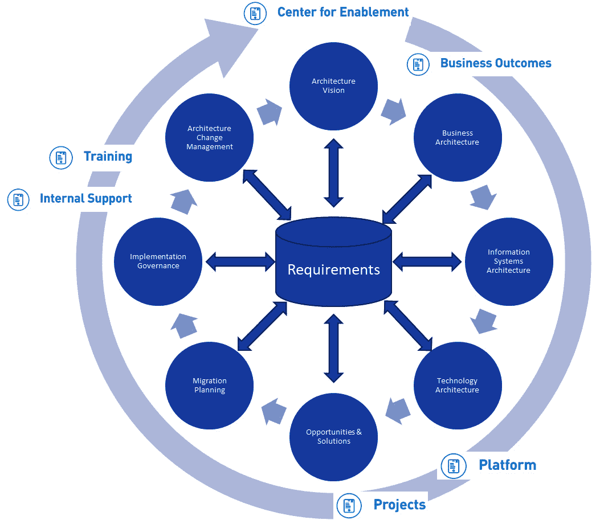
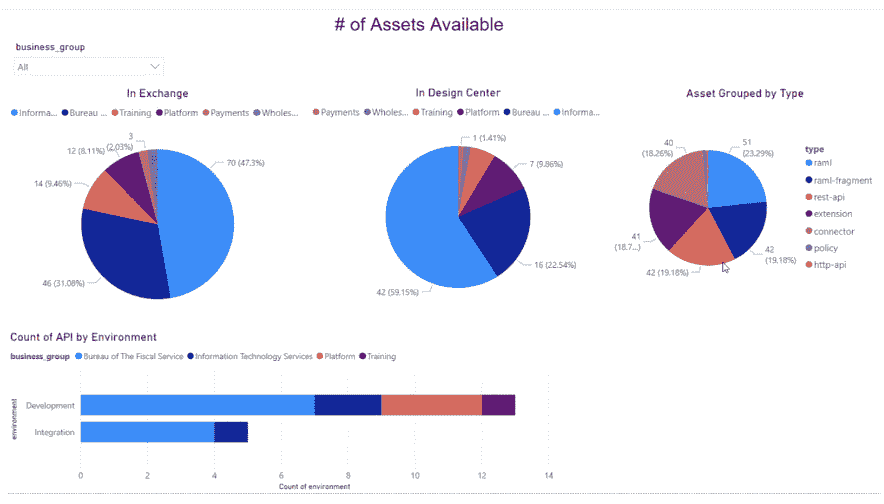

# 3. 利用 Catalyst 和 MuleSoft Knowledge Hub

如果您的组织已经拥有数千个 MuleSoft 实施项目，您从中研究了成功与失败的经验，整理了有效和无效的做法，收集了数百份文档并记录了数十个最佳实践，并将所有内容标记、打标签并组织成与产品开发相一致的类别，那么您可能想跳过本章。如果没有，MuleSoft Catalyst Knowledge Hub 中可能有一些值得挖掘的宝贵经验，能让您和您的公司更轻松地交付成功的 MuleSoft API 项目。

MuleSoft 客户和合作伙伴可以访问一项重要的 MuleSoft 资源，该资源有助于为其集成和转型计划提供加速和提升，并为项目开发带来一致性。该资源就是 Catalyst 和 Catalyst Knowledge Hub。简单来说，Catalyst 是 MuleSoft 交付成功企业集成计划的方法。

Catalyst 所描述的方法及其配套框架并非旨在取代任何项目交付方法论。相反，它指导在规划不同业务时应包含的活动类型和步骤。Catalyst Knowledge Hub 包含即用型（可复用）资产、最佳实践和交付方法，这些均源自多年来数千位 MuleSoft 客户的实施经验，且均以业务目标为中心。

在本书中，我们探讨了企业系统集成的一些历史背景，以及 MuleSoft 平台本身是如何从这一背景中发展而来的。我们还了解了平台本身的核心组件和结构。本书的大部分剩余内容侧重于平台技术细节和项目设计细节。Catalyst 有助于为架构工作提供结构和框架，本书其余部分将进一步对此进行描述。

在本章中，我们将涵盖以下主题：

*   Catalyst、其核心原则及其业务
*   利用 Catalyst Knowledge Hub
*   在 **赋能中心 (C4E)** 中寻找价值

## 探索 Catalyst、其核心原则及其业务

我们进行了一项非常不科学的调查，我询问了几位经验丰富的 MuleSoft 专业人士 Catalyst 是什么，以及它为组织提供了什么益处。尽管样本量很小，但结果很有趣。几乎所有人都认为 Catalyst 是一项重要资源。一些人认为它是项目蓝图；其他人认为它是项目方法论；我询问的少数人认为它是模板和工件的存储库，能给他们提供一个良好的起点。所有人对它的看法都不同。

参加 **MuleSoft Certified Platform Architecture (MCPA)** 课程的架构师将在很高层面上接触 Catalyst，在那里它被描述为一个*框架*和一种企业集成交付*方法论*，采用全局视角来交付业务成果、技术和组织赋能。它指向*行动指南*，讲师几乎总会指出 Catalyst Knowledge Hub 中的模板、文档、问卷和其他资产。

因此，从某种意义上说，所有受访者都在正确的轨道上。他们每个人都使用了 Catalyst 的不同部分并从中发现了价值。事实上，作为一个交付框架，Catalyst 旨在被引入并定制，以适应任何特定组织的组织方式。

但让我们更深入地了解一下 Catalyst 是什么、其基础构成、组织方式，以及为什么它可以成为架构师的有用工具。

### 什么是 Catalyst？

## Catalyst：MuleSoft 的交付方法

简单来说，Catalyst 是 MuleSoft 的交付方法，它从整体视角出发以实现客户成功，将基于成果的技术交付与组织赋能相结合。名字里有什么含义呢？最初，Catalyst 称为 Outcome-Based Delivery（基于成果的交付），这名字太拗口了。Catalyst 让人联想到一种物质，它能引起加速或反应，而自身不受影响。我喜欢这个意象和名字，因为这正是架构师，乃至整个组织，应该了解的关于 Catalyst 的核心。它是任何 MuleSoft 计划的加速器，事实上，也是任何 IT 组织的加速器。

Catalyst 包含六个不同的主要实施指南，我们稍后将逐一回顾。这些实施指南包含活动和步骤，以确保重点领域取得成功。这些步骤大多包含工件、最佳实践、模板和文档作为工件，以支持步骤的执行。

但当我们谈论 Catalyst 作为一种方法论时，意味着什么？这是另一种用于 IT 架构工作的项目管理方法吗？组织目前已在使用许多不同的架构框架和许多项目管理方法论。开放组架构框架 (TOGAF) 和 Zachman Framework© 都是流行的企业架构方法。项目管理协会 (PMI) 的项目管理知识体系指南 (PMBOK) 可能是项目方法论的主要典范，此外还有敏捷、Scrum、瀑布、关键路径法和极限编程。除了这些之外，许多其他方法已被组织采用，以帮助管理项目、识别风险、规划活动、提供阶段评审门、记录当前状态架构、构想未来状态架构、确定差距，并构建路线图以解决上述所有问题。

Catalyst 并非旨在取代这些方法论。相反，它旨在补充、加速和丰富这些方法论。理想情况下，组织将利用 Catalyst 来丰富其现有的项目方法论和企业架构。例如，Catalyst 并不试图概述管理任务的方法。它确实包含步骤、活动和交付物，所有这些都与敏捷项目方法论或方法非常契合。然而，它不包含关于 Scrum 会议的建议、不提倡特定的仪式、不指示演示的必要性，也不建议演示时间表。所有这些都很重要，且应该已经就绪。

同样，Catalyst 也不规定架构偏好或方法。您将找到示例模式、解决方案架构模板和设计考量文档，许多其他架构框架也指向这些内容。然而，Catalyst 并不规定所需的图表，也不规定为通过阶段门应完成哪些资产。

现在我们对 Catalyst 有了更多了解，让我们看看它的基础以及它是如何组织的。

### Catalyst 的基础

Catalyst 围绕三大核心支柱组织，每个支柱由一个或多个实施指南支撑：

*   **业务成果支柱**
    *   业务成果实施指南
*   **技术交付支柱**
    *   平台实施指南（及交付方法）
    *   项目实施指南（及交付方法）
*   **组织赋能支柱**
    *   C4E（及交付方法）
    *   内部支持
    *   培训

Catalyst 通过更具指导性的交付方法来增强其中三个实施指南。Anypoint Platform、Anypoint 项目和 C4E 都有相应的交付方法。这些方法明确定义了跨各个步骤要交付的工作产品。例如，项目交付方法包含一个设计解决方案的步骤，描述了使用 Philippe Kruchten 的软件架构 4+1 视图模型。这种视图常见于许多架构方法论中，并经常被纳入 TOGAF 交付物中。

交付方法还概述了要执行的活动流程，以及每个活动的执行/负责/咨询/知情 (RACI) 矩阵。然而，即使采用特定的交付方法，每个组织也应了解这些交付方法包含的内容，然后采取措施定制处方以适应其机构方法论。

根据 MuleSoft 的 Catalyst 认证课程，Catalyst 实施指南与 Catalyst 交付方法的区别不仅在于结构，还在于受众。两者对所有 Anypoint Platform 订阅者均可用；然而，实施指南是从专门供客户采用的视角编写的，而交付方法的受众则是为系统集成商 (SI) 和交付组织量身定制的。

实施指南及其相关工件是在知识中心开发和维护的，旨在供 MuleSoft 客户采用。但请记住，它们不特定于个别产品或产品套件。它们涵盖 Catalyst 的“规划成功”、“奠定基础”、“构建规模”和“衡量影响”阶段。各个实施指南提供高层级活动以及单个步骤。

在深入探讨其相关实施指南和交付方法之前，让我们简要了解一下这些核心支柱。

#### 业务成果

业务成果是指路明灯，也是告知和塑造未来工作的主要支柱。组织有目标，通常还有企业愿景声明。当公司着手任何新业务时，都怀揣着一个成果——即有助于实现这一愿景或目标的某种未来状态。许多（如果不是全部）组织在承担支持目标或愿景的大型工作计划之前，都需要一个价值主张。价值主张可能包含定性和定量价值。业务成果支柱及其支持的实施指南活动记录了如何与这些业务目标对齐、如何通过关键绩效指标 (KPI) 识别成功、这些报告将是什么样子，以及如何在成功的基础上再接再厉。稍后在本书中，我们将更仔细地研究业务成果及其与功能需求的关系。

#### 技术交付

技术交付也非常重要。您今天构建的平台和应用程序将成为明天的遗留平台和应用程序。此支柱分为两条路径或实施指南：

*   平台
*   项目

平台实施指南始于制定目标 MuleSoft 平台应有的愿景。在此，平台架构师不仅应了解 MuleSoft 产品及其协同工作方式，还必须了解以下方面：

*   我们之前描述的业务成果
*   推动计划的业务战略
*   企业标准
*   企业架构原则和治理

通过理解业务成果主张，我们可以通过展示平台愿景如何支持业务成果来描述该愿景。

一旦规划了平台的未来状态，我们就可以开始安装平台和支持服务，例如通用日志记录、警报和错误处理。我们还可以建立构建和发布管道以支持 CI/CD DevOps 需求。也许最重要的是，我们可以开始衡量作为业务成果工作一部分而开发的 KPI 的影响，从而让我们能够优化平台并确定增长和改进领域。

## Catalyst Foundation

项目手册描述了基于高业务价值和/或可复用 API 的快速获胜，识别并创建待办事项列表所需的活动和步骤。这项工作通常是项目或项目经理的责任，但应在平台架构师和解决方案架构师的参与下完成。项目手册还定义了设计、开发、测试、部署和发布项目或解决方案的活动和步骤。很多时候，这标志着组织项目的结束。然而，Catalyst 包含了扩展以及监控和衡量已完成项目影响的活动。通常，平台架构师可能会发现他们有一个服务每季度只被调用一两次甚至更少。如果是这样，了解原因并确定是否有其他更合适的服务至关重要。

本书的大部分内容都是关于理解这些平台能力以及它们如何支持不同的架构愿景。但如果在真空环境下进行，缺乏对业务愿景、目标和成果的完整理解，你今天构建的平台和应用程序不仅会成为明天的遗留应用程序，还可能成为新的、昂贵的技术债务。

### Organizational Enablement（组织赋能）

组织赋能是关于让人员和流程就绪以创造成功。这项活动可能会让人感到不适，因为它可能涉及变革。为了支持这种变革，该支柱分为三本手册：

*   C4E
*   Internal Support（内部支持）
*   Training（培训）

组织工作之所以如此困难且必要，原因之一是康威定律对系统集成的影响。康威定律假设组织中的沟通结构将反映在系统设计中。如果一家公司组织为位于中心位置的一个大团队，那么软件很可能会被设计为大型单体架构。同样，如果一家公司组织为分布在不同地点的小团队，软件很可能是模块化和分布式的。

Catalyst 最佳实践中推荐的最大变革之一是建立 C4E。在许多情况下（如果不是大多数），创建 C4E 将需要对角色和人员进行一些重组，并可能增加新资源。我们将在本章后面更仔细地研究 C4E。

除了 C4E，我们还必须确定监控、支持和排查 MuleSoft 平台及其支持的所有 API 和应用程序所需的框架和流程。这里有一个警示：Catalyst 中 Internal Support 手册的一些材料、活动和步骤是从 MuleSoft 专业服务或 SI（系统集成商）的角度编写的，包含诸如“与客户设置介绍会议”之类的活动。如前所述，Catalyst 和这些手册应被视为对组织内现有人员、流程和技术的补充。IT 组织可能决定利用其现有的内部支持团队指南，仅添加本手册中专门支持识别和监控与 MuleSoft 平台支持相关的 KPI 的活动。

Training 手册是组织赋能中的第三本，与 Internal Support 一样，它也带有浓重的 SI 视角。然而，对于组织的长期成功至关重要的是，确保 IT 团队具备支持并持续构建 MuleSoft 组件所需的技能，特别是当第三方 SI 被聘请交付初始平台和支持特定业务成果的快速获胜 API 时。该手册还确定了通过其他 MuleSoft 计划（如 Ambassador 计划、开发者研讨会、峰会和会议，以及博客、论坛和聚会小组等在线资源）扩展传统课程作业的活动。

### Playbook Organization（手册组织）

这些支柱还有第二个维度，它有助于进一步组织每本手册中的材料。Catalyst 采用了设计-构建-扩展-优化的开发方法，并对每个阶段使用以下名称：

*   Plan for Success（规划成功）
*   Establish the Foundation（奠定基础）
*   Build to Scale（构建以扩展）
*   Measure Impact（衡量影响）

表 3.1 显示了支柱、手册和这些阶段之间的关系：

表 3.1 – 按开发阶段划分的 Catalyst 基础活动

在此矩阵中，每个阶段所需的活动列在每个阶段下方。每个支柱中的每本手册都包含成功交付项目该阶段所需的活动和步骤。例如，在 Technology Delivery（技术交付）支柱的 Platform（平台）手册中，可以找到与 **Plan for Success** 阶段相关的活动：定义平台愿景和路线图，以及设计架构和实施计划。

每个活动被分解为具体步骤，并详细描述，同时包含该步骤将产生的任何工件和交付物，包括启动该步骤的前置步骤，以及交付团队和客户团队中哪些角色应以某种形式参与该步骤。最后，许多步骤会识别并提供可供下载并供项目团队使用的实体资产链接。

MuleSoft 还通过所谓的 Catalyst Engagements（Catalyst 交付服务）为成功项目提供指导。

### Catalyst Engagements（Catalyst 交付服务）

关于 Catalyst 基础的最后一点说明：MuleSoft 服务产品包括与 MuleSoft 或合作伙伴合作，执行围绕 Catalyst 阶段组织的预定义活动。

Catalyst Launch（启动）交付服务对于刚开始引入 MuleSoft 平台并开发 API 应用程序的组织非常有用。Launch 结合了所有六本手册中 **Plan for Success** 和 **Establish Foundation** 下的活动。此交付服务旨在帮助实现业务成果。它在 Anypoint Platform 的初始配置和设置以及组装首批用例以进行交付方面也很有用。此外，它建立了一个培训计划，通过针对其工作和日常活动的特定课程，赋能组织确定的员工。

Catalyst Scale（扩展）交付服务使用 **Build to Scale** 的活动交付一个计划。因此，此交付服务专注于允许企业和组织开始推动复用的活动。此交付服务有助于识别新用例的潜在候选者，特别是那些可以从最初开发的可复用组件中受益的用例。在此交付服务中，参与组织赋能的团队开始通过额外培训增加他们的技能，并学习运营和支持 API 及 MuleSoft 平台。

Catalyst Optimize（优化）使用 **Measure Impact** 活动。顾名思义，它可以被视为帮助组织在能力成熟度模型量表上迈向更高层级。诸如通过新创建的仪表板进行 KPI 监控、报告和复用加速等活动融入了组织的文化中。

这些交付服务专门利用不同的 Catalyst 产品交付生命周期阶段，采用指导性方法和长期努力，跨越三个 Catalyst 支柱：Business Initiatives（业务倡议）、Technology Delivery（技术交付）和 Organizational Enablement（组织赋能），以实现业务成果。多个项目可能在单个 Catalyst 交付服务的背景下启动并完成。

现在，让我们考虑如何利用 Catalyst Knowledge Hub（知识中心）来加速和/或增强组织的现有方法论。

## Leveraging the Catalyst Knowledge Hub（利用 Catalyst 知识中心）

### Catalyst 知识中心

Catalyst 知识中心是一个可搜索的文档存储库，包含 MuleSoft 精选的资产和内容，供 Catalyst 交付项目使用。本章前面我们将 Catalyst 描述为一种加速器和交付成功企业集成项目的方法；它不是一个项目或架构方法论。

**注意**

除了 Catalyst 中的剧本和交付方法外，MuleSoft 还有一个 GitHub 账号，截至撰写本文时，拥有 158 个代码库。这些代码库包含从功能监控演示到指标工具包再到熔断器策略等模式的实现示例。浏览和使用该账号和代码库不需要 MuleSoft 许可证。该 GitHub 账号向任何寻找示例、演示和启动项目开发的起始框架的人开放。地址如下：`https://github.com/orgs/mulesoft-catalyst/repositories`。

#### 搜索知识中心

利用 Catalyst 知识中心的一种方式是按需搜索示例。仅在平台剧本中，跨阶段和活动就多达 250 个资产页面，其中许多页面附带多个文件。这些文件包括模板、示例、矩阵、视频、PDF、幻灯片等。

例如，作为一名架构师，你可能被要求开发 Anypoint Platform 参考架构。你在 Catalyst 中搜索 Anypoint Platform 并找到 347 个结果。你加入架构关键字将其缩小到 117 个。专门检查**设计架构与实施**，如*图 3.1*所示，我们找到了一个可能有用的剧本步骤：

*图 3.1 – 搜索 Catalyst 知识中心示例*

我们发现该剧本页面上有 25 个可用资产，其中之一是一个包含架构模板的参考架构文档。页面上排名前四的资产如*图 3.2*所示：

*图 3.2 – 搜索结果*

**注意**

剧本条目本身不仅仅是页面底部的可复用资产列表。在*图 3.1*的示例文档中，可以找到对 4+1 架构视图的回顾。

虽然定期搜索特定资产当然是使用 Catalyst 知识中心的一种方式，但杠杆率更高的做法是将该方法本身融入组织已采用的项目和架构方法论中，通过活动和步骤填充项目看板、Scrum 看板或项目计划，并利用资产来加速和丰富你的架构方法。

#### 与架构方法论对齐

Catalyst 方法与通用架构很好地对齐。由于约 80% 的组织使用 TOGAF，它可以作为将 Catalyst 的原则和概念与 TOGAF 相结合的良好示例。

*图 3.3*所示的 TOGAF **架构开发方法**（**ADM**）已通过 Catalyst 方法的剧本进行了增强：

*图 3.3 – Catalyst 方法与 TOGAF ADM 阶段对齐*

在*图 3.3*所示示例中，Catalyst 业务成果已与 TOGAF 架构愿景和业务架构对齐。在 TOGAF 的架构愿景和业务架构步骤中，我们有以下内容：

*   识别利益相关者、关注点和业务需求
*   确认并详述业务目标、业务驱动因素和约束
*   选择参考模型、视点和工具
*   开发当前和目标业务架构描述

通过业务成果增强这些步骤或工件，使 MuleSoft 项目能够沿着 Catalyst 定义的活动与企业架构对齐：

*   就业务成果达成一致
*   识别并对齐关键利益相关者
*   识别成功的依赖关系和风险

同样，当我们定义技术架构和机会与解决方案时，TOGAF 旨在交付架构愿景、架构工作声明、基线和目标业务、数据、应用和技术架构，以及能力评估，这些可以为 Catalyst 平台和项目剧本提供信息，步骤如下：

*   建立平台架构
*   定义通用服务
*   验证架构的合规性

Catalyst 培训与支持剧本已与实施治理和变更管理对齐。这些可以贯穿 ADM 的所有阶段，类似于 C4E 定位为环绕并汲取完整 ADM 生命周期。

*图 3.3* 只是与预先存在的架构方法论对齐的一个示例。重要的是要了解现有的内容，以及可以扩展哪些构建块来支持 API 主导集成计划的产品生命周期。

一般来说，当业务和 IT 之间存在协调时，集成效果会好得多。将 Catalyst 流程与 TOGAF（或任何其他企业架构方法）集成也不例外；跨部门打破孤岛共享是关键。帮助推动集成能力、鼓励复用并衡量 API 在整个组织中的有效性的最佳方式之一，是建立 C4E。在下一节中，我们将探讨 C4E 的构成要素，以及建立 C4E 为组织带来的价值。

## 在 C4E 中寻找价值

通常，MuleSoft 从业者、架构师和交付组织要么忽视 C4E，要么——最好的情况——将其视为次要甚至第三位的考量。在以下情况下，原因很容易理解：

*   工作说明书中确定了更高优先级的事项
*   预算已在年度财务会议中设定并固定
*   财务部门要求不高；他们只想要可包含在薪资报告中的良好数据

这些短期项目、战术性的救火演练、闪亮新事物的诱惑，以及**又一个治理项目**（**YAGP**）的枯燥乏味，足以让组织分心，不再投入精力去关注任何以“中心”开头的事物。

具有讽刺意味的是，当公司忽视不仅是 C4E，还有其推荐的活动和行动时，组织可能会加剧他们原本寻求通过采用 API 方法和崭新的 MuleSoft 平台来解决的问题。他们非但没有减少对 IT 的需求，反而增加了需求；非但没有利用为复用而设计的平台，反而发现自己在缺乏培训和支持的情况下维护和运营另一个平台；非但没有创新和加速刚刚启动的数字化转型计划，业务反而倒退回影子 IT，将关键业务职能放在电子表格中。

正如 Catalyst 中所定义，C4E 首先不是一个治理项目。它不旨在增加阻止项目推进的额外流程关卡。它也不必对每个组织都长得一样。相反，C4E 是一个计划和方法，旨在使团队能够有效管理 Anypoint Platform，促进应用复用以加速创新，传达整体能力，并通过合规性降低风险。

如果缺乏长期平台增长的愿景、良好的资源组织和布道，公司会迅速开始产出不是良好构建块的资产，无法获得应有的复用以实现价值主张。让我们看看建立 C4E 的几个关键要素，包括团队赋能、度量和人员配置。

### 团队赋能

### 通过基础组件赋能团队

C4E 的核心能力和主要活动之一是赋能团队。实现这一目标最有效的方法之一是提供基础组件、模板、示例和 API。模板和示例可以发布到 Exchange，以便那些希望开始开发新 API 的团队能够发现它们。

模板还可以支持最佳实践的编纂，从而有助于确保资产的使用者将遵循既定的最佳实践。C4E 计划的集成架构师与企业架构师协调，识别最佳实践，特别是针对系统通用的基础组件。这可能包括以下内容：

- 日志记录
- 错误处理
- 安全性
- 队列管理
- 警报、监控和健康检查

通常，组织可能已经为某些基础组件确定了最佳实践。例如，组织可能已经规定了日志记录标准，要求将所有应用程序日志和审计日志发送到标准日志记录服务（如 ELK 或 Splunk）。这很好，但通常意味着每个开发人员最终都要自行摸索将日志发送到聚合器的流程。

然而，另一项最佳实践是“一次构建，多处复用”。这些最佳实践可以推动通用框架的开发，这些框架本身就可以被其他项目使用。例如，可以设计并构建一个日志框架来处理任何通用的日志记录需求。然后，这些通用框架可以被纳入针对特定集成设计模式的模板中，例如 API、发布/订阅事件处理器、批处理和 SOAP 服务/消费者。并且，如前所述，这些都可以在 Exchange 中发布并附带完整文档。

许多 MuleSoft 开发人员和架构师都能讲出他们曾多次构建日志服务、安全组件或全局异常处理器的经历。对于负责为多个客户交付 MuleSoft 平台的咨询公司、系统集成商或其他合作伙伴来说，这并不奇怪，但在一个组织内部，这不应成为常态。

#### 指标和 KPI

收集 C4E KPI 的指标可以为您的组织增加价值，无论您是否已启动 C4E 计划。它们告诉您组织相对于业务目标的表现如何。这些信息可以帮助团队根据 API 的使用情况，确定是否需要对平台或 API 进行更改。

Catalyst 建议跟踪以下 KPI，以深入了解平台的成功程度：

- Exchange 中的资产数量
- Design Center 中的资产数量
- 生产环境中的 API 数量
- 开发人员参与度
- 平均评分
- API 复用百分比
- 核心使用量

本章前面提到的 GitHub 账户中较受欢迎的代码库之一包含一个在此处可能有用的工具：`https://github.com/mulesoft-catalyst/metrics-toolkit`

该工具包有助于收集和聚合性能指标，提供仪表板和图表，展示此处描述的许多 KPI。

> **注意：** 根据我们的经验，在 Exchange 中对资产进行评分的情况很少见，即使存在评分，特定资产的评分数量也无法提供有意义的统计反馈。

*图 3.4* 所示的仪表板展示了关于 Exchange 和 Design Center 中资产数量的报表示例：

*图 3.4 – 显示 Anypoint Platform 中可用资产数量的 KPI 仪表板*

*图 3.4* 中的仪表板可以开始讲述一个故事，尽管单靠它还不完整，关于哪个业务组最多地利用了该平台。然而，它也可能表明工作停滞，或者某些团队正在开发 API 但未将其发布到 Exchange。

这些指标绝非详尽列表。获取 KPI 并对其进行衡量可以帮助架构师了解平台的稳定性和采用情况、项目交付的效率，以及最佳实践和治理是否得到遵循。

#### 人员配置

首先，必须始终有一位计划的**倡导者**，即能够赞助工作并跨组织推广（传播）能力的人。C4E 旨在跨职能领域运作。这意味着人员配置应组织为能够与组织内的不同团队和群体协作。由于每个组织都不同，且许多组织在不同能力上的成熟度各异，C4E 不必对每个组织都长得一样；这也延伸到 C4E 的人员配置方式。视组织规模而定，某些定义的角色可能是兼职的。以下职能领域列表在大多数中大型公司中很常见：

- **项目团队**：通常与业务或部门中的产品或解决方案对齐。他们负责新功能、应用程序或计划。
- **架构**：一个跨职能群体，可能包括企业、应用、数据和基础设施架构师。他们负责组织的架构路线图、治理和合规性。
- **变更控制/QA**：他们负责确保对运行环境的更改被理解、记录和测试。这是生产环境变更的最后一道防线。
- **运维**：在基础设施上保持运行的团队。它可能细分为本地和云计算支持。
- **安全**：保护公司可能拥有的最重要、最有价值的资产：其数据和系统。这可能包含在架构团队或运维团队中，并以矩阵式分配给项目团队。
- **CI/CD**：一个相对较新的职能，负责组织范围内的软件开发生命周期。它有时包含在变更控制/QA 团队中。

理想情况下，C4E 的人员配置将包括来自任何中央 IT 组织和不同业务部门的人员。这不仅将为平台中包含的能力提供更好的可见性，而且因为这些团队中的每一个都利益相关，所以也应该能创造更好的认同感。

除了人员来源外，Catalyst 确定了对任何 C4E 计划至关重要的三个主要角色：

- **赞助人**：计划的倡导者。他们理解并跟踪业务价值，是主要的传播者。
- **C4E 负责人**：他们对 C4E 和集成的成功负责，提供平台资产的管理，并处理与利益相关者的所有沟通。
- **集成架构师**：他们负责整体集成架构愿景和路线图，制定标准和最佳实践，并与架构团队以及项目团队联络。如果需要 API 开发团队，他们负责架构决策和方向。

除了这些角色外，还应考虑包含与前面确定的不同职能领域相对应的角色。以下是一些示例：

- **平台联络人**：他们将与运维团队（特别是基础设施）联系，并负责控制平面和运行时平面的稳定运行。
- **DevOps 联络人**：他们将与项目管理团队和 CI/CD 团队联系。此外，他们将负责软件生命周期和项目方法，并拥有 API 生命周期的所有权。

此处显示的角色可能不适合每个组织和每种情况。许多组织依赖个人身兼数职来完成工作，而其他组织则对个人或群体的预期活动有非常具体的规定。

## 摘要

在从业者中，我发现关于 MuleSoft Catalyst 存在许多不同的观点。本章所做的工作是为您提供一个基础，帮助您确定 Catalyst 方法如何以及在何处能为您提供帮助。本章概述了 Catalyst 的基础、它是什么，以及重要的是它不是什么。您了解了 Catalyst 的结构、其原则，以及其基础如何支撑三大支柱：业务成果、技术交付和组织赋能。

我们发现 Catalyst 中包含许多资产，范围涵盖从模板到模式再到示例，所有这些都包裹在创建组织变革以支持工作的最佳实践中。对于刚开始采用 API 方式进行集成的组织，剧本中的行动可以帮助指导组织的项目管理方法，而参考架构资产和 Catalyst 原则可以塑造并解决业务、数据、应用和技术方面的架构关注点。

本章还简要探讨了 C4E，它是组织赋能支柱的关键部分。我们专门考察了 C4E 如何通过提供不仅仅是治理来帮助赋能其他团队。这种支持还以最佳实践、基础框架，以及以模板和示例形式固化的最佳实践的形式出现。我们还研究了如何衡量项目的成功，以便在不奏效的地方做出改变，而布道则可以将这些 KPI 和指标传达给整个组织的利益相关者。文中描述了这些利益相关者以及 C4E 团队所需的关键角色。C4E 的人员配置通常是最具挑战性的方面之一，并且需要组织内部项目高级倡导者的支持和资助。

在 Catalyst 架构材料的建立过程中，可以观察和讨论应用网络的自然形成。下一章将更深入地探讨什么是应用网络、其优势是什么，以及如何鼓励其形成。

## 问题

回答以下问题以测试您对本章的掌握程度：

1. 构成 MuleSoft Catalyst 基础的三大支柱是什么？

2. 为什么在 API 交付项目中识别业务成果很重要？

3. Catalyst 知识中心有哪些内容，它对所有人开放吗？

4. C4E 如何支持成功的 API 项目交付？

## 延伸阅读

要了解本章涵盖主题的更多信息，请查看以下资源：

* Alan Dalley，Medium 上的 *Another Integration Blog* 文章
* MuleSoft 培训课程和认证：*Delivering Successful Business Outcomes with Catalyst*
* 面向合作伙伴和客户的 Catalyst 安全网站：`Knowledge Hub.MuleSoft.com`
* Catalyst 基础 C4E 网络研讨会系列
* MuleSoft 关于 COE 与 C4E 的博客：`https://blogs.mulesoft.com/digital-transformation/coe-c4e-away-teams/`

## 答案

以下是本章问题的答案：

1. MuleSoft Catalyst 围绕三大支柱构建：业务成果、技术交付和组织交付。

2. 业务成果有助于我们确定业务的优先级。它为我们提供了业务已确定的目标或目的。它可以帮助塑造和推动业务举措，以实现组织的现代化或数字化转型。它突出了交付业务成果所关联的价值。它还允许我们形成支持业务成果交付的技术用例。

3. Catalyst 知识中心面向 MuleSoft 的客户和合作伙伴开放。它需要订阅 Anypoint Platform。但是，其中的内容可随时用于任何项目或工作。Catalyst 知识中心按支柱组织，每个支柱包含一个或多个剧本。每个剧本定义了活动及其步骤，涵盖基于产品开发的四个类别：规划成功、建立基础、构建规模和衡量影响。每个步骤都有文档记录和描述，大多数步骤包含支持该活动的资产。这些资产可以是用于沟通的 PowerPoint 幻灯片、作为设计模板的文档、包含 API 主导架构示例的 Visio 图表，以及许多其他描述最佳实践、模式或网络架构的资产。除了剧本外，还有交付方法，可作为三个剧本的指导性方法：平台、项目和 C4E。

4. C4E 提供了一种赋能组织内团队的方法。C4E 不仅建立治理，还建立最佳实践、通用服务和其他加速器。团队发布基础组件和服务。团队与运维、CI/CD 和架构小组合作，为 SDLC 提供一致的方法。C4E 监控 KPI 和指标，以确定平台、团队和项目运行得如何，以及 API 采用情况如何。
