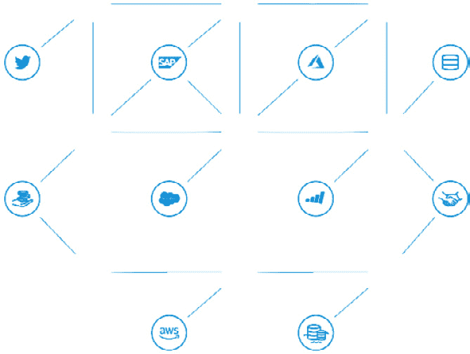
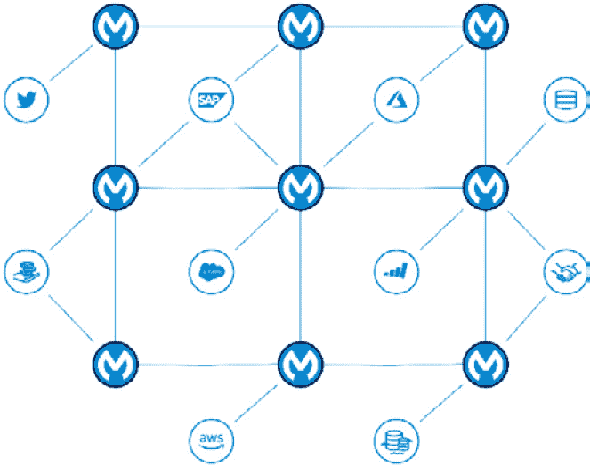
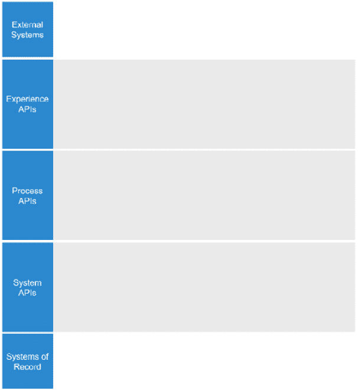
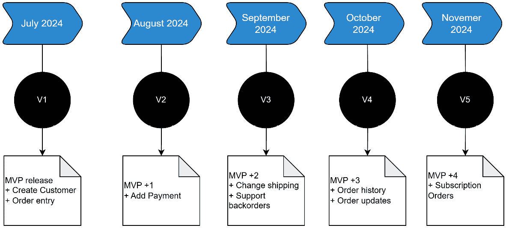
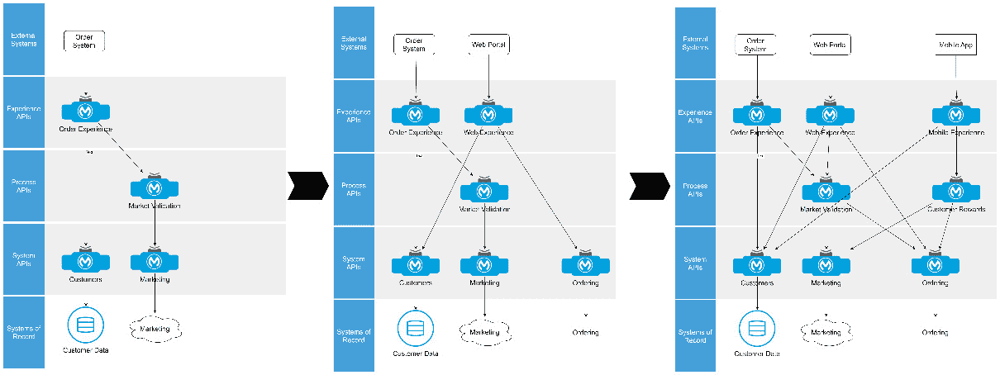
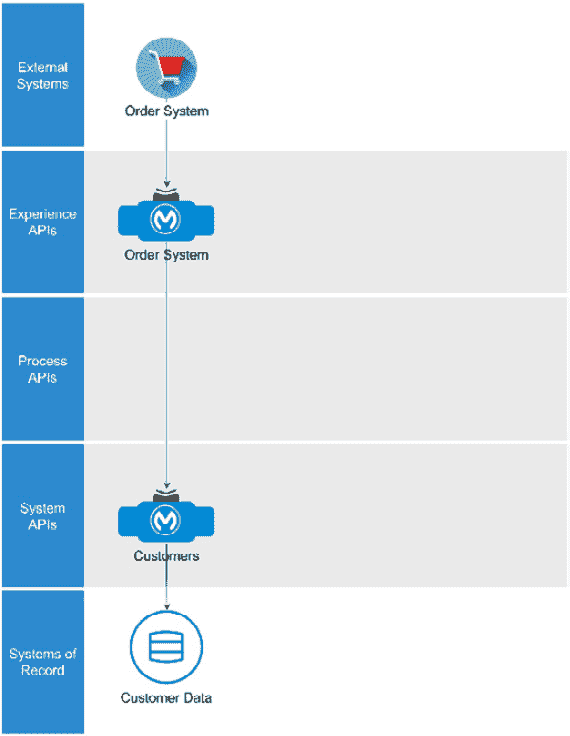
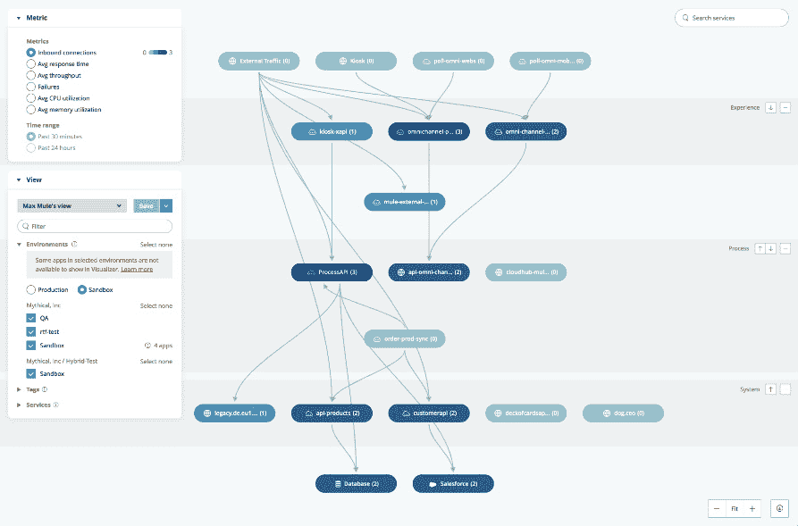

# 第 4 章：应用网络简介

在本章中，我们将考虑一种跨企业集成应用程序和数据的不同方法。我们已经从高层了解了随时间发展而形成的不同集成模式——点对点、发布-订阅和**面向服务的架构 (SOA)**。我们还考虑了一些中间件工具，如企业服务总线、中心辐射型、消息队列、事件驱动和**抽取、转换、加载 (ETL)**。

在这里，我们将更仔细地研究应用网络的概念，是什么将其与其他集成方法区分开来，以及为什么 MuleSoft 认为它是*下一代集成中间件*。我们还将看到如何应用工具、安全性和 Mule 运行时来实现应用网络架构。

在本章中，我们将探讨以下主题：

* MuleSoft 应用网络简介
* 构建和实施应用网络
* 应用网络的优势和最佳实践

2019 年，MuleSoft 在澳大利亚的现场 CTO、DTO Andrew Dent 写道："*应用网络是通过 API 连接应用程序、数据和设备的方式，这些 API 在网络上暴露其资产和数据。*" 在本章中，我们将更深入地探讨这些概念以及平台架构师在帮助定义和构建此网络中的角色。

## MuleSoft 应用网络简介

理解应用网络的概念非常重要。事实上，MuleSoft 平台架构师的主要角色之一不仅是理解它，还要充当该网络的编排者。确实，“应用网络”是准备学生参加平台架构师考试的 MuleSoft 课程的副标题（*Anypoint Platform Architecture: Application Networks*）！以下 URL 是该课程的链接：`https://trailheadacademy.salesforce.com/classes/ARC720-mulesoft-architecture-application-networks`。

### 什么是应用网络？

首先，让我们了解什么是应用网络，以及它不是什么。应用网络不是一种集成架构。相反，至少在 API 集成的背景下，它是当应用程序通过 API 作为“网络节点”可用，并与组织内的其他应用程序节点建立连接时所出现的全貌。它是连接的应用程序、数据和业务流程构建块的集合，API 作为网络的连接组织。

从某种意义上说，概念应用网络的起源可以部分追溯到蒂姆·伯纳斯-李爵士对**万维网**（**WWW**）的愿景。放眼全局，这个跨越每个大陆、连接几乎所有企业、启用当时甚至尚未想象出的设备、并开启了信息时代的信息和数据网络，展示了当事物以一种可复用连接的方式相互连接时，会变得多么有价值。该网络的连接组织，通常是**表述性状态转移（REST）**的动词与资源进行交互，正如*罗伊·托马斯·菲尔丁博士开创性的博士论文*中所述。

该网络涌现的主要问题之一是：在哪里可以找到值得信赖的信息。任何企业、实体，甚至不良行为者，都可以轻松加入这个“应用”网络，共享虚假或误导性的信息和数据。最终，该网络上发现的数据质量降低了其整体价值。这并不妨碍许多高中和大学论文或 LinkedIn 博客利用这些信息创建出来，进一步扩散了这个应用网络中浑浊的数据。解决 WWW “应用网络” 上信息的质量和可信度问题，现在是伯纳斯-李的最新关注点。这也应该是那些希望利用其最大资产之一——数据——来驱动创新的组织的关注重点。

应用网络中的可信数据使我们能够管理业务变更、实现敏捷性、创新新产品和解决方案，并通过可复用组件发挥组织中最佳创意的价值。组织中的几乎每个应用都与某些业务价值相关联。当这些应用启用 API 并加入应用网络时，应用的内在价值会增加，网络的价值也会随之增加。然而，我们可以称之为网络的*潜在价值*也会增加。随着更多应用加入网络并利用已为新消费应用提供的数据和流程，这种潜在价值得以实现。

那么，让我们更仔细地看看是什么构成了应用网络，以及它重要的一些原因。

## 应用网络的组件及其重要性

应用网络的第一个且最明显的组件是应用或系统。然而，应用分为两种不同类型：

*   **记录系统**：记录系统是某条信息或数据的公认权威来源。例如，一个组织内可能有许多不同的应用，都使用客户数据。然而，当某个特定应用被确定为客户数据的真实来源时，其他系统必须遵从这个主系统以获取经过验证的数据。

*   **外部或消费应用**：组织内外的许多系统将从多个来源消费数据。在此背景下，该应用是一个外部消费应用。

不同数据域的记录系统可能难以识别。因为大多数组织拥有相当庞大的应用环境（一些报告指出系统数量超过 900 个），不同业务单元可能使用相似的数据，但以独特的方式使用它们。

组织在不知不觉中已经拥有了一个雏形的应用网络。当我们考虑公司中使用的所有应用，并暂时抛开连接组织（如手动双重数据录入、文件下载和文件上传）时，“网络”层面是不可见的。*图 4.1* 展示了公司日常业务可能使用的各种应用的一个小规模足迹。这些应用当然因公司而异。这些可能是**业务线**（**LOB**）应用、企业级应用，甚至是外部应用。

我们可以将其视为一个无意的应用网络。利用这些应用中的数据和流程的能力是未知的。不可见网络的内在价值并非为零；它最终可能会给公司带来显著的财务成本。例如，考虑在多个系统中手动维护数据的成本、雇佣员工管理和维护重复业务功能的成本，更不用说因未知数据质量而开展业务的成本了。在为一家公司进行战略和架构路线图项目时，发现员工薪资是从一个应用下载到 CSV 文件中，手动转换为 Excel 电子表格，由薪资人员在电子表格中手动审核并经常调整，最后发送给另一家第三方公司来制作支票。显然，该流程中的几个环节都可能导致声誉和财务损失。

借助 MuleSoft 支持的组织，我们可以开始看到 API 作为企业通用的连接能力，为该网络中的任何信息系统提供可访问的数据和可复用的流程。*图 4.2* 常用于表示 MuleSoft 平台支持的应用网络。

当然，这个图表是非常高层级的，并未显示应用之间连接的任何具体细节。我们可以通过查看 API（MuleSoft 支持的应用网络的第二个组件）来分解它。

当我们在 MuleSoft 支持的组织背景下谈论应用网络时，大多数 Mule 从业者首先想到的是一个多层级的高层架构图，通常由 API 架构师开发，用于确定需要构建哪些 API、数据和流程来自何处，以及哪些系统和应用消费特定的数据和流程。

用于 API 主导连接的 API 架构通常绘制为泳道图。*图 4.3* 显示了一个未填充的模板，其中标识了每一层或组件层。

在*图 4.3* 所示的模板中，应用网络的第一个组件——应用（或系统）——位于顶部和底部的泳道中。连接它们的 API 位于中间的泳道中。组件可以识别如下：

*   **外部系统**：这些是通过 API 消费流程和信息的系统。

*   **体验 API**：这些 API 专门构建用于将请求数据的获取与外部系统所需的格式化和通信解耦。例如，所获取的数据可能来自各种来源，使用的格式对外部系统来说完全陌生。该体验 API 承担以特定系统能理解的方式呈现数据的工作。

*   **流程 API**：这些 API 可以协调系统的获取和/或事务。这种协调可以是编排或协作。其目的也可以是聚合跨不同来源的数据，或执行多系统业务事务，在需要时手动处理回滚和提交。

*   **系统 API**：这些 API 可安全可靠地暴露记录系统中提供的数据操作。这可以包括在特定应用程序中获取、创建、更新和删除数据。通常，记录系统将提供文档完善且设计良好的 RESTful API。这些 API 可以直接用作系统 API，特别是当出现流程数或 vCore 等其他成本相关因素时。但是，请务必彻底考虑如果替换这些系统，任何可组合性、复用性和耦合性问题可能造成的技术债务。

*   **记录系统**：如前所述，该系统是就某条信息或数据达成共识的事实来源。

## 构建和实施应用网络

在考虑构建应用网络时，我们可以考虑三个主要步骤。

1.  规划路线图
2.  设计与开发
3.  管理与推广复用

### 规划路线图

当我们开始考虑构建应用程序时，尤其是在采用敏捷方法和途径的组织中，我们通常会考虑一个包含不同新增功能的路线图，这些功能涵盖不同的功能性和业务用例。制定战略路线图应被视为重中之重。如果没有方向或对期望目标的理解，未来状态就只能听天由命，可能支持也可能不支持组织目标所需的业务成果。

如前所述，这是开发应用程序路线图的常规方法（或应该是）。这可以包括 API 应用程序以及新的 LOB 应用程序。请参考 **图 4.4** 中的示例项目路线图。该图从 **最小可行性产品 (MVP)** 开始，确定了若干额外的里程碑及所包含的功能。

图 4.4 - 应用程序路线图

**图 4.4** 中描绘的路线图确定了我们何时可以期望订购应用程序的 MVP 完成，随后建议了 MVP 发布后用户每月可以期待的附加功能。

同样，我们可以通过考虑应安全暴露并提供哪些数据和流程，以及哪些应用程序将开始消费这些数据，来开始规划应用网络的路线图。请参考 **图 4.5** 中的高层架构设计。这一系列架构设计展示了应用网络如何随时间演进。

图 4.5 - 新兴应用网络的解决方案路线图

此外，这些图中的设计也开始突显我们将在何处能够复用现有 API，从而提取 MuleSoft Anypoint Platform 中价值主张的一部分。

该解决方案路线图应突显的一点是，由组织高层驱动的集成架构的重要性。这会带来两个结果：

*   一种考虑其他 LOB 应用程序、企业系统和组织目标的架构。部门团队可能不了解这些跨职能需求。
*   开发集成架构的部门团队开始考虑这些外部因素，以及如何利用其系统提供服务以支持组织目标。

### 设计与开发

在本步骤中，我们将更详细地探讨在我们不断演进的应用网络中需要设计和开发的内容。在上一节中，我们开始创建路线图，并提供了一种方法来了解如何复用不同的 API，方法是观察未来的 API 主导连接将如何引入新连接并复用现有连接。在这里，我们将获取那些单独的连接点并设计和开发其细节。

让我们使用前面描述的用例来考虑一个快速示例。我们假设 J&J Music 一直在为其客户数据的低质量而苦恼，尤其是在尝试下订单时。对这家音乐公司运营的分析显示，客户难以找到他们之前的订单，因为他们的信息被重复了，或者因为他们的信息不再存在。这种管理不善的数据带来的另一个问题是无法深入了解客户的购买习惯，以便公司能更好地满足他们的需求，并提供更高水平的服务，无论是线下购物还是在线购物。

J&J Music 的 CIO 决定通过开发或购买 **主数据管理 (MDM)** 应用程序来解决数据质量问题。该系统将治理并促进其客户数据的管理。我们在这里没有空间描述该系统或其实施过程的细节，但为方便起见，让我们假设在系统的实施和部署期间，已进行了数据清理，并完成了与订购系统的对账。上线期间，业务方同意宣布 MDM 应用程序为客户数据的单一事实来源。

最终，期望的业务成果是客户在订购音乐作品时拥有更清晰、更不易出错的流程。在收集需求以定义实现这一业务成果的解决方案时，架构团队展示了您在 **图 4.6** 中看到的设计。

图 4.6 - J&J Music 的订购和客户视图

使用泳道模板，平台架构师可以将订购系统识别为外部/消费系统。同样，架构师发现客户数据的事实来源位于客户 MDM 系统中。

J&J Music 的 IT 团队负责开发 API，以提供对数据的受控访问，并开放可添加或编辑客户数据的流程。因为这些数据在 MDM 解决方案中进行管理和治理，我们甚至可能需要开发这些 API 以与 MDM 解决方案中的任何工作流、策略、通知或规则集成。这当然对现有的订单应用程序具有即时的现实价值。订单应用程序现在可以利用这些经过整理的客户数据，确保在与客户交易时使用事实来源。

然而，对于与客户数据交互的任何其他应用程序，也存在“潜在价值”，这正是应用网络内在价值的所在。这种潜在价值也可以估算。至少，它等于构建客户 API 的成本。通过复用客户 API 而不是重建它，可以为任何其他消费者实现直接的成本节约。此外，虽然有点难以量化，但当然也存在拥有来自单一事实来源的高质量数据的价值。

正如我们在上一节所观察到的，随着路线图愿景的执行和未来功能的添加，客户 API 将被复用。每当这种情况发生，组织就兑现了应用网络的价值。

### 管理与推广复用

在上一章中，我们回顾了 **赋能中心 (C4E)** 的概念，并从高层探讨了组织赋能。C4E 通过多种角色为组织提供价值。监控、推广和宣传复用是其中最重要的。实现有价值、可复用的应用网络取决于公司调整其 IT 运营模式，以开始利用应用程序之间的连接。

这意味着，除了制定架构路线图策略和计划，以及设计和开发可复用的 API 服务以实现路线图策略之外，我们还需要实现对这些新资产的管理，并找到方法激发组织活力，以便在应用网络开始成型时利用它。

请注意，我们在此描述的管理活动主要甚至次要目的都不是审查代码或文档。这项活动旨在确保新资产在整个组织中更广为人知。许多组织（如果不是大多数的话）光是弄清有哪些系统正在使用中就很困难，尤其是当我们开始统计作为“skunkworks”应用程序开发的影子 IT 系统数量时，因为 IT 部门很难为又一个业务请求分配资源。因此，从某种意义上说，增加 API 资产可能会扩大对现有资产及其用途的认知差距。

MuleSoft Anypoint Platform 可用于保持应用网络连接的可见性，明确应用网络的哪些部分最强、哪里存在弱点。下列列表展示了 Anypoint Platform 中包含的一些基本机制，使得管理组织的 API 变得更加容易。API 门户和仪表板提供了 Anypoint 上 API 运行的指标：

*   消息流性能的管理视图
*   API 的管理视图
*   API 的架构和故障排查视图（通过 Visualizer），如图 4.7 所示

Anypoint Visualizer 等视图以及本书其他章节讨论的监控功能，都是可用的工具，可突出显示应用网络中表现良好的 API，同时也能识别不再相关或可能为整个组织所不知的 API。可能是时候弃用某个特定的 API，或者可能需要更好地推广 API 集合所暴露的数据和功能。

何时采取此类行动取决于组织、未来的架构差距过渡，以及组织为管理应用网络而采用的最佳实践。

在下一节中，我们将总结应用网络的优势，并探讨在组织内创建应用网络的一些最佳实践。

## 应用网络的优势和最佳实践

在本节中，我们将回顾应用网络为组织带来的优势，然后重点介绍在设计应用网络架构时应遵循的一些最佳实践。

### 优势

连接和通信总体上有许多优势，通过观察组织内应用程序间的数据流动即可轻易察觉。这些优势既有定量的，也有定性的。

#### 提高效率和敏捷性

本章伊始，我们提到了 WWW（万维网）的价值。将其与组织的应用网络相比并不完全贴切，但它凸显了应用网络最大的优势之一（也可能是一个严重的弱点）。

互联网上有海量数据可用。但我认为最好的研究仍然源自一座好图书馆和扎实的藏书，比如你手中的这本书——这些资料经过了编辑和研究时间的打磨。然而，一旦确定了可信的数据源，我们能以多快的速度找到问题的答案，这是毋庸置疑的。同样，业务发展迅速。这一事实催生了那句常用语：“大鱼不吃小鱼，快鱼吃慢鱼”。

这不仅仅是能在需要时找到并使用数据。它关乎通过开发可用于快速构建新解决方案的构建模块，在 IT 团队内部建立敏捷性，而无需一遍又一遍地重建相同的数据路径。

应用网络使您能够复用和重组现有的应用程序和数据，而不是从头构建所有内容。这使您能够快速响应不断变化的市场需求和客户需要，以及尝试新想法和新功能。

#### 可扩展性

应用网络允许您根据负载和需求扩展或缩减应用程序，而不会影响性能或可靠性。您还可以利用云服务和平台托管应用程序和数据，降低基础设施管理的成本和复杂性。

#### 安全性

应用网络使您能够在应用程序和数据上实施一致的安全策略，无论它们位于何处或如何被访问。您还可以使用加密、身份验证和授权机制来保护数据和交易免受未经授权的访问或篡改。

#### 可见性

应用网络为您提供应用程序和数据的性能、健康状况和使用情况的实时洞察。您还可以监控和排查问题，以及优化资源和流程。

### 最佳实践

架构师和资深开发人员早已知晓遵循既定最佳实践的好处。这样做有助于提供代码一致性。最佳实践能让理解这些实践的新开发人员更容易上手并发挥作用，减少所需的知识传递。它们能揭示“简易按钮”，避免团队重复造轮子。

在这里，我们将探讨在设计应用网络架构和为其提供动力的 API 时应考虑的八大最佳实践。

#### 数据策略

应用网络的“秘诀”在于理解并确定组织数据的所在位置，然后安全地启用数据和流程，以供组织内部以及在适当情况下外部（例如 B2B 交易和消息传递）的任何其他应用程序按需消费和使用。

MuleSoft 和 Anypoint Platform 本身并不属于数据策略的一部分。然而，它们将帮助您交付和执行数据策略。这是通过打开通往锁定在各种事实系统中的数据的大门来实现的。它还帮助我们安全地将这些数据交付给消费者。

#### 安全性与合规性

在制定应用网络的架构路线图时，必须尽早且反复地解决安全性和可信度问题。架构师和架构与设计会议中的从业者经常使用这样一句话：“我们可以暴露此系统的数据，另一个系统就能轻松消费它。”这往往会引起被暴露系统所有者的强烈本能反应。即使初衷始终是保护数据安全，并有意控制谁可以访问 API、谁不可以，但因数据暴露而在公众面前（如果不是在市场上）“烧伤”自己的公司实在太多了。

为什么要在这里讨论语义？因为安全性非常重要，但如果数据所有者只听到“暴露”这个词，还不了解我们如何设计集成安全性（包括身份验证和授权），我们可能会发现利益相关者的合作意愿大打折扣。

#### 创新与协作

### 改善跨孤岛协作

应用程序最强大的组件最终可能是改善企业内部先前孤立的部门、团队或群体之间的协作。随着应用网络的增长，我们开始安全地释放企业范围内的数据。如果不共同努力推广这些新功能，我们可能会失去应用网络背后的一些主要优势。作为这一最佳实践的实用方法，平台架构师应鼓励开放沟通。虽然工具可以支持我们在集成中所做的大部分工作，但最好的想法和创新来自于了解当前可用服务的个人。这种沟通也应尽可能跨职能进行。

### 以消费者为中心设计您的 API

您的 API 应易于理解、使用和与其他应用程序集成。您还应遵循 `REST`（`representational state transfer`，表述性状态转移）的原则，包括资源、方法、状态码和超媒体链接。这一最佳实践带来的挑战是找到功能与特性之间的平衡，以及 API 应处于什么粒度。

#### 为您的 API 编写清晰的规范文档

您的 API 应具有清晰且全面的文档，描述其功能、参数、响应、错误和示例。您还应使用标准格式为 API 编写文档，例如 `OpenAPI Specification` (`OAS`) 或 `RESTful API Modeling Language` (`RAML`)，后者是描述 RESTful API 的广泛采用的标准。

除了这些规范之外，在 Exchange 中提供良好的开发者文档至关重要。Stripe 和 Fiserv 的 API 文档通常被视为行业标杆，两者都提供了清晰的服务使用示例。我们不应感到惊讶，当 Exchange 中的 API 被闲置并开发出新 API 时，因为该 Exchange 条目仅包含资源（功能）和操作（`GET` 和 `PUT`）。（请参阅前文的创新与协作部分。）

### 使用 Anypoint API Management 管理您的 API

虽然 MuleSoft 希望将组织内的所有 API 都视为 Mule API，但现实是组织通常拥有使用许多不同工具开发的 API。能够在单一位置管理这些 API 还使我们能够获得完整应用网络的可见性，而可见性是应用网络的主要优势之一。

### 使用策略和标准治理您的 API

借助 `Anypoint API Governance`，我们可以创建策略和标准，定义应用网络上的 API 应如何设计、开发、测试、部署和维护。该平台允许我们确保遵守这些策略和标准，以及法规要求和最佳实践。

### 通过反馈和迭代演进您的 API

您的 API 应根据消费者、合作伙伴和利益相关者的反馈持续改进。您还应采用迭代方法开发 API，使用敏捷方法论，如 `Scrum` 或 `Kanban`。这将帮助您更快、更频繁地交付价值，并适应不断变化的需求和期望。

### 总结

在本章中，我们开始学习如何使用不同的范式来看待集成问题——一种将企业内外部的应用程序和系统视为网络节点的观点。我们了解到，这种企业集成架构方法是 `MuleSoft` 所称的应用网络。虽然这种方法并非 `MuleSoft` 独有，但该平台为架构师提供了启用应用网络所需的工具、治理、安全性和执行能力。

除了探讨应用网络的逻辑概念外，我们还花时间在本章的“构建和实施应用网络”部分探讨了这种架构的物理表现。我们介绍了应用网络的特征，并研究了架构和设计这些网络的一些优势和挑战。我们还探讨了可组装企业的含义及其对 IT 组织的影响。

最后，我们确定了平台架构师在设计、构建和实施应用网络时应考虑的最佳实践。

### 问题

1. 在 `MuleSoft Anypoint Platform` 的背景下，哪两个关键组件有助于形成应用网络？

2. 为应用网络制定架构策略的重要性是什么？

3. 公司通过在企业内部开发和/或暴露应用网络将获得哪些益处？

### 延伸阅读

- *新 IT 运营模式——应用网络、组件交换和 `Federated Enablement`（联邦赋能）*
- *Catalyst：项目交付——管理解决方案：构建 `Solution Roadmap`（解决方案路线图）*
- *为什么 `Mule` 不是您的数据 `strategy`（战略）* ([`blogs.mulesoft.com/learn-apis/application-network/where-mule-fits-in-your-data-strategy/`](https://blogs.mulesoft.com/learn-apis/application-network/where-mule-fits-in-your-data-strategy/))

### 答案

1. 应用网络的两个关键组件是记录系统应用程序和外部或消费应用程序。应用网络充当内部神经系统，通过系统 API 连接这些不同的应用程序，这些系统 API 安全地暴露适量的数据给流程 API 和体验 API，后者组合、编排、协调并向经过批准和授权的消费者展示这些数据。

2. 制定路线图使平台架构师能够直观地识别可重用的 API，基于新出现的消费应用程序在路线图上显现。

3. 应用网络可以提高业务效率和 IT 团队效率。应用网络可以通过重用创建更好的可扩展性，并通过将数据锁定在单一暴露接口上（通过各种身份验证和授权功能控制）来提高数据安全性。最后，应用网络提高了数据流和构成网络的构建块重用的可见性。
