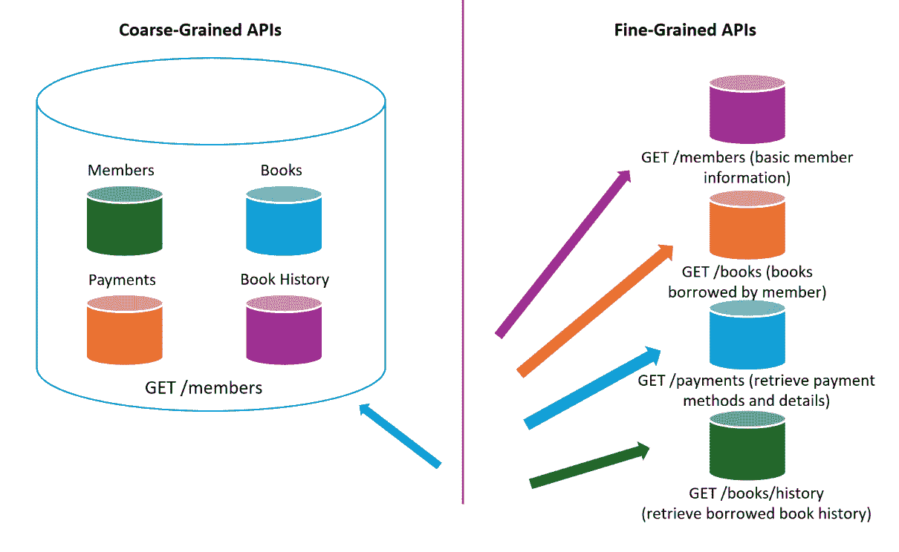
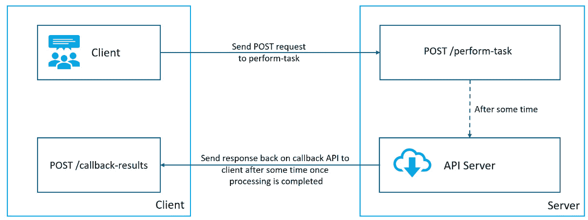

# 将期望的业务成果与功能需求相匹配

充分发挥 MuleSoft 平台优势的关键步骤是了解期望的业务成果，并将这些成果转化为功能需求。本章探讨功能需求如何与平台功能相匹配。您将了解这些功能需求如何影响架构决策和设计模式，例如数据模型、粒度、并发性和 HTTP 方法。本章将包含使用有界上下文数据模型与**企业数据模型 (EDM)** 的示例。

在本章中，我们将涵盖以下主题：

- 制定业务成果和功能需求
- 面向通信设计
- EDM 与有界上下文数据模型
- 粗粒度 API 与细粒度 API
- API 并发性和 HTTP 动词
- API 回调

## 制定业务成果和功能需求

在软件工程中，功能需求指定了软件系统的精确操作或功能。除了提供输入、流程、输出和数据的需求外，它们还概述了系统应能实现的目标。

功能需求的子类别如下：

- **数据输入和输出**：这描述了系统应接受的输入数据的类型和格式，以及系统输出应采用的格式。
- **外部接口**：这描述了如何与外部系统交互或通信。
- **安全性**：这描述了应用程序的任何安全需求，例如数据加密和用户访问控制。
- **错误处理**：这描述了系统应如何处理错误以及应显示哪些错误消息。
- **数据存储和检索**：由于它们是系统设计、测试和验证的基础，因此功能需求对于系统开发至关重要。它们通常由业务用户主导，并通常用业务术语描述。

协调功能需求与期望业务成果的第一步是确定组织的目标以及实现这些目标所需的技术技能。

以下是确定功能需求的步骤：

1. **确立业务目标**：无论您的重点是提升销售额、增加客户参与度，还是优化运营效率，首先要确定您的业务目标。
2. **确定功能需求**：确立业务目标后，下一阶段是确定实现预期结果所需的功能需求，即系统的特性和功能。例如软件系统、人员技能和操作程序。
3. **咨询利益相关者**：在确定功能需求时，纳入重要利益相关者至关重要。为了了解公司及其客户的需求，这可能需要与管理者、最终用户、客户和技术团队交谈。
4. **设定优先级**：并非所有需求都同等重要。根据功能需求对整体战略的重要性，将其排列为优先级列表。
5. **映射和对齐**：将业务成果与已确定的功能需求对齐。业务分析师可以协助建立联系并将需求映射到成果。
6. **开发和实施**：根据规范创建和实施系统或功能。确保每个开发项目均符合公认的行业规范。
7. **测试和评估**：确保测试所有新功能或系统。修正的错误越多，结果越好。分阶段交付项目，确保每个阶段都结合您的业务成果进行评估，以保证对齐。
8. **定期审查**：为确保功能需求和业务成果保持对齐，请确保定期审查两者。随着业务增长，您的功能需求和业务成果也会发生变化。

请记住，战略对齐可确保组织的资源有效且高效地促进其目标的实现。这种对齐发生在期望的业务成果与功能需求之间。

由于**应用程序编程接口 (API)** 可在各种平台、系统和技术之间实现通信，因此它们通常是数字业务的重要组成部分。借助 API，不同的软件应用程序可以通用连接，从而交换数据、发起操作和进行集成。

功能需求和业务成果的制定在很大程度上依赖于 API。具体方法如下：

- **实现自动化**：通过实现直接的系统间通信，API 启用了自动化功能。它们可以创建更高效的流程并取代人工劳动，从而提高产出并降低成本。
- **实现集成**：API 使您能够集成两个或多个系统，以交换或释放数据并建立安全通信。
- **改善客户体验**：通过支持提供定制化服务，API 可以改善用户体验。它们使与外部应用程序集成成为可能，为客户提供独特且定制化的体验，从而提高客户满意度和留存率。
- **扩大覆盖范围**：企业可以通过利用 API 来扩展其能力和覆盖范围。它们可以将公司数据和服务提供给外部开发人员，后者可以利用这些数据和服务创建新应用程序并开辟新渠道，使公司能够触达新市场或客户。

# API 功能需求与设计原则

## 功能需求

API（应用程序编程接口）必须具备或提供的行为特性、能力或功能被称为 API 功能需求。它们代表了 API 旨在提供的功能或服务。这些规范概述了 API 被允许执行的精确功能，包括数据检索、记录更新和数据删除。它们还描述了事件序列、API 与其他软件组件之间的交互，以及涉及数据输入、输出、安全、错误处理和其他主题的规范。

因此，“API 功能需求”一词指的是 API 行为的综合规范，包括预期的输入和响应、其响应不同类型请求的方式，以及与其他系统的任何潜在交互。

## 非功能需求

在创建 API 时，考虑一些非功能需求以实现这些业务成果至关重要：

*   **安全性**：为防止未经授权的访问、篡改或敏感数据丢失，API 必须是安全的。
*   **性能**：为保证系统的可靠性和有效性，API 必须提供卓越的速度和性能。
*   **可扩展性**：随着业务扩展，API 应足够灵活以适应不断增长的负载。
*   **可靠性**：为防止停机并保证不间断运行，API 必须是可靠且可访问的。
*   **灵活性**：API 应以不干扰系统的方式处理变更。
*   **易用性**：开发人员应能在清晰的文档和说明指引下轻松使用 API。
*   **互操作性**：为促进集成，API 应能够相互通信，并与软件系统通信。

通过考虑这些功能需求以及 API 所能实现的业务成果，企业可以将 API 作为一种战略工具加以有效利用，以推动数字化转型、提升效率、拓宽客户群并改善客户体验。

在前一节中，我们讨论了必须与业务成果相匹配的功能需求。在本节中，我们将讨论为通信设计 API。

## 为通信而设计

API（应用程序编程接口）的设计对于实现各种软件服务和组件之间的顺畅通信至关重要。以下提示详细说明了应如何创建 API 以促进高效通信：

*   **明确目标**：确保您知晓并理解 API 的目标。它将处理何种信息或提供何种服务？
*   **选择合适的协议**：API 通信中使用的两种主要协议是 `SOAP` 和 `REST`。因其易用性，`REST` 是最流行的协议。
*   **URI**：在设计端点时，应精确定义资源的 URI。定义 API 资源路径时始终使用名词。
*   **使用状态码**：为告知客户端 API 请求的结果，API 应返回标准 HTTP 状态码。
*   **以标准格式提供数据**：最广泛使用的格式是 `JSON`。大多数现代编程语言都支持它，且它轻量级、易读易写。
*   **错误处理**：提供一致的错误处理和信息丰富的错误消息。当客户端发送错误请求时，收到关于出了什么问题以及如何修复的明确说明，能带来更好的用户体验。
*   **清晰定义端点**：它们对设计良好的 API 至关重要。这些端点应准确代表资源且易于理解。您的应用程序应为每个可通过 HTTP 方法访问的资源提供不同的 URL。
*   **采用标准 HTTP 方法**：为以可预测且易懂的方式操作资源，应使用标准 HTTP 方法 `GET`、`POST`、`PUT`、`DELETE` 等。
*   **提供充分的文档**：除非有完善的文档，否则 API 无法被使用。应解释每个端点及其功能、输入、参数、潜在结果以及任何异常或错误消息。
*   **版本控制**：为防止使用旧版本的应用程序出现故障，API 从一开始就应进行版本控制，因为它们很可能会随时间变化。
*   **分页和过滤**：这些功能让客户端能控制从返回大量数据的 API 接收多少数据。
*   **安全性**：设计 API 时采用安全实践。加密敏感数据是必须的，正确实现身份验证也是必要的。
*   **使用 RESTful 原则**：`RESTful` 原则通常是基于 Web 的 API 的良好选择，尽管并不总是适用。
*   **认证与授权**：API 通信应包含认证和授权流程，利用 `OAuth` 协议或 `API 密钥`。
*   **速率限制**：为防止滥用并增强 API 的强健性和安全性，请考虑实施速率限制程序。
*   **测试**：为确保 API 能处理预期用例和边缘情况，需要进行彻底测试。

为通信设计 API 需要周密的规划，以确保其具有可扩展性、有效性和良好的集成度。遵循这些准则，您可以设计出用户友好、适应性强且有助于促进各软件组件间无缝通信的 API。

我们已讨论了促进两个或多个系统间通信的最佳设计方式。EDM 将是我们下一个主题。

## EDM（企业数据模型）

EDM 是一种集成模型，包含企业的所有数据——准确说是大部分数据。企业级的概念、逻辑或物理数据模型可能包含在您的企业架构中。EDM 是组织整个数据结构中每个数据实体及关系的表示。它连接了组织对其数据的技术理解与业务理解，并用作所有数据的全局视图。EDM 概述并标准化了组织的战略数据需求。它提供了公司内部数据的全面统一视角，以促进数据治理、报告和战略规划。

以零售企业为例。

对于这家零售企业，EDM 将包含订单数据（订单 ID、订单日期、产品 ID、客户 ID、数量等）、客户数据（客户 ID、客户姓名、联系信息等）和产品数据（产品 ID、产品名称、产品描述、价格等）。它还将提供这些实体间的联系，例如哪位消费者订购了哪种产品以及订购数量。

### EDM 的优势

以下是 EDM 的优势：

*   **标准化**：通过提供统一的数据定义、关系和结构视图，EDM 提高了整个组织的一致性和标准化水平。
*   **提升效率**：它使各部门、系统或应用程序间的高效数据共享变得更容易，并简化了数据集成。
*   **改进决策**：通过提供清晰统一的企业数据视图，它促进了战略规划和决策的改进。
*   **提高数据质量**：通过使识别错误和不一致成为可能，EDM 有助于提高数据质量。
*   **支持数据治理**：它通过协助明确数据所有权并为数据管理角色和职责提供路线图，构成了数据治理不可或缺的一部分。
*   **可复用性**：它使不同系统间的可复用数据实践成为可能。

### EDM 的劣势

# 限界上下文数据模型

## EDM 的缺点

以下是 EDM 的缺点：

*   **实现复杂性**：创建 EDM 可能既复杂又耗时且昂贵，因为它需要深入理解业务目标、流程和系统。
*   **抗拒变革**：组织可能不愿采用单一数据模型，因为它们担心失去对自己数据的权威或控制权。
*   **维护**：由于业务变化需要频繁更新模型，模型的复杂性和成本可能会增加。
*   **敏捷性受限**：由于 EDM 需要达成共识，且可能阻碍决策过程，它偶尔会限制灵活性。
*   **技能要求**：实施和维护 EDM 需要专业知识和技能组合，这可能需要进一步的培训或资源。

尽管 EDM 有许多优势，但其成功实施取决于组织仔细评估这些潜在障碍并采取必要措施加以解决的能力。

上一节介绍了 EDM。在下一节中，我们将讨论限界上下文数据模型以及它与 EDM 的区别。

## 限界上下文数据模型

*领域驱动设计* 创造了 *限界上下文* 这一术语，它描述了围绕特定模型建立界限和职责的过程。它专注于更易于管理的微模型，每个微模型代表公司的一个独特方面，从而捕获并划定所有权和边界。每个模型（或限界上下文）用于定义边界，并在更大的系统中为特定模型提供上下文。

### J&J 公司电商平台示例

以 J&J 公司的电商平台为例。由于 J&J 规模庞大且功能多样，可被划分为多个限界上下文：

*   **用户管理上下文**：此上下文将包含与用户相关的数据模型，如登录凭证、活动日志和私人数据。自然地，负责此上下文的团队从事与用户相关的功能开发。
*   **产品目录上下文**：此上下文将包含与产品属性相关的数据模型，如名称、描述、价格和类别。产品相关的更新、数据录入和其他变更也包含在此上下文中。
*   **库存上下文**：此上下文跟踪每个产品的库存水平和当前可用数量。包含出入库数据。
*   **订单管理上下文**：此上下文管理订单处理、订单状态跟踪和其他相关任务。将包含专注于订单、支付信息、订单状态等方面的数据模型。
*   **物流上下文**：此上下文将监督物流信息的处理，包括跟踪发货和详细说明订单如何送达客户。

这些场景中的每一个都将拥有自己的模型和仅与该上下文相关的特定特征，并由不同的团队监管。虽然所有上下文可能共享相似的数据，但根据上下文的不同，数据的表示方式可能会有所不同。简而言之，每个限界上下文都是系统中高度独立且解耦的组件，提供了灵活性和易用性。

### J&J 音乐商店示例

J&J 音乐商店的限界上下文模型可根据不同的业务功能细分为多个子上下文。

*   **库存管理**：涉及商店销售的所有音乐产品（无论是数字还是实体）的管理。包括跟踪销售、维护库存、更新产品详情，以及根据需要下单采购新产品。
*   **销售与市场**：在此上下文中，音乐商店的市场营销和销售举措是主要焦点。包括跟踪销售数据和趋势、生成营销活动、管理客户关系以及制定销售策略。
*   **客户关系管理**：此上下文的主要焦点是客户关系管理。包括客户画像、订单处理、反馈管理、换货、退货和投诉处理。
*   **支付处理**：此上下文管理商店的所有交易。包括开票、处理退款、维护安全支付网关和月度销售报表。
*   **配送与物流**：如果音乐商店有实体店面，此部分处理客户产品配送的物流。包括订单跟踪、发货管理和退货取件。
*   **网站与应用管理**：在此上下文中，管理商店的在线形象，主要是其网站或应用。包括更新内容、监控用户交互、管理应用/网站分析以及解决技术问题。
*   **用户账户**：管理用户认证、授予不同用户访问权限、管理个人资料和实施安全协议均属于此上下文。
*   **音乐咨询**：指根据听众口味、新品发布、畅销榜和评论提供歌曲推荐的服务。

将 J&J 音乐商店的功能划分为这些限界上下文，使每个团队能够专注于各自的职责，从而降低复杂性并促进更透明的沟通。

## 限界上下文数据模型的优势

以下是限界上下文数据模型的优势：

*   **独立开发**：团队可以在限界上下文中独立且并发地处理不同的系统组件，从而加快开发速度。
*   **降低复杂性**：通过将较大的模型拆分为更小、更易管理的部分，大大降低了每个部分的复杂性。
*   **增强灵活性**：限界上下文允许使用最适合满足每个上下文独特需求的各种语言、库或数据库。
*   **提高可扩展性**：限界上下文能实现更好的可扩展性，因为每个上下文可根据自身需求独立扩展。结合微服务时尤其如此。
*   **更易维护**：由于在一个限界上下文中进行的更新或变更不会立即影响其他上下文，维护过程得以简化。

## 限界上下文数据模型的劣势

以下是限界上下文数据模型的劣势：

*   **复杂性增加**：虽然限界上下文降低了每个上下文内部的复杂性，但增加了上下文之间通信的复杂性。
*   **数据不一致**：如果管理不善，可能会导致各个限界上下文之间出现数据不一致。
*   **高昂的初始投资**：实施限界上下文架构时，建立上下文、创建有效的通信通道等可能需要大量的初始时间、资金和人力投入。
*   **重构困难**：跨限界上下文进行重构需要更多的精力和时间。
*   **依赖良好设计**：限界上下文数据模型的有效程度取决于对业务领域的理解程度以及边界定义的有效性。
*   **通信复杂**：限界上下文必须通过精确定义的接口（API）相互通信，这会增加系统的复杂性，且定义这些接口需要一定时间。

请记住，尽管限界上下文能提供显著收益，但它们是一种相对复杂的技术，需要精心的设计和实施。

## 限界上下文与 EDM 的对比

下表总结了限界上下文与 EDM 之间的差异：

| **特性** | **限界上下文数据模型** | **EDM** |
| --- | --- | --- |

**表 6.1 - 限界上下文数据模型与企业数据模型 (EDM) 对比**

| 属性 | 限界上下文数据模型 | 企业数据模型 (EDM) |
| --- | --- | --- |
| 理想架构 | 适合`微服务架构`，允许每个服务独立演进 | 适合一致性至关重要的大规模或单体系统 |
| 复杂性 | 降低每个上下文内部的复杂性，但可能使上下文间的通信更复杂 | 可以使部门间的数据集成变得不那么复杂，但也可能难以实施和维护 |
| 开发 | 可实现更快的开发，因为多个团队可以并行工作 | 全组织范围需要仔细规划和理解 |
| 适应性和敏捷性 | 具有适应性和敏捷性，因为在一个上下文中所做的修改可能不会影响其他上下文 | 因为它们可能影响整个组织，变更可能是渐进的，需要仔细考虑 |
| 数据定义和上下文 | 根据需要，每个上下文可能使用不同的语言和数据库 | 无论需求如何，数据定义在整个组织中都是标准化的 |
| 数据管理和通信 | 需要明确的接口（`APIs`）进行上下文间通信 | 需要有效的`数据库管理系统`（`DBMSs`）来管理大量多样化数据 |
| 统一性和一致性 | 各种情况下可能出现不一致的行为 | 数据定义在整个公司统一 |

前面部分已介绍`限界上下文数据模型`。下一节将介绍`粗粒度和细粒度 API`。

# `粗粒度 API`

`粗粒度 API`是一种`API`设计，它将多个细粒度操作组合成单个功能，以提供高度封装的服务。通过更少但更重要的调用，它能有效地表示高层级的动作或一系列动作。`粗粒度 API`可以用更少的请求完成同等任务，而`细粒度 API`则需要多个请求来完成单个任务。例如，在用户管理系统框架内，`细粒度 API`通常会为创建新用户、向现有用户添加角色以及向现有用户分配权限提供不同的`端点`。另一方面，`粗粒度 API`可能会提供单个`端点`，在一次请求中执行所有这些任务。

以下是`粗粒度 API`的关键特性：

*   **组合操作**：使用`粗粒度 API`，单个`API`调用可以执行多个操作。这种“一站式服务”经常模拟实际业务流程，例如设置账户或提交订单。
*   **减少往返调用**：因为它将多个操作合并为单个`API`调用，所以通常需要更少的客户端和服务器之间的往返调用，从而节省网络带宽。
*   **更高层级的抽象**：通过封装复杂的内部工作流，`粗粒度 API`提供了更高层级的抽象，并便于客户端应用程序调用和使用。
*   **增强安全性**：`粗粒度`设计通过限制暴露给客户端的`端点`数量，有助于降低安全风险。
*   **简洁性**：它们通过封装复杂性并为复杂操作提供直观的接口，使与客户端应用程序的交互更加容易。

## `粗粒度 API`的优势

以下是`粗粒度 API`的优势：

*   **减少网络开销**：由于`粗粒度 API`延迟较低且所需调用较少，它们更适合慢速网络
*   **简化客户端逻辑**：由于需要处理的调用较少，客户端逻辑通常更容易理解

## `粗粒度 API`的劣势

以下是`粗粒度 API`的劣势：

*   **灵活性较低**：`粗粒度 API`可能不如细粒度 API 适应多变的需求，因为它们执行广泛的功能
*   **数据冗余**：它们可能返回超出需求的信息，从而增加内存使用和网络流量

前一节讨论了`粗粒度 API`的优缺点。下一节我们将讨论`细粒度 API`及其与`粗粒度 API`的区别。

# `细粒度 API`

`细粒度 API`设计方法涉及创建旨在执行精确、微小任务的服务。这些`API`以其极其详细的方法为特点，给予客户极大的控制权，但执行复杂任务需要更多的`API`调用。

以下是`细粒度 API`的关键特性：

*   **特定操作**：`细粒度 API`为执行微小、高度特定的任务提供`端点`。例如，在用户管理系统中，创建用户、为用户分配角色和设置权限将需要单独的`API`调用。
*   **更多 API 调用**：由于每个操作都非常详细和细粒度，完成复杂任务通常需要在客户端和服务器之间进行更多往返调用，从而增加网络流量。
*   **灵活性和控制力**：由于`细粒度 API`可以以多种方式用于执行复杂任务，它们为客户提供了高度的灵活性和控制力。
*   **复杂性**：管理`细粒度 API`更加困难。这是因为有更多的`API``端点`需要维护，且完成任务需要调用多个`API`可能导致客户端应用程序更加复杂。
*   **增强安全性**：由于可以为每个功能分配特定的权限集，对功能进行更细粒度的控制可以实现更精确的安全措施。

然而，网络效率和`API`粒度是权衡关系。`细粒度 API`提供更多控制和灵活性，但因为它们进行更多`API`调用，也会使用更多网络带宽。因此，您的应用程序需求将决定使用`粗粒度`（组合式）还是`细粒度`（原子式）`API`。

## `细粒度 API`的优势

以下是`细粒度 API`的优势：

*   **增加灵活性**：由于开发人员可以精确选择他们所需的`API`调用，这些`API`提供了极大的灵活性
*   **有效的数据使用**：因为它们只提供所需的信息，所以在数据交换方面很有效

## `细粒度 API`的劣势

以下是`细粒度 API`的劣势：

*   **增加网络开销**：由于`细粒度 API`需要更多调用，其本质增加了网络开销
*   **复杂的客户端逻辑**：管理`细粒度 API`可能导致更高的调用次数，进而导致更复杂的客户端逻辑

但请务必记住，`粗粒度`策略并不总是最佳选择。如果客户端只需执行简单操作，而`API`仅提供可完成多项任务的高层级动作，这可能会导致不必要的复杂性。因此，创建高效且有效的`API`需要在`细粒度`和`粗粒度``API`设计之间找到理想的平衡。总之，用例场景和项目需求决定使用`粗粒度`还是`细粒度 API`。如果需要对返回数据进行精确控制，`细粒度 API`更好。然而，如果网络延迟是个问题，`粗粒度 API`可能是更好的选择。

以下是`粗粒度`和`细粒度 API`的区别：

| 标准 | `粗粒度 API` | `细粒度 API` |
| --- | --- | --- |

# 粗粒度 API 与细粒度 API

| **定义** | | 以较少的方法调用提供广泛的功能。 | | 通过更有针对性的方法调用提供彻底的功能。 |
| --- | --- | --- | --- | --- |
| **详细程度** | | 高层级，更通用 | | 低层级，高度具体 |
| **数据传输** | | 单次调用传输大量数据 | | 每次调用传输少量数据 |
| **服务器调用** | | 调用次数较少，服务器开销减少 | | 数量更多，开销增加 |
| **网络延迟** | | 由于服务器调用较少，延迟较低 | | 由于服务器调用较多，延迟较高 |
| **效率** | | 潜在的低效（可能传输额外数据） | | 更高效（仅传输必要数据） |
| **适用性** | | 适用于网络延迟可能成为问题的互联网环境 | | 适用于高带宽、低延迟的环境 |
| **控制权** | | 开发人员控制较少，因为方法被泛化 | | 开发人员控制更多 |

表 6.2 - 粗粒度 API 与细粒度 API

下图展示了粗粒度 API 和细粒度 API 的示意图。

图 6.1 - 粗粒度 API 与细粒度 API

作为粗粒度 API 和细粒度 API 差异的一个示例，让我们更详细地看看 `Figure 6.1` 中所示的图书馆管理系统 API。

## 粗粒度 API 示例

单次 API 调用（例如 `GET /members`）可能会返回大量详尽的数据，包括用户的联系详情、地址、当前借阅的书籍列表、借阅历史、任何未缴罚款以及注册的支付方式。

因为它只需要一次请求就能提供大量数据，其中一些数据可能并不总是被需要或使用，所以这是一个粗粒度 API。

## 细粒度 API 示例

细粒度方法将涉及发出多个 API 查询以获取相同的数据。API 调用（如 `GET /members`（成员基本信息）、`GET /books`（指定成员借阅的书籍）、`GET /payments`（支付方式和详情）以及 `GET /books/history`（借阅书籍历史））将彼此区分开来。

每个 API 调用都是唯一的，并生成一组有针对性的信息。如果你只需要知道借阅了哪些书，则只需提交指定的 `GetBorrowedBooks` 请求。

> **注意：**
> 细粒度 API 将导致更多数量的资产。如果您使用 Anypoint Exchange 管理 API 的资产，您将看到细粒度 API 的资产比粗粒度 API 多。

在前一节中，我们介绍了细粒度 API 和粗粒度 API 之间的区别。在下一节中，我们将深入探讨 API 并发和 HTTP 动词。

# API 并发

API 同时处理多个请求的能力称为 API 并发。这在去中心化系统中尤为重要，在该系统中，许多独立服务通过 API 相互通信。如果系统在没有适当并发控制的情况下过载，可能会导致竞态条件，即多个进程访问和操作相同的数据，从而导致结果不一致。

以下是处理并发的支持方式：

*   **多线程**：这可能是处理并发最常见的方式。每个请求由特定线程处理，以便并行处理多个请求。缺点是管理许多线程可能会消耗大量资源。
*   **速率限制**：这用于控制客户端在指定时间内可发出的 API 请求数量。这可确保您的 API 不会一次性被过多请求淹没。
*   **排队**：如果并发请求数量超过特定阈值，应用系统可能会创建一个队列。这可确保每个请求最终都会被处理，但如果队列太长，可能会导致延迟。
*   **缓存**：请求的结果可以被存储并重用于未来的相同请求，从而减少对并发的需求。它可以大幅减轻 API 的负载，但仅适用于幂等（读取）请求或数据不频繁变化的情况。
*   **负载均衡**：如果请求分布在多个服务器上，负载均衡器可以帮助 API 同时处理大量请求。

在设计 API 时考虑并发非常重要，因为它会显著影响性能和可用性。

# HTTP 动词

HTTP 动词，也称为 HTTP 方法，是指定对特定资源执行所需操作的命令。虽然每种方法实现不同的语义，但所有方法都共享一些通用特性。最常用的 HTTP 方法列在此处：

*   `GET`：使用给定的 URI，此方法从指定服务器检索数据。它是发送未加密数据最广泛使用的技术。
*   `POST`：此方法用于将表单数据发送到服务器。通过 `POST` 发送的数据不会被服务器缓存。
*   `PUT`：此技术上传内容以替换现有资源。
*   `DELETE`：此命令删除指定资源。
*   `HEAD`：此方法类似于 `GET`，但它仅返回响应头而非响应体。
*   `OPTIONS`：此方法返回目标资源的通信选项。
*   `PATCH`：此功能部分修改资源。
*   `CONNECT`：客户端使用此方法通过网络连接到 HTTP Web 资源。
*   `TRACE`：此方法沿通往目标资源的路径执行消息环回测试。

使用 HTTP 方法，客户端可以通过提交、检索和修改数据与服务器资源进行通信。重要的是要记住，这些事务中的数据可以采用 XML、JSON 甚至 HTML 格式进行编码。客户端和服务器的需求通常决定所选择的方法。

下表列出了 HTTPS 方法以及它们是否安全、幂等或两者兼具：

| **HTTP 方法** | | **描述** | | **幂等** | | **安全** |
| --- | --- | --- | --- | --- | --- | --- |
| `GET` | | 从指定资源请求数据 | | 是 | | 是 |
| `POST` | | 创建新资源 | | 否 | | 否 |
| `PUT` | | 更新现有资源 | | 是 | | 否 |
| `DELETE` | | 删除指定资源 | | 是 | | 否 |
| `HEAD` | | 类似于 GET，但仅返回标头部分和状态行；不返回资源本身 | | 是 | | 是 |
| `OPTIONS` | | 概述目标资源的通信选项 | | 是 | | 是 |
| `PATCH` | | 应用资源的部分修改 | | 否 | | 否 |
| `CONNECT` | | 用于通过网络连接到资源（通常用于 SSL 隧道） | | 否 | | 否 |
| `TRACE` | | 对测试和调试有用；沿通往目标资源的路径向后循环 | | 是 | | 是 |

表 6.3 - HTTP 动词

幂等方法和安全方法定义如下：

*   **幂等方法**：这些方法重复调用时产生的副作用与仅调用一次时相同。
*   **安全方法**：这些方法被调用时不会更改资源。它们不应有任何其他效果；其唯一目的是检索数据。

# API 回调

一种称为回调的异步 API 请求来自 API 服务器，并作为对客户端已发出请求的响应传递给客户端。回调是 API 提供有关有趣事件的信息并识别这些事件的有用工具。

下图展示了 API 回调的示意图。

图 6.2 - API 回调

## API 回调安全

如图 6.2 所示，假设我们正在开发一个 API 或应用程序，它需要第三方服务执行一些繁重的处理，且这是一个耗时的过程。在这种情况下，我们会将请求提交给服务器，而不会立即等待服务器响应。一旦服务器完成处理，它会将结果通过客户端提供的回调 URL 发送回客户端。

可以通过使用 JWT 令牌，或在 API 回调 URL 上实施任何认证机制来保护 API 回调 URL。

可以使用以下机制来保护 API 回调端点：

*   在 API 回调端点上实施基本认证
*   在回调期间向 HTTP 头添加 HMAC 签名
*   在 API 回调端点上实施双向认证 (mTLS)；该端点可验证客户端证书

尽管我们讨论了可以实施的几项安全措施，但 API 回调端点还需遵守额外的安全措施。

当您预期发送到服务器的请求可能需要一段时间，且客户端无法等待响应时，API 回调非常有用。在这种情况下，服务器会确认客户端的请求，并发送一个技术响应，指示请求已被接受。服务器完成对客户端请求的处理后，会使用客户端提供的 API 回调 URL 将功能性响应发送回客户端。

## 摘要

在本章中，我们了解了将功能性需求与期望的组织目标和业务成果相匹配的重要性。我们还讨论了限界上下文数据模型与企业数据模型 (EDM) 之间的区别。粗粒度 API 与细粒度 API 之间的区别也进行了讨论。

在下一章中，我们将讨论微服务、API 主导的连接性以及事件驱动架构。
