# 第 7 章：微服务、应用网络、EDA 与 API 主导设计

在第 6 章中，我们学习了如何将业务成果与功能性需求对齐。在本章中，我们将讨论几种架构风格，包括**微服务**、**事件驱动架构**和 **API 主导连接架构**，以构建可组合的应用网络。

本章将涵盖以下主题：

*   单体架构及其优缺点
*   微服务及其优缺点
*   微服务设计模式，如 Saga 和熔断器等
*   事件驱动架构及其优缺点
*   API 主导连接性
*   应用网络与可组合企业
*   Anypoint MQ

开发有效的集成解决方案需要使用架构设计原则。架构师会考虑从业务需求到系统约束的各种因素，以创建端到端的集成解决方案。以下是一些集成解决方案的架构方法：

*   **点对点集成**：最古老但最不推荐的方法之一，因其简单性，这种方法允许两个系统在没有中介的情况下相互通信。然而，随着系统的增加，复杂性也随之增加，导致维护问题。
*   **中心辐射型架构**：这种方法将所有系统连接到一个集中的集成枢纽，实现高效通信。虽然这简化了控制，但可能存在单点故障。
*   **企业服务总线 (ESB) 架构**：此方法使用标准接口和协议将应用程序功能转化为可复用的服务。这简化了集成和系统管理，但 ESB 的初始安装可能复杂且昂贵。
*   **微服务架构**：这将大型复杂系统分解为小型、松耦合的服务。虽然这允许灵活性和可扩展性，但也可能引入数据一致性和管理问题。
*   **无服务器架构**：这种方法专注于编写由事件触发的单个无状态操作。它自动扩展，且您只需为所消耗的资源付费，但不推荐用于长时间运行的进程。
*   **基于 API 的连接性**：这种架构方法专注于开发生产级 API，这些 API 可在企业内复用，并实施安全控制。这加快了项目交付并鼓励复用，尽管它增加了复杂性。
*   **集成平台即服务 (iPaaS)**：在这种架构中，用户可以在云中开发、运行和管理集成工作流。虽然它提供了速度、成本效益和易用性，但在处理复杂集成时可能存在局限性。
*   **混合集成**：本地和基于云的集成模型相结合，实现了灵活性和可扩展性。然而，由于其复杂的性质，管理起来可能比较困难。

这些架构方法各有优劣，选择通常取决于组织的具体需求、约束和偏好。因此，了解每种方法的细微差别以做出正确选择非常重要。在下一节中，我们将详细讨论一些集成架构及其优缺点。

## 单体架构

在进入微服务架构之前，让我们确保理解**单体架构**的概念。拆解术语 "monolithic"，"mono" 意为单一，"lithic" 意为石头（因此意为单块石头）。所以，单体软件架构风格是将所有功能包含在一个单一应用程序中，如图 7.1 所示。

单体架构将所有业务关注点整合到一个拥有单一代码库的庞大计算机网络中。这类应用程序涉及升级完整的技术栈以进行更改，这包括生成和部署更新后的服务端接口以及访问代码库。

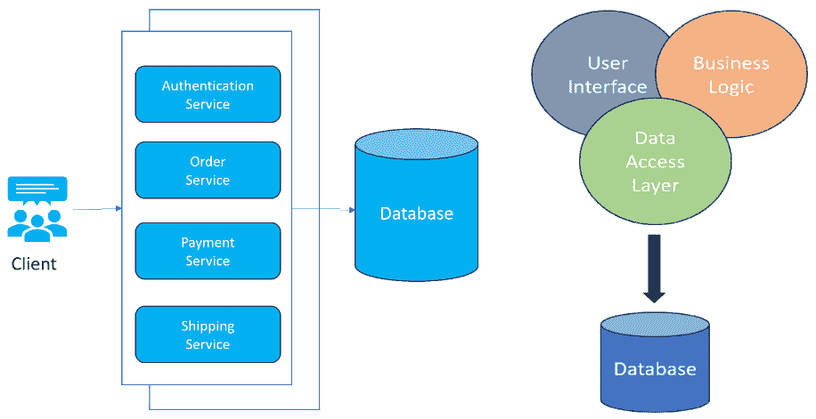

图 7.2 展示了一个典型的单体架构，其中认证、订单、支付和发货服务被包含在一个单一的可执行 JAR 文件中。这些服务紧密耦合，并连接到同一个数据库，尽管它们具有独立的功能。

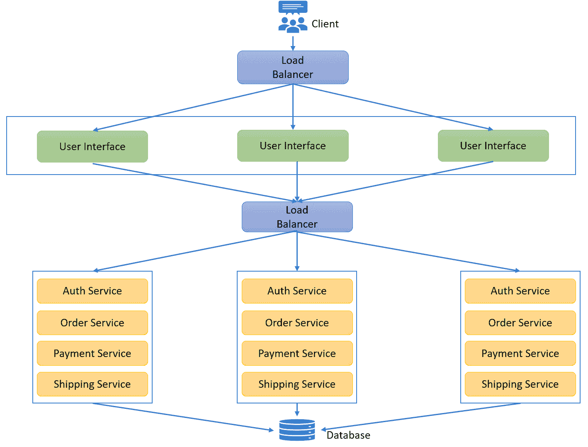

### 单体架构的优势

单体架构的优势如下：

*   **易于部署**：应用程序可以轻松部署，因为所有服务和用户界面只有一个单一的可执行文件
*   **易于应用管理**：由于统一的应用程序被整合在一起，它通常比替代技术需要更少的管理、协调和编排，使得单体应用通常比其他解决方案更易于管理
*   **更快的端到端测试**：单体应用程序是一个单一的、集中的单元，因此端到端测试的执行速度比分布式应用程序快得多

### 单体架构的劣势

单体架构的劣势如下：

# 单体架构的缺点

*   **单点故障**：单体架构在一个应用程序中包含所有必需的功能。这导致一旦一个或多个组件发生故障，整个应用程序就可能失败。这可能导致整个应用程序出现长时间的停机。

*   **扩展性复杂性**：因为单体应用程序的并非每个组件都能独立扩展（因为每个组件有不同的资源需求），随着应用程序规模的增加，扩展变得更加困难。

*   **基础设施成本**：发生应用程序性能问题时，您需要扩展整个单体架构。这可能导致额外的基础设施成本。

*   **上市时间**：使用单体架构添加和发布新功能非常耗时。即使发布简单的功能也可能需要更多时间。这是因为同一应用程序中的许多组件需要经过测试，以确保新变更不会影响其他组件的功能。

*   **应用升级复杂性**：将应用程序升级到新版本可能是一项繁琐的任务。所有组件需要一起升级，这可能是一个耗时的过程。在某些情况下，组织最终会放弃升级应用程序以避免这种情况。

*   **部署复杂性**：应用程序中即使是微小的变更，也会导致整个应用程序需要重新部署。

单体架构因其更快的开发、测试和部署速度以及更低的基础设施成本，适用于较小的应用程序。然而，当您的系统不断增长且应用程序所需功能增加时，可能会给业务带来瓶颈，并导致上述各种问题。

单体架构及其优缺点现在对我们已经很清晰。接下来我们将介绍微服务架构，看看如何规避单体架构的这些限制。

# 微服务架构

对于由通过定义良好的 API 通信的小型独立服务组成的软件，微服务是一种软件开发的架构和组织方法。小型、自包含的团队拥有这些服务。

微服务架构允许团队创建独立、自治、松耦合且可独立部署的单元。

## 微服务的特征

以下是微服务的特征：

*   服务是可独立部署且松耦合的单元
*   每个服务拥有自己的代码库
*   自治服务
*   微服务小巧且独立
*   每个服务可独立扩展
*   技术无关性

微服务是松耦合且高内聚的。高内聚的微服务封装其依赖项、逻辑和数据，并在定义良好的领域内承担单一职责。当两个系统的构建方式使得对一项服务的实现、设计或行为的修改不会影响另一项服务时，它们被称为松耦合微服务。

微服务架构旨在使用许多小型、可独立部署的服务来构建大型软件。在此架构中，服务内聚和松耦合是两个主要功能：

*   **内聚**：在微服务的背景下，内聚是指单个服务的职责相互关联的程度。服务内的高内聚是可取的，因为它提高了系统的可维护性，并降低了服务间通信的复杂性。高度统一的服务仅执行一个逻辑功能。例如，如果您正在开发一个电商平台，您可能会为用户认证、库存管理、订单处理等拥有单独的服务。每个服务都是统一的，因为它专注于系统的一个领域。

*   **耦合**：耦合是指一项服务为执行其职责而依赖其他服务的程度。在微服务架构中，目标是创建“松耦合”服务。松耦合服务可以相互独立运行，这增加了系统的灵活性，并实现了更轻松的变更管理。例如，您的订单处理服务不应因仓储服务宕机而失败。它仍应能工作，尽管可能无法提供实时库存数据。

通过专注于高内聚和松耦合，开发人员可以创建比传统单体架构更易于维护、更具弹性且可扩展性更强的微服务系统。

**领域驱动设计（DDD）**和**单一职责原则（SRP）**是微服务开发中的两个重要概念：

*   **DDD**：这是一种软件设计方法，专注于核心业务逻辑（“领域”）。在微服务的背景下，DDD 有助于确保每个服务跨越一个有界且统一的业务上下文。DDD 有助于为每个服务定义清晰且有界的上下文，确保它们直接与业务特征相关。例如，在电商应用程序中，您可以使用 DDD 原则将用户管理、产品目录、订购和支付处理等服务分离开来。所有这些服务都对应电商应用程序中的特定业务领域。

*   **SRP**：该原则规定，一个类、模块或在此背景下的微服务只能有一个变更的理由。这意味着每个微服务必须仅处理单一功能或流程。在电商示例中，用户管理服务应仅负责处理用户。这不应包含与产品目录、订单处理或支付相关的活动，因为这些是不同的职责。该原则有助于保持高内聚和低耦合，从而产生更健壮且可维护的系统。

通过在微服务中使用 DDD 和 SRP，您可以创建一个有效地将业务逻辑分离到各个服务中的系统，每个服务负责整个业务领域的一个方面。这将产生一个更易于理解、维护和随时间扩展的系统。

下图说明了微服务架构，其中每个服务在单独的容器或机器中独立运行。

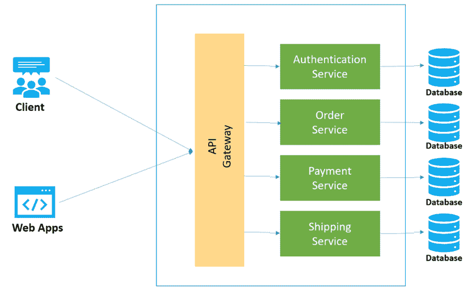

图 7.3 - 微服务架构

## 微服务架构的优势

以下是微服务架构的优势：

*   **敏捷性和更快的上市时间**：微服务架构允许快速上市，因为它通过将大型应用程序拆分为小块，简化了大型应用程序的开发、测试、维护和演进，使它们更易于随时间开发、测试、维护和扩展。因此，团队可以加快代码交付速度。

*   **可扩展性**：微服务允许您独立扩展一个或多个服务，而不影响其他服务。我们可能需要扩展表现不佳的服务，而微服务允许我们独立地做到这一点。

*   **灵活性和敏捷性**：每个微服务都可以独立开发和部署，因此实施微服务允许近岸开发团队快速适应不断变化的业务需求。这是一种获得结果、提高响应能力和加快发布周期的更高效方法。

*   **快速开发**：微服务使团队更容易处理小型、聚焦的组件，从而加快开发周期，并缩短新功能和更新的上市时间。

# 微服务架构

## 优势

*   `Continuous deployment`（持续部署）：微服务架构允许您有效地执行持续部署和持续集成，并实现软件应用程序的持续交付。
*   `Resource optimization and utilization`（资源优化与利用）：为了优化资源利用率并降低基础设施成本，微服务可以在容器化环境或无服务器架构中运行。
*   `Business agility`（业务敏捷性）：微服务与敏捷方法论非常契合，使组织能够快速响应不断变化的业务需求。

## 劣势

以下是微服务架构的劣势：

*   `Deployment and scalability complexity`（部署与扩展复杂性）：微服务架构允许您独立扩展和部署应用程序，但同时，扩展和部署多个微服务可能难以管理并会增加复杂性。有诸如 Kubernetes 和 Docker 之类的工具有助于降低部署和扩展的复杂性，但它们本身也带来了额外的复杂性。
*   `Complex and distributed application network`（复杂且分布式的应用网络）：管理多个微服务可能很复杂。随着服务数量的增加，管理和监控这些服务变得更加困难。微服务本质上是分布式的，这可能导致额外的网络延迟，且难以解决，因为可能需要调用多个服务来响应单个客户端请求。
*   `Increased costs`（成本增加）：微服务可能会增加额外成本，因为管理和控制微服务所需的额外工具（如 Kubernetes、Docker 和 API 网关）通常是必需的，并且伴随着额外费用。

我们现在已经回顾了单体架构和微服务架构，并讨论了两者的优缺点。接下来，我们将探讨其他几种架构风格，即事件驱动架构和 API 主导的连接性。

# Saga 模式

`Saga pattern`（Saga 模式）是一种故障管理技术，有助于跨多个微服务协调事务以保持数据一致性，并有助于在分布式应用程序中建立一致性。该模式跨多个微服务管理并维护数据一致性。每个事务由单个服务完成，并将状态变更广播给参与 Saga 的其他服务。通过一系列本地事务，Saga 架构模式提供事务管理。本地事务代表 Saga 参与者的工作。补偿事务可以回滚每个 Saga 活动。此外，Saga 模式确保在发生任何故障时执行相关的补偿事务以回滚先前完成的工作，从而确保数据一致性，或者确保所有活动都已完成。

## 注意事项

在软件中，Saga 是一种用于管理分布式事务的设计模式。它是一系列本地事务，其中每个事件更新单个服务中的数据。该术语源自 Hector Garcia-Molina 和 Kenneth Salem 于 1987 年撰写的论文 `SAGAS`。Saga 模式主要用于微服务架构，以确保跨多个服务的数据一致性。每个 Saga 事务在发生故障时都有定义好的恢复流程。如果一个事务失败，将执行回滚流程以维护数据一致性。Saga 事件由一个编排器协调，该编排器可以是集中式的，也可以是去中心化的。

## Saga 模式中的本地事务

Saga 模式中的本地事务是指发生在单个微服务或数据库内的事务。这些本地事务中的每一个都可以独立执行，如果成功，应将系统从一个一致状态转换到另一个一致状态。Saga 中本地事务与传统分布式事务的关键区别在于，本地事务允许部分成功。这与传统事务形成对比，在传统事务中，事务的每一部分都必须成功，该事务才算成功。

如果本地事务发生故障，Saga 模式不会像传统事务那样进行回滚，而是执行一系列补偿事务。这些补偿事务旨在撤销 Saga 中前面的本地事务所做的更改，从而保持整体系统一致性。重要的是要注意，这些补偿事务本身也是本地事务。

下图说明了 Saga 设计模式架构。

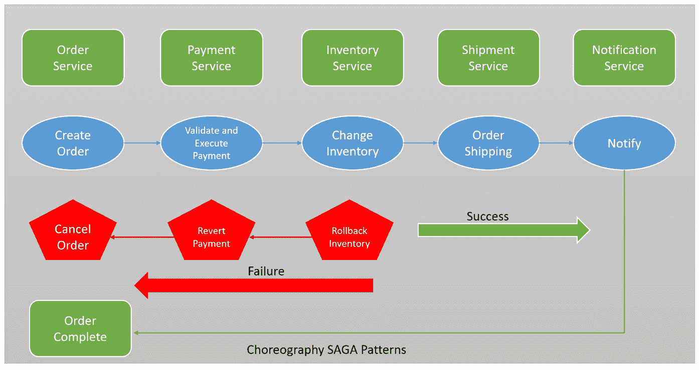

Figure 7.4 - Saga 设计模式架构

Saga 模式可以通过两种方式实现：

*   `Saga choreography pattern`（Saga 编排模式 / 舞蹈模式）
*   `Saga orchestration pattern`（Saga 编排模式 / 编排器模式）

> **译者注**：原文中 "Choreography" 译为“编排/舞蹈”，"Orchestration" 译为“编排/编排器”。为区分两者，通常将 Choreography 译为“协作模式”或“舞蹈模式”，Orchestration 译为“编排模式”或“中央编排模式”。下文将 Choreography 翻译为“协作模式”，Orchestration 翻译为“编排模式”。

## Saga 协作模式

协作方法涉及单个微服务消费一个事件，执行必要的操作，然后将事件传递给后续服务进行消费。

`Saga choreography pattern`（Saga 协作模式）用于以去中心化的方式实现跨越多个服务的事务跨度。

下图描绘了 Saga 协作模式。

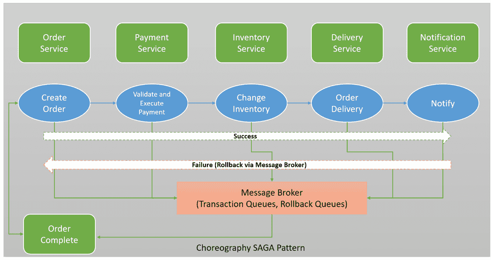

Figure 7.5 - Saga 协作模式

在上图中，Saga 中的所有服务通过消息代理进行通信，以执行事务以及回滚事务。这种通信以异步、有序的方式进行。

### 优势

以下是 Saga 协作模式的优势：

*   易于扩展以添加新服务，因为它以去中心化的方式工作
*   带来了消息传递和事件驱动架构的优势，如松耦合、异步通信和可靠性
*   实现了更大的灵活性和演进能力，提高了可扩展性和可用性，并降低了微服务之间的耦合度

### 劣势

以下是 Saga 协作模式的劣势：

*   缺乏对事务处理的集中控制，因此如果跨越多个服务，管理和理解流程会变得复杂
*   事务回滚复杂，因为 Saga 中的每个服务都必须具备事务回滚能力
*   在没有中央协调器的情况下，监控和控制协作系统中微服务之间的交互可能更具挑战性

## Saga 编排模式

在编排模式中，应用程序通过将每个服务连接到中央协调器来完成，中央协调器按预定顺序安排服务。基于编排的 Saga 中，中央 Saga 编排器使用命令消息指示 Saga 参与者执行本地事务。

下图说明了 Saga 编排模式：

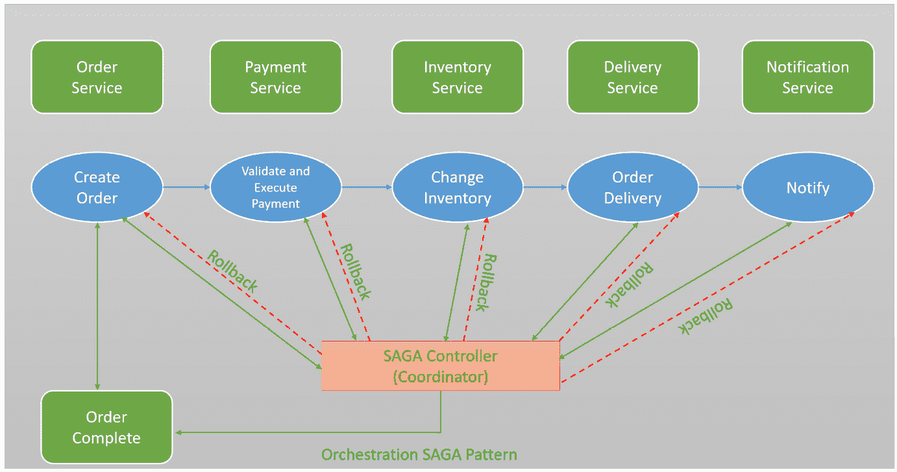

Figure 7.6 - Saga 编排模式

使用中央控制器，可以使用 Saga 编排微服务设计来实现分布式事务。使用此中央控制器协调 Saga 参与者之间的调用以执行事务。

Saga 控制器管理与服务的通信，执行事务，并负责在发生任何故障时通知 Saga 中的服务执行回滚。

### 优势

以下是 Saga 编排模式的优势：

*   通过编排模式显式执行事务处理时，对事务处理拥有更多控制权
*   有了中央协调器，监控和控制编排系统中微服务之间的交互变得更加简单

## Saga 编排模式的缺点

以下是 Saga 编排模式的缺点：

* 向 Saga 添加新服务或流程要复杂得多，因为需要更改 Saga 控制器
* 由于编排通常耦合更紧密，系统的弹性和可扩展性可能会降低
* 在编排系统中，中央协调器可能成为单点故障，从而降低系统的弹性。

### 使用 MuleSoft 实现 Saga 编排

以一个虚构的电子商务应用程序用例为例，让我们演示一个简化示例，说明如何利用 MuleSoft 实现 Saga 编排：

1. **微服务创建**：假设一个 MuleSoft 应用程序内置了三个独立的微服务：`Order service`、`Payment service` 和 `Delivery service`。

2. **事件创建**：`Order service` 发起一个新的 Saga，并在收到订单时发布 `OrderCreatedEvent`。

   这可以通过向 `Order service` 添加 `POST` HTTP 方法来在 MuleSoft 应用程序中完成，这将导致在创建订单后触发事件。Anypoint MQ 服务或消息代理（如 RabbitMQ 或 ActiveMQ）可以接收此事件。

3. **事件订阅**：`Payment service` 订阅了 `OrderCreatedEvent`。它在收到此事件后尝试处理付款，如果成功，则发布 `PaymentProcessedEvent`。这可以通过在 `Payment service` 中配置 Anypoint MQ 订阅者来监听 `OrderCreatedEvent` 并在检测到时启动相应的付款处理流程来在 MuleSoft 中完成。处理完成后，它会向其队列添加一个新事件。

4. **编排**：`Delivery service` 订阅了 `PaymentProcessedEvent`。它一收到此事件就开始交付程序。`Delivery service` 可以拥有一个监听 `PaymentProcessedEvent` 并启动交付的 MQ 订阅者，就像 `Payment service` 一样。

5. **补偿事务**：如果付款程序不成功，`Payment service` 会发出 `PaymentFailedEvent`。然后，订阅了此事件的 `Order service` 会发起补偿事务来取消订单。可以通过在 `Order service` 中设置一个额外的 MQ 订阅者来监听 `PaymentFailedEvent`，从而启动订单取消流程。

这只是一个简化示例；实际实现将复杂得多，需要考虑一些额外因素，例如管理服务调用之间的事务一致性以及处理服务之间的通信故障。

实现 Saga 编排需要 MuleSoft 管理 API 和无缝集成各种系统的能力。

上一节演示了用于创建微服务的 Saga 模式。接下来，我们将在本部分讨论竞争消费者模式。

## 竞争消费者模式

多亏了竞争消费者模式，来自同一通道的多个消费者可以并行处理消息。当同一池实例的多个消费者需要并行且异步地处理多个小任务时，此模式非常有用。

在正常场景下，从发布者传入消息代理的流量较低，消费者可以按照发布者发送消息的速率处理消息，如图 7.7 所示。

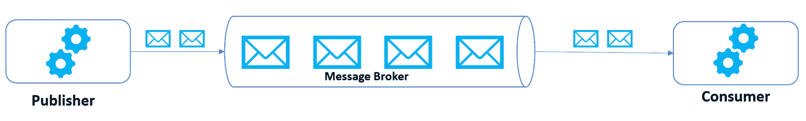

图 7.7 - 低流量下的竞争消费者模式

可能会出现入站流量增加的情况，例如发布者开始向队列发送更多消息，或发布者数量增加。在这种情况下，消息发布到队列的速率快于消费速率。

如果发生这种情况，我们可以增加监听消息流的消费者数量，并允许每个队列有多个消费者同时处理消息。这样，流量就会分布在多个消费者中，以实现消息的同时处理，无论有多少消费者监听同一个队列，一条消息只会传递给单个消费者。

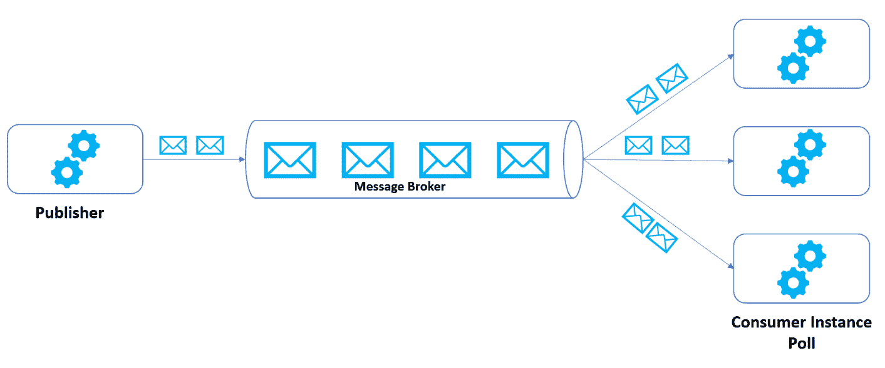

图 7.8 - 高流量下的竞争消费者模式

在图 7.8 中，我们向池中添加了更多消费者，以按发布者发送流量的相同速率处理流量。

### 实施竞争消费者模式的优势

以下是实施竞争消费者模式的优势：

* **可扩展性**：根据消息通道中来自发布者的流量，可以添加或删除消费者。增加消费者数量将允许在多个消费者之间分配流量，并且每条消息都可以异步且独立地处理。
* **高可用性**：多个消费者监听同一个消息通道。如果其中一个消费者失败或停止，其他消费者可以处理消息。
* **可靠性和弹性**：如果某条消息的处理失败，该消息将被返回到队列，并可供其他消费者重新处理。

我们可以在各种应用程序中使用竞争消费者模式：

* 当需要分发流量时，因为单个消费者无法处理，例如传输量非常大且多变时。在这种情况下，我们可以让多个消费者同时处理消息。
* 在需要消息可靠性、容错性和可用性的场景中。
* 如果流程被拆分成一小组任务，并且每个任务都可以在并发执行模式下异步或独立执行。

## 熔断器模式

软件开发中使用的另一种设计模式是熔断器模式。在微服务中，`Circuit Breaker design pattern` 通过监控交互、建立阈值以及暂时停止或暂停向故障服务发送流量来防止服务故障。它通过帮助防止级联故障并保持系统稳定性，保证了分布式架构中的可靠性能。

它的名称源于电路断路器，当检测到故障时会切断电流。在软件中，熔断器模式用于检测故障并定义防止故障再次发生的逻辑，适用于维护期间、临时外部系统故障或意外系统问题期间。

其工作原理如下。当系统遇到一定数量的故障时（例如，调用微服务失败），熔断器就会跳闸。熔断器模式将在指定期间内阻止与该服务的任何交互，并立即返回错误。超时期满后，熔断器将允许有限数量的测试请求通过。如果测试成功，熔断器将恢复正常操作；如果不成功，将恢复超时期。

熔断器模式防止系统将资源分配给可能失败的操作，防止过载，并给系统一个恢复的机会。

### 熔断器状态

以下是各种熔断器状态：

* `Open`：当达到配置的跳闸超时时，订阅者源不尝试检索消息，也不会静默跳过消息。
* `Closed`：起始状态，根据订阅者源的配置正常从 MQ 获取消息。

*   `Half-open`（半开）：行程超时过后，`Subscriber source`（订阅者源）会进入 `Half-open`（半开）状态。在下一次轮询消息时，`Subscriber source`（订阅者源）会从服务中检索一条消息，并使用该消息检查系统是否已恢复，然后再返回正常的 `Closed`（关闭）状态。

下图展示了 `Circuit Breaker pattern`（熔断器模式）的架构。

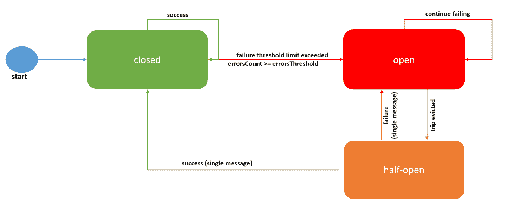

Figure 7.9 - The Circuit Breaker pattern

`MuleSoft` 允许我们使用 `Anypoint MQ` 或将 `Circuit Breaker policy`（熔断器策略）应用于 API 来实现 `Circuit Breaker pattern`（熔断器模式）。该策略可从 `MuleSoft Catalyst` 下载并发布到您组织的 `Anypoint exchange`（Anypoint Exchange）中。

# Anypoint MQ

`Anypoint MQ` 是由 `MuleSoft` 提供的一种多租户、基于云的托管队列服务，用于在应用程序之间异步交换数据。`Anypoint MQ broker`（Anypoint MQ 代理）允许应用程序将消息发布到队列，以便另一个应用程序可以从队列中消费该消息。`Anypoint MQ` 与 `Anypoint platform`（Anypoint 平台）完全集成，提供访问控制、客户端管理和连接器。

`Mule` 应用程序可以使用 `Anypoint MQ Connector`（Anypoint MQ 连接器）向队列发布和消费消息，而非 `Mule` 应用程序可以使用 `Anypoint MQ REST APIs`（Anypoint MQ REST API）向队列发布和消费消息。

## Message exchanges and queues（消息交换与队列）

`Message queues`（消息队列）是发布者可以发布消息、消费者可以消费消息的临时存储。`Message queues`（消息队列）可在多个应用程序之间实现可靠且可扩展的通信。

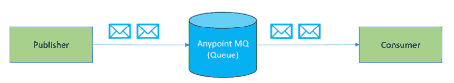

Figure 7.10 - Anypoint MQ (queue)

`Message exchanges`（消息交换）允许您将多个队列绑定在一起，以将相同的消息副本发送给绑定到该交换的所有队列。下图说明了消息如何从交换流向所有关联的队列。

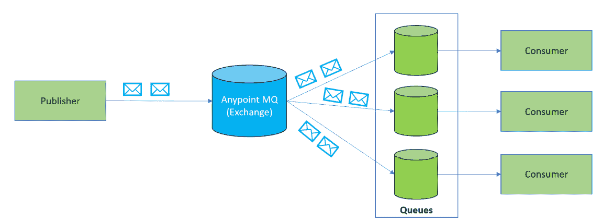

Figure 7.11 - Anypoint MQ (exchange)

通过交换，消息可利用消息路由规则智能地路由到特定队列。下图说明了消息如何根据路由规则流向特定队列。

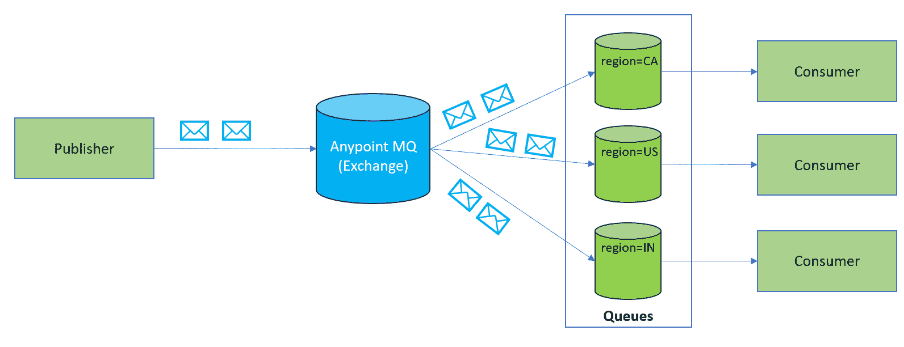

Figure 7.12 - Anypoint MQ (exchange intelligent routing)

使用消息交换时，请记住以下几点注意事项：

*   最多可将 450 个队列绑定到消息交换
*   仅可将 10 个队列绑定到启用了智能路由的消息交换
*   一个队列可绑定到多个队列

`Anypoint MQ` 支持 `FIFO` 队列。这些队列可保证消息的有序投递。对于要求**精确一次**投递和精确消息排序，但不要求快速投递速度的应用程序，`FIFO` 队列最为适用。

`Anypoint MQ` 支持 `FIFO` 队列中每个消息组 10 条在途消息。`Anypoint MQ` 中 `FIFO` 队列的消息组数量没有上限。

`Anypoint MQ` 支持的功能如下：

*   标准队列最多支持 120,000 条在途消息，`FIFO` 队列支持 10 条在途消息
*   `Anypoint MQ` 可在美国、欧洲和亚太地区的多个区域中进行配置
*   支持对队列中存储的消息进行加密

## Cross-region failover for Anypoint MQ standard queues（Anypoint MQ 标准队列的跨区域故障转移）

当您为队列启用故障转移时，`Anypoint MQ` 会自动在备用区域中创建一个回退队列。如果 `Mule` 应用程序无法连接到该区域的 `Anypoint MQ` 服务器，它将从回退队列发布和消费消息。

一旦连接器确定主区域不可用，它就会切换到从回退队列发布和消费新消息，并定期验证主区域是否恢复运行。

跨区域故障转移的注意事项如下：

*   故障转移支持标准队列，但不支持 `FIFO` 队列和消息交换。
*   `Anypoint government cloud`（Anypoint 政府云）不支持故障转移，因为它仅支持单一区域。`Anypoint government cloud`（Anypoint 政府云）将在 *Chapter 13* 中讨论。
*   故障转移支持需要 `Anypoint MQ Connector 4.0.5` 或更高版本。
*   在某些国家，`Anypoint MQ` 仅在一个区域可用。如果这些区域的队列启用了故障转移且主区域宕机，数据将存储在该国家以外的区域中，直到主区域恢复可用。
*   故障转移默认未启用。一旦启用故障转移，它将在故障转移区域中创建一个带有 `_fb` 后缀的队列。例如，如果您在主区域有一个名为 `myOrderQueue` 的队列，它将在故障转移区域中创建 `myOrderQueue_fb`。

## Dead-letter queues（死信队列）

您可以使用 `Anypoint MQ` 确保无法投递的消息被路由到 `DLQ`。之后，您可以检查发送到 `DLQ` 的消息，以确定它们未被投递的原因。`DLQ` 仅接收未投递的消息；除此之外，其功能类似于任何其他队列。创建队列时，您可以设置投递延迟、加密和 `TTL` 值。

`Anypoint MQ` 提供的其他功能包括：

*   提供开箱即用的 `Anypoint MQ Connector`，用于通过消息交换和队列发布和消费消息。
*   非 `MuleSoft` 应用程序或第三方应用程序可使用 `Anypoint MQ REST APIs` 从 `Anypoint MQ` 发布和消费消息。
*   可传输高达 10 MB 的大量负载。如果负载包含文本以外的任何格式（如 CSV、HTML、JSON 和 XML），`Anypoint MQ` 会在发送前将负载转换为字符串，这会增加负载的大小。如果因这种转换导致负载大于 10 MB 的最大负载大小，可能会发生负载过大错误。

## The Circuit Breaker pattern with Anypoint MQ（Anypoint MQ 的熔断器模式）

`Subscriber source`（订阅者源）提供 `Circuit Breaker`（熔断器）功能，允许您控制连接器在处理消费消息时出现错误时的响应方式。您可以使用 `Circuit Breaker`（熔断器）来处理您连接的外部服务的任何中断。`Circuit Breaker`（熔断器）允许外部服务在较低负载下恢复，并允许系统停止发出请求。下图显示了在 `Anypoint MQ` 上配置 `Circuit Breaker pattern`（熔断器模式）的情况。

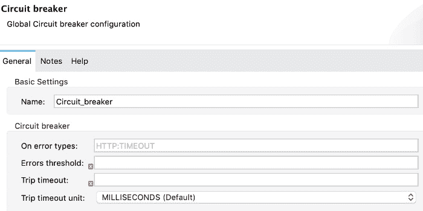

Figure 7.13 - The Circuit Breaker pattern with Anypoint MQ

在 `Anypoint MQ` 上启用 `Circuit Breaker pattern`（熔断器模式）需要配置以下参数：

*   `onErrorType`：这决定了在执行流程时哪些类型的错误被视为失败。仅当流程以错误传播结束时，错误发生才会被计数。每个错误都会自动被解释为电路故障。
*   `errorsThreshold`：这决定了 `Circuit Breaker`（熔断器）必须遇到多少个 `onErrorType` 错误才会打开。
*   `tripTimeout`：如果达到 `errorsThreshold`，电路将保持打开状态一段时间，可用此值指定。
*   `circuitName`：将绑定到此规范的 `Circuit Breaker`（熔断器）的名称。默认情况下，每个队列都有自己的 `Circuit Breakers`（熔断器）。

# Event-driven architecture (EDA)（事件驱动架构 (EDA)）

采用微服务构建的现代应用程序经常使用 `EDA`，它利用事件在解耦服务之间触发和通信。事件是状态的更新或更改，例如在网上商店将产品添加到购物车时。

现在让我们讨论 `EDA` 中的解耦和松耦合。

## 解耦与松耦合

解耦和松耦合是 EDA 中相关但截然不同的概念。**解耦**是一种消除系统不同组件之间依赖关系的方式。在 EDA 的上下文中，发布者在不知道消息消费者的情况下生成事件数据。这使得发布者和消费者能够在互不知晓的情况下独立通信。

**松耦合**试图通过降低组件间的相互依赖程度来减弱它们之间的耦合（而非完全分离它们）。虽然松耦合系统中的组件可能会相互通信，但它们不会因此产生任何形式的依赖。

## EDA 的优势

以下是 EDA 的优势：

*   **并行处理**：单个事件可以触发多个进程独立执行。EDA 的关键特性是其异步处理消息的能力。这意味着它可以分发工作负载并支持并行处理。代理可以从各种事件生产者接收任意数量的事件，并将它们分发给各个组件进行处理。
*   **响应能力提升**：服务可以通过交换事件异步通信，而无需等待即时响应。这种方法提高了响应能力，允许更多并行性，并降低了系统延迟。
*   **可扩展性**：单个事件会促使各个消费者做出多种响应，从而提升性能。解耦使得添加、更新或移除事件生产者和消费者变得更加容易，从而能够快速响应不断变化的需求。
*   **容错性与弹性**：EDA 在设计上可以具备弹性和容错性。即使某个组件发生故障或停止响应，其他组件仍可独立继续工作。这通过确保系统在发生故障时仍能继续运行，提高了应用程序的整体可用性和可靠性。

## EDA 的局限性

以下是 EDA 的局限性：

*   **消息排序**：EDA 的核心原则是异步且独立地处理消息，这使得维护事件的顺序和一致性变得具有挑战性，尤其是在分布式环境中处理事件时。
*   **错误处理**：在 EDA 中，错误和异常的处理方式可能不同，因为事件可能在不同的时间、不同的地点被处理。
*   **复杂性**：在理解事件流、事件间关系以及故障排查问题方面，EDA 可能会引入复杂性。
*   **调试挑战**：在 EDA 中，特别是当事件导致组件间的一系列交互时，很难确定问题的根源。

本章我们讨论了 `Anypoint MQ`，它可用于实现 EDA。其他消息系统，如 `JMS`、`AMQP` 或 `Kafka`，也可用于实现 EDA。

# API 主导的连接性与 EDA 的结合

EDA 和 API 主导的连接性是两种强大的软件架构技术，它们协同工作效果良好。在 API 主导的连接性中，软件的基本构建块是 API。因为所有设备、系统和应用程序都通过 API 连接并相互通信，所以系统是可管理的、可复用的和模块化的。相比之下，EDA 作为一种设计范式，涉及响应并创建事件的软件组件。这些事件表示应用程序状态的变更，从而触发系统其他组件中的事件。

当这两种策略结合时，可以极大地改善应用程序的设计和运行方式。

*   **增强的可扩展性**：API 主导的连接性便于添加新的系统组件，而 EDA 可协助管理实时信息流。
*   **增强的效率**：EDA 和 API 主导的连接性相结合，能够实现软件组件的有效复用，从而加快开发速度并降低成本。
*   **灵活性**：EDA 通过实现对变更的实时响应，支持灵活动态的系统；API 主导的连接性则提供连接不同应用程序、系统和设备的灵活性。
*   **实时处理**：API 可为事件处理所需的服务和资源提供实时访问，而 EDA 则便于实时处理事件。
*   **简化的可维护性**：API 主导的连接性的模块化设计使得更新和维护系统变得更加容易。EDA 通过连接松耦合服务并促进轻松的系统修改，进一步增强了这一点。

总之，EDA 与 API 主导的连接性相结合，可产生一种稳定、可扩展且适应性强的软件架构，能有效管理实时数据流和动态任务处理。

## 体验 API

顾名思义，API 主导的连接性中的 `体验 API` 描述了特定用户或系统的体验。`体验 API` 的主要目标是以特定设备、Web 应用程序或渠道所需的格式交付数据。对于其最终用户、系统或渠道——无论是移动应用、桌面网站还是另一个应用程序——每个 `体验 API` 都提供一个适合的特定视图。因此，开发人员可以在不更改底层系统和流程的情况下，更改用户界面或设备的数据源。我们必须修改体验 API 以满足每个客户的独特需求，因为它们是可选的，仅当客户无法使用我们的 API 时才应使用。

例如，基于 Web 的应用程序上显示的信息将不同于移动应用程序上显示的信息。`体验 API` 在这种情况下非常有用。它们从 `系统 API` 或 `流程 API` 检索相同的信息，但其呈现方式根据目标设备或渠道而异。`体验 API` 在更改用户界面和体验方面提供了极大的灵活性，而不会干扰后端系统的业务流程。这使公司能够迅速适应不断变化的消费者需求、市场趋势和偏好。

## 流程 API

在 API 主导的连接性中，`流程 API` 用于协调来自 `系统 API` 的数据并执行特定的业务功能。这些 API 可跨各种渠道和应用程序复用，因为它们旨在处理业务用例和流程。例如，客户的订单流程可由 `流程 API` 管理。它可以使用 `系统 API` 来计算价格、验证库存、获取产品详情并管理订单的生命周期。然后，不同的 `体验 API`（API 主导连接性中的第三层）可以使用此 `流程 API` 以每个渠道或平台所需的格式（如移动应用、Web 门户或其他客户接触点）获取数据。`流程 API` 是可选的，仅当需要从多个 `系统 API` 收集特定实体的信息时才应使用。

借助这些 `流程 API`，面向客户的应用程序（`体验 API`）可以抽象化从多个系统检索数据的过程，提高流程复用性并实现流程简化。这样，底层系统的修改不会直接影响面向客户的应用程序的运行效果。在 API 主导的连接性中使用 `流程 API` 提供了流程敏捷性、服务复用性和优化的数据流程，从而促进并加快了应用程序开发。

## 系统 API

# API 主导的连接性与应用网络

## 系统 API 与 API 主导的连接性架构

`System API` 是在 `API-led connectivity` 中促进与数据库、底层系统和其他服务通信的 API 类型。这种 API 不包含任何业务逻辑或流程；相反，它仅作为数据检索和存储的机制。借助 `system APIs`，可以高效地封装系统的技术细节，并仅暴露必要的信息。`System API` 的一个实例可以是从数据库检索客户信息的能力，或特定软件程序的功能。`System APIs` 是可选的，仅当我们使用的后端系统未暴露良好的 `RESTful APIs` 时才应使用。

例如，为了访问数据库、`ERP` 或电子邮件系统，可能会开发一个 `system API`。然后，更高层级的 `process APIs` 或 `Experience APIs` 将使用此 API 为各种用户界面或流程提供功能。

以下是 `API-led connectivity` 的架构：

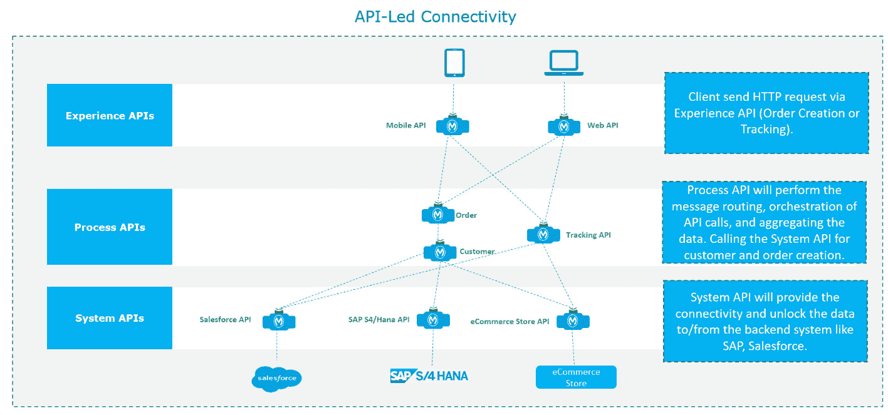

`Figure 7.14` - API 主导的连接性架构

在 `Figure 7.14` 中，`Experience API`、`Process API` 和 `System API` 之间的通信通过 `HTTP` 进行。`API-led connectivity` 带来了更高的生产力、效率、敏捷性和灵活性等优势。它允许组织创建可配置和可复用的 API、使用新技术，并简化流程，从而保持与遗留 `IT` 系统的连接。

让我们一起谈谈 `API-led connectivity` 和 `EDA`。`API-led connectivity` 和 `EDA` 相辅相成，但它们是两种截然不同的架构风格。

以下是 `EDA` 和 `REST API` 之间的一些区别：

*   `EDA` 是异步的，而 `REST API` 是同步的
*   `EDA` 是松耦合的，而 `REST API` 是紧耦合的
*   `EDA` 通过 `message broker` 通信，而 `REST API` 通过 `HTTP` 通信

下图展示了 `EDA` 和 `API-led connectivity` 架构的结合。

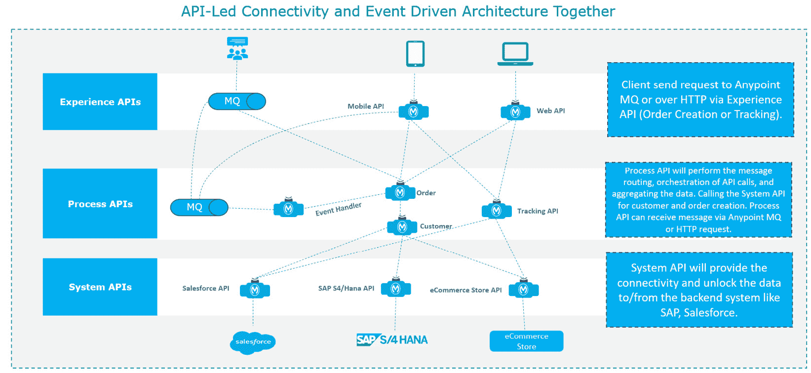

`Figure 7.15` - API 主导的连接性架构与 EDA 结合

在 `Figure 7.15` 中，我们结合了 `EDA` 和 `API-led connectivity` 架构，以通过 `Anypoint MQ` 或 `HTTP` 接收消息。我们可以通过 `EDA` 确保零消息丢失、可靠性和保证交付，并且在两者共同实施时，可以利用两种架构的优势。

# 应用网络与可组合性

专注于集成和 API 管理解决方案的公司提供了一套称为 `MuleSoft composable enterprise` 方法的能力。`composable enterprise` 概念的核心是创建灵活且可配置的架构，使企业能够快速调整和演进其系统。

`Application networks` 和 `APIs` 使组织更加灵活，能够快速响应不断变化的市场动态、技术颠覆或业务需求，它们是 `composable enterprises` 的关键要素。`application network` 可以帮助公司变得更加灵活，调整其业务步伐，并适应其行业、市场和客户群的变化，而不损害其核心价值观。

当您的可组合组织采用 `API-led` 方法时，每个新构建的 `API` 都可以为您整个 `application network` 和市场贡献额外价值。

以下是 `composable enterprise` 概念的关键推动因素：

*   **`API-led connectivity`**：`MuleSoft` 提倡 `API-led connectivity` 架构，允许您管理、设计和实施可复用的 `APIs` 以连接数据、应用程序和系统。`APIs` 是集成的构建模块，允许组合各种服务和组件。
*   **`Reusable assets`**：`composable enterprise` 概念强调构建可复用的组件、资产和构建模块，如 `APIs`、模板、连接器和框架。这使我们能够快速创建新的 `APIs`，缩短开发周期并最大限度地减少总体开发工作量。这意味着新功能可以更快发布。这些可复用资产可以存储在 `Anypoint Exchange` 中，允许其他开发者发现这些资产。
*   **`Hybrid integration`**：`composable enterprise` 支持混合实施，允许组织连接 `on-premises` 和基于云的系统。`MuleSoft` 提供连接器、平台组件和其他服务，实现与运行在云端和 `on-premises` 的数据库、服务和设备的连接。
*   **`Application networks`**：`MuleSoft` 提倡构建 `application networks` 的概念——即 `APIs` 以受管方式排列和共享。这使企业能够通过利用现有 `APIs` 和开发新 `APIs` 来增强其连接能力。
*   **`Universal API management`**：`Universal API management` 允许创建、管理、保护和治理位于任何位置、遵循任何架构或用任何技术编写的 `APIs`。大多数组织在 `multi-cloud` 和 `on-premises` 上运行 `APIs`，并且可能拥有基于不同技术的 `APIs`。这些企业无法管理和协调这些不同的 `APIs`，并且缺乏可见性，因为信息在这些平台之间移动。这是 `MuleSoft` 旨在通过 `universal API management` 解决的问题之一，根据 `MuleSoft` 的说法，它是将完整的生命周期管理能力扩展到任何地方开发和实施的 `APIs` 的能力。
*   **`Automation`**：`Automation` 是 `composable enterprise` 的关键推动因素之一，它允许组织自动化手动业务流程，并通过减少手动任务来提高整体生产力。`LOB` 团队和非技术用户可以使用 `MuleSoft Composer` 独立地从中央 `IT` 创建的组件构建集成应用程序。通过 `MuleSoft Robotic Process`，构建者可以更简单地创建功能更丰富的组件。

## 摘要

本章涵盖了多种架构风格，这些风格在使用模块化架构创建网络时至关重要。除了 `EDA` 和 `API-led connectivity` 等其他现代架构风格外，我们还回顾了 `monolithic` 和 `microservices` 架构。

还研究了几种 `microservices` 设计模式，如 `Saga`、`Circuit Breaker` 和 `Competing Consumers` 模式。此外，我们现在知道如何使用 `MuleSoft` 的 `Anypoint MQ` 组件来实现消息传递架构或 `EDA`。

在下一章中，我们将讨论非功能性需求对架构设计的影响。
