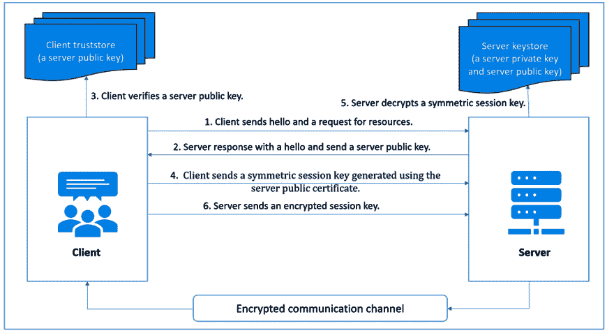
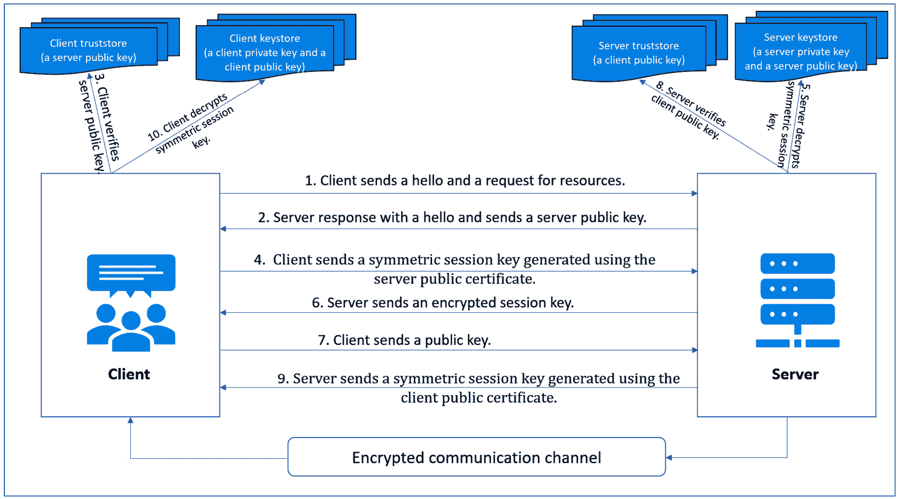
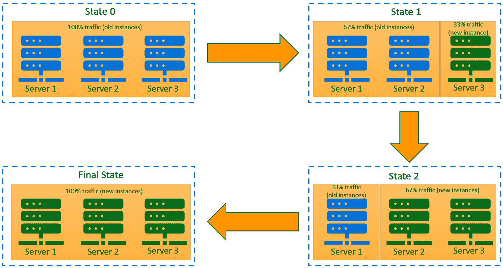
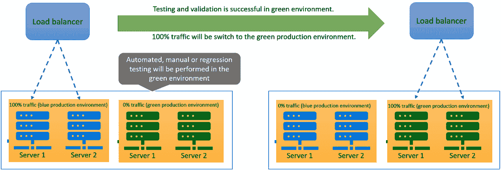
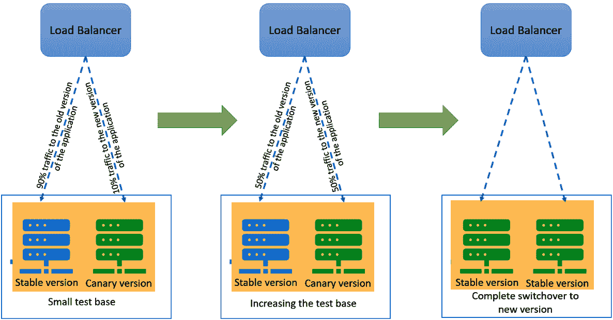

# 非功能性需求对 API 架构设计的影响

本章将讨论 `non-functional requirements` 在塑造架构方面的影响。`Non-functional requirements` 对于实施 `API` 解决方案至关重要，可确保静态和传输中的数据安全，实现风险较低或更安全的部署模型、API 性能和安全性。

在本章中，我们将涵盖以下主题：

*   `Common non-functional requirements`
*   `Meeting performance requirements in the platform`
*   `Applying security to the API design`
*   `Data encryption in transit and at rest`
*   `Deployment strategies`，如 `blue-green deployment` 和 `canary deployment`

## 常见非功能性需求

`Non-functional requirements` 有助于在各种功能之间平衡权衡，根据目标受众和 `API` 的预期用途的关键点指导设计和方法论。它为 `API` 的行为建立了规范。

通常称为 `quality attributes`，`non-functional requirements` (`NFRs`) 是评估系统功能而非其特定行为或功能的标准。

每位架构师都有一组需要管理的非功能性需求（NFR）。这些 NFR 勾勒了解决方案的技术限制，并规定了其应如何运行。最常见的 NFR 包括可用性、可扩展性、性能、安全性、可观测性、可维护性、弹性、可靠性、一致性和质量。

一些 NFR，例如可扩展性、高可用性、容错和灾难恢复，将在 *第 16 章* 中讨论。在本章中，我们将讨论一些与 API 性能、安全性等相关的 NFR。

# 在平台中满足性能要求

API 接收、处理和处理请求以与其他应用程序或服务通信或提供数据的速度称为 API 性能。

API 性能可通过以下因素进行衡量。

## 响应时间

这是 API 响应请求所需的时长。有效载荷大小、服务器处理和网络延迟是影响它的一些变量。它是用户有效性和满意度的关键指标。

## 吞吐量

这是 API 在给定时间内可以处理的请求数量。吞吐量受并发性、负载均衡和服务器资源分配的影响。它是可靠性和可扩展性的基本指标。

## 错误率

这是 API 在给定时间内返回的错误百分比。错误率受代码质量、异常处理、质量检查和验证等因素影响。

## 可用性

这是 API 正常运行的时间量，以百分比衡量。可用性受停机时间、正常运行时间和维护等因素影响。API 的可用性对于企业确保业务连续性至关重要。

## 延迟

这衡量的是执行请求后从 API 获取响应所需的时间。较低的延迟通常意味着更高的性能。

## 可扩展性

这是 API 在不降低性能的情况下处理更多请求和事务的能力。API 必须足够灵活，以便在流量负载期间独立扩展。

我们刚才了解了可用于衡量 API 性能的不同因素。以下是能够提升 MuleSoft API 整体性能的因素。

## 资源分配

在部署到任何 MuleSoft 环境时，需要为应用程序分配合适的资源。对于同一个应用程序，资源分配可能因环境而异。例如，与部署在本地的应用程序相比，部署到 CloudHub 的应用程序可能需要更多或更少的计算资源。MuleSoft 提供了一个运行时平面，允许您仅通过增加或减少工作节点的数量（在 CloudHub 2.0 中为副本）和工作节点大小（在 CloudHub 2.0 中为副本大小）来增加或减少计算资源。这可以实现零停机。增加计算资源意味着您将能够接受更多的 API 请求进行处理，并可在高峰时段提高整体性能。部署在 Runtime Fabric 上的 API 可以通过添加更多副本或增加副本大小来分配更多计算资源。

与 CloudHub 和 Runtime Fabric 形成对比的是，在本地 Mule 环境中扩展已安装的 Mule API 更加困难。在本地 Mule 环境中，无法单独扩展各个应用程序；相反，必须通过添加更多实例或资源来扩展整个服务器。在本地扩展 Mule 环境可能需要停机时间。

## 性能测试

您需要评估 Mule 应用程序及其运行环境，以从中获得最佳性能。性能测试是一种非功能性软件测试，用于评估应用程序在特定工作负载下的响应能力、速度、可扩展性和稳定性。这一关键步骤保证了软件质量。性能测试也称为压力测试。Apache JMeter 是一个 Apache 项目，允许您对 API 执行性能测试，以衡量和分析其 API 响应能力和吞吐量。

性能测试还将帮助您确定运行 API 所需的合适计算资源。

## 性能监控

必须持续监控 API，以验证测试期间它们消耗的资源。这将使您了解每个 API 在性能测试或标准测试期间消耗的 CPU 或内存。MuleSoft 提供了开箱即用的组件，例如 Anypoint Monitoring 或 Runtime Manager 指标，用于验证 API 的 CPU 或内存使用情况以及网络使用情况。

可以为超过阈值限制的 CPU 或内存使用量，或 API 无响应的情况配置警报。这将确保应用程序的可维护性和可用性。

## 负载均衡

将网络流量均匀地分配到资源池中以支持应用程序的过程称为负载均衡。通过缩短响应时间和降低网络延迟，负载均衡提高了应用程序性能。一个称为负载均衡器的智能组件可跨多台服务器高效地分发客户端请求或网络负载。

负载均衡器将确保流量仅路由到在线、健康且负载较低的服务器。这将保证 API 的可靠性和可访问性。

以下是负载均衡器分发网络流量的算法：

*   **轮询负载均衡**：客户端请求的周期被发送到可用服务器。轮询服务器负载均衡的最佳条件是服务器之间的处理和存储容量大致相等。
*   **最少连接负载均衡**：在这里，客户端请求被发送到活动连接最少或不那么繁忙的服务器。这将确保繁忙的服务器不会被更多客户端请求过载。
*   **加权轮询负载均衡**：为每台服务器分配一个数值。负载均衡器在将会话分配给服务器时会使用该值。如果两台服务器具有相同数量的活动连接，则权重较高的服务器将接收新请求。如果连接最少的服务器权重都相同，则忽略权重值。

> **注意**
>
> 在大多数情况下，算法使用轮询机制将请求分发给专用负载均衡器，但这并不总是正确的。算法试图均匀分割流量，但会根据 **专用负载均衡器 (DLB)** 和应用程序的性能进行调整。

## 应用缓存

缓存是一种临时数据存储，它自动存储信息以加快下次访问应用程序时的数据检索速度。为了节省后续 API 请求往返数据库或另一次系统调用的开销，我们通常缓存 API 中静态或不经常更改的数据。这将提高 API 的整体性能和响应时间。

在 MuleSoft 中，缓存可以通过以下方式实现：

*   通过将缓存策略应用于 Anypoint API Manager 上的 API，可以实现 MuleSoft 中的服务端实现。
*   一个称为缓存作用域的组件允许您将转换或操作的结果在内存中存储一段预定时间。这可以减少执行操作的次数，从而提高应用程序的性能。

许多其他因素可以提高 API 的整体性能：

*   **配置与调优**：为了防止性能下降，正确配置线程池、超时、内存和 CPU 利用率以及 **垃圾回收 (GC)** 调优等基本要素非常重要。

# API 性能优化

- **使用批处理**：为了提高 API 在重负载处理下的整体有效性和性能，请考虑利用批处理技术作为实时处理的替代方案。
- **有效的异常处理**：在 `Mule` 应用程序的设计中包含有效的错误处理程序。未受管理或控制的错误传播会严重影响性能。
- **优化 DataWeave 转换**：为了最大化 `DataWeave` 转换的效率，仅转换必要的数据，并在处理较大数据集时利用分页和流式处理。
- **异步处理**：通过启用并行流程执行，异步处理可以极大地提升 `MuleSoft` API 性能。
- **监控和日志记录**：准确的监控和及时的日志记录将有助于识别和解决任何性能问题。

我们将在后续章节中讨论更多关于非功能性需求（NFR）的内容。可扩展性、高可用性、灾难恢复、容错等将在 第 16 章 中讨论。

我们已经了解了如何总体上提升 API 性能以及可能导致 API 性能问题的变量。现在，我们将探讨许多种部署技术，这些技术可用于保证无故障的 API 部署和简单的 API 回滚程序。

# API 安全

防止恶意攻击和 API 滥用的做法称为 API 安全。由于 API 固有地暴露了应用程序逻辑和敏感数据（包括 `PII`），它们可能成为网络攻击的目标。

以下是将安全性应用于 API 设计的方法：

- **身份验证和授权**：实施强大的身份验证和授权程序来管理谁可以使用您的 API。可以使用标准协议，如 `OAuth 2.0`、`OpenID Connect` 或基于 `JWT` 的身份验证来实现这一点。
- **加密**：使用 `SSL/TLS` 加密保护传输中的所有数据。API 应拒绝通过未加密路由交换数据。
- **限流和配额**：通过在 API 上设置配额或速率限制（限流），降低 `DdoS` 攻击的可能性。这限制了客户在特定时间段内可提交的请求数量。
- **访问控制**：为确保只有授权用户才能访问特定资源，API 应包含强大、详细的访问控制机制。一种流行的方法是 `RBAC`。
- **验证和过滤数据**：应验证输入数据并过滤输出数据，以防止注入攻击和 `XSS` 等常见 Web 威胁。
- **错误处理**：API 错误消息中不应暴露敏感信息，因为这可能为攻击者提供利用系统的手段。
- **日志记录和监控**：应实施广泛的日志记录以监控 API 活动，帮助检测、诊断问题并识别可疑活动。
- **API 版本控制**：在更新或更改 API 时应使用适当的版本控制，以避免破坏依赖旧版本的应用程序。
- **保护 API 端点**：应通过实施最小权限原则来限制访问，从而保护 API 端点。建议使用 `UUID` 代替自增 ID 以减轻未经授权的访问。
- **渗透测试和定期审计**：对 API 进行定期审计和渗透测试，以主动识别和解决安全漏洞和弱点。您可以使用 `OWASP ZAP` 和 `Postman` 等工具执行常规 API 测试。

重要的是要注意，创建安全的 API 不仅仅需要实施身份验证和授权。包括数据结构和 HTTP 状态码的使用在内的各个方面，都有助于整个系统的安全性。在设计 API 时，必须考虑到每一个安全顾虑和潜在弱点。`MuleSoft` 提供了可从设计阶段到部署阶段用于保护 API 的工具。例如，为了保证 API 的一致性和质量并在整个公司强制执行 API 治理，我们可以在设计阶段将 API 治理规则集应用于 `RAML` 或 `OAS`。这也将保证已解决 `OWASP Top 10` 问题。在部署阶段，可以将安全 API 策略应用于已部署的 API。

现在让我们讨论如何在传输过程中保护 API 的其余部分。

# 传输中或动态数据安全

传输中或动态数据是指通过网络将数据从一个位置传输到另一个位置。这包括通过 HTTP、电子邮件或协作平台传输信息。鉴于数据在穿越互联网或私有企业网络时处于暴露状态，此类数据通常比静态数据安全性更低。因此，传输中的数据是一个高度脆弱的攻击点。

可以使用以下方法来保护传输中或动态的数据：

- **数据加密**：保护传输中数据最流行的技术是数据加密。除了保护数据免受黑客攻击外，端到端加密还能确保即使数据被拦截，接收者也无法在没有加密密钥的情况下对其进行解密。
- **虚拟专用网络 (`VPN`)**：`VPN` 是在发送数据时保护数据的另一种流行技术。通过使用 `VPN`，您可以在您交互的服务器和您的互联网连接之间建立一条安全隧道。这会隐藏您的 IP 地址并保护您的数据免受窥视，使黑客更难以追踪您的在线活动。
- **SSL 和 TLS**：`SSL` 和 `TLS` 是旨在提供网络安全的加密技术。它们通过在客户端和服务器之间建立加密连接来运作，以防止篡改和未经授权的访问。
- **使用专用网络**：发送敏感数据时，请尽量避免使用公共或不受保护的网络。使用专用或受保护的无线网络可以降低数据被拦截的可能性。
- **采用安全文件传输选项**：传输文件时，请始终选择提供安全文件传输的服务。例如，`SFTP` 除了支持加密外，还支持安全认证。
- **频繁的系统/软件更新**：软件开发人员随着每个版本的发布都会增强安全性并解决安全漏洞。如果您未能升级，系统可能会面临入侵风险。
- **多因素认证 (`MFA`)**：`MFA` 通过要求多种验证方式来认证用户，增加了一层额外的保护。
- **建立数据丢失防护 (`DLP`) 策略**：`DLP` 策略通过监控、检测和阻止使用中、传输中和静态的数据，最大限度地降低数据泄露的风险。

`TLS` 在 Web 服务器和浏览器之间建立加密连接。这保证了 Web 服务器和浏览器之间传输的所有数据的隐私和安全性。“单向 TLS”描述了一种客户端仅对服务器进行身份验证的过程，确保客户端确信服务器就是它声称的那样。

为了实现这一点，客户端会验证服务器 TLS 证书的可信度，以及通向该证书的证书链。在这种情况下，加密是单向的（从客户端到服务器），而不是双向的，并且服务器不知道客户端的身份（尽管它会知道客户端发送的数据将被安全加密）。当客户端面向公众开放（如 Web 浏览器）且不需要唯一身份时，通常会采用这种配置。

下图演示了单向 TLS：

图 8.1 - 单向 TLS

相比之下，双向 TLS（也称为相互认证或客户端认证 SSL）通过让客户端和服务器相互认证并验证彼此的身份，确保了更高级别的安全性。

双向 TLS 是一种通信模式，要求在任何数据交换发生之前，客户端和服务器都必须向对方进行身份认证。因为双向 TLS 验证了数据传输中双方的可靠性，所以它能提供更高级别的安全性。在传输或存储私密或敏感数据的情况下，这至关重要。处理敏感个人数据、金融交易或私有公司信息的企业经常使用双向 TLS 来降低数据泄露的风险。

下图演示了双向 TLS：

图 8.2 - 双向 TLS（相互认证）

在本节中，我们了解了如何使用单向和双向 TLS 等方法来保护传输中的数据安全。客户端和服务器之间的安全连接就是使用这种方法建立的。我们将在下一节讨论静态数据的安全保护。

## 静态数据安全

保护以任何数字格式（如电子表格、数据库、数据仓库、归档文件、磁带、异地备份和移动设备）物理存储的数据，被称为“保护静态数据”。

可以采取以下措施来保证该数据的安全：

*   **强访问控制**：确保数据仅对有特定需求的人员可访问。RBAC（基于角色的访问控制）、生物识别验证和复杂密码都有助于实现这一点。
*   **数据脱敏**：为了防止敏感信息被未授权方查看，采用数据脱敏技术，即对其进行去标识化或清洗处理。
*   **更新和安全补丁**：持续为系统和软件应用最新的安全补丁。
*   **使用 DLP 工具**：这些工具可以识别关键数据，追踪其流向，防止未授权访问，并阻止数据流出组织。
*   **频繁审计**：定期记录谁有权访问数据，进行审计，并根据需要更改权限。这也有助于发现可能指向安全漏洞的任何异常或模式。
*   **数据加密**：数据加密是将数据转换为只有拥有密钥或密码的人才能读取的另一种格式或代码的过程。它是保护静态数据的最佳方法之一。
*   **使用强认证技术**：实施 MFA（多因素认证）和其他技术可以防止未授权的数据访问。

为了完全保护其敏感和关键数据，组织必须同时保护传输中和静态的数据。在本节中，我们了解了如何使用数据加密、数据脱敏和其他技术来保护静态数据的安全，后续章节将更多地讨论 API 安全。下一节将介绍部署策略。在部署应用程序时，选择合适的部署策略非常重要。

## 部署策略

部署 API 可能具有挑战性和复杂性，因为有许多可用的部署策略。根据组织的需求和所部署 API 的性质，选择正确的部署策略至关重要。同时，也要考虑如何将部署失败的风险降至最低，或在不造成任何停机的情况下快速切换回 API 的先前版本。

为了确保软件应用程序能够可靠、高效地部署，并将对用户的干扰降至最低，需要部署策略。这些策略有助于降低中断、数据丢失和安全漏洞的风险，并提高组织软件应用程序的质量和性能。

组织用于将部署失败风险降至最低的三种重要部署策略：

*   滚动更新部署
*   蓝绿部署
*   金丝雀部署

我们将详细讨论这三种部署策略。

### 滚动更新部署

滚动更新确保应用程序部署可实现零停机。在滚动更新部署中，应用程序的新版本会在所有先前的实例中缓慢发布。简言之，这种方法逐个用新实例替换应用程序的现有实例。使用这种方法，我们可以随着时间的推移逐步更新各个系统组件。我们通过分阶段推出的方式，逐步将应用程序的更新版本引入生产环境。

下图展示了滚动更新部署的工作原理。

图 8.3 - 滚动更新部署

*图 8.3* 展示了每台服务器如何一次部署一个应用程序，随着时间推移，流向每个新应用程序实例的流量逐渐增加。

### 蓝绿部署

蓝绿部署是一种部署策略，其中两个相同的生产环境并行运行，一个环境称为蓝色环境，另一个称为绿色环境。蓝色是当前的生产环境，而绿色是新的生产环境。

蓝绿部署的流程如下：

1.  将最新的更改或增强部署到绿色环境。
2.  执行回归测试、手动测试或自动化测试，以确保绿色环境按预期工作且功能正常。
3.  一旦绿色环境测试通过并准备就绪，将流量从蓝色切换到绿色。
4.  密切关注绿色环境的性能，以发现绿色环境中的任何问题或缺陷，并将流量回滚到蓝色环境。

蓝绿部署并发运行两个相同的生产环境，降低了停机和服务中断的可能性。如果发现绿色环境存在问题，可以迅速恢复到蓝色环境，从而保护最终用户。

下图展示了蓝绿部署的工作原理。

图 8.4 - 蓝绿部署

### 金丝雀部署

金丝雀发布增强了可观测性，限制了新组件对当前服务的影响，并逐步将流量路由到软件的新版本，所有这些都有助于组织降低软件引入相关的风险。

降低发布新软件版本风险的一种方法是金丝雀部署。在向所有用户提供新软件版本之前，先在实时环境中向一小部分选定的用户展示。团队可以通过金丝雀部署在真实环境中测试新版本的表现、降低风险并提高软件质量，所有这些都旨在改善用户体验。金丝雀部署的流程如下：

1. 决定哪些用户或系统将首先获得更新或功能，并以一小部分比例开始。

2. 向金丝雀组授予对更新或功能的访问权限。

3. 密切关注金丝雀组的性能，以发现任何问题或错误。

4. 如果金丝雀组表现良好，则逐步增加接收更新或功能的用户或系统的百分比。

5. 在部署给更多用户或系统之前，解决发现的任何问题并回滚部署。

下图展示了金丝雀部署的工作原理。

*图 8.5 - 金丝雀部署*

作为持续交付策略的关键组成部分，金丝雀部署在为基于云的应用程序引入更新和新功能时非常有用。金丝雀部署得名于煤矿中历史上使用金丝雀在有害气体影响人类前识别它们的方法，它有助于在软件缺陷影响所有用户之前识别它们。

MuleSoft Catalyst 提供了一种 API 策略，允许您实施金丝雀部署。一种可动态切换 API 实现主机的 Mule 金丝雀部署 API 策略，使网关代理能够支持金丝雀发布策略。

## 摘要

本章讨论了实施强大架构所需的非功能性需求 (NFR)。我们研究了影响 API 性能的因素，并提出了增强性能的解决方案。此外，我们深入探讨了 API 安全性和部署策略，包括使用单向和双向 SSL 实现客户端和服务器之间的安全通信。在设计 API 时，优先考虑 API 安全性和性能至关重要。

在下一章中，我们将讨论如何利用 CloudHub 1.0 托管 MuleSoft API。

## 延伸阅读

*   单向和双向 SSL – <https://dzone.com/articles/implementing-one-way-and-two-way-ssl-mutual-authen>
*   API 安全性 – <https://www.mulesoft.com/resources/api/api-security>
*   API 性能 – <https://blogs.mulesoft.com/tag/api-performance/>
