# 9. 使用 Anypoint iPaaS (CloudHub 1.0) 实现无忧部署

在本章中，我们将学习如何在 CloudHub 1.0 环境中运行、管理和部署 MuleSoft 应用程序。我们还将了解 CloudHub 1.0 提供的不同特性和功能，以及在 Anypoint Platform 中于 CloudHub 1.0 内运行和部署应用程序的不同平台架构方法。

在本章中，我们将涵盖以下主题：

*   什么是 CloudHub 1.0？
*   CloudHub 1.0 提供哪些功能？
*   CloudHub 1.0 的架构功能
*   网络和托管选项
*   CloudHub 1.0 的高可用性、可扩展性、容错性和灾难恢复

## 技术要求

对于本章，您需要访问 Anypoint Platform。您可以在 <https://anypoint.mulesoft.com/login/signup> 注册一个 30 天免费试用账户。

您还需要下载 MuleSoft Anypoint Studio（访问 <https://www.mulesoft.com/lp/dl/anypoint-mule-studio>）。

## 什么是 CloudHub 1.0？

CloudHub 1.0 是一个现代的多租户基于云的集成**平台即服务**，分布在全球 12 个区域，用于运行 MuleSoft 应用程序。它允许企业使用现有数据源创建 API，将本地服务集成到云中，并在云中部署应用程序。部署到 CloudHub 1.0 的应用程序可通过 Anypoint Platform 中的 Runtime Manager 进行管理。CloudHub 1.0 中的应用程序可以使用 Anypoint Studio、Anypoint CLI、CloudHub 1.0 API 或 Mule Maven 插件进行部署。CloudHub 1.0 使用 `AWS` 云作为底层基础设施，CloudHub 1.0 的可用性取决于 `AWS` 云的可用性。CloudHub 1.0 为在云中部署和运行 API 提供了托管运行时平面。

CloudHub 1.0 具有弹性；可按需扩展。您可以从小型工作负载开始，并根据需要随时扩展。这可以在不经历应用程序或 API 任何停机时间的情况下实现。

我们在前几章中讨论了控制平面和运行时平面。当您将应用程序部署到 CloudHub 1.0 时，意味着您正在使用 MuleSoft 托管的控制平面和运行时平面。CloudHub 1.0 提供 Runtime Manager，用于管理、监控和部署 MuleSoft 应用程序。在深入探讨一些用例之前，让我们谈谈 CloudHub 1.0 支持的各种功能。

### Worker 和 Worker 大小

Worker 是运行 MuleSoft 应用程序的专用实例。Worker 大小是在部署期间为应用程序配置的内存和存储量。它有多种规格，如*表 9.1* 所示：

| Worker 大小 (vCores) | Worker 内存 (GB) | 堆内存 (GB) | 磁盘存储大小 (GB) |
| --- | --- | --- | --- |
| 0.1 | 1 | 0.5 | 8 |
| 0.2 | 2 | 1 | 8 |
| 1 | 4 | 2 | 12 |
| 2 | 8 | 4 | 40 |
| 4 | 16 | 8 | 88 |
| 8 | 32 | 16 | 168 |
| 16 | 64 | 32 | 328 |

表 9.1 - CloudHub 1.0 可用的 Worker 大小

分配给 Worker 的最小存储为 **8 GB**，供应用程序和系统使用，其中 **3 GB** 由操作系统和 Mule 运行时使用。部署到 CloudHub 1.0 的应用程序初始元空间分配为 **128 GB**，部署到 CloudHub 1.0 的应用程序的元空间限制为无限制，无论 Worker 大小如何。为应用程序分配 **0.1** vCores 和 **0.2** vCores 意味着它将处理应用程序的小型工作负载。如果您想要更好的性能并处理大型工作负载，则可以根据每秒请求数和有效载荷大小等各种因素，为应用程序分配更多 vCores。Worker 大小可随时扩展，且应用程序无停机时间。要启用水平扩展，请增加应用程序的 Worker 数量。要启用垂直扩展，请增加应用程序的 Worker 大小：

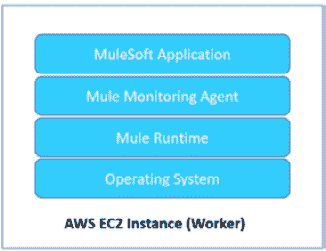

*图 9.1 - CloudHub 1.0 Worker*

*图 9.1* 显示了 MuleSoft Worker 作为一个专用的 `EC2` 实例，由 `AWS` 通过安装 `Linux`、Mule 运行时、监控代理和 MuleSoft 应用程序创建。

### 共享负载均衡器

CloudHub 1.0 为部署到 Runtime Manager 的任何应用程序提供默认负载均衡器。它提供基本功能，例如 `TCP` 负载均衡，并配备了速率限制以确保平台稳定性。MuleSoft 持续监控负载均衡器，并在必要时扩展这些限制。速率限制可能因区域而异。如果共享负载均衡器上的速率限制被超出，您可能会在一段时间内从共享负载均衡器收到 `429` 错误代码。

共享负载均衡器不支持配置自定义域名或证书。它支持传输中的 `TLS 1.1` 和 `TLS 1.2`。

### 区域

在撰写本文时，CloudHub 1.0 允许您在全球 12 个区域中部署应用程序。组织可以在最接近其企业数据中心或系统的 CloudHub 1.0 区域中部署其应用程序。*表 9.2* 提供了 CloudHub 1.0 中可用区域的列表：

| 区域 | 区域别名 | URL |
| --- | --- | --- |
| 美国东部 (弗吉尼亚北部) | `us-e1` | `<app_name>.us-e1.cloudhub.io` |
| 美国东部 (俄亥俄) | `us-e2` | `<app_name>.us-e2.cloudhub.io` |
| 美国西部 (加利福尼亚北部) | `us-w1` | `<app_name>.us-w1.cloudhub.io` |


# 表 9.2 - CloudHub 1.0 区域

| 区域 | | 别名 | URL |
| --- | --- | --- | --- |
| 美国西部（俄勒冈） | | `us-w2` | `<app_name>.us-w2.cloudhub.io` |
| 加拿大（中部） | | `ca-c1` | `<app_name>.ca-c1.cloudhub.io` |
| 南美洲（圣保罗） | | `br-s1` | `<app_name>.br-s1.cloudhub.io` |
| 亚太地区（新加坡） | | `sg-s1` | `<app_name>.sg-s1.cloudhub.io` |
| 亚太地区（悉尼） | | `au-s1` | `<app_name>.au-s1.cloudhub.io` |
| 亚太地区（东京） | | `jp-e1` | `<app_name>.jp-e1.cloudhub.io` |
| 欧盟（爱尔兰） | | `ir-e1` | `<app_name>.ir-e1.cloudhub.io` |
| 欧盟（法兰克福） | | `de-c1` | `<app_name>.de-c1.cloudhub.io` |
| 欧盟（伦敦） | | `uk-e1` | `<app_name>.uk-e1.cloudhub.io` |

## DNS 记录

CloudHub 1.0 支持多条 DNS 记录，以启用内部和外部通信：

### 表 9.3 - DNS 记录

| DNS 记录 | 说明 |
| --- | --- |
| `<myapp>.<region_alias>.cloudhub.io` | 共享负载均衡器的公开可访问 URL，配置为接受端口 80 上的 HTTP 流量和端口 443 上的 HTTPS 流量，将重定向到 `${http.port}` 和 `${https.port}` 指定的端口。 `http.port=8081` `https.port=8082` |
| `mule-worker-<myapp>.<region_alias>.cloudhub.io` | 此 DNS 可公开访问，提供工作节点的外部 IP 地址，并在端口 `${http.port}` 上暴露 HTTP 应用程序，在端口 `${https.port}` 上暴露 HTTPS 应用程序。 |
| `mule-worker-internal-<myapp>.<region_alias>.cloudhub.io` | 此 DNS 可在 Anypoint **虚拟私有云 (VPC)** 内访问，并为工作节点提供内部 IP 地址。HTTP 应用程序可通过端口 `${http.private.port}` 访问，HTTPS 应用程序可通过端口 `${https.private.port}` 访问。 |

*表 9.3* 显示了为应用程序创建并部署到 CloudHub 1.0 工作节点的默认 DNS 记录列表。它们可用于通过公共或专用网络访问 API。

## 智能修复（单区域灾难恢复）

部署到 CloudHub 1.0 的应用程序可以自动从任何故障或崩溃中恢复。MuleSoft 提供了一种称为自修复的机制，当可用区宕机或底层基础设施故障时，应用程序会自动恢复。在这种情况下，应用程序将在另一个可用区中重新启动，或尝试自动恢复。

### 单工作节点部署

*   应用程序将自动部署到所选区域中的一个可用区。
*   如果可用区发生故障，应用程序将在另一个可用区中重新启动。在应用程序在另一个可用区中重新启动之前，可能会有短暂的停机时间。

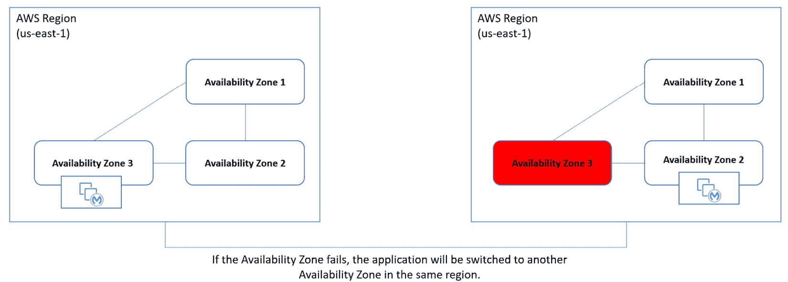

**图 9.2** - 智能修复（应用程序的单个实例）

### 多工作节点部署

*   部署在多个工作节点上的应用程序意味着该应用程序将部署到所选区域中的多个可用区。
*   如果可用区发生故障，应用程序将在另一个可用区中重新启动，而另一个可用区中的另一个应用程序实例将继续处理请求。失败的实例将尝试在另一个可用区中重新启动。

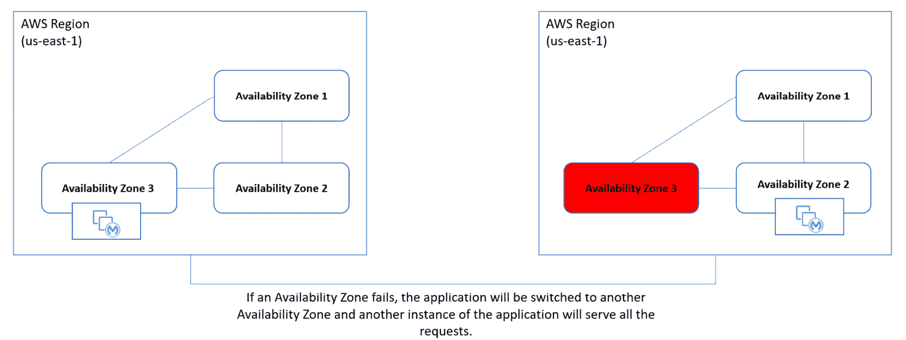

**图 9.3** - 智能修复（应用程序的多个实例）

## 零停机更新

应用程序可以重新部署，或者可以修改应用程序配置（如工作节点大小、工作节点数量或任何其他设置），而无需任何停机时间。在应用程序重新部署的情况下，用户将永远不会遇到任何停机时间。当我们将应用程序重新部署到 CloudHub 1.0 时，旧的应用程序实例将保持运行，并且域名将指向旧的应用程序实例，直到新应用程序成功部署到 CloudHub 1.0。

## 高可用性

部署在 CloudHub 1.0 上的应用程序具有高可用性。为确保应用程序的高可用性，必须将其部署在多个工作节点上。当您在一个工作节点上部署应用程序时，该应用程序将部署到 AWS 中的一个可用区。如果可用区宕机或应用程序尝试从任何故障中恢复，则可能会出现短暂的停机时间。

当您在多个工作节点上部署应用程序时，该应用程序将在 AWS 的多个可用区中可用。当其中一个可用区宕机时，将实现零停机时间，因为应用程序在另一个可用区中可用。如果整个区域宕机，您将遇到停机时间，直到该区域中的一个可用区恢复运行。

## 可扩展性

可扩展性对于任何应用程序实现高性能至关重要。部署到 CloudHub 1.0 的应用程序可以通过增加工作节点数量（水平扩展）或工作节点大小（垂直扩展）来轻松扩展。这可以通过零停机时间来实现。

CloudHub 1.0 提供了自动扩展等功能。要在 CloudHub 1.0 中启用自动扩展，您必须拥有企业许可协议。在 Anypoint Platform 的 Runtime Manager 控制台中，您可以为应用程序定义策略，以便根据内存和 CPU 使用情况自动扩展。

## 持久队列

持久队列是一项基于云的服务，允许发布到 VM 队列的消息在应用程序中外部存储。此功能直接与 CloudHub 1.0 应用程序相关联，可在应用程序级别启用。它允许开发人员设计 VM 队列，通过启用持久队列在工作节点之间分配负载；这将确保如果工作节点宕机，消息将持久保存。在多工作节点部署环境中，如果其中一个工作节点失败，则消息将由另一个工作节点读取，以确保服务连续性。

如果部署到 CloudHub 1.0 的应用程序正在使用 VM 队列，则可以启用持久队列。通过启用**加密持久队列**，消息可以作为加密消息存储在持久队列中：

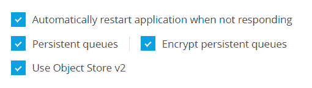

**图 9.4** - 启用加密持久队列

*图 9.4* 显示了如何为部署到 CloudHub 1.0 的应用程序启用持久队列。

持久队列的限制在于，与不使用持久队列相比，它可能会使应用程序性能下降多达 10 倍。如果您选择**加密持久队列**选项，性能可能会进一步下降。如果您不使用持久队列，消息将存储在内存或工作节点的本地文件中。在这种情况下，当应用程序重新启动或重新部署时，消息将会丢失。

## 管理计划

CloudHub 1.0 允许您管理和查看部署的应用程序的 Mule 流中配置的调度器组件。在 Runtime Manager 中，您可以使用应用程序中的**计划**选项卡来查看调度器的频率、更改调度器的频率，或启用/禁用调度器，而无需更改或重新部署正在运行的应用程序。

可以在**计划**选项卡上执行以下任务：

*   可随时触发作业，无论应用程序上设置了什么计划，也无需修改调度器
*   如果调度器应用程序连接的底层系统需要维护，可禁用调度器
*   可随时更新调度器，无需修改或重新部署应用程序

## Object Store V2

Object Store V2 允许部署到 CloudHub 1.0 的应用程序存储数据，并共享批处理流程、Mule 应用程序和组件的状态（在应用程序内部或通过使用 Object Store REST API）。以下是 Object Store V2 的功能列表：


## 对象存储 V2

* 对象存储 V2 将与您的工作器位于同一区域。
* 它允许存储无限数量的条目。对对象存储的总大小没有限制。
* 它可以存储大小高达 10 MB（Base64 编码后）的值。
* 它在所有区域及区域内的所有可用区均可用。
* 它提供 MuleSoft 对象存储连接器，用于检索和存储数据。
* 外部应用程序可以使用对象存储 REST API v2 来访问其他 MuleSoft 应用程序中的对象存储。
* 对象存储 REST API 支持连接应用程序，以使用 API 通过 Anypoint Platform 进行身份验证。

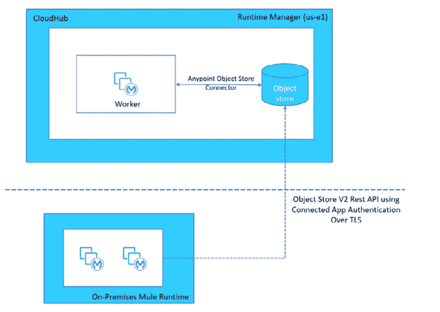

图 9.5 - CloudHub 1.0 与本地 Mule 运行时之间访问对象存储

图 9.5 展示了一个部署在 CloudHub 1.0 上并正在访问对象存储的 MuleSoft 应用程序。要在应用程序内部访问对象存储，可以使用对象存储连接器。要从部署在 CloudHub 1.0 或本地的另一个应用程序访问对象存储，可以使用对象存储 REST API。

## 静态 IP 地址

默认情况下，从 AWS EC2 IP 池中分配一个 IP 地址给部署在 CloudHub 1.0 上的任何应用程序。每次重启或重新部署应用程序时，IP 地址都会动态变更。您可以在 <https://docs.aws.amazon.com/vpc/latest/userguide/aws-ip-ranges.html> 找到可用的 AWS EC2 IP 池 IP 地址列表。CloudHub 1.0 允许我们在 Runtime Manager UI 的**设置**页面为应用程序配置静态 IP 地址。

为应用程序配置静态 IP 地址的主要原因是为了让它能被其他服务加入白名单。例如，MuleSoft 想要连接到一个 SFTP 位置，该来源需要将其 IP 加入白名单才能安全地连接到 SFTP。

分配给任何组织的静态 IP 地址数量 = 2 \* 生产环境 vCore 数量：

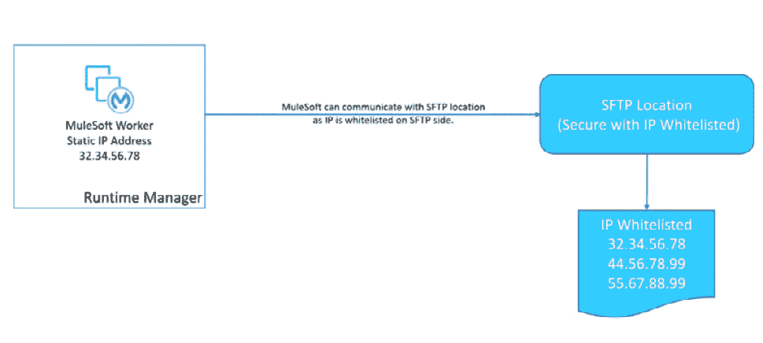

图 9.6 - 应用程序使用静态 IP 地址与外部服务通信

仅在以下场景中可以更改静态 IP 地址：

* 如果应用程序被删除并重新部署。删除应用程序将删除分配给该应用程序的静态 IP 地址。每当您部署一个同名应用程序时，都会动态分配一个新的静态 IP 地址。
* 如果应用程序被重新部署到不同的区域。
* 如果应用程序从一个环境移动到另一个环境。
* 释放未使用的 IP 地址，然后稍后启用**使用静态 IP**：

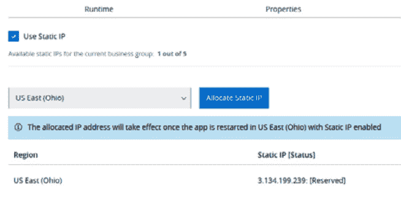

图 9.7 - 为部署在 CloudHub 1.0 上的应用程序启用静态 IP 地址

图 9.7 展示了如何为部署在 CloudHub 1.0 上的应用程序启用静态 IP 地址。

在本节中，我们介绍了 CloudHub 1.0 提供的特性和功能，包括可扩展性、高可用性、区域、DNS 记录、静态 IP 地址、工作器、工作器大小等。

默认情况下，CloudHub 1.0 不支持自定义域名和证书或双向认证，也无法连接防火墙后面的资源。但是，CloudHub 1.0 确实允许您创建 Anypoint VPC，它支持双向认证、自定义域名和证书等功能。它可以连接防火墙后面的资源，并允许您在 CloudHub 1.0 中创建自己隔离的独立网络段。让我们详细讨论 Anypoint VPC 及其组件。

# Anypoint VPC

Anypoint VPC 允许您在 CloudHub 1.0 中建立一个安全、隔离、独立且私有的网络，您可以在其中为您的组织托管 MuleSoft 应用程序。Anypoint VPC 可以在前面提到的 12 个不同的 AWS 区域中创建。创建 Anypoint VPC 时可以选择区域。让我们看一下关于此服务的一些关键点：

* Anypoint VPC 可以安全地连接到您自己的数据中心或公有云
* 它将 CloudHub 1.0 连接到防火墙后面的资源
* 支持自定义域名和自定义证书
* 支持专用负载均衡器，将流量路由到部署在 Anypoint VPC 内的应用程序
* 支持双向认证

使用 Anypoint VPC，您可以配置特定的入站防火墙规则来控制入站流量。可以在 Anypoint VPC 上配置的默认防火墙规则如下：

| 变量 | 端口 | 描述 |
| --- | --- | --- |
| `${http.port}` | 8081 | 这将通过 HTTP 从共享负载均衡器接受公共流量 |
| `${https.port}` | 8082 | 这将通过 HTTPS 从共享负载均衡器接受公共流量 |
| `${http.private.port}` | 8091 | 这将通过 HTTP 从内部 VPC 接受本地网络流量 |
| `${https.private.port}` | 8092 | 这将通过 HTTPS 从内部 VPC 接受本地网络流量 |

表 9.4 - Anypoint VPC 默认入站防火墙规则

## Anypoint VPC 架构

下图显示了默认的 Anypoint VPC 架构。在此架构中，端口 8081 (`${http.port}`) 允许接受 HTTP 流量，端口 8082 (`${https.port}`) 允许从共享负载均衡器接受 HTTPS 流量。端口 8091 允许接受来自内部应用程序或内部用户的 HTTP 流量，端口 8092 允许接受 HTTPS 流量：

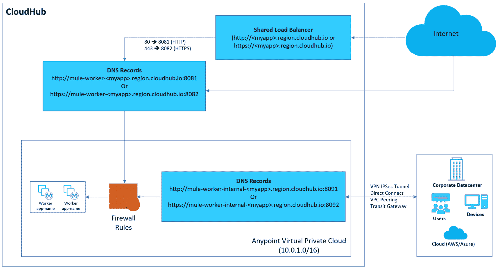

图 9.8 - 具有共享负载均衡器的 Anypoint VPC 架构

本地私有网络云中的应用程序可以使用内部 DNS (`mule-worker-internal-<myapp>.<region_alias>.cloudhub.io:port`) 访问在 Anypoint VPC 中运行的 MuleSoft 应用程序。这些内部应用程序或用户必须使用 VPC 对等连接、VPN IPsec 隧道、Direct Connect 或 Transit Gateway 与 Anypoint VPC 建立连接。部署在 CloudHub 1.0 上的 Anypoint VPC 中的 MuleSoft 应用程序可以访问位于企业数据中心、私有云或本地的服务、应用程序和数据库：

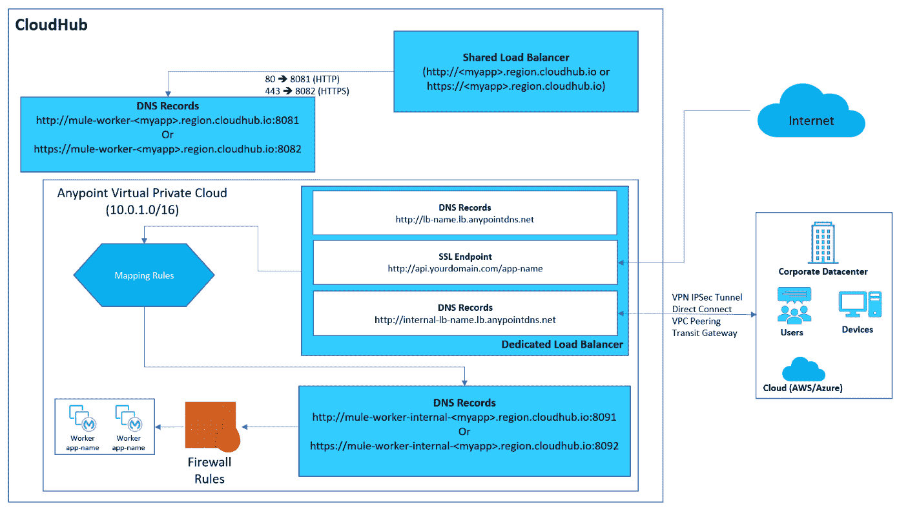

图 9.9 - 具有专用负载均衡器的 Anypoint VPC 架构

在图 9.9 所示的架构中，我们阻止了来自共享负载均衡器的流量，这意味着我们将不允许端口 8081 和 8082 上的任何流量，并且这些规则将从 Anypoint VPC 中移除。这意味着部署在 CloudHub 1.0 上的应用程序位于私有端口 **8091** 或 **8092** 上。要将流量路由到部署在这些私有端口上的应用程序，您需要 Anypoint VPC 内的专用负载均衡器。

现在，让我们谈谈 VPC 连接方法。根据您的系统所在位置和运行位置，Anypoint VPC 可以使用以下方法之一连接到私有网络：

* VPN IPsec 隧道
* VPC 对等连接
* Transit Gateway
* Direct Connect

## VPN IPsec 隧道

**虚拟专用网络 (VPN)** IPsec 隧道允许 Anypoint VPC 连接到本地数据中心。这是连接 Anypoint VPC 到本地数据中心的推荐解决方案之一。它确保 Anypoint VPC 和本地数据中心之间存在加密且安全的连接：

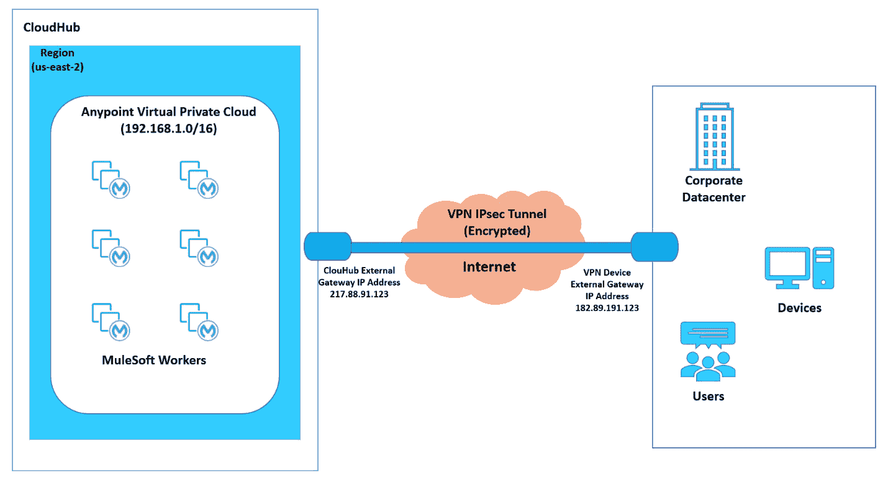

图 9.10 - Anypoint VPN


# VPN IPsec 隧道

VPN IPsec 隧道通过互联网经由加密隧道实现 Anypoint VPC 与本地数据中心或私有网络之间的连接。Anypoint Platform VPN IPsec 隧道支持两种路由类型：静态和动态。

静态路由是非自适应的，因为它不会自动更新或修改路由表；它需要手动更新。静态路由不使用任何复杂算法，且比动态路由更安全。

动态路由使用复杂算法在网络拓扑中选择最佳路径。动态路由使用 `Border Gateway Protocol` (`BGP`)。

## Anypoint VPN 高可用性

Anypoint VPN 创建两条隧道，分别终止于 AWS 区域中两个不同的可用区。这确保了如果其中一条隧道因可用区维护或升级而中断，AWS 会将流量路由到另一可用区中的隧道。建议在客户网关中配置这两条隧道以实现冗余。如果其中一条隧道中断，AWS 会将该 VPN 连接的流量路由到另一条隧道：

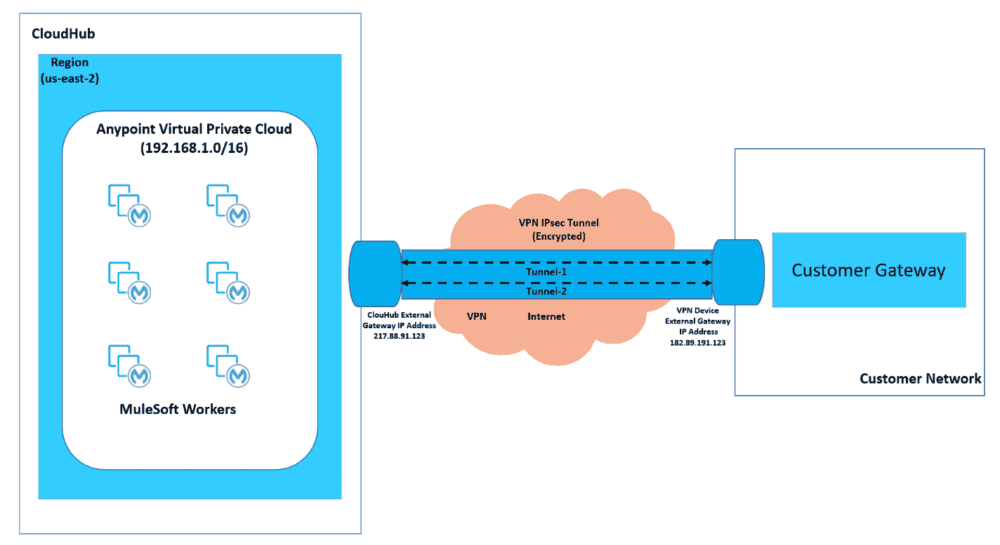

图 9.11 说明了具有两条隧道的 VPN 以确保高可用性。

## Anypoint VPN 灾难恢复

Anypoint 允许我们将最多 10 个 VPN 与 Anypoint VPC 关联。Anypoint VPN 网关可以配置在与客户相同或不同的物理位置。为避免单点故障，客户网关必须位于不同的位置或城市。建议将第二个位置用作灾难恢复位置：

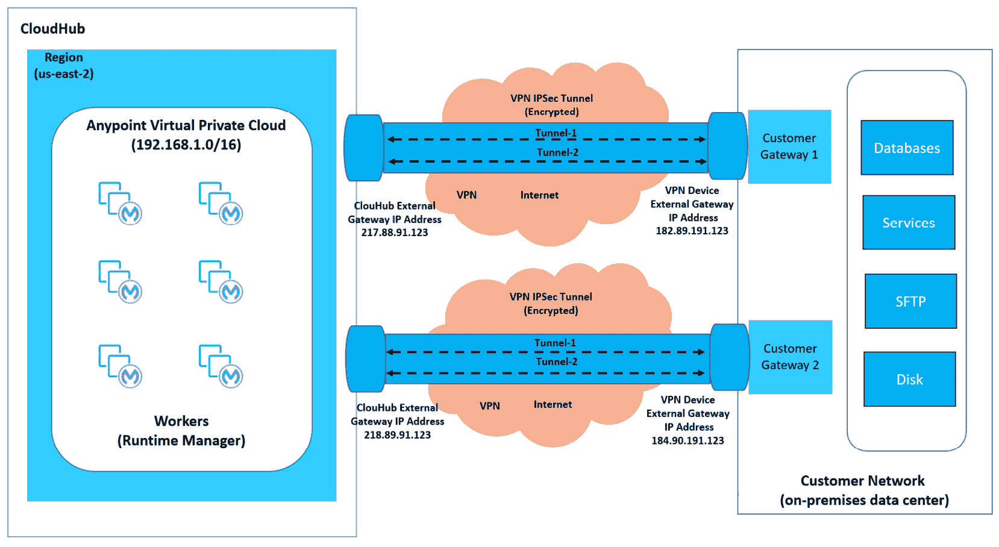

在图 9.12 所示的架构中，VPN 的配置方式决定了发生故障时将按以下顺序使用：

* `VPN-1 Tunnel-1`
* `VPN-1 Tunnel-2`
* `VPN-2 Tunnel-1`
* `VPN-2 Tunnel-2`

这配置为在发生任何故障时自动故障转移到另一条 VPN 隧道或另一个 VPN 连接。此 VPN 解决方案将具有弹性且稳健。动态路由可自动将路由从 `VPN-1` 提升至 `VPN-2`，它也支持静态路由，此时 `VPN-2` 将处于待机模式，以防 `VPN-1` 故障。

## VPN IPsec 隧道的示例用例

* 将 Anypoint VPC 与客户的私有数据中心或私有网络连接
* 将 Anypoint VPC 与非 AWS 云（如 Azure、GCP 或 Oracle Cloud）连接

## 配置 VPN 连接的建议

* 始终实施高可用 VPN 解决方案，以防止在 AWS 对 VPN 进行安全更新期间出现任何停机
* 最佳实践是为生产环境和非生产环境分别设置独立的 VPN 隧道

# VPC 对等连接

VPC 对等连接是 CloudHub 1.0 提供的一种连接选项，用于在同一 AWS 区域中对等连接两个或多个 VPC。VPC 对等连接是实现 Anypoint VPC 与同一区域中 AWS VPC 之间通信的最快方式，因为它可以通过提交支持工单并提供 MuleSoft 提供的模板中的网络详细信息来轻松创建。这是 [MuleSoft 官方文档](https://docs.mulesoft.com/cloudhub-1/to-request-vpc-connectivity)，描述了如何提交支持请求。

模板可在 [MuleSoft 官方文档](https://docs.mulesoft.com/runtime-manager/_attachments/VPC-form-v9.3-template.xlsx) 中找到。

VPC 对等连接可使用 `IPv4` 或 `IPv6` IP 地址进行配置：

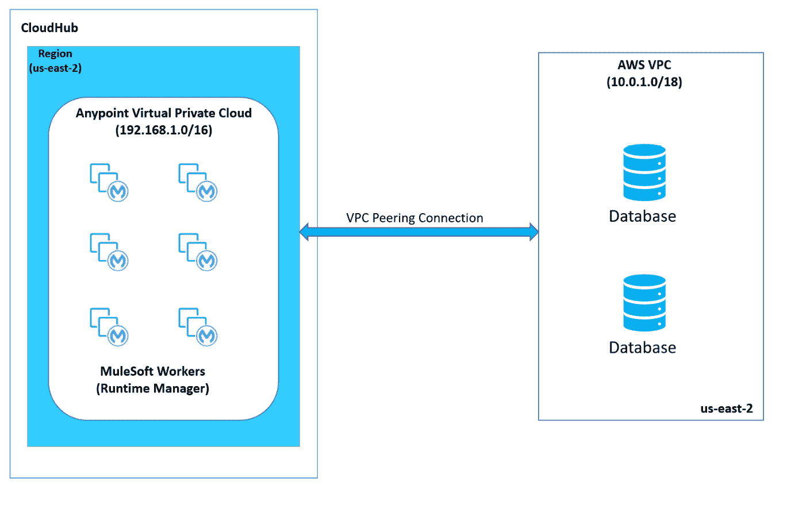

# Transit Gateway 附件

Transit Gateway 附件是 MuleSoft 提供的另一种连接 AWS Transit Gateway 的选项。AWS 中的 Transit Gateway 可以连接到 AWS VPC 或任何公有/私有云或本地数据中心。CloudHub 1.0 可以附加 AWS 中可用的 Transit Gateway，以启用与本地数据中心、公有/私有云等的连接。

Transit Gateway 是 AWS 云中的路由器，它简化了网络配置，允许您连接 AWS 中的 VPC 或 Private Space 以及 Anypoint Platform，并以安全的方式与本地环境、Azure Cloud 或任何第三方私有网络建立 VPN 连接。

CloudHub 1.0 允许您在组织中附加多个 Transit Gateway，但这取决于您的组织有权使用的 Transit Gateway 许可证数量：

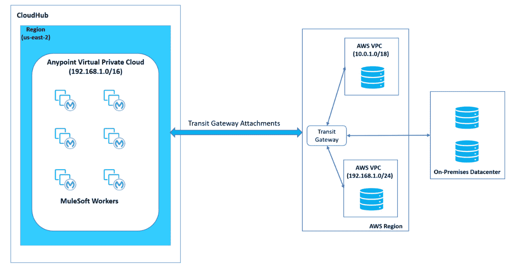

在图 9.14 中，我们通过 AWS 中的 Transit Gateway 将 AWS VPC 连接到本地数据中心，并在 Anypoint Platform 中创建 Transit Gateway 附件。通过这种方式，我们可以通过 AWS Transit Gateway 连接 AWS VPC 和本地数据中心。

请注意，Transit Gateway 只能在将连接到本地数据中心、公有/私有云等的 AWS 实例中创建。CloudHub 1.0 可以通过与 Anypoint VPC 附加来利用 Transit Gateway 连接。

# AWS Direct Connect

AWS Direct Connect 允许您在您的私有网络与一个 Direct Connect 位置之间创建专用网络线路。一旦您在 AWS 账户中启用了 Direct Connect 连接，您就可以建立与 AWS VPC 或本地数据中心的连接。这种连接可以在 MuleSoft 支持团队的帮助下建立。Direct Connect 使用 `BGP` 进行动态路由：

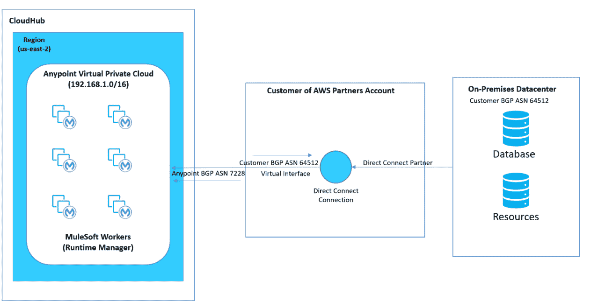

# 计算 Anypoint VPC 的 CIDR 掩码

`Classless Inter Dynamic Routing` (`CIDR`) 是一种分配 IP 地址的方法，它提高了数据路由效率，并取代了基于 A 类、B 类和 C 类网络分配 IP 地址的旧方法。支持的最小块大小为 `/24`，最大块大小为 `/16`：

| CIDR 块大小 | IP 地址数量 |
| --- | --- |
| `/24` | 256 |
| `/23` | 512 |
| `/22` | 1024 |
| `/21` | 2048 |
| `/20` | 4096 |
| `/19` | 8192 |
| `/18` | 16384 |
| `/17` | 32768 |
| `/16` | 65536 |

表 9.5 - CIDR 块大小

让我们学习如何计算 Anypoint VPC 的 CIDR 块。考虑以下需求并计算 CIDR 块大小：

* 两个非生产环境：开发和 UAT
* 一个生产环境
* 开发环境中的应用程序将部署在一个 worker 上
* UAT 环境中的应用程序将部署在两个 worker 上
* 生产环境中的应用程序将部署在两个 worker 上
* 每个环境将部署约 10 个应用程序
* 生产环境和非生产环境需要单独的 Anypoint VPC

始终将应用程序数量乘以 10，以确保我们选择最大的 CIDR 块大小——一旦创建了 VPC，就无法更新它。增加 Anypoint VPC 的 CIDR 掩码的唯一方法是删除它并重新开始：

| 环境 | 生产 | 非生产 |
| --- | --- | --- |
| 开发 | | `10 (应用程序) * 10 * 1 (Worker) = 100` |
| UAT | | `10 (应用程序) * 10 * 2 (Worker) = 200` |
| 生产 | `10 (应用程序) * 10 * 2 (Worker) = 200` | |
| 总计 | 200 | 300 |
| 额外 IP 地址 (总计的 50%) 用于零停机 | 100 | 150 |
| 为基础设施保留的 IP 地址 | 2 | 2 |
| IP 总数 | 302 | 452 |

表 9.6 - Anypoint VPC 规模估算


# Anypoint VPC 和专用负载均衡器

## Anypoint VPC 规模调整和最佳实践

从*表 9.6*中，我们得出生产环境所需的 IP 地址总数为 302 个，可以通过 `/23` 的 CIDR 块大小提供。非生产环境所需的 IP 地址总数为 452 个，可以通过 `/22` 的 CIDR 块大小提供。

以下是创建 Anypoint VPC 的建议和最佳实践：

*   **始终选择较大的 CIDR 范围** – Anypoint VPC 不允许您稍后更新 CIDR 掩码。要修改 CIDR 掩码，必须删除 VPC 并使用新的 CIDR 掩码重新创建。
*   建议为生产环境和非生产环境分别创建独立的 Anypoint VPC。
*   为 Anypoint VPC 选择的 CIDR 掩码不得与您网络或数据中心中的 IP 范围重叠。
*   多个环境可以映射到单个 Anypoint VPC。
*   一个环境不能关联多个 Anypoint VPC。
*   多个业务组可以映射到 Anypoint VPC。建议在父业务组中创建 Anypoint VPC，并将其共享给子业务组。

## Anypoint 专用负载均衡器

Anypoint VPC 创建完成且应用程序已部署到 Anypoint VPC 的私有端口后，我们需要对其进行访问。要访问部署在 Anypoint VPC 内私有端口上的应用程序，我们需要配置专用负载均衡器。

专用负载均衡器是允许您将流量路由到在 `CloudHub 1.0` 上运行、位于 Anypoint VPC 私有端口上的 MuleSoft 应用程序的组件。它是一个可选组件，并非总是必需。

专用负载均衡器将暴露两条 `A` 记录，用于接受来自本地私有网络和公共网络的流量。其中一条记录是内部的（`internal-<lb-name>.lb.anypointdns.net`），另一条是外部的（`<lb-name>.lb.anypointdns.net`）。

专用负载均衡器允许您选择多个工作节点。对于通过专用负载均衡器进来的大量请求，您可以在配置专用负载均衡器时选择更多工作节点。您也可以增加工作节点的数量。

可以在企业 DNS 域名服务器中创建 `CNAME` 记录，使用用户友好的域名（如 `api.domainname.com`）来掩盖创建专用负载均衡器时暴露的 `A` 记录：

| A 记录 | CNAME |
| --- | --- |
| `<lb-name>.lb.anypointdns.net` | `api.domainname.com` |
| `internal-<lb-name>.lb.anypointdns.net` | `api-internal.domainname.com` |

表 9.7 - 专用负载均衡器 CNAME 和 A 记录映射

部署在 Anypoint VPC 内私有端口（`8091` 和 `8092`）上的应用程序可以接收来自专用负载均衡器的流量。这意味着专用负载均衡器只能将流量路由到 Anypoint VPC 内私有端口上运行的应用程序：

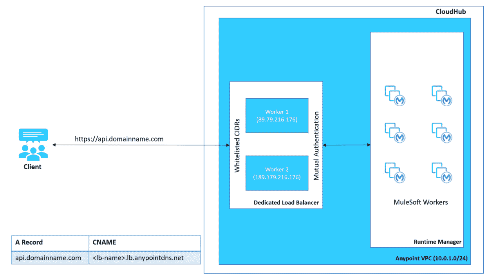

图 9.16 - 专用负载均衡器架构

### 允许列表 CIDR

专用负载均衡器可以通过互联网接受来自外部或第三方应用程序的流量。我们可能需要允许来自某些 IP 范围的流量通过专用负载均衡器，并丢弃来自未获许可 IP 地址的流量。

我们有 CIDR 允许列表选项，您可以在其中添加允许向专用负载均衡器发送流量的 IP 地址。默认情况下，允许所有外部流量，因为 CIDR 允许列表为 `0.0.0.0/0`。您需要确保移除默认的 CIDR 块 `0.0.0.0/0`，并添加允许的 IP 范围，以允许来自特定 IP 地址范围的外部流量：

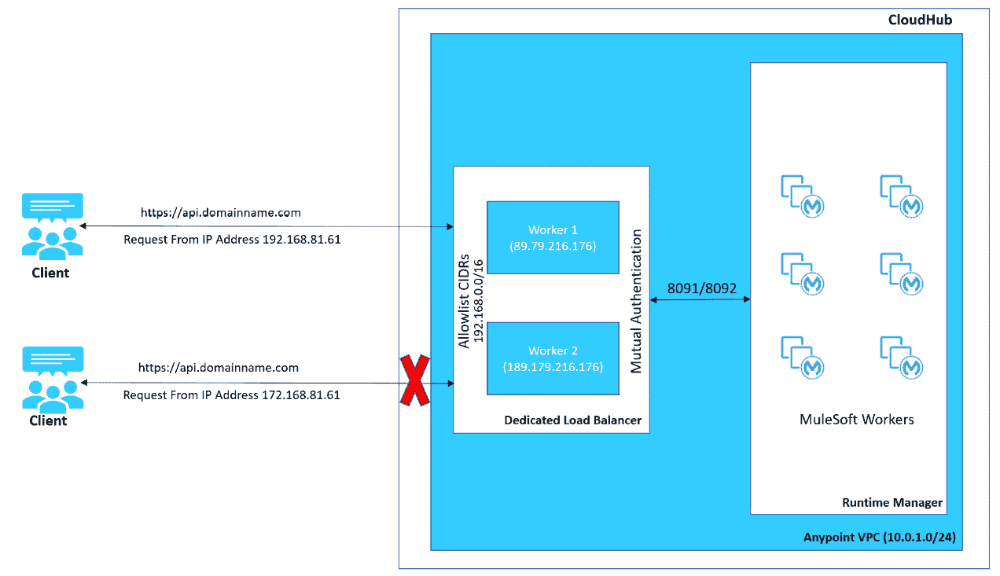

图 9.17 - 专用负载均衡器允许列表

在图 9.17 中，专用负载均衡器上允许的 IP 范围是 `192.168.0.0/16`。来自 IP 地址 `192.168.81.61` 的客户端请求被接受，而来自 `172.168.81.61` 的客户端请求被专用负载均衡器阻止，因为它不在允许列表中。

### SSL 证书

专用负载均衡器允许您添加多个域证书。专用负载均衡器**必须**至少关联一个域证书。

图 9.18 显示，单个专用负载均衡器可以关联多个域 SSL 证书，并且在专用负载均衡器上配置的每个 SSL 证书都与一个或多个映射规则关联：

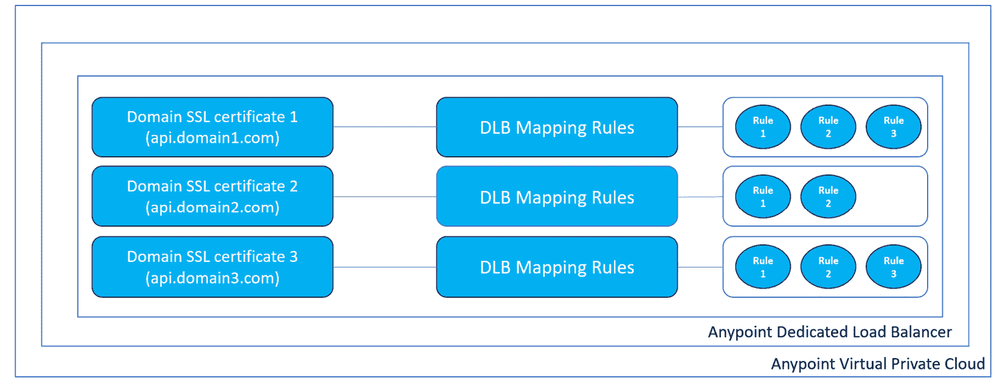

图 9.18 - 专用负载均衡器 SSL 证书和映射规则

专用负载均衡器允许您配置通配符证书，以便支持子域请求。例如，如果专用负载均衡器上允许的域是 `*.domain.com`，则意味着它将允许任何子域，如 `app1.domain.com`、`app2.domain.com` 等。

有关专用负载均衡器上 SSL 证书配置的更多详细信息，请参阅 MuleSoft 文档。

### 双向认证

专用负载均衡器提供额外的安全性，您可以上传客户端证书以启用双向认证：

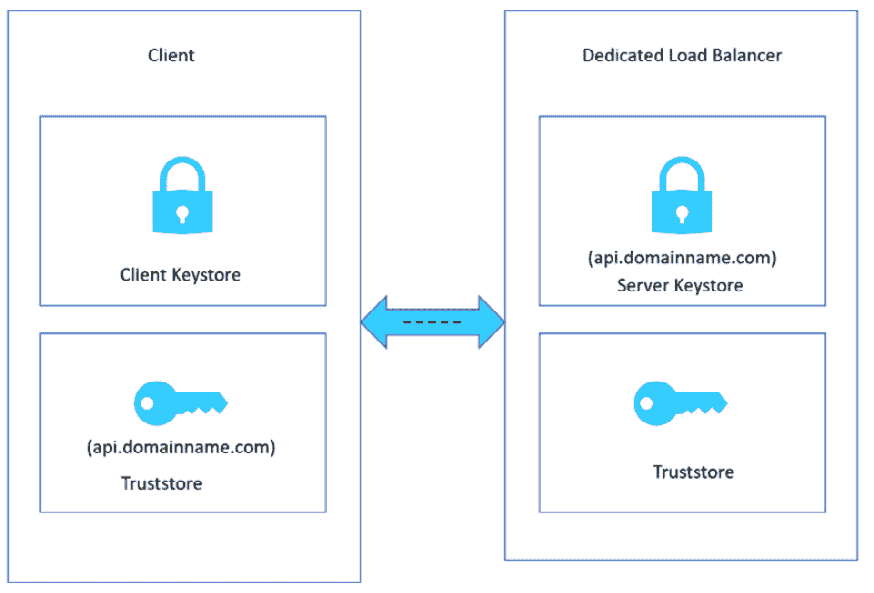

图 9.19 - 专用负载均衡器 – 双向认证

要允许更多客户端通过专用负载均衡器使用双向认证发送请求，请将客户端证书添加到专用负载均衡器现有的信任库中，如图 9.20 所示：

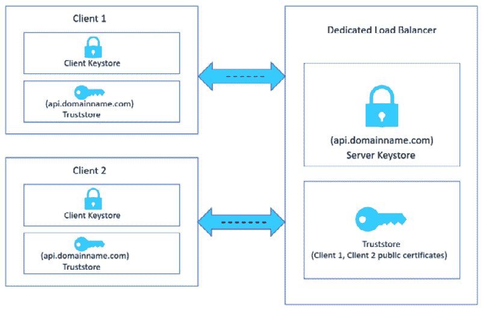

图 9.20 - 专用负载均衡器 – 双向认证

私钥配置在服务端（服务端 `Keystore`）。它永远不会与任何人共享，并用于解密数据。服务端 `Keystore` 将包含服务端私钥和服务端公钥。公钥配置在客户端（客户端 `Truststore`），通常客户端存储服务端公共证书。它用于加密数据。

同样，`Keystore` 和 `Truststore` 也配置在客户端。`Keystore` 位于客户端，包含客户端私钥和公钥，而 `Truststore` 仅包含服务端公钥。

### 专用负载均衡器规模调整

默认情况下，专用负载均衡器以两个工作节点的高可用性配置运行。每个工作节点的规格为 `2 vCores + 3.5 GB` 内存。专用负载均衡器的其他规格有 4、6 和 8 个工作节点。使用轮询算法将请求分发给专用负载均衡器的工作节点。有时可能会使用另一种算法，根据流量负载将请求分发给专用负载均衡器的工作节点。

专用负载均衡器默认分配两个工作节点。在调整专用负载均衡器规模时，需要考虑以下几点：

*   发往专用负载均衡器的请求数量。
*   专用负载均衡器后端的下游 API 数量。
*   下游 API 的响应时间。较长的响应时间意味着它将占用专用负载均衡器的资源。
*   通过专用负载均衡器传递的传入请求中负载的大小。

在大多数情况下，两个工作节点将满足性能要求。然而，在某些情况下，您可能需要为专用负载均衡器配置更多工作节点以应对更高的流量。

### 专用负载均衡器超时

默认情况下，专用负载均衡器响应超时为 `300 秒（5 分钟）`。这可以在 `Runtime Manager` 的专用负载均衡器配置中增加或减少。

### 专用负载均衡器映射规则


# 专用负载均衡器的映射规则

映射规则与已在专用负载均衡器上配置的域证书相关联，每个域证书可以关联多个映射规则。如果存在多个规则匹配，传入专用负载均衡器的请求将始终执行第一个匹配的规则。

映射规则会转换传入请求的 URI，以将请求路由到部署在 Anypoint VPC 内 CloudHub 1.0 中的目标应用程序。在配置映射规则之前，需要了解以下几个参数：

*   **`inputUri` (输入路径)**：这是客户端请求的 URI —— 例如 `/{app}/`。
*   **`appName` (目标应用)**：这是在 Anypoint VPC 内 CloudHub 1.0 中运行的 MuleSoft 应用程序。专用负载均衡器将根据传入请求的 URI 将请求路由至此。
*   **`appUri` (输出路径)**：这是传递给部署在 Anypoint VPC 内的目标应用程序的 URI 字符串。
*   **`Protocol` (协议)** —— 这是目标（下游）应用程序监听所用的协议。可以是 HTTP、HTTPS、WS 等。

映射规则输入路径中花括号 (`{}`) 内定义的值为变量。这些变量不能用于输出路径，但可用于目标应用参数中的应用程序名称。

如果在专用负载均衡器上定义了多个映射规则，无论存在多少匹配规则，它始终会将第一个匹配的规则应用于传入请求。

让我们了解如何在专用负载均衡器上定义映射规则。

## 示例 1

应用程序名称可以包含在传入请求的 URL 中，并可用于将请求路由到部署在 CloudHub 1.0 中的应用程序。输入请求通过 [`api-dev.domainname.com/invoice-app-dev/v1.0/invoices`](https://api-dev.domainname.com/invoice-app-dev/v1.0/invoices) 发送以获取发票。以下是配置的映射规则：

| **输入路径** | **目标应用** | **输出路径** | **协议** |
| --- | --- | --- | --- |
| `/{app}/` | `{app}` | `/` | `https` |

表 9.8 - 专用负载均衡器映射规则

`{app}` 是变量，其值为 `invoice-app-dev`。HTTPS 是下游 API 的协议。因此，专用负载均衡器的映射规则会将 URL 转换为 [`mule-worker-internal-invoice-app-dev.us-e1.cloudhub.io:8092/v1.0/invoices`](https://mule-worker-internal-invoice-app-dev.us-e1.cloudhub.io:8092/v1.0/invoices)：

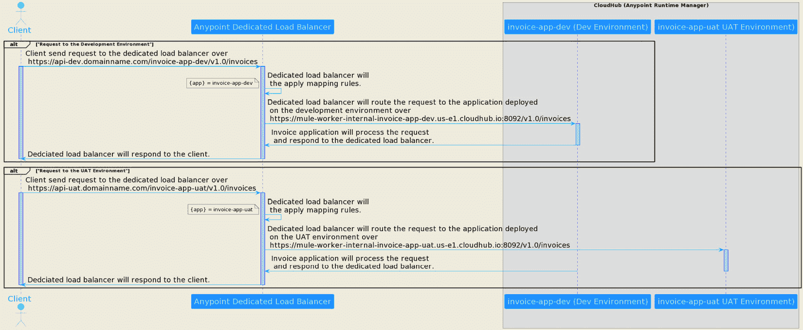

图 9.21：带有映射规则的专用负载均衡器 URL 转换

## 示例 2

在*示例 1*中，我们了解了如何通过专用负载均衡器使用应用程序名称路由请求。

在本示例中，我们将学习如何使用子域名路由请求。通常，每个环境都有不同的子域名。所有非生产环境将映射到非生产 Anypoint VPC，生产环境将映射到生产 Anypoint VPC：

| **域** | **子域名** | **Anypoint VPC** | **环境** |
| --- | --- | --- | --- |
| api-dev.subdomain.com | api-dev | VPC-1 | 开发 |
| api-uat.subdomain.com | api-uat | VPC-1 | UAT |
| api.subdomain.com | api | VPC-2 | 生产 |

表 9.9 - API 域

让我们考虑以下映射规则，它们已配置为将请求路由到部署在 CloudHub 1.0 中的应用程序。输入请求通过 [`api-dev.domainname.com/invoice/v1.0/invoices`](https://api-dev.domainname.com/invoice/v1.0/invoices) 发送以获取发票。这是配置的映射规则：

| **输入路径** | **目标应用** | **输出路径** | **协议** |
| --- | --- | --- | --- |
| `/{app}/` | `{app}-{subdomain}` | `/` | `https` |

表 9.10 - 专用负载均衡器映射规则

`{app}` 是变量，值为 `invoice`，`{subdomain}` 为 `api-dev`。HTTPS 是下游 API 的协议。因此，专用负载均衡器映射规则会将 URL 转换为 [`mule-worker-internal-invoice-api-dev.us-e1.cloudhub.io:8092/v1.0/invoices`](https://mule-worker-internal-invoice-api-dev.us-e1.cloudhub.io:8092/v1.0/invoices)：

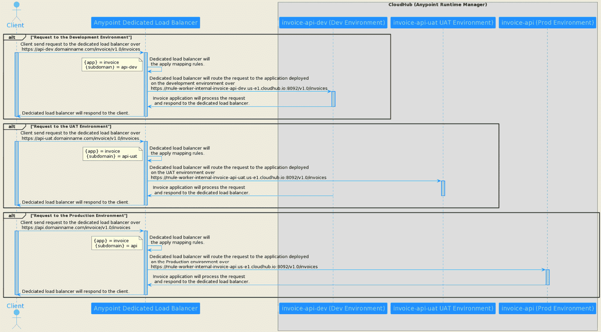

图 9.22 - 带有映射规则的专用负载均衡器 URL 转换

## HTTP 入站模式

专用负载均衡器上的一项关键配置决定了如何路由传入的 HTTP 请求。它可以接受 HTTP 或 HTTPS 请求，静默丢弃 HTTP 请求，或将请求重定向到下游 API 的 HTTPS。

可以在专用负载均衡器上配置以下选项，以确保接受传入流量并将其发送到下游 API：

*   **`Off` (关闭)**：专用负载均衡器将静默丢弃所有传入的 HTTP 流量，仅接受 HTTPS 请求。
*   **`On` (开启)**：专用负载均衡器将在默认 SSL 端点上接受传入的 HTTP 请求。
*   **`Redirect` (重定向)**：专用负载均衡器将始终通过 HTTPS 将流量路由到下游 API。

## 建议

以下是在配置专用负载均衡器时可遵循的一些建议：

*   与 Anypoint VPC 关联的所有环境都将映射到专用负载均衡器。这意味着单个专用负载均衡器可以将请求路由到多个环境。
*   多个 CNAME 可以映射到单个专用负载均衡器或单个 A 记录，例如开发环境的 `api-dev.domainname.com`、QA 环境的 `api-uat.domainname.com` 和生产环境的 `api.domainname.com`。
*   始终为生产环境和沙箱环境创建单独的负载均衡器。

让我们看看专用负载均衡器和共享负载均衡器的区别：

| **功能** | **共享负载均衡器** | **专用负载均衡器** |
| --- | --- | --- |
| 自定义域 | 不支持 | 支持 |
| 自定义证书 | 不支持 | 支持 |
| 双向认证 | 不支持 | 支持 |
| 白名单 CIDR | 不支持 | 支持 |
| 速率限制 | 适用 | 不适用 |

表 9.11 - 共享负载均衡器与专用负载均衡器对比

## 用于公共和私有流量的专用负载均衡器

部署到 Runtime Manager 的 API 可能会接收来自外部和内部消费者的流量。出于安全原因，可能需要保护某些 API 免受外部消费者访问，或不为这些 API 提供外部访问。建议为私有和公共流量分别设置独立的专用负载均衡器。我们可能需要某些 API 仅内部可访问，或者某些 API 面向公众。在这里，我们将看到一个 API 主导连接的示例，其中体验 API 必须是公开 API，而流程 API 和系统 API 必须是私有 API。

有多种解决方案可实现这一点：

*   单个专用负载均衡器用于公共和私有 API
*   单独的专用负载均衡器分别用于公共和私有 API

### 方法 1 – 单个专用负载均衡器用于公共和私有 API

在此方法中，我们将设置一个专用负载均衡器，它将提供两个 **A** 记录：`<lb-name>.lb.anypointdns.net`（接受外部流量）和 `internal-<lb-name>.lb.anypointdns.net`（接受私有本地网络流量）。您可以在专用负载均衡器上上传多个证书，并创建指向这些 **A** 记录的 CNAME 记录。

以下是 DNS 注册表中 CNAME 和 A 记录映射的示例：

*   `api.domainname.com` => `<lb-name>.lb.anypointdns.net` (A 记录)


### 方法 2 – 为公共 API 和私有 API 分别使用专用负载均衡器

`api-internal.domainname.com` => `internal-<lb-name>.lb.anypointdns.net` (A record)

每个证书将拥有其自己的映射规则。您可以创建映射规则，当请求通过 `api.domainname.com` 到达时将流量导向公共应用程序，以及另一组映射规则，当请求通过 `api-internal.domainname.com` 到达时将流量导向私有应用程序。当专用负载均衡器接收到请求时，它会在请求中查找主机标头，以根据证书端点和后续映射规则匹配请求。例如，假设公共请求通过 `http://api.domainname.com` 从客户端发送到专用负载均衡器。在这种情况下，标头中的主机值将为 `api.domainname.com`，专用负载均衡器将根据主机匹配证书并应用后续映射规则。流量将被转发给 API。

为公共和私有流量使用单个专用负载均衡器的问题在于：当恶意行为者使用修改后的主机标头，通过专用负载均衡器的公共域名以此为目标访问私有应用程序时，就会出现该问题。

例如，恶意行为者可以发送请求到 `api-internal.domainname.com`，并将主机标头设置为 `api-internal.domainname.com`。此请求将匹配私有证书并执行后续映射规则，从而允许通过专用负载均衡器的公共域名访问私有应用程序：

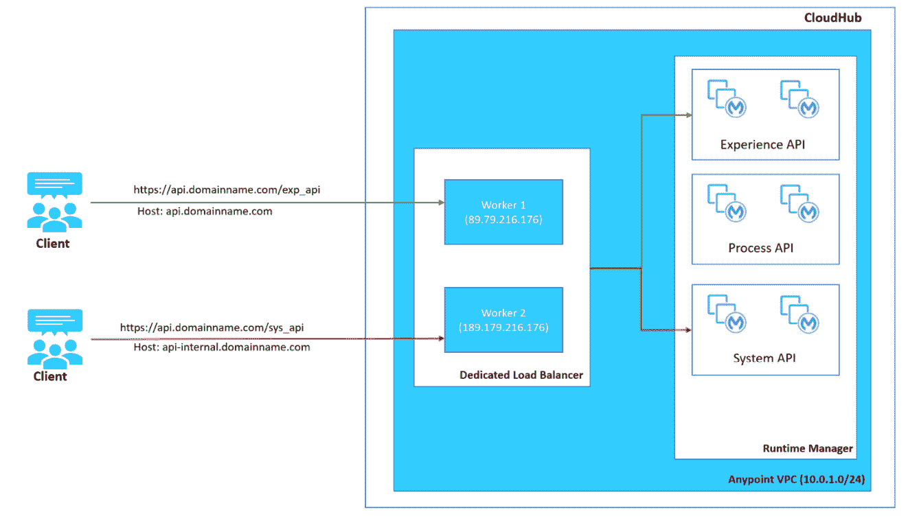

图 9.23 - 用于公共和私有 API 的单个专用负载均衡器

在图 9.23 中，您可以看到恶意行为者如何通过发送主机值 `api.domainname.com`，经由专用负载均衡器的公共域名访问私有应用程序。另一个问题是允许列表 CIDR 对专用负载均衡器是全局的。如果相同的允许列表 CIDR 同时应用于专用负载均衡器的公共域和私有域，则无法添加特定的私有 IP 范围。要做到这一点，您需要移除 `0.0.0.0/0`，这意味着将不允许公共流量。

为克服使用单个专用负载均衡器的问题，您应该为公共 API 和私有 API 使用单独的专用负载均衡器。采用此方法，您必须在单独的专用负载均衡器中为私有域和公共域配置单独的证书，并使用唯一的映射规则。除此之外，您可以为两个专用负载均衡器配置单独的允许列表 CIDR：

*   **专用负载均衡器（公共）和允许列表 CIDR (`0.0.0.0/0`)**：允许所有人访问。
*   **专用负载均衡器（私有）和允许列表 CIDR (`192.168.1.0/24`, `10.0.1.0/22`)**：允许访问私有 IP 地址范围：

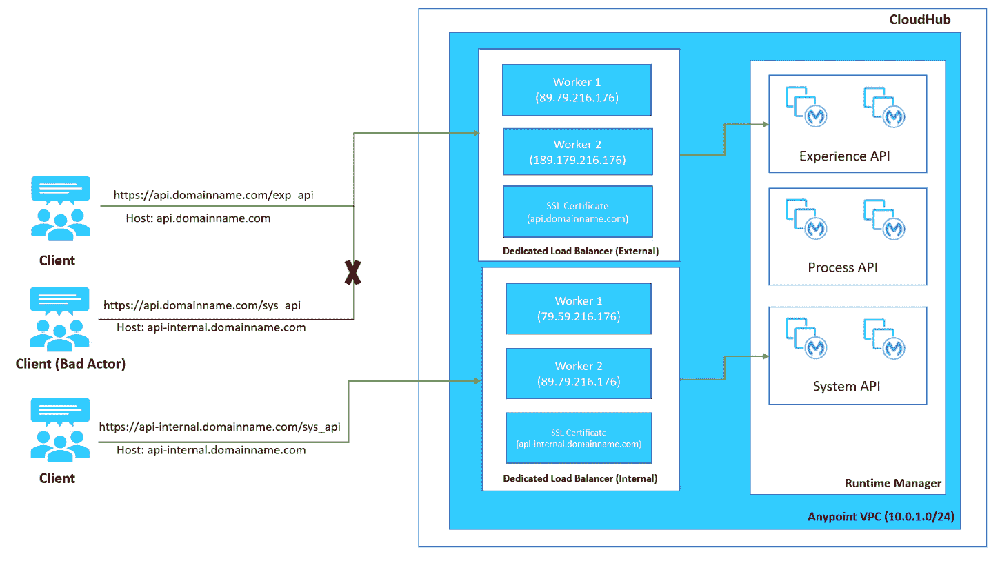

图 9.24 - 为公共和私有 API 分别使用专用负载均衡器

恶意行为者使用公共专用负载均衡器访问私有 API 的请求将被阻止，因为没有证书与公共专用负载均衡器的主机标头匹配。公共和私有专用负载均衡器的允许列表 CIDR 是分开的。这意味着您可以完全阻止公共流量，并仅允许来自特定私有 IP 地址范围的流量访问私有专用负载均衡器。

# 将 MuleSoft 应用程序部署到 CloudHub 1.0 Runtime Manager 的不同选项

MuleSoft 提供了多种将应用程序部署到 CloudHub 1.0 的方式，所有这些方式都可以与 CI/CD 流水线集成，以实现 MuleSoft 应用程序到 CloudHub 1.0 的自动部署。让我们探讨一下将应用程序部署到 CloudHub 1.0 的所有方式。

## Mule Maven 插件

Mule Maven 插件是用于将 MuleSoft 应用程序部署、取消部署和打包到 CloudHub 1.0 的最重要的 Maven 插件之一。让我们更详细地讨论 Mule Maven 插件。可以在应用程序的 `POM.xml` 文件中配置以下插件，其中包含在 CloudHub 1.0 中部署和运行应用程序所需的所有属性：

```xml
<plugin>
  <groupId>org.mule.tools.maven</groupId>
  <artifactId>mule-maven-plugin</artifactId>
  <version>3.8.6</version>
  <extensions>true</extensions>
  <configuration>
    <cloudHubDeployment>
      <uri>https://anypoint.mulesoft.com</uri>
      <muleVersion>${app.runtime}</muleVersion>
      <username>${anypoint.username}</username>
      <password>${anypoint.password}</password>
      <applicationName>${application.name}</applicationName>
      <environment>${mule.environment}</environment>
      <region>${mule.region}</region>
      <workers>${mule.workers}</workers>
      <workerType>${mule.workerType}</workerType>
      <properties>
        <key>value</key>
      </properties>
    </cloudHubDeployment>
  </configuration>
</plugin>
```

在前面的 Mule Maven 插件中，使用 `${}` 定义的值是您可以在 `mule deploy` 命令中传递的参数，如下所示：

```
mule deploy –DmuleDeploy -Dapp.runtime=4.3.0 -Danypoint.username=anypointusername –Danypoint.password=password -Dapplication.name=music-api-dev –Dmule.environment=Sandbox –Dmule.workers=1 –Dmule.workerType=MICRO
```

以下是在将应用程序部署到 CloudHub 1.0 时可以在 Mule Maven 插件中配置的属性：

| 属性 | 描述 | 是否必需 | 默认值 / 示例 |
| --- | --- | --- | --- |
| `cloudHubDeployment` | 根元素。 | 是 | |
| `uri` | 您的 Anypoint Platform URI。 | 否 | |
| `muleVersion` | 在 CloudHub 2.0 实例中运行的 Mule 运行时引擎版本。 | 是 | 例如，`4.3.0` |
| `username` | CloudHub 用户名。 | 仅当使用 Anypoint Platform 凭据登录时 | |
| `password` | CloudHub 密码。 | 仅当使用 Anypoint Platform 凭据登录时 | |
| `applicationName` | 要在 Runtime Manager 中实现的应用程序标题。 | 是 | |
| `artifact` | 要部署的 JAR 文件的绝对路径。 | 否 | |
| `environment` | 将部署应用程序的 CloudHub 环境。 | 是 | |
| `properties` | 可以传递在应用程序部署期间需要设置的属性。 | 否 | |
| `workers` | 工作器数量。 | 否 | `1` |
| `workerType` | 每个工作器的大小。 | 否 | `MICRO` |
| `region` | 工作器云的区域。 | 否 | `us-e1` |
| `objectStoreV2` | 启用 Object Store V2。 | 否 | `true` |
| `persistentQueues` | 启用持久队列。 | 否 | `false` |
| `businessGroup` | 部署的业务组路径。 | 否 | |
| `businessGroupId` | 业务组 ID 或组织。 | 否 | |
| `deploymentTimeout` | 部署过程允许的持续时间（以毫秒为单位）。这指的是从部署开始到确认工件成功部署之间的时间。 | 否 | `1000000` |
| `server` | Maven 服务器与 Anypoint Platform 凭据集成。服务器 ID 可以在 `settings.xml` 文件中找到，该文件关联了用户的 Anypoint 用户名和密码。 | 否 | |
| `skip` | 启用时，它会跳过插件的部署目标。 | 否 | `false` |
| `skipDeploymentVerification` | 启用时，它会跳过对已部署应用程序状态的确认。 | 否 | `false` |
| `authToken` | 指定用于访问平台的授权令牌。 | 仅当使用授权令牌登录时 | |


### 表 9.12 - Mule Maven 插件属性

| 属性 | 说明 | 条件 | 默认值 |
| --- | --- | --- | --- |
| `connectedAppClientId` | 指定连接应用 ClientID 值。 | 仅当使用连接应用凭据登录时 |  |
| `connectedAppClientSecret` | 指定连接应用客户端密钥。 | 仅当使用连接应用凭据登录时 |  |
| `connectedAppGrantType` | 指定唯一支持的连接类型：客户端凭据。 | 仅当使用连接应用凭据登录时 |  |
| `applyLatestRuntimePatch` | 启用后，应用程序将首先更新至最新版本的 Mule Runtime，然后再部署到 CloudHub。 | 否 | `false` |
| `disableCloudHubLogs` | 设置为 `true` 时，此功能将禁用 CloudHub 日志。 | 否 | `false` |

有关 Mule Maven 插件的更多详细信息，请参阅 MuleSoft 文档：<https://docs.mulesoft.com/mule-runtime/4.5/mmp-concept>。

可以使用以下命令来部署和取消部署应用程序：

```
mvn clean deploy –DmuleDeploy
mvn mule:undeploy
```

Mule Maven 插件可以使用以下身份验证机制之一将应用程序部署到 CloudHub 1.0：

*   Anypoint Platform 用户名和密码
*   服务器
*   Anypoint 连接应用
*   认证令牌

## Anypoint CLI

Anypoint CLI 可用于将 MuleSoft 应用程序部署、取消部署或重新部署到 CloudHub 1.0。Anypoint CLI 是 Anypoint Platform 的脚本编写和命令行工具。Anypoint CLI 可以管理 Anypoint Platform 的各种功能，例如 CloudHub 1.0、API 治理、Anypoint 专用负载均衡器、Anypoint VPC、Exchange、Design Center 和 API Manager。要使用 Anypoint CLI，您需要设置 Anypoint CLI 的 npm 包。

以下是 MuleSoft 提供的用于设置 Anypoint CLI 的文档：<https://docs.mulesoft.com/anypoint-cli/4.x/install>。

Anypoint CLI 可以使用以下身份验证机制之一来管理 Anypoint Platform：

*   Anypoint Platform 用户名和密码
*   客户端 ID 和客户端密钥
*   Bearer 令牌 – 仅限命令行

可在 MuleSoft 文档中找到用于管理 CloudHub 1.0 的命令列表：<https://docs.mulesoft.com/anypoint-cli/4.x/cloudhub-apps>。

可以使用以下命令将应用程序部署到 CloudHub 1.0：

```
runtime-mgr:cloudhub-application:deploy <name> <zipfile> [flags]
```

可以将以下标志与此命令一起传递：

### 表 9.13 - 用于将应用程序部署到 CloudHub 1.0 的 Anypoint CLI 属性

| 标志 | 说明 | 默认值 |
| --- | --- | --- |
| `--runtime` | 提供运行时环境的名称和版本。 |  |
| `--workers` | 工作节点数量。 | `1` |
| `--workerSize` | 工作节点的大小（以 vCore 为单位）。 | `0.1` |
| `--region` | 区域名称。 | `us-east-1` |
| `--property` | 设置属性（`name:value`）——例如，`--property "https.port:8082"`。 |  |
| `--propertiesFile` | 此文件中的所有属性都应被其对应的值覆盖。请确保在本地硬盘上指定属性文件的绝对路径。 |  |
| `--[no-]persistentQueues` | 启用或禁用持久队列。 | `disabled` |
| `--[no-]persistentQueuesEncrypted` | 启用或禁用持久队列加密。 |  |
| `--[no-]staticIPsEnabled` | 启用或禁用静态 IP。 | `disabled` |
| `--[no-]objectStoreV1` | 启用或禁用对象存储 V1。 |  |
| `--[no-]objectStoreV2` | 启用或禁用对象存储 V2。 |  |
| `--[no-]autoRestart` | 应用程序在无响应时将自动重启。 | `enabled` |
| `--output` | 指定响应所需的格式。可用选项为 `table` 和 `json`。 | `table` |
| `--help` | 输出用法信息。 |  |
| `--timeout` | 设置超时值（以毫秒为单位）。此值应在 `60000` 到 `300000` 之间。 |  |

有关用于将应用程序部署到 CloudHub 1.0 的 Anypoint CLI 的更多详细信息，请参阅 MuleSoft 文档：<https://docs.mulesoft.com/anypoint-cli/4.x/cloudhub-apps>。

## CloudHub 1.0 API

CloudHub 1.0 API 允许您部署和管理 MuleSoft 应用程序。您可以部署 MuleSoft 应用程序、管理计划和队列，并查看有关应用程序的日志。以下是 MuleSoft 提供的用于将应用程序部署到 CloudHub 1.0 的 REST API：

### 表 9.14 - 用于将应用程序部署到 CloudHub 1.0 的 Platform API 属性

| 属性 | 值 |
| --- | --- |
| **方法** | `POST` |
| **API 端点** | <https://anypoint.mulesoft.com/cloudhub/api/v2/applications> |
| **请求体** | 请参阅下方的 JSON 示例 |
| **认证** | Basic 或 OAuth 2.0（连接应用或 Anypoint 用户名和密码） |
| **请求头** | `X-ANYPNT-ENV-ID`（Anypoint Platform 的环境 ID），`Content-Type`（`application/json`） |

请求体示例：

```
{
  "domain": "api-dev",
  "muleVersion": {
    "version": "4.4.0"
  },
  "region": "us-east-1",
  "monitoringEnabled": true,
  "monitoringAutoRestart": true,
  "workers": {
    "amount": 2,
    "type": {
      "name": "Medium",
      "weight": 1,
      "cpu": "1 vCore",
      "memory": "1.5 GB memory"
    }
  },
  "loggingNgEnabled": true,
  "persistentQueues": true,
  "objectStoreV1": true
}
```

有关将应用程序部署到 CloudHub 1.0 的 API 请求的更多详细信息，请访问 Anypoint Platform 开发者门户：<https://anypoint.mulesoft.com/exchange/portals/anypoint-platform/f1e97bc6-315a-4490-82a7-23abe036327a.anypoint-platform/cloudhub-api/>。

# 摘要

在本章中，我们探讨了 CloudHub 1.0 提供的功能和特性，以及如何利用它们来运行和管理 MuleSoft 应用程序。我们研究了各种功能，例如高可用性、容错性、可扩展性和灾难恢复。此外，我们了解了 Anypoint VPC，它允许我们在 CloudHub 1.0 内创建隔离且独立的网络段。我们还理解了 Anypoint VPC 的重要性。此外，我们探讨了不同的网络连接选项，包括 VPC 对等连接、VPN IPsec 隧道、AWS Direct Connect 和传输网关附件，这些选项使我们能够连接防火墙后面或公有/私有云上的资源。此外，我们学习了如何利用 Mule Maven 插件、Anypoint CLI 和 Platform API 在 CloudHub 1.0 环境中部署 MuleSoft 应用程序。

在下一章中，我们将讨论 CloudHub 2.0，它允许我们在基于 Kubernetes 的容器化环境中运行 MuleSoft 应用程序。

# 延伸阅读

CloudHub 1.0 参考列表包含以下来源：

*   MuleSoft 文档：CloudHub 架构 | MuleSoft 文档
*   YouTube 系列：<https://youtube.com/playlist?list=PL5GwZHHgKcuDQ6vWarTLgVbrPEQipzbOM&si=xKjv6f7f10VRkyjg>
*   Medium 文章：Anypoint Virtual Private Cloud、Virtual Private Network 和 Dedicated Load Balancer 库及资源 | 作者：Jitendra Bafna | Medium
*   本章中的一些表格参考自 MuleSoft 官方文档：<https://docs.mulesoft.com/>
