# 10


# 使用 Anypoint iPaaS (CloudHub 2.0) 实现无忧部署

在*第 9 章*中，我们了解了 CloudHub 1.0 的功能和特性。在本章中，我们将学习 CloudHub 2.0 为管理 MuleSoft 应用程序提供的架构能力。本章还将介绍 CloudHub 2.0 与 CloudHub 1.0 的区别。

本章将涵盖以下主题：

*   什么是 CloudHub 2.0？
*   CloudHub 2.0 提供了哪些不同的能力？
*   CloudHub 2.0 的架构能力
*   网络和托管选项，如私有空间和共享空间
*   使用 CloudHub 2.0 实现高可用性、可扩展性、容错性和灾难恢复

## 什么是 CloudHub 2.0？

我们在*第 9 章*中了解了 CloudHub 1.0。在本章中，我们将学习 MuleSoft 提供的另一种托管选项（即 CloudHub 2.0），用于独立且安全地运行应用程序。

CloudHub 2.0 是一种基于云的**集成平台即服务**，类似于 CloudHub 1.0。它是一种托管的多租户服务，分布在全球 12 个区域，用于在基于 Kubernetes 的容器化环境中运行 MuleSoft 应用程序。

CloudHub 2.0 本质上具有弹性；可按需扩展。您可以从较小的工作负载开始，并根据需要进行扩展。这可以在应用程序或 API 不出现任何停机时间的情况下实现。

### 为什么选择 CloudHub 2.0？

选择 CloudHub 2.0 有多种原因，列举如下：

*   CloudHub 2.0 采用基于 Kubernetes 的架构，使您能够实现基于容器的应用程序隔离。部署到 CloudHub 2.0 的每个应用程序都在单独的容器中运行，且相互独立。
*   它简化了网络，以实现与本地数据中心、**Amazon Virtual Private Cloud (VPC)** 以及 **Azure** 或 **Google Cloud Platform (GCP)** 等其他云的连接。
*   它支持入站防火墙规则和出站防火墙规则，您可以为每个私有空间设置最多 80 条入站和 80 条出站防火墙规则。它提供了更好的防火墙控制。
*   它提供开箱即用的安全性，允许所有内部服务安全地相互通信，并使用加密密钥保护敏感数据。
*   它支持为部署到 CloudHub 2.0 的单个应用程序配置多个公共端点。
*   它支持开箱即用的入口负载均衡器，将流量路由到部署在 CloudHub 2.0 上的应用程序。入口负载均衡器会根据工作负载自动扩展。
*   它拥有动态可扩展的基础设施，并内置服务以支持大容量。

以下是 CloudHub 2.0 提供的功能列表：

*   可部署在私有空间或共享空间中。
*   提供基于容器的应用程序隔离。
*   在全球 12 个区域可用。
*   可部署在多个副本上以实现高可用性和容错性。
*   提供更细粒度的虚拟核心 (vCore) 选项；每个副本最多可分配四个 vCore。
*   支持集群模式部署；启用集群至少需要两个副本。
*   支持滚动更新和重新创建部署模型。
*   通过增加副本数量实现水平扩展，通过增加 vCore 数量实现垂直扩展。入口负载均衡器根据工作负载自动扩展。
*   支持智能修复和零停机更新等功能。
*   每个配置最多存储 200 MB 的日志数据，或存储长达 30 天，以先达到的限制为准。

让我们更详细地讨论 CloudHub 2.0 提供的几项功能。

### 副本和副本大小

副本是一个专用实例，您可以在其中于容器化环境中运行 MuleSoft 应用程序。副本大小是在部署期间为应用程序配置的内存和存储量。它有多种规格，如下所列：

| vCore 大小 | 总内存 (GB) | 堆内存 (GB) | 存储 (GB) |
|------------|-------------------|------------------|--------------|
| 0.1        | 1.2               | 0.6              | 8            |
| 0.2        | 2                 | 1                | 8            |
| 0.5        | 2.6               | 1.3              | 10           |
| 1          | 4                 | 2                | 12           |
| 1.5        | 6                 | 3                | 20           |
| 2          | 8                 | 4                | 20           |
| 2.5        | 9.5               | 4.75             | 20           |
| 3          | 11                | 5.5              | 20           |
| 3.5        | 13                | 6.5              | 20           |
| 4          | 15                | 7.5              | 20           |

表 10.1 - 副本规格

vCore 少于 1 的副本为小型工作负载提供有限的 CPU 和 I/O。要以稳定的性能处理较大的工作负载，请在应用程序中使用更多的 vCore。

### 区域

CloudHub 2.0 目前允许您在全球 12 个区域部署应用程序。组织可以在靠近其企业数据中心或系统的 CloudHub 2.0 区域部署应用程序。

以下是美国区域控制平面的 DNS 记录：

| 区域 | DNS 记录 |
|--------|------------|
| 美国东部 (弗吉尼亚北部) | `<appName>-<uniqId>.<shard>.usa-e1.cloudhub.io` |
| 美国东部 (俄亥俄) | `<appName>-<uniqId>.<shard>.usa-e2.cloudhub.io` |
| 美国西部 (加利福尼亚北部) | `<appName>-<uniqId>.<shard>.usa-w1.cloudhub.io` |
| 美国西部 (俄勒冈) | `<appName>-<uniqId>.<shard>.usa-w2.cloudhub.io` |
| 加拿大 (中部) | `<appName>-<uniqId>.<shard>.can-c1.cloudhub.io` |
| 南美洲 (圣保罗) | `<appName>-<uniqId>.<shard>.bra-s1.cloudhub.io` |
| 亚太地区 (新加坡) | `<appName>-<uniqId>.<shard>.sgp-s1.cloudhub.io` |
| 亚太地区 (悉尼) | `<appName>-<uniqId>.<shard>.aus-s1.cloudhub.io` |
| 亚太地区 (东京) | `<appName>-<uniqId>.<shard>.jpn-e1.cloudhub.io` |
| 欧盟 (爱尔兰) | `<appName>-<uniqId>.<shard>.irl-e1.cloudhub.io` |
| 欧盟 (法兰克福) | `<appName>-<uniqId>.<shard>.deu-c1.cloudhub.io` |
| 欧盟 (伦敦) | `<appName>-<uniqId>.<shard>.gbr-e1.cloudhub.io` |

表 10.2 - CloudHub 2.0 区域

以下是美国政府区域控制平面的 DNS 记录：

| 区域 | DNS 记录 |
|--------|------------|
| 美国政府西部 | `<appName>-<uniqId>.<shard>.usg-w1.gov.cloudhub.io` |

表 10.3 - CloudHub 2.0 美国政府区域

以下是欧盟区域控制平面的 DNS 记录：

| 区域 | DNS 记录 |
|--------|------------|
| 欧盟 (爱尔兰) | `<appName>-<uniqId>.<shard>.irl-e1.eu1.cloudhub.io` |
| 欧盟 (法兰克福) | `<appName>-<uniqId>.<shard>.deu-c1.eu1.cloudhub.io` |

表 10.4 - CloudHub 2.0 欧盟控制平面区域

在这些记录中，`uniq-id` 是附加在应用程序名称后的 6 位数值，以确保唯一性，例如 `b9cdfr`；`shard` 是与应用程序部署所在的私有空间关联的 6 位数值，例如 `p7oprc`。但是，对于共享空间，`shard` 将是一个 6 位数值后跟一个连字符 (`-`) 和数字，例如 `r7oprb-2`。

### 集群

CloudHub 2.0 支持集群，并提供可扩展性、工作负载分发和可靠性。部署在多个副本上的应用程序允许我们在将应用程序部署到 CloudHub 2.0 时启用集群。启用集群后，同一应用程序的副本可以共享对象存储和 VM 队列，副本可以在同一应用程序内共享数据。在副本之间启用集群至少需要两个副本：

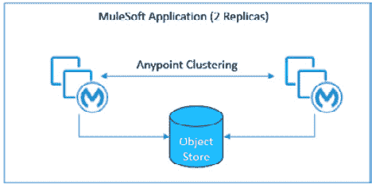

图 10.1 - CloudHub 2.0 中的 Anypoint 集群

### 高可用性


# CloudHub 2.0

CloudHub 2.0 允许您部署高可用应用程序并确保业务连续性。在多个副本上部署应用程序将创建多个应用程序实例，这将确保在一个或多个副本崩溃或发生故障时应用程序的高可用性。

## 应用程序隔离

CloudHub 2.0 通过将应用程序部署到单独的容器中来提供应用程序隔离。应用程序的每个副本将在单独的容器中运行。这将确保一个副本中的问题不会影响其他副本，并且所有副本相互独立。

## 智能修复

部署到 CloudHub 2.0 的应用程序可能会因底层硬件故障而失败；在这种情况下，副本会自动恢复，因为它支持自愈合机制。如果副本因代码问题或内存问题而崩溃，平台将自动识别该问题并自动重新部署副本。

## 零停机更新

CloudHub 2.0 支持两种部署模型——滚动更新和重建：

*   滚动更新模型允许您通过增量更新副本，以零停机时间部署应用程序
*   重建部署模型首先终止旧副本，然后部署新副本
*   滚动更新模型确保旧应用程序副本可用，直到新应用程序重新部署完成
*   重建模型比滚动更新模型更快，可用于您可以接受停机时间部署应用程序或部署新应用程序的场景

## 可扩展性

应用程序前端的入口负载均衡器会根据应用程序工作负载自动扩缩容，它是一项完全托管的服务。在 CloudHub 2.0 中运行的应用程序可以通过增加工作节点数量和工作节点规模来分别进行水平和垂直扩展。

## 支持的 Mule 运行时

Mule 运行时引擎允许您运行 MuleSoft 应用程序，并支持域和策略。CloudHub 2.0 支持 Mule 运行时引擎 4.3x 到 4.4x 版本。不支持 Mule 3.x。在 CloudHub 2.0 上部署应用程序期间，它会自动从存储库中拉取所选版本的 Docker 镜像。

## 精细 vCore 选项

CloudHub 2.0 支持在部署应用程序时配置精细的 vCore。可分配给副本的最小 vCore 数为 0.1，最大为 4。可分配给副本的其他 vCore 规格有 0.2、0.5、1、1.5、2、2.5、3 和 3.5。

## Object Store v2

Object Store v2 允许部署到 CloudHub 2.0 的应用程序存储数据，并共享批处理流程、Mule 应用程序和组件的状态，无论是在应用程序内部还是通过使用 Object Store REST API。以下是 Object Store v2 提供的功能列表：

*   它将与您的工作节点位于同一区域。
*   它允许无限数量的条目。对 Object Store 的总大小没有限制。
*   每个条目在键值对中存储单个值，大小上限为 10 MB（Base64 编码后）。
*   它在所有区域和可用区均可用。
*   它提供 MuleSoft Object Store 连接器用于检索和存储数据。
*   外部应用程序可以使用 Object Store REST API v2 访问其他 MuleSoft 应用程序中可用的对象存储。
*   Object Store REST API v2 支持连接应用程序使用 API 向 Anypoint Platform 进行身份验证。

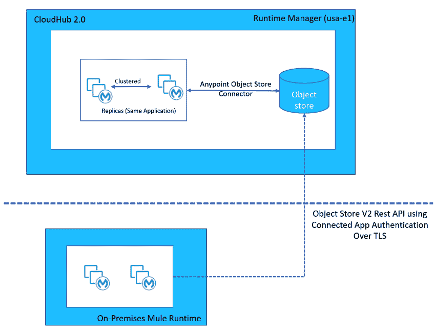

图 10.2 - CloudHub 2.0 与本地 Mule Runtime 之间访问 Object Store v2

在图 10.2 中，部署到 CloudHub 2.0 并带有 Object Store v2 的 MuleSoft 应用程序可以使用 Object Store 连接器组件来存储和检索数据。

部署到本地 Mule 运行时的应用程序，或任何外部应用程序，均可使用 REST API v2 访问 Object Store。

## 管理调度器

CloudHub 2.0 允许您管理和查看已部署应用程序的 Mule 流中配置的调度器组件。从 Runtime Manager 中，使用应用程序中的 **Schedule（调度器）** 选项卡来查看调度器的频率、更改调度器的频率，或启用/禁用调度器，而无需更改或重新部署正在运行的应用程序。

可以从 **Schedule（调度器）** 选项卡执行各种其他任务，如下所示：

*   您可以随时触发作业，而不管应用程序上设置了什么计划，也无需修改调度器
*   如果调度器应用程序连接的底层系统需要维护，可禁用调度器
*   调度器可随时更新，无需修改或重新部署应用程序

图 10.3 展示了如何在 CloudHub 2.0 应用程序设置中更新调度器：

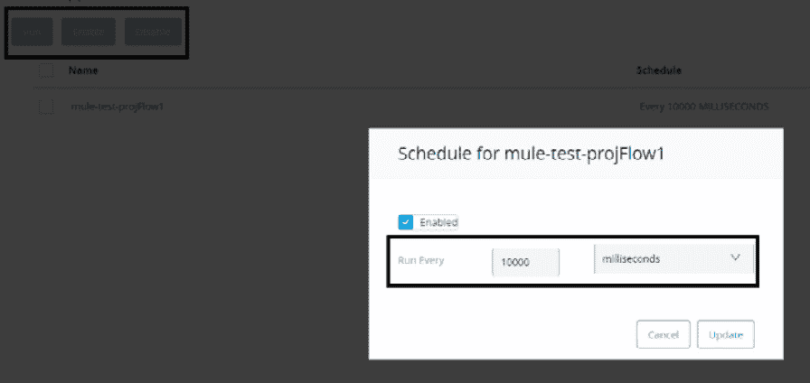

图 10.3 - 管理 CloudHub 2.0 应用程序的调度器

## 最后一公里安全

部署在共享空间中的应用程序支持最后一公里安全。最后一公里安全可实现入口与部署在工作节点上的应用程序之间通过 HTTPS 进行通信。部署到 CloudHub 2.0 的应用程序支持 HTTP 流量的单个监听器端口，即 8081，同时用于 HTTP 和 HTTPS 工作负载。该选项可在 Runtime Manager 控制台的 **Ingress（入口）** 选项卡下启用：

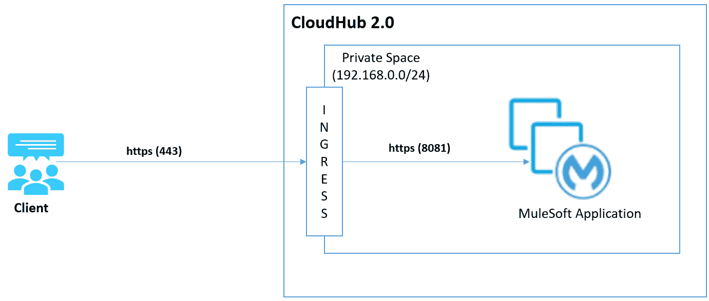

图 10.4 - CloudHub 2.0 中的最后一公里安全

图 10.5 展示了如何在 Runtime Manager 中为部署到 CloudHub 2.0 的应用程序启用最后一公里安全：

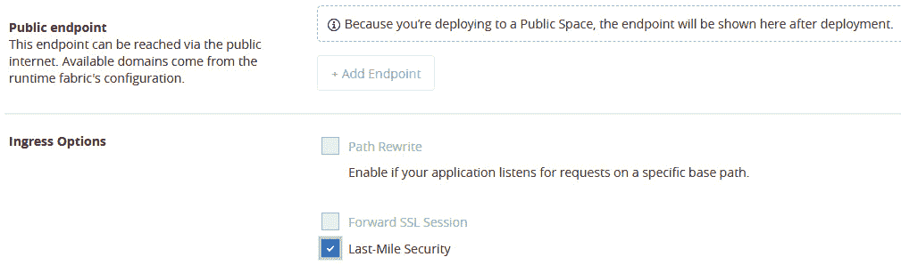

图 10.5 - 在 CloudHub 2.0 中为应用程序启用最后一公里安全

CloudHub 2.0 支持共享空间和私有空间，用于在容器化环境中部署和运行 MuleSoft 应用程序。让我们探讨一下共享空间和私有空间。

# 共享空间

共享空间使您能够在多租户环境中运行 Mule 实例。CloudHub 2.0 在每个区域提供一个共享空间来部署您的 MuleSoft 应用程序。

以下情况适合使用共享空间：

*   您没有使用自定义域名的要求，可以继续使用 cloudhub.io
*   您不需要使用自定义证书和自定义域名
*   您不想访问位于本地数据中心或私有/公有云中的资源、服务或数据库
*   您没有在与公有云隔离的环境中运行应用程序的要求

如果以下任何情况适用于您，则不应使用共享空间：

*   您希望在单租户环境或隔离模式下运行应用程序
*   您需要使用自定义域名
*   您需要自定义证书
*   您需要私有端点
*   您需要连接到位于本地数据中心或私有/公有云中的资源、服务或数据库

图 10.6 展示了共享空间的高级架构：

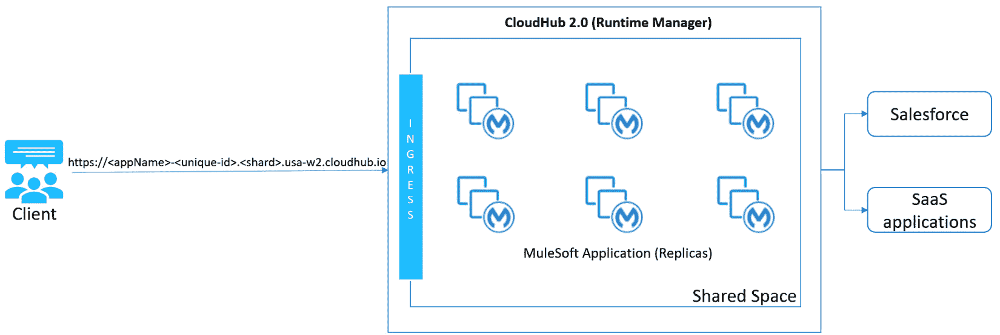

图 10.6 - 共享空间高级架构

# 私有空间

私有空间是 CloudHub 2.0 中一个虚拟、私有且隔离的空间，用于运行您的 MuleSoft 应用程序。您可以在 CloudHub 2.0 的单个或多个区域中为单个或多个业务组创建多个私有空间。需要为私有空间中的应用程序指定一范围允许的 IP 地址。

以下情况适合使用私有空间：


# 私有空间架构

*   您想要连接位于本地数据中心或私有/公有云中的一个或多个资源、服务或数据库。您可以使用 `Anypoint VPN` 或 `transit gateway`；但是，`CloudHub 2.0` 中不支持 `AWS Direct Connect` 和 `VPC peering`。
*   您想要启用私有端点以接受来自私有位置的流量。
*   您想要配置自定义证书和您自己的自定义域名。
*   您想要配置入站和出站防火墙规则。

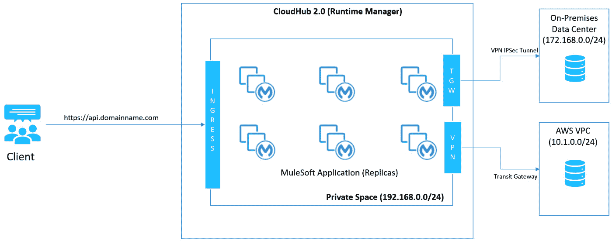

**图 10.7 - 私有空间高级架构**

您需要 `CIDR mask` 来创建私有空间，我们可以使用 *第 9 章* 中的相同逻辑来计算 `CIDR block`。私有空间创建后，将提供 *图 10.8* 中显示的以下信息：

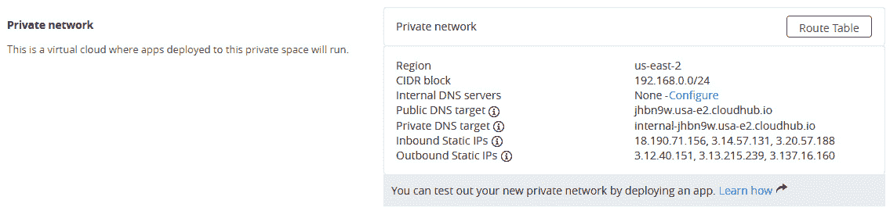

**图 10.8 - 私有空间详情**

让我们更详细地查看 *图 10.8* 中显示的属性：

*   **Region（区域）**：这是创建私有空间所在的区域。
*   **CIDR block（CIDR 块）**：这是创建私有空间时提供的 IP 范围。
*   **Internal DNS servers（内部 DNS 服务器）**：内部 DNS 服务器允许您进行主机和 IP 地址映射。
*   **Public DNS target（公共 DNS 目标）和 Private DNS target（私有 DNS 目标）**：它将默认提供两个域名；一个用于公共流量，另一个用于内部流量。公共域名可供应用程序用来接受来自外部客户端的流量，而私有域名可用于接受私有网络、`VPN` 或 `transit gateway` 内部的流量。
*   **Inbound Static IPs（入站静态 IP）和 Outbound Static IPs（出站静态 IP）**：在 `CloudHub 2.0` 中，入站和出站静态 IP 将在私有空间层面分配，而非应用程序层面。入站静态 IP 分配给您的公共域名，您可以使用它们映射更多公共域名。分配给私有空间的出站静态 IP 在部署到私有空间的应用程序需要与外部系统（如 `SFTP`）通信时非常有用，因为在这些系统中需要 IP 白名单来启用通信。在这种情况下，所有出站静态 IP 都可以在外部系统上加入白名单。分配的入站 IP 地址数量取决于区域中可用区的数量。例如，如果 `usa-east-1 region` 有三个可用区，则将分配三个入站和三个出站静态 IP 地址。
*   **Route Table（路由表）**：**Route Table** 允许您配置路由以确定流量将从私有空间导向何处。*图 10.9* 显示了创建私有空间时将添加的默认路由：

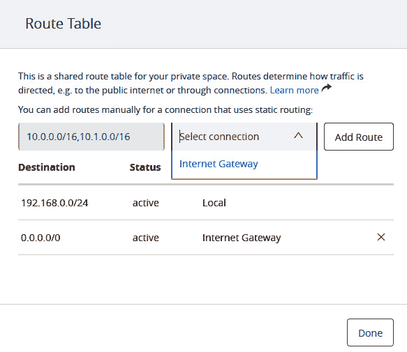

**图 10.9 - 私有空间的路由表**

上图显示允许本地网络内的流量，以及通往互联网的流量。如果您想禁用互联网流量，只需移除可通过 `Internet Gateway` 访问的 `0.0.0.0/0` 路由，但请注意 `API Manager`、`Anypoint MQ` 和 `Object Store` 需要从私有空间访问互联网。您可以向路由表添加更多可访问的子网路由，或者如果不再希望子网可通过 `transit gateway` 或 `VPN` 连接访问，则从路由表中移除路由。

## AWS 服务角色

服务角色是 `AWS` 服务为执行任务而承担的一种身份。

如果您在 `AWS` 中设置了 **identity and access management**（身份和访问管理，**IAM**）角色，则可以将其链接到您的私有空间。`AWS` 中的 `IAM` 角色授予私有空间访问资源和权限的权限。要在 `AWS` 上设置此功能，请执行以下操作：

*   使用 `Anypoint Platform` 生成的唯一 `AWS IAM` 角色名称。
*   使用设置私有区域的公司的组织 ID。
*   此功能要求启用 `port 443` 上的出站流量。

## 入站和出站流量规则

`CloudHub 2.0` 允许您在私有空间中配置入站和出站流量规则。下图显示了私有空间中可用的默认入站和出站规则：

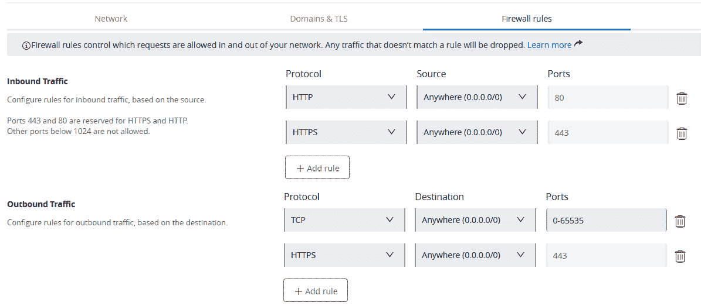

**图 10.10 - 私有空间的入站和出站防火墙规则**

在 *图 10.10* 中，我们可以看到允许来自任何位置的 `HTTP` 和 `HTTPS` 入站流量。如果您希望私有空间仅接受 `HTTPS` 流量，请移除接受 `HTTP` 流量的规则。

如果您想接受来自内部网络的 `HTTPS` 流量，请将 **Source（源）** 更改为 **Local private network（本地私有网络）**，如下图所示：

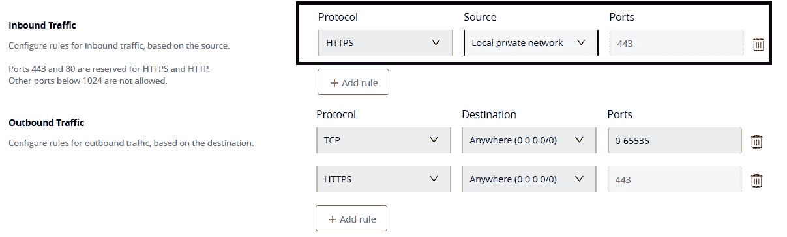

**图 10.11 - 配置私有空间的入站防火墙规则**

私有空间允许您根据需求添加新的入站防火墙规则或修改现有的入站防火墙规则。您最多可以添加 80 条入站防火墙规则。

出站流量决定了部署到私有空间的应用程序如何与外部服务通信。默认情况下，它允许通过 `port 0 to 65535` 进行 `TCP` 连接，并通过 `port 443` 进行 `HTTPS` 连接。

私有空间允许您根据需求添加新的出站防火墙规则或修改现有的出站防火墙规则。您最多可以添加 80 条出站防火墙规则。

如果您希望 `TCP` 和 `HTTPS` 仅与您网络内的本地服务通信，请将 **Source（源）** 从 **Anywhere（任何位置）** 更改为 **Local private network（本地私有网络）**，如下图所示：

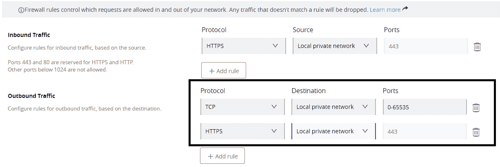

**图 10.12 - 配置私有空间的出站防火墙规则**

## TLS 上下文和域名

私有空间默认提供带有一个公共域名和一个私有域名的 `TLS` 上下文。如果您希望配置额外的 `TLS` 上下文以支持自定义域名，可以通过上传 `PEM` 或 `JKS` 格式的域名证书来创建额外的 `TLS` 上下文：

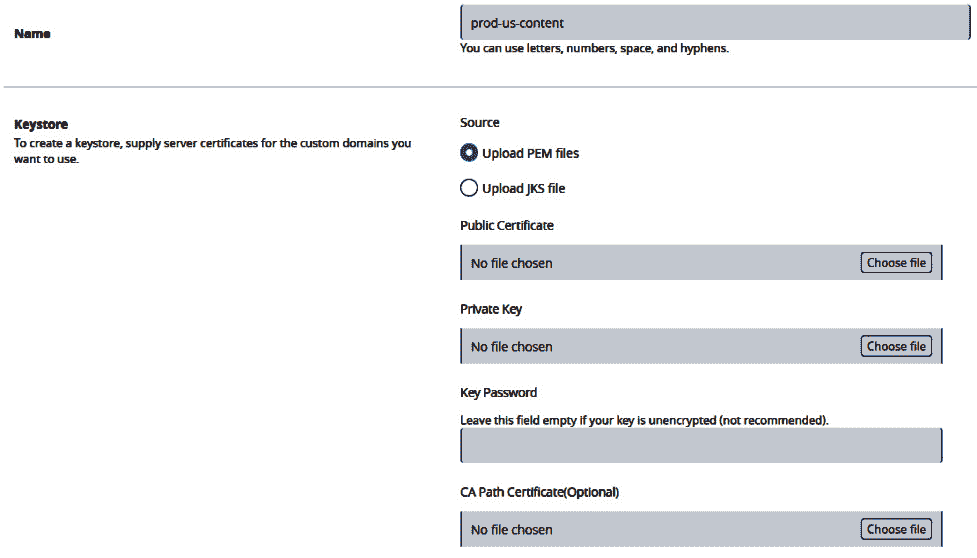

**图 10.13 - 配置私有空间的 TLS 上下文**

## 公共端点和私有端点

当应用程序部署时，`CloudHub 2.0` 默认会创建两个端点。一个是公共端点，另一个是私有端点。公共端点可以接受来自外部客户端的流量，而私有端点接受来自私有网络、`VPN` 或 `transit gateway` 的流量。支持多个公共端点，您需要在私有空间设置中配置 `TLS` 上下文以在应用程序上启用多个公共端点。要禁用来自外部客户端的流量，您需要从部署到 `CloudHub 2.0` 的应用程序中删除公共端点。

## 入口负载均衡器

`CloudHub 2.0` 支持入口负载均衡器，用于将流量路由到部署在私有空间和共享空间中的应用程序。入口负载均衡器会根据传入的入站请求数量或流量负载自动扩缩。私有空间允许您在需要时下载入口负载均衡器的日志以进行故障排查。入口负载均衡器的默认读取/响应超时时间为 `300 seconds`，可根据要求增加或减少。

默认日志级别为 **Error**，但也支持 **Debug**、**Trace** 和 **Info** 等其他日志级别。

## HTTP 请求

`HTTP requests` `CloudHub 2.0:HTTP requests` 定义了入口负载均衡器如何处理请求。流量将通过以下三种方式之一进行处理：

*   **Redirect to HTTPS（重定向到 HTTPS）**：将传入的 `HTTP` 请求重定向到使用 `HTTPS` 协议的同一 URL


- `Accept HTTP`：允许使用 HTTP 协议在默认 SSL 端点上接收传入请求
- `Drop HTTP`：静默丢弃 HTTP 请求，仅接受 HTTPS 上的流量

图 10.14 展示了如何为私有空间中的入口负载均衡器配置 HTTP 请求、响应超时和日志下载：

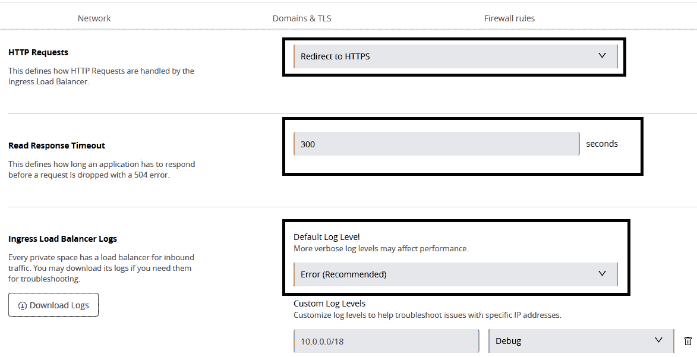

图 10.14 - 为私有空间配置 HTTP 请求

## VPN 连接

要将私有空间连接到外部网络，可以在它们之间建立 VPN 连接，其中包括本地数据中心。这将在私有空间和本地数据中心之间创建一个安全且高可用的连接：

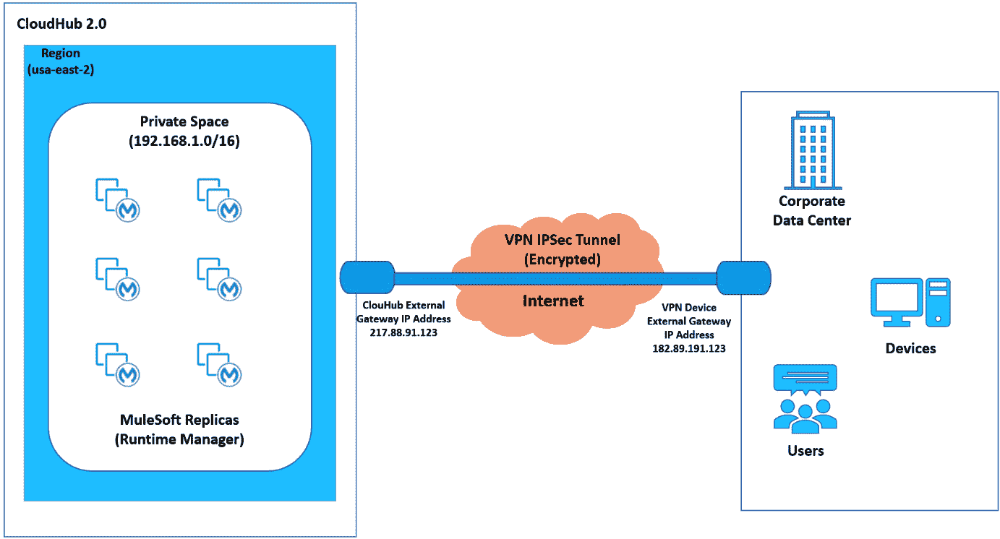

图 10.15 - 私有空间的 VPN IPSec 隧道

### VPN 高可用性

如果您仅创建了一个 VPN 连接，私有空间允许您创建第二个 VPN 连接，这被称为冗余 VPN。强烈建议创建冗余 VPN，因为它将确保高可用性，并将从初始 VPN 继承某些设置，例如路由类型、`ASN` 等。

建议与客户网关建立两个 VPN 连接，以防其中一个 VPN 连接进行任何更新或发生任何故障。在这些情况下，另一个 VPN 连接将确保 Anypoint Platform 与本地数据中心之间的连通性：

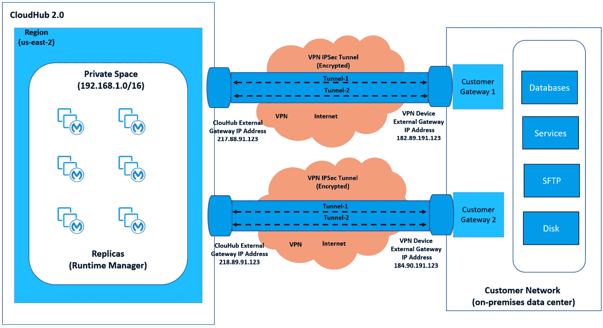

图 10.16 - VPN 高可用性

在上述架构中，VPN 的配置方式使其在发生任何故障时按以下顺序使用：

1. `VPN-1 Tunnel-1`
2. `VPN-1 Tunnel-2`
3. `VPN-2 Tunnel-1`
4. `VPN-2 Tunnel-2`

这配置为在发生任何故障时自动故障转移到另一个 VPN 隧道或连接。此 VPN 解决方案将具有弹性和稳健性。动态路由有助于自动将路由从 `VPN-1` 通告到 `VPN-2`，它还支持静态路由，当 `VPN-1` 发生故障时，`VPN-2` 将处于待机模式。

## 传输网关

`AWS Transit Gateway` 就像一个路由器，可帮助您简化网络配置，并允许您连接 AWS 或 Anypoint Platform 中的私有空间，以安全的方式建立通往本地部署、Azure 云或任何第三方专用网络的 VPN 连接。

`CloudHub 2.0` 允许您在组织中附加多个传输网关，具体取决于组织的传输网关许可权利数量：

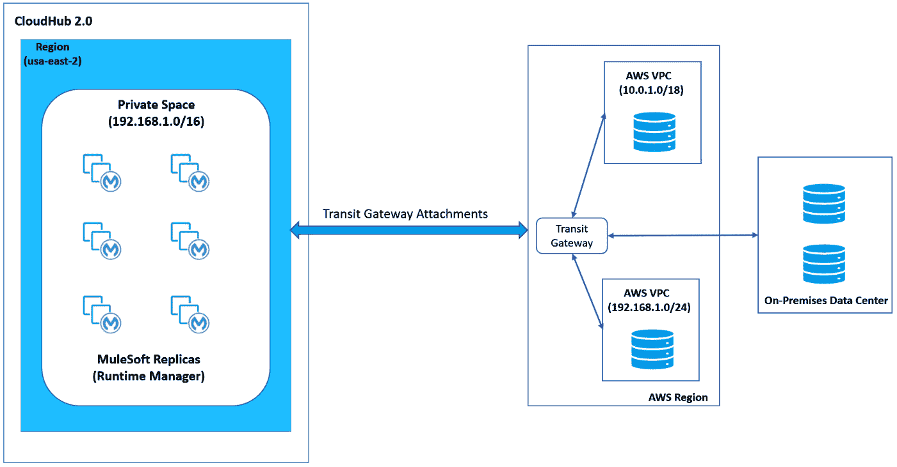

图 10.17 - 传输网关附件

在图 10.17 中，我们通过在 Anypoint Platform 中创建传输网关附件，利用 `AWS Transit Gateway` 将私有空间连接到本地数据中心。

## 私有空间网络架构

下图展示了部署在私有空间中的应用程序如何与外部或本地网络或互联网上的服务或应用程序进行通信。正如我们所讨论的，本地服务可以通过专用端点与部署在私有空间中的应用程序通信，外部客户端可以使用公共端点进行通信。您可以在将应用程序部署到私有空间时配置公共和专用端点：

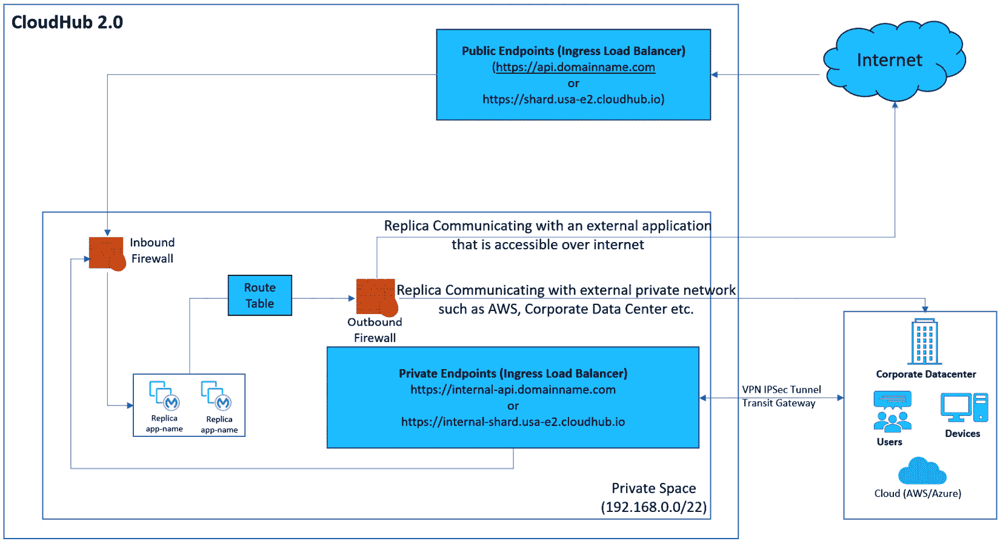

图 10.18 - 私有空间网络架构

如果您需要自定义域，则需要在私有空间中创建 `TLS 上下文`，并以 `JKS` 或 `PEM` 格式添加域证书。在下图中，我们有自定义专用域 (`internal-api.domainname.com`) 和公共域 (`api.domainname.com`)。要启用流量通过自定义域到达部署在私有空间中的应用程序，请在自有域中创建一条指向您的私有空间**完全限定域名** (`FQDN`) 的 `CNAME` 记录：

| `自定义域 (CNAME)` | `FQDN (A 记录)` | `域类型` |
| --- | --- | --- |
| `internal-api.domainname.com` | `internal-<shard>.usa-e2.cloudhub.io` | 专用 |
| `api.domainname.com` | `<shard>.usa-e2.cloudhub.io` | 公共 |

表 10.5 - `CNAME` ⇔ `A 记录` 映射

私有空间将根据入站防火墙规则验证传入请求，所有从私有空间发出的传出请求将由出站防火墙规则验证。

## 私有空间中的多环境

私有空间允许您将业务组及其子组中的沙箱或生产环境进行映射：

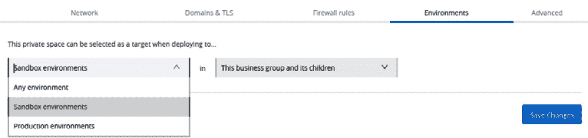

图 10.19 - 为私有空间映射多个环境

如果您想使用同一个私有空间映射生产环境和沙箱环境，可以选择 `Any environment`（任意环境）。但是，建议为沙箱环境和生产环境分别准备独立的私有空间。

## 私有空间中的多域

私有空间允许您创建多个 `TLS 上下文` 以支持多个域。例如，沙箱映射到一个包含两个环境（开发和 QA）的私有空间。

在这种情况下，我们可以配置两个 `TLS 上下文`，分别使用域 `api-dev.domainname.com` 用于开发环境，`api-qa.domainname.com` 用于 UAT 环境，如表 10.6 所示。

| `CNAME` | `私有空间 - 公共域目标 (A 记录)` | `环境` | `域类型` |
| --- | --- | --- | --- |
| `api-dev.domainname.com` | `<shard>.usa-e2.cloudhub.io` | 开发 | 公共 |
| `api-qa.domainname.com` | `<shard>.usa-e2.cloudhub.io` | QA | 公共 |

表 10.6 - 多环境的 `CNAME` ⇔ `A 记录` 映射

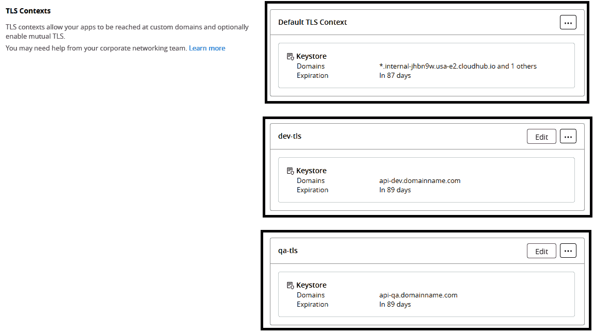

图 10.20 - 私有空间的 TLS 上下文

我们有三个 `TLS 上下文`。一个是在创建私有空间时自动创建的默认 `TLS 上下文`。然后，我们还有两个用于开发和 QA 环境的 `TLS 上下文`。

现在，每当我们将应用程序部署到开发环境时，可以在与开发相关的 `Ingress`（入口）选项卡下选择主机 (`https://api-dev.domainname.com`)，每当我们将应用程序部署到 QA 环境时，可以在与 QA 相关的 `Ingress` 选项卡下选择主机 (`https://api-qa.domainname.com`)：

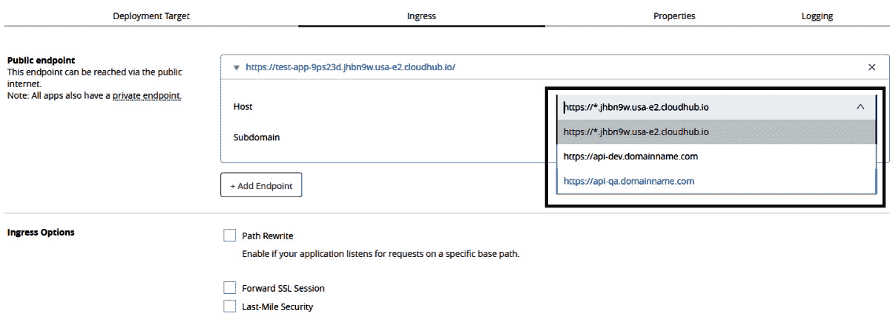

图 10.21 - 私有空间的应用程序端点

## 将 MuleSoft 应用程序部署到 CloudHub Runtime Manager 的不同选项

MuleSoft 提供了多种将应用程序部署到 CloudHub 的方式，所有选项都可用于与 CI/CD 流水线集成，以实现 MuleSoft 应用程序到 CloudHub 的自动部署。让我们探讨所有可用于将应用程序部署到 CloudHub 的选项。

### Mule Maven 插件

`Mule Maven 插件` 是用于将 MuleSoft 应用程序部署、取消部署和打包到 `CloudHub 2.0` 的重要 Maven 插件之一。让我们更详细地讨论 `Mule Maven 插件`。可以在应用程序的 `POM.xml` 文件中配置以下插件，并包含在 CloudHub 中部署和运行应用程序所需的所有必需属性：


# 用于 CloudHub 2.0 部署的 Mule Maven 插件配置

## 插件配置

```xml
<plugin>
  <groupId>org.mule.tools.maven</groupId>
  <artifactId>mule-maven-plugin</artifactId>
  <version>3.8.6</version>
  <extensions>true</extensions>
  <configuration>
    <cloudhub2Deployment>
      <uri>https://anypoint.mulesoft.com</uri>
      <provider>MC</provider>
      <environment>${environment}</environment>
      <target>${target}</target>
      <muleVersion>${app.runtime}</muleVersion>
      <username>${anypoint.username}</username>
      <password>${anypoint.password}</password>
      <applicationName>${application.name}</applicationName>
      <replicas>${replicas}</replicas>
      <vCores>${replicaSize}</vCores>
      <deploymentSettings>
        <http>
          <inbound>
            <publicUrl>${publicURL}</publicUrl>
            <forwardSslSession>true</forwardSslSession>
            <lastMileSecurity>true</lastMileSecurity>
          </inbound>
        </http>
      </deploymentSettings>
    </cloudhub2Deployment>
  </configuration>
</plugin>
```

在前述 Mule Maven 插件中，使用 `${}` 定义的值是可以从 `mule deploy` 命令传递的参数，如下所示：

```
mule deploy –DmuleDeploy -Dapp.runtime=4.4.0 -Danypoint.username=anypointusername –Danypoint.password=password -Dapplication.name=music-api-dev –Denvironment=Sandbox –Dworkers=1 –DworkerType=MICRO -Dreplica=1 -DreplicaSize=0.1 -DpublicUrl=https://api-dev.domainname.com -Dtarget=jj-dev-ps
```

## Mule Maven 插件属性（表 10.7）

下表显示了在将应用程序部署到 CloudHub 时可以在 Mule Maven 插件上配置的属性：

| 参数 | 说明 | 是否必需 | 默认值/示例 |
| --- | --- | --- | --- |
| `cloudhub2Deployment` | 这是顶层元素。 | 是 | |
| `uri` | 这是您的 Anypoint Platform URI。 | 否 | `https://anypoint.mulesoft.com` |
| `muleVersion` | 这是在 CloudHub 2.0 实例中运行的 Mule 运行时引擎版本。 | 是 | 例如 `4.3.0` |
| `username` | 这是您的 Anypoint Platform 用户名。 | 是（仅当使用 Anypoint Platform 凭据时） | |
| `password` | 这是您的 Anypoint Platform 密码。 | 是（仅当使用 Anypoint Platform 凭据时） | |
| `applicationName` | 这是要在 Runtime Manager 中实现的应用程序的标题。 | 是 | 例如 `invoice-api-dev` |
| `scopeLoggingConfigurations` | 这是要使用的日志记录库的包。`logLevel`：是日志级别。允许的值为 `NONE`、`ERROR`、`WARN`、`INFO`、`DEBUG` 和 `TRACE`。 | 否 | |
| `target` | 这是要部署应用程序的目标。可以是共享空间或私有空间。 | 是 | |
| `provider` | 对于 CloudHub 2.0，设置为 `MC`。 | 是 | `MC` |
| `environment` | 这是要部署应用程序的 CloudHub 2.0 环境。 | 是 | |
| `replicas` | 这是要为应用程序创建的副本数量。 | 是 | |
| `vCores` | 这是副本的大小，允许的值为 `0.1`、`0.2`、`0.5`、`1`、`1.5`、`2`、`2.5`、`3`、`3.5` 和 `4`。 | 否 | `0.1` |
| `businessGroup` | 这是部署的业务组路径。 | 否 | |
| `businessGroupId` | 这是部署的业务组 ID。 | 否 | |
| `deploymentTimeout` | 这是部署过程允许的持续时间，以毫秒为单位。这指的是从部署开始到确认工件成功部署之间的时间。 | 否 | `10,00,000.00` |
| `server` | Maven 服务器与 Anypoint Platform 凭据集成。服务器的 ID 可以在 `settings.xml` 文件中找到，该文件链接到用户的 Anypoint 用户名和密码。 | 否 | |
| `properties` | 可以在应用程序部署期间传递要设置的属性。 | 否 | |
| `secureProperties` | 可以在应用程序部署期间传递要设置的安全属性。 | 否 | |
| `skip` | 当设置为 `true` 时，它会跳过插件部署目标。 | 否 | `false` |
| `skipDeploymentVerification` | 当设置为 `true` 时，它会跳过已部署应用程序的状态验证。 | 否 | `false` |
| `authToken` | 指定用于访问平台的授权令牌。 | 仅当使用授权令牌登录时 | |
| `connectedAppClientId` | 指定 Connected App 的 clientID 值。 | 仅当使用 Connected App 凭据登录时 | |
| `connectedAppClientSecret` | 指定 Connected App 的密钥。 | 仅当使用 Connected App 凭据登录时 | |
| `connectedAppGrantType` | 指定唯一支持的连接类型：`client_credentials`。 | 仅当使用 Connected App 凭据登录时 | |

## 部署设置参数（表 10.8)

以下列出了可以在 `deploymentSettings` 下传递的其他一些参数：

| 参数 | 说明 |
| --- | --- |
| `enforceDeployingReplicasAcrossNodes` | 此设置确保副本跨不同节点部署，默认值设置为 `false`。 |
| `updateStrategy` | `updateStrategy` 的值可以是 `recreate` 或 `rolling`。 |
| `clustered` | 此设置允许跨应用程序的多个副本启用集群。默认情况下，它设置为 `false`。 |
| `http` | **公共 URL**：这是指已部署应用程序的 Web 地址。<br>**最后一英里安全性**：启用此功能后，HTTPS 连接将被转发并由应用程序解密。<br>**转发 SSL 会话**：当设置为 `true` 时，此选项在会话期间启用 SSL 转发。默认值为 `false`。 |
| `generateDefaultPublicUrl` | 当选择 `set to true` 选项时，CloudHub 2.0 将为已部署的应用程序生成公共 URL。 |

### 配置示例

**enforceDeployingReplicasAcrossNodes**

```xml
<deploymentSettings>
  <enforceDeployingReplicasAcrossNodes>false</enforceDeployingReplicasAcrossNodes>
</deploymentSettings>
```

**updateStrategy**

```xml
<deploymentSettings>
  <updateStrategy>recreate</updateStrategy>
</deploymentSettings>
```

**clustered**

```xml
<deploymentSettings>
  <clustered>true</clustered>
</deploymentSettings>
```

**http**

```xml
<deploymentSettings>
  <http>
    <inbound>
      <publicUrl>https://myapp.anypoint.com</publicUrl>
      <lastMileSecurity>true</lastMileSecurity>
      <forwardSslSession>true</forwardSslSession>
    </inbound>
  </http>
</deploymentSettings>
```

## 部署和取消部署命令

以下命令用于部署和取消部署应用程序：

```
mvn clean deploy –DmuleDeploy (将应用程序部署到 CloudHub 2.0)
mvn mule:undeploy (从 CloudHub 2.0 取消部署应用程序)
```

## 身份验证机制

Mule Maven 插件可以使用以下身份验证机制之一来将应用程序部署到 CloudHub：

- Anypoint Platform 用户名和密码
- 服务器
- Anypoint 连接应用程序
- 授权令牌

# Anypoint CLI

Anypoint CLI 也可用于将 MuleSoft 应用程序部署、取消部署或重新部署到 CloudHub 2.0。Anypoint CLI 是 Anypoint Platform 的脚本和命令行工具。Anypoint CLI 能够管理 Anypoint Platform 的各种功能，例如 CloudHub 1.0、CloudHub 2.0、API 治理、Anypoint 专用负载均衡器、Anypoint VPC、Exchange、Design Center、API Manager 等。要使用 Anypoint CLI，您需要为其设置一个 npm 包。以下是 MuleSoft 提供的用于设置 Anypoint CLI 的文档：

<https://docs.mulesoft.com/anypoint-cli/4.x/install>

Anypoint CLI 可以使用以下身份验证机制之一来管理 Anypoint Platform：

- Anypoint Platform 用户名和密码
- 客户端 ID 和客户端密钥
- 持有者令牌（仅限命令行）


## CloudHub 2.0 部署命令

管理 CloudHub 的命令列表可在 MuleSoft 文档中找到，链接如下：

[`docs.mulesoft.com/anypoint-cli/4.x/cloudhub2-apps`](https://docs.mulesoft.com/anypoint-cli/4.x/cloudhub2-apps)

以下命令可用于将应用程序部署到 CloudHub 2.0：

```
runtime-mgr:application:deploy <appID> <deploymentTargetID> <runtimeVersion> <artifactID> [flags]
```

您可以使用以下值将应用程序 ID 中提到的应用程序部署到部署目标：

| 值 | 说明 | 示例 |
|-------|-------------|---------|
| `--artifactId` | 应用程序的 Artifact ID 来源于 Exchange。 | `--artifactId mule-error-plugin` |
| `--deploymentTargetId` | 标识部署目标。 | `--deploymentTargetId cloudhub-us-east-2` |
| `--name` | 指定需要部署在 CloudHub 2.0 上的应用程序名称。 | `--name testcloudhubapp` |
| `--runtimeVersion` | 这是部署应用程序所需的运行时版本。 | `--runtimeVersion 4.3.0` |
| `--secureProperty` | 这会设置一个加密属性。 | `--secureProperty secureTestProperty:true` |

表 10.9 - Anypoint CLI 应用程序部署值

可随 `runtime-mgr` 部署命令传递的标志列表如下：

| 标志 | 说明 | 示例 |
|------|-------------|---------|
| `--assetVersion` | 这是 Exchange 中的资产版本。 | `--assetVersion 3.0.5` |
| `--[no-]clustered` | 这启用集群节点的使用，需要至少两个副本。 | `--no-clustered` |
| `--[no-]disableAmLogForwarding` | 这会禁用应用程序日志转发到 Anypoint Monitoring。 | `--disableAmLogForwarding` |
| `--[no-]forwardSslSession` | 这启用 SSL 会话转发。 | `--no-forwardSslSession` |
| `--groupId` | 这是要部署的资产的组 ID。 | `--groupId org.mule.test` |
| `--[no-]lastMileSecurity` | 这启用最后一公里安全性。 | `--no-lastMileSecurity` |
| `--[no-]objectStoreV2` | 这启用 Object Store v2。 | `--no-objectStoreV2` |
| `--pathRewrite` | 这为应用程序中的 HTTP 监听器提供预期的基本路径。 | `--pathRewrite /http://localhost:8000` |
| `--property` | 这设置一个属性。 | `--property testproperty:true` |
| `--propertiesFile` | 所有属性均替换为指定文件中的值。 | `--propertiesFile /Users/mule/Documents/dev-properties.txt` |
| `--publicEndpoints` | 这提供可通过万维网访问的接入点。 | `--publicEndpoints my-superapp-example:/status?limit=50` |
| `--replicas` | 这是要部署的副本数量。 | `--replicas 3` |
| `--replicaSize` | 这是副本的大小（以 vCore 为单位）。 | `--replicaSize 0.1` |
| `--scopeLoggingConfig` | 这定义作用域日志记录。 | `--scopeLoggingConfig testscope1:WARN,testscope2:DEBUG` |
| `--scopeLoggingConfigFile` | 这上传一个文件以定义作用域日志记录。 | `--scopeLoggingConfigFile /Users/mule/Documents/cert.txt` |
| `--updateStrategy` | 这更新所使用的策略。 | `--updateStrategy recreate` |

表 10.10 - Anypoint CLI 应用程序部署标志

## 从 CloudHub 1.0 到 CloudHub 2.0 的技术增强

*   允许您为副本数量超过一的部署配置集群。
*   允许使用容器进行应用程序部署，以控制资源使用、保证应用程序可用性并促进扩展。
*   允许使用 AWS 服务角色进行资源访问控制。
*   粒度 vCore 分配选项 — CloudHub 2.0 支持在粒度 vCore 上部署应用程序。
*   允许您配置多个私有或公共端点。
*   允许您下载入口自助服务日志。可通过私有空间访问。Titanium 用户也可通过 Anypoint Monitoring 访问日志。
*   支持入站和出站防火墙规则。
*   在 CloudHub 1.0 应用程序中，名称在每个控制平面必须唯一，而在 CloudHub 2.0 中，应用程序名称在每个私有空间内必须唯一。
*   VPC 对等连接和 AWS Direct Connect 在 CloudHub 2.0 中已弃用。可改用 Transit Gateway 代替 VPC 对等连接和 AWS Direct Connect。
*   HTTP 和 HTTPS 流量使用端口 8081。
*   您可以根据环境类型（如沙箱和生产环境）将一个私有空间与多个环境关联。这在 Anypoint Virtual Private Cloud 中是不可能的，因为您必须将每个单独的环境关联到 Anypoint Virtual Private Cloud。
*   默认情况下，CloudHub 2.0 中 VPN 启用了高可用性。
*   具有相同 vCore 大小的 CloudHub 1.0 应用程序工作节点和 CloudHub 2.0 应用程序副本在性能指标上可能显示差异，且无法进行比较。

以下是 CloudHub 2.0 **不** 支持的功能或特性：

*   4.3.0 之前的 Mule 版本
*   CloudHub Connector
*   不支持 TLS 1.0。请使用 TLS 1.2 或 TLS 1.3
*   创建自定义通知
*   Anypoint Functional Monitoring
*   持久队列；请使用 Anypoint MQ 进行持久队列和其他队列管理

## 总结

在本章中，探讨了 CloudHub 2.0 的所提供能力和特性，重点介绍了其与 CloudHub 1.0 的差异。讨论涵盖了各种特性，如高可用性、容错性和可扩展架构，所有这些均由 CloudHub 2.0 支持。

此外，还演示了在 CloudHub 2.0 中利用共享空间和私有空间运行 MuleSoft 应用程序。另外，还解释了利用 Mule Maven Plugin 和 Anypoint CLI 等工具在 CloudHub 2.0 环境中部署 MuleSoft 应用程序。

下一章将深入探讨 Runtime Fabric 管理器，它运行在自管理的 Kubernetes 和裸金属服务器上。该管理器可用于在基于 Kubernetes 的容器化环境中运行 MuleSoft 应用程序。

## 延伸阅读

CloudHub 2.0 参考列表包含以下来源：

*   MuleSoft 文档：[`docs.mulesoft.com/cloudhub-2/ch2-architecture`](https://docs.mulesoft.com/cloudhub-2/ch2-architecture)
*   YouTube 系列：[`youtube.com/playlist?list=PL5GwZHHgKcuDaUnFQymi85AbUVbvJBtsA&si=GvCy64jOsw3PoYT4`](https://youtube.com/playlist?list=PL5GwZHHgKcuDaUnFQymi85AbUVbvJBtsA&si=GvCy64jOsw3PoYT4)
*   本章中一些表格引用自 MuleSoft 官方文档：[`docs.mulesoft.com/`](https://docs.mulesoft.com/)
