# 11. 使用 Runtime Fabric 容器化运行时平面

在本章中，我们将讨论如何在基于 Kubernetes 的容器化环境中运行和管理 MuleSoft 应用程序。MuleSoft 提供了用于裸金属服务器/虚拟机（**VM**）的 Runtime Fabric 和用于自管理 Kubernetes 的 Runtime Fabric，以便您可以在容器化环境中管理和运行 MuleSoft 应用程序。

在本章中，我们将涵盖以下主题：

*   Kubernetes 架构及其组件
*   用于裸金属服务器/VM 的 Runtime Fabric
*   用于自管理 Kubernetes 的 Runtime Fabric
*   用于 Red Hat OpenShift 的 Runtime Fabric
*   Anypoint Security

## 技术要求

本章需要满足以下条件：

*   启用了 Runtime Fabric 的企业版 Anypoint Platform 访问权限。
*   Runtime Fabric 设置许可证密钥。
*   如果您计划在自管理 Kubernetes 上设置 Runtime Fabric，则需要 EKS/GKE/AKS。


## 先决条件

- `VMs/bare-metal server` 以满足所有先决条件。相关链接可在本章末尾的 `Further reading` 部分找到。
- `Red Hat OpenShift`，以防您计划在 OpenShift 上设置 Runtime Fabric。

# Kubernetes 架构

首先，我们将讨论 Kubernetes 集群的高层架构，然后再了解由 MuleSoft 提供的 Runtime Fabric。Kubernetes 集群遵循主从架构来运行容器化应用程序，并且比部署在虚拟机上的应用程序更快、更轻量。它们也易于管理和扩展。

Kubernetes 由主节点和工作节点组成，用于运行应用程序工作负载和管理容器编排。主节点通常是决策者，负责管理 Kubernetes 集群。它是任何管理任务的入口点，您可以通过 API、CLI 或 Kubernetes GUI 轻松与主节点通信。为确保架构的高可用性和容错性，集群中必须有不止一个主节点。

## 主节点组件

主节点包含以下组件：

- `kube-apiserver`：API 服务器在主节点上执行所有管理任务。用户可以通过 HTTP REST 调用与 API 服务器交互，此时 API 服务器会验证并执行请求。客户端可以与 API 服务器交互以利用 Kubernetes 功能。
- `Etcd`：etcd 是一个高可用的分布式键值存储，用于存储所有集群数据，例如当前状态、期望状态、资源配置和运行时数据。Kubernetes 集群使用 etcd 存储所有配置数据、其状态（集群的当前状态和期望状态）以及元数据。etcd 使用 Golang 编写。
- `kube-scheduler`：调度器监视新创建的、未分配工作节点的 Pod，并为 Pod 选择节点。简单来说，调度器根据可用资源决定将容器部署在哪个节点上。
- `Controller manager`：控制器管理器负责管理各种控制器，这些控制器持续监视集群状态，并确保集群的当前状态接近期望状态。可用的控制器包括：
    - `Node controller`：节点控制器负责将新节点加入集群并管理节点的期望状态。它处理节点变得不可用的情况，以保持应用程序运行。
    - `Replica controller`：副本控制器监控副本集，并确保副本集中有期望数量的 Pod 可用。如果 Pod 崩溃或终止，它会自动创建一个新 Pod。它将始终确保期望数量的 Pod，或者至少有一个 Pod 处于运行状态。
    - `Deployment controller`：部署控制器管理应用程序的部署。它确保 Pod 在期望的副本数量下运行，并确保不健康的副本被新的健康副本替换。这将保证至少维护一个应用程序实例来提供请求服务。
    - `Job controller`：作业控制器与 API 服务器通信以移除或添加新 Pod，并不自行运行作业。作业是在一个或多个 Pod 上运行以执行任务然后终止的 Kubernetes 任务。


图 11.1 描绘了 Kubernetes 控制平面中主节点的组件。

## 工作节点组件

集群中将始终有不止一个工作节点，以确保其高可用性和容错性。工作节点负责运行容器化应用程序。它们包含以下组件：

- `kube-proxy`：这是一个在集群的每个工作节点上运行的网络代理。kube-proxy 管理节点上的网络规则，这些网络规则允许您的 Pod 与集群内部或外部的网络会话进行通信。
- `kubelet`：kubelet 在每个工作节点上运行，以与集群中的主节点通信。它负责管理 Pod 如何部署到 Kubernetes 集群。它从 API 服务器接收命令并指示容器启动或停止。
- `Container runtime`：容器运行时负责在 Pod 中运行和管理您的应用程序。


图 11.2 描绘了工作节点中的组件。


图 11.3 描绘了完整的 Kubernetes 架构。

在本节中，我们了解了 Kubernetes 架构。下一节将介绍 Runtime Fabric。Runtime Fabric 运行在 Kubernetes 之上，是 MuleSoft 提供的一项服务，用于运行 Mule 应用程序和代理。

# 什么是 Runtime Fabric？

Runtime Fabric 是由 MuleSoft 基于 Kubernetes 构建的容器服务，用于在云（Azure/AWS/Google）和本地数据中心运行和管理 MuleSoft 应用程序。Runtime Fabric 可以设置在裸金属服务器/虚拟机、自托管 Kubernetes（如 `Azure Kubernetes Service (AKS)`、`Elastic Kubernetes Service (EKS)` 或 `Google Kubernetes Engine (GKE)`）以及 Red Hat OpenShift 上。

当我们在自托管 Kubernetes、裸金属服务器/虚拟机或 Red Hat OpenShift 上设置 Runtime Fabric 时，客户和 MuleSoft 在管理 Runtime Fabric 方面的责任有所不同。在以下章节中，我们将了解当 Runtime Fabric 在上述任何实例中设置时，哪些责任属于 MuleSoft，哪些属于客户。

## 裸金属服务器/虚拟机上的 Runtime Fabric

裸金属服务器/虚拟机上的 Runtime Fabric 由一组用于集群的虚拟机组成。每个虚拟机可以作为控制器节点或工作节点。

控制器节点是用于操作 Runtime Fabric 的专用虚拟机，包含编排服务、内部负载均衡器以及允许您从 Anypoint Platform（控制平面）监控集群的服务。工作节点是用于运行 Mule 应用程序和 API 网关的专用虚拟机。

以下是具有一个控制器节点和两个工作节点的开发环境中 Runtime Fabric 的典型架构：


图 11.4 - Runtime Fabric 架构（开发环境）

以下是生产环境中 Runtime Fabric 的典型架构，提供高可用性和容错性。Runtime Fabric 架构有三个控制器和三个工作节点。三个控制器节点可在丢失一个控制器时实现容错：


图 11.5 - Runtime Fabric 架构（生产环境）


## 控制器节点和工作节点配置

为了在丢失两个控制器节点的情况下提供进一步的容错能力，应设置总共五个控制器。此配置可用于生产环境。对于开发环境，您可以设置一个控制器节点和两个工作节点。Anypoint Platform 与控制器节点上的代理之间的通信始终是出站的。代理始终在控制器上可用，且控制器仅运行内部负载均衡器。Mule 应用程序部署在工作节点上。应用程序的多个副本可以跨工作节点运行。集群中控制节点的最大数量为 5 个，工作节点的最大数量为 16 个。对于开发环境，我们可以使用 1 个、3 个或 5 个控制节点。对于生产环境，我们可以使用 3 个或 5 个控制节点。

## 网络架构

TCP 负载均衡器用于在每个控制器节点的内部负载均衡器内对请求进行负载均衡。内部负载均衡器将流量分发到运行在工作节点上的应用程序副本中。外部客户端可以通过公共域名向 TCP 负载均衡器发送请求：

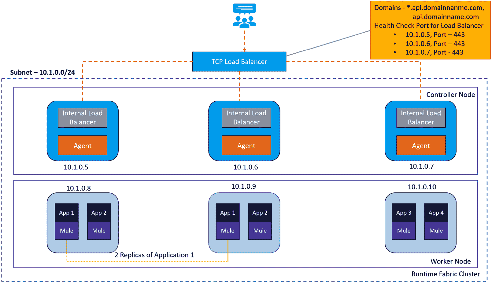

图 11.6 - Runtime Fabric 网络架构

图 11.6 描绘了 Runtime Fabric 的网络架构。

## 客户与 MuleSoft 之间的共同责任

了解客户和 MuleSoft 在管理 Runtime Fabric 方面各自的责任至关重要。下图描绘了客户和 MuleSoft 的责任：

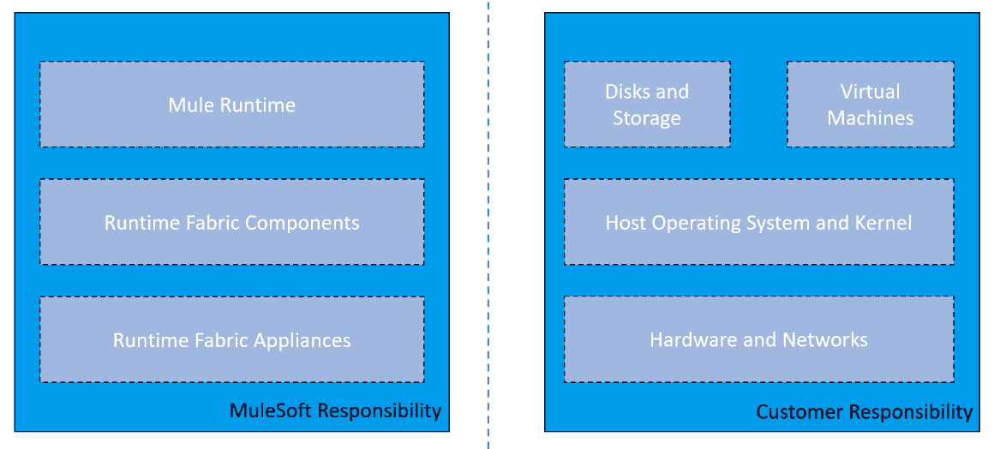

图 11.7 - 共同责任模型

图 11.7 描绘了 MuleSoft 与客户之间 Runtime Fabric 的共同责任模型。

管理基础设施组件（如磁盘、存储、虚拟机、网络端口、所有虚拟机间的系统时间同步以及服务器补丁）是客户的责任。管理 Mule 运行时、Runtime Fabric 相关组件和 Runtime Fabric 设备是 MuleSoft 的责任。

## Runtime Fabric 中 `etcd` 的概念

`etcd` 是一个可靠的分布式键值对数据存储。它维护集群配置数据、当前状态以及与之关联的元数据。`etcd` 可用于 Runtime Fabric 的所有控制器节点，并将相同的数据复制到所有控制器节点：

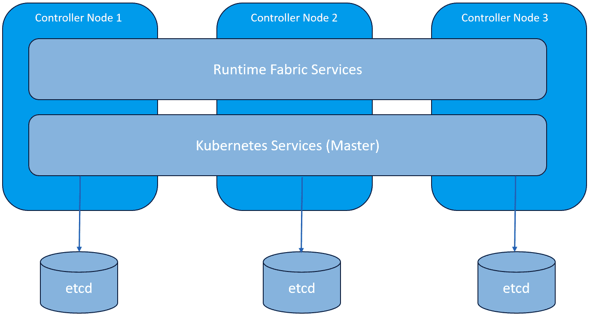

图 11.8 - etcd 配置

Runtime Fabric 信息以 JSON 或 YAML 格式存储。`etcd` 将确保所有节点间信息一致，并且无论您从哪个节点访问信息，都能获得相同的信息。控制器通常对 `etcd` 文件执行写入或读取操作。读取是一项简单的操作，因为相同的 `etcd` 副本可在所有控制器节点上获得。

写入是一项复杂的操作。例如，如果您同时收到多个写入 `etcd` 的请求，哪个请求会生效？并非所有控制器都在 `etcd` 集群中执行写入操作；只有一个控制器节点会执行写入操作，该节点称为**领导者节点**。集群中的其他节点称为**追随者节点**。在 `etcd` 集群中，其中一个节点会被选举为领导者，其余节点为追随者。

如果任何控制器节点收到写入请求，该请求将被转发给领导者节点，由领导者节点对 `etcd` 执行写入操作。之后，它将确保追随者节点接收到相同的数据副本。当领导者收到所有追随者的确认时，此过程将被标记为完成。

## 法定人数管理

弄清楚 Runtime Fabric 集群需要多少控制器节点才能正常运行并成功写入 `etcd` 文件的关键概念之一是法定人数管理。

法定人数管理是指集群中执行 `etcd` 写入操作并正常运行所需的最少节点数。计算法定人数的公式为 `floor (n/2) + 1`，其中 `n` 是集群中控制器节点的数量。让我们计算法定人数并了解它如何适应 Runtime Fabric 架构：

- **一个控制器节点**：法定人数将为 `floor (1/2) + 1 = 1`。这意味着当控制节点宕机时，整个系统将瘫痪。此配置仅适用于开发环境。
- **两个控制器节点**：法定人数将为 `floor (2/2) + 1 = 2`。这意味着当一个控制器宕机时，仍有一个控制器节点可用，但法定人数为 2。在这种情况下，将没有容错能力，且写入操作将无法执行。这意味着单节点控制器和双节点控制器提供的集群可用性相似。因此，拥有两个节点的集群毫无意义。
- **三个控制器节点**：法定人数将为 `floor (3/2) + 1 = 2`。这意味着当一个控制器宕机时，仍有两个控制器节点可用，且法定人数为 2。在这种情况下，将有两个控制器节点可用，同时满足法定人数。在这种情况下，我们可以容忍一个控制器节点不可用，仍有两个控制器节点继续工作。
- **四个控制器节点**：法定人数将为 `floor (4/2) + 1 = 3`。这意味着当一个控制器宕机时，有三个控制器节点可用，且法定人数为 3。这意味着集群将继续工作。然而，如果我们再丢失一个控制器，将只剩两个控制器节点可用，而法定人数为 3。这意味着三节点控制器和四节点控制器提供的集群可用性相似。没有必要拥有四个节点的集群。
- **五个控制器节点**：法定人数将为 `floor (5/2) + 1 = 3`。这意味着当一个控制器宕机时，有控制器节点可用（原文此处似有漏词，应为 "four controller nodes available"），且法定人数为 3。这意味着集群将继续工作。然而，如果我们再丢失一个控制器，将有三个控制器节点可用，且法定人数为 3。在这种情况下，将有三个控制器节点可用，同时满足法定人数。在这种情况下，我们可以容忍两个控制器节点不可用，因为仍有三个控制器节点继续工作。

通常，建议在集群中设置奇数个控制器节点（即 1 个、3 个或 5 个）。下表说明了特定数量的控制器节点所提供的容错能力：

| 控制器节点数量 | 法定人数 | 容错能力 |
| --- | --- | --- |
| 1 | 1 | 0 |
| 2 | 2 | 0 |
| 3 | 2 | 1 |
| 4 | 3 | 1 |
| 5 | 3 | 2 |

表 11.1 - 法定人数与容错能力的关联

## 可扩展性

扩展可以在基础设施层面和应用程序层面实现。

水平扩展可以通过两种方式完成：

- 在 Runtime Fabric 集群中添加或移除控制器或工作节点
- 添加或移除应用程序的副本

垂直扩展可以通过两种方式完成：

- 增加或减少集群中节点（控制器和工作节点）的计算资源，如内存或 CPU
- 增加或减少应用程序副本上的 CPU 资源（预留 CPU 或 CPU 限制）

## 高可用性

如前所述，通过在 Runtime Fabric 架构中运行多个控制器和工作节点，可以实现 Runtime Fabric 的高可用性。

要以高可用性模式运行应用程序，请部署多个应用程序副本。这将确保应用程序的高可用性。


## 容错

默认情况下，部署到 Runtime Fabric 的应用程序具有容错能力。假设您部署了一个或多个应用程序副本。如果其中一个副本因 `JVM` 故障而崩溃，或因节点宕机而不可用，则该不健康副本将被另一个节点上的新副本替换，如果原节点可用，则在同一节点上替换。我们之前介绍了 `Kubernetes` 架构，其中控制器可确保集群的期望状态。

## 入站负载均衡器（入口负载均衡器）

所有控制器节点上均提供入站负载均衡器，用于将流量分发至工作节点上的应用程序副本。默认情况下，入站流量处于禁用状态，以避免不必要的资源消耗。可通过 `Anypoint Runtime Manager` 启用。该负载均衡器负责 `TLS` 终止，扩展负载均衡器所需的资源数量取决于传入请求的数量和每个请求的负载大小。

内部负载均衡器可配置为共享模式或专用模式：

*   `共享模式` 允许您为内部负载均衡器指定 `CPU` 核心数和内存大小。共享模式为默认设置，并分布在所有控制节点中。
*   `专用模式` 不允许您为内部负载均衡器指定 `CPU` 核心数和内存大小，但它会使用专门分配给内部负载均衡器的所有资源。在此模式下，内部负载均衡器部署在专用的内部负载均衡器节点上。

内部负载均衡器的规格取决于响应时间延迟、请求数量和负载大小：

*   `0.5 GB` 为默认内部负载均衡器规格，最多可处理 500 个活动连接。
*   `1.5 GB` 可处理 500 个以上的活动连接，且在启用安全策略时需要此规格。

入站负载均衡器可定义如何接受来自客户端的流量并将其转发给运行在 Runtime Fabric 中的应用程序：

*   `接受 HTTPS 请求`：仅接受 `HTTPS` 协议流量，丢弃所有入站 `HTTP` 流量：
    *   `将 HTTP 重定向到 HTTPS`：接受 `HTTPS` 流量并将流量以 `HTTP` 发送至 Runtime Fabric。若流量通过 `HTTP` 而来，则响应 302 将其重定向至端口 443 上的 `HTTPS`。
    *   `接受 HTTP 请求`：接受 `HTTPS` 流量并将请求以 `HTTP` 发送至 Runtime Fabric 端口 80。
    *   `丢弃 HTTP 请求`：接受 `HTTPS` 流量。发送至 Runtime Fabric 的 `HTTP` 流量将被忽略或丢弃。
*   `仅接受 HTTP 请求`：接受 `HTTP` 流量。这不是允许 `HTTP` 流量的安全方式。

## Anypoint Security

Anypoint Security 使您能够在边缘应用安全策略，并代理所有入站和出站连接，以保护应用程序网络，从而降低任何风险或威胁。可在 Runtime Fabric 前应用各种边缘策略，以保护应用程序网络免受外部威胁：

*   `拒绝服务 (DoS) 策略`：此策略确保仅接受来自合法来源的流量，防止攻击者用大量请求淹没您的应用程序网络。`DoS` 指持续向您的应用程序网络发送大负载请求，以消耗服务器资源和网络带宽。
*   `IP 允许列表策略`：顾名思义，`IP 允许列表` 策略将允许来自策略中允许的 `IP` 地址的流量进入应用程序网络，而来自不在允许列表中的 `IP` 地址的流量将被丢弃。
*   `HTTP 限制策略`：此策略允许您配置应用程序网络上允许的负载大小和标头数量。攻击者会尝试发送大负载以消耗服务器资源，导致 `DoS`，并消耗网络带宽，从而导致服务器性能下降。通过 `HTTP` 策略，您可以控制传入消息的大小。
*   `Web 应用程序防火墙 (WAF) 策略`：`WAF` 策略将保护请求和响应流量，在 Web 应用程序层面提供安全防护。

## 应用程序性能指标

下图展示了 Mule 应用程序在简单 `10 KB` 负载下，不同 `vCPU` 核心数的应用程序性能：

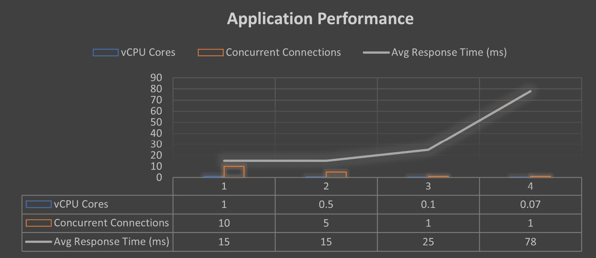

图 11.9 - Runtime Fabric 应用程序性能指标

## 内部负载均衡器性能指标

下图展示了控制器节点上内部负载均衡器在 `AWS EC2 M4` 实例上的性能：

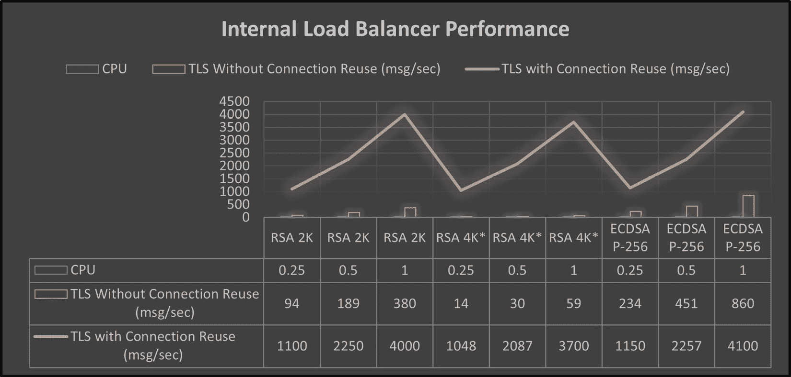

图 11.10 - 内部负载均衡器性能指标

上述应用程序和负载均衡器性能指标摘自 MuleSoft 官方文档 (`https://docs.mulesoft.com/runtime-fabric/1.13/deploy-resource-allocation`)。

至此，我们已介绍了裸金属服务器和 VM 上 Runtime Fabric 的架构。接下来，我们将了解自管理 Kubernetes 上 Runtime Fabric 的架构。

# 自管理 Kubernetes 上的 Runtime Fabric

MuleSoft 提供在自管理 Kubernetes (`EKS`/`AKS`/`GKE`) 上设置 Runtime Fabric 的选项。自管理 Kubernetes 上的 Runtime Fabric 允许您将 Mule 应用程序和 API 代理部署并管理到由您创建、配置和管理的 Kubernetes 集群中。此选项允许您 `自带 Kubernetes` (`BYOK`)，MuleSoft 将提供运行应用程序所需的 Runtime Fabric 服务、Mule 运行时和其他组件。在本节中，我们将讨论如何利用 `AWS` 上的 `EKS` 来运行 Runtime Fabric。但在此之前，我们需要了解 `EKS` 架构及其功能。

## EKS 架构

`EKS` 是 `AWS` 提供的全托管服务，提供 `Kubernetes` 以运行工作负载并管理 `Kubernetes` 控制平面。

`EKS` 的控制完全由 `AWS` 管理，`AWS` 负责 `Kubernetes` 控制平面的可用性、可扩展性、容错性和持久性。控制平面通常托管在 `AWS` 托管的 `虚拟私有云` (`VPC`) 中的控制器节点。`Kubernetes` 控制平面通过 `EKS` 托管的 `弹性网络接口` (`ENI`) 与集群中的工作节点通信。`ENI` 位于多个可用区中，以提供容错和高可用性架构。

`ENI` 是虚拟网桥，将 `AWS` 虚拟私有云中的实例连接到网络，以允许安全的入站和出站流量。

以下是您可以设置的典型 `EKS` 架构。但并非必须使用类似架构；具体架构将因组织需求而异：

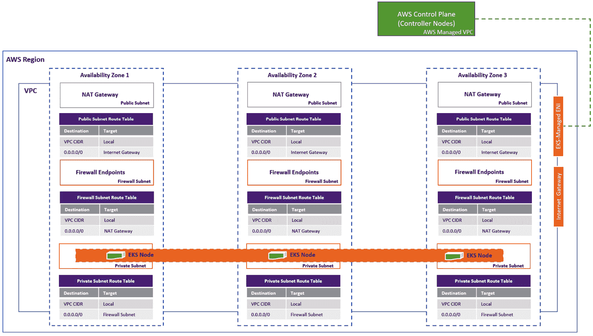

图 11.11 - 面向 Runtime Fabric 的弹性 Kubernetes 架构

在 `图 11.11` 中，我们选择了需要设置 `Kubernetes` 集群的区域。我们在该区域中设置了 `VPC`，其中包含三个子网，如下所示：

*   `私有子网`：这是托管工作节点 (`AWS EC2` 实例) 的子网，工作节点将跨所有可用区启动，以提供高可用性和容错能力。工作节点的规格取决于您的应用程序工作负载。


# EKS 上的 Runtime Fabric 架构

## 网络子网架构

*   `Firewall subnet`（防火墙子网）：此子网将限制来自私有子网的出站流量。默认情况下，如果您已将 NAT 网关与私有子网关联，则允许来自私有子网的所有出站流量。如果您有需求指定只能连接到互联网上可用的少数应用程序，在这种情况下，您可以在防火墙子网的防火墙策略中允许那些应用程序域名或 IP 地址。这意味着您不允许来自私有子网的所有流量流向互联网。防火墙子网是可选的，它主要允许您定义有状态和无状态规则。

*   `Public subnet`（公有子网）：此子网与互联网网关关联，允许入站和出站流量进出互联网。NAT 网关将在公有子网中设置，以仅允许来自私有子网流向互联网的出站流量。

每个子网都跨所有可用区创建，以确保可扩展、高可用且具备容错能力的架构。与每个子网关联的路由表用于定义流量将从子网导向何处的规则。

完成 EKS 设置后，Kubernetes 控制平面（控制器节点）会自动在 AWS 托管的 VPC 中设置。它由 AWS 管理，负责扩展、高可用性、容错等。它还跨可用区启用 EKS 托管的 ENI，以建立 Kubernetes 集群中控制平面与工作节点之间的通信。

堡垒主机可以在公有子网中设置，以连接私有子网中的工作节点。

存储在 `etcd` 上的数据使用 Amazon 的 `Key Management Service` (`KMS`) 进行加密。控制器节点分布在各个可用区中，流量由 `Elastic Load Balancer` (`ELB`) 分发。

## EKS 上的 Runtime Fabric 架构（自管理 Kubernetes）

让我们来看看自管理 Kubernetes 上的 Runtime Fabric 架构。下图展示了该架构及其众多组件如何交互和协调：

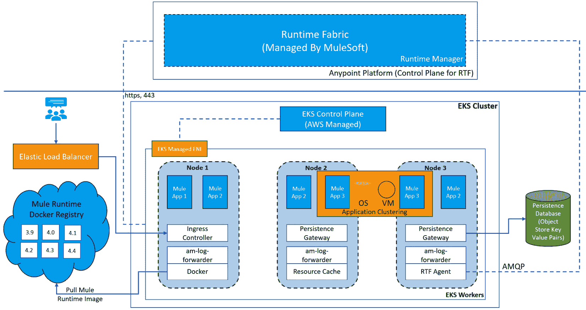

Figure 11.12 - EKS 上的 Runtime Fabric 架构（自管理 Kubernetes）

图 11.12 展示了各个组件及其相互交互的方式：

*   **Persistence Gateway**（持久化网关）负责将对象存储数据存储在持久化数据存储中。应用程序必须经过集群化以共享数据，例如在对象存储或跨副本的 VM 队列中。持久化网关将确保这些数据在应用程序重启或部署时不会消失，并能从任何崩溃中恢复。

*   **Docker Pod**（Docker Pod）是负责从 Mule Docker 注册表拉取特定版本 Mule 运行时的工作节点。

*   **log forwarder agent**（日志转发代理）将日志转发到外部系统，例如 Splunk、CloudWatch、ELK 或 Anypoint Monitoring。

*   可以实现两种集群：基础设施级别和应用级别。基础设施集群涉及协同工作在集群中运行 MuleSoft 应用程序的节点组，确保架构的高可用性、可扩展性和容错性。

*   当我们部署多个应用程序副本时，可以启用应用集群，这可以在应用程序部署期间启用。这将提高应用程序性能，并允许数据在应用程序副本之间共享。

*   部署在 Runtime Fabric 上的应用程序副本具备容错能力。它们会在 `JVM` 崩溃或工作节点宕机后自动恢复。

*   通过向自动扩缩组添加工作节点来支持自动扩缩。它可以根据内存和 `CPU` 使用率是否超过配置值进行扩缩。

## 在自管理 Kubernetes 上安装 Runtime Fabric

可以使用 `rtfctl` 或 `helm` 实用程序在自管理 Kubernetes 上设置 Runtime Fabric。

以下是使用 `rtfctl` 或 `helm` 在自管理 Kubernetes 上安装 Runtime Fabric 的官方 MuleSoft 文档：

*   `rtfctl`: [`https://docs.mulesoft.com/runtime-fabric/1.13/install-self-managed`](https://docs.mulesoft.com/runtime-fabric/1.13/install-self-managed)
*   `helm`: [`https://docs.mulesoft.com/runtime-fabric/1.13/install-helm`](https://docs.mulesoft.com/runtime-fabric/1.13/install-helm)

## 客户与 MuleSoft 之间的共同责任

了解客户和 MuleSoft 在管理自管理 Kubernetes 上的 Runtime Fabric 方面各自的责任至关重要。下图描述了客户和 MuleSoft 的责任：

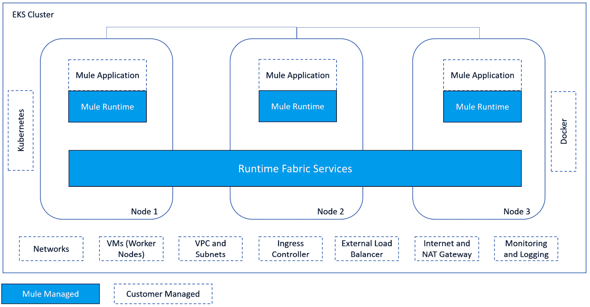

Figure 11.13 - 共同责任模型

MuleSoft 提供 Runtime Fabric 服务、Mule 运行时和其他组件，用于在自管理 Kubernetes 上部署和运行 Mule 应用程序。

客户将负责管理 Mule 应用程序、基础设施、Kubernetes、网络、负载均衡器、向外部平台的监控和日志记录等。

## Ingress（入站流量）

Runtime Fabric 允许您使用资源模板为入站流量指定自定义 Ingress 配置。在资源模板中，您可以定义注解、类名以及 HTTP 和 HTTPS 路由规则。Ingress 负责 TLS 终止和隧道、负载均衡和路由。Ingress 控制器可以是 `NGINX ingress controller`、`AWS load balancer controller` 等：

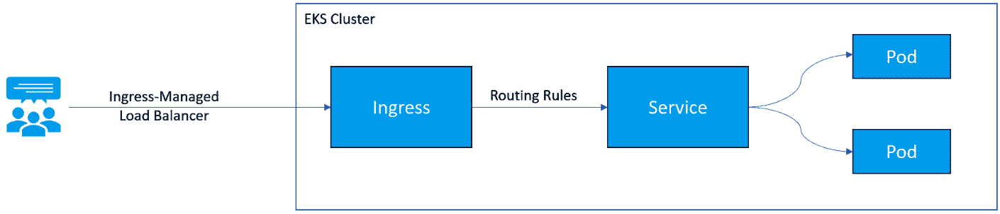

Figure 11.14 - Ingress 托管的负载均衡器

**Note**（注意）

以下文档解释了如何在自管理 Kubernetes 上的 Runtime Fabric 上配置 Ingress：[`https://developer.mulesoft.com/tutorials-and-howtos/runtime-fabric/runtime-fabric-aws-elastic-kubernetes-service/`](https://developer.mulesoft.com/tutorials-and-howtos/runtime-fabric/runtime-fabric-aws-elastic-kubernetes-service/)。

## 高可用性和容错性

每当您在自管理 Kubernetes 上设置 Runtime Fabric 时，控制平面完全由云提供商管理，并且具有高可用性，以确保业务连续性和性能。根据法定人数要求，应至少设置三个工作节点，以确保容错和高可用架构。通过部署多个副本和集群，应用程序可以实现高可用性。

部署到自管理 Kubernetes 上的 Runtime Fabric 的应用程序具有容错能力，将自动从任何故障或工作节点宕机中恢复。

## 可扩展性

自管理 Kubernetes 的控制平面可扩展性由云提供商管理。工作节点可以通过添加或移除节点进行水平扩展，并通过添加或移除 `CPU` 或内存等计算资源进行垂直扩展。

可以将工作节点添加到自动扩缩组，以便在内存或 `CPU` 使用率增加或减少时自动扩缩。

部署到自管理 Kubernetes 上的 Runtime Fabric 的应用程序可以通过添加或移除副本进行水平扩展，并通过增加或减小副本大小进行垂直扩展。应用程序不支持自动扩缩，但可以通过 `Runtime Manager UI`、`Mule Maven plugin` 或 `Platform API` 实现零停机扩缩。

## 部署到自管理 Kubernetes 的应用程序如何与需要 IP 白名单的外部服务通信？

您可能会遇到这样的情况：您的应用程序必须与外部服务通信。为了与外部服务建立成功的连接，必须在外部服务上将应用程序的 IP 地址加入白名单。

在这里，我们将考虑部署到 AWS EKS 的应用程序与必须进行 IP 白名单的外部服务进行通信的情况。

### 场景 1 - 工作节点运行在公有子网中


# 工作节点子网部署场景

## 场景 1：工作节点运行在公共子网中

在这种情况下，工作节点运行在公共子网中，这意味着工作节点将获得公共 IP 地址，且 `Pod` 将从公共子网 IP 范围分配一个 IP 地址。

`Pod` 可以使用工作节点的公共 IP 与外部服务通信，因为 `Pod` 的 IP 地址将与工作节点 IP 地址进行 `SNAT` 转换。您只需提供集群中所有工作节点的公共 IP 地址以加入白名单，即可实现运行在工作节点上的 `Pod` 与外部服务之间的成功通信。`SNAT` 代表 `source network address translation`（源网络地址转换）：


图 11.15 - 工作节点运行在公共子网中

## 场景 2：工作节点运行在私有子网中

在这种情况下，工作节点运行在私有子网中，这意味着工作节点将仅获得私有 IP 地址，且工作节点可以使用 `NAT 网关` 与外部世界通信。

`Pod` IP 地址将与 `NAT 网关` 的公共 IP 地址进行 `SNAT` 转换以与外部服务通信；只需在外部系统中将 `NAT 网关` 的 IP 地址加入白名单，即可通过公共子网中的 `NAT 网关` 建立 `Pod` 与外部应用程序之间的成功通信：


图 11.16 - 工作节点运行在私有子网中

简单来说，`Pod` 通过服务抽象与外部应用程序通信。

# Runtime Fabric 部署对比

## 自托管 Kubernetes 上的 Runtime Fabric 与裸金属/虚拟机上的 Runtime Fabric 之间的差异

裸金属/虚拟机上的 Runtime Fabric 与自托管 Kubernetes 上的 Runtime Fabric 之间的差异如下表所示：

| 属性 | Runtime Fabric（裸金属/虚拟机） | Runtime Fabric（EKS/AKS/GKE） |
| --- | --- | --- |
| Kubernetes | MuleSoft 提供 | `BYOK` |
| Ingress | 包含 | 不包含 |
| OpsCenter UI | 包含 | 不包含 |
| 节点类型 | 裸金属或虚拟机 | 支持基于虚拟机的实例。不支持 `Fargate` |
| 最后一公里安全 | 支持 | 支持 |
| 令牌化服务 | 支持 | 支持 |
| Anypoint 集群 | 支持 | 支持 |
| 持久化网关 | 支持 | 支持 |
| Anypoint Security | 支持 | 不支持 |
| Runtime Fabric 服务 | 包含 | 包含 |
| Mule Runtime | 包含 | 包含 |
| 最大业务组数量 | 50 | 50 |
| 最大工作节点数量 | 16 | 30 |
| 每个应用程序的副本数 | 8 | 8 |
| 每个工作节点的副本数 | 40 | 40 |
| 最大控制器节点数量 | 5 | 自托管控制器节点 |
| `Kapacitor` 警报 | 包含 | 不包含 |
| 安装选项 | 虚拟机或裸金属服务器 | `EKS`、`GKE`、`AKS` |
| 控制器节点可访问性 | 可访问控制器节点 | 不可访问 |
| 每个 Runtime Fabric 集群关联的最大环境数量 | 50 | 100 |
| Docker | MuleSoft 提供 | `自带 Docker (BYOD)` |
| 应用程序端口 | 8081 | 8081 |

表 11.2 - 自托管 Kubernetes 上的 Runtime Fabric 与裸金属/虚拟机上的 Runtime Fabric 之间的差异

既然我们已经介绍了自托管 Kubernetes 上的 Runtime Fabric 与裸金属/虚拟机上的 Runtime Fabric 之间的架构差异，现在让我们看看一些可用于管理和执行 Runtime Fabric 的实用服务。

## `rtfctl` 实用程序

`rtfctl` 是 MuleSoft 提供的一个实用程序，用于从本地机器、堡垒主机或任何计算机安装和管理 Runtime Fabric。此 `rtfctl` 实用程序适用于裸金属服务器/虚拟机上的 Runtime Fabric 和自托管 Kubernetes。

> **注意**
>
> 以下 MuleSoft 文档解释了如何安装和使用 `rtfctl`：
>
> `https://docs.mulesoft.com/runtime-fabric/2.3/install-rtfctl`

# 令牌化服务

令牌化服务允许您保护敏感数据。例如，假设传入消息包含敏感数据，如信用卡号或社会安全号。此数据可使用令牌化服务进行令牌化。MuleSoft 提供了令牌化和去令牌化策略，可在 API 网关层面进行配置。

要在 API Manager 中启用令牌化和去令牌化策略，您应在 Runtime Fabric 中部署令牌化服务。

下图显示了如何对社会安全号等敏感数据进行令牌化：


图 11.17 - Runtime Fabric 令牌化

下图显示了如何对前一个示例中已令牌化的数据进行去令牌化：


图 11.18 - Runtime Fabric 去令牌化

# 密钥管理器

Anypoint Security 提供密钥管理器，以便您存储机密、TLS、密钥库和信任库，供您的部署使用。密钥管理器支持 Runtime Fabric Ingress 的 TLS 上下文。

# Runtime Fabric 中的 CPU 突发

Runtime Fabric CPU 突发是基于 Kubernetes CPU 突发技术的概念。每当我们将应用程序部署到 Runtime Fabric 时，都需要为应用程序分配正确的资源（如 `vCPU` 和内存），以确保其能够处理所需的工作负载。

当我们将应用程序部署到 Runtime Fabric 时，它会部署在隔离的 `Pod` 中。应用程序的每个副本在单独的 `Pod` 中运行。每个副本都有自己的 Mule Runtime，并且需要为每个副本分配 `vCPU` 和内存等资源。我们还需要确定部署期间需要创建的副本数量。

我们需要在部署应用程序时为副本分配以下资源：

*   `Reserved CPU`（预留 CPU）：可供应用程序副本使用的保证 `vCPU`。
*   `CPU limit`（CPU 限制）：应用程序副本可使用的最大 CPU（CPU 可突发的级别）。
*   `Memory`（内存）：应用程序副本可使用的内存量（以 `GiB` 为单位）。可分配给应用程序副本的最小内存为 `Mule 4` 上的 0.7 `GiB` 和 `Mule 3` 上的 0.5 `GiB`。

每当预留 CPU 量和 CPU 限制相等时，意味着 CPU 以保证模式分配给副本。这将确保应用程序的性能一致。

如果分配给副本的 CPU 限制大于预留 CPU，则意味着 CPU 突发已激活，如果应用程序因请求过载，应用程序副本已准备好消耗更多 CPU。此 CPU 将从工作节点上可用的备用 CPU 资源中获取。

当您使用 CPU 突发时，最小预留 CPU 必须为 0.02 `vCPUs`，最小 CPU 限制必须为 0.07 `vCPUs`。高工作负载的应用程序可能需要额外的 CPU 容量以获得更好的性能。如果在使用最小 CPU 限制时应用程序部署失败，则增加 CPU 限制并重新部署应用程序。

对于具有关键性能要求的应用程序，切勿使用 `vCPU` 突发，因为它不能保证在需要时突发 `vCPU` 可用。在这种情况下，请采用保证 CPU 模式，您可以在其中保持预留 CPU 等于 CPU 限制。

您需要确保不消耗超过您所付费的 CPU，即使您正在使用 CPU 突发。查看 `https://docs.mulesoft.com/runtime-fabric/1.8/deploy-resource-allocation#cpu-and-licensed-cores` 以获取更多详细信息。

CPU 限制受限于工作节点上提供的 CPU 核心数的上限，这意味着提供给副本的 CPU 限制不应超过工作节点的 CPU 核心数。


# CPU 突发与 Runtime Fabric 概览

下图展示了应用程序过载期间 CPU 突发的工作原理，以及请求数量的变化，随后在请求数量减少或恢复正常后回到正常状态：

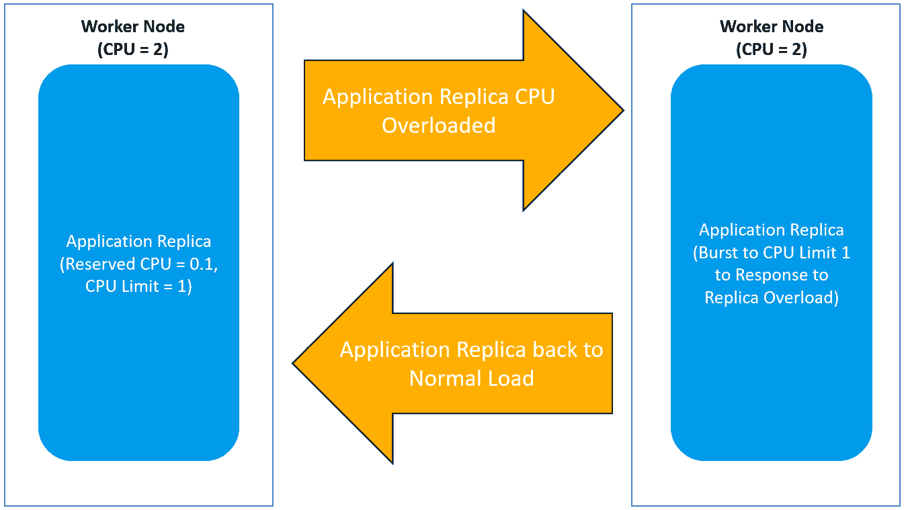

图 11.19 - CPU 突发

CPU 限制并不总是得到保证，但如果且仅当有空闲 CPU 可用时，它可以突发到定义的限制；部署的应用程序的其他副本也可能在争夺工作节点上未分配的 CPU。

Runtime Fabric 默认会在工作节点上运行一些服务，消耗 `0.3 到 0.5 vCPUs` 的 CPU。

例如，假设你有三个工作节点，每个工作节点有两个 vCPU，这意味着集群共有六个 vCPU。工作节点将至少使用 `0.3 vCPUs` 用于其他进程，这意味着总共预留了 `0.9 vCPUs` 给工作节点，剩余 `5.1 vCPUs` 可供使用。

# Pod

Pod 可以在 Kubernetes 集群中容纳一个或多个应用程序。Pod 是短暂的；如果 Pod 执行失败，Kubernetes 将自动创建一个 Pod 副本来替换不健康的实例。Runtime Fabric Pod 只能包含一个 MuleSoft 应用程序。不允许在一个 Pod 中部署多个应用程序。下图展示了如何在 Runtime Fabric 中设置 Pod：

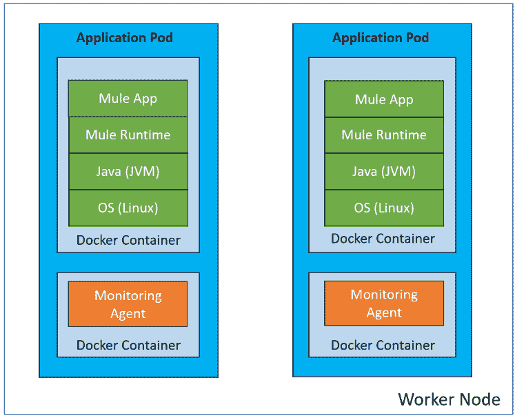

图 11.20 - Runtime Fabric Pod

# 最后一公里安全

最后一公里安全允许你在边缘与 Runtime Fabric 上的应用程序之间启用 HTTP 流量。部署在 Runtime Fabric 上的应用程序始终监听端口 `8081`；不支持其他端口。要启用最后一公里安全，你需要在已部署到 Runtime Fabric 的应用程序的 HTTPS 监听器上配置带有服务器密钥库的 TLS 上下文（使用 HTTPS 协议），并在 Runtime Manager 的应用程序设置的 `Ingress` 选项卡中启用最后一公里安全：

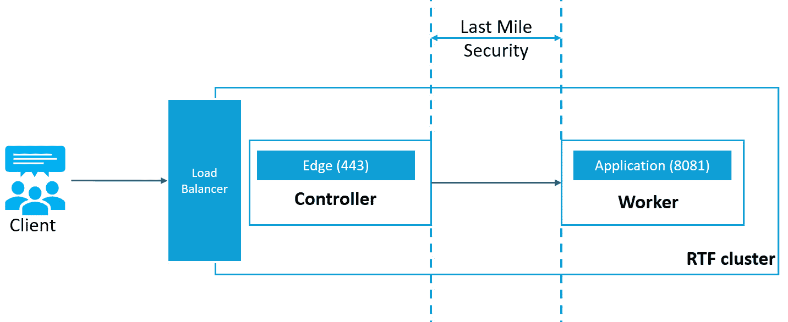

图 11.21 - 最后一公里安全

# 内部服务间通信

为部署到集群 `cluster.local` 域中的每个应用程序创建 DNS。完全限定域名为 `<service>.<namespace>.svc.cluster.local`。

例如，`invoice-sys-api` 应用程序部署到 Runtime Fabric 集群，使用 HTTPS 协议监听端口 `8081`。该域名将为 `invoice-sys-api.e893e8e9-f802-4346-9dd8-ce958efb1979.svc.cluster.local`，其中 `invoice-sys-api` 是应用程序名称，`e893e8e9-f802-4346-9dd8-ce958efb1979` 是 Runtime Fabric 的命名空间：

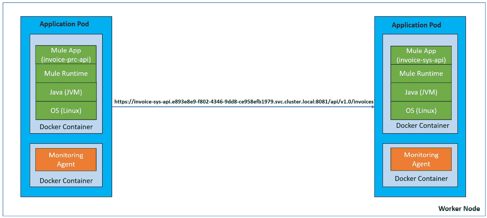

图 11.22 - 内部服务间通信

# 带有 Runtime Fabric 的持久化网关

持久化网关允许 MuleSoft 应用程序存储和共享部署到 Runtime Fabric 的多个副本之间的数据。有了持久化网关，在应用程序重启或重新部署的情况下，数据不会丢失：

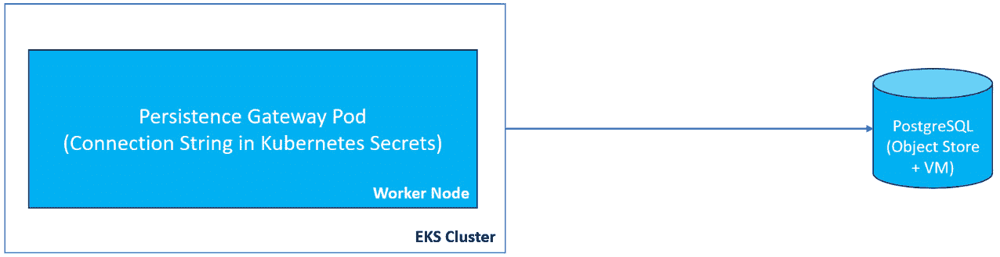

图 11.23 - 带有 Runtime Fabric 的持久化网关

始终部署多个持久化网关副本以确保高可用性和可扩展性。PostgreSQL 数据库是 Runtime Fabric 上持久化网关支持的唯一数据库。

# 部署策略

Runtime Fabric 支持两种部署策略：

- 滚动更新
- 重建

滚动更新允许你以零停机时间重新部署应用程序。现有的应用程序副本将保持可用，直到新的应用程序副本部署完成，客户端可以继续发送请求。一旦新副本成功部署，旧副本将被终止。

下图描绘了滚动更新的工作原理：

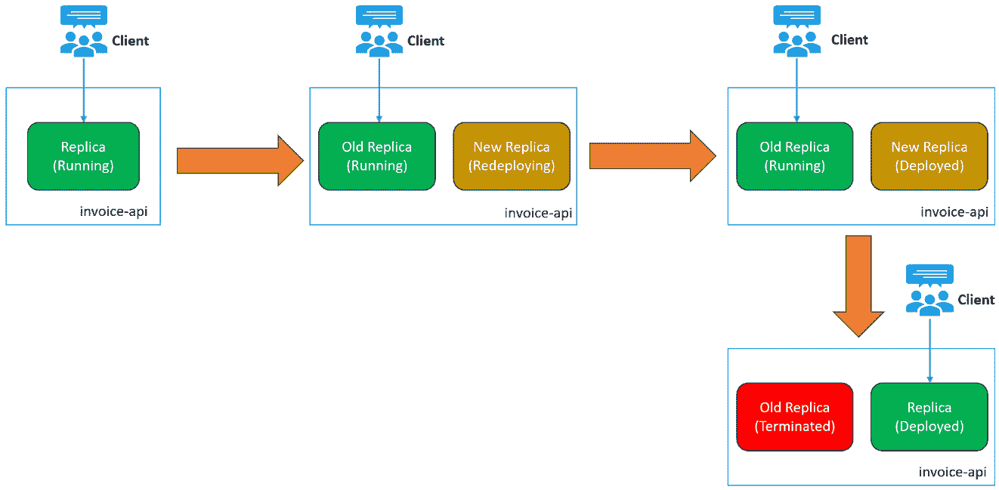

图 11.24 - 滚动更新部署策略

重建将终止现有的应用程序副本，然后部署新的应用程序副本。应用程序在部署期间将不可用。

下图描绘了重建的工作原理：

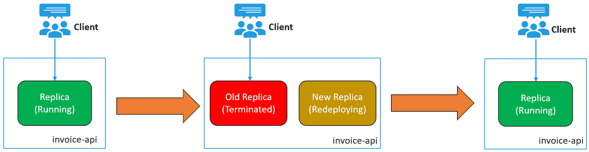

图 11.25 - 重建部署策略

# 集群

要为部署到 Runtime Fabric 的应用程序启用集群，必须至少有两个副本。可以从 Runtime Manager UI 启用集群，也可以在使用 Mule Maven 插件部署应用程序时指定。

## 跨节点部署副本

此选项确保具有多个副本的应用程序部署到集群中的各个节点上。可以从 Runtime Manager UI 启用此选项，也可以在使用 Mule Maven 插件部署应用程序时指定。

# 备份和恢复 Runtime Fabric

备份 Runtime Fabric 集群至关重要，以便在发生任何故障时能够恢复。Runtime Fabric 中的数据分布在 Kubernetes 集群中。

在发生任何故障时，保留部署到 Runtime Fabric 的应用程序非常重要，以便能够恢复所有应用程序、其配置及其状态：

- 始终将备份存储在 Runtime Fabric 之外的外部存储中
- 最佳实践是每小时备份一次 Runtime Fabric

## 何时使用备份和恢复流程

有几个用例可以使用备份和恢复流程：

- 在 Runtime Fabric 硬件升级期间，你可以添加更多计算资源并迁移到新的操作系统
- 将 Runtime Fabric 从本地迁移到云，或从一个云提供商迁移到另一个
- 将 Runtime Fabric 从一个数据中心迁移到另一个
- 添加更多节点以扩展 Runtime Fabric 集群
- 在灾难恢复事件中对集群进行故障转移时

## 备份了什么？

Runtime Fabric 备份与 Runtime Fabric 集群相关的服务和组件，但不备份与 Anypoint Platform 集群相关的任何内容。以下是备份内容的列表：

- 应用程序详情，包括副本集、Pod、应用程序元数据以及在 Runtime Manager UI 中配置的属性
- Runtime Fabric 和应用程序中的所有数据，包括入口、密钥、角色和集群绑定、服务和服务账户以及部署
- Runtime Fabric 集群上运行的当前 `rtfctl` 版本
- Runtime Fabric 集群上的当前代理版本
- 与 MuleSoft 配置相关的数据，如对象存储、Anypoint Monitoring 和外部负载转发器
- 控制器和工作节点配置

## 备份和恢复

通过 `rtfctl` 进行备份和恢复过程非常简单。只需执行一条命令行，即可备份和恢复 Runtime Fabric。

要备份 Runtime Fabric，请使用以下命令：

```
./rtfctl backup <path_to_store_backup>
```

要恢复 Runtime Fabric，请使用以下命令：

```
./rtfctl restore <path_to_backup_store>
```

# 将 MuleSoft 应用程序部署到 Runtime Fabric 的不同选项

MuleSoft 提供了多种将应用程序部署到 Runtime Fabric 的方式。每个选项都可以与 CI/CD 流水线集成，以便自动将 MuleSoft 应用程序部署到 Runtime Fabric。让我们探索所有可用于将应用程序部署到 CloudHub 的选项。

## Mule Maven 插件


# 面向 Runtime Fabric 的 Mule Maven 插件

Mule Maven 插件是一个重要的 Maven 插件，用于将 MuleSoft 应用程序部署、取消部署和打包到 Runtime Fabric 中。可以在应用程序的 `POM.xml` 文件中配置以下 Mule Maven 插件，其中包含在 Runtime Fabric 中部署和运行应用程序所需的所有属性：

```xml
<plugin>
  <groupId>org.mule.tools.maven</groupId>
  <artifactId>mule-maven-plugin</artifactId>
  <version>3.8.6</version>
  <extensions>true</extensions>
  <configuration>
    <runtimeFabricDeployment>
      <uri>https://anypoint.mulesoft.com</uri>
      <muleVersion>${app.runtime}</muleVersion>
      <username>${username}</username>
      <password>${password}</password>
      <applicationName>${app.name}</applicationName>
      <target>rtf</target>
      <environment>${environment}</environment>
      <provider>MC</provider>
      <replicas>${replicas}</replicas>
      <properties>
        <key>value</key>
      </properties>
      <deploymentSettings>
        <enforceDeployingReplicasAcrossNodes>false</enforceDeployingReplicasAcrossNodes>
        <updateStrategy>recreate</updateStrategy>
        <clustered>false</clustered>
        <forwardSslSession>false</forwardSslSession>
        <lastMileSecurity>false</lastMileSecurity>
        <resources>
          <cpu>
            <reserved>${reserved.cpu}</reserved>
            <limit>${cpu.limit}</limit>
          </cpu>
          <memory>
            <reserved>${reserved.memory}</reserved>
          </memory>
        </resources>
        <http>
          <inbound>
            <publicUrl>${public.url}</publicUrl>
          </inbound>
        </http>
      </deploymentSettings>
    </runtimeFabricDeployment>
  </configuration>
</plugin>
```

在前述 Mule Maven 插件配置中，`${}` 下定义的值是可以通过 `mule deploy` 命令传递的参数，如下所示：

```
mule deploy –DmuleDeploy -Dapp.runtime=4.3.0 -Dusername=anypointusername –Dpassword=password -Dapp.name=music-api-dev –Denvironment=Sandbox –Dreserved.cpu=20M -Dcpu.limit=1500M -Dreserved.memory=700Mi -Dpublic.url=https://api-dev.domainnanme.com
```

## Mule Maven 插件属性

部署应用程序到 Runtime Fabric 时，可以在 Mule Maven 插件中配置以下属性：

| 参数 | 说明 | 必填 | 默认值/示例 |
| --- | --- | --- | --- |
| `runtimeFabricDeployment` | 顶层元素。 | 是 |  |
| `uri` | 您的 Anypoint Platform URI。 | 否 |  |
| `muleVersion` | 在 Runtime Fabric 实例中运行的 Mule 运行时引擎版本。 | 是 |  |
| `username` | 您的 Anypoint Platform 用户名。 | 仅当使用 Anypoint Platform 凭据登录时 |  |
| `password` | 您的 Anypoint Platform 密码。 | 仅当使用 Anypoint Platform 凭据登录时 |  |
| `applicationName` | 应用部署后在 Runtime Manager 中显示的应用程序名称。 | 是 |  |
| `target` | 用于部署应用程序的 Runtime Fabric 目标名称。 | 是 |  |
| `provider` | 设置为 `MC`，即面向 Runtime Fabric。 | 是 |  |
| `environment` | 目标 Anypoint Platform 环境。 | 是 |  |
| `replicas` | 这指定了要部署的 Mule 应用程序的副本（实例）数量。每个应用程序的最大副本数为 8。 | 是 |  |
| `businessGroup` | 部署的业务组路径。 | 否 |  |
| `businessGroupId` | 部署的业务组 ID。 | 否 |  |
| `deploymentTimeout` | 部署过程开始与确认构件已部署之间允许的经过时间（以毫秒为单位）。 | 否 | `1000000` |
| `server` | 带有 Anypoint Platform 凭据的 Maven 服务器。 | 否 |  |
| `properties` | 顶层元素。 | 否 |  |
| `secureProperties` | 顶层元素。 | 否 |  |
| `skip` | 设置为 `true` 时，跳过插件部署目标。 | 否 |  |
| `skipDeploymentVerification` | 设置为 `true` 时，跳过已部署应用程序的状态验证。 | 否 |  |
| `authToken` | 指定用于访问平台的授权令牌。您可以使用此身份验证方法代替设置用户名和密码。 | 仅当使用授权令牌登录时 |  |
| `connectedAppClientId` | 指定连接应用客户端 ID 值。 | 仅当使用 Connected Apps 凭据登录时 |  |
| `connectedAppClientSecret` | 指定连接应用密钥。 | 仅当使用 Connected Apps 凭据登录时 |  |
| `connectedAppGrantType` | 指定唯一支持的连接类型：`client_credentials`。 | 仅当使用 Connected Apps 凭据登录时 |  |
| `deploymentSettings` | 部署设置定义在下表中。 | 否 |  |

*表 11.3 - Mule Maven 插件属性*

## 部署设置属性

可以在 `deploymentSettings` 下传递其他一些参数，如下所示：

| 参数 | 说明 | 示例 |
| --- | --- | --- |
| `enforceDeployingReplicasAcrossNodes` | 强制跨不同节点部署副本。默认值为 `false`。 | ```xml\n<deploymentSettings>\n    <enforceDeployingReplicasAcrossNodes>false</enforceDeployingReplicasAcrossNodes>\n</deploymentSettings>\n``` |
| `updateStrategy` | `updateStrategy` 值可以是 `recreate` 或 `rolling`。 | ```xml\n<deploymentSettings>\n  <updateStrategy>recreate</updateStrategy>\n</deploymentSettings>\n``` |
| `clustered` | 启用跨两个或更多应用程序副本的集群。默认值为 `false`。 | ```xml\n<deploymentSettings>\n    <clustered>true</clustered>\n</deploymentSettings>\n``` |
| `http` | 已部署应用程序的 URL。 | ```xml\n<deploymentSettings>\n  <http>\n    <inbound>\n      <publicUrl>https://api-dev.domainname.com</publicUrl>\n    </inbound>\n  </http>\n</deploymentSettings>\n``` |

*表 11.4 - 部署设置属性*

## 部署和取消部署命令

可以使用以下命令来部署和取消部署应用程序：

*   `mvn clean deploy –DmuleDeploy`（将应用程序部署到 Runtime Fabric）
*   `mvn mule:undeploy`（从 Runtime Fabric 取消部署应用程序）

## 身份验证机制

Mule Maven 插件可以使用以下身份验证机制之一将应用程序部署到 Runtime Fabric：

*   Anypoint Platform 用户名和密码
*   Server
*   Anypoint connected app
*   Auth token

可以从 Anypoint Platform 的 Runtime Manager UI 部署 MuleSoft 应用程序。

# Runtime Fabric 的优势

Runtime Fabric 提供以下优势：

*   Runtime Fabric 允许您在轻量级容器中运行 MuleSoft 应用程序。
*   Runtime Fabric 可以在 EKS、AKS、GKE、Red Hat OpenShift 以及本地或任何云中的裸机服务器/VM 上设置。
*   同一个 Runtime Fabric 中支持多个版本的 Mule 运行时。
*   它支持零停机部署或更新。
*   Runtime Fabric 上支持的最小副本规模为 0.02 vCores。
*   它提供基于容器的应用程序隔离。每个容器相互独立。
*   它支持高可用性、容错性、可扩展性和副本自动恢复等功能。
*   支持基于 Hazelcast 的集群，用于跨副本存储和共享数据。
*   每个应用程序都可以独立于其他应用程序进行扩展，并且每个应用程序可以部署在不同的副本规模上。

# Red Hat OpenShift 上的 Runtime Fabric

如前所述，Runtime Fabric 可以安装在 VM/裸机服务器和自管理的 Kubernetes (EKS/AKS/GKE) 上。Runtime Fabric 也可以作为 Kubernetes (K8s) 操作符在 Red Hat OpenShift 上设置。作为 Kubernetes 操作符的 Runtime Fabric 可以在以下平台上设置：

*   Red Hat OpenShift Service on AWS


- Microsoft Azure Red Hat OpenShift
- Red Hat OpenShift Dedicated
- Red Hat OpenShift on IBM Cloud
- 自管式 Red Hat OpenShift 版本（Performance Plus、OCP 和 Kubernetes Engine）

我们不会深入探讨 Runtime Fabric 作为 Red Hat OpenShift 中 Kubernetes 操作符的架构，但如果您计划安装 Red Hat OpenShift Runtime Fabric 服务，它支持上述平台。

以下是在 Red Hat OpenShift 上设置 Runtime Fabric 的高级架构：

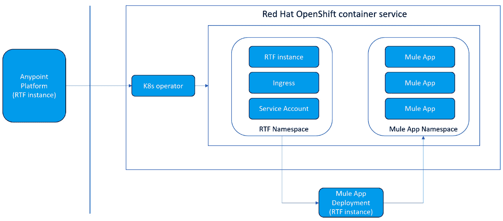

图 11.26 - Red Hat OpenShift 上的 Runtime Fabric

有关 Red Hat OpenShift 上 Runtime Fabric 的更多详细信息，请参阅“延伸阅读”部分提供的链接。

# 概要

本章介绍了 Runtime Fabric 提供的功能，以及它如何与虚拟机/裸金属服务器、自管式 Kubernetes 和 Red Hat OpenShift 配合使用。我们还涵盖了各种组件，例如入口、最后一公里安全、令牌化服务、部署策略、零停机部署，以及可扩展性、容错性和高可用性等非功能性需求。在下一章中，我们将解释如何在您的数据中心设置 Mule 运行时，以便您可以运行 Mule 应用程序。

## 延伸阅读

要了解本章涵盖主题的更多信息，请查看以下资源：

- Runtime Fabric 概览：`docs.mulesoft.com/runtime-fabric/latest`
- Runtime Fabric 先决条件（裸金属/虚拟机）：`docs.mulesoft.com/runtime-fabric/1.13/install-prereqs`
- Runtime Fabric 许可证密钥安装：`docs.mulesoft.com/runtime-fabric/1.13/install-manual`
- 持久性网关：`docs.mulesoft.com/runtime-fabric/2.3/persistence-gateway`
- Red Hat OpenShift 上的 Runtime Fabric：`docs.mulesoft.com/runtime-fabric/latest/install-openshift`
