# 第 12 章：部署到您自己的数据中心

在本章中，我们将讨论如何在您自己的数据中心运行、管理和部署 MuleSoft 应用程序。我们还将探讨 Mule 运行时在您自己的数据中心运行 MuleSoft 应用程序时提供的不同特性和功能，以及在本地 Mule 运行时上运行和部署应用程序的不同平台架构方法。

在本章中，我们将涵盖以下主题列表：

- 在本地设置 Mule 运行时的硬件和软件要求
- 从控制平面管理 Mule 服务器
- Anypoint Private Cloud Edition
- Anypoint 集群和服务器组
- 高可用性和灾难恢复
- Mule 运行时有哪些不同的设置方式？

## 技术要求

- 访问 Anypoint Platform – 可在此处创建 30 天免费试用账户：[`anypoint.mulesoft.com/login/signup`](https://anypoint.mulesoft.com/login/signup)
- 下载 MuleSoft Anypoint Studio（访问 [`www.mulesoft.com/lp/dl/anypoint-mule-studio`](https://www.mulesoft.com/lp/dl/anypoint-mule-studio)）

### 硬件要求

以下是在 Mule 运行时上运行 MuleSoft 应用程序的最低要求，但您可以根据延迟和性能要求进行扩展：

- 2 GHz CPU 或虚拟化环境中的 1 个虚拟 CPU
- 1 GB 内存
- 4 GB 存储空间

MuleSoft 支持 x64 和 x86 架构，但目前不支持 ARM。

### 软件要求

MuleSoft 可以在任何启用了受支持 JDK 的 **Java Runtime Engine (JRE)** 的操作系统上运行。

## 为什么选择本地 Mule 运行时？

本地 Mule 运行时被那些对隐私和安全性有高要求、不允许在其组织数据中心之外建立任何设施的组织广泛使用。在这种情况下，您可以利用本地 Mule 运行时。

使用本地 Mule 运行时，您可以完全控制运行 Mule 应用程序的运行时平面和底层基础设施。您需要完全负责管理底层基础设施、网络、负载均衡器等。

让我们了解一下选择本地 Mule 运行时时，MuleSoft 和客户各自的责任：

- 客户负责设置和配置 Mule 运行时，因为客户对本地实例拥有完全控制权。
- Mule 运行时将由 MuleSoft 提供。
- 客户负责管理和配置底层基础设施、负载均衡器、服务器安全、网络等。
- 运行时平面将由客户管理，控制平面将由 MuleSoft 管理。如果您不选择 Anypoint Platform **Private Cloud Edition (PCE)**，Anypoint Platform 可以作为控制平面。使用 Anypoint Platform PCE，您可以在自己的数据中心设置控制平面。

### 在本地 Mule 运行时中运行应用程序

以下是在本地 Mule 运行时中运行 Mule 应用程序的注意事项：

- 本地 Mule 运行时允许您在单个 Mule 运行时中运行多个应用程序。
- 您可以在同一个 Mule 运行时中部署应用程序的多个版本。
- Mule 运行时允许您使用域跨多个应用程序共享配置。
- 运行时支持集群，允许您将服务器分组在一起形成一个集群，该集群可作为一个单元运行。
- 为了在应用程序的多个实例之间对 HTTP 工作负载进行负载均衡，需要设置外部负载均衡器。
- 运行时支持服务器组以分布式模式运行应用程序，但应用程序之间完全隔离。当您想要在所有服务器上部署应用程序时，这非常有用。

让我们谈谈如何实现非功能性需求。

### 高可用性

默认情况下，Mule 运行时集群可确保高可用性。如果集群中的任何服务器因计划内停机或故障而不可用，则集群中的其他节点将继续处理现有事件或消息。我们将在本章后面进一步讨论 Anypoint 集群。

### 可扩展性

本地 Mule 运行时可以水平和垂直扩展。要实现水平扩展，可以向集群或组中添加或移除更多安装了 Mule 运行时的服务器。向现有集群或组添加更多服务器会自动将集群或组中现有服务器上可用的所有应用程序部署到新添加的服务器上。

垂直扩展可以通过向现有服务器添加更多计算能力（如内存和存储）来实现。

### 负载均衡器

为了启用 HTTP 工作负载，需要在服务器组或集群前面设置外部负载均衡器。这将确保请求在负载均衡器后面的所有服务器之间进行负载均衡。它将提高性能并为 HTTP 工作负载启用高可用性。

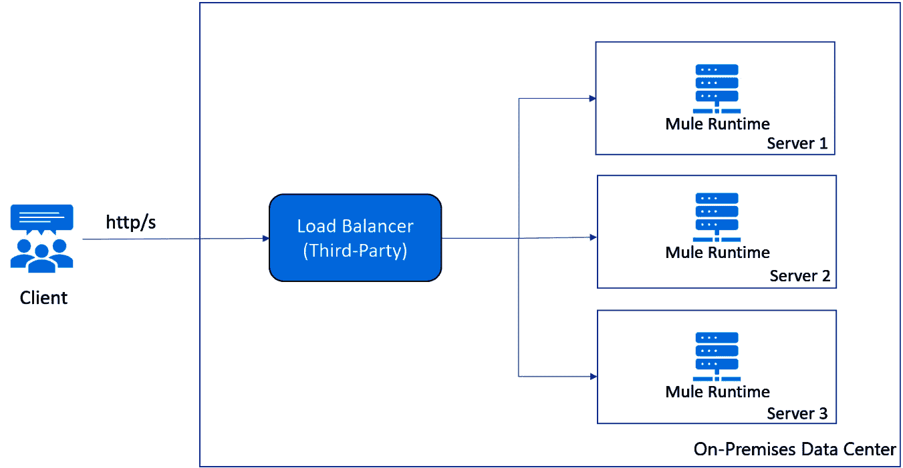

图 12.1：本地 Mule 运行时 HTTP 负载均衡

在图 12.1 中，我们有三台安装了 Mule 运行时的服务器，它们使用外部负载均衡器对 HTTP 工作负载进行了负载均衡。

在本节中，我们已经了解了本地 Mule 运行时的各种特性，例如高可用性、可扩展性和负载均衡。

在接下来的章节中，我们将介绍本地 Mule 运行时的各种重要概念，例如 Anypoint 集群、服务器组和域项目。

## Anypoint 集群


# Anypoint 集群

Anypoint 集群是指在服务器上设置的一组 `Mule` 运行时，它们作为一个单元运行。在 Anypoint 集群中，集群内的所有 `Mule` 运行时相互通信，并通过分布式共享内存网格共享其状态和信息。Anypoint 集群使用 `Hazelcast`。

有一个名为 `Hazelcast` 的开源内存数据网格。它提供弹性可扩展的分布式内存计算，这被广泛认为是提升应用程序性能最快、扩展性最强的方法。

`Mule Hazelcast` 服务器实现了一个定制版的 `Hazelcast` 发行版，该版本专为满足 `Mule` 运行时的需求而定制。这种定制实现不会以任何方式修改 `Hazelcast` 的行为。它只是实现了 `Mule` 运行时所需的基本配置，以及使用 `Log4j` 的默认日志记录配置。

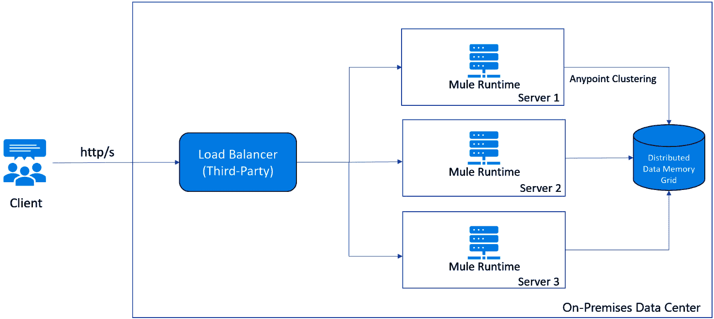

**图 12.2：具有 Anypoint 集群的本地部署 Mule 运行时**

为本地部署 `Mule` 运行时实施集群的好处如下：

*   Anypoint 集群将流量分发到集群中的各个节点，从而提高应用程序的整体性能。
*   通过向集群添加额外节点可以轻松实现水平扩展，它会自动将现有节点上可用的所有应用程序部署到新节点上。
*   Anypoint 集群支持 `Mule` 运行时对资源（如文件、数据库和 `FTP`）的访问进行自动协调。
*   它提高了应用程序的整体性能，使用自动故障转移，并支持高可用性以确保业务连续性。

Anypoint 集群支持两种不同类型的集群，可根据组织的网络设置加以利用：

## 单播集群

在单播集群中，您需要配置集群中节点的 IP 地址以建立节点间的通信。在单播集群中，端口从 `5701` 开始，并从该端口按顺序自动递增以建立节点间的通信。

## 多播集群

在多播集群中，您无需显式配置集群中节点的 IP 地址，因为它会自动检测集群中的其他服务器并启用它们之间的通信。要实施多播集群，需要额外的网络权限，您需要联系网络管理员以确保组织网络支持多播集群。必须在 IP 地址 `224.2.2.3` 和 `UDP` 端口 `54327` 上启用多播集群才能实施它。在多播集群中，一个集群中的所有节点必须位于同一网段。向集群添加新节点或从集群中移除现有节点不需要重启集群。

# 并发问题

Anypoint 集群可解决以下并发问题：

*   **基于文件的连接器**：所有 `Mule` 实例将访问相同的文件夹，这会导致重复文件处理，或者如果文件被另一个 `Mule` 应用程序修改或删除，可能会导致处理失败。
*   **JMS 主题**：所有监听该主题的 `Mule` 实例将收到同一条消息的副本，这会导致消息处理重复。
*   **JMS 请求/回复队列**：所有 `Mule` 实例可能都在监听同一个回复队列。`Mule` 实例获得的响应可能与其发送的请求无关，这可能导致错误的响应或超时。

启用 Anypoint 集群还可以解决由 `Salesforce Streaming API`、多播连接器等引起的许多其他并发问题。

# 手动设置 Anypoint 集群

Anypoint 集群允许您在不注册 Anypoint Platform 的情况下对服务器进行集群化，方法是在所有服务器的 `$MULE_HOME/.mule` 中添加具有以下属性的 `mule-cluster.properties`：

```
...
mule.cluster.nodes=192.168.11.22,192.168.11.23,192.168.11.24
mule.cluster.multicastenabled=false
mule.clusterId=<ClusterId>
mule.clusterNodeId=<ClusterNodeID>
...
```

以下是可以添加到 `$MULE_HOME/.mule` 中的 `mule-cluster.properties` 的集群配置属性：

| Property Name | Description | Required | Comments |
| --- | --- | --- | --- |
| `mule.clusterId` | 集群的唯一标识符。可以是任意字母数字字符串。 | Yes | |
| `mule.clusterNodeId` | 集群内节点的唯一 ID。 | Yes | |
| `mule.clusterSize` | 属于该集群的节点数量。 | Yes | 可以是 1 到集群节点数之间的任意整数。 |
| `mule.cluster.networkinterfaces` | 供 `Hazelcast` 使用的接口的逗号分隔列表。支持通配符。 | No | `192.168.2.*`, `192.168.99.99` |
| `mule.cluster.nodes` | 属于该集群的节点，格式为 `<host:port>`。 | No | 例如 `172.16.9.24:9000`。仅指定一个 IP 地址即可使服务器加入集群。 |
| `mule.cluster.quorumsize` | 允许您定义集群保持运行状态所需的最少机器数量。 | No | |
| `mule.cluster.multicastenabled` | (布尔值) 启用/禁用多播。如果使用固定 IP 地址进行集群节点发现（请参阅 `mule.cluster.nodes` 选项），则设置为 `false`。 | No | 如果设置为 `true`，请勿在 `mule.cluster.nodes` 中设置 IP 地址。 |
| `mule.cluster.multicastgroup` | 要使用的多播组 IP 地址。 | No | |
| `mule.cluster.multicastport` | 要使用的多播端口号。 | No | |
| `mule.cluster.jdbcstoreurl` | 用于连接数据库的 `JDBC` URL。 | | 仅在存储持久数据时需要。 |
| `mule.cluster.jdbcstoreusername` | 数据库用户名。 | | 仅在存储持久数据时需要。 |
| `mule.cluster.jdbcstorepassword` | 数据库用户密码。 | | 仅在存储持久数据时需要。 |
| `mule.cluster.jdbcstoredriver` | `JDBC` 驱动程序类名。 | | 仅在存储持久数据时需要。 |
| `mule.cluster.jdbcstorequerystrategy` | 用于访问存储对象数据的 SQL 方言。 | | 仅在存储持久数据时需要。此属性可取三个不同的值：`mssql`、`mysql` 和 `postgresql`。 |
| `mule.cluster.jmxenabled` | (布尔值) 启用/禁用监控。 | No | |
| `mule.cluster.listenersenabled` | (布尔值) 启用/禁用成员监听器。 | | |

**表 12.1：Anypoint 集群配置属性**

## Anypoint 集群中的法定人数管理

当您手动设置 Anypoint 集群时，法定人数管理允许您定义集群处于运行状态所需的最少节点数。可以通过在 `$MULE_HOME/.mule` 中的 `mule-cluster.properties` 中添加属性 (`mule.cluster.quorumsize`) 来定义法定人数管理所需的集群最小节点数。

设置最小法定人数可以让您获得更好的一致性，并在集群意外丢失节点时保护集群。例如，假设您设置了一个包含七个节点的集群。您将最小法定人数设置为五个节点，这意味着集群要处于运行状态，集群中至少必须有五个节点处于活动状态。


## 法定人数集群

法定人数集群仅适用于使用对象存储的组件。每当发生 `QuorumException` 时，捕获它并执行适当的操作非常重要，例如重试消息、停止进程、发送电子邮件或记录错误详细信息。如果集群中的服务器数量少于法定人数大小，则该操作将被拒绝，并抛出 `QuorumException`。

## 在 Anypoint Platform 上设置 Anypoint 集群

在这种情况下，Anypoint Platform 将充当控制平面，并且可以轻松地从 Runtime Manager 控制台设置 Anypoint 集群，而无需执行任何手动步骤。要设置 Anypoint 集群，服务器必须在 Anypoint Platform 上注册。现在，您可以轻松地从 Anypoint Platform 创建集群，并将所有必需的服务器添加为集群的一部分。在创建 Anypoint 集群时，您可以选择要设置的集群类型，它将自动在集群中所有节点的 `$MULE_HOME/.mule` 下创建包含所有必需属性的 `mule-cluster.properties`。

请确保集群中所有节点上的 Mule 运行时版本相同。

## 持久对象存储

默认情况下，Anypoint 集群是非持久的（瞬态的）。存储在对象存储和 VM 队列中的数据将在应用程序或 Mule 运行时重新启动时丢失。但 MuleSoft 提供了一个选项，您可以通过使用 JDBC 数据库来设置持久 Anypoint 集群。此 JDBC 数据库将在集群中的所有节点之间共享。如果应用程序或 Mule 运行时重新启动，此数据将持久保留。以下是支持的 JDBC 数据库列表：

* MySQL 5.5+
* PostgreSQL 9
* Microsoft SQL Server 2014

要启用对象存储，您需要在集群中所有服务器的 `$MULE_HOME/.mule` 下的 `mule-cluster.properties` 中添加以下属性：

* `mule.cluster.jdbcstoreurl`：JDBC URL 连接字符串
* `mule.cluster.jdbcstoreusername`：数据库用户名
* `mule.cluster.jdbcstorepassword`：数据库用户密码
* `mule.cluster.jdbcstoredriver`：JDBC 驱动类名
* `mule.cluster.jdbcstorequerystrategy`：SQL 方言

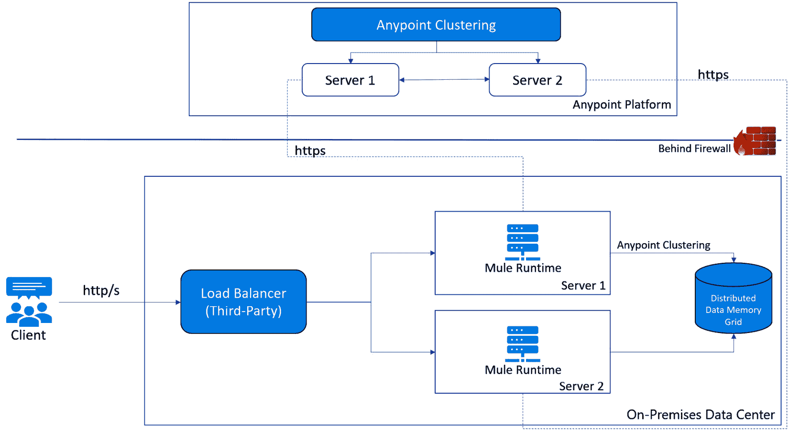

图 12.3：Anypoint 集群

## 主节点和从节点

Anypoint 集群具有主节点和从节点的概念，其中集群中的一个节点是主节点，集群中的其他节点是从节点。如果主节点发生故障，其中一个从节点将成为主节点。

每当部署到集群的应用程序具有调度器组件时，调度器轮询仅在主节点上工作。

对于其他源或监听器，如果您希望主节点监听消息，则有 `primaryNodeOnly=true` 属性，可在连接器配置期间进行配置：

```
<flow name="jmsListener_flow">
    <jms:listener config-ref="jmsConfig" destination="listen-queue" primaryNodeOnly="true"/>
    <logger message="#[payload]"/>
</flow>
```

在前面的 JMS 监听器连接器配置中，消息将仅由主节点拾取。当您使用主题时，此配置非常方便，因为主题具有将消息传递给所有监听器的属性。通过 `primaryNodeOnly=true` 属性，它将确保消息传递给主节点上的主题监听器。

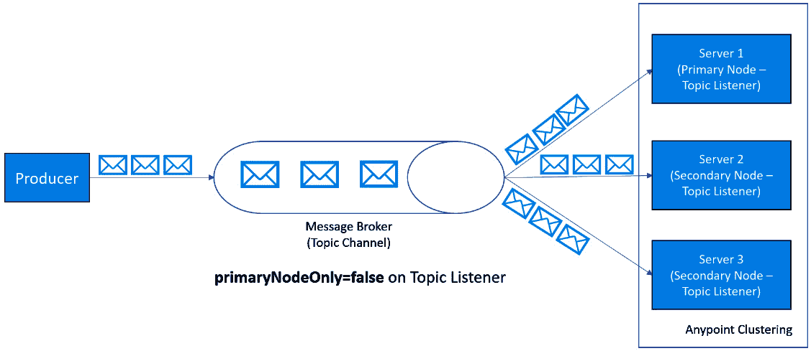

图 12.4：JMS 主题监听器 (primaryNodeOnly=false)

在图 12.4 中，描绘了 JMS 主题监听器，`primaryNodeOnly=false` 意味着主题中的同一消息将传递给集群中所有活动的主题监听器。因此，这将导致同一消息被多次处理。主题具有将消息传递给所有活动监听器的属性。

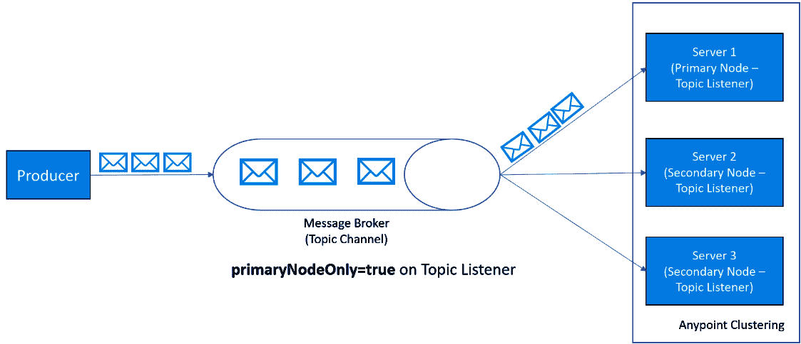

图 12.5：JMS 主题监听器 (primaryNodeOnly=true)

在图 12.5 中，描绘了 JMS 主题监听器，`primaryNodeOnly=true` 意味着主题中的一条消息将传递给集群中主节点上的一个主题监听器。如果主节点发生故障，其中一个从节点将成为主节点并继续处理来自主题的消息。

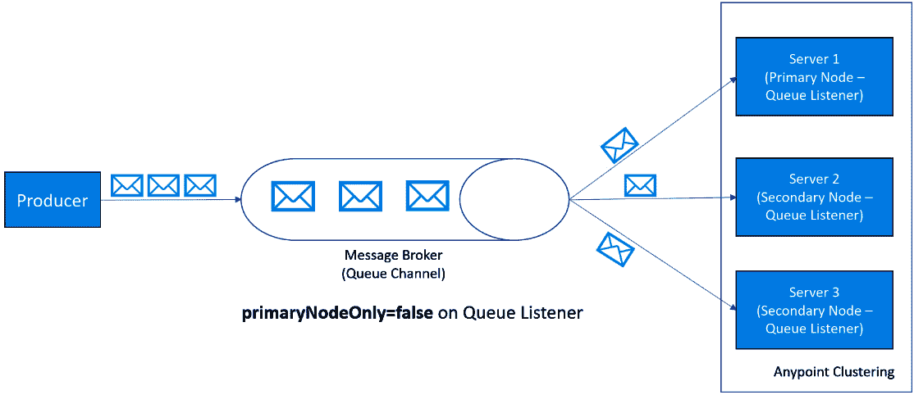

图 12.6：JMS 队列监听器 (primaryNodeOnly=false)

在图 12.6 中，描绘了 JMS 队列监听器，`primaryNodeOnly=false` 意味着消息将在集群中的所有节点之间进行负载均衡，但不会将消息传递给集群中的多个节点。队列具有这样的属性：消息将以轮询方式传递给活动队列监听器中的一个，并提供在集群中的多个节点之间对消息的负载均衡。

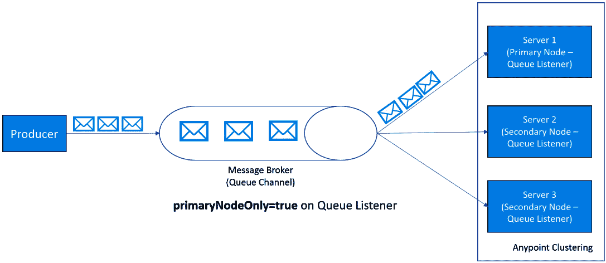

图 12.7：JMS 队列监听器 (primaryNodeOnly=true)

在图 12.7 中，描绘了 JMS 队列监听器，`primaryNodeOnly=true` 意味着队列中的消息将传递给集群中主节点上的一个队列监听器。如果主节点发生故障，其中一个从节点将成为主节点并继续处理来自队列的消息。

让我们了解如何使用 Anypoint 集群实现竞争队列消费者模式。竞争队列消费者模式通过同一通道上的多个消费者实现消息的并行处理。多个消费者可以监听同一队列以并行处理消息。

有一个用例，生产者以非常高的速率将消息发送到队列——高于消费者消费消息的速率。为了确保消息以快速速率得到处理，我们可能需要更多消费者实例，它们可以从队列并行消费消息。我们可以通过添加更多消费者（队列监听器）来横向扩展，以提高消息消费速率，这样流量就会分布在多个队列监听器之间。

在 Anypoint 集群中，可以通过在集群中拥有多个设置了 `primaryNodeOnly=false` 的节点来实现此模式。这将确保所有带有队列监听器的节点都在监听队列，并且消息将从监听器并行读取，从而提高整体性能。

竞争队列消费者模式提供以下优势列表：

* **可扩展性**：可以根据发布者发布消息的速率添加或移除消费者。通过增加消费者的数量，消息将分布在消费者之间，以确保消息被独立且更快地处理。
* **高可用性**：多个消费者监听同一队列。如果其中一个消费者崩溃或关闭，还有其他消费者将继续处理消息。
* **可靠性和弹性**：如果消息处理在其中一个节点上失败，消息将被传递回队列，确保其可以被重新处理。

## Anypoint 集群中的 VM 队列

VM 队列可用于在集群之间对请求进行负载均衡。例如，您的应用程序包含一系列子流程，集群可以将每个后续子流程分配给集群中空闲且负载较低的 Mule 运行时。当消息通过 VM 端点传递时，进入集群的消息可以由多个节点处理，如下图所示：

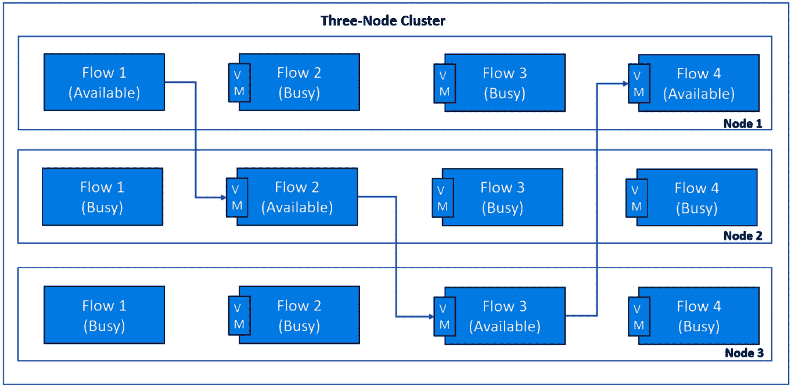

图 12.8：三节点集群

在图 12.8 中，我们部署了一个包含四个流程的应用程序，每个流程通过 VM 队列进行通信：


* 节点 1 上的 Flow 1 接收并处理消息，然后将其发送到 VM 队列
* 节点 2 上的 Flow 2 可用，从 VM 队列读取消息，完成处理，并将其发布到 VM 队列
* 节点 3 上的 Flow 3 可用，从 VM 队列读取消息，完成处理，并将其发布到 VM 队列
* 节点 1 上的 Flow 4 可用，从 VM 队列读取消息，并完成处理

# Anypoint 服务器组

Anypoint 服务器组是一组服务器，它们作为部署应用程序的单个部署目标，因此您无需在每台服务器上单独部署应用程序。例如，当您想要部署应用程序时，只需选择服务器组作为目标，它就会将应用程序部署到组中的所有服务器。

添加到服务器组的服务器彼此隔离，并且不共享状态。要分配 HTTP 工作负载，您可以使用负载均衡器，它可以在服务器组中的服务器之间分配流量。

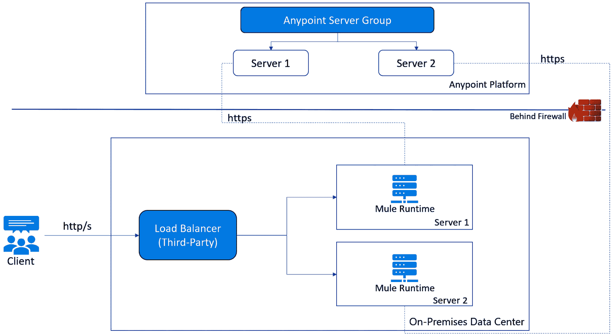

图 12.9：Anypoint 服务器组

要启用服务器组，请确保所有节点具有相同版本的 Mule 运行时，并且节点必须在 Anypoint Platform 上注册。每当存在并发问题时，服务器组都不适用，例如两个节点上的主题监听器接收相同的消息，最终导致消息处理重复。

我们刚了解了 Anypoint 集群和服务器组，它们可以使用本地部署的 Mule 运行时来实现。我们还了解了如何在 Anypoint Platform 中注册由 MuleSoft 管理的服务器，以及如何从 Anypoint Platform 创建服务器组或集群。

以下是 Anypoint 服务器组和集群之间的比较：

| 比较因素 | Anypoint 服务器组 | Anypoint 集群 |
| --- | --- | --- |
| HTTP 流量所需的第三方负载均衡器 | 是 | 是 |
| 避免并发问题 | 否 | 是 |
| 节点相互感知、共享通用信息并同步其状态 | 否 | 是 |
| 通过在集群节点之间划分工作负载来提高应用程序性能 | 否 | 是 |
| 节点相互独立且隔离 | 是 | 否 |
| 组或集群中的所有节点必须具有相同版本的 Mule 运行时 | 是 | 是 |
| 自动协调对资源（如文件、数据库和 FTP 源）的访问 | 否 | 是 |
| 集群或组内处理的自动负载均衡 | 否 | 是 |

表 12.2：Anypoint 集群与服务器组对比

在下一节中，我们将讨论 Anypoint Platform PCE，它可以在本地数据中心设置，以管理集群、服务器组和服务器。

## Anypoint Platform 私有云版

借助 Anypoint Platform PCE，您可以在自己的数据中心内设置 Anypoint Platform 控制平面，它允许您使用组织的安全策略和合规性要求，在本地服务器上管理、运行或部署 MuleSoft 应用程序。

例如，有一项要求是您希望 MuleSoft 控制平面和数据平面都在您自己的数据中心内，并且不想与外部系统或公共互联网连接交互。在这种情况下，您可以使用 Anypoint Platform PCE 在自己的数据中心本地运行 Anypoint Platform 软件。

所有安全性和其他策略均可在本地获得，并可轻松应用于位于您自己数据中心内的 Anypoint Platform PCE 中的应用程序。

以下是 Anypoint Platform PCE 包含的组件：

| 组件 | 包含 | 不包含 | 说明 |
| --- | --- | --- | --- |
| Anypoint Runtime Manager | X | | 使您能够跟踪和管理已部署的 Mule 应用程序。 |
| Runtime Fabric 管理（包括 Security Edge 和令牌化） | | X | 自动化客户托管的 Mule 应用程序和 API 网关的部署与编排。 |
| Anypoint API Manager | X | | 使您能够管理已注册的 API。 |
| Secrets Manager | | X | 为受支持的 Anypoint Platform 服务存储和管理密钥。 |
| Anypoint Exchange | X | | 使您的组织能够共享各种资产，以便在集成项目中重复使用。 |
| 访问管理 | X | | 使您能够创建 Anypoint Platform 账户或配置外部联合身份。 |
| Anypoint Design Center（不含 Flow Designer） | X | | 使您能够使用多种建模语言创建 API 规范并创建 RAML API 片段。 |
| Anypoint Analytics – Insights | | X | 提供对部署在 CloudHub 和本地服务器上的 Mule 应用程序上的业务交易和事件的深度可见性。 |
| Anypoint Analytics – Anypoint Visualizer | X | | 使您能够通过应用程序网络图探索应用程序网络。 |
| Anypoint Analytics – API | | X | 提供对 API 使用情况和性能的洞察。 |
| Anypoint Monitoring | X | | 提供对应用程序网络中集成、Mule 流和组件的可见性。 |
| Object Store | | X | Object Store v2 允许 CloudHub 应用程序跨批处理、Mule 组件和应用程序存储数据和状态，无论是从应用程序内部还是通过使用 Object Store REST API。 |
| Anypoint MQ | | X | 一种多租户云消息传递服务，使您能够在租户应用程序之间执行高级异步消息传递场景。 |
| API 测试 | | X | 提供一个测试框架，使您能够轻松为集成和 API 构建自动化测试。 |

表 12.3：Anypoint Platform PCE 组件（来源：MuleSoft 官方文档：https://docs.mulesoft.com/）

Anypoint Platform PCE 支持 **4 节点** 和 **7 节点** 配置，以确保高可用性和稳定的性能。**4 节点** 配置是 Anypoint Platform PCE 支持的最小配置。这是确保高可用性和故障转移所需的最少节点数。

图 12.10 指的是在启用了 Anypoint 集群的服务器之间，在本地数据中心运行控制平面和数据平面。

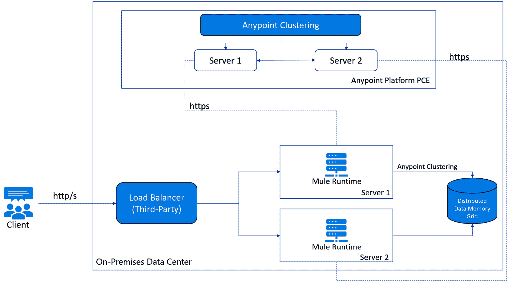

图 12.10：启用 Anypoint 集群的本地数据中心上的 Anypoint 控制平面和运行时平面

# 本地运行 Mule 运行时的用例

Mule 运行时可以在本地的单个节点或多个节点上设置。如果您正在寻找更好的性能、高可用性和业务连续性，则不建议在单个节点上运行 Mule 运行时。

设置 Mule 运行时有多种方法：

* 本地运行时平面，无控制平面
* 本地运行时平面，控制平面在 Anypoint Platform 上
* 本地运行时平面，控制平面在 Anypoint Platform PCE 上（完全本地化）

## 本地 Mule 运行时平面且无控制平面（独立）

在此方法中，Mule 运行时将在本地设置，而无需将服务器注册到 Anypoint Platform。这意味着我们没有控制平面来管理 Mule 运行时。使用此方法，我们将无法应用任何 API 策略，也无法利用 Anypoint Monitoring 来监控部署在本地 Mule 运行时上的应用程序。正如本章前面所讨论的，可以使用手动方法对服务器进行集群。

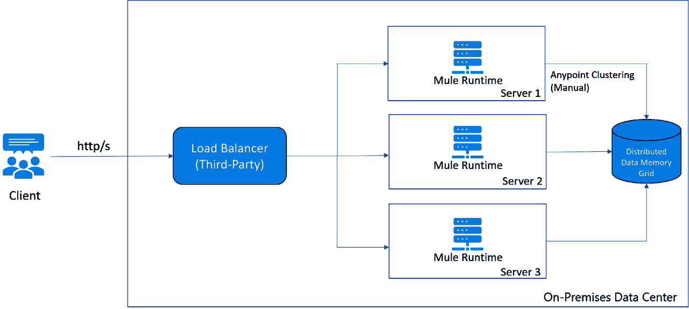

图 12.11：本地 Mule 运行时平面且无控制平面（独立）


前述架构展示了在运行时平面上进行手动集群，而无需将服务器注册到 Anypoint Platform 的控制平面。

## Mule 运行时平面部署在本地，控制平面部署在 Anypoint Platform（混合模式）

在此方法中，Mule 运行时将在本地设置，所有服务器都将注册到 Anypoint Platform。Anypoint Platform 控制平面位于组织防火墙之外，因此需要允许本地服务器与 Anypoint Platform 上的控制平面之间进行通信。本地服务器将向控制平面发送元数据，这将在控制平面上生成诸如 CPU 利用率和内存利用率之类的指标。通过控制平面，您可以管理本地服务器，例如启动和停止 Mule 运行时及应用程序，以及查看服务器状态。

下图显示了本地 Mule 运行时如何与 Anypoint Platform 上的控制平面进行通信。


图 12.12：Mule 运行时平面部署在本地，控制平面部署在 Anypoint Platform（混合模式）

我们已经讨论了 Anypoint 集群，可以将所有服务器集群化以作为一个单元运行。这可以通过 Anypoint Platform 中的 Runtime Manager 轻松完成。`图 12.12` 展示了一个带有控制平面的 Anypoint 集群 Mule Runtime 设置。采用这种方法，元数据将离开组织的数据中心，以生成 CPU 和内存利用率等指标，并管理集群、服务器和服务器组。

## Mule 运行时平面部署在本地，控制平面部署在 Anypoint Platform PCE（完全本地化）

采用这种方法，运行时平面和控制平面均位于您自己的数据中心。我们之前讨论过 Anypoint Platform PCE，它可在本地使用，部署在本地 Mule 运行时上的应用程序可以连接到 Anypoint Platform PCE，而无需任何公共互联网连接。以下是 Anypoint Platform PCE 提供的几项功能：

*   Anypoint Platform PCE 支持使用 Runtime Manager 管理部署在本地 Mule 运行时上的应用程序，并设置 Anypoint 集群、服务器组等
*   Anypoint Platform PCE 支持使用 API Manager 管理部署在本地 Mule 运行时上的 API 生命周期，例如应用 API 策略和管理 API 实例
*   Anypoint Platform PCE 支持 Anypoint Monitoring 和 Anypoint Visualizer

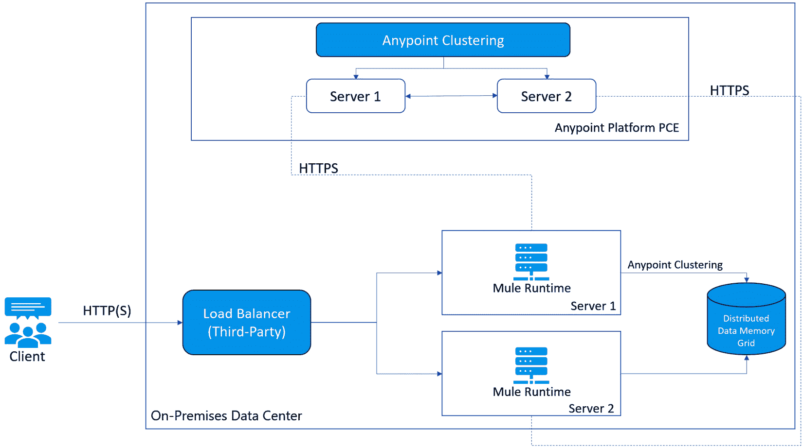

图 12.13：Mule 运行时平面部署在本地，控制平面部署在 Anypoint Platform（混合模式）

在 `图 12.13` 中，您可以看到控制平面和运行时平面均位于同一个数据中心，无需公共互联网连接即可建立控制平面和运行时平面之间的通信。采用这种方法，您需要管理控制平面和运行时平面的整个基础设施网络，因为两者都在您自己的数据中心中。当您的组织有严格的合规性和安全要求，意味着无法使用基于云的解决方案时，通常会采用此解决方案。

当您的组织有严格的合规策略，要求数据或元数据不得离开托管在本地的组织数据中心，并且您拥有强大的团队来管理底层基础设施和网络时，这种方法非常有用。

# 在单个端口上运行多个 MuleSoft 应用程序（Mule 域）

Mule 域允许您在部署在本地 Mule 运行时上的应用程序之间共享资源。您可能需要在多个应用程序之间共享连接器配置、共享属性和错误处理程序，而域项目是应用程序之间共享资源的唯一方式。

在本地部署 Mule 时，您可以指定全局配置，例如默认错误处理、共享属性、调度器池和连接器配置，以便在部署在同一域上的所有应用程序之间共享。要使用 Mule，您需要创建一个域，然后从每个应用程序链接到它。这意味着分配给您的 Mule 域的每个应用程序现在都将有权访问该域中的共享资源。

当您将多个服务部署到同一个本地 Mule 运行时引擎时，域的使用可显著提高性能。由于域为所有共享资源提供了一个中心点，它们使类加载过程更快，特别是因为 `POM.xml` 中定义的域依赖项也在域应用程序中共享。

以下是可以作为域项目一部分的共享配置：

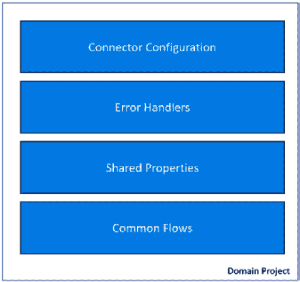

图 12.14：域项目

让我们考虑在具有 HTTP 监听器的本地 Mule 运行时上部署应用程序。每个应用程序必须部署在不同的端口上，并且它们不得与其他应用程序的端口重叠。这增加了管理多个端口的复杂性。为了解决这个问题，我们可以使用域项目，在任意端口（例如 `8081`）上添加 HTTP 监听器连接配置。应用程序可以引用域项目，并引用域项目中的 HTTP 监听器配置。这样，所有应用程序都可以引用域项目和 HTTP 监听器配置——您无需为每个项目配置单独的端口，并且可以轻松地从域项目引用连接器配置。

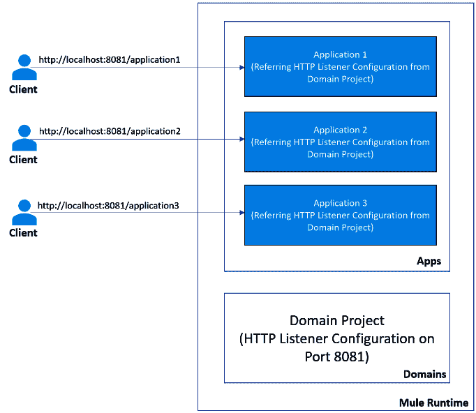

图 12.15：使用域项目在单个端口上运行 MuleSoft 应用程序

在前面的图表中，部署到 Mule 运行时的每个应用程序都引用域项目以使用 HTTP 监听器连接器配置，因此应用程序可以在单个端口 `8081` 上运行。

## 如何在 API 主导的连接架构中使用域项目

正如我们所知，API 主导的连接架构有三层：体验 API、流程 API 和系统 API。我们通常要求不向外部暴露系统 API 和流程 API，只有体验 API 可以由外部消费者调用。

为了实现这一点，我们将使用三个域项目：`exp-domain-project-8081`、`prc-domain-project-8082` 和 `sys-domain-project-8083`。每个域项目将具有具有不同端口的 HTTP 监听器连接器配置，如下表所示。

| **层** | **域项目** | **HTTP 监听器配置 – 端口** | **负载均衡器** |
| --- | --- | --- | --- |
| 体验 API | `exp-domain-project-8081` | `8081` | 外部负载均衡器 |
| 流程 API | `prc-domain-project-8082` | `8082` | 内部负载均衡器（可选） |
| 系统 API | `sys-domain-project-8083` | `8083` | 内部负载均衡器（可选） |

表 12.4：域项目配置

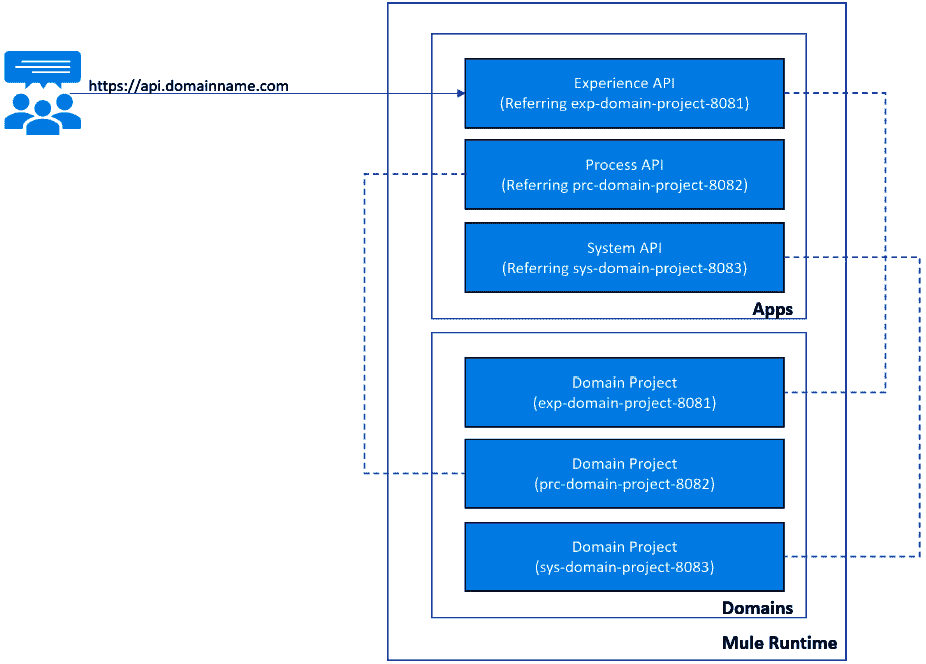

图 12.16：带有 API 主导连接的域项目

在 `图 12.16` 中，运行在端口 `8081` 上的体验 API 暴露给外部负载均衡器，而系统 API 和流程 API 可以暴露给内部负载均衡器，因此体验 API 可以使用内部 URL 与流程 API 通信，流程 API 可以使用内部 URL 与系统 API 通信。如果在流程 API 和系统 API 前面设置了内部负载均衡器，则可以使用内部负载均衡器进行内部通信。

# 使用 Mule Maven 插件在本地部署 MuleSoft 应用程序


# Mule Maven 插件

Mule Maven 插件是一个重要的 Maven 插件，用于在本地部署、取消部署和打包 MuleSoft 应用程序。可以在应用程序的 `POM.xml` 中配置以下插件，其中包含在本地部署和运行应用程序所需的所有属性：

```xml
<plugin>
  <groupId>org.mule.tools.maven</groupId>
  <artifactId>mule-maven-plugin</artifactId>
  <version>3.8.6</version>
  <extensions>true</extensions>
  <configuration>
    <standaloneDeployment>
      <muleHome>${mule.home}</muleHome>
      <muleVersion>${app.runtime}</muleVersion>
    </standaloneDeployment>
  </configuration>
</plugin>
```

在前述 Mule Maven 插件中，`${}` 下定义的值是可以通过 `mule deploy` 命令传递的参数，如下所示：

```bash
mule deploy –DmuleDeploy -Dapp.runtime=4.3.0 -Dmule.home=/opt/mule/bin
```

## 本地部署属性

以下是在本地部署应用程序时可以在 Mule Maven 插件上配置的属性：

| 参数 | 描述 | 是否必需 |
| --- | --- | --- |
| `standaloneDeployment` | 顶层元素。 | 是 |
| `applicationName` | 指定部署时使用的应用程序名称。 | 是 |
| `muleVersion` | 本地计算机实例上运行的 Mule 版本。如果此值与部署目标上运行的 Mule 版本不匹配，插件将抛出异常。如果这些值不匹配，Mule Maven 插件不会下载 Mule 运行时引擎。 | 是 |
| `muleHome` | 本地计算机上 Mule 实例的位置。 | 是 |
| `deploymentTimeout` | 部署过程开始与确认制品已部署之间允许的经过时间（以毫秒为单位）。默认值为 1,000,000。 | 否 |
| `skip` | 当设置为 `true` 时，跳过插件部署目标。其默认值为 `false`。 | 否 |

*表 12.5：Mule Maven 插件属性*

## ARM 部署

Mule Maven 插件支持 `Anypoint Runtime Manager` (`ARM`) 部署，以将应用程序部署到目标，例如在 Anypoint Platform 上注册的服务器、集群或服务器组。可以在应用程序的 `POM.xml` 中配置以下插件，其中包含使用 ARM 部署和运行应用程序所需的所有属性：

```xml
<plugin>
  <groupId>org.mule.tools.maven</groupId>
  <artifactId>mule-maven-plugin</artifactId>
  <version>3.7.1</version>
  <extensions>true</extensions>
  <configuration>
    <armDeployment>
      <muleVersion>${app.runtime}</muleVersion>
      <uri>https://anypoint.mulesoft.com</uri>
      <target>${target}</target>
      <targetType>${target.type}</targetType>
      <username>${username}</username>
      <password>${password}</password>
      <environment>${environment}</environment>
      <properties>
        <key>value</key>
      </properties>
    </armDeployment>
  </configuration>
</plugin>
```

在前述 Mule Maven 插件中，`${}` 下定义的值是可以通过 `mule deploy` 命令传递的参数，如下所示：

```bash
mule deploy –DmuleDeploy -Dapp.runtime=4.3.0 -Dtarget=test-cluster -Dtarget.type=cluster -Dusername=Anypoint_Username -Dpassword=Anypoint_Password -Denvironment=Sandbox
```

## ARM 部署属性

以下是使用 ARM 部署应用程序时可以在 Mule Maven 插件上配置的属性。

| 参数 | 描述 | 是否必需 |
| --- | --- | --- |
| `armDeployment` | 顶层元素。 | 是 |
| `applicationName` | 指定部署时使用的应用程序名称。 | 是 |
| `muleVersion` | 应用程序在部署目标中运行所需的 Mule 版本。 | 是 |
| `uri` | Anypoint Platform URI。 | 否 |
| `target` | 安装 Mule 实例的服务器名称。 | 是 |
| `targetType` | 要部署到的目标类型。有效值为 `cluster`、`server` 和 `serverGroup`。 | 是 |
| `username` | 安装 Mule 实例的服务器的用户名。 | 仅当使用 Anypoint Platform 凭据登录时 |
| `password` | 安装 Mule 实例的服务器的密码。 | 仅当使用 Anypoint Platform 凭据登录时 |
| `environment` | 安装 Mule 实例的服务器的环境名称。此值必须与 Runtime Manager 帐户中配置的任何环境匹配。 | 是 |
| `businessGroup` | 部署的业务组路径。 | 否 |
| `businessGroupId` | 部署的业务组 ID。 | 否 |
| `deploymentTimeout` | 部署过程开始与确认制品已部署之间允许的经过时间（以毫秒为单位）。默认值为 1000000。 | 否 |
| `server` | 具有 Anypoint Platform 凭据的 Maven 服务器。仅当你想要使用存储在 Maven `settings.xml` 文件中的凭据时才需要此项。这不是 Mule 服务器名称。 | 否 |
| `properties` | 顶层元素。 | 否 |
| `skip` | 当设置为 `true` 时，跳过插件部署目标。其默认值为 `false`。 | 否 |
| `skipDeploymentVerification` | 当设置为 `true` 时，跳过已部署应用程序的状态验证。其默认值为 `false`。 | 否 |
| `authToken` | 指定用于访问平台的授权令牌。你可以使用此身份验证方法代替设置用户名和密码。 | 仅当使用授权令牌登录时 |
| `connectedAppClientId` | 指定 Connected Apps 的 `clientID` 值。 | 仅当使用 Connected Apps 凭据登录时 |
| `connectedAppClientSecret` | 指定 Connected Apps 的密钥。 | 仅当使用 Connected Apps 凭据登录时 |
| `connectedAppGrantType` | 指定唯一支持的连接类型：`client_credentials`。 | 仅当使用 Connected Apps 凭据登录时 |

*表 12.6：使用 ARM 部署时的 Mule Maven 插件属性*

## 部署和取消部署命令

以下是部署和取消部署应用程序的命令：

```bash
mvn clean deploy –DmuleDeploy (在本地部署应用程序)
mvn mule:undeploy (从本地取消部署应用程序)
```

# 使用 Anypoint Runtime Manager (ARM) REST API 在本地部署 MuleSoft 应用程序

MuleSoft 提供 ARM API，用于在 Anypoint Platform 上注册的集群、服务器组或服务器上部署应用程序。它还提供用于管理服务器、集群和服务器组的端点，并支持通过 ARM REST API 进行许多其他操作。以下是完整的操作列表：[`anypoint.mulesoft.com/exchange/portals/anypoint-platform/f1e97bc6-315a-4490-82a7-23abe036327a.anypoint-platform/arm-rest-services/`](https://anypoint.mulesoft.com/exchange/portals/anypoint-platform/f1e97bc6-315a-4490-82a7-23abe036327a.anypoint-platform/arm-rest-services/)。

下表展示了使用 ARM API 将应用程序部署到目标的过程：

| 方法 | POST |
| --- | --- |
| API 端点 | `https://anypoint.mulesoft.com/hybrid/api/v1/applications` |
| 请求体 | ```json { "applicationSource": { "source": "EXCHANGE", "groupId": "com.mulesoft.hybrid", "artifactId": "platformApp", "version": "0.0.1" }, "targetId": 101, "artifactName": "test-app" } ``` |
| 认证 | OAuth 2.0（Connected Apps 或 Anypoint 用户名和密码） |
| 标头 | `X-ANYPNT-ORG-ID`（Anypoint Platform 的组织 ID）、`X-ANYPNT-ENV-ID`（Anypoint Platform 的环境 ID）和 `Content-Type`（`application/json`） |

*表 12.7：ARM API*


有关 ARM API 的更多详细信息，请参阅 Anypoint 开发者门户。链接如下：[`anypoint.mulesoft.com/exchange/portals/anypoint-platform/f1e97bc6-315a-4490-82a7-23abe036327a.anypoint-platform/arm-rest-services/minor/1.0/console/method/%231517/`](https://anypoint.mulesoft.com/exchange/portals/anypoint-platform/f1e97bc6-315a-4490-82a7-23abe036327a.anypoint-platform/arm-rest-services/minor/1.0/console/method/%231517/)

# 部署 Mule 以实现高可用性和灾难恢复策略

应用程序停机可能随时发生。这可能是由于应用程序和基础设施维护而计划内的，也可能是由于 JVM 故障或崩溃、硬件故障或网络问题而导致的非计划内停机。由于全球向电子商务的转变，企业希望其应用程序能以 100% 的正常运行时间运行，具备高可用性，并能从任何灾难中快速恢复，而不影响业务。

有多种方法可以解决高可用性和灾难恢复策略，其中一种方法是 Anypoint 集群，它提供基本的故障转移功能，我们在本章前面已经讨论过。借助 Anypoint 集群，当主节点发生故障时，备用节点将成为主节点以恢复处理。

MuleSoft 提供了四种实现高可用性的选项：

- 冷备
- 温备
- 热备 - 主备模式
- 双活模式

## 冷备

在冷备方法中，一个或多个操作系统未运行。这基本上是生产环境或虚拟机的备份。一旦检测到任何中断，备份操作系统和 Mule 运行时将启动。在启动备份操作系统和 Mule 运行时并将流量重定向到备份期间，将会发生一些停机时间。

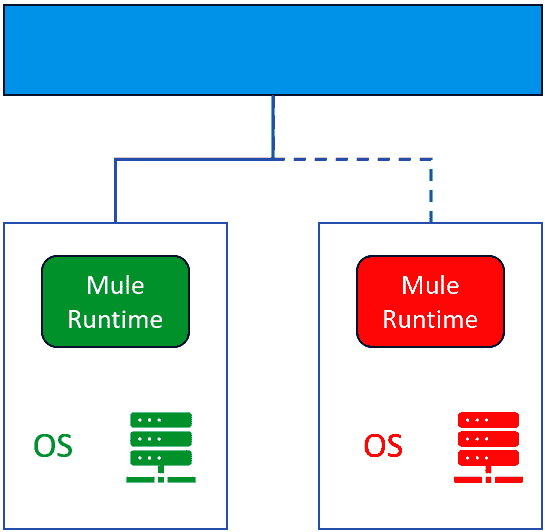

图 12.17：冷备

## 温备

在温备方法中，备份操作系统正在运行，但 Mule 运行时未运行。一旦检测到任何中断，备份 Mule 运行时将启动。在启动运行时并将流量重定向到备份期间，可能会发生少量停机时间。

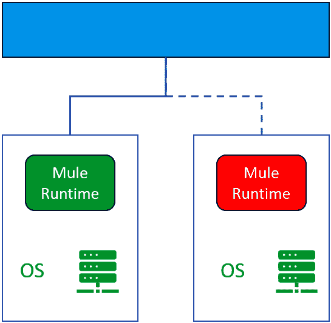

图 12.18：温备

## 热备 - 主备模式

在此方法中，备份 Mule 运行时和操作系统处于运行状态。但是，它们不处理任何请求。一旦检测到任何中断，备份将开始处理请求。在将流量重定向到备份时，可能会发生最短的停机时间。

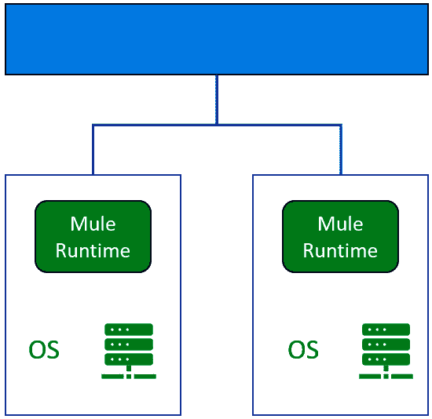

图 12.19：热备 - 主备模式

## 双活模式

在此方法中，备份 Mule 运行时和操作系统处于运行状态。环境被集群化，负载均衡器将流量路由到所有环境。此方法下没有停机时间。

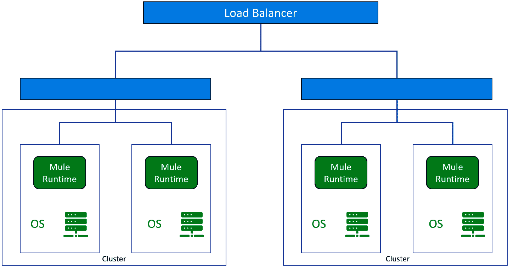

图 12.20：双活模式

也可以对单集群环境进行负载均衡，这将确保服务零停机时间。要实施此方法，环境之间的网络延迟必须小于 10 毫秒。

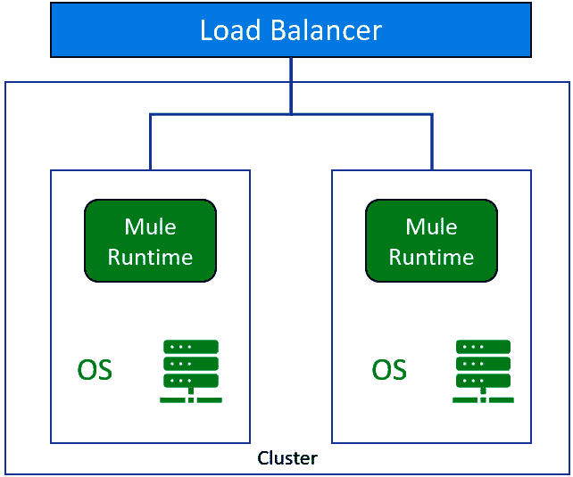

图 12.21：双活模式 - 单集群

## 在零停机时间内升级 Mule 运行时或扩展底层基础设施

我们通常有升级 Mule 运行时或进行硬件更改（如增加内存或存储）的需求，这些操作必须实现零停机时间，以确保业务连续性。确保升级或进行硬件更改后 Mule 运行时的稳定性也很重要。当前的 Mule 运行时可视为基准生产环境，当运行时配置变更和硬件升级时，将创建一个新环境。

为了对新环境建立信心，我们将使用金丝雀部署方法，即将少量流量发送到新环境，其余流量发送到基准环境。随着我们对新部署应用程序信心的增加，我们将逐渐增加发送到新环境的流量。

一旦 100% 的流量被路由到新环境，基准环境将被终止，新环境将成为基准生产环境。下图说明了流量如何在新环境中缓慢增加，最终终止旧环境。

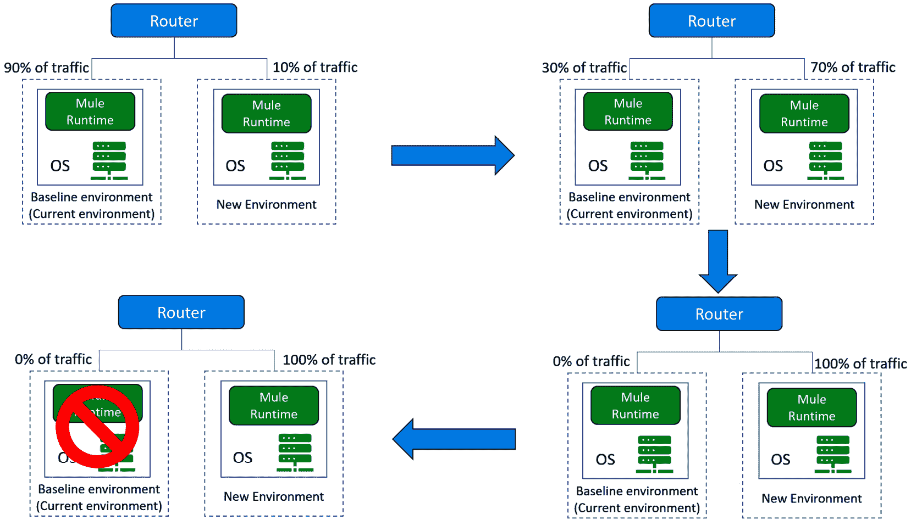

图 12.22：在零停机时间内升级 Mule 运行时或扩展底层基础设施

在此方法中，运行额外实例可能会产生临时成本（这可能持续几分钟、几小时或几天）。

## Mule 本地部署运行时安全性

安全性对任何企业都至关重要，旨在确保通过软件应用程序存储和检索的信息安全受保护，并防止未经授权的用户访问。信用卡详细信息和社会安全号码等信息应以安全方式访问以执行任何交易，且仅可供合法或授权用户访问。

Mule 运行时提供了多种用于实施安全性的工具：

- 用于加密和解密数据的加密模块。支持的策略包括 JCE、PGP 和 XML，用于加密和签名数据。
- 安全配置属性，用于以加密形式将凭据或敏感数据存储在属性文件中。
- 启用 FIPS 140-2 认证环境
- 开箱即用的 API 策略，如 JWT 验证令牌、客户端凭据强制执行策略，以及其他可在 API 上启用以进行授权和身份验证的安全策略。
- TLS 安全配置 - 通过配置 TLS，可保护 Mule 应用程序的传输安全。支持 TLS 1.1 和 TLS 1.2。
- Spring Security，用于启用基本身份验证或带有 LDAP 提供程序的基本身份验证。

## 总结

在本章中，我们对本地部署 Mule 运行时的属性和功能有了更深入的了解。此外，我们还探讨了 Anypoint 集群、服务器组、域项目以及高可用性、可扩展性和负载均衡等非功能性先决条件等重要主题。另外，我们还探讨了升级 Mule 运行时、实施安全措施和灾难恢复替代方案等主题。展望未来，下一章将重点关注 Government Cloud（政府云）和 EU Control Plane（欧盟控制平面），并特别关注需要考虑的独特因素。

## 延伸阅读

- Anypoint Platform PCE 支持的配置：[`docs.mulesoft.com/private-cloud/3.2/supported-cluster-config`](https://docs.mulesoft.com/private-cloud/3.2/supported-cluster-config)
- FIPS 140-2 合规性支持：[`docs.mulesoft.com/mule-runtime/4.5/fips-140-2-compliance-support`](https://docs.mulesoft.com/mule-runtime/4.5/fips-140-2-compliance-support)
- 安全性：[`docs.mulesoft.com/mule-runtime/4.5/securing`](https://docs.mulesoft.com/mule-runtime/4.5/securing)
- 集群：[`docs.mulesoft.com/runtime-manager/cluster-about`](https://docs.mulesoft.com/runtime-manager/cluster-about)
- 本章中的一些表格摘自 MuleSoft 官方文档：[`docs.mulesoft.com/`](https://docs.mulesoft.com/)
