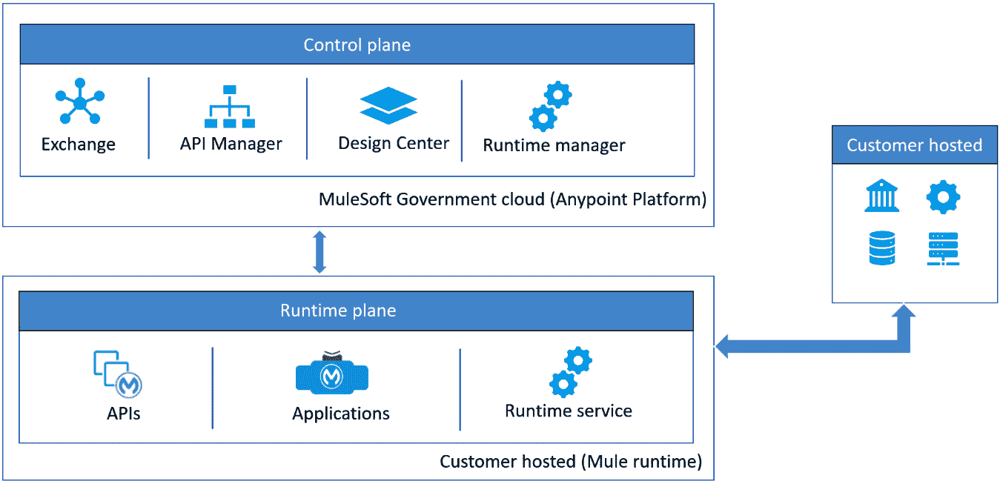

# 13 Government Cloud 和 EU Control Plane - 特殊考量

本章将向您展示在使用 Government Cloud 与 EU 控制平面时所涉及的一些重要差异。本章将简要介绍 FedRAMP 合规性。您还将了解 Government Cloud 是如何部署在一个符合 FedRAMP 标准的特殊 AWS 区域中的。

在本章中，我们将涵盖以下主题：

*   FedRAMP 要求与合规性
*   Government Cloud 注意事项
*   EU 控制平面的 EU 合规性

# FedRAMP 合规性

**联邦风险和授权管理计划**（**FedRAMP**）是美国的一项全政府计划，它为云产品和服务的安全评估、授权和持续监控提供了一种标准化方法。对于联邦机构内部低风险和中等风险影响级别的云部署和服务模型，这是一项强制性计划。MuleSoft Government Cloud 旨在符合 FedRAMP 标准。这意味着：

*   **安全评估**：为确保 MuleSoft Government Cloud 满足 FedRAMP 要求，其已接受全面的安全评估。这包括证明能有效防御数据泄露和其他安全事件。
*   **授权**：在成功完成安全评估后，MuleSoft Government Cloud 获得了授权，表明该平台已满足 FedRAMP 要求。
*   **持续监控**：MuleSoft 持续监控 Government Cloud 的安全性，以确保遵守 FedRAMP 法规。这包括定期报告和安全控制更新。
*   **数据保护**：MuleSoft Government Cloud 提供强大的数据保护功能，例如安全数据传输、访问控制和数据加密。这些措施旨在满足 FedRAMP 规定的严格安全要求。
*   **透明度**：作为致力于维护 FedRAMP 标准的一部分，MuleSoft 保持其安全程序公开透明。这使用户能够验证是否采取了适当的预防措施。

实际上，FedRAMP 合规性意味着 MuleSoft Government Cloud 是一家值得信赖的云服务提供商，符合严格的安全标准，适合美国政府机构及其合作伙伴使用。

**第三方评估机构**（**3PAO**）根据 FedRAMP 和 NIST 800-53A 法规进行了安全评估。该评估考察了现有安全控制措施在保护 MuleSoft Government Cloud 及其处理、传输和存储的数据的可用性、机密性和完整性方面的有效性。

MuleSoft 的 Government Cloud 环境设置在 **Amazon Web Services**（**AWS**）的 AWS GovCloud 上。AWS GovCloud 是一个符合 **国际武器贸易条例 (ITAR)**、经 FedRAMP 高影响级别授权、并拥有 DOD IL2、IM4 和 IA5 临时授权的环境。为了妥善保护政府数据的机密性、完整性和可用性，MuleSoft Government Cloud 通过确保符合 FedRAMP 特殊要求，加强了其在 AWS 中的配置。

# 什么是 MuleSoft Government Cloud？

MuleSoft 的 Government Cloud 是 Anypoint Platform 的定制版本，专为政府组织而创建。它提供了一个安全、符合 FedRAMP 标准的环境，用于创建和实施集成与 API。所有数据和应用流量都停留在安全的网络屏障之后，以提高安全性，确保遵守要求限制访问和数据隐私的法律法规。

以下是 Government Cloud 的主要功能：

*   **FedRAMP 授权**：MuleSoft 的 Government Cloud 符合政府施加的监管标准，该标准包含复杂的安全防护措施。
*   **安全、隔离的平台**：为了为敏感信息提供最高级别的数据保护，Government Cloud 运行在隔离的网络中。
*   **设计、构建、部署和管理 API**：Government Cloud 赋予用户与基础 Anypoint Platform 相同的功能，使他们能够在一个包中规划、开发、实施和监督 API 与集成。
*   **连接任何系统**：得益于 Government Cloud，任何系统、服务或数据源都可以安全连接。
*   **高可用性**：它提供零停机的自动化容量扩展和云数据流管理。

MuleSoft Government Cloud 包含 Anypoint Platform 的所有运行时平面功能（服务和 Mule 运行时引擎），以及部分控制平面（基于浏览器的 API 管理和 Mule 运行时引擎实例管理）功能。Government Cloud 支持端到端的 API 生命周期管理和完整的 API 主导连接技术。政府组织可以使用 MuleSoft 的 Government Cloud 来构建、部署和管理集成与 API，同时遵守严格的安全和合规要求。MuleSoft 的 Government Cloud 是一个强大的 API 主导连接工具。

## Government Cloud 注意事项

在考虑 MuleSoft Government Cloud 时，请务必记住以下几点：

*   **合规性**：美国政府使用的所有云服务都必须符合 FedRAMP，MuleSoft Government Cloud 满足这一要求。
*   **增强的安全性**：为了保护敏感数据，MuleSoft Government Cloud 提供尖端的安全功能和协议。它们包括数据保护、访问控制和强大的网络安全。
*   **数据驻留**：所有数据和元数据均位于美国境内，这对于对数据驻留有严格要求的政府组织来说是有利的。
*   **集成能力**：MuleSoft 提供强大的 API 主导连接功能，例如安全的系统、服务和数据源连接。
*   **专用环境**：为了确保更高的可靠性和性能，Government Cloud 提供隔离容量的专用环境。
*   **高可用性**：为了确保正常运行时间，该平台采用多活实例构建，以实现高可用性。
*   **可扩展性**：该平台提供可扩展的解决方案，包括针对数据量和用户数量变化的调整，以满足机构不断变化的需求和要求。
*   **频繁更新**：为了保持符合不断变化的安全和监管标准，MuleSoft 定期更新其 Government Cloud 平台。
*   **非功能性需求**：除了功能性需求外，可能影响用户体验的其他因素包括系统性能、延迟和正常运行时间。

通过牢记这些因素，政府组织可以在保持法律合规并为公民提供更好的数字服务的同时，充分利用 MuleSoft Government Cloud。

## MuleSoft Government Cloud 中的安全性

如前所述，MuleSoft Government Cloud 满足所有 FedRAMP 安全要求、合规性和标准。MuleSoft Government Cloud 还遵循以下额外的安全协议：

*   **联邦信息处理标准**（**FIPS** 140-2）
*   **传输层安全性**（**TLS**）1.2 加密
*   **美国国家标准与技术研究院**（**NIST**）800-53
*   **独立国家联合体**（**CIS**）基准

## MuleSoft Government Cloud 中的 Anypoint Virtual Private Cloud 和 Virtual Private Network

MuleSoft 的 Government Cloud 使用 Anypoint **Virtual Private Cloud**（**VPC**）和 **Virtual Private Network**（**VPN**）来隔离 Mule 应用程序，并在这些应用程序与本地网络之间提供安全、私密的连接。

# MuleSoft Government Cloud 概述

## Anypoint VPC 和 VPN

**Anypoint VPC**：这允许您创建一个受您控制的虚拟网络，就像 MuleSoft Government Cloud 内部的一个私有隔离区域。VPC 允许您创建一个虚拟专用网络，其中包含应用程序和 API 等资源，这些资源与 Government Cloud 中的所有其他资源完全隔离。

**Anypoint VPN**：VPN 扩展了专用网络，允许资源发送和接收数据，就如同它们直接连接到专用网络一样。Anypoint VPN 保证您的 Anypoint VPC 与本地网络之间通过公共互联网传输的所有数据的安全性和加密性。

通过使用 Anypoint VPC 将应用程序数据与公共视图隔离，增加了一层额外的安全性。Anypoint VPN 安全地将您的本地网络连接到您的 VPC，使您能够从专用网络访问信息，而无需担心数据在传输过程中被拦截。通过提供安全、私密的数据入口和出口点，Anypoint VPC 和 VPN 协同工作以提高系统安全性和隐私性。

它们提供的优势包括改进的网络性能、数据安全性以及更多的网络自定义选项。

这些工具在 Government Cloud 的背景下尤为重要，因为它们解决了政府组织固有的更高安全性和合规性要求。

## MuleSoft Government Cloud 中的专用负载均衡器

Government Cloud 环境包含一个专用负载均衡器，这是一种基于云的服务，可将传入的网络流量分发到 Government Cloud 中的多个 MuleSoft 应用程序工作器。这确保了负载在环境中均匀分布，从而促进有效的资源利用、最佳性能和更高的应用程序可用性。

以下是在 MuleSoft Government Cloud 中拥有专用负载均衡器的主要优势：

*   **性能提升**：通过均匀分发网络流量，负载均衡器有助于防止任何单个应用程序工作器成为性能瓶颈。
*   **可靠性和可用性提高**：当操作工作器出现问题时，负载均衡器会将流量重新路由到其他正常运行的服务器，以便您的应用程序保持可用。
*   **安全套接字层 (SSL) 终止**：由单独的负载均衡器提供 SSL 终止支持。这意味着负载均衡器处理与用户会话的 SSL 握手，从而为后端应用程序工作器释放资源并提高系统性能。
*   **支持扩展**：专用负载均衡器在可扩展环境中也能有效工作，随着实例投入服务或退出服务，动态地跨多个实例分发网络负载。
*   **自定义域**：您还可以配置路由规则，允许使用专用负载均衡器将流量定向到特定域或多个域。

在经常托管任务关键型应用程序的 Government Cloud 中，使用专用负载均衡服务器对于维持高可用性和性能尤为重要。

Government Cloud 中的专用负载均衡器公开两个 A 记录，以接受来自本地专用网络和公共网络的流量。其中一条记录是内部的（`internal-<lb-name>.lb-gprod-rt.anypointdns.net`），另一条是外部的（`<lb-name>.lb-gprod-rt.anypointdns.net`）。

## MuleSoft Government Cloud 控制平面

MuleSoft Government Cloud 支持作为符合 FedRAMP 标准的控制平面的 Anypoint Platform。控制平面是您设计、部署、共享和管理 API 及应用程序的地方。

控制平面包含以下组件：

*   Anypoint Design Center，用于设计 API 规范
*   Anypoint Management Center，用于管理用户、API 和集成
*   Anypoint Exchange，一个用于发布和共享 API 规范、API 和集成的市场
*   Anypoint Runtime Manager，用于将 API 和集成部署到云或数据中心

## MuleSoft Government Cloud 运行时平面

API 和 Mule 应用程序在 Anypoint Platform 的运行时平面组件上部署并可供用户使用。Mule 运行时服务器、Anypoint 连接器和支持服务是运行平面的一部分。

## MuleSoft Government Cloud 中的独立 Mule 支持

MuleSoft Government Cloud 部署允许将 Mule 运行时引擎实例部署到本地环境中（独立 Mule 实例）。独立 Mule 实例及其 MuleSoft 支持不在 FedRAMP 范围内。这意味着客户负责确保与 Salesforce 交换的所有数据符合任何适用的数据保护原则、要求和标准。请查看 MuleSoft 系统安全计划以了解 FedRAMP 范围。

需要 Mule 运行时版本 `4.1.x` 或更高版本以及运行时代理版本 `2.4.9` 或更高版本以符合 FIPS 合规性。独立 Mule 支持使联邦、州和地方政府客户能够在其私有云或本地环境中部署独立 Mule 实例，并使用 MuleSoft Government Cloud 控制平面进行管理。

以下组件不受 MuleSoft Government Cloud 支持：

*   Anypoint Analytics
*   Anypoint Code Builder
*   API Data Gateway
*   API Governance
*   Anypoint Flex Gateway
*   Anypoint Runtime Fabric
*   Anypoint Security
*   Anypoint Service Mesh

## MuleSoft Government Cloud 的部署模型

部署 Government Cloud 有两种选择。第一种选择是全托管模型，即控制平面和运行时平面都在云中。第二种选择是控制平面在云中，而运行时平面在客户的数据中心中。如果控制平面在云中，而运行时平面托管在 MuleSoft 云或客户的数据中心中，您也可以结合使用这两种选择。

### 全托管部署模型

在此部署模型中，控制平面和运行时平面将由 MuleSoft 管理。客户无需担心底层基础设施，且完全符合 FedRAMP 标准。

`Figure 13.1` 展示了全托管部署模型的架构。

Figure 13.1: 全托管部署模型

以下是全托管部署模型的优势：

*   支持高可用性、可扩展性和智能修复机制
*   99.99% 正常运行时间
*   能够管理多个 Mule 运行时版本
*   符合 FedRAMP 标准
*   容错
*   MuleSoft 负责管理运行 MuleSoft 应用程序的底层基础设施
*   应用程序隔离
*   Government Cloud 可以使用 Anypoint VPN 和 VPC 对等连接连接到本地数据中心或私有云

以下是全托管部署模型的主要局限性：

*   连接到本地数据源、服务和资源时可能会遇到延迟

### 混合部署模型

通过混合选项，用户可以在自管理环境中托管 Mule 运行时服务器和相关 API，并使用 MuleSoft 控制平面来管理 API。Mule 运行时服务器可以安装在第三方云中，例如 AWS、Microsoft Azure、GCP、OCI 或其他云基础设施提供商，也可以在物理服务器或虚拟机上运行。

当使用客户托管的运行时时，客户还负责为高可用性、故障转移、集群和负载均衡提供基础设施和框架。

`Figure 13.2` 展示了混合托管部署模型的架构。

图 13.2：混合托管部署模型

以下是混合托管部署模型的优势：

- 连接本地资源、数据源和服务时延迟低
- 支持各种服务器和**虚拟机**（**VM**），用于本地和云数据中心的运行时
- 数据不会离开客户的数据中心
- 最灵活的部署模型之一

以下是混合托管部署模型的局限性：

- 客户负责管理和预配运行 Mule 应用程序的基础设施
- 客户负责管理非功能性需求，如高可用性、可扩展性以及其他网络和防火墙配置

我们已经讨论了 Government Cloud，这是 MuleSoft 为政府机构提供的用于管理和运行 API 的平台。在下一节中，我们将探讨 EU 控制平面。

# EU 控制平面

MuleSoft 为您提供了在 EU 区域完全托管 Anypoint Platform 的替代方案。出于 EU 基于地理位置的数据存储法规目的，MuleSoft 提供了一个欧洲 Anypoint Platform 控制平面（EU 控制平面）。受法律强制要求将所有数据处理和存储保存在 EU 境内物理位置的欧洲客户可以使用此平台。

运行时平面的所有方面，包括管理、集成和 API 控制，均位于 EU 国界内。EU 保留对所有数据的控制，包括运行时管理、控制流量、传输中和静态数据。此外，它保证用户遵守最严格的安全准则和 EU 的《通用数据保护条例》（GDPR）。

MuleSoft 在 EU 区域完全托管 Anypoint Platform（数据中心位于都柏林和法兰克福）。这使您能够在 EU 内管理和部署 MuleSoft API 及其相关数据。

除了 EU 控制平面，MuleSoft 还允许您在 EU 区域部署 Mule 应用程序，这意味着您可以在 EU 区域托管运行时平面。这确保您能够满足 EU 的监管要求和合规性。

**注意：** EU 控制平面可通过 `https://eu1.anypoint.mulesoft.com` 访问。EU 控制平面的使用仅限符合条件的客户，且需要申请。

## EU 控制平面注意事项

在使用 MuleSoft 的 EU 控制平面之前，有多个方面需要考虑，包括以下内容：

- **合规性**：EU 控制平面有助于确保您的数据符合 GDPR 和其他严格的 EU 数据保护法规。
- **数据驻留**：应用程序数据在传输中和静态时均保留在 EU 内。对于必须遵守数据主权法规的组织而言，这尤为关键。
- **安全标准**：MuleSoft 通过遵循最严格的安全标准，确保您的数据得到妥善保护。

不过，也存在一些劣势，如下所示：

- **地理覆盖范围受限**：目前，MuleSoft 的 EU 控制平面仅在欧洲联盟内可访问。如果您的公司在 EU 以外开展业务，可能需要探索其他区域或全球控制平面选项。
- **性能**：选择 EU 控制平面可能会影响延迟，具体取决于您的用户或系统所在位置。
- **服务可用性**：MuleSoft 的功能和服务可用性可能与 US 控制平面不同，具体取决于该区域提供的基础设施和支持。
- **成本**：根据您的合同和使用情况，使用 EU 控制平面而非默认的 US 平面可能会产生额外费用。
- **数据传输**：如果您目前使用 US 控制平面，将数据从 MuleSoft 的 US 控制平面迁移到 EU 控制平面可能既困难又耗时。

## 将应用程序部署到 EU 控制平面

将应用程序部署到 EU 控制平面与部署到 US 控制平面类似。部署期间，您需要确保选择位于 EU 内的区域。支持两个区域：都柏林和法兰克福。关于将应用程序部署到 `CloudHub 1.0` 和 `CloudHub 2.0` 的主题已在 第 9 章 中介绍，如有需要请参考这些章节以获取更多信息。

## EU 控制平面中的 Object Store

在 EU 控制平面中创建的 Mule 应用程序默认使用 `Object Store V2`。无需进行平台或应用程序配置更改即可使用此版本。EU 控制平面不支持 `Object Store V1`。

## 从 US 控制平面迁移到 EU 控制平面

对于已经在 US 控制平面部署了应用程序、资源和资产，并希望迁移到 EU 版本的现有客户，没有自动化的迁移流程或工具可将组织从 US 控制平面迁移到 EU 控制平面。

这些平台被有意相互隔离，因此任何应用程序、资源和其他资产都必须在 EU 控制平面中从头创建。由于在 US 控制平面有大量部署的客户可能会发现这是一项劳动密集型任务，请咨询您的客户主管，了解 MuleSoft 服务是否可协助迁移规划。

## EU 控制平面中的 Anypoint VPC 和 VPN

EU 控制平面支持使用 Anypoint VPC 创建虚拟隔离网络以运行 MuleSoft 应用程序。EU 控制平面还支持网络连接选项，如 Anypoint VPN，用于从本地数据中心或私有网络访问资源。其他网络连接选项（如 VPC 对等连接和 AWS Transit Gateway）在 EU 控制平面中也受支持。

有关 Anypoint VPC 和网络连接选项（如 Anypoint VPN、VPC 对等连接和 Transit Gateway 配置）的更多详细信息，请参阅 第 9 章。

## EU 控制平面中的 Anypoint 专用负载均衡器 (DLB)

Anypoint DLB 是 EU 控制平面的一个可选组件。它用于将 HTTP/HTTPS 流量路由到部署在 Anypoint VPC 内的应用程序。

EU 控制平面中的专用负载均衡器暴露两条 A 记录以接受来自本地私有网络和公共网络的流量。其中一条记录是内部的（`internal-<lb-name>.lb-prod-eu-rt.anypointdns.net`），另一条是外部的（`<lb-name>.lb-prod-eu-rt.anypointdns.net`）。

如有需要，有关 Anypoint DLB 配置的更多详细信息，请参阅 第 9 章。

# 总结

在本章中，我们向您介绍了 MuleSoft 提供的 Government Cloud 和 EU 控制平面。我们讨论了围绕 Government Cloud 和 EU 控制平面的注意事项。我们还了解了 Government Cloud 和 EU 控制平面如何支持多种不同的部署模型。

在下一章中，我们将探讨 Anypoint 监控和警报。

# 延伸阅读

- MuleSoft Government Cloud：[`docs.mulesoft.com/gov-cloud/`](https://docs.mulesoft.com/gov-cloud/)
- MuleSoft EU 控制平面：[`docs.mulesoft.com/eu-control-plane/`](https://docs.mulesoft.com/eu-control-plane/)

# 14
