# 功能监控、警报和操作监视器

在本章中，我们将讨论如何监控已部署到 CloudHub、本地和 Runtime Fabric 的 MuleSoft 应用程序。应用程序监控对于深入了解应用程序的性能、可用性和正确性至关重要。MuleSoft 提供 Anypoint Monitoring，用于监控 MuleSoft 应用程序并提供应用程序性能可见性。


在本章中，我们将涵盖以下主题：

* 什么是 Anypoint Monitoring？
* Anypoint Monitoring 功能
* 功能监控
* API 警报和通知
* API 日志记录和故障排除
* API Manager 监控
* Runtime Manager 监控

# 为什么需要 API 监控？

API 监控确保 API 按预期工作且可用。在现代，大多数组织都在进行数字化转型，并依赖 API 来实现这一转型。大多数组织依靠 API 进行关键业务交易。对组织而言，其 API 必须始终可用以确保业务连续性，实施稳健的 API 监控系统以确保其性能和正确性至关重要。

监控 API 有助于开发人员在问题升级之前发现问题，并减轻可能导致收入损失的风险。

例如，假设一个与支付相关的 API 无响应，并影响客户从您的电子商务应用程序进行的支付。这可能会给您的业务带来收入损失。监控可以排查问题并快速修复，以防止进一步的收入损失。

# Anypoint Monitoring

Anypoint Monitoring 是 MuleSoft 提供的开箱即用功能，用于监控部署在 CloudHub、本地 Mule 运行时和 Runtime Fabric 上的 API 或应用程序。该工具可以识别和排查与 MuleSoft API 相关的问题，衡量 API 性能，并快速解决问题。

任何组织的 DevOps 团队都可以使用 Anypoint Monitoring 来快速诊断问题并确定解决方案。使用此工具，识别问题的总体时间将会缩短。它还通过警报、数据可视化工具、聚合指标等帮助解决问题。

## Anypoint API Manager 的监控和分析功能

Anypoint API Manager 提供内置分析仪表板，显示特定时期内的**按位置统计的请求**、**按日期统计的请求**、**按平台统计的请求**和**按应用程序统计的请求**。它们展示了 API 的性能及其使用情况。策略违规也可以包含在 API 分析仪表板和 API 图表中。API Manager 分析数据保留 30 天：

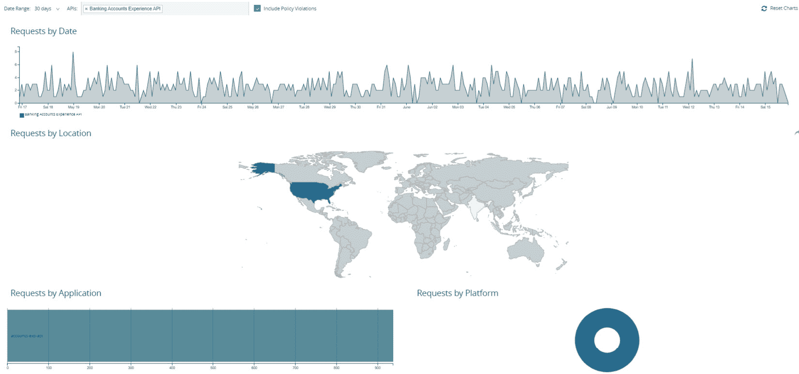

Figure 14.1 - API monitoring and analytics with API Manager

*Figure 14.1* 显示了一个开箱即用的仪表板，展示**按应用程序统计的请求**、**按位置统计的请求**、**按平台统计的请求**和**按日期统计的请求**。

API Manager 允许您为**请求大小**、**请求数**、**响应大小**和**响应时间**等指标创建自定义仪表板，如*Figure 14.2*所示：

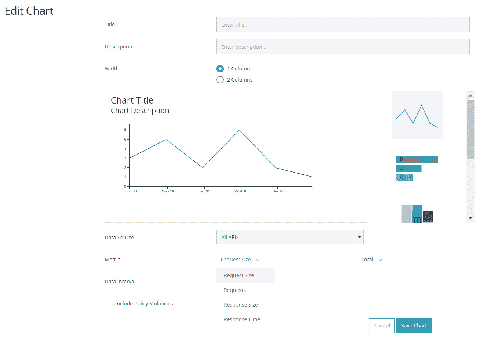

Figure 14.2 - Custom dashboard in API Manager

*Figure 14.2* 展示了如何为各种指标（如请求和响应大小、响应时间以及请求数量）创建自定义仪表板。

## 理解 Mule API 分析图表

API Manager 为每个 API 实例提供三种不同的图表：**请求摘要**、**热门应用程序**和**延迟**。

### 理解请求摘要图表

此图表显示您选择的时长内收到的请求数量。

默认时长为 1 小时：

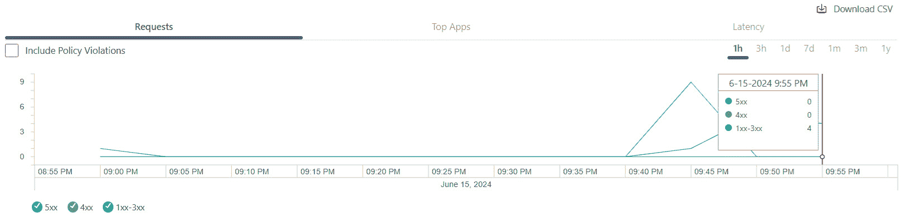

Figure 14.3 - Requests Summary chart

让我们看看不同图表线条的含义：

* **绿色**：返回 HTTP 状态码 1xx 到 3xx 的成功请求
* **灰色**：返回 HTTP 状态码 4xx（客户端错误）的失败请求
* **蓝色**：返回 HTTP 状态码 5xx（服务器错误）的失败请求

### 理解热门应用程序图表

**热门应用程序**图表显示调用该 API 实例的前 5 个应用程序各自向该 API 实例发出的请求总数：

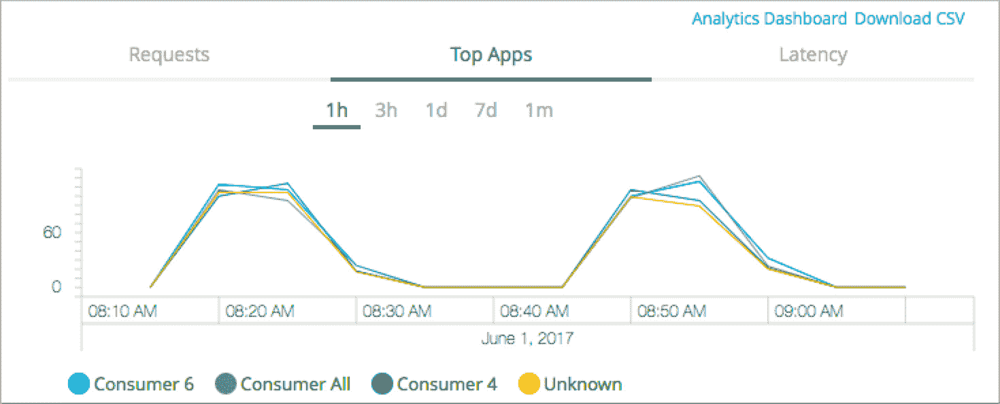

Figure 14.4 - Top Apps chart

图表中的每种颜色代表前五个应用程序中的一个。

### 理解延迟图表

**延迟**图表显示所选时间段内的平均响应时间。这有助于我们了解 API 的性能：

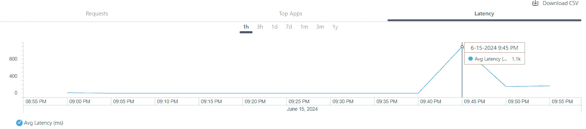

Figure 14.5 - Latency chart

响应时间越高（延迟越高），性能越差。

# API Manager 警报

API Manager 允许您为已创建的 API 实例设置各种警报。可以针对**请求计数**、**响应码**、**策略违规**和**响应时间**设置警报。这可以在 API Manager 中针对 API 实例轻松设置：

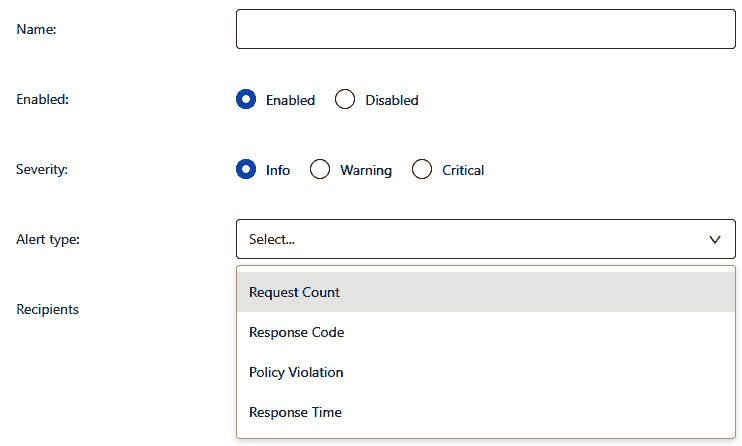

Figure 14.6 - API Manager alerts

要设置警报，您必须在 API Manager 实例中配置所需的警报，并提供应接收警报通知的目标收件人。

# 理解 Mule Analytics Event API

Mule Analytics Event API 允许您生成报表或图表。可以为特定环境中的多个 API 生成报表，也可以为同一 API 生成不同的报表。Analytics Event API 具有 30 天的保留策略和长达 10 分钟的数据可用性延迟。此 API 强制执行每分钟 10 个请求的使用限制，每个请求最多 20,000 个事件。超过每分钟 10 个请求的请求速率将被限流。

## API 报表

API Manager 允许您创建 API 报表，以识别诸如因 IP 黑名单或 JWT 验证失败导致的策略违规等事件：

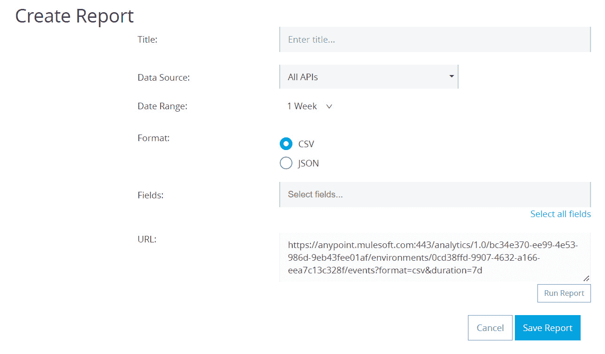

Figure 14.7 - Anypoint Monitoring report

报表可以为所有 API 或单个 API 生成 CSV 或 JSON 格式。

# 理解 Anypoint Monitoring

Anypoint Monitoring 与 Anypoint Platform 集成，因此它可以监控部署在本地、CloudHub 和 Runtime Fabric 上的应用程序。Anypoint Monitoring 提供内置仪表板，并允许您为各种指标创建自定义仪表板。

Anypoint Monitoring 的优势如下：

* 从单一视图监控所有微服务、应用程序和 API
* 降低**平均修复时间 (MTTR)**
* 即时了解应用程序的性能和运行状况
* 为**响应时间超标**和**CPU 与内存利用率超标**等情况设置警报
* 主动识别问题并快速解决，而不会造成太大影响

## 仪表板

Anypoint Monitoring 提供内置仪表板，提供有关应用程序指标的信息。仪表板还包含有关入站和出站请求、应用程序性能、故障指标以及部署在 CloudHub 上的应用程序的基础设施相关指标的数据。下图显示了 Anypoint Monitoring 提供的内置图表：

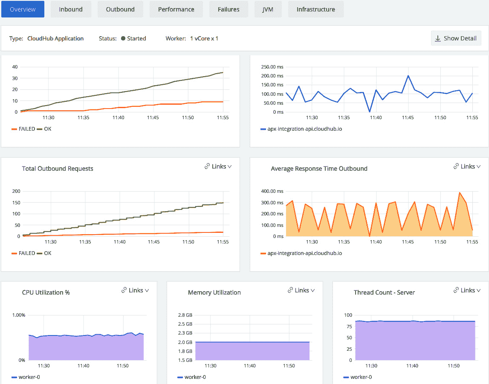

Figure 14.8 - Anypoint Monitoring dashboard

此仪表板可帮助您识别异常、排查应用程序问题并即时解决问题。

Anypoint Monitoring 允许您根据各种指标配置自定义仪表板。您可以通过 Anypoint Monitoring 控制台轻松配置自定义仪表板：


Figure 14.9 - Anypoint Monitoring custom dashboard

可以使用 Anypoint Monitoring 配置以下自定义仪表板：

* **Graph**：各种指标可作为时间序列数据显示。此自定义仪表板支持查询语言。
* **Singlestat**：显示单个时间序列数据分组的汇总统计信息（单个总计或数字）。


## 可视化类型

- **表格**：各种指标均可在表格中显示为时间序列数据。
- **文本**：以 HTML 格式显示文本信息，例如向图表添加标题。

# Anypoint Monitoring 事件驱动警报

Anypoint Monitoring 提供开箱即用的警报，您可以配置这些警报以通知他人应用程序网络中的任何异常。例如，假设您想在响应时间超标时添加警报；这可以在 Anypoint Monitoring 警报控制台中轻松配置：

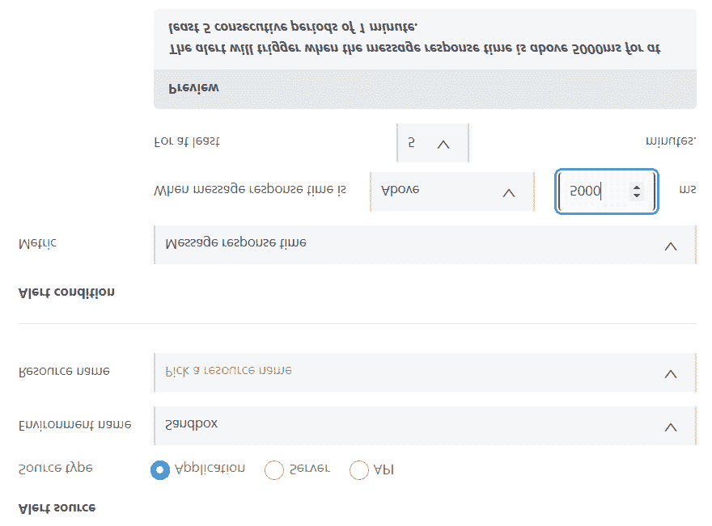
*图 14.10 - Anypoint Monitoring 事件驱动警报*

当消息响应时间在至少 5 个连续的 1 分钟周期内超过 5 毫秒时，将触发警报：

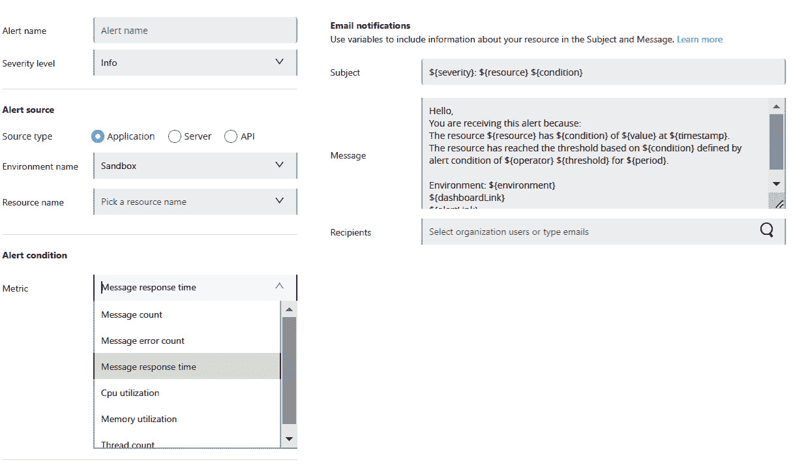
*图 14.11 - Anypoint Monitoring 事件驱动警报*

同样，您可以配置其他警报，例如 **消息计数**、**CPU 利用率**、**内存利用率** 和 **消息错误计数**。

# 为部署到 CloudHub 的应用程序启用 Anypoint Monitoring

为部署到 CloudHub 的应用程序启用 Anypoint Monitoring 有两种方式。让我们来看一下。

## 使用 Anypoint Monitoring 控制台

在 Anypoint Monitoring 的 **设置** 选项卡上，您可以选择 **CloudHub** 并为已部署到 CloudHub 的新应用程序启用 Anypoint Monitoring。这意味着任何新部署的应用程序都将启用 Anypoint Monitoring。

对于任何现有应用程序，您只需选择需要启用或禁用 Anypoint Monitoring 的环境和应用程序，即可为单个应用程序启用/禁用 Anypoint Monitoring。为此，请勾选或取消勾选每个应用程序的复选框：

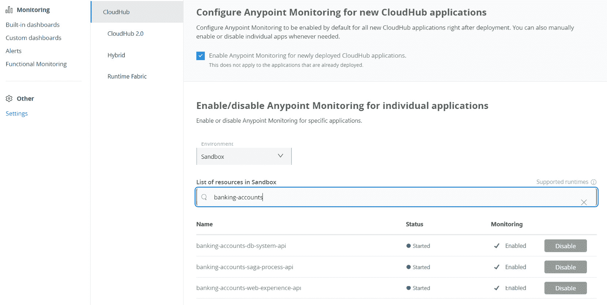
*图 14.12 - 启用 Anypoint Monitoring (CloudHub)*

## 在 CloudHub 设置中启用 Anypoint Monitoring

可以通过在 CloudHub 的 Runtime Manager 应用程序设置中添加 `anypoint.platform.config.analytics.agent.enabled=true` 属性来启用 Anypoint Monitoring。要禁用 Anypoint Monitoring，请将此属性的值更改为 `false`。启用 Anypoint Monitoring 可能会增加应用程序的 CPU 利用率。但请注意，利用率的变化取决于应用程序的行为，例如入站和出站调用速率：

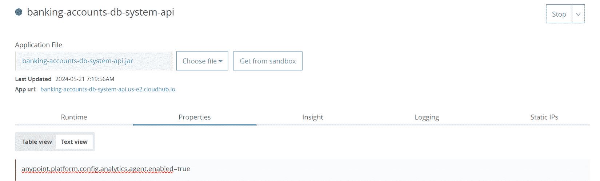
*图 14.13 - 从 Runtime Manager 启用 Anypoint Monitoring (CloudHub)*

可以通过将 `anypoint.platform.config.analytics.agent.enabled` 设置为 `false` 来禁用已部署到 CloudHub 的应用程序的 Anypoint Monitoring。

# 为部署到 CloudHub 2.0 的应用程序启用 Anypoint Monitoring

部署到 CloudHub 2.0 的应用程序默认已启用 Anypoint Monitoring。您无需进行任何额外配置即可为部署到 CloudHub 2.0 的应用程序启用 Anypoint Monitoring：

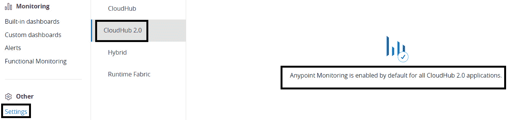
*图 14.14 - 启用 Anypoint Monitoring (CloudHub 2.0)*

要为部署到 CloudHub 2.0 的应用程序禁用 Anypoint Monitoring，请在 Runtime Manager 控制台的应用程序设置中添加 `anypoint.platform.config.analytics.agent.enabled=false` 属性：

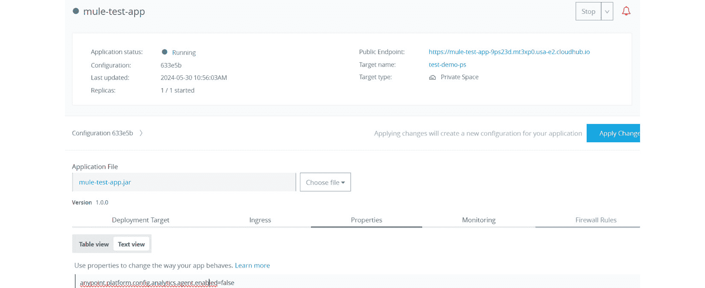
*图 14.15 - 从 Runtime Manager 禁用 Anypoint Monitoring (CloudHub 2.0)*

# 为部署到 Runtime Fabric 的应用程序启用 Anypoint Monitoring

部署到 Runtime Fabric 的应用程序默认已启用 Anypoint Monitoring：

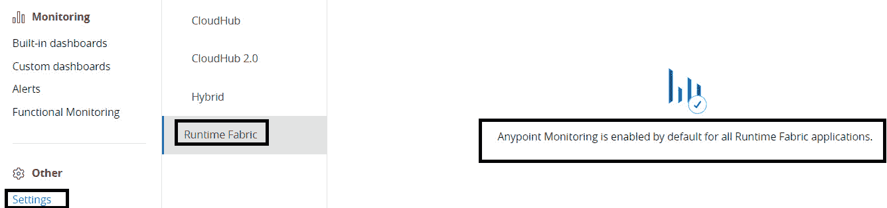
*图 14.16 - 启用 Anypoint Monitoring (Runtime Fabric)*

要为部署到 Runtime Fabric 的应用程序禁用 Anypoint Monitoring，请在 Runtime Fabric 控制台的应用程序设置中添加 `anypoint.platform.config.analytics.agent.enabled=false` 属性。

# 为部署在混合环境中的应用程序启用 Anypoint Monitoring

此处的混合环境是指运行时平面位于您的数据中心，而控制平面位于 Anypoint Platform。要为部署在混合环境中的应用程序启用 Anypoint Monitoring，需要在运行时平面上设置 Anypoint Monitoring 代理，以便其将监控数据发送到 Anypoint Monitoring API 端点。

要启用 Anypoint Monitoring，请通过选择环境和服务器、服务器组或集群，从 Anypoint Monitoring 控制台下载 `am.zip` 文件，并按照控制台上给出的说明在运行时平面上设置 Anypoint Monitoring 代理：

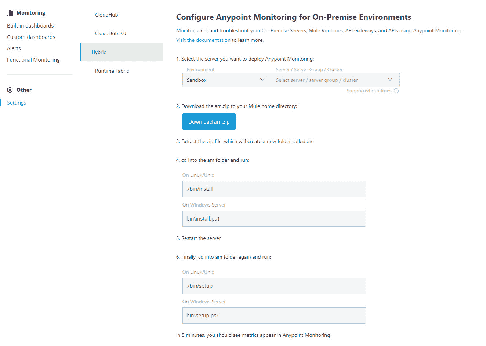
*图 14.17 - 启用 Anypoint Monitoring (混合环境)*

代理设置完成后，重启 Mule 运行时。在 5-10 分钟内，应用程序指标将开始出现在 Anypoint Monitoring 的内置仪表板上：

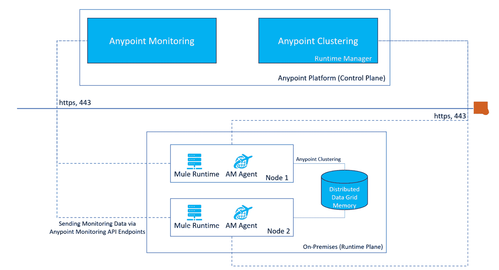
*图 14.18 - Anypoint Monitoring 架构 (混合环境)*

启用 Anypoint Monitoring 可能会增加应用程序的 CPU 利用率，但利用率的任何变化取决于应用程序的行为，例如入站和出站调用速率。

通常，对应用程序的 CPU 利用率影响将小于 5%。但是，要得出准确的数字，必须通过在不同环境中执行应用程序测试来进行影响分析。您可以通过启用和禁用 Anypoint Monitoring 来执行此操作。

# 数据保留策略和限制

下表描述了 Anypoint Monitoring 的数据保留策略和限制：

### 黄金和白金订阅

| 功能 | 限制 |
| --- | --- |
| 日志 | 30 天或 100 MB。 |
| 应用程序指标 | 30 天。 |
| 增强 API 指标 | 30 天。客户端应用程序中数据的限制为 30 天。 |
| Mule 应用程序和服务器的基本警报 | 50 个警报。 |
| API 的基本警报 | 每个实例六个基本警报。 |

### 钛金订阅

| 功能 | 限制 |
| --- | --- |
| 日志 | 以原始格式存储，您的日志可占用随钛金订阅接收的存储空间大小。 |
| 应用程序指标 | 365 天。 |
| 可搜索日志 | 额外存储空间为购买的用于可搜索日志索引存储大小的 10%。 |
| 增强 API 指标 | 30 天。客户端应用程序中数据的限制为 30 天。 |
| 自定义指标 | 365 天。 |
| 高级警报 | 每个父组织 20 个。 |
| Mule 应用程序和服务器的基本警报 | 组织中生产环境 vCore 数量的 50 倍再加 100。 |
| API 的基本警报 | 每个实例 10 个基本警报。 |

*表 14.1 - Anypoint Monitoring 数据保留策略和限制*

# 监控连接器

Anypoint 为 Anypoint 连接器提供了内置仪表板，包括数据库、Salesforce、Anypoint MQ、JMS、SMTP、HTTP 以及所有其他 Anypoint 连接器。每个连接器提供三个指标：

- **请求数**：连接器的平均请求数，按自动时间间隔分组
- **响应时间**：连接器的平均响应时间，按自动时间间隔分组
- **失败数**：连接器的平均请求失败数，按自动时间间隔分组

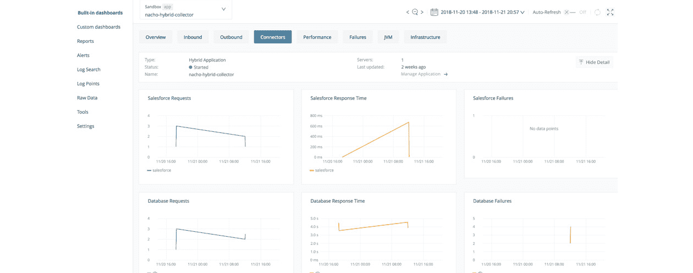
*图 14.19 - Anypoint Monitoring 连接器指标*

图 14.19 显示了数据库和 Salesforce 连接器的指标。

# 混合环境的服务器信息


当我们在 Anypoint Platform（控制平面）中注册服务器时，它会提供该服务器的 **CPU 利用率 (%)** 和 **堆内存 (MB)** 指标，以及在该服务器上运行的应用程序的状态，以及每个应用程序的 Mule 消息数量、响应时间和错误数：


Figure 14.20 - 服务器 CPU 和内存利用率

Figure 14.20 显示了特定时间间隔的 CPU 和内存利用率。您可以选择 **3 Hours**、**24 Hours**、**7 Days** 或 **2 Weeks**。

## 使用 Runtime Manager 为混合环境启用警报

MuleSoft 提供开箱即用的警报，可在服务器、服务器组和集群上进行配置。警报可在 Runtime Manager **Alerts** 控制台中配置。API Manager 警报没有速率限制。

可以轻松配置各种警报。

### 可以为服务器配置以下警报：

*   **Agent version changed**（代理版本已更改）
*   **Runtime version changed**（运行时版本已更改）
*   **Server CPU usage**（服务器 CPU 使用率）
*   **Server load average**（服务器负载平均值）
*   **Server memory usage**（服务器内存使用率）
*   **Server thread count**（服务器线程计数）
*   **Server connected**（服务器已连接）
*   **Server deleted**（服务器已删除）
*   **Server disconnected**（服务器已断开连接）

### 可以为服务器组配置以下警报：

*   **Server group connected**（服务器组已连接）
*   **Server group deleted**（服务器组已删除）
*   **Server group disconnected**（服务器组已断开连接）
*   **Server group’s node CPU Usage**（服务器组节点 CPU 使用率）
*   **Server group’s node Load average**（服务器组节点负载平均值）
*   **Server group’s node Memory Usage**（服务器组节点内存使用率）
*   **Server group’s node Thread count**（服务器组节点线程计数）
*   **Server group’s node connected**（服务器组节点已连接）
*   **Server group’s node disconnected**（服务器组节点已断开连接）
*   **Server added to server group**（服务器已添加到服务器组）
*   **Server removed from server group**（服务器已从服务器组移除）

### 可以为集群配置以下警报：

*   **Cluster connected**（集群已连接）
*   **Cluster deleted**（集群已删除）
*   **Cluster disconnected**（集群已断开连接）
*   **Cluster presents visibility issues**（集群出现可见性问题）
*   **Cluster’s node CPU usage**（集群节点 CPU 使用率）
*   **Cluster’s node load average**（集群节点负载平均值）
*   **Cluster’s node memory usage**（集群节点内存使用率）
*   **Cluster’s node thread count**（集群节点线程计数）
*   **Cluster’s node connected**（集群节点已连接）
*   **Cluster’s node disconnected**（集群节点已断开连接）
*   **Server added to cluster**（服务器已添加到集群）
*   **Server removed from cluster**（服务器已从集群移除）

### 可以为部署在混合环境中的应用程序配置以下警报：

*   **Application undeployed**（应用程序已取消部署）
*   **Deployment failure**（部署失败）
*   **Deployment success**（部署成功）
*   **Number of Mule messages**（Mule 消息数量）
*   **Number of errors**（错误数量）
*   **Response time**（响应时间）

## 使用 Runtime Manager 为 CloudHub 启用警报

MuleSoft 提供开箱即用的警报，可在 CloudHub 上进行配置。警报可在 Runtime Manager **Alerts** 控制台中配置。API Manager 警报没有速率限制。

### 可以为部署在 CloudHub 上的应用程序配置以下警报：

*   CPU usage（CPU 使用率）
*   Custom application notification（自定义应用程序通知）
*   Deployment failed（部署失败）
*   Deployment success（部署成功）
*   Exceeds event traffic threshold（超过事件流量阈值）
*   Memory usage – Cloudhub（内存使用率 – CloudHub）
*   Secure data gateway connected（安全数据网关已连接）
*   Secure data gateway disconnected（安全数据网关已断开连接）
*   Worker not responding（Worker 无响应）

## 使用 Runtime Manager 为 CloudHub 2.0 启用警报

MuleSoft 提供开箱即用的警报，可在 CloudHub 2.0 上进行配置。警报可在 Runtime Manager **Alerts** 控制台中配置。API Manager 警报没有速率限制。

### 可以为部署在 CloudHub 2.0 上的应用程序配置以下警报：

*   Deployment failed（部署失败）
*   Deployment success（部署成功）

警报的严重级别为 `Critical`、`Warning` 和 `Info`。警报可在服务器和应用程序上配置。对于部署在 Runtime Fabric 上的应用程序，没有可用的开箱即用警报。

# 功能监控

功能监控使您能够监控作为应用程序网络一部分的公共 API 和私有 API 的可用性和可靠性。启用功能监控后，您可以持续测试 API，以衡量其在生产和非生产环境中的性能和功能行为。

您可以在 Anypoint Monitoring 的功能监控控制台中设置功能监控。

在功能监控中创建监视器有两种方法：

*   使用 Anypoint Monitoring GUI
*   使用 `BAT CLI`

### 在功能监控控制台上使用 Anypoint Monitoring GUI，您可以创建一个监视器。请遵循以下步骤：

1.  **Set up the monitor**（设置监视器）：提供监视器的名称，选择要创建监视器的位置，并安排监视器计划：

    

    Figure 14.21 - 步骤 1（设置监视器）

2.  **Select endpoints**（选择端点）：添加一个或多个需要监控的端点。您可以提供需要监控的 API 端点，以及可选的任何 Header。您可以添加一个或多个断言来验证 HTTP 状态码、响应体或响应 Header：

    

    Figure 14.22 - 步骤 2（选择端点）

3.  **Set notifications**（设置通知）：功能监控支持五种类型的 **Notifier** – **Slack**、**PagerDuty**、**NewRelic**、**SumoLogic** 和 **Email**：

    

    Figure 14.23 - 步骤 3（选择通知）

选择您想要使用的 Notifier 并单击 **Create Monitor**。这将创建一个监视器，它将持续监控和测试 API。创建监视器后，它将根据计划持续监控 API 端点。您可以向同一个监视器添加更多计划：


Figure 14.24 - API 功能监控仪表板

### 监视器提供以下信息：

*   平均响应时间（毫秒）
*   最后一次执行的状态
*   最近几次执行的摘要，例如 `Assertions Status`
*   计划信息，如下次运行、计划、执行位置和位置状态
*   添加更多计划的选项
*   监视器的测试持续时间

## 监控公共 API 的端点

功能监控允许您在公共位置监控公共 API。公共 API 拥有通过互联网公开可用的端点。公共位置是与其他 MuleSoft 客户共享的区域。公共位置可以与一个或多个监视器的一个或多个计划相关联。

下图描述了如何监控公共端点，这些端点可以与 API、计划、公共位置和环境建立关系：


Figure 14.25 - 监控公共 API 的端点

以下监视器已在公共位置创建，用于监控公共端点：

*   **Monitor 1（单一计划、单一公共位置和单一环境）**：`Monitor 1` 在单一计划 (`Schedule 1`) 上运行，该计划与 `Public Location 1` 相关联。`Monitor 1` 设置为在单一环境中测试公共 `API 1` 和公共 `API 2`。
*   **Monitor 2（多个计划、单一公共位置和单一环境）**：`Monitor 2` 在多个计划 (`Schedule 2` 和 `Schedule 3`) 上运行，它们与 `Public Location 1` 相关联。`Monitor 2` 设置为在单一环境中测试公共 `API 3` 和公共 `API 4`。


## 监控公共 API 的端点

- `Monitor 3 (multiple schedules, multiple public locations, and multiple environments)`：`Monitor 3` 在多个计划上运行（`Schedule 4` 和 `Schedule 5`），并关联多个公共位置（`Public Location 1` 和 `Public Location 2`）。`Monitor 3` 设置为在多个环境中测试公共 `API 5` 和公共 `API 6`。

- `Monitor 4 (multiple schedules, single location, and single environment)`：`Monitor 4` 在多个计划上运行（`Schedule 6` 和 `Schedule 7`），并关联 `Public Location 2`。`Monitor 4` 设置为在单个环境中测试公共 `API 7` 和公共 `API 8`。

- `Monitor 5 (multiple schedules, multiple locations, and single environment)`：`Monitor 5` 在多个计划上运行（`Schedule 8` 和 `Schedule 9`），并关联多个公共位置（`Public Location 2` 和 `Public Location 3`）。`Monitor 5` 设置为在单个环境中测试公共 `API 9` 和公共 `API 10`。

- `Monitor 6 (multiple schedules, single location, and the World Wide Web)`：`Monitor 6` 在多个计划上运行（`Schedule 10` 和 `Schedule 11`），并关联单个公共位置（`Public Location 3`）。`Monitor 6` 设置为测试 `API 11` 和 `API 12`，它们可通过万维网访问。

## 监控私有 API 的端点

Functional Monitoring 允许您监控可通过 Anypoint Virtual Private Cloud 访问的私有端点。私有 API 可在 Anypoint Virtual Private Cloud 内部的网络中访问。测试只能针对可在私有位置访问的私有 API 运行。可以在单个 Anypoint Virtual Private Cloud 中创建多个私有位置，以及与 Anypoint Virtual Private Cloud 关联的私有位置。

要为在 Anypoint Virtual Private Cloud 中运行的私有端点设置监控，我们需要在 Functional Monitoring 中创建一个私有位置，这将在 Anypoint Virtual Private Cloud 中创建应用程序以监控私有 API。这将默认消耗 `0.2 vCores`。此配置可根据您的需求进行更改，例如更多工作节点和工作节点大小。要创建私有位置，请在创建监控时从 `Select location` 下拉菜单中选择 `Create new location`。为您的私有位置提供 `Name` 和 `Environment` 详细信息：

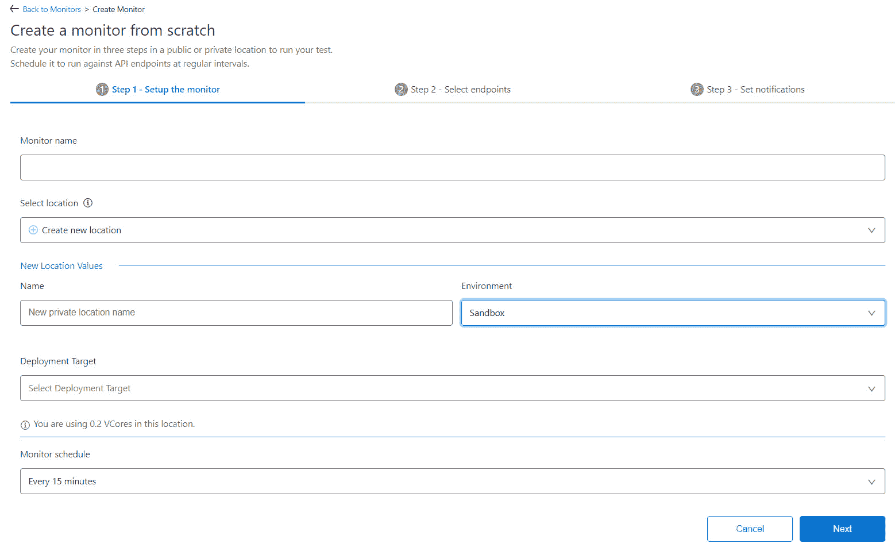

图 14.26 - 在 Functional Monitoring 中创建私有位置和监控

创建私有位置后，它将在 Anypoint Virtual Private Cloud 内的 CloudHub 中部署应用程序，以便您可以监控私有端点：

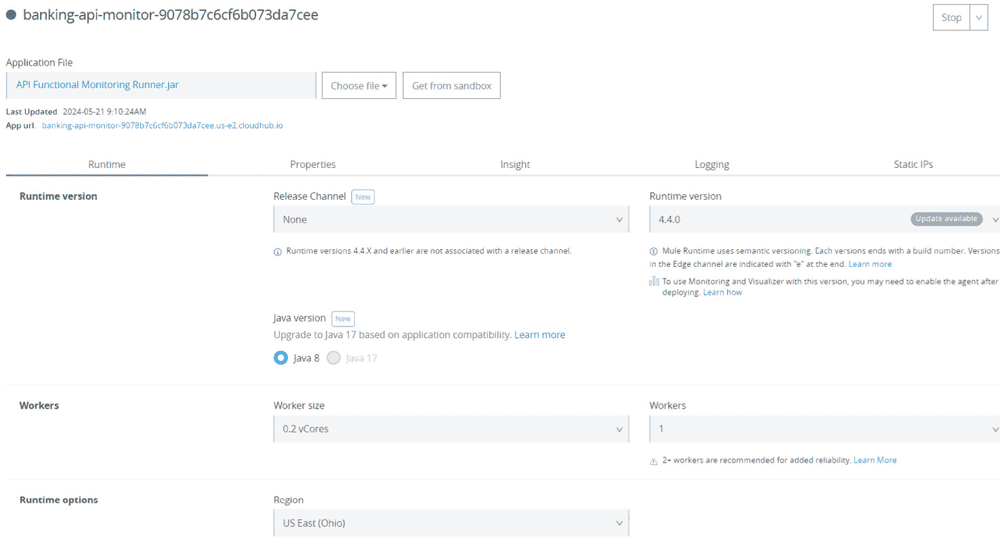

图 14.27 - 私有位置应用程序部署到 CloudHub

在图 14.27 中，我们可以看到应用程序已部署到 Anypoint Virtual Private Cloud 内的 CloudHub，以便我们可以监控私有端点。它也能够监控公共端点。

下图显示了如何监控与 API、计划、私有位置和环境具有关系的私有端点：

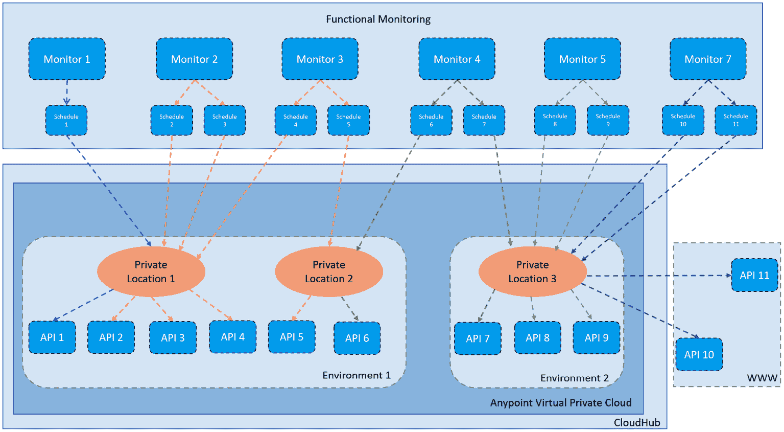

图 14.28 - 监控私有 API 的端点

以下监控已在公共位置创建，用于监控私有端点：

- `Monitor 1 (single schedule, single private location, and single environment)`：`Monitor 1` 在单个计划上运行（`Schedule 1`），关联 `Private Location 1`。`Monitor 1` 设置为在单个环境中测试私有 `API 1`。

- `Monitor 2 (multiple schedules, single private location, and single environment)`：`Monitor 2` 在多个计划上运行（`Schedule 2` 和 `Schedule 3`），关联 `Private Location 1`。`Monitor 2` 设置为在单个环境中测试私有 `API 2` 和私有 `API 3`。

- `Monitor 3 (multiple schedules, multiple private locations, and single environment)`：`Monitor 3` 在多个计划上运行（`Schedule 4` 和 `Schedule 5`），关联多个私有位置（`Private Location 1` 和 `Private Location 2`）。Monitor 3 设置为在多个环境中测试公共 `API 5` 和公共 `API 6`。

- `Monitor 4 (multiple schedules, multiple private locations, and multiple environments)`：`Monitor 4` 在多个计划上运行（`Schedule 6` 和 `Schedule 7`），关联多个私有位置（`Public Location 1` 和 `Private Location 2`）。`Monitor 4` 设置为在多个环境中测试公共 `API 6` 和公共 `API 7`。

- `Monitor 5 (multiple schedules, single private location, and single environment)`：`Monitor 5` 在多个计划上运行（`Schedule 8` 和 `Schedule 9`），关联单个私有位置（`Private Location 3`）。`Monitor 5` 设置为在单个环境中测试公共 `API 8` 和公共 `API 9`。

- `Monitor 6 (multiple schedules, single private location, and the World Wide Web)`：`Monitor 6` 在多个计划上运行（`Schedule 10` 和 `Schedule 11`），关联单个私有位置（`Public Location 3`）。`Monitor 6` 设置为测试 `API 10` 和 `API 11`，它们可通过万维网访问。

MuleSoft 提供选项，以便您可以从公共位置监控私有端点。这可以通过向 Anypoint Virtual Private Cloud 添加防火墙规则轻松实现。

在 Anypoint Virtual Private Cloud 防火墙规则中，`Type` 必须设置为 `https.port`，`Source` 可以自定义，`Port Range` 必须为 `8082`。对于自定义源，根据您的公共位置，添加表 14.2 中显示的以下 IP 地址之一：

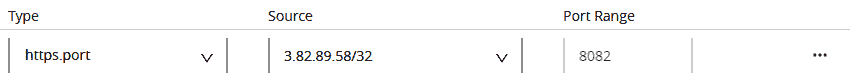

图 14.29 - 用于监控私有端点的 Anypoint Virtual Private Cloud 防火墙规则

使用这种方法，您无需创建私有位置即可监控私有端点。这将节省运行应用程序所需的 vCores，以便您可以从私有位置监控私有端点：

| 公共位置 | IP 地址 |
| --- | --- |
| us-east-1 | 3.82.89.58 |
| us-east-2 | 3.128.151.139 |
| eu-central-1 | 18.156.106.167 |

表 14.2 - IP 地址（公共位置）

表 14.2 显示了公共位置的各种 IP 地址。

# 为什么日志记录很重要？

日志记录对于任何应用程序都至关重要，用于事件和消息跟踪、故障排除、衡量应用程序性能以及识别应用程序中发生的错误。日志记录对于任何开发人员和运维人员快速识别和排查问题都至关重要。

MuleSoft 提供应用程序和运行时日志，以排查与应用程序和 Mule 运行时相关的问题。记录器组件可用于您的应用程序中，以进行监控和故障排除。它记录错误信息、负载和任何其他信息。此组件可在流中的任何位置使用，以记录字符串或 DataWeave 表达式，或字符串和 DataWeave 表达式的组合。

## Anypoint Monitoring 中的日志


要在 Anypoint Monitoring 中启用日志，您需要 Titanium 订阅。Anypoint Monitoring 会聚合日志文件，随后您可以对其进行管理、搜索、筛选或分析。日志可按应用程序、环境、日志级别、环境类型、类、时间戳、工作器等进行筛选。Anypoint Monitoring 允许您以表格或 JSON 格式查看日志，并且您可以使用高级搜索查询来搜索日志。

## 了解部署到 CloudHub 的 MuleSoft 应用程序的日志记录

每当应用程序部署到 CloudHub 时，它都会提供部署日志，包括该应用程序的系统日志和工作器日志。日志将保留 30 天（约 4 周半）或 100 MB 数据，以先达到的限制为准：

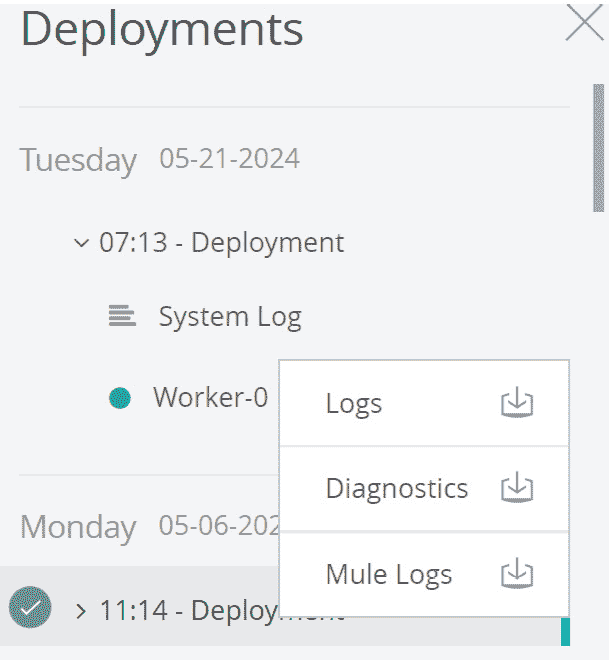

图 14.30 - CloudHub 部署日志

如前图所示，CloudHub 提供了下载 `Logs`（日志）、`Diagnostics`（诊断）和 `Mule Logs`（Mule 日志）的选项：

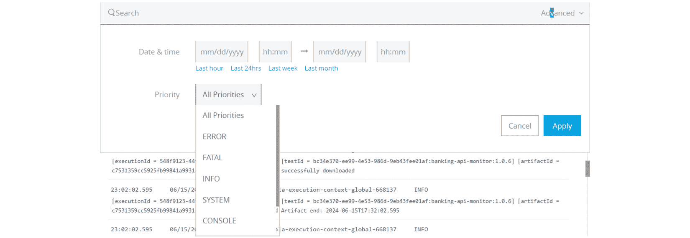

图 14.31 - CloudHub 日志搜索

图 14.31 显示日志可以根据其周期和优先级进行搜索。

### 将 CloudHub 应用程序日志发送到外部系统

部署到 CloudHub 的应用程序可以使用 `log4j2.xml` 与 ELK 或 Splunk 等外部日志记录系统集成。如果我们想将日志发送到外部系统，需要禁用 CloudHub 日志设置。默认情况下，您将看不到禁用 CloudHub 日志的选项。要使其在 CloudHub 的应用程序设置中可见，您需要联系 MuleSoft 支持团队：

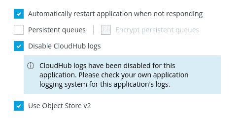

图 14.32 - 在 CloudHub 上禁用 CloudHub 日志

一旦该选项如图 14.32 所示变得可见，您可以勾选 `Disable CloudHub logs`（禁用 CloudHub 日志）以将日志发送到 Splunk 和 ELK 等外部系统。请注意，您还需要向 `log4j2.xml` 文件添加一个 appender（附加器）以将日志发送到外部系统。

要将日志发送到 Splunk，您可以向部署到 CloudHub 的应用程序的 `log4j2.xml` 文件添加 Splunk 或 HTTP appender：

这是 Splunk appender：

```xml
<SplunkHttp name="SPLUNK-CLOUD" source="mule-cloudhub-app" url="http://localhost:8088/"
            token="b3a34eabd-b5f4-471431-97d2-e5b234af5bae9e"            index="main"
            disableCertificateValidation="true">
            <PatternLayout pattern="[%d{MM-dd HH:mm:ss}] %-5p %c{1}            [%t]: %m%n" />
</SplunkHttp>
```

这是 HTTP appender：

```xml
<Http name="Splunk" url="http://localhost:8088/services/collector/raw">
  <Property name="Authorization" value="Splunk eert8e102-5f55-40ad-   a047-b55a82245419"></Property>
  <PatternLayout pattern="%-5p %d [%t] [event: %X{correlationId}] %c:  %m%n"></PatternLayout>
</Http>
```

要将日志发送到 ELK，您可以向部署到 CloudHub 的应用程序的 `log4j2.xml` 文件添加 socket appender。

这是 socket appender：

```xml
<Socket name="socket" host="${sys:elk.host}" port="${sys:elk.port}" protocol="TCP">
  <PatternLayout pattern="%-5p %d [%t] [event: %X{correlationId}] %c:  %m%n"></PatternLayout>
</Socket>
```

如果您禁用了 CloudHub 日志但仍可将日志发送到 CloudHub，请在 `log4j2.xml` 中使用 `Log4J2CloudhubLogAppender`。`Log4J2CloudhubLogAppender` 将日志数据发送到 CloudHub。这是 log4j2 CloudHub appender：

```xml
<Log4J2CloudhubLogAppender name="CLOUDHUB"
            addressProvider="com.mulesoft.ch.logging.            DefaultAggregatorAddressProvider"
            applicationContext="com.mulesoft.ch.logging.            DefaultApplicationContext"
            appendRetryIntervalMs="${sys:logging.appendRetryInterval}"
            appendMaxAttempts="${sys:logging.appendMaxAttempts}"
            batchSendIntervalMs="${sys:logging.batchSendInterval}"
            batchMaxRecords="${sys:logging.batchMaxRecords}"
            memBufferMaxSize="${sys:logging.memBufferMaxSize}"
            journalMaxWriteBatchSize="${sys:logging.            journalMaxBatchSize}"
            journalMaxFileSize="${sys:logging.journalMaxFileSize}"
            clientMaxPacketSize="${sys:logging.clientMaxPacketSize}"
            clientConnectTimeoutMs="${sys:logging.            clientConnectTimeout}"
            clientSocketTimeoutMs="${sys:logging.clientSocketTimeout}"
            serverAddressPollIntervalMs="${sys:logging.            serverAddressPollInterval}"
            serverHeartbeatSendIntervalMs="${sys:logging.            serverHeartbeatSendIntervalMs}"
            statisticsPrintIntervalMs="${sys:logging.            statisticsPrintIntervalMs}">
            <PatternLayout pattern="%-5p %d [%t] [event:            %X{correlationId}] %c: %m%n"/>
</Log4J2CloudhubLogAppender>
```

## 了解部署到 CloudHub 2.0 的 MuleSoft 应用程序的日志记录

每当应用程序部署到 CloudHub 2.0 时，它将提供运行时日志和应用程序日志。在 CloudHub 2.0 中，应用程序日志和运行时日志会被合并。它们可以从 Runtime Manager GUI 下载。

这些日志将保留 30 天（约 4 周半）或 200 MB 数据，以先达到的限制为准。

如果在应用程序设置中未勾选 `Enable application logs`（启用应用程序日志），日志将不会转发到 Anypoint Monitoring 和 Anypoint Runtime Manager：

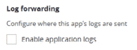

图 14.33 - 在 CloudHub 2.0 中启用应用程序日志

部署到 CloudHub 2.0 的应用程序可以通过在应用程序的 `log4j2.xml` 文件中配置相关 appender 来与外部日志记录系统集成，正如本章前面所讨论的那样。

## 了解部署到本地/混合环境的 MuleSoft 应用程序的日志记录

部署到本地 Mule 运行时的应用程序的日志可以在 `MULE_HOME/logs` 文件夹中找到，您可以在其中找到特定于应用程序的日志和运行时日志。也可以通过向 `log4j2.xml` 文件添加适当的 appender 将日志发送到外部系统。

正如我们已经讨论的，我们可以使用 Splunk 和 HTTP appender 将日志发送到 Splunk，并使用 socket appender 将日志发送到 ELK。

每当应用程序部署在混合环境中时，可以配置 Splunk 或 ELK 将事件跟踪或 API 分析发送到 Splunk 或 ELK。这可以在 Runtime Manager 的 Server Plugin（服务器插件）控制台中启用：

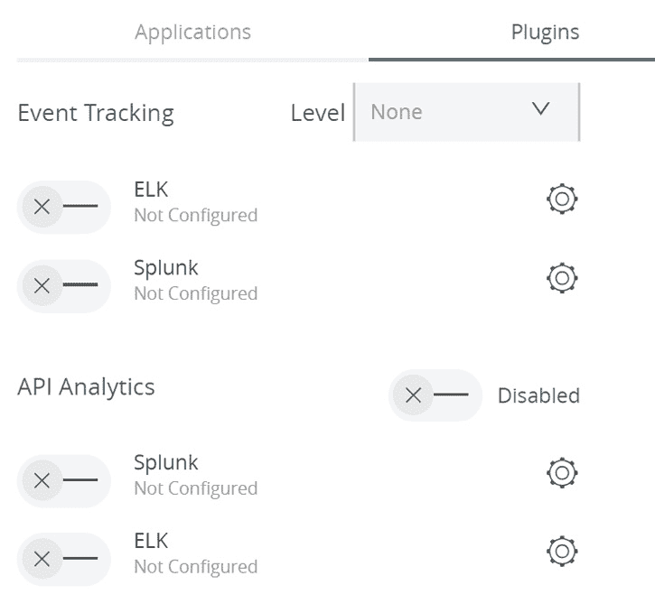

图 14.34 - 为部署在混合环境中的本地应用程序启用日志记录

图 14.34 显示了 API 分析和事件跟踪，可为混合环境中的 Splunk 和 ELK 启用这些功能：

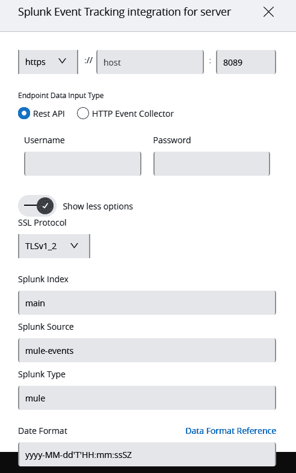

图 14.35 - 为混合环境配置 Splunk 事件跟踪

图 14.35 展示了如何为混合环境配置 Splunk 事件跟踪。

## 了解部署到裸金属系统/VM 上的 Runtime Fabric 的 MuleSoft 应用程序的日志记录

部署到 Runtime Fabric 的应用程序会为应用程序、Runtime Fabric 服务、API 代理和 Kubernetes 服务生成日志。托管在裸金属服务器或 VM 上的 Runtime Fabric 的日志在 OpsCenter 中可见。

您可以将 Runtime Fabric 配置为将日志转发到 Splunk、ELK、CloudWatch、Data Dog 或 Syslog 等外部日志记录系统，也可以配置为将日志转发到 Anypoint Monitoring。要将日志转发到 Anypoint Monitoring，您需要 Titanium 订阅。

可以通过在部署到 Runtime Fabric 的应用程序的 `log4j2.xml` 文件中配置 appender，将日志转发到 Splunk 或 ELK 等外部系统。我们在本章前面讨论了如何在 `log4j2.xml` 文件中配置 appender。


# 第 14 章：使用 Anypoint Platform 进行监控和日志记录

## OpsCenter

OpsCenter 是一个基于 Web 的工具，可用于监控裸金属服务器或虚拟机上的 Runtime Fabric。OpsCenter 允许我们将日志转发到外部系统和 Anypoint Monitoring，提供 SSO 集成，并提供 Runtime Fabric 的健康报告。它还提供仪表板以查看 CPU 核心使用率、Pod 指标、入口指标等。

Runtime Fabric 自带各种内置警报，并且可以使用 `Kapacitor` 配置自定义警报。

## Mule 应用程序的 JSON 日志记录

MuleSoft 提供了一个开箱即用的记录器组件，可用于应用程序中记录信息、错误、负载和状态通知。这在调试和排查任何问题时非常有用。记录器组件可用于 Mule 流中的任何位置，它允许您记录字符串数据、`DataWeave` 表达式的输出，或字符串数据和表达式的组合。

还有另一个可用于日志记录的组件，称为 `JSON Logger`，这是一个开源自定义连接器，允许您以 JSON 格式记录日志。由于它是自定义连接器，因此不受 MuleSoft 官方支持或管理。该组件提供以下功能：

*   日志采用 JSON 格式。
*   在记录前对敏感数据进行掩码处理。
*   隐藏不应记录的字段。
*   将日志发送到外部系统，如 `JMS`、`Anypoint MQ`、`AMQP` 等。
*   作用域记录器允许您计算一个或多个组件的耗时。可用于衡量 Mule 流中一个或多个组件的性能。
*   一个 `DataWeave` 函数，用于适应所需的日志格式。
*   `JSON Logger` 可根据您的要求和需求进行定制。
*   记录位置信息。
*   `JSON Logger` 可以添加到 Mule 流中的任何位置，它会异步记录日志。

## Anypoint Visualizer

Anypoint Visualizer 提供了正在运行和发现的 API 及 Mule 应用程序的实时图形化表示。它还显示了 Mule API、代理或应用程序网络中的应用程序所调用的第三方系统。

Anypoint Visualizer 收集部署在 `CloudHub` 上的 Mule 应用程序、API 和代理的数据，独立于 Mule 运行时引擎（Mule 实例），或在 `Runtime Fabric` 中收集数据，以定位所有传入和传出连接。如果应用程序、API 或代理在受支持的 Mule 实例上运行，则会连同所有依赖项一起被发现：

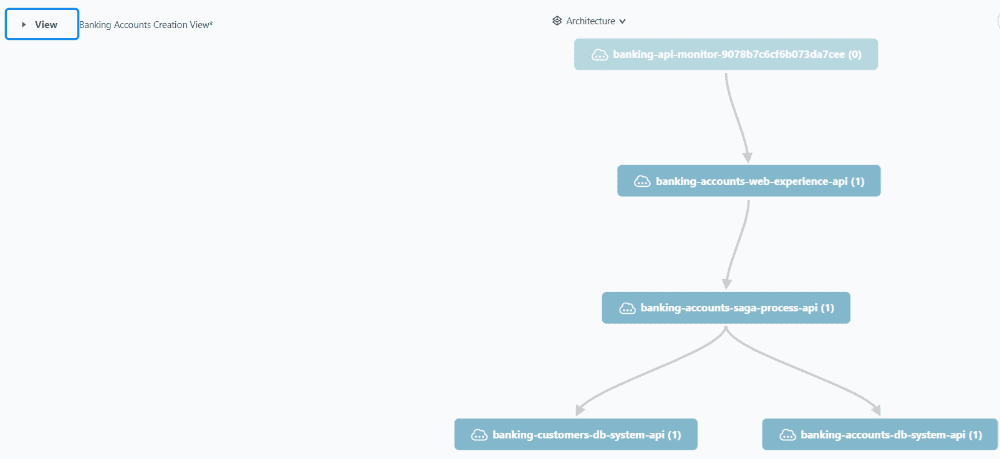

图 14.36 - Anypoint Visualizer

## 总结

Anypoint Monitoring 提供开箱即用的仪表板并支持自定义仪表板。它还允许您为各种条件配置警报，例如超过 CPU 使用率或内存使用率。

功能监控可配置为监控和测试公共和私有端点。Runtime Manager 为部署在 `CloudHub` 或混合环境中的应用程序提供开箱即用的警报。

部署在 `CloudHub`、混合环境和 `Runtime Fabric` 上的应用程序可以将日志转发到外部系统，如 `Splunk`、`ELK`、`Data Dog` 和 `Syslog`。API Manager 提供 API 分析信息，并允许您配置自定义仪表板和设置 API 警报。

在下一章中，我们将学习如何通过通用 API 管理控制 API 蔓延。

## 延伸阅读

要了解本章涵盖主题的更多信息，请查看以下资源：

*   *MuleSoft 文档*：CloudHub Architecture | MuleSoft Documentation
*   *本章中引用的几个表格来自 MuleSoft 官方文档*：[`docs.mulesoft.com/`](https://docs.mulesoft.com/)
*   *Anypoint Monitoring*：[`docs.mulesoft.com/monitoring/`](https://docs.mulesoft.com/monitoring/)
*   *日志*：[`docs.mulesoft.com/monitoring/logs`](https://docs.mulesoft.com/monitoring/logs)
*   *JSON Logger*：[`blogs.mulesoft.com/dev-guides/how-to-tutorials/json-logging-mule-4/`](https://blogs.mulesoft.com/dev-guides/how-to-tutorials/json-logging-mule-4/)
