# 第 15 章：使用通用 API 管理控制 API 蔓延

本章将演示如何使用 API Manager 管理 MuleSoft 和非 MuleSoft API 的生命周期。本章将解决 API 蔓延的成因，并概述如何使用通用 API 管理来控制 API 蔓延。

在本章中，我们将涵盖以下主题：

*   API 蔓延
*   通用 API 管理
*   API 网关
*   治理和保护 API
*   在 API 上启用 API 策略
*   管理 API 警报和分析
*   API 治理和安全

## API 蔓延

API 蔓延是用于描述企业内部 API 无序增长的概念。当组织内的团队或部门在缺乏足够监控或控制的情况下，为满足自身目的开发自己的 API 时，可能会导致 API 蔓延。这可能导致大量维护不善、无文档或不安全的 API。从 API 安全的角度来看，API 蔓延带来了严重的安全漏洞，必须加以解决。

以下原因可能导致 API 蔓延：

*   **缺乏集中式治理**：如果公司内的多个团队或部门在没有集中式治理框架的情况下创建自己的 API，可能会导致重复、重叠或不兼容的 API。
*   **非计划性增长**：为了适应新技术的采用和组织需求的变化，会开发新的 API。如果缺乏充分的准备，这可能会导致无法管理的 API 激增。
*   **供应商锁定**：如果组织过度依赖单一供应商来满足其技术需求，可能会开发出大量与其他系统不兼容的供应商专用 API。
*   **收购和合并**：收购或与其他企业合并的公司可能会接管被收购企业开发的一系列 API。这些 API 与组织现有 API 之间可能存在不兼容性，从而导致 API 蔓延。
*   **缺乏标准和文档**：当 API 没有良好的文档或不遵循行业标准时，开发人员可能难以理解如何高效使用 API。这可能导致额外的、冗余的 API 被创建出来，从而加剧 API 蔓延。

## 如何防止 API 蔓延

组织采用 API 最佳实践并实施清晰的 API 治理策略以防止 API 蔓延至关重要。防止 API 蔓延的第一步是盘点组织内的 API，确定哪些 API 对业务至关重要，并淘汰不再使用或不再需要的 API。

一旦创建了对业务至关重要的 API 清单，您就可以开始制定防止 API 蔓延的策略。以下是可以防止 API 蔓延的策略：

*   **使用单一来源进行 API 发现**：如果没有单一的事实来源，开发人员很难找到 API 并弄清其功能。例如，多条业务线可能会创建其他团队不知情的 API。这将在组织内部产生冗余 API，从而降低 API 在组织内的可重用性。一个可以在单一位置存储所有 API 的集中式平台将允许开发人员发现组织内的 API。开发者门户可用于发现 API，并将成为开发人员了解和发现组织内 API 的中心场所。


# 防止 API 蔓延

* **建立 API 治理**：组织应建立强有力的 API 治理来控制或防止 API 蔓延。这将确保 API 设计为可复用且易于扩展。API 治理是在组织内定义 API 最佳实践指南和标准的过程，旨在促进 API 复用，并推动 API 一致性和安全性。API 治理是采用 **API 优先策略** 的关键，在该策略中，API 是产品创建的基础。在 API 优先策略中，所有利益相关者、开发人员、设计师、架构师和产品经理在 API 创建之前就已知晓其存在。为实现这一点，建立 API 治理策略至关重要。

* **使用合适的 API 版本控制**：API 版本控制至关重要，因为大多数 API 都会超出其原始范围，或需要修复缺陷，这意味着 API 功能很可能会发生变更。API 版本控制将确保 API 的**向后兼容性**，因此变更不会影响现有的 API 消费者，他们可以逐步迁移到最新版本的 API。

* **限制创建的 API 数量**：限制创建的 API 数量是防止 API 蔓延的一种策略。这可以通过制定严格的指南来确定何时需要新 API，并确保所有相关方都认同其必要性来实现。此外，这应传达给开发团队和 CISO 团队，以便跨所有开发团队协调任务。

* **实施通用 API 管理**：API 的使用将随着时间的推移而不断增长。因此，最好现在就处理 API 蔓延问题，而不是等到它失控。通过开发一种通用化解决方案，确保所有 API 都可被发现且能够相互交互，可以阻止 API 蔓延并解决许多其他问题。我们将在本章进一步讨论通用 API 管理。

* **设计 API 规范**：API 规范是防止 API 蔓延的宝贵工具。在 API 规范的帮助下，开发人员可以查看 API 及其所有组成部分。它是一种自动生成的文档，易于人类阅读，解释了 API 的功能、来自 API 的请求和响应格式，以及 API 所需的其他参数（如标头）。API 规范可以用 **REST API 建模语言** (**RAML**)、**Open API 规范** (**OAS**) 或其他语言编写。

本节涵盖了 API 蔓延及其预防主题。下一节将介绍有助于阻止 API 蔓延的通用 API 管理理念。

# 通用 API 管理

无论 API 的设计、托管环境或开发地点如何，为其提供完整生命周期管理能力的能力被称为**通用 API 管理**。

借助通用 API 管理，您可以从单一控制平面控制、监管和保护多个 API。无论 API 是 Mule 还是非 Mule，无论它们托管在何处（本地、云端或其他地方），均可在以下领域实现这一点。

企业可利用的通用 API 管理优势如下：

* **适用于任何架构**：企业正在采用或实施多种架构风格，从微服务架构到单体架构。通过基于平台的安全性和管理，通用 API 管理允许企业使用任何架构风格或模式。

* **适用于任何来源的 API**：由于采用了微服务架构，企业正在将 AsyncAPI 和 GraphQL 等新协议纳入其 RESTful 技术栈。得益于通用 API 管理，组织可以使用任何 API，无论其开发地点或所用协议如何。

* **适用于任何环境**：在通用 API 管理的帮助下，您可以发现、管理、保护并与在任何类型环境中运行的 API 进行交互——本地、云、混合或其他环境。

* **适用于任何技术**：通用 API 管理使企业能够从单一控制面板处理 API 生命周期，独立于用于实现 API 的技术平台。

* **面向任何受众**：通用 API 管理为组织的所有 API 提供了一个中央存储库，使内部和外部受众能够以多种角色参与并增加价值。这包括建立新的联盟、增强最终用户体验和创造新的业务策略。

让我们讨论 MuleSoft 提供的用于实现通用 API 管理的各个组件：

* **设计中心**：设计中心是 Anypoint Platform 的一部分，允许开发人员用 OAS、RAML 和 AsyncAPI 编写 API 规范。

* **Anypoint CLI**：Anypoint CLI 允许开发人员自动编目、发现或复用 Anypoint Exchange 中的 API。

* **API 管理器**：API 管理器将管理 API 的整个生命周期。它是一个统一的单一平台，允许您管理所有 API。API 管理器使您能够应用安全策略，如 IP 允许列表、IP 阻止列表、客户端 ID 强制策略和 JWT 验证策略，以保护 API。

* **Flex 网关**：这是一个超快的 API 网关，使您能够以更快的响应和更低的占用来管理和保护 API。

* **Anypoint Exchange**：Anypoint Exchange 是可复用资产的存储库。Anypoint Exchange 允许您在企业内存储连接器、模板、API、片段、自定义资产等。您可以对资产进行编目（发布）、共享、搜索、发现和复用，以促进标准化、提高生产力和促进协作。

* **Anypoint 社区管理器** (**ACM**)：您可以使用 Anypoint API 社区管理器为公司内外的合作伙伴和开发人员创建和管理围绕 API 的社区。它创建利用您 API 的应用程序。借助 Salesforce Experience Cloud，API 社区管理器可以定制、品牌化、推广和互动，以满足您开发者受众的各种需求。除了为 Anypoint Exchange 中编目的 API 提供丰富的 API 展示外，还可使用 API 社区管理器管理客户端应用、API 访问凭证和消费分析。

* **API 体验中心**：您可以借助 Anypoint API 体验中心构建动态生态系统并增加 API 产品的参与度。使用现成的模板，您可以快速简便地创建自定义 API 门户，以将在任何平台或技术上开发的 API 产品化和发布。

我们已经讨论了通用 API 管理的优势以及如何防止 API 蔓延。现在我们将详细研究 MuleSoft 提供的 API 管理功能和组件，以监督完整的 API 生命周期。

# API 管理

为企业创建、设计、测试、监控、保护和分析 API 的过程称为 **API 管理**。API 管理平台提供一套全面的软件解决方案和流程，可托管在混合环境、云端或本地。通过 API 管理，企业可以确保内部或公开暴露的 API 是安全的、可消费的和可扩展的。

## 完整 API 管理生命周期

管理 API 从创建到退役的整个生命周期的过程称为**完整 API 生命周期管理**。这涵盖了创建、传播、记录、保护和评估 API 的各个方面。一个促进 API 发现和复用，同时确保适当治理和安全性的 API 管理系统，是任何成功 API 战略的基本组成部分。


# API 生命周期管理

MuleSoft 的 Anypoint Platform 为端到端 API 生命周期管理提供了强大的解决方案。清晰了解每个阶段有助于您提高 API 有效性并更快地解决潜在问题。API 生命周期的每个阶段如下：

## 1. 设计

使用 API Designer，您可以指定 API 的功能。例如，如果您正在为银行网站开发 API，您需要指定用于获取账户信息、创建账户和客户等的端点。创建功能测试和文档，以及为 `REST` API 设计 `RAML` 或 `OAS` 规范、为事件驱动架构设计 `AsyncAPI`，都是该阶段的内容。设计阶段是 API 生命周期的第一个阶段，也是最重要的阶段之一。在开发和实施之前，必须在此阶段规划和设计 API 结构：

### 1.1 创建 API 规范

这包括定义 API 将做什么、将处理什么数据以及将执行什么业务逻辑。规范使用 `RAML` 或 `OAS` 等语言创建。

### 1.2 定义端点和方法

设计 API 资源 URI 以及将对这些资源进行操作的 `HTTP` 方法（`GET`、`POST`、`PUT`、`DELETE` 等）。

### 1.3 设计数据模型

定义 API 将发送和接收的数据。这涉及规划 `JSON` 或 `XML` 消息结构、数据类型和数据元素。

### 1.4 创建模拟服务

MuleSoft 允许您在设计阶段创建模拟服务。这使 API 消费者能够在 API 完全实现之前与其进行交互。

### 1.5 文档

从 API 规范自动生成 API 文档。文档详细说明如何使用 API 并提供示例。

### 1.6 协作与评审

与利益相关者和 API 消费者共享设计以进行评审和反馈。这可以直接通过 Anypoint Platform 中的 Anypoint Exchange 完成。

请记住，API 的成功最终取决于其为用户设计得有多好。在设计阶段，确保 API 易于使用且易于理解，并确保其准确满足其设计初衷的业务需求和目标，至关重要。

## 2. 开发

Anypoint Studio 允许您将设计转换为功能代码。开发人员利用预制的连接器和组件创建 Mule 应用程序。例如，在银行场景中，您可以定义一个流来分别处理账户信息的 `GET` 和 `POST` 请求，并使用 `HTTP` 监听器作为源。

## 3. 安全

在此阶段，您可以使用基于策略的安全模型（如 `OAuth` 和 `JWT` 验证）来保护您的 API。例如，您可以将策略应用于 API 代理以保护您的银行 API 端点，包括 `IP` 白名单或速率限制。

## 4. 部署

API 可以使用 Anypoint Runtime Manager 部署在云端、本地或混合环境中。例如，您的银行 API 可以部署到 CloudHub，确保在购物高峰期的可用性和可扩展性。

## 5. 运营

Anypoint Monitoring 和 Anypoint Visualizer 对 API 进行管理、监控、分析和可视化。在银行 API 示例中，Anypoint Monitoring 监控 API 的响应时间和请求数量。此外，Anypoint Visualizer 可以创建所有 API 和集成的实时视图，实时描绘应用程序网络。

## 6. 管理

Anypoint Exchange 和 Anypoint API Manager 提供了一个用于管理、治理和发布 API 的环境。假设您的银行有多个 API。API Manager 将从单一位置管理这些 API，设置 `SLA` 和策略，并控制访问。

## 7. 版本控制与弃用

Anypoint Platform 简化了 API 版本控制。每当需要更改时，您可以引入新版本并弃用旧版本。在我们的银行示例中，如果订单处理方式发生变化，可以引入 API 的新版本。

## 8. 互动

这是 API 用户可以探索和试用 API、提供反馈以及在 Anypoint Exchange 中发现资产的地方。在我们的银行示例中，第三方开发者可以访问 Anypoint Exchange，找到您的 API 文档，了解其功能，并学习如何将其集成到他们的应用程序中。

通过这些阶段，API 不断演进。生命周期管理确保这种演进不会影响所提供的服务，并确保阶段之间的过渡平滑，从而提高 API 的整体实用性、可靠性和盈利能力。

本节展示了用于设置和维护 API 的 API 管理生命周期。我们将在下一节讨论用于管理和保护 API 的 MuleSoft API 网关。

# API 网关

API 网关是一个典型元素，有助于路由 API 调用、聚合 API 响应，并通过速率限制等功能强制执行 `SLA`。它充当传入消息和请求的入口点，使其成为 API 管理系统的关键组件或工具。

组织的 API 由 API 网关保护，后者也充当安全访问点。它们实施行业标准的加密和访问控制，赋予 API 开发者授予访问权限并将用户引导至正确方向的能力。网关将您构建的后端服务和 API 隔离在一个可由您的 API 管理解决方案控制的层中。

## 为什么需要 API 网关？

API 网关在保护和控制 API 流量方面发挥着重要作用。API 网关隐藏 API 的实际实现，并在 API 消费者和 API 实现之间提供隔离。

API 网关提供以下功能：

*   **流量控制**：通过应用 `rate-limiting` 策略可以限制流量，这有助于减少 `分布式拒绝服务 (DDoS)` 和 `拒绝服务 (DoS)` 攻击。例如，每个客户端每分钟可调用 API 20 次。
*   **API 分析**：依赖 API 的企业必须投资于 API 分析，因为它提供了关于客户行为和 API 性能的全面洞察，这直接关系到数字战略的有效性。
*   **API 警报**：可以为响应时间、请求计数、策略违规和响应代码启用 API 警报。
*   **身份验证和授权**：通过应用基本身份验证、`JWT` 验证策略和 `OAuth` 策略等安全策略，可以对 API 进行授权和身份验证。
*   **高效且富有成效的 API 开发**：运行多个 API 版本以促进新版本的快速迭代、测试和交付。转换协议以支持使用单个 API 的各种客户端。

MuleSoft 支持三种类型的 API 网关，可用于管理 API 的不同目的：

*   `Mule Gateway`
*   `Service Mesh`
*   `Flex Gateway`

# Mule Gateway

`Mule Runtime` 包含一个嵌入式 API 网关，它允许您通过在 API 之上应用安全 API 策略来保护 API，丰富传入和传出的 API 消息，并使用 `IP allowlist` 或 `blocklist` 策略丢弃来自不受信任来源的请求。`Mule Gateway` 允许您在后端 API 或服务之上添加一个编排层，这将把编排层与实现层隔离开来。


Mule Gateway 是 Anypoint Platform API Manager 的组件，用于控制 API 流量和 API 访问、强制执行使用策略，以及收集和整理 API 分析数据。它充当所有 API 的守门人，将访问权限仅限于经过授权和验证的用户或应用程序。API 网关负责强制执行 SLA、身份验证和授权，以及请求路由、组合和协议转换。它为用户应用程序与您的 API 或微服务之间，以及您的网络上提供安全保障。

现在，我们将讨论利用 API 自动发现 和 API 代理 在 MuleSoft 和非 MuleSoft API 上提供 API 管理功能的两个关键概念。

## API 代理

一种称为 API 代理 的 MuleSoft 功能充当应用程序和后端 API 之间的桥梁。MuleSoft 的 API 代理使您能够更高效地管理 API，确保其具有可扩展性、安全性和处理流量的能力。

以下是 API 代理的优势：

*   **安全性**：可以设置 API 代理以提供权限和身份验证等安全功能，保护后端 API 免受未经授权的访问。
*   **限流**：API 代理允许我们控制发送到后端 API 或服务的请求数量。简单来说，API 代理可以限制发送到后端 API 或服务的请求数量，防止后端 API 因一次性接收过多请求而不堪重负。
*   **监控和分析**：出于监控和调试目的，API 代理可以跟踪请求和响应，并提供有价值的数据。
*   **缓存**：代理可以保存后端 API 的响应，用于回复相同的请求，从而减轻后端负载并缩短响应时间。
*   **隐藏 API 实现**：API 代理通过不直接暴露后端 API 的 URL 来隐藏后端 API 的实现。

MuleSoft API 代理可以部署在 `CloudHub 1.0`、`CloudHub 2.0`、本地 `Mule Runtime` 和 `Anypoint Runtime Fabric` 上。每当您使用 `API Manager` 创建 API 代理时，它都会在所选平台上创建一个代理应用程序。例如，在 `CloudHub 1.0` 上创建 API 代理至少需要 0.1 个 vCore 和一个工作节点。

## 何时使用 API 代理

以下是使用 API 代理的原因：

*   当您的 API 是非 MuleSoft API，并且您希望为非 MuleSoft API 启用 MuleSoft API 管理功能时
*   当您希望使用 `RAML`、`OAS` 或 `SOAP` API 验证 API 时
*   当您的 Mule 应用程序是闭源代码，且您无法访问以应用 API 自动发现时

以下是 API 代理的示意图：

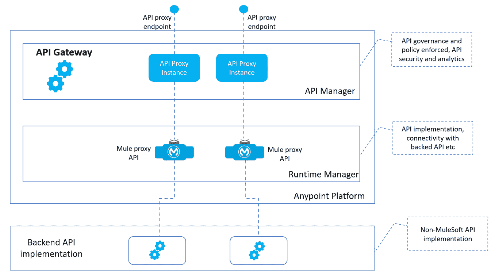

图 15.1：API 代理

`图 15.1` 展示了如何为后端 API 启用 API 代理，并利用其 API 管理功能来启用 API 策略、安全性和分析。让我们讨论如何通过在后端 API 前面实施 API 代理来管理非 MuleSoft API。

### 管理托管在本地数据中心的非 MuleSoft API

J&J Music 的 API 托管在一个无法通过公共互联网直接访问的本地数据中心中。为了管理、保护、治理和使用这些 API，他们希望利用 API 管理功能。为了实施其 API 管理，他们选择了 Anypoint Platform。

有两种方法来处理此场景。要在本地数据中心运行的后端 API 上实施 API 管理功能，我们需要一个 API 代理。我们需要一个 `Mule Runtime`（可以是 `CloudHub` 或本地 `Mule Runtime`）来配置和部署 API 代理。

#### 方案 1 – 在 CloudHub 中部署 API 代理以管理非 MuleSoft API

要在 `CloudHub` 上实施 API 代理以管理后端非 MuleSoft API，我们需要设置 Anypoint `虚拟私有云` (`VPC`) 和 `虚拟专用网络` (`VPN`)。Anypoint VPN 允许部署在 `CloudHub` 上的 API 代理与托管在本地数据中心的后端 API 进行通信。以下是在 `CloudHub` 上为托管在本地数据中心的后端 API 实施 API 代理的示意图：

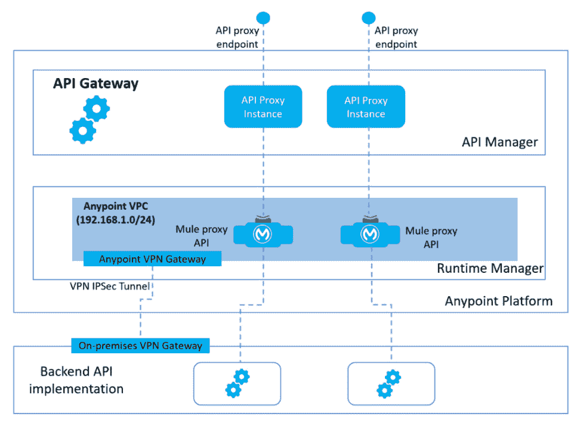

图 15.2：CloudHub 上用于本地数据中心托管的非 MuleSoft API 的 API 代理

#### 方案 2 – 在本地 Mule Runtime 中部署 API 代理以管理非 MuleSoft API

将 API 代理部署到可与后端 API 交互的本地 `Mule Runtime` 是管理后端 API 所必需的。在这种情况下，不需要 VPN，因为后端 API 和 `Mule Runtime` 位于同一个数据中心。

下面是一个示例，展示如何在本地 `Mule Runtime` 中为在本地数据中心运行的后端 API 设置 API 代理。

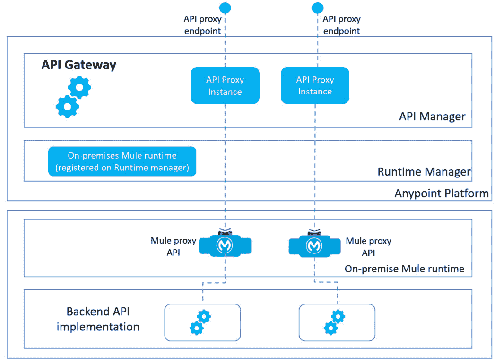

图 15.3：用于本地数据中心托管的非 MuleSoft API 的 API 代理

重要的是，本地 `Mule Runtime` 必须在 Runtime Manager（Anypoint Platform 控制平面）中注册为服务器、服务器组或集群。这将允许我们在本地 `Mule Runtime` 中部署 API 代理。

## API 自动发现

在 MuleSoft 中，将 API 连接到其已部署的 Mule 应用程序实例的过程称为 API 自动发现。API 自动发现过程将已部署的 Mule 应用程序链接到相应的 Anypoint Platform API，使 API 在平台中可见，并启用版本和状态跟踪。借助此过程，您现在可以从 Anypoint Platform 的 Runtime Manager 实时控制、监控和跟踪 API。

MuleSoft API 自动发现的一些基本功能如下：

*   实时绑定已部署的 API 实例，以便于跟踪和管理
*   使用 Anypoint Platform 直接管理和监控已部署的 API
*   提高 API 的版本和状态可见性

任何希望保持对其 API 的可见性和控制力的组织都应利用此功能，尤其是那些拥有复杂、大容量 API 环境的组织。值得注意的是，必须应用特定于 API 的策略才能使用 API 自动发现。

API 自动发现可针对部署在 `CloudHub 1.0`、`CloudHub 2.0`、`Runtime Fabric` 和本地 `Mule Runtime` 上的 Mule API 实施。

下图说明了部署在 `CloudHub`、`Runtime Fabric` 或本地 `Mule Runtime` 上的 MuleSoft API 的 API 自动发现：

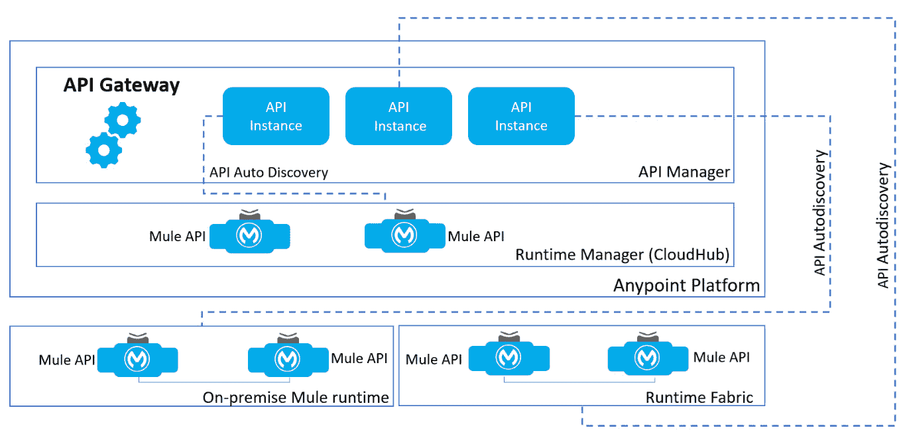

图 15.4：API 自动发现

API 自动发现可针对部署在本地 `Mule Runtime`、`Runtime Fabric` 或 `CloudHub` 上的 MuleSoft API 实施。要实施 API 自动发现，第一步是在 `API Manager` 中创建一个 API 实例，这将生成一个 API ID。我们可以在 Mule 代码的 API 自动发现组件中配置该 API ID 和主 Mule 流。在部署期间，我们需要传递两个属性：

*   `anypoint.platform.client_id`
*   `anypoint.platform.client_secret`

这两个属性的值因环境而异。对于本地 `Mule Runtime`，这两个属性可以在 `wrapper.conf` 中设置。

## API 代理与 API 自动发现的对比

以下是 API 代理和 API 自动发现的区别：

| | **API 代理** | **API 自动发现** |
| --- | --- | --- |


| **定义** | | API 代理是一种接口，用于向客户端应用隐藏后端服务或 API。它可用于 API 实现的开发、测试和生产阶段。API 代理的主要目标是流量管理和安全。它提供路由、适应性、速率限制和安全等功能。 | | MuleSoft 的 API 自动发现功能通过在 API 及其已部署的 Mule 应用程序之间建立连接，使已部署的 Mule 应用程序能被 API 管理器识别。这使得可以从 Anypoint Platform 控制 API 的版本和状态。 |
| **目的** | | 它能够隐藏和保护后端 API 实现。 | | 它能够将已部署的 MuleSoft API 与 API 管理器实例关联，以管理和保护 API。 |
| **管理非 MuleSoft API** | | API 代理可用于管理非 MuleSoft API 以及 MuleSoft API。 | | API 自动发现只能管理 MuleSoft API。 |
| **用法** | | 它被用作客户端应用程序与后端服务或 API 通信的接口。 | | 它用于在 Mule 应用程序部署后对 API 进行管理和监控。 |
| **CloudHub 和 Runtime Fabric 上的 vCore 要求** | | API 代理在运行时平面部署代理应用程序，这需要 vCore。 | | 不需要额外的 vCore。 |

表 15.1：API 代理与 API 自动发现对比

# Anypoint Service Mesh

服务网格是一种软件架构模式，用于将代理服务器作为微服务部署，并使用边车来促进服务之间安全、快速且持续的通信。大多数服务网格（包括 Istio）都是使用 Kubernetes 集群部署的。尽管存在大量商业产品和开源服务网格项目，但 Istio 已成为事实上的行业标准。

为了实现它们，通常会使用边车的代理模式。边车代理伴随每个应用程序，管理所有服务间通信。它负责东西向流量的发现、路由、安全和监管。每个代理实例都连接到一个控制平面，控制平面提供了一种控制网格的方式。您的服务间交互由在控制平面层面管理的安全和通信策略进行管控。现在可以在控制平面层面应用身份验证和授权策略，指示边车在服务间网络调用期间做出适当响应。

Anypoint Service Mesh 是 MuleSoft 提供的一种产品，可简化微服务的管理和控制。它旨在提供服务网格的优势，同时将 Anypoint Platform 的功能扩展到部署在非 Mule 运行时引擎中的任何微服务。

以下是 Anypoint Service Mesh 的功能：

*   **服务发现**：跨分布式环境自动发现非 Mule 应用程序和服务
*   **安全性和可靠性**：一键应用一致的预构建安全性和可靠性策略，无需更新微服务代码
*   **流量管理**：通过重试、限流和熔断策略控制微服务流量并防止停机
*   **性能监控**：通过与 Anypoint Monitoring 集成，深入了解微服务的性能和运行状况
*   **分析和洞察**：通过 API 和集成分析理解和可视化服务性能和依赖关系的元数据
*   **治理和控制**：将 Anypoint Platform 的治理和控制功能扩展到所有已部署的实例

使用 Anypoint Service Mesh，组织可以确保其微服务（无论这些服务是使用 MuleSoft 还是其他平台构建的）能够以标准化的方式被发现、管理和保护。

以下是 Anypoint Service Mesh 架构图：

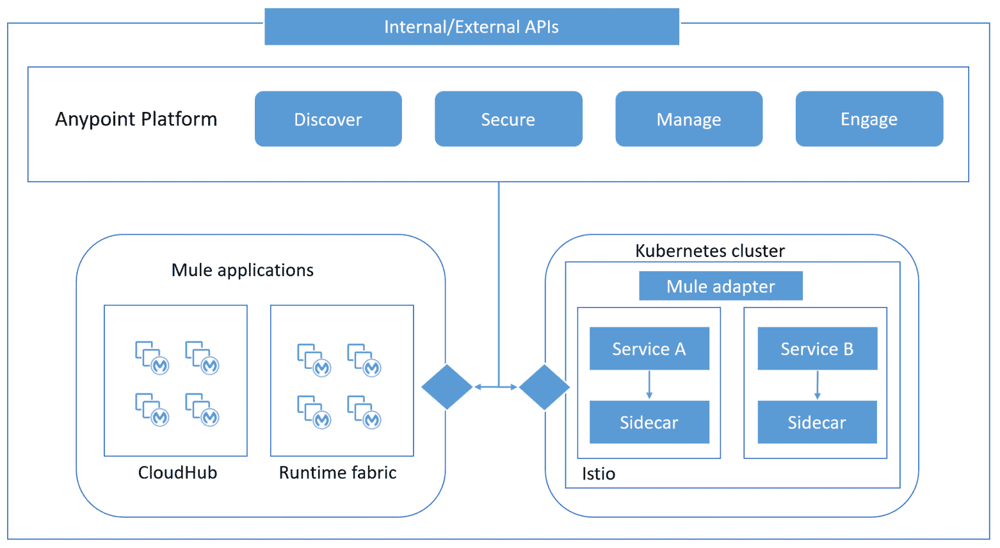

图 15.5：Anypoint Service Mesh 架构

如图 15.5 所示，Anypoint Platform 位于架构的顶层，为使用 Mule 运行时引擎构建的微服务提供完整的生命周期 API 管理功能。这些 Mule 实例可以在 Runtime Fabric 或 CloudHub 中本地设置。安装在 Kubernetes 集群上的 Istio 使用边车代理来利用 Envoy 进行服务管理。边车与您的服务位于同一个容器中，并监管其所有通信。即使启用了 Anypoint Service Mesh，您仍可以继续使用 Istio 的原生策略进行安全和流量控制。

组件通过 MuleSoft 适配器连接到 Anypoint Platform。适配器与代理协作，允许所有网格管理的服务共享元数据，这使得 Anypoint Platform 能够将 Kubernetes 集群中的当前微服务识别为 API。服务被发现后，Anypoint Exchange 使用元数据自动为每个服务查找并创建 API（HTTP、REST 或 SOAP）。然后，可以使用 API Manager 来管理这些 API。同样，Anypoint Monitoring 通过元数据从边车代理获取数据，并将其提供给 API Analytics。

## Flex Gateway

Anypoint Flex Gateway 速度极快，旨在保护和管理随处使用的 API。Anypoint Flex Gateway 在任何环境中提供企业级安全性和可管理性，并具备满足甚至最苛刻应用程序所需的性能。它旨在与 DevOps 和 CI/CD 工作流无缝集成。

Flex Gateway 是一个轻量级的、基于 Envoy 的 API 网关，能够在一个统一框架下管理、保护、发现和交互 API。由于它能够管理用任何技术实现的 API（技术无关）、遵循任何架构（从单体架构到微服务架构）并在任何地方运行（云、本地、混合等），因此该网关可防止 API 蔓延。

### Flex Gateway 的优势

以下是使用 Flex Gateway 的优势：

*   能够管理和保护位于任何位置的 API
*   将 Anypoint Platform 的功能扩展到 MuleSoft 和非 MuleSoft API
*   实现跨任何环境中运行的每个 API 的一致安全性和治理
*   通过轻量级灵活的 API 网关适应任何架构以管理和保护 API
*   在单一框架下治理所有 API
*   Flex Gateway 可设置为 Linux 服务、Docker 容器或 Kubernetes Ingress 控制器
*   Flex Gateway 可设置为连接模式和本地模式

### Flex Gateway 连接模式

在连接模式下，Flex Gateway 在 Runtime Manager 中注册，我们可以在 API Manager 中查看 API 实例和策略配置。连接模式让您能够访问 Anypoint Platform 的所有功能，包括通过 Exchange 实现复用和通过 API Analytics 进行监控，同时允许您从单一统一的控制平面管理所有非 Mule API。下图展示了作为 Kubernetes Ingress 控制器的 Flex Gateway 连接模式：

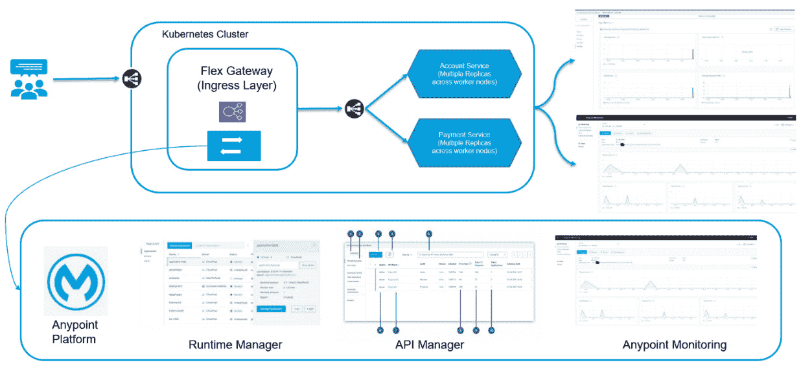

图 15.6：Flex Gateway 连接模式

在图 15.6 中，我们可以看到连接模式下的 Flex Gateway 可以使用 MuleSoft 提供的开箱即用组件（如 API Manager、Anypoint Monitoring 和 Runtime Manager）来管理和保护发布到 Flex Gateway 的 API。

### Flex Gateway 本地模式


# Flex Gateway 本地模式

在本地模式下，Flex Gateway 与 Anypoint Platform 完全断开连接。在本地模式下控制 Flex Gateway 的主要方式是通过配置文件或 YAML 文件。我们可以使用此文件控制 API 实例和相关安全策略。非 Mule API 可在本地模式下由 Flex Gateway 管理，而无需 Anypoint 控制平面的协助（本地保存的声明式配置文件用于处理本地模式下的所有配置和策略应用）。

下图展示了作为 Kubernetes Ingress 控制器的 Flex Gateway 本地模式：

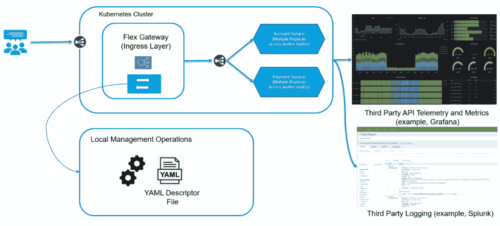

图 15.7：Flex Gateway 本地模式

在图 15.7 中，我们可以看到本地模式下的 Flex Gateway 由 YAML 描述符文件管理，并且需要 Splunk 和 ELK 栈等第三方工具进行监控和日志记录。当企业有严格策略要求 API 流量不得离开内部网络，或存在任何合规性或安全要求时，均可将 Flex Gateway 设置为本地模式。

## Flex Gateway 部署模型

Flex Gateway 支持多种部署模型，可在连接模式和本地模式下实施。可实施以下部署来设置 Flex Gateway。

### 独立部署模型

在独立部署模型中，Flex Gateway 作为独立服务运行，以保护企业内的一个或多个 API。下图展示了 Flex Gateway 独立部署：

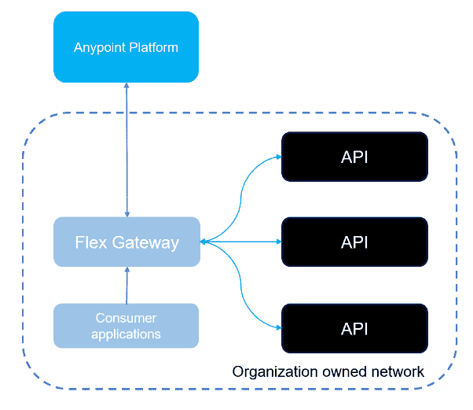

图 15.8：Flex Gateway 独立部署

在图 15.8 中，我们可以看到所有流量都在组织网络内部。内部流量通过 Flex Gateway 路由至消费者应用程序。

### Ingress 部署模型

Ingress 部署模型作为独立服务运行，保护一个或多个 API。在该模型中，Flex Gateway 通过负载均衡器管理进入内部网络的外部流量。它是广泛使用的部署模型之一，可同时充当入站网关和出站网关。下图展示了 Flex Gateway Ingress 部署：

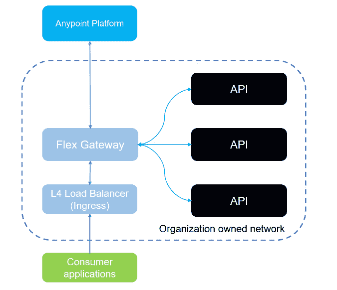

图 15.9：Flex Gateway Ingress 部署

在图 15.9 中，我们可以看到所有外部流量通过负载均衡器进入内部网络。所有流量均通过 Flex Gateway 传递至消费者应用程序。

### Egress 部署模型

Egress 部署与 Ingress 部署模型相反，作为独立服务运行，保护一个或多个 API。在 Egress 部署模型中，Flex Gateway 管理离开组织以连接非组织拥有的 API 的内部流量。下图展示了 Flex Gateway Egress 部署：

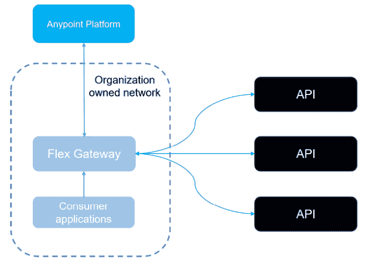

图 15.10：Flex Gateway Egress 部署

在图 15.10 中，我们可以看到 Flex Gateway 管理离开组织以连接外部 API 的内部流量，该模型同时充当入站和出站网关。

### Sidecar 部署模型

在 Sidecar 部署模型中，每个 Flex Gateway 部署仅保护其受保护服务所暴露的 API。每当添加一个受保护服务，就会添加一个新的 Flex Gateway 副本。

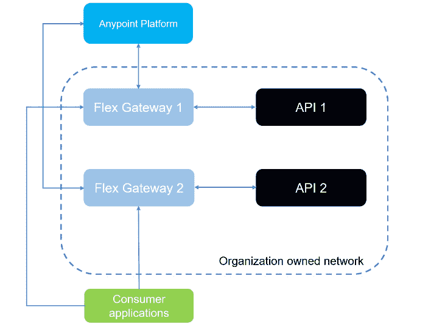

图 15.11：Flex Gateway Sidecar 部署

在图 15.11 中，Sidecar 部署中的流量被路由至相应的消费者 API。消费者应用程序可能托管在外部网络或与 Flex Gateway 相同的网络中。

## Flex Gateway 的高可用性与可扩展性

通过运行多个 Flex Gateway 实例，并在 Flex Gateway 实例前配置负载均衡器以分发流量，可实现高可用性，确保即使一个或多个 Flex Gateway 实例发生故障，仍能保证高可用性和业务连续性。

在 Kubernetes 集群中运行 Flex Gateway 时，可通过在 Kubernetes 集群中部署多个副本来实现高可用性。使用安装在 Kubernetes 命名空间中的 `Helm` Chart，可运行以下命令为 Flex Gateway 添加更多副本：

```
helm -n gateway upgrade \
ingress flex-gateway/flex-gateway \
--reuse-values \
--set replicaCount=4
```

通过添加额外副本，Flex Gateway 可水平扩展。Flex Gateway 还支持自动扩展，尽管默认处于关闭状态。

可使用 Helm Chart 启用自动扩展；默认情况下，支持最少 2 个副本，最多 11 个副本。

可使用以下 Helm 属性启用 Flex Gateway 的自动扩展功能：

| 参数 | 描述 | 默认值 |
| --- | --- | --- |
| `autoscaling.enabled` | 这是一个布尔值，指示 `Horizontal Pod Autoscaler (HPA)` 是否处于激活状态；默认设置为 `false`。 | `false` |
| `autoscaling.minReplicas` | 这显示了 `HPA` 扩缩容器可生成的最小副本数量。 | `2` |
| `autoscaling.maxReplicas` | 这显示了 `HPA` 扩缩容器可生成的最大副本数量。 | `11` |
| `autoscaling.targetCPUUtilizationPercentage` | 这是一个资源指标，用于确定每个已部署 `Pod` 平均 `CPU` 使用率的比例。 | `50` |
| `autoscaling.targetMemoryUtilizationPercentage` | 这是一个字符串，显示所有已部署 `Pods` 平均内存使用率的百分比。 | `nil` |
| `autoscaling.behavior` | 这是一个 Kubernetes 配置，用于启用 `HorizontalPodAutoscaler` 对象。`HPA` 设置控制自动扩展行为，包括根据工作负载的变化率调整应用程序资源的数量。 |  |
| `autoscaling.behavior.scaleUp`, `autoscaling.behavior.scaleDown` | 这些是自动扩展行为的配置，当 `HPA` 扩缩容器增加 (`scaleUp`) 或减少 (`scaleDown`) 副本数量时生效。我们可以使用嵌套参数描述扩展行为：`selectPolicy`：当配置的资源指标指示需要扩展时，此设置控制何时扩展 `Pods`。由于 `Pods` 可能具有不同数量的副本，因此需要此设置。可接受值为 `Min`、`Max` 和 `Disabled`。默认设置为 `Max`。`stabilizationWindowSeconds`：这给出了在响应工作负载修改之前必须经过的最短秒数，以便重新扩展应用程序。其目的是防止 `HPA` 在频繁扩展时过于激进或不稳定地响应。`policies`：管辖扩展行为的策略目录：`type`：根据特定策略的值类型为 `Percent` 或 `Pods`；`value`：特定策略的值类型的值；`periodSeconds`：特定策略扩展操作的时间间隔（秒）。 |  |

表 15.2：Flex Gateway Helm Chart 设置

## Flex Gateway 中的路由

Flex Gateway 通过多种路由管理请求流量，每种路由均可将流量路由至多个上游服务。Flex Gateway 利用路由顺序和每个路由的特定规则将流量路由至目标。您还可以为路由内的每个上游服务分配加权百分比，以控制发送至上游服务的请求百分比。每个 API 实例最多支持 50 条路由，每条路由最多支持 10 个上游服务。Flex Gateway 1.5.x 或更高版本支持多个 API 实例通过单个消费者端点暴露不同的上游服务。


# Flex Gateway

## 路由

在下图中，不同的路由管理对银行信息数据库的请求。路由 1 配置了两个上游服务，将 80% 的流量导向主 API，主 API 随后连接到稳定数据库。20% 的流量导向辅助 API，该 API 连接到数据库的测试版本。

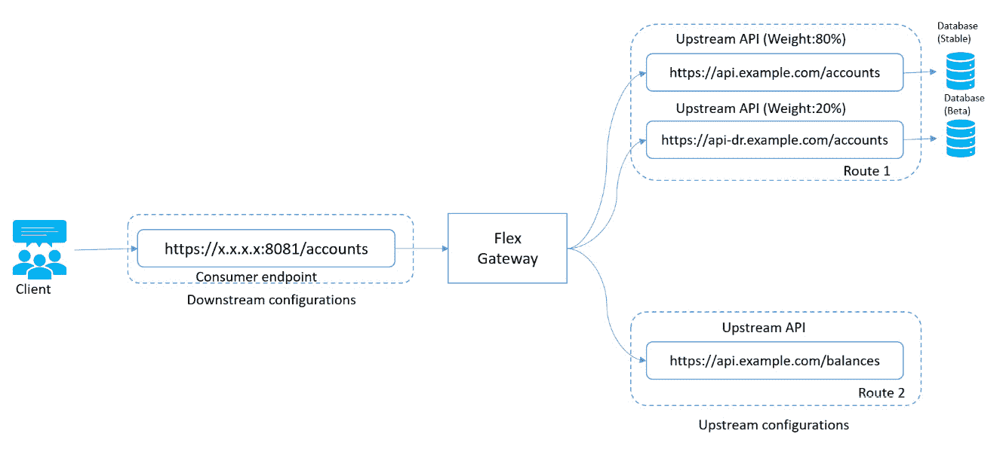

图 15.12：Flex Gateway 路由

通过在单个路由中利用多个上游服务，可以将请求路由到可比较的服务。例如，您可以将一半流量路由到稳定的上游服务，另一半路由到新的上游服务，以测试新测试版上游服务的功能，而无需将所有流量发送到新服务。Flex Gateway 还根据页面上路由出现的顺序（从上到下）将请求路由到各个路由。如果请求满足路由规则，Flex Gateway 会将其路由到第一个匹配的路由。

Flex Gateway 允许您使用端口或路径将请求路由到上游 API。

图 15.13 展示了 Flex Gateway 基于端口的路由。每当请求通过端口 `8081` 到达 Flex Gateway 时，该请求将被路由到 `Employee API`；同样，如果请求通过端口 `8082` 到达 Flex Gateway，它将被路由到 `Order API`。

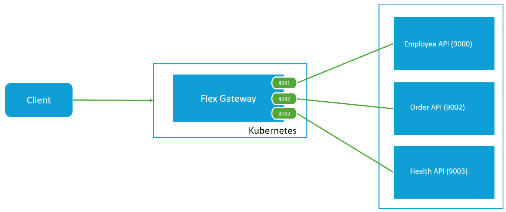

图 15.13：Flex Gateway 基于端口的路由

这种方法的局限性在于，每当我们向 Flex Gateway 发布新 API 时，都需要使用一个唯一的端口。当使用 Kubernetes 作为入口控制器时，端口也必须在入口服务上启用。还有另一种方法，我们可以使用路径路由请求，并继续对发布到 Flex Gateway 的每个 API 使用相同的端口。图 15.14 展示了 Flex Gateway 基于路径的路由：

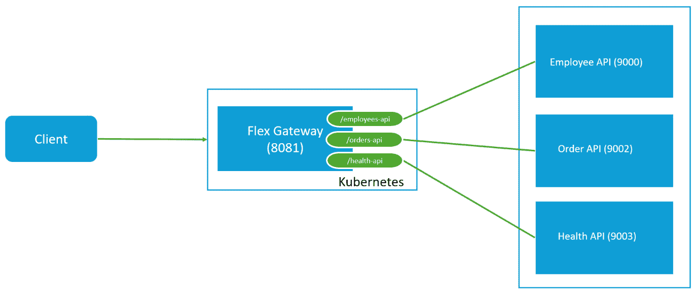

图 15.14：Flex Gateway 基于路径的路由

在图 15.14 中，基本路径可以在 API 管理器中创建的 API 实例上配置，并将用于将请求路由到上游 API。在同一端口上发布到 Flex Gateway 的每个 API 都需要一个唯一的基本路径。

如图 15.14 所示，带有 `/employees-api` 基本路径的请求到达 Flex Gateway 时将被路由到 `Employee API`。同样，带有 `/orders-api` 基本路径的请求到达 Flex Gateway 时将被路由到 `Order API`。在此方法中，所有 API 都在同一端口 `8081` 上发布到 Flex Gateway。

## 集中模式

在集中模式下，一个 Flex Gateway 将管理组织内的所有 API，而不受技术、位置或架构的限制。下图显示了集中模式下的 Flex Gateway：

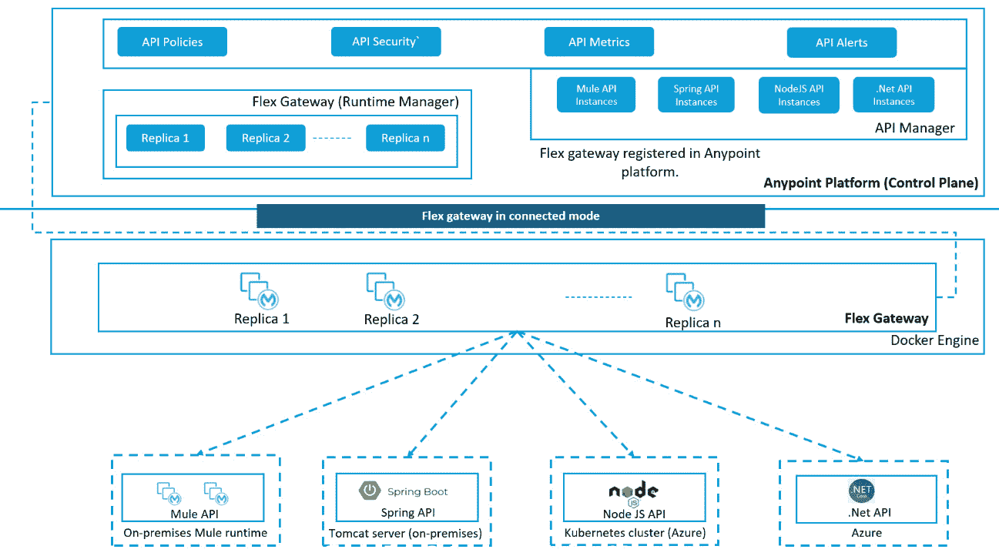

图 15.15：集中模式下的 Flex Gateway

在图 15.15 中，我们有一个集中的 Flex Gateway 管理组织内的所有 API，而不受技术、位置和架构的限制。

## 分散模式

在分散模式下，多个 Flex Gateway 将管理组织内的所有 API。下图说明了分散模式下的 Flex Gateway：

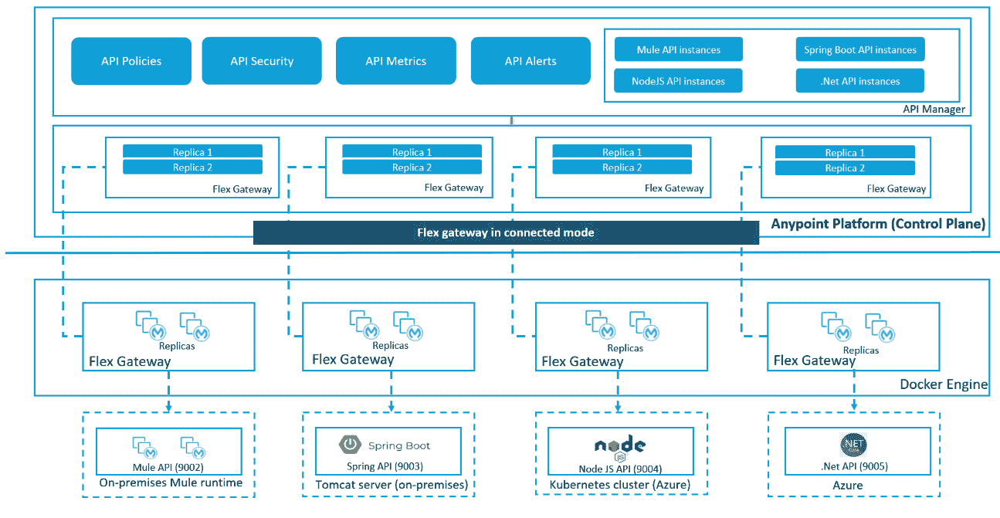

图 15.16：分散模式下的 Flex Gateway

在图 15.16 中，我们可以看到已实施多个 Flex Gateway 来管理组织内的 API，并且可以看到针对特定技术的 API 有一个专门的 Flex Gateway。

图 15.17 说明了一个 Flex Gateway 将管理一个 Kubernetes 命名空间中的 API。简单来说，Kubernetes 命名空间中的每个命名空间都将拥有自己的 Flex Gateway 来管理该命名空间中的 API。

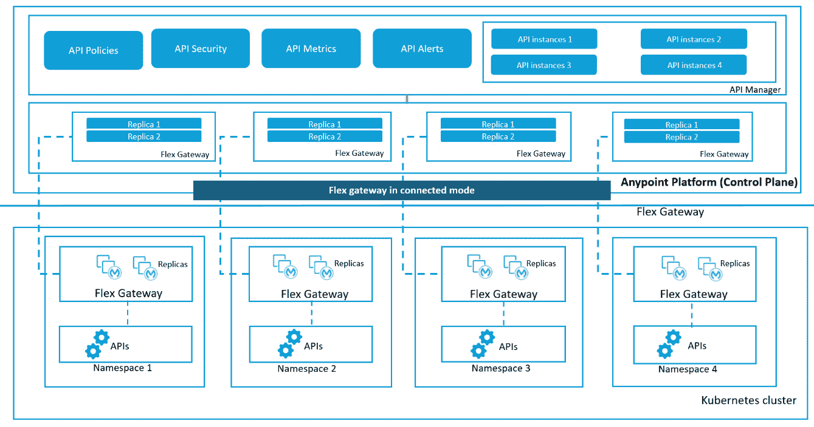

图 15.17：分散模式下的 Flex Gateway（每个命名空间一个 Flex Gateway）

在图 15.17 中，一个 Flex Gateway 实施在一个命名空间中。这意味着 Kubernetes 中的每个命名空间都将拥有自己的 Flex Gateway。

图 15.18 显示了一个 Flex Gateway 将管理一个 API。此概念称为 sidecar 部署模式。

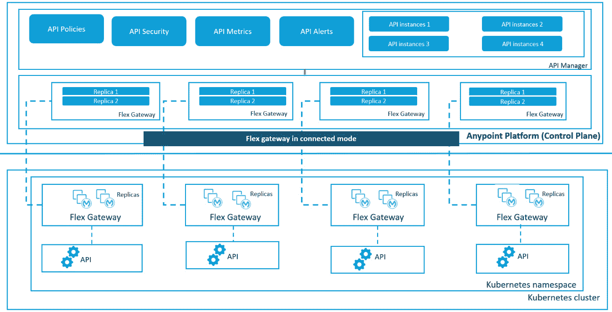

图 15.18：分散模式下的 Flex Gateway（一个 API 对应一个 Flex Gateway sidecar）

在图 15.18 中，每个 API 都有自己的 Flex Gateway 来管理该 API。API 和 Flex Gateway 将在 Kubernetes 中运行在同一个 Pod 上。

## API 策略

MuleSoft 提供声明式配置文件（本地模式）或 Anypoint Platform（连接模式），允许您将策略应用到 API。提供的策略包括速率限制、缓存、授权、认证、威胁防护、监控和日志记录。

然而，有时这些开箱即用的策略无法满足我们的精确规格。幸运的是，我们可以使用 Rust 编程语言为这些情况创建自己的独特策略。自定义策略基于 Proxy-wasm ABI，这是一个事件驱动的、与 Envoy 无关的低级代理接口。该接口定义了 `WebAssembly` (`WASM`) 扩展与其宿主之间的交互。

## Flex Gateway 与 Mule Gateway 的对比

以下是 Flex Gateway 和 Mule Gateway 之间的区别。

| Mule Gateway | Flex Gateway |
| --- | --- |
| Mule Gateway 只能管理单个 API | Flex Gateway 可以管理 MuleSoft 以及非 MuleSoft API |
| 基于 Java 的 API 网关嵌入在 Mule 中，使用 API 自动发现管理 Mule API | 基于 Envoy 的 API 网关，支持多种部署模式和架构 |
| 仅在连接模式下工作 | 在连接模式和本地模式下均可工作 |
| 支持使用 Java 和 Mule DSL 开发自定义策略 | 支持使用 Rust WASM SDK 开发自定义策略 |
| Mule 内部集成的 Java Spring 应用程序 | 基于 Envoy 的基础引擎，使用 FluentBit 进行日志记录 |
| 适合使用专用代理或基本端点处理（保护、监控等）Mule 应用程序（也可作为安装在 CloudHub 中的 Mule 代理应用程序访问） | 适合管理部署在任何位置且具有高可用性和高性能的 Mule 和非 Mule 应用程序 |

表 15.3：Mule Gateway 与 Flex Gateway 对比

# 使用 Anypoint Platform 共享和发现 API

在 MuleSoft 中，通过 Anypoint Exchange 共享和发现 API——这是一个用于共享、发现和重用 API 以及其他集成资产的中心枢纽。

Anypoint Exchange 是 Anypoint Platform 的一个组件，充当集成资产的市场。它允许开发人员共享、发现和重用由 MuleSoft 或 MuleSoft 用户社区创建的 API、连接器、模板、示例和其他资源。

Anypoint Exchange 还充当一个存储库，允许企业发布自定义资产、连接器、模板、API、策略以及通用框架（如日志记录和错误处理框架），这些资产稍后可在整个组织中被发现和重用。

Anypoint Exchange 的优势如下：

*   **API 存储库**：它提供了一个中心位置或目录，用于发布和发现 API。开发人员还可以访问有关如何使用这些 API 的详细信息，包括文档和示例。

*   **资源编目**：它存储和编目的不仅是 API，还包括连接器、模板、示例和 API 片段，这些资产可在企业内的多个应用程序中重用。


# Anypoint Exchange

*   **开发者协作**：开发者可以对资产进行评分、评论和提供反馈，促进协作和持续改进。
*   **版本控制**：它为 API 和其他资产提供版本管理，允许开发者记录变更，并根据需要轻松升级或回滚版本。
*   **依赖跟踪**：它帮助开发者了解不同资产之间的依赖关系，这在管理复杂的集成场景时非常有益。

Anypoint Exchange 对于可复用资产和 API 主导连接的推进至关重要，这能大幅缩短开发时间、提高产出，并确保应用程序间的一致性。

## 开发者门户

MuleSoft 的开发者门户是 Anypoint Platform 中 Anypoint Exchange 的一个组件，作为一个共享、搜索和使用可复用 API 的市场。API 开发者门户可以作为 API 提供者和 API 使用者之间桥梁的重要角色。它提供 API 开发者设计、实施和测试 API 所需的工具，也是使用者了解、访问并在其应用程序中使用 API 的场所。

以下是开发者门户的功能：

*   **API 文档**：包含关于如何使用 API 的详细指南和参考，通常根据 API 规范生成。这是根据 API 规范自动生成的文档。
*   **API 探索器**：这是一个交互式界面，用户可以在其中对 API 进行测试调用并试验其端点。他们可以在使用 API 之前探索 API 的功能。
*   **模拟服务**：开发者门户允许我们使用模拟服务测试 API，以了解 API 的行为和功能。
*   **认证和授权**：开发者门户提供访问 API 所需的认证授权机制信息。
*   **社区**：社区论坛帮助开发者相互交流，开发者可以在论坛上发布任何问题。
*   **支持**：开发者门户可以包含支持论坛，以提出疑问、提交工单解决问题或获取更多关于 API 的信息。

MuleSoft 还提供其他用于共享和发现 API 的 API 开发者门户。这些开发者门户功能丰富，并允许自定义**图形用户界面**（**GUI**）。我们将在下一节讨论这些 API 开发者门户。

## ACM

ACM 是 MuleSoft 提供的一款产品，使组织能够为其 API 构建和管理开发者门户和社区。ACM 是 API 主导连接方法中的关键组件，因为它通过为 API 使用者建立一个自助服务和协作的中心位置，促进了数字资产的可见性和复用。

以下是 ACM 提供的关键功能：

*   **可定制的开发者门户**：ACM 允许组织创建一个完全可定制且带有品牌标识的开发者门户，可在其中发布和管理 API、SDK、模板和其他资源。
*   **API 文档和测试**：它提供生成和发布交互式 API 文档的功能，并使 API 使用者能够直接从门户测试 API。
*   **协作和互动工具**：ACM 通过提供论坛讨论、支持案例管理和使用分析工具来促进协作。这提高了与 API 使用者的互动。
*   **自助式 API 管理**：它赋予 API 使用者自助服务能力，以管理应用程序、获取凭据以及管理密钥/API 令牌。
*   **简化的 API 发现**：它允许 API 使用者轻松发现和使用 API 及数字资产。

通过使用 ACM，组织可以促进 API 采用、提升使用者体验，并将 API 转化为可有效共享和复用的产品。

以下是 ACM 的局限性：

*   **需要 Salesforce 专业知识**：设置和管理 ACM 需要 Salesforce 专业知识。
*   **复杂的设置和新用户入职**：设置和管理 ACM 是一项复杂的任务，需要 Salesforce Experience Cloud 和 MuleSoft 专业知识。
*   **性能和可扩展性较差**：ACM 门户臃肿，导致性能问题，且不易扩展。

## API Experience Hub

Anypoint API Experience Hub 是一个为开发者和合作伙伴量身定制、丰富且引人入胜的 API 互动体验。它作为一个开发者门户，开发者可以在其中发现、探索和测试 API，并创建应用程序。

以下是 API Experience Hub 提供的关键功能：

*   **完全可定制的界面**：借助 API Experience Hub，企业可以开发一个符合其特定需求的品牌化、用户友好的 API 门户。
*   **API 目录**：该门户提供 API、文档、SDK 和其他可复用资产的目录，开发者可在其 API 主导连接项目中使用这些资产。
*   **API 文档和测试**：API Experience Hub 提供交互式 API 文档，并允许开发者直接从门户测试 API，促进对 API 的深入理解和有效利用。
*   **协作环境**：它提供了一个开发者可以相互交流、提问、分享见解并通过社区论坛更有效地协作的空间。
*   **分析**：它展示 API 的使用情况、衡量互动程度，并通过指标驱动 API 计划。

通过集中化 API 的发现、学习、测试和开发，API Experience Hub 为开发者简化了 API 主导连接的流程。

API Experience Hub 通过以下方式克服了 ACM 的局限性：

*   设计用于扩展并提供高性能。
*   设置和管理 API Experience Hub 无需 Salesforce 专业知识。
*   简化的用户入职管理。
*   改进且轻量级的 GUI。

## ACM 与 API Experience Hub 对比

API Experience Hub 和 ACM 均由 MuleSoft 作为 Anypoint Platform 的一部分提供。让我们对比一下它们：

*   **ACM**：这是 MuleSoft 提供的一款产品，使大大小小的企业能够构建和管理开发者门户和社区。它本质上充当了所有 API 社区互动活动的统领范畴。这包括托管其 API 的文档、允许开发者测试 API、通过论坛和讨论促进协作，甚至提供存储在 Salesforce 中并通过 Salesforce 对象公开的使用分析和指标数据。
*   **API Experience Hub**：另一方面，API Experience Hub 是 ACM 的一个特定方面或组件。它本质上是指开发者可以在其中发现、了解和使用 API 的交互式且可定制的门户。这包括 API 目录、API 文档和测试、交互式论坛以及存储在 Anypoint Platform 中并通过可使用的 API 公开的 API 分析数据等功能。

简单来说，ACM 的范围更广——它涉及构建和管理开发者社区的所有方面。相比之下，API Experience Hub 更专注于开发者门户中 API 被发现和使用的那一方面。

# API Analytics

Mule API Analytics 是 Anypoint Platform 中的一项功能，提供 API 使用情况和性能指标的可见性。它允许组织监控和衡量其 API 的有效性、识别问题并做出数据驱动的决策。

以下是 API Analytics 的功能：

*   **实时洞察**：它提供对 API 性能的实时可见性，跟踪关键 API 使用指标、吞吐量、响应时间和错误率。
*   **详细报告**：借助 API Analytics，您可以深入钻取到单个 API 调用以诊断问题或了解特定事务。


## API 分析

*   **历史数据分析**：API 分析提供历史数据，支持趋势分析、容量规划，并识别优化领域。
*   **可自定义仪表板**：用户可以创建可自定义的仪表板，以监控对他们及其业务最重要的指标。
*   **主动问题识别**：它能识别 API 行为中的问题和异常，可用于早期错误检测和修正。
*   **使用情况跟踪**：它提供关于谁在使用 API、使用频率以及使用方式的洞察。这可以为 API 采用模式提供参考，并触发功能开发或修复。

要访问 API 分析，用户必须拥有 Anypoint Platform 账户以及查看分析所需的权限。

# API 策略

MuleSoft API 策略是 Anypoint Platform 中的一组功能，允许 API 开发人员管理和控制 API。这些策略在 API 上强制执行特定行为，例如安全性、合规性、运维和服务质量。

以下是 MuleSoft 提供的 API 策略：

| **API 策略** | **描述** |
| --- | --- |
| 安全策略 | 这些策略可通过验证客户端凭据、过滤、限制流量、验证用户角色等方式帮助保护 API。示例包括 OAuth 2.0 访问令牌强制执行、客户端 ID 强制执行、JSON 和 XML 威胁防护。 |
| 限流和节流策略 | 这些策略通过控制 API 在任一时间处理的请求数量，确保资源不会不堪重负。示例包括速率限制和尖峰控制。 |
| 合规策略 | 这些策略有助 on 符合法规和标准，例如与日志记录和数据掩码相关的标准。 |
| 运维策略 | 这些包括**跨域资源共享**（**CORS**）策略，以控制资源如何在不同域之间共享。 |
| 基于 SLA 的策略 | 此策略层级管理应用程序对 API 的访问。应用此类策略会强制执行处理时间、消息数量、失败率等方面的限制。示例是带有 SLA 的速率限制。 |
| 服务质量策略 | 这些策略确保服务按用户预期的标准运行。它们可以指定 API 可用性、响应时间、错误率等。 |
| 自定义策略 | MuleSoft 提供用于编写自定义策略的 Mule 和 Java DSL，如果您没有现成的策略来满足业务需求，可以使用这些 DSL。 |

表 15.4：API 策略

通过在 API Manager 中应用这些策略，组织可以保护其 API，确保它们在整个生命周期内保持功能正常、安全且可靠。

# API 治理

API 治理是 Anypoint Platform 的一个组件，它使您能够将治理规则应用于 API，以确保 API 一致性。它提供了几个默认规则集，例如 OWASP API 安全前 10 名、Anypoint API 最佳实践和 OpenAPI 最佳实践治理规则集，这些规则集可以在设计阶段应用于 API 规范，以确保 API 规范符合组织的 API 标准和指南，并与之保持一致。API 治理将确保整个企业的 API 设计保持一致，并在设计时考虑到 API 最佳实践和指南。这将确保 API 的安全性并提高 API 的质量。

## 实施 API 治理

实施 API 治理的第一步是在 Anypoint Platform 的 API 治理组件中创建一个配置文件，并选择需要为该配置文件启用的规则集。您可以添加过滤器和通知。过滤器将选择需要根据我们创建的配置文件进行扫描的 API。如果 API 未根据与配置文件关联的规则集进行设计，通知将向用户发送电子邮件，并将其标记为**不合规**。

作为 API 治理的一部分，您的 API 维护以下三种状态：

*   **未验证**：API 未根据 API 治理配置文件进行验证。
*   **合规**：API 满足了与配置文件关联的规则集。
*   **不合规**：API 未满足与配置文件关联的规则集。

开发人员或架构师可以在 Design Center 的 API 设计阶段应用 API 治理，方法是将治理规则集作为依赖项直接添加到 API 规范中，以便开发人员或架构师可以在 API 设计阶段验证规范的合规性。

以下屏幕截图显示了 API 治理界面：

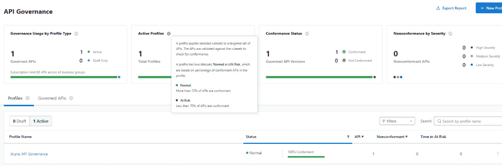

图 15.19：API 治理界面

API 治理界面中可见以下详细信息：

*   所选草稿配置文件的 API 合规性概览。
*   请注意草稿配置文件所针对的 API。尽管这些 API 受治理约束，但除非它们也是活动配置文件的主题，否则其合规性信息仅显示在草稿配置文件视图中。
*   导出此草稿配置文件打算针对的每个 API 的 CSV 合规性报告。

可以在 API 治理配置文件上配置以下开箱即用的规则集：

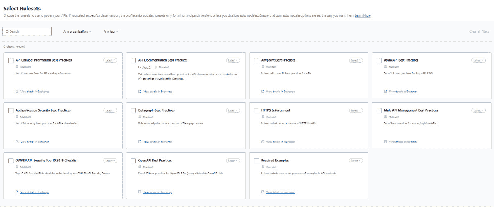

图 15.20：API 治理规则集

# Anypoint API Manager 警报

Anypoint API Manager 警报是您可以在 MuleSoft 的 Anypoint Platform 中设置的通知，用于监控与 API 相关的特定活动或变更。这些警报帮助企业主动识别并缓解其 API 的潜在问题。

可以根据不同因素配置以下 API Manager 警报以发送警报：

*   **响应时间**：如果您的 API 响应时间超过特定阈值，将触发警报以通知您。
*   **请求量**：如果 API 请求数量在特定时间段内超过特定限制，您可以设置警报。
*   **失败请求**：如果失败 API 请求的比率激增超过特定百分比，请配置警报。
*   **策略违规**：如果发生策略违规，您可以收到策略违规警报。

您可以在 Anypoint Platform 的 Runtime Manager 中设置这些警报。该过程包括指定警报类型、设置警报条件，然后指定警报通知的接收者。您可以通过多种渠道接收这些警报，例如电子邮件、第三方应用程序（如 Slack）和 Webhook，具体取决于您如何设置警报。通过使用 API Manager 警报，企业可以采取主动的 API 管理方法，快速高效地排查和解决出现的任何问题。

# API 安全威胁

API 安全威胁是指危及数据和服务的机密性、可用性和完整性的潜在风险或漏洞。

以下是一些 API 安全威胁：

*   **注入攻击**：当恶意命令或数据被输入到 API 中，目的是访问、破坏或篡改私有数据时，称为注入。
*   **身份认证失效**：如果 API 无法正确验证用户身份，攻击者可能冒充授权用户并获得未经授权的访问。
*   **不安全的直接对象引用**（**IDOR**）：不安全的直接对象引用 (IDOR) 是一种漏洞，当攻击者操纵 Web 应用程序 URL 或参数中使用的 ID 时会发生，允许他们访问或编辑对象。
*   **安全配置错误**：如果 API 的服务器或代码具有不正确的安全设置，攻击者可能能够访问敏感数据。
*   **过度数据暴露**：过度透明的 API 可能被用于在未经授权的情况下获取敏感数据。


## OWASP 十大安全威胁

*   **缺乏速率限制**：在没有适当速率限制的情况下，API 容易遭受 `DoS` 和暴力破解攻击。
*   **函数级授权失效**：在这种情况下，由于 API 未能正确授权仅应向特定角色提供的功能，导致未经授权的访问。
*   **批量赋值**：攻击者对 API 请求的组成进行合理猜测，以更改其不应有权更改的对象属性。
*   **XML 外部实体** (`XXE`)：如果攻击者可以上传 XML 或在 XML 文档中包含恶意内容，他们可以利用脆弱的 XML 处理器，这可能导致内部文件泄露、`DoS` 或远程代码执行。
*   **跨站脚本攻击** (`XSS`)：如果 API 在未编码或验证的情况下将用户输入发送回 Web 浏览器，允许浏览器将其作为脚本运行，则可能发生 `XSS` 攻击。

在讨论了 OWASP 十大安全威胁之后，我们现在将讨论 `DoS` 攻击。

## DoS

`DoS` 是一种网络攻击，涉及攻击者向目标计算机系统、网络或服务发送过量的请求，以耗尽其资源和带宽。因此，系统对其预期用户变得不可访问。典型的 `DoS` 攻击包括用流量饱和网络、中断连接或迫使系统使用过量资源，这可能会减慢其速度甚至导致其停止运行。

`DDoS` 是一种更强大、更复杂的 `DoS` 攻击。`DDoS` 攻击利用多个被攻陷或受控的源（通常分布在互联网各处）对目标发起攻击。在一个称为 **僵尸网络** 的设备网络中，每个设备都充当一个僵尸程序。这些僵尸程序的数量可达数千甚至数百万，它们同时向目标网络发送大量请求，导致 `DoS`。由于攻击源来自许多不同的地方，阻止一个源无法阻止其他源，因此很难阻止此类攻击。

下图展示了一个 `DDoS` 攻击：

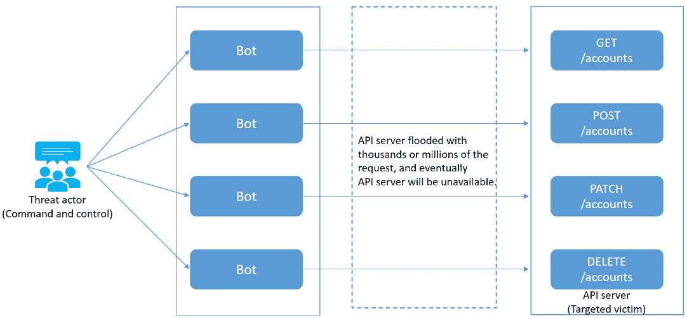

图 15.21：DDoS 攻击

## API 保护的安全措施

可以实施以下措施来保护 API 免受安全威胁或攻击：

*   **API 网关**：`MuleSoft` 的 API 网关可以处理 `OAuth 2.0`、`JWT`、`SAML` 等多种安全协议。通过作为流量管理和 API 实现之间的屏障，它提供集中式策略管理。
*   **Anypoint Security**：`MuleSoft` 的 `Anypoint Security` 利用令牌化、速率限制、IP 白名单和黑名单等尖端安全功能，为 API 提供多层保护。`Anypoint Security` 仅由 `Runtime Fabric` 支持。
*   **速率限制和节流**：此功能可保护 API 免受突发流量激增的影响，并防范 `DoS` 攻击。
*   **令牌化**：在处理敏感数据时，`MuleSoft` 可以用令牌替换敏感数据，提供额外的安全层。令牌化仅由 `Runtime Fabric` 支持。
*   **安全策略**：`MuleSoft` 便于在 API 上实施预制或个性化的安全策略，例如 HTTP 基本身份验证策略和 `OAuth 2.0` 作用域验证策略。
*   **DataWeave**：为了进一步减少数据暴露，`MuleSoft` 的转换语言有助于在记录活动之前对敏感数据进行匿名化处理。
*   **安全属性**：`MuleSoft` 提供通过加密应用程序属性内的敏感信息来保护静态数据的能力。使用安全算法（如 `AES256` 或 `Blowfish`）加密应用程序中的所有安全属性。
*   **审计和监控**：为了识别异常、监控 API 活动并跟踪任何未经授权的访问，`MuleSoft` 自带审计和监控工具。
*   **传输中的 API 安全**：使用 `传输层安全性` (`TLS`) 等加密协议来保护数据在传输过程中的安全，以防止数据被篡改和拦截。`TLS` 也称为安全套接字层，是保障在线交易和登录在后台安全的标准安全技术。在您所有的 `Mule` API 中，您的组织可以实施 `TLS` 安全，这将确保网络上消息的机密性和数据的完整性。使用 `Anypoint Secrets Manager` 添加 `TLS` 上下文将允许您在应用程序或 API 代理级别配置 `TLS` 设置。`Flex Gateway` 也支持此功能。特别是，`TLS` 的实施将最大限度地减少 API 中的漏洞，如安全错误和不安全的消费。
*   **在设计阶段保护 API**：`MuleSoft` 提供可在设计阶段应用于 API 的 API 治理规则集。此规则集将扫描 API 以确保质量、合规性、安全性和一致性。我们在本章中已经讨论了 API 治理。

请回顾，将这些防御措施集成到设计、实施和部署阶段——而不仅仅是作为事后补救措施添加——是保护 `MuleSoft` API 的最佳方法。适当的安全措施还应遵守行业标准和最佳实践。

## 摘要

在本章中，我们学习了如何使用通用 API 管理来阻止 API 蔓延。为了实现通用 API 管理——允许用户从单一控制平面管理、治理、保护和交互 API——我们讨论了几个组件，包括 `Flex Gateway`、`API Governance`、开发者门户和 `API Manager`。

下一章将介绍必须解决的非功能性需求，以提供构建高质量 API 的可靠框架。

## 参考资料

以下是 `Flex Gateway` 文档的参考资料：

*   使用 Rust 的自定义 API 策略: <https://docs.mulesoft.com/gateway/latest/policies-custom-flex-implement-rust>
*   Flex Gateway: <https://docs.mulesoft.com/gateway/latest/>
