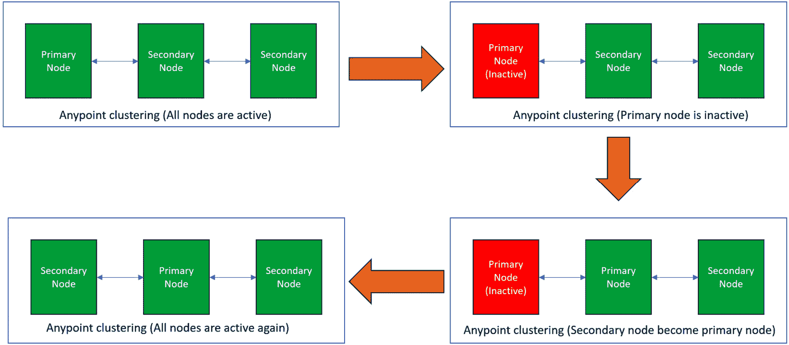
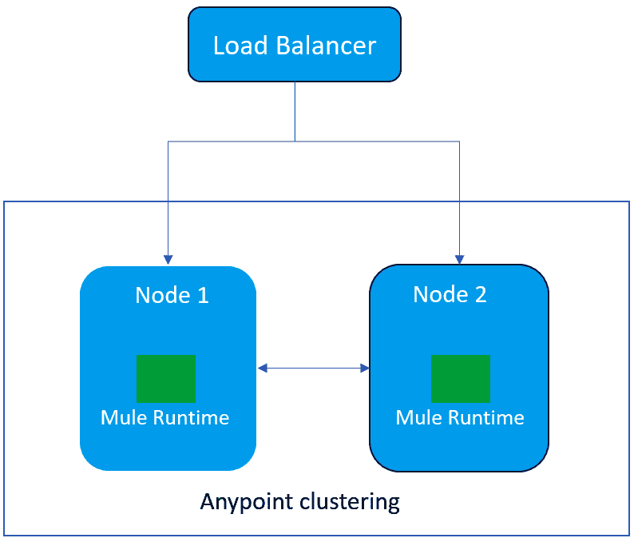
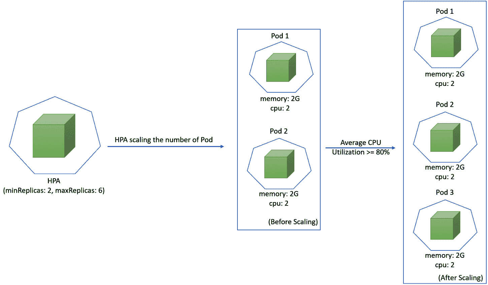
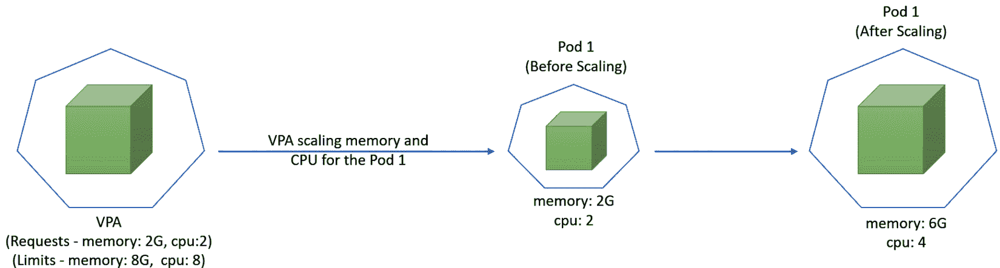
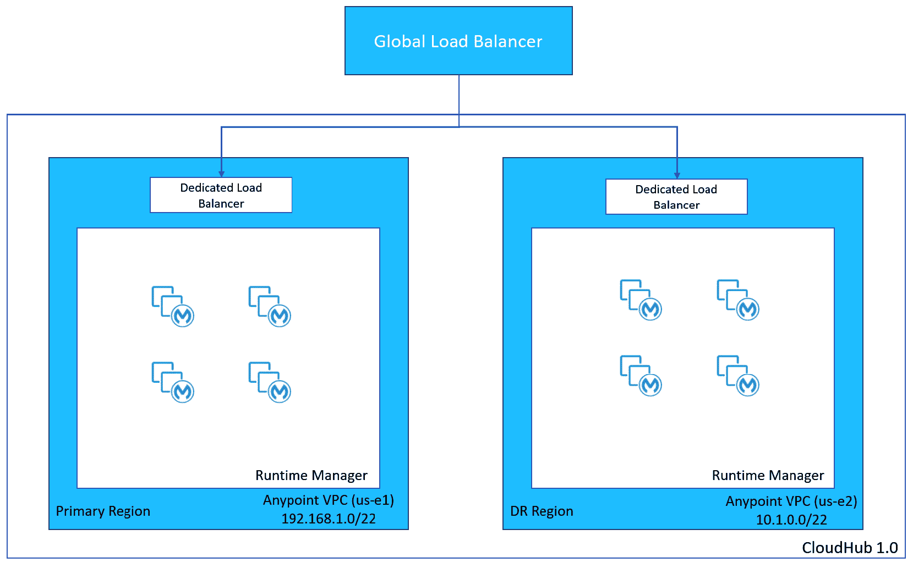
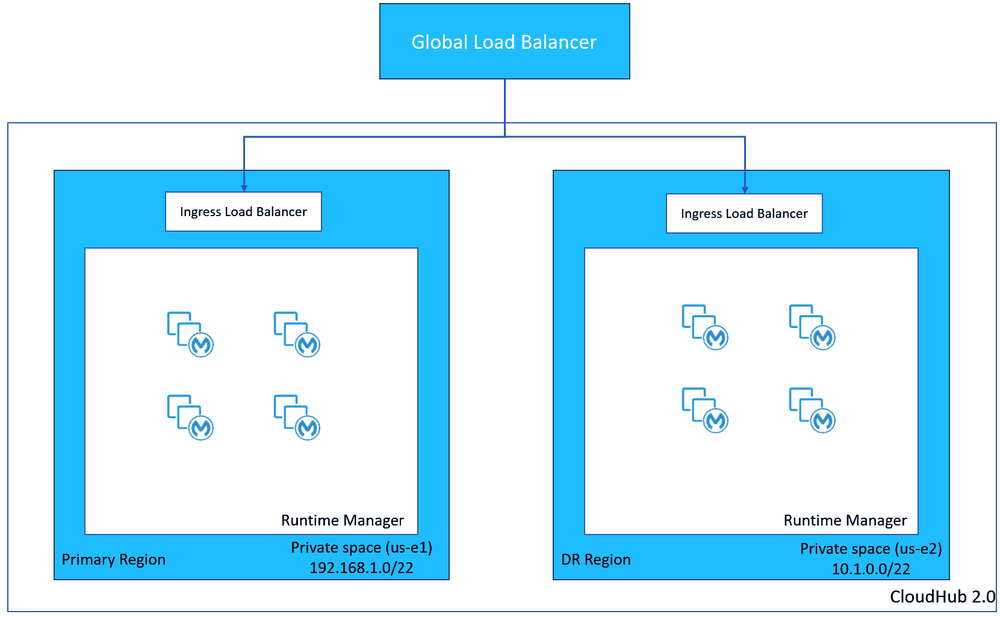
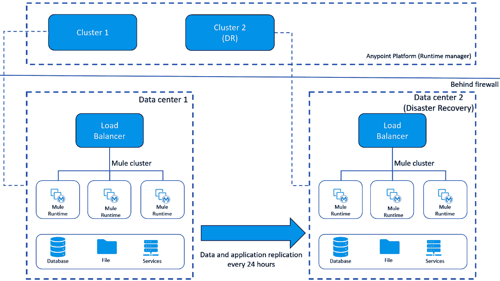

# 第 16 章：解决非功能性需求——从构想到运维

本章将向读者展示如何实施非功能性需求，如 `HA`、容错、弹性，以及分配和优化 `vCores` 以提升应用程序性能。

在本章中，我们将涵盖以下主题：

*   `NFRs`，如可扩展性、高可用性和容错性
*   `MuleSoft` 平台的 **灾难恢复** (`DR`)
*   `vCores` 分配和优化

## 先决条件

本章的先决条件如下：

*   了解 `MuleSoft` 平台，如 `CloudHub 1.0`、`CloudHub 2.0`、`Runtime Fabric` 和本地 `Mule` 运行时
*   了解 `Kubernetes` 及其基于容器的应用程序架构
*   对 `NFRs` 有基本了解，如可扩展性、高可用性、容错性等

## 什么是 NFRs？

`NFRs` 是一组描述系统运行能力和限制的规范。它们作为描述功能运行效果的需求，例如高可用性、可扩展性、安全性、可靠性和数据完整性。让我们仔细看看这些术语：

*   **高可用性**：系统在发生任何系统故障时的可用程度。这保证了业务连续性。
*   **可扩展性**：系统处理请求数量或工作负载增加的能力。
*   **性能**：系统响应任何请求的速度。
*   **安全性**：系统抵御未经授权的请求、恶意攻击或数据泄露的保护程度。


*   **可靠性**：系统设计得有多好。在此，故障百分比应很小，且系统应当可靠。

*   **数据完整性**：系统设计得有多好，以将数据泄露的风险降至最低。

*   **容错性**：系统设计得有多好，以便在发生故障或系统崩溃时能够恢复。

*   **DR**：DR 涉及应用 IT 技术和最佳实践，以减轻灾难性事件（如网络攻击、自然灾害、公共紧急情况和设备故障）对业务运营和数据丢失的影响。

在本章中，我们将探讨一些非功能性标准，例如 DR、可扩展性、容错性和高可用性。一些非功能性需求（如 API 安全性、可靠性和性能）已在前几章中介绍。

# 高可用性

高可用性是指 IT 系统、组件或应用程序无需人工干预即可长时间持续且高水平运行的能力。具有高可用性的基础设施旨在提供卓越的性能，并管理不同的负载和故障，实现极少甚至零停机时间。

## CloudHub 1.0 的高可用性与容错性

CloudHub 1.0 提供多个组件，例如 Anypoint Platform `API` 和服务、共享负载均衡器、监控组件，以及许多其他组件，这些组件在任何 `AWS` 区域中默认均具备高可用性。在 CloudHub 1.0 上运行的 Mule 应用程序可以部署到多个 Worker，从而确保高可用性并提高整体应用程序性能。如果一个 Worker 发生故障，其他 Worker 可用于处理请求。

将应用程序部署到多个 Worker 可确保流量通过负载均衡器分发到它们之间。CloudHub 1.0 支持持久队列以实现消息可靠性。持久队列在区域中大量存在，但当 `AWS` 区域宕机时可能不可用。此处可能会发生数据丢失，但当 `AWS` 区域恢复时，通信会通过队列恢复。

某些 CloudHub 组件（如 `Object Store V1`、应用程序设置和监控相关数据）存储在 `US East` 区域，无论应用程序部署在任何区域。`Object Store V2` 存储在与 CloudHub 1.0 应用程序 `AWS` 区域相同的 `AWS` 区域中。如果 `US East` 区域不可用，则 `Object Store V1` 不可用；如果应用程序所在的 `AWS` 区域不可用，则 `Object Store V2` 不可用。对象存储中的信息会被持久化，并在该区域恢复使用时再次变为可用。Anypoint `Virtual Private Cloud` (`VPC`) 按区域配置。如果某区域不可用，则 Anypoint `VPC` 将不可用，直到为其他区域配置了之前的 Anypoint `VPC` 实例。

### CloudHub 1.0 在区域内的可用性

CloudHub 1.0 使用 `AWS` 云基础设施，CloudHub 1.0 的可用性取决于 `AWS` 的可用性。CloudHub 1.0 的可用性和部署划分为不同的区域，每个区域对应其相应的 Amazon 区域。

当某 Amazon 区域宕机时，该区域中的应用程序将不可用，且不再自动复制到其他区域。

例如，如果 `us-east-1` 区域不可用，云管理 `UI` 以及支持部署的各种 `REST` 服务将不可用，直到该区域恢复可用。不会有新应用程序部署到 `us-east-1` 区域。

### CloudHub 1.0 在可用区内的可用性

将应用程序部署到多个 Worker 可确保高可用性，因为应用程序部署在单独的 `Availability Zones` 中。

如果一个可用区发生故障，您的应用程序可在另一个 `Availability Zone` 中为您的请求提供服务。同时，在故障可用区中运行的应用程序将尝试在另一个 `Availability Zone` 中恢复或重启。

如果应用程序启用了一个 Worker，而该 Worker 因可用区宕机而发生故障，该 Worker 将自动尝试恢复，并可在另一个可用区中重启。这可能会导致短暂的停机时间。

我们将在第 9 章中更详细地介绍此主题。

## CloudHub 2.0 的高可用性与容错性

CloudHub 2.0 具备高可用性和可扩展性，并提供冗余、智能修复和零停机更新。您可以运行同一应用程序的多个副本，以实现负载均衡和高可用性。

CloudHub 2.0 支持集群，应用程序可从中受益，获得更高的稳定性、工作负载分发和可扩展性。CloudHub 的副本横向扩展和可扩展负载均衡解决方案为这些功能提供支持。

集群允许多个副本相互通信，并通过对象存储和 `VM` 队列在同一应用程序的多个副本之间共享数据。应用程序的高可用性以及在应用程序上启用集群，至少需要两个副本。

CloudHub 2.0 监控副本的问题，并提供用于恢复的自愈机制。如果底层硬件发生故障，平台会自动将应用程序迁移到新的副本。私有空间中有一个私有入口负载均衡器，可自动扩展以适应流量。

CloudHub 2.0 中的 Anypoint `VPN` 默认具备高可用性。您可以在 CloudHub 2.0 中创建冗余 `VPN` 以确保高可用性。原始 `VPN` 设置中的某些配置参数会自动传输到冗余 `VPN`。

## 本地 Mule 运行时的高可用性与容错性

集群可用于为部署在本地 Mule 运行时上的应用程序启用高可用性。它为 Mule 提供基本的故障转移能力。

如果主节点因 `Java Virtual Machine` (`JVM`) 故障、计划内维护或硬件故障而变得不可用，集群中的其他节点之一将成为主节点，并从故障实例中断的地方恢复处理。

下图显示了在主节点发生故障时，节点如何从从节点转换为主节点：



图 16.1：Anypoint 集群节点转换（从从节点到主节点）

对于 `HTTP` 工作负载，您应在节点前配置第三方负载均衡器，以将流量分发到多个节点，并确保流量流向活动节点。

下图显示了如何在集群的节点前使用负载均衡器来分发 `HTTP` 工作负载：



图 16.2：带有 Anypoint 集群的 HTTP 负载均衡器

我们在第 12 章中讨论了 Anypoint 服务器组。服务器组也可以配置第三方负载均衡器，以便将流量分发到服务器组中的多个节点。

请注意，客户负责配置和管理负载均衡器，以及设置和管理运行本地 Mule 运行时所需的基础设施。

## Runtime Fabric（裸金属服务器/VM）的高可用性与容错性

Runtime Fabric 上的高可用性可在基础设施级别和应用程序级别实现。基础设施级别的高可用性可通过设置多个主节点和工作节点来实现，如第 11 章所述。


在*第 11 章*中，我们讨论了 Quorum 管理以及如何利用它来确保 Runtime Fabric 的高可用性和容错基础设施。我们讨论了生产环境和非生产环境所需的最小主节点和控制节点数量，以确保基础设施的高可用性。

# Runtime Fabric（自管式 Kubernetes）的高可用性与容错性

Runtime Fabric 的应用层和基础设施层均可实现高可用性。设置多个工作节点有助于实现基础设施级别的高可用性。自管式 Kubernetes 提供托管的 Kubernetes 主节点，从而无需管理主节点。AWS 负责监管 EKS 主节点。再次强调，管理主节点的可用性是云提供商（在 EKS 的情况下为 AWS）的责任，而非 MuleSoft 的职责。

要在自管式 Kubernetes 和 VM/裸金属服务器上的 Runtime Fabric 中实现应用级高可用性，可以为应用程序部署多个副本。您可以将多个副本组成集群，以确保数据和信息分布在各个副本中。就像本地集群一样，Runtime Fabric 支持集群功能。

我们在*第 11 章*中详细讨论了 Anypoint 集群。

# 可扩展性

系统适应应用程序和系统处理需求变化而调整其性能和成本的能力称为可扩展性。示例包括操作系统在各种硬件类别上的运行方式、数据库处理不断增加的查询量的方式，或硬件系统处理用户数量增长的方式。

扩展分为两种类型：

*   **水平扩展**：水平扩展意味着向资源池中添加更多机器。水平扩展分为两种类型：
    *   **扩容**：向资源池中添加更多机器
    *   **缩容**：从资源池中移除一台机器
*   **垂直扩展**：垂直扩展意味着向现有服务器添加更多电源或计算资源（如内存和 CPU）：
    *   **向外扩展**：向现有机器添加更多算力
    *   **向内扩展**：减少现有机器的算力

## CloudHub 1.0 的可扩展性

CloudHub 1.0 是一项托管服务，我们无需监管其基础设施，它完全由 MuleSoft 管理。我们只负责选择运行 Mule 应用程序或代理所需的正确工作节点和工作节点规格。

MuleSoft 将根据我们为应用程序选择的工作节点和工作节点规格自动配置基础设施。应用程序可以通过增加或减少工作节点数量进行水平扩展，通过增加或减少工作节点规格进行垂直扩展。

CloudHub 1.0 支持自动扩展功能，正如*第 9 章*所述，它允许应用程序根据流量的增减自动扩展。

## CloudHub 2.0 的可扩展性

与 CloudHub 1.0 类似，CloudHub 2.0 是一项托管服务，无需监管其基础设施，完全由 MuleSoft 管理。我们只负责选择运行 Mule 应用程序或代理所需的正确副本和副本规格。

MuleSoft 将根据我们为应用程序选择的副本和副本规格自动配置基础设施。应用程序可以通过增加或减少副本数量进行水平扩展，通过增加或减少副本规格进行垂直扩展。CloudHub 2.0 不支持自动扩展功能。

我们在*第 10 章*中详细讨论了 CloudHub 2.0 的可扩展性。

## Runtime Fabric（裸金属服务器/VM）的可扩展性

Runtime Fabric 基础设施可通过向集群添加更多工作节点或主节点进行水平扩展，通过增加或减少 CPU 和内存等计算资源进行垂直扩展。实施基础设施级别的可扩展性变更是客户的责任。

应用程序可通过添加更多应用程序副本进行水平扩展，通过增加副本规格（预留 CPU、CPU 限制或内存）进行垂直扩展。

Runtime Fabric 是 MuleSoft 基于 Kubernetes 提供的用于运行 Mule 应用程序的服务。这抽象化了管理和维护 Kubernetes 集群的复杂性，使开发人员能够专注于应用程序开发和部署。

然而，Runtime Fabric 并不直接提供应用程序扩展功能。在这种情况下，Kubernetes 发挥作用，提供强大的扩展能力。

Kubernetes 是一个用于自动化容器化应用程序部署、扩展和管理的开源平台。

Kubernetes 提供了两种不同的应用程序实例自动扩展方式：

*   `Horizontal Pod Autoscaler` (`HPA`)
*   `Vertical Pod Autoscaler` (`VPA`)

当流量增加时，HPA 会添加更多 `Pod`。当负载减少时，`Pod` 的数量将缩减到最小值。

HPA 作为 Kubernetes API 的控制器和资源使用。控制器的行为由资源决定。位于 Kubernetes 控制平面中的水平 Pod 自动扩展控制器，使用观测到的指标（如平均 CPU 使用率、平均内存使用率或您指定的任何其他自定义指标）定期确定其对象（如 `Deployment`）的适当规模。

HPA 基于目标原则工作。它会调整 `Deployment` 或副本集中 `Pod` 的数量，以匹配给定资源（如 CPU 或内存）的预定义目标使用率。

要创建 HPA，需要使用 `kubectl autoscale` 命令：

```
kubectl autoscale deployment mule-test-app --cpu-percent=80 --min=2 --max=6
```

让我们分解一下前面的 `kubectl` 命令：

*   这里，`mule-test-app` 是应用程序的名称。
*   然后是 `--cpu-percent=80`，这意味着当所有 `Pod` 的平均 CPU 利用率超过 80% 时，Kubernetes 将添加更多副本。
*   最后，`--min=2` 是始终运行的最小副本数，`--max=6` 是在 CPU 利用率高时 Kubernetes 可以创建的最大副本数。

`kubectl autoscale` 命令是一个激活 HPA 的简单命令。然而，使用清单文件定义 HPA 更加灵活，因为它允许多个指标来启用扩展。

以下清单文件允许在节点的平均 CPU 利用率达到 80% 或更高时进行水平扩展。创建一个 `mulesoft-test-app-hpa.yaml` 清单文件。然后，执行 `kubectl apply` 命令以启用 HPA：

```
kubectl apply -f mulesoft-test-app-hpa.yaml
```

输出如下：

```yaml
apiVersion: autoscaling/v2
kind: HorizontalPodAutoscaler
metadata:
  name: mulesoft-test-app
spec:
  scaleTargetRef:
    apiVersion: apps/v1
    kind: Deployment
    name: mule-test-app
  minReplicas: 2
  maxReplicas: 6
  metrics:
  - type: Resource
    resource:
      name: cpu
      target:
        type: Utilization
        averageUtilization: 80
```

让我们仔细看看此 YAML 文件中定义的属性：

*   这里，`scaleTargetRef` 是该 HPA 将管理的 MuleSoft 部署。


## Pod 自动扩缩容（HPA 和 VPA）

*   然后，我们有 `minReplicas`，它指定将始终运行的最小副本数，以及 `maxReplicas`，它指定当 CPU 或内存利用率超过定义的利用率阈值时，Kubernetes 可以扩展的最大副本数。
*   `metrics` 指定 `HPA` 将用来决定何时扩缩容的属性。在本例中，我们使用了 `CPU utilization` 作为 `HPA` 的属性。

下图显示了当平均 CPU 利用率达到 80% 或更高时，`Pod` 如何水平扩缩容：



图 16.3：Kubernetes 的 HPA

`VPA` 会自动调整 `Pod` 运行应用程序所需的 CPU 和内存，使其达到合适的大小。这将确保集群中资源的有效利用。`VPA` 需要两种类型的配置：

*   `Requests`
*   `Limits`

`Requests` 是分配给 `Pod` 的最小资源量，这保证了 `Pod` 将获得的资源。`Limits` 是 `Pod` 在流量增加时可以消耗的最大资源量。然而，这不被保证，只有在有额外资源可用以容纳更多流量时才能分配。

下图显示了当需要更多资源时，`Pod` 如何垂直扩缩容：



图 16.4：Kubernetes 的 VPA

下表显示了如果需要更多资源可以采取的措施：

| 所需容量调整 | HPA | VPA |
| --- | --- | --- |
| 更多资源 | 添加更多 Pod | 增加现有 Pod 的内存或 CPU |
| 更少资源 | 移除 Pod | 减少分配给现有 Pod 的内存或 CPU |

表 16.1：HPA 和 VPA 资源分配

## Runtime Fabric 的可扩展性（自管理 Kubernetes）

自管理 Kubernetes 是云提供商提供的一种托管服务（AWS 的 `Elastic Kubernetes Service` (`EKS`)、Azure 的 `Azure Kubernetes Service` (`AKS`)、Google 的 `Google Kubernetes Engine` (`GKE`)）。

用户可以专注于他们的应用程序和工作负载，因为云提供商使用自管理 Kubernetes 来管理 `API server` 和 Kubernetes 控制平面，其中包括主节点、存储和其他组件。

这意味着云提供商维护并确保基本组件具有可扩展性和高可用性。

自管理 Kubernetes 可以轻松扩展以满足应用程序的需求。

它自动促进工作节点的供应和管理，这使得在应用程序需求发生变化时更容易扩展集群。

`etcd` 持久化层和 Kubernetes `API servers` 的可扩展性和可用性由云提供商自动管理。

应用程序可以通过添加更多应用程序副本进行水平扩展，并通过增加副本大小（预留 CPU、CPU 限制或内存）进行垂直扩展，例如裸金属服务器/VM 的 Runtime Fabric 组件。

## 灾难恢复 (DR)

DR 是任何组织为确保业务连续性并在自然灾害、区域故障和网络攻击等意外中断后尽快恢复关键业务功能而必须考虑的关键因素。

你需要定义 DR 策略以确保业务连续性；否则，你可能会遭受收入损失或声誉受损，甚至导致业务倒闭。

### CloudHub 1.0 的 DR（多区域）

CloudHub 1.0 在同一区域内跨可用区提供自动 DR。

我们在 *第 9 章* 中讨论了此选项。

可以设置跨多区域的 DR，以便如果整个区域宕机，我们有其他区域来确保业务连续性。

以下是关于 CloudHub 1.0 DR 的一些重要要点：

*   可以通过在两个不同区域创建两个 `Anypoint VPC` 来设置多区域 DR。其中一个区域是主区域，另一个是 DR 区域。
*   可以为每个区域设置两个单独的 Anypoint 专用负载均衡器。每个专用负载均衡器都可以映射到 `DNS` 服务器上的 `CNAME` 记录。
*   全局负载均衡器是客户的责任，MuleSoft 不提供。它将在主区域和 DR 区域之间路由流量。客户可以使用 `Route 53` 或任何 `DNS` 路由器在主区域和 DR 区域之间路由流量。
*   应用程序名称、`Anypoint VPC` 名称和 Anypoint 专用负载均衡器名称必须在各区域中唯一。
*   `object store` 是一项区域性服务，无法跨区域访问。我们需要定义一种策略，以便跨区域使用 `object store` 或任何持久化存储。
*   必须在主区域和 DR 区域之间建立单独的 `VPN` 隧道、`VPC peering` 或 `AWS Transit Gateway` 连接。
*   在主动/主动 DR 机制中，从主区域切换到 DR 区域将比主动/被动 DR 更快，因为负载均衡器会识别主区域不健康并自动将所有流量路由到 DR 区域。
*   在主动/被动 DR 机制中，从主区域切换到 DR 区域将是手动的。你可能需要将应用程序部署到 DR 区域，并且激活它需要额外的时间。这可能导致较高的 `recovery time objective` (`RTO`)。

`RTO` 是企业在区域故障期间可接受的停机时间量。例如，如果企业可接受 1 小时的停机时间，则 `RTO` 为 1 小时。

`recovery point objective` (`RPO`) 是系统恢复后企业可接受的数据丢失量。例如，如果系统在下午 2 点故障，最多可接受 2 小时的数据丢失，则 `RPO` 将为下午 4 点：



图 16.5：CloudHub 1.0 DR

图 16.5 展示了如何在 CloudHub 1.0 中设置跨多区域的 DR，确保即使一个区域完全宕机，应用程序仍然可用。

我们可以在两个不同的区域设置两个 `Anypoint VPC`，每个区域将有一个专用负载均衡器，将流量路由到部署在 `Anypoint VPC` 内的应用程序。

全局负载均衡器负责在两个区域之间负载均衡流量。

如果其中一个区域宕机，全局负载均衡器将检测到这一点，并将所有流量路由到另一个区域。

### CloudHub 2.0 的 DR（多区域）

CloudHub 2.0 在同一区域内跨可用区提供自动 DR。

我们在 *第 10 章* 中讨论了此选项。

可以设置跨多区域的 DR，以便如果整个区域宕机，我们有其他区域来确保业务连续性。

以下是关于 CloudHub 2.0 DR 的一些重要要点：

*   可以通过在两个不同区域创建两个 `private spaces` 来设置多区域 DR。其中一个区域是主区域，另一个是 DR 区域。
*   将为不同区域中的 `private space` 创建单独的私有和公共端点。
*   全局负载均衡器是客户的责任，MuleSoft 不提供。它将在主区域和 DR 区域之间路由流量。客户可以使用 `Route 53` 或任何 `DNS` 路由器在主区域和 DR 区域之间路由流量。
*   `object store` 是区域性的，无法跨区域访问。我们需要定义一种策略，以便跨区域使用 `object store` 或任何持久化存储。
*   必须在主区域和 DR 区域之间建立单独的 `VPN` 隧道或 `AWS Transit Gateway` 连接。CloudHub 2.0 中的 `VPN` 默认在所有区域中都具有高可用性。


# 灾难恢复与 vCores 分配

## 主动/主动 与 主动/被动 DR 机制对比

### 主动/主动 DR
在主动/主动 DR 机制中，从主区域切换到 DR 区域的速度将快于主动/被动 DR，因为负载均衡器会识别出主区域不健康，并自动将所有流量路由到 DR 区域。

### 主动/被动 DR
在主动/被动 DR 机制中，从主区域切换到 DR 区域将是手动的。您可能需要将应用程序部署到 DR 区域，并且激活它需要额外的时间。这可能导致较高的 `RTO`：



**图 16.6：CloudHub 2.0 DR**

图 16.6 展示了如何在 CloudHub 2.0 中跨多个区域设置 DR，以确保即使一个区域完全宕机，应用程序仍然可用。我们可以在两个不同的区域中设置两个私有空间，每个区域都有一个入口负载均衡器，用于将流量路由到部署在私有空间内的应用程序。全局负载均衡器负责在两个区域之间进行流量负载均衡。如果其中一个区域宕机，全局负载均衡器将检测到这一点，并将所有流量路由到另一个区域。

## 面向本地 Mule Runtime 的 DR
本地 Mule Runtime 的 DR 在第 12 章中进行了讨论。我们探讨了实现它的各种选项。

### DR 选项
以下是我们在第 12 章中讨论的用于为本地 Mule Runtime 实现高可用性和 DR 的选项：

- 冷备
- 温备
- 热备 - 主动-被动
- 主动-主动

您可以使用本地 Mule Runtime（或后端应用程序）在主连接发生故障时提供增强的可靠性和快速故障转移。客户通常遵循本地 MuleSoft Runtime DR 计划，以补充其整个数据中心 DR 计划。

下图显示了本地 DR 计划的架构：



**图 16.7：本地 Mule Runtime DR**

我们已经讨论了 Mule 应用程序运行必须满足的 `NFRs`（非功能性需求）。除了这些非功能性标准外，还必须考虑其他要求，以使应用程序能够可靠且高效地运行。我们将在本章即将到来的部分中解决 `vCores` 分配和优化问题，因为它们对于实现这一目标至关重要。

## vCores 分配与优化

`vCores` 是指运行应用程序所需的 CPU 和计算资源数量。`vCore` 是 virtual core（虚拟核心）的缩写。部署到 CloudHub 或 Runtime Fabric 的应用程序以 `vCores` 来衡量。在前面的章节中，我们讨论了不同平台可用的不同 `vCore` 规格。

有必要为应用程序分配合适的 `vCores`，以便其能够持续稳定地运行。可能会出现给应用程序分配不足或过度分配 `vCores` 的情况。如果 `vCores` 分配不足，应用程序可能表现不佳并丢弃传入流量。如果 `vCores` 过度分配，我们最终可能会浪费分配给应用程序的 `vCores`。

出于以下原因，应用程序可能会获得额外资源：

- 应用程序频繁重启。
- 日志中出现与性能问题相关的错误。
- 应用程序频繁超时，运行时仪表板记录了高资源使用率。响应时间慢可能会占用更多资源。

在为应用程序分配 `vCores` 时，还需要考虑其他因素：

- 每秒请求数
- 有效载荷大小
- 应用程序中的错误数量
- 应用程序的响应时间
- 吞吐量
- Mule 流的数量
- 数据转换复杂性
- 流复杂性
- 应用程序中的对象存储使用情况

在决定分配多少 `vCores` 时，需要考虑多个层面：

### 流级别
- 流复杂性
- 数据转换复杂性
- 对象存储

### 应用程序级别
- 流的数量
- 集成/流的类型（`batch`/`API`/`integration`/`async`）

### Worker 级别
- 内存需求
- 计算需求
- 性能需求
- Worker 数量
- 应用程序可用性

实时集成可以水平或垂直扩展。在大多数情况下，实时集成将水平扩展以容纳更多流量。批处理集成无法水平扩展，但可能需要额外的内存或 CPU 来接受或处理更大的有效载荷或文件。

可以使用另一种方法来确定应用程序所需的确切资源——即在将应用程序部署到生产环境之前，在沙箱环境中测试应用程序的性能。这可以帮助您确定应用程序所需的近乎精确的 `vCores` 数量。

## CloudHub 1.0 和 CloudHub 2.0 的 vCores 优化

容量少于 1 个 `vCores`（`0.1 vCores` 和 `0.2 vCores`）的 Worker 或副本为较小的工作负载提供有限的 CPU 和 I/O。建议为需要高性能的应用程序分配更多 `vCores`。

没有金科玉律规定应分配多少 `vCores` 给应用程序以实现 *x* 性能。部署到 CloudHub 1.0 和 CloudHub 2.0 并分配相同数量 `vCores` 的应用程序性能可能不相同。

将应用程序部署到 CloudHub（1.0 和 2.0）的好处之一是每个应用程序都在单独的隔离容器中运行。每个应用程序都分配有自己的 CPU 和内存，因此一个应用程序的性能问题不会影响其他应用程序。每个应用程序可以单独进行水平或垂直扩展。

部署到多个 Worker 或副本的应用程序将允许流量通过负载均衡器分发到多个副本或 Worker。

例如，部署到 CloudHub 1.0 且具有两个 Worker、Worker 规格为 `0.2 vCores` 的应用程序意味着该应用程序总共将消耗 `0.4 vCores`，并且两个 Worker 之间将按 `0.2-0.2 vCores` 分配。负载均衡器将确保流量分发在各个 Worker 之间。相同的逻辑适用于 CloudHub 2.0。

性能测试对于为应用程序分配合适的 Worker 或副本规格非常重要。

## 本地 Mule Runtime 的 vCores 优化

在同一本地 Mule Runtime 上运行的应用程序不允许您向单个应用程序分配 `vCores`。始终建议在非高峰时段运行本地 Mule Runtime 上的批处理应用程序处理。这将确保实时 API 能获得更多资源来处理请求。

当我们将应用程序部署到本地 Mule Runtime 时，对可以部署多少应用程序没有限制，但必须确保我们最终部署的应用程序数量不超过服务器上可用的资源量。这会降低 Mule 应用程序的性能，并可能影响在本地 Mule Runtime 上运行的其他应用程序。

## Runtime Fabric 的 vCores 优化

使用 Runtime Fabric 时，我们在部署期间为应用程序分配预留 CPU 和 CPU 限制；这意味着应用程序将获得保证的 CPU 预留值，并可以突发到 CPU 限制值。仅当有空闲 CPU 可用时，应用程序才会突发到 CPU 限制值；否则，CPU 限制值不受保证。

当应用程序部署到 Runtime Fabric 时，可以使用以下策略，确保在流量高峰时有额外的 CPU 可供其他应用程序使用：


*   始终为白天流量高的应用程序部署夜间批处理作业。这样，应用程序可以在白天获得额外的 CPU，而夜间批处理作业可以在夜间获得额外的 CPU。
*   为了优化未分配 CPU 的利用面，请将应用程序的多个副本分布在工作节点之间。

无论您使用何种策略，建议都要进行性能测试，并验证已分配给应用程序的资源。与分配较少 `vCores` 的应用程序相比，分配了更多 `vCores` 的应用程序部署所需时间更短。

## 总结

在本章中，我们涵盖了非功能性需求（NFR），包括灾难恢复 (DR)、容错、高可用性以及 `vCores` 的分配与优化。通过实施非功能性需求来确保业务连续性，对于 API 实施至关重要。

应用程序性能的基础是应用程序规模调整。如果分配的内存或 CPU 少于应用程序所需，会导致应用程序性能低下。

在下一章中，我们将讨论如何为 MuleSoft 认证平台架构师考试做准备。
