# 18. 攻克棘手主题

在前几章中，我们探讨了 MuleSoft 的各种托管选项，包括 CloudHub、本地部署、混合部署、运行在 VM/裸金属机器上的 Runtime Fabric 管理器，以及自管理 Kubernetes。

本章将涵盖以下主题：

* 选择合适部署模型的考量因素
* 弹性 API 技术
* `Anypoint CLI`
* 幂等作用域和缓存作用域
* 核心组件
* 实施平台架构的用例

## 选择合适部署模型的考量因素

MuleSoft 是一个高度适应性的平台，提供多种部署选择来托管您的应用网络。为确保企业的数字化转型平稳且无错误，您必须评估最佳部署模型。

对于希望托管其应用网络的企业，MuleSoft 提供以下部署选项：

* CloudHub 1.0
* CloudHub 2.0
* 本地 Mule Runtime（独立版和混合版）
* 运行在 VM/裸金属机器、OpenShift 和自管理 Kubernetes 上的 Runtime Fabric 管理器

选择 MuleSoft 部署策略基于多项考量，包括数据安全性、数据控制权、可扩展性和特定业务需求。以下实例将展示何时选择各模型。表 18.1 说明了在平台能力、数据和元数据存储、以及平台维护和升级方面，各部署选项的异同。

### 表 18.1：MuleSoft 部署考量因素（平台、数据和元数据、升级管理）

| 因素 | 完全云托管（控制平面和运行时平面均在云端） | 完全客户托管（控制平面和运行时平面均在本地或客户托管环境） | 混合部署（控制平面在云端，运行时平面在本地） |
| --- | --- | --- | --- |
| 平台 | Anypoint Platform（控制平面） CloudHub 1.0 和 CloudHub 2.0（运行时平面） | Anypoint Private Cloud Edition (PCE)（控制平面） 本地 Mule Runtime（运行时平面） | Anypoint Platform（控制平面） 本地 Mule Runtime（运行时平面）或运行在自管理 Kubernetes、VM/裸金属和 OpenShift 上的 Runtime Fabric |
| 数据和元数据 | 数据和元数据将位于供应商基础设施中 | 数据和元数据将位于客户基础设施中 | 仅元数据将位于供应商基础设施中 |
| 平台和升级管理 | 平台维护和升级由供应商（MuleSoft）管理 | 客户负责 Mule Runtime 和 Anypoint PCE 的升级、补丁和维护。 | 客户负责 Mule Runtime 和 Anypoint Platform 的升级、补丁和维护，升级由 MuleSoft 管理 |

表 18.2 说明了在网络连接方面，各部署选项的异同。

### 表 18.2：网络连接考量因素

| 因素 | 完全云托管（控制平面和运行时平面均在云端） | 完全客户托管（控制平面和运行时平面均在本地或客户托管环境） | 混合部署（控制平面在云端，运行时平面在本地） |
| --- | --- | --- | --- |

# MuleSoft 部署考量

## 网络连接选项

**表 18.2：MuleSoft 部署考量（网络连接）**

| 部署模式 | 网络连接选项 |
|----------|-------------|
| **CloudHub 1.0** | 支持 Anypoint Virtual Private Cloud，可通过 VPN IPSec 隧道、VPC 对等连接、AWS Direct Connect 或 Transit Gateway 连接到本地数据中心或任意云 |
| **CloudHub 2.0** | 支持私有空间，可通过 VPN IPSec 隧道和 Transit Gateway 连接到本地数据中心或任意云 |
| **完全客户托管** | 客户必须管理 Mule 应用程序与其他系统之间的网络连接。客户必须使用防火墙或实施 VPN 或任何其他连接选项来控制入站和出站流量，以连接到其他数据中心或私有云 |
| **混合部署** | 客户必须管理 Mule 应用程序与其他系统之间的网络连接。客户必须使用防火墙或实施 VPN 或任何其他连接选项来控制入站和出站流量，以连接到其他数据中心或私有云 |

## 业务连续性

**表 18.3：MuleSoft 部署考量（业务连续性）**

| 因素 | 完全云托管（控制平面和运行时平面在云中） | 完全客户托管（控制平面和运行时平面在本地或客户托管环境中） | 混合部署（控制平面在云中，运行时平面在本地） |
|------|------------------------------------------|---------------------------------------------------------------|-----------------------------------------------|
| **业务连续性** | • 高可用性、容错和智能修复等功能由 MuleSoft 提供和管理 • 应用程序可通过添加更多实例（工作节点或副本）或增加 vCore 或副本大小进行水平或垂直扩展 • Anypoint Platform 的可扩展性和高可用性由 MuleSoft 管理 • 客户无需管理运行 Mule 应用程序或代理的任何基础设施 | • 客户负责高可用性、容错、可扩展性等 • 客户负责管理运行 MuleSoft 应用程序的基础设施和网络，并实施 Anypoint PCE • MuleSoft 仅提供用于运行 MuleSoft 应用程序的 Mule 运行时，以及在客户基础设施上设置 Anypoint PCE | • 客户负责管理运行 Mule 应用程序或代理的底层基础设施 • 客户需要确保节点或服务器的高可用性和可扩展性 • 应用程序可通过在 Runtime Fabric 上增加副本数量和副本大小轻松扩展，实现零停机时间 • Runtime Fabric 在应用程序级别提供智能修复和容错机制 • 在本地运行的 Mule Runtime 必须部署在集群或组中的多个节点上以确保高可用性。节点扩展只能通过向组和服务器添加额外节点来完成 • 客户负责管理底层基础设施和网络 • Anypoint Platform 将完全由 MuleSoft 管理。MuleSoft 将确保 Anypoint Platform 的可用性和可扩展性 • 支持应用程序级别的 Anypoint 集群以确保应用程序的可用性 |

## 负载均衡器

**表 18.4：MuleSoft 部署考量（负载均衡器）**

| 因素 | 完全云托管（控制平面和运行时平面在云中） | 完全客户托管（控制平面和运行时平面在本地或客户托管环境中） | 混合部署（控制平面在云中，运行时平面在本地） |
|------|------------------------------------------|---------------------------------------------------------------|-----------------------------------------------|
| **负载均衡器** | • 高可用性、容错和智能修复等功能由 MuleSoft 提供和管理 • 应用程序可通过添加更多实例（工作节点或副本）或增加 vCore 或副本大小进行水平或垂直扩展 • Anypoint Platform 的可扩展性和高可用性由 MuleSoft 管理 • 客户无需管理运行 Mule 应用程序或代理的任何基础设施 | • 客户负责高可用性、容错、可扩展性等 • 客户负责管理运行 MuleSoft 应用程序的基础设施和网络，并实施 Anypoint PCE • MuleSoft 仅提供用于运行 MuleSoft 应用程序的 Mule 运行时，以及在客户基础设施上设置 Anypoint PCE | • 客户负责管理运行 Mule 应用程序或代理的底层基础设施 • 客户需要确保节点或服务器的高可用性和可扩展性 • 应用程序可通过在 Runtime Fabric 上增加副本数量和副本大小轻松扩展，实现零停机时间 • Runtime Fabric 在应用程序级别提供智能修复和容错机制 • 在本地运行的 Mule Runtime 必须部署在集群或组中的多个节点上以确保高可用性。节点扩展只能通过向组和服务器添加额外节点来完成 • 客户负责管理底层基础设施和网络 • Anypoint Platform 将完全由 MuleSoft 管理。MuleSoft 将确保 Anypoint Platform 的可用性和可扩展性 • 支持应用程序级别的 Anypoint 集群以确保应用程序的可用性 |

## 上线时间

**表 18.5：MuleSoft 部署考量（上线时间）**

| 因素 | 完全云托管（控制平面和运行时平面在云中） | 完全客户托管（控制平面和运行时平面在本地或客户托管环境中） | 混合部署（控制平面在云中，运行时平面在本地） |
|------|------------------------------------------|---------------------------------------------------------------|-----------------------------------------------|
| **上线时间** | 需要少量设置时间，大多数功能开箱即用。可能需要配置 Anypoint VPC、VPN 和专用负载均衡器 | 需要大量设置时间。需要配置基础设施以运行 Mule 应用程序和 Anypoint PCE | 需要为运行时平面设置基础设施 |

## 监控和日志记录

**表 18.6：MuleSoft 部署考量（监控和日志记录）**

| 因素 | 完全云托管（控制平面和运行时平面在云中） | 完全客户托管（控制平面和运行时平面在本地或客户托管环境中） | 混合部署（控制平面在云中，运行时平面在本地） |
|------|------------------------------------------|---------------------------------------------------------------|-----------------------------------------------|
| **监控和日志记录** | 表格内容不完整，原文仅提供表头 | 表格内容不完整，原文仅提供表头 | 表格内容不完整，原文仅提供表头 |

# MuleSoft 部署注意事项

## 监控和日志记录

表 18.6：MuleSoft 部署注意事项（监控和日志记录）

| 因素 | CloudHub 1.0/2.0 | 客户托管 | 混合 |
|--------|------------------|-----------------|--------|
| 监控和日志记录 | MuleSoft 提供开箱即用的监控功能，可用于监控部署在 CloudHub 1.0 和 CloudHub 2.0 上的 Mule 应用程序。CloudHub 1.0 还支持功能监控，并允许您为应用程序设置警报。CloudHub 1.0 和 CloudHub 2.0 均支持应用程序日志记录。这是 MuleSoft 提供的一项开箱即用的功能。需要 Titanium 许可证或高级日志功能（如聚合日志文件），以便您管理、搜索、筛选和分析日志。 | 需要第三方监控和日志记录工具来监控部署在客户环境中的应用程序。可与 Splunk 或 ELK 集成以进行日志记录和监控。 | MuleSoft 提供开箱即用的监控功能，可用于监控在混合环境中运行的 Mule 应用程序和节点。需要第三方监控来监控基础设施和网络。第三方日志记录工具可集成到混合环境中。可与 Splunk 或 ELK 集成以进行日志记录和监控。 |

## 用例

表 18.7：MuleSoft 部署注意事项（用例）

| 因素 | 完全云托管（控制平面和运行时平面在云中） | 完全客户托管（控制平面和运行时平面在本地或客户托管） | 混合（控制平面在云中，运行时平面在本地） |
|--------|-------------------------------------------------------------------|--------------------------------------------------------------------------------------|-------------------------------------------------------------------|
| 用例 | 没有管理基础设施团队的中小型组织。您的公司是全新的，以前从未使用过云服务管理。您拥有的应用程序很少，不想投资独立的云基础设施。没有适用于数据的法律或政府法规。 | 您拥有管理整个基础设施的团队，并有义务迁移到云端。您的数据/元数据不应离开您的组织。 | 您将部署更多应用程序，并且认为使用全云方案成本太高。您计划保留现有基础设施并逐步向云环境迁移。您认为混合解决方案将降低成本和构建基础设施的时间。 |

## 部署选项

我们已经讨论了为您的公司选择最佳部署选项时需要考虑的许多因素。根据您组织的需求和能力，CloudHub 1.0、2.0、**Runtime Fabric (RTF)** 或混合实施可能是最佳选择。要充分了解每种部署模型的优缺点，最好咨询 MuleSoft 或可靠的合作伙伴。以下是 MuleSoft 提供的用于托管应用程序和代理的部署选项。

### CloudHub 1.0

MuleSoft 基于云的**集成平台即服务**称为 CloudHub 1.0。它适用于公司缺乏本地部署所需基础设施或不想自行构建的情况。它具有集成负载均衡、轻松扩展、自动更新和即时部署选项。它消除了硬件和软件维护的需求，但大部分数据控制权由 MuleSoft 掌握。

假设一家零售公司刚刚开始扩大其在线业务。他们希望将新的电子商务平台与当前系统（如订单管理、库存和**客户关系管理 (CRM)**）无缝集成，而无需处理大量基础设施管理麻烦。CloudHub 1.0 对该公司将大有裨益。使用 CloudHub 1.0 模式，他们无需购买新硬件，也无需担心软件更新和维护，因为平台会处理这些事务。此外，他们还将受益于平滑扩展和集成负载均衡，以适应不断变化的需求，尤其是在一年中的繁忙时期。

### CloudHub 2.0

CloudHub 2.0 在 CloudHub 1.0 的基础上增加了更多运营功能，例如提供粒度化的 `vCores` 大小选项、改进的负载均衡器策略，以及用于在隔离的虚拟网络中托管应用程序的改进型私有空间。

以在线媒体流媒体提供商为例，即使在业务增长和软件更新期间，它也需要继续提供快速且高可用的服务。此外，他们希望能够自定义某些运营设置以满足自身需求，并拥有相应的灵活性。该服务不希望出现任何延迟或中断，因为这会导致用户不满并造成订阅用户流失。

CloudHub 2.0 对此类企业大有裨益。CloudHub 2.0 的可扩展性和零停机更新使媒体服务能够更有效地管理其运营，而不会损害用户体验。此外，该平台赋予企业对数据的更多控制权，使其能够保障敏感用户信息的安全。

### Runtime Fabric

Anypoint RTF 是一项容器服务。对于需要自由地将 Mule 应用程序和 API 集成到其自身云托管基础设施（如 AWS、Azure 或 GCP）或本地数据中心的企业来说，这很有利。虽然它比其他选项对基础设施要求更高，但它具有对数据和系统资源拥有更多控制权等优势。

想象一家需要集成各种服务的金融机构，例如 CRM、支付系统和账户管理。考虑到其运营的敏感性质，它必须遵守严格的隐私和数据保护法规。此外，由于该银行在多个地理区域运营，它必须遵守当地的监管要求。这些规范可能要求数据必须位于特定地理区域内，而非国际范围。

在这种充满挑战的场景中，银行可以利用 Anypoint RTF。银行机构可以通过使用 RTF 从混合应用模型中受益。它可以使用本地和不同的云部署解决方案来满足地理合规要求，并在监管范围内部署应用程序和 API。此外，处理金融数据的银行集成工作流依赖于高应用性能和可用性。RTF 提供高可用性、冗余和容错能力，非常适合这些场景。无论部署位置如何，银行还可以在保持高度安全性和基础设施管理的同时持续运行和监控系统。因此，Anypoint RTF 是此类环境下的最佳选择。

### 本地 Mule Runtime

本地 Mule Runtime 非常适合需要严格控制其数据、遵守严格数据法规或在数据中心投入巨资的公司。

让我们考虑一家需要集成其医疗账单系统、**实验室信息管理系统 (LIMS)** 和**电子病历 (EMR)** 的医疗保健组织。该医疗保健组织受 HIPAA 等严格法律管辖，这些法律要求严格的数据安全和隐私。此外，由于安全或技术限制，组织可能拥有对日常运营至关重要但只能通过组织私有网络访问的遗留系统。

# 本地部署 Mule Runtime

在此场景中，组织可以在本地安装 Mule Runtime。得益于这种实施方式，他们可以安全地与遗留系统集成，并严格控制其数据。由于数据从未离开公司的物理场所，因此始终遵守安全法规。此外，医疗公司可能已在拥有合适硬件的私有数据中心进行了大量投资。通过使用本地部署的 Mule Runtime，他们可以利用现有基础设施而无需切换到基于云的解决方案，从而降低潜在迁移相关的风险和费用。

我们已经讨论了一些可应用于 Mule API 创建和部署的基本构建模块。本章将在下一节带我们演练 Anypoint MQ。

# Anypoint CLI

MuleSoft 的 Anypoint Platform 提供了一个名为 Anypoint `Command-Line Interface` (`CLI`) 的工具，它允许用户在不使用 Anypoint Platform 用户界面的情况下对平台执行各种操作。或者，您可以使用终端来管理 Anypoint Platform Web 界面中的服务器、应用程序、API 和其他实体。

这对于更喜欢 `CLI` 而非图形界面的用户，以及用于自动化任务、编写脚本和与 `CI/CD` 工具集成非常有帮助。它简化了不同 Anypoint Platform 资源的创建、管理和删除，包括服务器、应用程序、API 等。该工具采用 `Node.js` 编写，可使用 `Node Package Manager` (`npm`) 进行安装。它允许用户执行创建和管理应用程序、部署 API、操作环境、应用策略等任务。

以下是 Anypoint `CLI` 的主要功能：

*   **管理 Mule 应用程序**：您可以在不同环境中启用、修改或禁用 Mule 应用程序
*   **API 管理**：创建和管理 API、策略和代理
*   **VPN 管理**：您可以编辑或创建 Anypoint VPN
*   **混合管理**：您可以直接从 `CLI` 管理混合服务器
*   **管理用户和角色**：您可以管理与 Anypoint Platform 关联的用户、角色和访问权限
*   **与 `CI/CD` 工具集成**：您可以创建脚本以与各种 `CI/CD` 工具集成，实现无缝部署和升级

当您想要自动化特定任务，或者开发人员想要将 Anypoint Platform 功能集成到其现有开发工作流中时，Anypoint `CLI` 工具特别有用。因此，它提供了一种替代通过浏览器与平台进行传统交互的方式，并扩展了与平台交互的可用选项。

# 弹性 API 技术

弹性 API 旨在优雅地应对故障，无论故障源于 API 本身、依赖服务，还是网络问题或延迟、API 版本不匹配等外部因素，或因环境变更或意外用户行为而引发的其他问题。

以下是 API 必须具备弹性并持续运行的原因：

*   **可用性**：API 必须高可用，并在发生任何硬件或基础设施故障时继续运行。API 确保业务连续性至关重要。
*   **性能**：通过减少错误和中断的数量，弹性 API 有助于提高应用程序的性能。这将带来更好的用户体验和更高的生产力。
*   **可扩展性**：通过使应用程序对负载峰值和故障更具弹性，弹性 API 有助于提高应用程序的可扩展性。这可能有助于您在不影响性能的情况下处理更多流量和用户。
*   **安全性**：API 必须能抵御任何安全威胁或攻击。这可能包括 `SQL` 或 `PHP` 注入、`分布式拒绝服务` (`DDoS`) 和 `拒绝服务` (`DoS`)。API 必须防止未经授权的访问。
*   **容错性**：API 必须具备容错能力，并在发生任何故障或崩溃时自动恢复。API 必须能在发生基础设施故障或 `JVM` 崩溃时自动修复。

以下是一些确保 API 具备弹性并在发生任何故障时继续运行的技术：

*   **负载均衡**：传入 API 的流量必须跨运行在多台服务器上的多个 API 实例进行负载均衡。这将确保单个服务器不会过载，并提高 API 性能和可用性。
*   **错误处理和日志记录**：API 必须优雅地处理错误，并向客户端返回正确的错误代码。发生任何错误时，API 必须继续运行并处理后续请求。还可以跟踪和记录 API 中发生的错误，这将帮助您通过错误处理和日志记录来调试、诊断并提高 API 的性能和质量。
*   **故障转移**：如果主服务器故障，弹性 API 可以使用故障转移功能切换到备用服务器。即使某台服务器出现问题，这也有助于保持应用程序正常运行。
*   **设计稳健的 API 安全性**：API 必须安全，以确保仅授权客户端可访问。API 必须通过实施 `SSL` 或 `TLS` 来保护。这将允许客户端和服务器之间的安全通信。可以向 API 应用 `IP` 允许列表、阻止列表等 API 策略和其他安全策略，以确保请求来自授权客户端。
*   **为可扩展性和可靠性设计**：API 处理不断增加或变化的负载和需求、并从故障或中断中恢复的能力，即 API 具备弹性和可靠性的能力。如果您规划可扩展性和可靠性，有助于防止因可用资源不足或不稳定而导致的中断、崩溃或数据丢失等错误。
*   **监控和警报**：为了及早发现问题，可以对弹性 API 进行监控。在问题导致中断或其他干扰之前，这可以帮助您采取纠正措施。监控将及早排查问题，并在问题变得严重之前尽快修复。为了确保在发生任何故障或 `CPU` 和内存使用率增加时收到警报，有必要在 API 上设置它们。
*   **实施 API 治理**：定义、实施和管理标准、策略或流程以确保 API 标准化、可靠和安全的做法称为 API 治理。原则上，API 治理是成熟 API 管理系统的关键组成部分，在确保创建优质 API 方面发挥着重要作用。MuleSoft 提供 API 治理组件，可用于确保 API 规范一致，并提高组织内 API 的整体质量。

在本节中，我们看到了各种 API 弹性技术。现在我们将研究一些与选择部署模型相关的用例。

# 幂等作用域

幂等性是一种检测并消除重复消息处理的设计模式。让我们看一个示例，说明为什么需要幂等设计模式。

当客户端向服务器发送请求时，可能无法收到响应。客户端无法判断是响应丢失了，还是服务器在处理请求之前就崩溃了。为确保请求得到处理，客户端必须再次发送请求。如果服务器处理了请求然后崩溃，当客户端重试时，服务器将收到来自客户端的重复请求。

# 幂等过滤器

为了唯一标识客户端，每个客户端都会被分配一个唯一 ID。收到请求后，服务器会检查具有该请求编号的请求是否正在由同一客户端处理。如果服务器找到存储的响应，它会将响应发送给客户端，而无需重新处理请求。

MuleSoft 提供了一个幂等过滤器来处理这种情况，防止重复消息被处理。幂等过滤器会检查传入消息的唯一 ID。该 ID 可以是任何消息属性，也可以使用 `DataWeave` 表达式计算得出。然后过滤器会检查该 ID 是否已被处理。如果是，则丢弃该消息。否则，消息可继续通过 Mule 流程。

通过配置幂等过滤器，已处理的消息 ID 可以存储在多个对象池中。这使您可以选择最适合您需求的对象存储选项——例如分布式缓存、本地数据库，甚至基于云的对象存储。

**图 18.1** 展示了幂等过滤器在 Mule 流程中的工作原理。

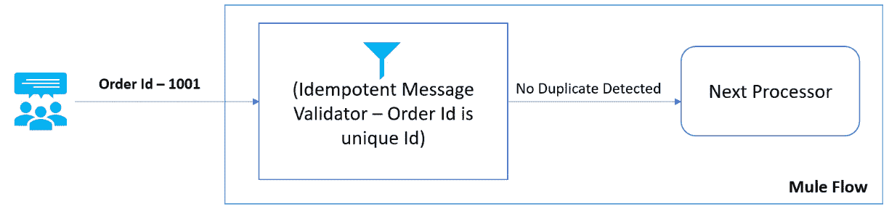

图 18.1：幂等过滤器

上图中订单 ID 为 `1001` 的订单被 Mule 流程接收，并将由幂等消息验证器进行验证，以确保在特定时间内不处理重复订单。该订单 ID 也将存储在本地数据库、分布式缓存或对象存储中，以便未来传入的订单可以根据存储的订单 ID 进行验证。

订单 ID `1001` 首次进入 Mule 流程，它将在进一步处理前通过幂等消息验证器。在这种情况下，未发现重复项。

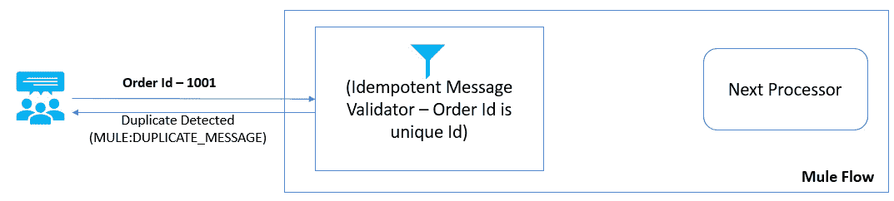

图 18.2：幂等过滤器（检测到重复项）

上图中，幂等消息验证器将验证 Mule 流程接收到的订单 ID 为 `1001` 的订单，以确保在特定时间内不处理重复订单。在这种情况下，订单 ID `1001` 已被接收，将抛出错误消息 `MULE:DUPLICATE_MESSAGE`。

# 缓存作用域

缓存作用域是 MuleSoft 提供的另一个有价值的组件，需要在 Mule 流程中进行配置，以存储和重用经常引用的数据。这将通过减少操作执行的次数来提高软件的整体性能。

下图说明了缓存在 Mule 流程中的工作原理。

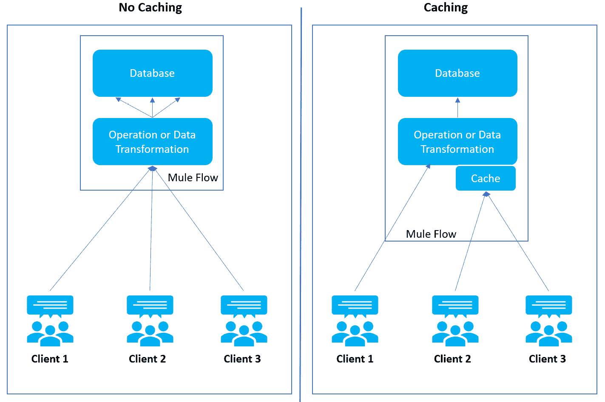

图 18.3：缓存与无缓存对比

在 **图 18.3** 中，我们有一个不带缓存的 Mule 流程和一个带缓存的 Mule 流程。不带缓存的 Mule 流程将为每个请求始终连接到数据库以检索数据，而带缓存的 Mule 流程仅在第一次请求时连接一次数据库以检索数据，将其存储在缓存中并响应客户端。任何后续请求将直接从缓存接收数据副本，而无需反复连接数据库。

缓存适用于静态数据和不频繁变更的数据，但对于频繁变更且动态的数据可能不合适。

让我们看看缓存的好处：

*   使用缓存通过在靠近消费者的地方缓存数据来减少网络开销，并减少与数据库和 Web 服务等终端系统的连接次数。
*   由于缓存减少了 Mule 流程中执行的操作数量，并将操作和数据转换数据存储在缓存中以供未来请求检索，因此整体应用程序响应时间将得到改善。
*   Mule 实例上的处理负载将减少，整体应用程序性能将得到提高，Mule 流程内消息处理的速度也将提高。
*   在网络崩溃期间，数据将可在缓存中获取。您的应用程序可能无法连接终端系统以检索数据；在这种情况下，缓存可用于存储和检索数据。

# 核心组件

MuleSoft 提供开箱即用的组件，可用于路由、转换和处理传入消息，这些组件可在 Mule 流程中配置。

**表 18.8** 列出了 MuleSoft 提供的核心组件组。

| 核心组件组 | 核心组件 | 描述 |
| --- | --- | --- |
| **批处理** | Batch Job、Batch Step、Batch Aggregator | 批处理组件用于通过自动拆分数据源并存储在持久队列中来处理大量数据，同时确保可靠性。 |
| **端点** | Scheduler | Scheduler 是一种 Mule 源事件，根据定义的调度器频率或 cron 表达式触发 Mule 流程的执行。 |
| **错误处理** | On Error Propagate、On Error Continue、Error Handler、Raise Error | 错误处理组件允许您处理 Mule 流程中消息处理期间的错误。 |
| **流程控制** | Choice、Scatter-Gather、First Successful、Round Robin | 流程控制组件用于根据特定条件将消息路由到一个或多个目标。这有助于您实现基于内容的路由、分散-聚集和多播等企业集成模式。 |
| **转换器** | Set Variable、Remove Variable、Set Payload | 转换器修改或增强消息负载或消息头，使其准备好通过 Mule 流程进行处理。 |
| **作用域** | All、Any、Async、Cache、Flow、For Each、Parallel For Each、Sub Flow、Try、Until Successful | 作为作用域的消息处理器——有时称为“包装器”——当您首次将它们放置在消息流程画布上时，显示为处理块。 |
| **其他组件** | Custom Business Events、Dynamic Evaluate、Flow Reference、Idempotent Message Validator、Invalidate Cache、Invalidate Key、Logger、Parse Template、Set Transaction Id、Transform Message | 其他有价值的核心组件用于转换消息、调用其他流程、验证数据和缓存数据。 |

表 18.8：核心组件

我们已经讨论了一些核心组件。现在，我们将讨论一些在 Mule 流程中经常使用的更重要的核心组件。

## Choice 路由器

Choice 路由器根据一组评估消息内容的 `DataWeave` 表达式，动态地通过流程路由消息。每个表达式都关联一个不同的路由选项。这类似于大多数编程语言中存在的 `if/then/else` 代码块。

Choice 路由器只有一条路由会运行（即，只有第一个评估为 `true` 的表达式会触发其对应的路由运行）；其他路由不会被检查。如果没有表达式为真，则使用默认路由。

**图 18.4** 展示了 Choice 路由器在 Mule 流程中的工作原理。

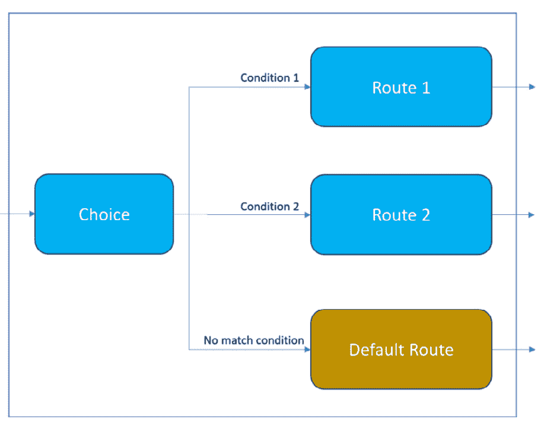

图 18.4：Choice 路由器

当现有路由中的表达式均不为真时，Choice 路由器会运行默认路由；当配置的 `DataWeave` 表达式评估为 `true` 时，会运行一个路由选项。当您需要评估多个条件并根据满足的条件执行不同操作时，请添加更多路由。

## Scatter-Gather 路由器

Scatter-Gather 组件是一种路由事件处理器，用于处理 Mule 事件。Mule 事件通过由不同事件处理器组成的多条并行处理路由进行路由。每条路由在接收到 Mule 事件的引用后，执行一系列事件处理器。

## Scatter-Gather 组件

这些路由中的每一个都有单独的线程用于其事件处理器，生成的 `Mule event` 可能与输入的相同，也可能是一个不同的事件，具有不同的有效负载、属性和变量。`Scatter-Gather` 组件随后会合并每个处理路由返回的 `Mule events`，以创建一个新的 `Mule event`，该事件仅在每个路由都成功完成后才传递给下一个事件处理器。

**图 18.5** 说明了 `Scatter-Gather` 在 `Mule flow` 中的工作原理。

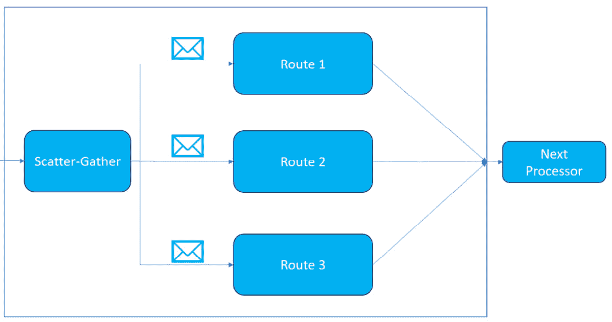

图 18.5：Scatter-Gather 路由器

`Scatter-Gather` 组件将消息的副本并行路由到所有路由，这将提高 `Mule application` 的整体性能。`Scatter-Gather` 组件适用于可重复流，但不处理不可重复流。

可以通过在 `Scatter-Gather` 组件的每个路由中使用 `Try` 作用域，来处理路由的事件处理器可能产生的任何错误。如果有任何路由因错误而失败，`Scatter-Gather` 组件会在每个路由执行后抛出 `MULE:COMPOSITE_ROUTING` 类型的错误。流程中的事件处理将在 `Scatter-Gather` 组件处停止。相反，流程会分流到您处理错误的事件处理器。

我们可能会遇到这样一种情况：即使 `Scatter-Gather` 组件中的其他路由失败，我们也希望获得成功路由的输出。在这种情况下，您可以将单个路由放在一个带有 `on error continue` 的 `try-catch` 块中，以确保我们可以获得成功路由的聚合输出和失败路由的错误响应。

## 错误处理

`MuleSoft` 提供开箱即用的错误处理组件，以处理在 `Mule flow` 中执行消息时发生的任何类型的异常。`MuleSoft` 会生成两类错误，具体描述如下。

### 系统错误

`System errors` 是发生在系统级别或未涉及 `Mule event` 时的错误。`System errors` 发生在应用程序启动期间，或当监听器无法与终端系统连接时。此类错误不可在 `Mule flow` 中配置或处理。

### 消息传递错误

`Messaging errors` 是在 `Mule flow` 中 `Mule events` 或消息处理期间发生的错误。`Mule` 提供可在 `Mule flow` 中配置以处理任何类型错误的错误组件，或者我们可以依赖默认的错误处理机制。

建议使用错误组件（`On Error` 组件，如 `On Error Propagate` 和 `On Error Continue`），而不是依赖默认错误处理机制：

*   **On Error Propagate**：在 `On Error Propagate` 块中，`On Error Propagate` 拦截错误，处理 `Mule flow`，并返回错误响应（状态码 `500`）。下图说明了 `On Error Propagate` 在 `Mule flow` 中的工作原理。

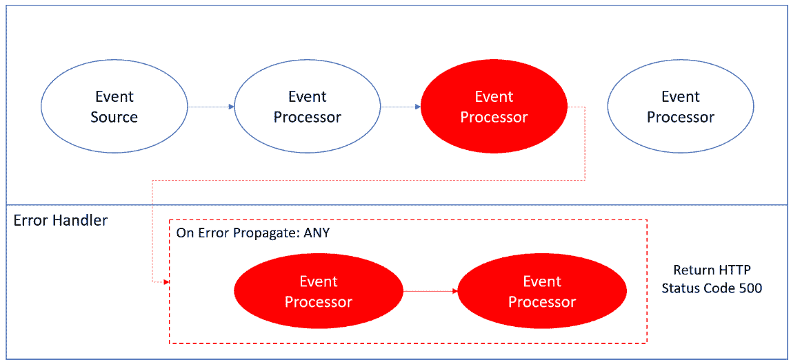

图 18.6：On Error Propagate

*   **On Error Continue**：在 `On Error Continue` 中，捕获错误，处理 `Mule flow`，并返回成功响应（状态码 `200`）。下图说明了 `On Error Continue` 在 `Mule flow` 中的工作原理。

图 18.7：On Error Continue

*   **Raise Error** 是一个核心组件，用于在 `Mule flow` 中引发带有自定义描述和自定义类型的错误。此组件可用于引发以下错误：

*   核心运行时错误，如 `MULE:SECURITY` 和 `MULE:CONNECTIVITY`
*   自定义错误类型

**图 18.8** 说明了如何在 `Mule flow` 中配置 `Raise Error` 组件及其工作原理。

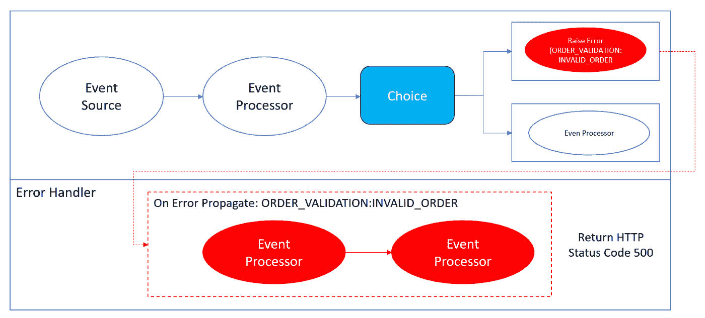

图 18.8：Raise Error 组件

在中心位置管理 `Mule application` 执行期间出现的异常和错误的过程，在 `MuleSoft` 中称为 `global error handling`。它提供了一种跨各种集成流和组件可靠地捕获和管理错误的方法。

错误处理器是可设置为处理特定类型错误或异常的独特 `MuleSoft` 组件，通常用于实现 `global error handling`。每当应用程序内部出现错误时，就会调用这些错误处理器，它们在应用程序级别定义。

请访问 [`docs.mulesoft.com/mule-runtime/latest/error-handling`](https://docs.mulesoft.com/mule-runtime/latest/error-handling) 了解有关 `global error handling` 的更多信息。

正如我们所见，`MuleSoft` 提供了多个组件以帮助高效处理错误。作为最佳实践，我们应始终使用 `MuleSoft` 提供的组件创建一个通用的错误处理框架，该通用错误处理框架可发布到 `Anypoint Exchange` 并在多个 `Mule applications` 中重用。

## Transform Message 组件

`Transform Message` 组件允许您转换接收到的输入数据。您可以使用 `DataWeave` 语言显式保存转换，或通过拖放元素在 UI 中创建转换。

我们已经了解了 `MuleSoft` 用于构建 API 和集成的基本构建块和错误处理框架。在下一节中，我们将探讨一些将平台架构付诸实践的用例。

# 用例 1

J&J Music 旨在通过为用户提供专辑、歌曲以及歌曲评论、歌手等歌曲相关信息的访问权限，来增强其在线知名度。他们希望在无需担心维护基础设施的情况下，将公有云上的现有音乐管理系统与 `Salesforce` 等 CRM 程序集成。他们打算在未来拓展业务，这意味着流量很有可能会上升。因此，他们需要一个既高可用又可扩展的平台。

上述需求清楚地表明，J&J Music 正在寻找供应商托管的部署选项，以保证可扩展性和业务连续性。他们还希望能与公开访问的音乐管理系统和用于客户管理的 `Salesforce` CRM 无缝集成。我们可以使用 `CloudHub 1.0` 或 `CloudHub 2.0` 来实现这一点。`CloudHub 2.0` 相对于 `CloudHub 1.0` 新增或改进的内容已在前面的章节和 第 10 章 中介绍过。

我们将使用 `CloudHub 1.0` 作为 `MuleSoft` 应用程序部署选项来满足该需求。`CloudHub 2.0` 甚至也能满足此需求。

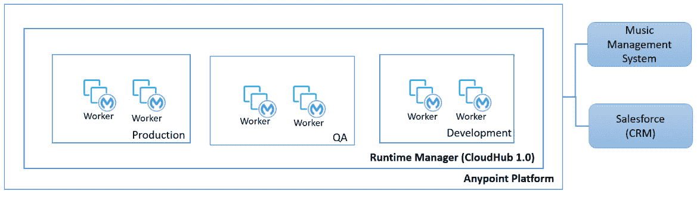

图 18.9：CloudHub 1.0 实现

在 **图 18.9** 中，我们可以利用 `MuleSoft` 提供的原生 `CloudHub 1.0` 平台功能。我们无需配置任何其他额外组件，即可满足所有客户需求。

J&J Music 正在拓展业务，现在他们希望将所有 API 托管在单个域名下，并需要连接位于企业数据中心或无法公开访问的一些资源。

为满足新需求，我们需要配置 `Anypoint VPC` 和 `Anypoint Dedicated Load Balancer` (`DLB`) 以在单个域名下托管所有 API。需要 `Anypoint Virtual Private Network` (`VPN`) 来连接位于企业数据中心的资源，以便从运行在 `CloudHub 1.0` 上的应用程序访问它们。下图说明了如何将 `Anypoint VPC`、`DLB` 和 `VPN` 与 `CloudHub 1.0` 结合使用。

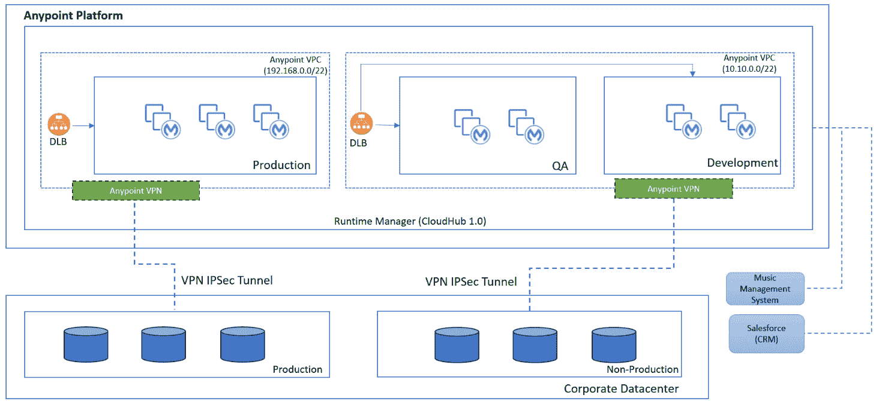

图 18.10：带有 Anypoint VPC 和 VPN 的 CloudHub 1.0 实现

如图 18.10 所示，我们已配置 Anypoint VPC、DLB 和 VPN。DLB 将允许在单个域下托管所有 API，而 Anypoint VPN 将允许连接到位于企业数据中心的资源。

J&J Music 可以为运行在 CloudHub 1.0 上的 API 启用 API 管理功能，如图 18.11 所示。

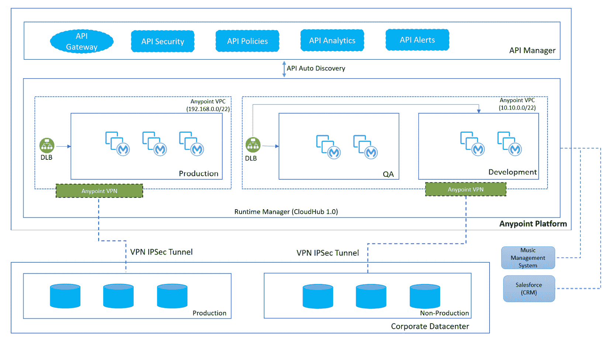

如图 18.11 所示，API 管理器可以通过 API 自动发现与部署到 CloudHub 1.0 的 API 建立对等连接。这将使我们能够管理和保护 API。

## 用例 2

Java 用于编写 J&J Music 的 API，这些 API 托管在本地。为了保护、管理、发现和使用这些 API，他们目前正尝试在 API 上激活 API 管理功能。此外，他们打算逐步将每个 API 迁移到云端。MuleSoft 已经是他们管理和实施 API 的首选平台。

从用例来看，J&J Music 希望使用 Anypoint Platform 来管理非 MuleSoft API。他们还需要逐步将所有内容迁移到 CloudHub。

有多种解决方案可用于实现此用例。

混合实施是一种选择（控制平面在 Anypoint Platform 中，运行时平面在客户数据中心中）。

我们必须设置一个 API 代理，使其与 Java API 建立对等连接，以便 API 管理能够管理 Java API。尽管本地 Mule 运行时将使该 API 代理能够更靠近客户的 Java API 运行，但它并不能完全满足客户的要求，因为客户打算很快迁移到云端。根据 J&J Music 的云迁移计划，从长远来看，此解决方案并不切实际。

为了完全满足 J&J Music 的要求，我们选择了 CloudHub 2.0 作为托管解决方案。要通过运行在 CloudHub 2.0 上的 API 代理连接本地运行的 Java API，我们还需要在 CloudHub 2.0 上配置私有空间和 Anypoint VPN。关于 CloudHub 2.0 的更多信息请参阅第 10 章。此选项将更具适应性，并符合客户的需求和长期目标。

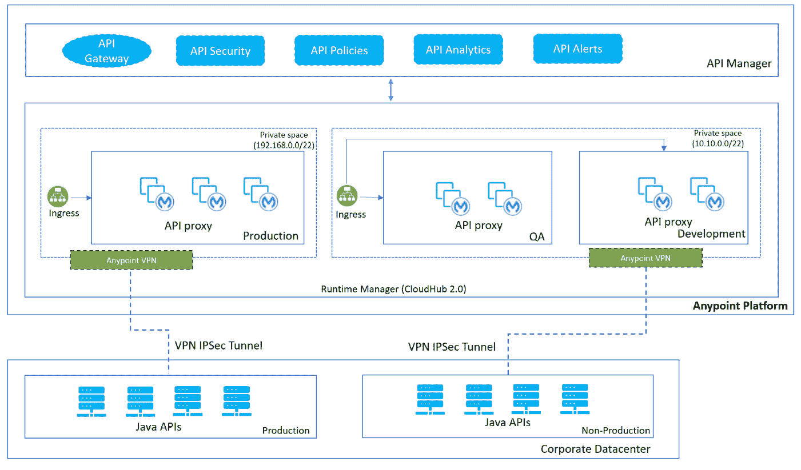

图 18.12 展示了 J&J Music 使用 Anypoint Platform 管理 Java API 时的架构蓝图。

> **注意**
>
> 与 CloudHub 2.0 一样，CloudHub 1.0 也可以以类似的方式使用。

Flex Gateway 可用于管理 Java API；第 15 章 中有关于 Flex Gateway 的更多信息。AWS、Azure、Google 和其他云平台可用于设置 Flex Gateway。

## 用例 3

J&J Music 希望在一个法律和合规要求更严格的国家拓展业务。该国政府通过多项法律法规，将网络安全、数据保护和隐私列为首要任务。该国规定，如果你想在线开展业务，必须在那里托管基础设施，或使用提供在该国托管基础设施选项的云服务提供商。此外，你的数据和元数据不得离开该国。

尽管 MuleSoft 的控制平面位于美国或欧盟，但我们在希望拓展业务并建立在线业务的国家无法访问它。在这种情况下，我们无法使用 Anypoint Platform 管理 API 生命周期。我们必须实施 Anypoint PCE，它可以托管在该国的云计算环境或企业数据中心中。

客户托管的 Anypoint PCE 将用于管理 API，客户托管的 Mule 运行时将用于执行 Mule 应用程序。

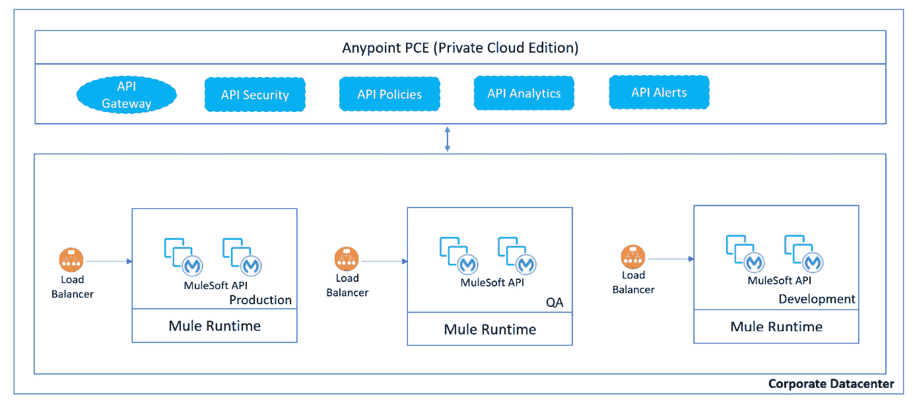

图 18.13 显示运行时平面和控制平面均托管在客户基础设施中。这将使 J&J Music 能够遵守该国制定的法律法规。

> **注意**
>
> 可以实施本地 Mule 运行时来代替 RTF。
>
> 如果云服务提供商允许在该国托管必要的基础设施，则控制平面和运行时平面可以托管在那里。

## 摘要

在本章中，我们讨论了 MuleSoft 提供的主要组件。我们还了解了在弹性 API 的设计和开发中的灵活 API 技术。还讨论了用于管理 MuleSoft 平台和 API 的 `Anypoint CLI`，包括如何将 `Anypoint CLI` 与 `CI/CD` 集成以实现应用程序部署和自动化。我们还讨论了在选择运行 MuleSoft 应用程序的正确部署选项时需要考虑的事项。

感谢您抽出时间阅读本书。您的关注对我意义重大，我深表感激。谢谢。
