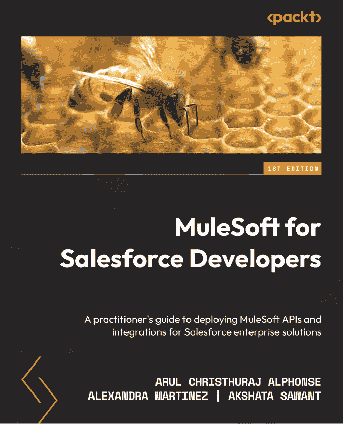
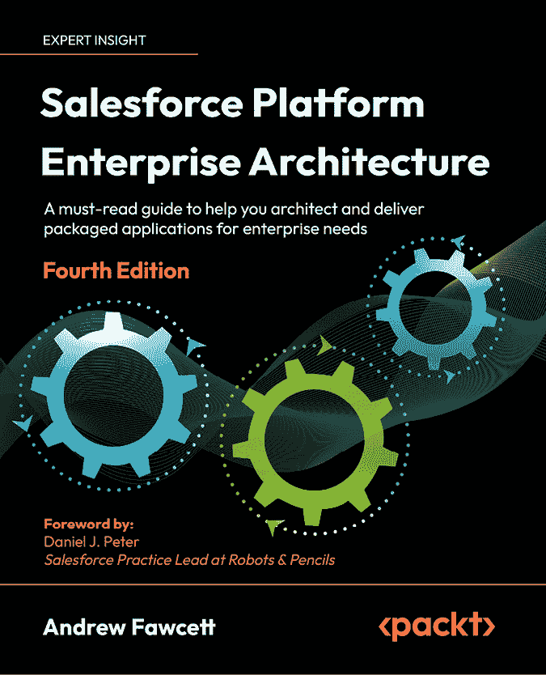

## 索引

由于此电子书版本没有固定的页码，下面的页码仅供参考，根据本书的印刷版本超链接。

A

加速器 85

加速器构建模块 86

最佳实践 88

连接器 87

数据映射 88, 89

端点 89

预构建 API 87

模板 88

Amazon Virtual Private Cloud (VPC) 198

Amazon Web Services (AWS) 304

Anypoint API Manager

监控和分析功能 316, 317

Anypoint API Manager 警报 387

失败的请求 387

策略违规 387

请求量 387

响应时间 387

Anypoint CLI 192, 193, 354, 433

功能 434

参考链接 193

Anypoint 集群 272

优势，用于本地 Mule 运行时 273

解决并发问题 274

配置属性 274, 275

组播集群 273

持久化对象存储 277

主节点和从节点 278\-280

仲裁管理 276

手动设置 274

在 Anypoint Platform 上设置 276

单播集群 273

VM 队列 281

Anypoint Code Builder (ACB) 18, 46

Anypoint Community Manager (ACM) 355, 381

功能 381

局限性 382

Anypoint 控制平面 31

业务组 36, 37

## 索引

- **组件** 31
- **控制平面托管选项** 31, 32
- **环境** 38, 39
- **组织** 35
- **保护** 33–35
- **服务** 31

- **Anypoint 核心服务** 43
  - 设计功能 45, 46
  - 发现功能 46, 47
  - 管理功能 43, 45

- **Anypoint 专用负载均衡器** 177
  - 允许列表 CIDR 179
  - 用于公共和私有流量 186
  - HTTP 入站模式 185
  - 在 EU 控制平面中 313
  - 映射规则 182–184
  - 双向身份验证 180–182
  - 建议 186
  - 单独的专用负载均衡器，用于公共和私有 API 188
  - 单个专用负载均衡器，用于公共和私有 API 186–188
  - 规格调整 182
  - SSL 证书 180
  - 超时 182

- **Anypoint Design Center** 2

- **Anypoint Exchange** 2, 355, 380
  - ACM 381
  - API 体验中心 382
  - API 规范片段 23, 47
  - 优势 380
  - 连接器 23, 47
  - DataWeave 库 23, 47
  - 开发者门户 380
  - 示例应用程序 47
  - 示例 23
  - 策略 23, 47
  - REST API 23, 47
  - RPA 活动模板 23, 47
  - 规则集 24, 47
  - SOAP API 24, 47
  - 模板 24, 47
  - 用于发现 API 380
  - 用于共享 API 380

- **Anypoint Monitoring** 316, 320
  - 警报，在 Runtime Manager 中为 CloudHub 2.0 启用 333
  - 警报，在 Runtime Manager 中为 CloudHub 启用 333
  - 警报，在 Runtime Manager 中为混合环境启用 331–333
  - 优势 321
  - 连接器 330, 331
  - 控制台，使用 325
  - 仪表板 321, 322
  - 数据保留策略和限制 329
  - 启用，针对部署在混合环境中的应用程序 328, 329
  - 启用，针对部署到 CloudHub 的应用程序 325
  - 启用，针对部署到 CloudHub 2.0 的应用程序 326
  - 启用，针对部署到 Runtime Fabric 的应用程序 327
  - 启用，在 CloudHub 设置中 326
  - 事件驱动警报 322–324
  - 日志，启用 341

- **Anypoint MQ** 132
  - 熔断器功能 135, 136
  - 跨区域故障转移，用于标准队列 134
  - 死信队列 (DLQ) 135
  - 功能 134
  - 消息交换 133
  - 消息交换，注意事项 133
  - 消息队列 132

- **Anypoint Platform Private Cloud Edition (PCE)** 19, 32, 270, 283
  - 组件 284, 285

- **Anypoint Runtime Manager (ARM) REST API**
  - 本地部署 MuleSoft 应用程序，使用 295, 296

- **Anypoint 服务器组** 282
  - 对比，Anypoint 集群 283

- **Anypoint Service Mesh** 365
  - 架构 365
  - 功能 365

- **Anypoint Visualizer** 347

- **Anypoint VPC** 167, 361, 393
  - 架构 168, 169
  - CIDR 掩码，计算 175–177
  - 连接方法 169
  - 在 EU 控制平面中 312
  - 在 MuleSoft Government Cloud 中 306
  - 关键点 167
  - 对等连接 173
  - VPN IPsec 隧道 170

- **Anypoint VPN**
  - 灾难恢复 171, 172
  - 高可用性 171
  - 在 EU 控制平面中 312
  - 在 MuleSoft Government Cloud 中 306

- **API Analytics** 383
  - 功能 383, 384

- **API 自动发现** 362, 363

- **基于 API 的连接** 118

- **API 回调** 115, 116

- **API 并发** 113
  - 处理 113

- **API 开发** 43

# A

## API 体验中心
355, 382

### 功能特性
382

### 局限性
383

### 与 ACM 的对比
383

## API 优先开发
22

## API 网关
357

### 功能
358

### Mule 网关
358

### 类型
358

## API 治理
385

### 合规
385

### 实施
385, 386

### 接口
386

### 不合规
385

### 未验证
385

### 规则集
386

## API 主导的连接性
137

### 与 EDA
137, 138

### 体验 API
138

### 流程 API
138

### 系统 API
139, 140

## API 管理
355

## API 生命周期
355\-357

## API 管理器
354

## 警报
319, 320

## API 监控

### 必要性
315

## API 性能
144

## API 性能指标

### 可用性
144

### 错误率
144

### 延迟
144

### 响应时间
144

### 可扩展性
144

### 吞吐量
144

## API 策略
384

## API 代理
359

### 优势
359

### 启用
360

### 使用标准
359

### 与 API 自动发现的对比
364

## API 安全
147, 148

## API 安全威胁
387

### 认证失效
387

### 功能级授权失效
388

### 跨站脚本攻击 (XSS)
388

### DDoS 攻击
388

### DoS 攻击
388

### 过度数据暴露
388

### 注入攻击
387

### 不安全的直接对象引用 (IDOR)
387

### 缺乏速率限制
388

### 批量赋值
388

### 预防措施
389, 390

### 安全配置错误
387

### XML 外部实体注入 (XXE)
388

## API 蔓延
351, 352

### 预防
352, 353

## 应用程序缓存
146

## 应用程序网络
70

### 优势
80

### 最佳实践
81, 82

### 构建
74

### 组件
71

### 可组合性
140, 141

### 设计
76, 77

### 开发
76, 77

### 高层应用程序网络设计模板
73

### 管理
78, 79

### MuleSoft 赋能的应用程序网络
73

### 路线图，规划
74\-76

### 意义
71

### 无意形成的应用程序网络
72

## 应用程序编程接口 (API)
101

### 设计，用于通信
102, 103

### 重要性，在交付现代集成方面
26, 27

## 应用程序

### 部署，到 EU 控制平面
312

## 架构能力，MuleSoft
15

### 优势
18, 19

### 组件
22

### 设计能力
24

### 发现能力
22, 23

### 发现能力
24

### 管理能力
25, 26

### 操作平面
15\-19

### 平台部署选项
19

## AsyncAPI
18, 24, 45

## 自动化
141

## 自动扩缩容
163

## AWS Direct Connect
174

## Azure
198

## Azure Kubernetes Service (AKS)
233

# B

## 优中选优应用
14

## 优中选优策略
14

## 大泥球架构
6

## 蓝绿部署
153, 154

## 边界网关协议 (BGP)
170

## 僵尸网络
388

## 限界上下文数据模型
105

### 优势
106

### 劣势
107

### 特性
105

### 功能
105, 106

### 与 EDM 的对比
107, 108

## 自带 Kubernetes (BYOK)
243

## 业务成果

### 依赖，API
101

### 开发
99\-101

### 考虑非功能性需求
101

# C

## 缓存作用域
146, 438

## 缓存
113, 146

### 优势
439

- **运行中** 438
- **与无缓存对比** 438
- **金丝雀部署** 154
- **Catalyst** 50
  - **Catalyst 基金会** 51, 52
    - **业务成果** 52
    - **工作/委托** 56
    - **组织赋能** 54
    - **战术手册组织** 55
    - **技术交付** 53
  - **Catalyst 知识中心** 57
    - **利用** 57–60
  - **Catalyst 启动工作** 56
  - **Catalyst 优化** 56
  - **Catalyst 扩展** 56
- **赋能中心 (C4E)** 78
  - **KPI** 62, 63
  - **指标** 62
  - **人员配置** 63–65
  - **团队赋能** 61
  - **价值, 发现** 60
- **人工操作方式** 13
- **Choice 路由器** 440
  - **工作原理** 441
- **断路器设计模式** 131
  - **架构** 131, 132
  - **状态** 131
  - **结合 Anypoint MQ** 135, 136
- **无类别域间路由 (CIDR)** 175
- **CloudHub** 20, 39
- **CloudHub 1.0** 158, 431, 432
  - **DNS 记录** 160
  - **高可用性** 162
  - **高可用性和容错** 392
  - **智能修复** 161, 162
  - **Object Store V2** 164
  - **持久队列** 163
  - **区域** 160
  - **可扩展性** 163, 397
  - **计划, 管理** 164
  - **共享负载均衡器** 159
  - **单区域灾难恢复** 161, 162
  - **静态 IP 地址** 165, 166
  - **vCore 优化和分配** 407
  - **工作器** 158, 159
  - **工作器大小** 158, 159
  - **零停机更新** 162
- **CloudHub 1.0 API** 194
- **CloudHub 1.0 (多区域)**
  - **DR, 用于** 402, 403
- **CloudHub 2.0** 20, 39, 197, 432
  - **Anypoint CLI** 224, 225
  - **应用程序隔离** 201
  - **功能** 198
  - **集群** 201
  - **特性** 198
  - **颗粒度 vCore 选项** 202
  - **高可用性** 201
  - **高可用性和容错** 394
  - **智能修复** 201
  - **最后一公里安全** 204, 205
  - **限制** 227
  - **Mule Maven 插件** 219–223
  - **Mule 运行时** 202
  - **MuleSoft 应用程序部署选项** 219
  - **Object Store v2** 202, 203
  - **私有空间** 206–209
  - **区域** 199, 200
  - **副本** 199
  - **副本大小** 199
  - **可扩展性** 202, 397
  - **计划, 管理** 204
  - **共享空间** 205, 206
  - **技术增强** 226
  - **vCore 优化和分配** 407
  - **零停机更新** 202
- **CloudHub 2.0 (多区域)**
  - **DR, 用于** 403–405
  - **集群** 259
- **粗粒度 API** 108
  - **优势** 109
  - **劣势** 109
  - **示例** 112
  - **特性** 108, 109
  - **与细粒度 API 对比** 111, 112
- **内聚性** 121
- **商用现成系统 (COTS)** 26
- **公共对象请求代理架构 (CORBA)** 7
- **竞争消费者模式** 129
  - **应用** 130
  - **优势** 130
  - **用于高流量** 130
  - **用于低流量** 129
- **竞争队列消费者模式**
  - **优势** 280
- **可组装企业概念** 141
  - **API 主导的连接** 141
  - **应用网络** 141
  - **自动化** 141
  - **混合集成** 141
  - **可复用资产** 141
  - **通用 API 管理** 141
- **连接器** 87
  - **优势** 87
  - **使用示例** 87
- **消费者应用程序** 71
- **控制器管理器** 231
  - **部署控制器** 231
  - **作业控制器** 231
  - **节点控制器** 231
  - **副本控制器** 231

## C

### 控制平面
15, 16

### 核心组件
439, 440

#### 选择路由器
440

#### 错误处理组件
442

#### 分发-聚集路由器
441, 442

#### 转换消息组件
445

### 核心服务，Anypoint
43

### 耦合
122

### 跨站脚本 (XSS)
148

### 客户关系管理 (CRM)
432

## D

### 数据加密
149, 152

### 数据丢失防护 (DLP) 策略
149

### 数据映射
88

#### 优势
89

#### 使用示例
89

### 数据脱敏
151

### 静态数据安全
151

#### 数据加密
152

#### 数据脱敏
151

#### 使用 DLP 工具
151

#### 频繁审计
152

#### 强访问控制
151

#### 使用强认证技术
152

#### 更新和安全补丁
151

### 传输中的数据安全
148, 149

#### 数据加密
149

#### 数据丢失防护 (DLP) 策略
149

#### 频繁的系统/软件更新
149

#### 多因素认证 (MFA)
149

#### 使用专用网络
149

#### 采用安全文件传输选项
149

#### 安全套接字层 (SSL)
149

#### 传输层安全 (TLS)
149

#### 虚拟专用网络 (VPN)
149

### 死信队列 (DLQ)
135

### 专用负载均衡器

#### 优势
307

#### 在 MuleSoft Government Cloud 中
307

### 拒绝服务 (DoS) 策略
241

### 部署模型

#### 适用于 MuleSoft Government Cloud
308\-310

#### 选择考量因素
425\-431

### 部署策略
152

#### 蓝绿部署
153, 154

#### 金丝雀部署
154

#### 滚动更新部署
152, 153

### Design Center
18, 354

#### API 规范
24

#### 开发者门户
380

##### 功能特性
381

### 灾难恢复 (DR)
402

#### 适用于 CloudHub 1.0 (多区域)
402, 403

#### 适用于 CloudHub 2.0 (多区域)
403\-405

#### 适用于本地 Mule 运行时
405, 406

### 分布式拒绝服务 (DDoS) 攻击
147, 388, 435

### 领域驱动设计 (DDD)
122

### 域项目
289

#### 在 API 主导的连接架构中使用
290\-292

### DoS 攻击
388

## E

### EDM
103

#### 优势
104

#### 劣势
104

### 弹性 Kubernetes 服务 (EKS)
233

### 弹性负载均衡器 (ELB)
245

### 弹性网络接口 (ENI)
243

### 电子病历 (EMR)
433

### 端点
89

#### 优势
89

#### 使用示例
89

### 企业应用集成 (EAI)
14

### 企业规范模型
14

### 企业服务总线 (ESB)
8

#### 架构
118

### 错误处理组件
442

#### 消息传递错误
443\-445

#### 系统错误
443

### 错误率
144

### etcd
237

#### 在 Runtime Fabric 中
237

### EU 控制平面
311

#### Anypoint 专用负载均衡器 (DLB)
313

#### Anypoint VPC
312

#### Anypoint VPN
312

#### 部署应用程序到
312

#### 考量因素
311

#### 劣势
311

#### 对象存储
312

#### 参考链接
311

#### 迁移到美国控制平面
312

### 事件驱动架构 (EDA)
136

#### 与 API 主导的连接
137, 138

#### 优势
136

#### 解耦
136

#### 局限性
137

#### 松耦合
136

### 体验 API
138

### 提取、转换和加载 (ETL)
69

## F

### 联邦风险和授权管理计划 (FedRAMP)
32, 42, 303

#### 合规性
303, 304

### 细粒度 API
109

#### 优势
110

#### 劣势
110

#### 示例
112

#### 特性
109

#### 对比粗粒度 API
111, 112

### 先进先出 (FIFO) 队列
134

### 适用性策略
14

### Flex Gateway
355, 366

#### API 策略
379

## F

### Flex Gateway
- 优势 367
- Helm Chart 设置 373
- 高可用性 371
- 集中模式 376
- 连接模式 367
- 去中心化模式 377–379
- 本地模式 368
- 路由 374, 375
- 可扩展性 371
- 与 Mule Gateway 对比 379

### Flex Gateway 部署模型
- 出站部署模型 370
- 入站部署模型 369, 370
- Sidecar 部署模型 370, 371
- 独立部署模型 369
- 全托管部署模型
  - 优势 309

### 功能监控
- 功能监控 334–336
- 监控私有 API 的端点 338–340
- 监控公共 API 的端点 336, 337

### 功能需求
- 功能需求 99
- 依赖 API 101
- 确定 100
- 子类别 100

## G

### 垃圾回收 (GC) 调优
- 垃圾回收 (GC) 调优 147

### 通用数据保护条例 (GDPR)
- 通用数据保护条例 (GDPR) 32, 311

### 全局错误处理
- 全局错误处理 445

### Google Cloud Platform (GCP)
- Google Cloud Platform (GCP) 198

### Google Kubernetes Engine (GKE)
- Google Kubernetes Engine (GKE) 233

### gRPC
- gRPC 7

## H

### Hazelcast
- Hazelcast 272

### 高可用性
- 高可用性 392
- 以及 CloudHub 1.0 的容错 392
- 以及 CloudHub 2.0 的容错 394
- 以及 Runtime Fabric（裸金属服务器/虚拟机）的容错 396
- 以及 Runtime Fabric（自管式 Kubernetes）的容错 396
- 以及本地部署 Mule 运行时的容错 394–396

### CloudHub 1.0 的高可用性和容错
- CloudHub 1.0 的高可用性和容错 393
  - 在可用区内 393, 394
  - 在区域内 393

### 高可用性，实现选项
- 高可用性，实现选项
  - 主动-主动方法 299
  - 冷备方法 297
  - 热备方法 298
  - 温备方法 297

### 高层应用网络设计模板
- 高层应用网络设计模板
  - 体验 API 73
  - 外部系统 73
  - 过程 API 74
  - 系统 API 74
  - 记录系统 74

### HTTP 限制策略
- HTTP 限制策略 241

### HTTP 方法
- HTTP 方法 114
  - CONNECT 114
  - DELETE 114
  - GET 114
  - HEAD 114
  - 幂等方法 115
  - OPTIONS 114
  - PATCH 114
  - POST 114
  - PUT 114
  - 安全方法 115
  - TRACE 114

### 中心辐射型架构
- 中心辐射型架构 117

### 混合集成
- 混合集成 118

### 混合 iPaaS
- 混合 iPaaS 15

### 混合托管部署模型
- 混合托管部署模型
  - 优势 310
  - 局限性 310

## I

### 幂等作用域
- 幂等作用域 436, 437

### 身份提供商 (IdP)
- 身份提供商 (IdP) 33

### 入站负载均衡器，Runtime Fabric
- 入站负载均衡器，Runtime Fabric
  - 专用模式 240
  - 共享模式 240

### 集成平台即服务 (iPaaS)
- 集成平台即服务 (iPaaS) 118

### 集成
- 集成
  - 组织中的挑战 13–15

### 集成方法
- 集成方法 4
  - 企业服务总线 (ESB) 8, 9
  - J&J Music Store 用例 4
  - 中间件和远程过程调用 7
  - 点对点集成 4–6
  - REST 服务 10
  - 面向服务架构 10

### 集成平台即服务 (iPaaS)
- 集成平台即服务 (iPaaS) 11, 12, 197, 431

### 内部服务间通信
- 内部服务间通信 256

### 国际武器贸易条例 (ITAR)
- 国际武器贸易条例 (ITAR) 304

### IP 允许列表策略
- IP 允许列表策略 241

## J

### Java 虚拟机 (JVM)
- Java 虚拟机 (JVM) 16

### J&J Music Store
- J&J Music Store 90
  - 组件 91

### JSON 记录器
- JSON 记录器 347

### JSON 日志记录
- JSON 日志记录
  - 结合 Mule 应用程序 347

## K

### Kapacitor
- Kapacitor 347

### 密钥管理服务 (KMS)
- 密钥管理服务 (KMS) 245

### 关键绩效指标 (KPI)
- 关键绩效指标 (KPI) 52

### Kubernetes 架构
- Kubernetes 架构 230
  - 主节点组件 230, 231
  - 工作节点组件 232, 233

## L

### 实验室信息管理系统 (LIMS)
- 实验室信息管理系统 (LIMS) 433

### 最后一英里安全
- 最后一英里安全 255

### 延迟
- 延迟 144

### 延迟图表
- 延迟图表 319

### 最少连接负载均衡
- 最少连接负载均衡 146

### 业务线 (LOB) 应用程序
- 业务线 (LOB) 应用程序 71

### 负载均衡
- 负载均衡 113, 146

### 负载均衡算法
- 负载均衡算法
  - 最少连接负载均衡 146
  - 轮询负载均衡 146
  - 加权轮询负载均衡 146

### 日志记录
- 日志记录

# C

## CloudHub 应用程序日志
- 发送到外部系统 342, 343

## JSON 日志记录
- 结合 Mule 应用程序 347

## 重要性 341

## 部署到 CloudHub 2.0 的 MuleSoft 应用程序 344

## 部署到 CloudHub 的 MuleSoft 应用程序 341, 342

## 部署到本地/混合环境的 MuleSoft 应用程序 345, 346

## 部署到裸金属系统/VM 上的 Runtime Fabric 的 MuleSoft 应用程序 346

# M

## 管理功能，Anypoint
### 访问管理 25
### API 治理 26
### API Manager 25
### 监控 26
### Runtime Manager 25
### Secrets Manager 26
### 可视化工具 26

## 管理中心 18

## 主数据管理 (MDM) 应用程序 76

## 主节点组件，Kubernetes
### 控制器管理器 231
### etcd 230
### kube-apiserver 230
### kube-scheduler 230

## 微服务架构 118, 121
### 优势 123
### 特征 121
### 内聚性 121
### 耦合性 122
### 劣势 124
### 领域驱动设计 (DDD) 122
### 单一职责原则 (SRP) 122

## 中间件层 8

## 最小可行性产品 (MVP) 74

## 单体架构 118, 119
### 优势 120
### 劣势 120

## Mule Analytics Event API 320
### API 报告 320

## Mule API 分析图表 317
### 延迟图表 319
### 请求摘要图表 317, 318
### 热门应用程序图表 318, 319

## Mule 金丝雀部署 API 策略 155

## Mule 域 288

## Mule 网关 358

## Mule Maven 插件 189, 192, 261–265, 292
### 属性 293
### 属性，使用 ARM 部署时 295

## Mule 运行时
### 安全性 301
### 升级 300

## MuleSoft 2
### 应用程序网络 70
### 架构功能 15
### 部署，用于高可用性和灾难恢复 296

## MuleSoft 加速器
### 零售加速器，自定义 90, 91
### 优势 92, 93
### 构建模块 92
### 自定义 89
### 局限性 93

## MuleSoft API，性能提升因素
### 应用程序缓存 146, 147
### 负载均衡 146
### 性能监控 145
### 性能测试 145
### 资源分配 145

## MuleSoft 应用程序
### 部署选项，至 CloudHub 1.0 189–194
### 部署选项，至 Runtime Fabric 260

## 本地 MuleSoft 应用程序
### 部署，使用 ARM REST API 295, 296
### 部署，使用 Mule Maven 插件 292–295

## MuleSoft Catalyst 155

## MuleSoft Catalyst GitHub 存储库 94
### 组件 95, 96

## MuleSoft 认证平台架构师 (MCPA)
### 课程 50
### 考试当天 416
### 考试形式 412
### 1 级认证 411
### 1 级认证，优势 413
### 1 级认证有效期 412
### 1 级考试考生 413
### 1 级考试准备 412
### 1 级考试大纲 413–415
### 1 级维护考试 412
### 策略，用于回答多项选择题 415
### 考试系统要求 416

## MuleSoft 可组装企业 140

## 启用 MuleSoft 的应用程序网络 72

## MuleSoft 政府云 304
### Anypoint VPC 306
### Anypoint VPN 306
### 注意事项 305
### 控制平面 307
### 控制平面，组件 307
### 专用负载均衡器 307
### 专用负载均衡器，优势 307
### 部署模型 308–310
### 功能 304
### 运行时平面 308
### 安全性 306
### 独立 Mule 支持 308

## MuleSoft RPA 23

## 多播集群 273

## 多因素身份验证 (MFA) 33, 149

## 多个 MuleSoft 应用程序
### 运行，在单个端口上 289, 290

## 多线程 113

# N

## N(N-1) 规则 5

## Node 包管理器 (npm) 434

# 索引

## N
- 非功能性需求 (NFRs) 143, 144, 392
- 非 MuleSoft API
  - 管理 360
  - 管理，在 CloudHub 中部署 API 代理 361
  - 管理，在本地 Mule Runtime 中部署 API 代理 361

## O
- Object Store V2 164
  - 特性 164
- On Error Continue 组件 443
- On Error Propagate 组件 443
- 单向 TLS 149, 150
- 本地 Mule Runtime 270, 433
  - 运行应用程序的注意事项 271
  - 用于灾难恢复 405, 406
  - 完全本地部署方法 287, 288
  - 高可用性 271
  - 高可用性和容错 394, 395
  - 混合方法 286, 287
  - 负载均衡器 271, 272
  - 可扩展性 271
  - 安全性 301
  - 独立部署方法 286
  - 升级 300
  - 用例 285
  - vCore 优化和分配 408
- OpenAPI 规范 (OAS) 11, 18, 24, 353
- OWASP 十大安全威胁 387, 388
- OWASP ZAP 148

## P
- 性能监控 145
- 性能测试 145
- 持久化网关
  - 与 Runtime Fabric 配合使用 257
- 持久队列 163
- 个人身份信息 (PII) 147
- 成功规划阶段 55
- 平台即服务 158
- 平台部署选项 19
  - 控制平面托管 19
  - 控制平面托管选项 21, 22
  - 结合控制平面主机和运行时主机 21, 22
  - 运行时托管选项 21, 22
  - 运行时平面 19, 20
- Pod 255
- 点对点集成 4\-6, 117
  - 局限性 7
- Postman 148
- 预构建 API 87
  - 优势 87
  - 使用示例 87
- 私有空间，CloudHub 2.0 206
  - 属性 207\-209
  - AWS 服务角色 209
  - AWS Transit Gateway 215
  - 高层架构 207
  - HTTP 请求 212
  - 入站和出站流量规则 209, 210
  - 入口负载均衡器 212
  - 多域名 217, 218
  - 多环境 217
  - 私有空间网络架构 215, 216
  - 公共和私有端点 211
  - TLS 上下文和域名 211
  - VPN 连接 213
  - VPN 高可用性 213, 214
- 进程 API 138
- 发布-订阅方法 8

## Q
- 质量属性 143
- 排队 113
- 仲裁管理
  - 在 Anypoint 集群中 276

## R
- Raise Error 组件 444
- 速率限制 113
- 恢复点目标 (RPO) 403
- 恢复时间目标 (RTO) 402
- 远程过程调用 (RPC) 7
- 副本
  - 跨节点部署 259
- 表述性状态转移 (REST) 10, 11, 70, 82, 102
- 请求-响应方法 8
- 请求摘要图表 317, 318
- 弹性 API 技术 434, 435
- 资源分配 145
- 响应时间 144
- 负责/问责/咨询/知情 (RACI) 矩阵 52
- RESTful API 建模语言 (RAML) 18, 24, 45, 82, 92
- RESTful Web 服务 11
- 机器人流程自动化 (RPA) 47
- 基于角色的访问控制 (RBAC) 148
- 滚动更新部署 152, 153
- 轮询负载均衡 146
- `rtfctl` 实用程序 251
- Runtime Fabric 20, 33, 39, 233, 431\-433
  - Anypoint Security 241
  - 应用程序性能指标 241
  - 备份 259, 260
  - 备份和恢复过程 260
  - 使用备份和恢复过程 259
  - 优势 266

# 索引

## 通用条目
- **部署策略** 258
- **etcd** 237
- **容错** 240
- **高可用性** 239
- **入站负载均衡器** 240
- **内部负载均衡器性能指标** 242
- **网络架构** 235
- **在裸机服务器/虚拟机上** 234, 235
- **在 Red Hat OpenShift 上** 266
- **仲裁管理** 238, 239
- **可扩展性** 239
- **共享责任模型，MuleSoft 与客户之间** 236
- **流量，接受** 240
- **vCore 优化与分配** 408

## Runtime Fabric
### Runtime Fabric（裸机服务器/虚拟机）
- **高可用性和容错** 396
- **可扩展性** 397–401

### Runtime Fabric CPU 突发
- 253, 254

### Runtime Fabric，在自管理的 Kubernetes 上
- **应用场景** 248–250
- **EKS 架构** 243–246
- **高可用性和容错** 248
- **Ingress** 247
- **安装** 246
- **可扩展性** 248
- **共享责任，客户与 MuleSoft 之间** 246
- **与裸机/虚拟机对比** 250, 251

### Runtime Fabric（自管理的 Kubernetes）
- **高可用性和容错** 396
- **可扩展性** 401

## 运行时平面
### 运行时平面
- **服务** 16

### 运行时平面，Anypoint Platform
- **合并控制平面主机和运行时主机** 42, 43
- **核心组件** 41
- **部署选项** 39
- **托管** 40
- **概述** 39

## S
### Saga 编舞模式
- **优势** 126
- **劣势** 127
- **实现** 128, 129

### Saga 编排模式
- **优势** 128
- **劣势** 128

### Saga 模式
- **架构** 125
- **SAGAS** 125

### Salesforce
- 12

### 可扩展性
- **水平扩展** 396
- **垂直扩展** 397
- **使用 CloudHub 1.0** 397
- **使用 CloudHub 2.0** 397
- **使用 Runtime Fabric（裸机服务器/虚拟机）** 397–401
- **使用 Runtime Fabric（自管理的 Kubernetes）** 401

### Scatter-Gather 路由器
- **工作原理** 442

### Secrets Manager
- 253

### 安全性，应用于 API 设计
- **访问控制** 148
- **保护 API 端点** 148
- **API 版本控制** 148
- **认证** 147
- **授权** 147
- **数据过滤** 148
- **数据验证** 148
- **加密** 147
- **错误处理** 148
- **日志记录和监控** 148
- **渗透测试** 148
- **配额** 147
- **定期审计** 148
- **限流** 147

### 无服务器架构
- 118

### 服务级别协议 (SLA)
- 44

### 服务网格
- 365

### 面向服务的架构 (SOA)
- **组件** 10

### 共享空间，CloudHub 2.0
- **高层架构** 206

### 简单对象访问协议 (SOAP)
- 102

### 单一职责原则 (SRP)
- 122

### 单点登录 (SSO)
- 33

### SOAP Web 服务
- 10

### 独立 MuleSoft 运行时引擎
- 39

### 独立服务器
- 20

### 旋转椅集成方式
- 13

### 系统 API
- 139, 140

### 记录系统
- 71

### 系统集成商 (SI)
- 52

## T
### TCP 负载均衡器
- 235

### 模板
- **优势** 88
- **使用示例** 88

### The Open Group 架构框架 (TOGAF)
- 51

### 第三方评估机构 (3PAO)
- 304

### 三节点集群
- 281

### 吞吐量
- 144

### 生存时间 (TTL) 值
- 135

### TOGAF 架构开发方法 (ADM)
- 58

### 令牌化服务
- 251, 252

### 热门应用图表
- 318, 319

### Transform Message 组件
- 445

### 传输网关
- 174

### 传输网关附件
- 173, 174

### 传输层安全性 (TLS)
- 390

### 双向 TLS
- 150

## U
### 单播集群
- 273

### 无意的应用网络
- 72

### 通用 API 管理
- **优势** 354

# 索引

## C

**components, for achieving** 354, 355

## U

**通用描述、发现与集成 (UDDI)** 10

**US 控制平面**

- 迁移至 EU 控制平面 312

## V

**vCore 分配与优化** 406, 407

- 结合 CloudHub 1.0 和 CloudHub 2.0 407
- 结合本地 Mule 运行时 408, 409

**虚拟私有云 (VPC)** 243

- 防火墙子网 244
- 私有子网 244
- 公有子网 244

**虚拟专用网络 (VPN)** 149, 361, 446

**VM 队列**

- 在 Anypoint 集群中 281

**VPC 对等连接** 173

**VPN IPsec 隧道** 170

- Anypoint VPN 灾难恢复 171, 172
- Anypoint VPN 高可用性 171
- 动态路由 170
- 静态路由 170
- 用例 172

## W

**Web 应用防火墙 (WAF) 策略** 241

**WebAssembly (WASM) 扩展** 379

**Web 服务描述语言 (WSDL)** 10

**加权轮询负载均衡** 146

**工作节点组件, Kubernetes** 232

- 容器运行时 232
- kubelet 232
- kube-proxy 232

**万维网 (WWW)** 70

## Y

**yet another governance project (YAGP)** 61

---

# Packt 相关内容

[packtpub.com](http://packtpub.com)

订阅我们的在线数字图书馆，即可完全访问超过 7,000 本书籍和视频，以及帮助您规划个人发展和提升职业生涯的行业领先工具。如需更多信息，请访问我们的网站。

## 为什么要订阅？

- 花更少的时间学习，更多的时间编码，通过来自 4,000 多位行业专业人士的实用电子书和视频
- 通过专为您构建的技能计划改善学习
- 每月获赠一本免费电子书或视频
- 全文搜索，轻松访问重要信息
- 复制粘贴、打印和书签内容

您知道吗？Packt 为每本出版的书籍提供电子书版本，提供 PDF 和 ePub 文件。您可以在 [packtpub.com](http://packtpub.com) 升级到电子书版本，作为印刷书客户，您有权享受电子书副本的折扣。请通过 customercare@packtpub.com 联系我们以获取更多详情。

在 [www.packtpub.com](http://www.packtpub.com)，您还可以阅读免费技术文章合集，注册各类免费时事通讯，并获得 Packt 书籍和电子书的独家折扣和优惠。

## 您可能喜欢的其他书籍

如果您喜欢这本书，可能对 Packt 的以下书籍感兴趣：

### MuleSoft for Salesforce Developers

**作者**：Arul Christhuraj Alphonse, Alexandra Martinez, Akshata Sawant

**ISBN**：978-1-80107-960-0

- 了解如何使用 MuleSoft 实现 API 主导的连接性
- 为您的 API 设计和创建文档
- 开发 Mule 应用程序并在 Anypoint Studio 中运行
- 从 Anypoint Platform 监控您的应用程序
- 使用 DataWeave 转换数据
- 使用 CI/CD 和 Mule Maven 插件
- 使用 MUnit 运行测试并生成代码覆盖率报告
- 使用最佳实践维护编码标准

[查看详情](https://packt.link/1801079609)

### Salesforce Platform Enterprise Architecture

**作者**：Andrew Fawcett

**ISBN**：978-1-80461-977-3

- 为您自己的业务或 AppExchange 创建和部署打包应用
- 了解企业应用架构模式
- 使用 Lightning Web Components 自定义移动和桌面用户体验
- 使用异步处理和大数据策略管理大数据量
- 学习如何超越 Apex 语言，利用 Java 和 Node.js 通过 Heroku 和 Salesforce Functions 扩展技能和代码
- 测试和优化 Salesforce Lightning UI
- 结合 AWS 集成工具使用 Connected Apps、External Services 和 Objects，通过应用程序访问平台外代码和数据

[查看详情](https://packt.link/1804619779)

## Packt 正在寻找像您这样的作者

如果您有兴趣成为 Packt 的作者，请访问 [authors.packtpub.com](http://authors.packtpub.com) 立即申请。我们已与数千名开发人员和技术专业人士合作，帮助他们与全球技术社区分享见解。您可以提交通用申请，申请我们正在招募作者的特定热门主题，或提交您自己的想法。

## 分享您的想法

现在您已读完《MuleSoft Platform Architect's Guide》，我们很想听听您的想法！如果您从 Amazon 购买了这本书，请[点击此处直接前往该书的 Amazon 评论页面](https://packt.link/r/1805126180)分享您的反馈，或在您购买的网站上留下评论。

您的评论对我们和技术社区都很重要，将帮助我们确保提供优质内容。

## 下载本书的免费 PDF 副本

感谢您购买本书！

您喜欢随时随地阅读，但无法随身携带纸质书？

您的电子书购买与您选择的设备不兼容？

别担心，现在每本 Packt 书籍都免费赠送该书的无 DRM PDF 版本。

随时随地，在任何设备上阅读。直接从您喜爱的技术书籍中搜索、复制和粘贴代码到您的应用程序中。

福利不止于此，您还可以在收件箱中每天获得独家折扣、时事通讯和优质免费内容。

请遵循以下简单步骤获取福利：

1. 扫描二维码或访问下方链接

[`packt.link/free-ebook/9781805126188`](https://packt.link/free-ebook/9781805126188)

2. 提交购买凭证

3. 完成！我们会将免费 PDF 和其他福利直接发送到您的邮箱

