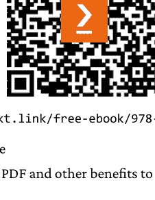

# 精通 C++ 游戏动画编程：使用 C++、OpenGL 和 Vulkan 的高级游戏动画技术提升你的技能

## 贡献者

Michael Dunsky是一名电子工程师、主机移植程序员和游戏开发者，拥有超过20年的编程经验。他在14岁时便开始学习BASIC，多年来不断扩展自己的技能范围，涉及汇编语言、C、C++、Java、Python、VHDL、OpenGL、GLSL和Vulkan。在他的职业生涯中，他还积累了关于Linux、虚拟机、服务器运营和基础设施自动化的广泛知识。Michael持有哈根远程大学计算机科学硕士学位，主攻计算机图形学、并行编程和软件系统。

感谢Marco和Morris允许我创作我的第二本书，并再次在业余时间完成它。也感谢Packt团队的大力支持。

你是否曾看着第一人称或第三人称游戏中玩家角色和敌人跑来跑去、跳跃、射击和躲避，而你正按着按钮、瞄准目标，然后自问：

> 等等……角色们是如何保持在地面上的？它们怎么知道墙在哪里？按钮又怎么知道是被我按下而不是我的队友按下的？

要回答这些问题，你需要启动一个现代 3D 引擎，如 Unreal Engine、Unity 或 Godot。你会尝试使用模型和动画、关卡、资源、菜单和其他对象。通过逐步学习教程和视频，你将学会如何构建一个与你喜爱的游戏相似的世界，并为自己的成果感到高兴。

但如果你的渴望了解底层细节、对多个功能的实现仍未满足呢？即使从视觉编程转向 3D 引擎的底层编程语言，你仍然不满意。代码的复杂性太重，无法仅从中学习基础知识。所以，你再次踏上道路，寻找这些问题的答案……

这听起来熟悉吗？许多游戏程序员都从这种好奇心开始，想要“窥探”他们所见事物的“内部”，并渴望理解模型是如何动画化的、动画是如何混合的。这可能是面部动画的工作原理，或头部简单的“点头”是如何完成的，或如何让角色在关卡的地形多边形上行走奔跑而不穿过墙壁。

本书旨在回答你关于 3D 游戏角色动画实现细节的问题。你将从仅有一个基本的 OpenGL 或 Vulkan 渲染器开始，将三角形绘制到屏幕上——然后你将被引导一路登上高峰，从从文件中加载单个角色模型，到多个不同模型的实例在游戏地图中漫游，在虚拟世界中检测并避开墙壁和其他实例，沿预定义路径行进，并能够与其他实例交互。

通过本书获得的知识，你将用另一双眼睛看待游戏中的动画，因为你知道它们是如何制作的，会因此而微笑。

### 本书适合谁

如果你已经熟悉 C++ 和角色动画，但想了解更多关于实现细节和高级角色动画主题的知识，类似于 3D 游戏中发现的动画，那么这本书适合你。

### 本书涵盖内容

第 1 章，Working with Open Asset Import Library，概述了 Open Asset Import Library（或 assimp）的数据结构，并解释了如何从文件中加载角色模型。文件加载过程将通过添加基于 ImGui 的打开文件对话框得到增强。此外，还将介绍在运行时添加和删除模型和实例的代码。

第 2 章，Moving Animation Calculations from CPU to GPU，介绍了计算着色器以将计算卸载到图形处理器并在 GPU 内存中存储查找数据。通过使用 GPU 的大规模并行架构，将加速所有实例的节点位置计算，CPU 将再次空闲出来执行其他任务。

第 3 章，Adding a Visual Selection，解释了如何支持应用程序用户进行角色实例选择任务。除了在屏幕上高亮当前选中的实例外，还将添加使用鼠标选择任何实例的能力。

第 4 章，Enhancing Application Handling，引入了将应用程序分离为视图模式和编辑模式，部分配置不同的做法。此外，还将实现撤销和重做操作。

第 5 章，Saving and Loading the Configuration，涵盖将应用程序的当前配置加上已加载的模型和已创建的实例存储在 YAML 文件中，以及将配置从文件加载回应用程序。

第 6 章，Extending Camera Handling，展示了如何添加不同类型的相机和配置。新的相机设置包括正交投影以及第一人称和第三人称视角。

# 第7章，增强动画控制
涵盖基础动画混合、动作状态，以及将动作状态与动画片段进行关联。到本章结束时，你将能够使用键盘和鼠标控制实例，包括跳跃、翻滚或挥手等附加动作。

# 第8章，碰撞检测入门
解释基于四叉树、轴对齐包围盒和包围球的实例/实例碰撞检测路径以及对碰撞的反应。

# 第9章，添加行为和交互
添加一个基于节点的图形编辑器，通过创建和连接简单节点来控制实例行为。这些节点将被扩展以涵盖实例之间可配置的交互。

# 第10章，高级动画混合
介绍面部动画以表达情感，以及叠加动画混合以使头部独立于角色模型其余身体进行移动。

# 第11章，加载游戏地图
解释动态角色模型实例与静态关卡几何体之间的差异，以及如何加载和处理关卡数据以实现良好的性能。

# 第12章，高级碰撞检测
将碰撞检测扩展到第11章中添加的关卡几何体。简单的重力将被添加以使模型实例保持在关卡地面上，你将看到如何避免实例与墙壁发生碰撞。

# 第13章，添加简单导航
涵盖在已加载游戏地图中的寻路和导航。将使用一种广为人知的寻路算法，让实例能够自由地在关卡中漫游。

# 第14章，创建沉浸式交互世界
提供提示和资源，说明如何为角色模型编辑器添加更多酷炫功能，逐步推进代码以形成一个简单的游戏引擎。

# 如何充分利用本书

要充分利用本书，你应至少具备 C++ 的中级经验，并了解向量/矩阵数学知识，以及理解骨骼动画的基础。任何特殊或高级功能都将被解释，并在其首次使用所在章节中包含进一步学习的资源。但你应能够自行调试简单的 C++ 问题（即通过使用日志语句，或将调试器附加到应用程序）。

代码是为 OpenGL 4.6 Core 和 Vulkan 1.1+ 编写的。这两种图形 API 在现代 GPU 中都得到广泛支持。已知能与这些 API 版本配合工作的最老显卡是约 10 年前发布的 Intel HD 4000 系列。

| 书中涵盖的软件 | 操作系统要求 | C++ 版本 |
| --- | --- | --- |
| OpenGL 4.6 和 Vulkan 1.1+ | Windows 或 Linux | C++17 及以上（最高至 C++26） |

书中提供的示例代码应在运行最新版 Windows 和 Linux 的任何台式电脑或笔记本上编译通过。代码已在以下组合下测试：

- Windows 10 with Visual Studio 2022
- Windows 10 with Eclipse 2024-09, using GCC from MSYS2
- Ubuntu 24.04 LTS with Eclipse 2024-09, using GCC or Clang
- Ubuntu 24.04 LTS, compiling on the command line, using GCC or Clang

如果你使用的是本书的数字版，我们建议你自行输入代码或从本书的 GitHub 仓库访问代码（链接在下一节提供）。这样做将有助于避免因复制粘贴代码而产生的潜在错误。

示例的完整源代码可从本书的 GitHub 仓库获取（链接在下一节提供）。书中的章节仅包含代码的摘录，涵盖重要部分。

# 下载示例代码文件

你可以在 GitHub 上下载本书的示例代码文件：https://github.com/PacktPublishing/Mastering-Cpp-Game-Animation-Programming。如果代码有更新，将在 GitHub 仓库中更新。

我们还有来自我们丰富图书和视频目录的其他代码包，网址为 https://github.com/PacktPublishing。快来看看吧！

# 下载彩色图片

我们还提供了一份 PDF 文件，其中包含本书中使用的截图/图表的彩色图片。你可以在此处下载：https://packt.link/gbp/9781835881927。

# 下载本书的免费 PDF 副本

感谢你购买本书！

你喜欢随时阅读，但又无法随身携带印刷书籍吗？

你的电子书购买不兼容你选择的设备吗？

不用担心，现在购买每本 Packt 书籍，你都将免费获得该书的无 DRM PDF 版本。

在任何地方、任何地点、在任何设备上阅读。直接从你喜爱的 technical 书籍中搜索、复制和粘贴代码到你的应用程序中。

福利还不止于此，你还可以获得独家折扣、新闻通讯，以及每日发送到你邮箱的精彩免费内容。

按照以下简单步骤获取福利：

1. 扫描二维码或访问下方链接

https://packt.link/free-ebook/978-1-83588-192-7

2. 提交你的购买证明

3. 就这样！我们会直接将你的免费 PDF 和其他福利发送到你的电子邮件
