# 第1章 使用 Open Asset Import Library

欢迎阅读 *Mastering C++ Game Animations*！你是否属于那种看到电脑或主机游戏、或 3D 动画工具中的动画模型时，会问自己这样的问题的人：

> 这是如何工作的？他们是怎么做到的？我也能做到吗？

如果是这样，本书将带你走向实现这一目标的正确方向。在接下来的 14 章中，你将学习如何创建自己的小游戏角色模型查看器。

本书从使用 Open Asset Import Library 加载文件开始，将导入库的数据结构转换为更高效的渲染数据结构，并使用简单的 OpenGL 或 Vulkan 渲染器渲染角色模型。你还将学习如何通过将计算负载以 GPU 基于查找表和计算着色器的形式转移到 GPU 来优化数据更新和渲染。

对于角色动画，你不仅将深入研究常规动画混合，还将被介绍基于状态的动画控制、叠加动画混合以使头部独立于身体其余部分移动，以及面部动画。你还将学习如何通过使用行为树的简化版本来控制实例的行为，并在屏幕上实现实例之间的交互。

为了给游戏角色提供一个合适的家，你将学习如何将游戏地图加载到应用程序中。在游戏地图中的移动将通过添加碰撞检测、角色脚部的逆运动学以及简单的导航得到增强，让实例能够完全自主地在虚拟世界中奔跑。

除了动画之外，还将介绍诸如使用鼠标进行交互式选择、将配置保存和加载到文件以便在更大的虚拟世界中工作，以及处理虚拟世界中的不同摄像机等功能。此外，还将实现一个图形化、基于节点的配置，使你能够以非编程方式更改实例的行为。

将所有这些步骤结合起来，你的虚拟世界中的虚拟角色将更接近真实的游戏角色。

加入我们的 Discord 社区

加入我们社区的 Discord 空间，与作者和其他读者进行讨论：https://packt.link/cppgameanimation。

每段旅程都始于第一步，所以欢迎来到第1章。本章将为动画应用程序奠定基础，因为你将深入了解如何将模型文件从计算机加载到程序中，将实例放置在虚拟世界的广阔空白中，并播放文件中包含的动画。到本章结束时，你的游戏角色模型将能够在屏幕上跳跃、奔跑或行走，也许周围环绕着非动画模型或其他静态物体。

- 动画游戏角色 – 基础介绍
- 什么是 Open Asset Import Library？
- 加载模型文件
- 使用打开文件对话框扩展 UI
- 动态添加和移除模型实例


由于本书将使用开源软件和平台无关的库，因此你应该能够在 Windows 和 Linux 上“开箱即用”地编译和运行代码。你可以在下面的 *技术要求* 部分找到所需软件和库的详细清单，以及它们的安装说明。

## Technical requirements

本章你需要以下内容：

- 一台运行 Windows 或 Linux 的 PC，以及本节后面列出的工具
- 用于源代码管理的 Git
- 一个文本编辑器（如 Notepad++ 或 Kate）或完整的 IDE（如 Windows 版 Visual Studio 2022，或 Linux 版 Eclipse/KDevelop）

> Important note
> 
> 需要一个较新的 C++ 编译器来编译代码。在当前的 CMake 构建系统中，已配置 C++17，但代码已知可与更新的 C++ 标准一起使用，直至 C++26 包含在内（尽管编译器必须支持这些标准）。

现在，让我们获取本书的源代码并开始解压代码。

## Getting the source code and the basic tools

本书的代码托管在 GitHub 上，你可以在这里找到：

https://github.com/PacktPublishing/Mastering-Cpp-Game-Animation-Programming

你需要安装 Git，因为构建系统利用 Git 下载示例中使用的第三方项目。

在 Linux 系统上，使用你的包管理器。对于 Ubuntu，以下命令可安装 Git：

```
sudo apt install git
```

在 Windows 上，你可以从这里下载 Git：https://git-scm.com/downloads。

要解压代码，你可以使用以下两种方法中的任意一种。

### Getting the code using Git

要获取书中的代码，你应该使用 Git。使用 Git 可为你提供额外的功能，例如为你的更改创建本地分支、跟踪你的进度以及将你的更新与示例代码进行比较。此外，如果你在探索源代码或在每章末尾的实践环节中破坏了代码，你可以轻松地还原更改。

你可以通过 Git GUI、在 Visual Studio 2022 中克隆存储库，或在 CMD 中执行以下命令，将代码的本地检出放在系统上的特定位置：

```
git clone https://github.com/PacktPublishing/Mastering-Cpp-Game-Animation-Programming
```

请确保你使用的是没有空格或特殊字符（如变音符号）的路径，因为这可能会让某些编译器和开发环境感到困惑。

### Getting the code as a ZIP file

虽然推荐使用 Git，但你也可以从 GitHub 将代码作为 ZIP 文件下载。你需要将 ZIP 文件解压到系统上你选择的某个位置。此外，请确保解压 ZIP 文件的路径中不包含空格或特殊字符。

在我们使用本书的代码之前，必须安装一些工具和库。我们将先从 Windows 安装开始，然后是 Linux 安装。

### Installing the required tools and libraries for Windows

要在 Windows 机器上编译示例代码，我建议使用 Visual Studio 2022 作为 IDE，因为它包含了快速入门所需的一切。使用其他 IDE 如 Eclipse、Rider 或 KDevelop 也没问题，因为构建由 CMake 管理，但你可能需要安装 C++ 编译器，如 MSYS2 加上编译器包作为额外依赖。

### Installing Visual Studio 2022 on Windows

如果你想使用 Visual Studio 来使用示例文件且尚未安装，请从 https://visualstudio.microsoft.com/de/downloads/ 下载免费的 Community Edition。

双击该文件将自动启动 Windows 注册表编辑器，以将设置导入 Windows 注册表。确认 UAV 对话框和以下警告对话框后，单击“是”，注册表编辑器将导入新设置。

现在，重新启动 PC 以激活长路径名称并继续安装。

## Downloading Open Asset Import Library

对于 Windows，必须从源文件构建并安装 Open Asset Import Library。从 https://github.com/assimp/assimp 克隆存储库到新的 Visual Studio 2022 项目中，如图 1.3 所示：

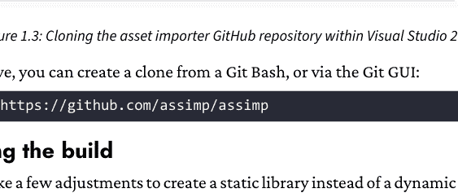

作为替代方案，你可以从 Git Bash 或通过 Git GUI 创建克隆：

```
git clone https://github.com/assimp/assimp
```

## Configuring the build

我们需要进行一些调整以创建静态库而不是动态库。使用静态库使我们的构建过程更简单，因为我们不必担心额外的 DLL 文件。

要更改 CMake 设置，在 CMakeLists.txt 文件上右键单击后选择以下选项：


在出现的 Visual Studio 2022 的 **Configuration** 选项卡中，将配置名称更改为 x64-RelWithDebInfo，并将配置类型更改为 RelWithDebInfo：

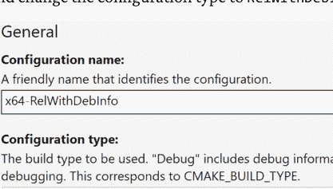

Figure 1.5: Modifying the current configuration of the asset importer

通过使用 RelWithDebInfo，将创建带有调试信息的发布版本。生成的可执行文件将由编译器优化，但文件仍包含数据以允许在出现问题时调试程序。

接下来，更改 CMake 设置中的以下设置。你可以使用左下角名为 **Filter variables...** 的搜索字段来搜索指定的设置：

- 禁用构建共享库：

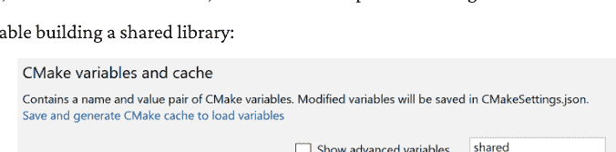

Figure 1.6: Switching the setting to create a static library

- 更改 C 运行时库的链接方式：

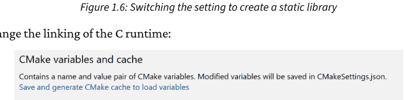

Figure 1.7: Linking the C runtime statically

- 删除库后缀以创建不带编译器版本的文件名：

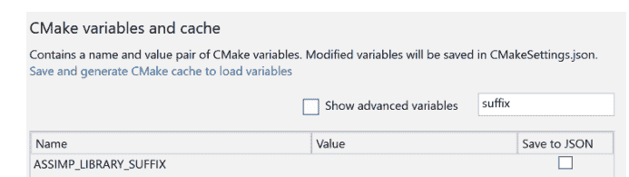

Figure 1.8: Removing the suffix of the created file

接下来，选择 Build 然后在 CMakeLists.txt 文件的上下文菜单中选择 Install。

安装完成后，将生成以下文件夹结构：

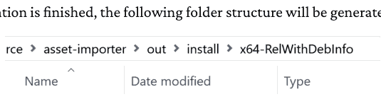

Figure 1.9: Asset importer library and includes

我们必须使本节讨论的所有文件对本书中的所有示例都可用。为此，有两个选项可用——将文件复制到固定路径或添加环境变量。

## Copying the Assimp files

首先，在你的计算机上创建此文件夹：

```
C:\Program Files\assimp
```

然后，将两个文件夹 lib 和 include 复制到其中：

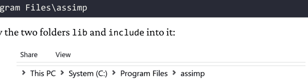

Figure 1.10: The two folders have been copied to the Program Files folder

## Compiling and starting the example code

运行示例可以通过两种不同的方式完成：按照书中示例逐个进行，或一次性编译所有代码以浏览所有示例。

编译代码可以通过以下步骤完成：

1. 要打开示例项目，请从 Visual Studio 2022 开始屏幕中选择 Open a local folder 或从 Visual Studio 2022 的 File 菜单中选择 Open CMake，然后导航到你想要编译的示例代码所在的文件夹，或导航到示例代码的顶级文件夹，如果你想一次性编译所有示例。Visual Studio 将自动检测并为你配置所选文件夹中的 CMake。输出窗口的最后一行应如下所示：

```
1> CMake generation finished.
```

2. 这确认了 CMake 文件生成的成功运行。

3. 现在，通过右键单击 CMakeLists.txt 文件设置启动项——此步骤是构建和运行项目所必需的：

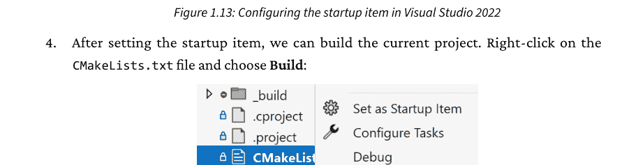

4. 设置启动项后，我们可以构建当前项目。右键单击 CMakeLists.txt 文件并选择 Build：


5. 编译成功后，使用未填充的绿色箭头以非调试构建启动程序：

   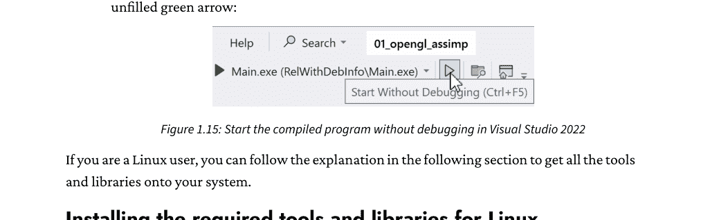

如果您是 Linux 用户，可以按照以下章节中的说明将所有工具和库安装到您的系统上。

## 为 Linux 安装所需的工具和库

现代 Linux 发行版已包含编译本书示例代码所需的大多数工具。

### 下载开放资产导入库

对于常见的 Linux 发行版，Assimp 应可从软件包管理器获得。对于 Ubuntu，您需要安装 Assimp 开发包：

```
sudo apt install libassimp-dev
```

### 在 Linux 上安装 C++ 编译器和所需的库

如果您使用 Ubuntu Linux，所有必需的依赖项都可以通过集成的软件包管理器安装。使用以下命令安装基于 OpenGL 的示例的软件包：

```
sudo apt install git gcc g++ cmake ninja-build libglew-dev libglm-dev libglfw3-dev zlib1g-dev
```

要使用 Clang 作为编译器，而不是 GCC，您可以使用以下命令：

```
sudo apt install git llvm clang cmake ninja-build libglew-dev libglm-dev libglfw3-dev zlib1g-dev
```

如果您计划构建 Vulkan 示例，则需要以下附加软件包，应将其安装以充分利用 Vulkan 代码：

```
sudo apt install glslang-tools glslc libvulkan-dev vulkan-validationlayers
```

如果出现构建错误，您需要再次检查要求。

如果您想使用 IDE，可以继续安装 Eclipse。

## 在 Linux 上安装 Eclipse

如果您想在 Linux 上使用 Eclipse IDE 编译示例代码，则需要执行一些额外步骤：

1. 从 https://www.eclipse.org/downloads/packages/ 下载并安装 Eclipse IDE for C/C++ Developers。

2. 安装 Eclipse 后，转到 Help 下的市场：

   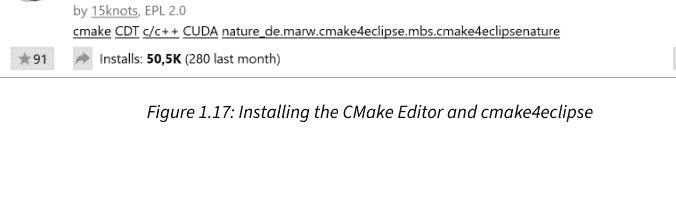

   安装 cmake4eclipse 和 CMake Editor 软件包。第一个软件包可在 Eclipse 中启用 CMake 支持，并提供我们所需的所有功能，第二个软件包可为 CMake 文件添加语法着色。额外的颜色使编辑文件更加方便：

   

可以按以下步骤编译和启动示例代码：

1. 从 **File** 菜单中选择 **Open Project from File System**。
2. 选择 **Directory...** 并导航到包含源代码的文件夹：
   - 如果您想一次构建所有示例，请选择顶级源文件夹，按 **Deselect All**，然后只选择第一个项目。
   - 要只构建单个示例，您可以在顶级文件夹上使用 **Deselect All** 并只选择要构建的示例，或者您可以进入特定示例的文件夹。
3. 单击 **Finish** 以打开项目。
4. 接下来，从项目文件夹的上下文菜单中选择 **Build Project**。
5. 您可能需要切换控制台输出以显示当前的构建消息。使用带有工具提示 **Display Selected Console** 的小箭头：

   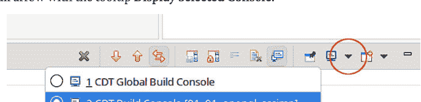

   图 1.18：选择正确的输出以查看构建消息

6. 如果 Eclipse 在构建后未刷新项目内容，请从项目文件夹的上下文菜单中选择 **Refresh**，或按 F5。
7. 选择 **Run As**，并选择第二个选项 **Local C/C++ application**。
8. 从窗口中选择 **Main** 可执行文件以运行程序。

   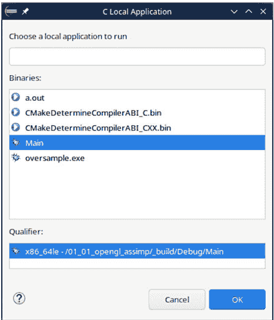

   图 1.19：选择 Main 可执行文件以运行编译后的应用程序

作为准备工作的最后一步，我们来看一下本书 GitHub 仓库中代码的组织方式。

## 本书中的代码组织

每章的代码都存储在 GitHub 仓库中，使用相关章节编号的单独文件夹。编号使用两位数字以确保排序正确。在每个文件夹内部，可以找到一个或多个子文件夹。这些子文件夹包含该章的代码，具体取决于该特定章节的进度。

对于所有章节，我们将 Main.cpp 文件和 CMake 配置文件 CMakeLists.txt 放入项目根文件夹中。在 cmake 文件夹中，存储了 CMake 的辅助脚本。这些文件对于查找额外的头文件和库文件是必需的。

所有 C++ 类都位于文件夹中，收集我们创建的对象的类。Window 类将存储在 window 子文件夹中，以保存与该类本身相关的所有文件，工具——记录器、模型类和渲染相关类也适用。安装完所有必需的代码和工具后，让我们对游戏角色动画有一个大致的了解。

## 游戏角色动画入门

在虚拟世界中移动游戏角色，拥有各种动画、可更换的服装、用于其他角色和环境的碰撞检测系统，甚至可能与其他角色互动，在玩游戏时看起来很漂亮也很简单。

但在屏幕上渲染出流畅动画的游戏角色背后的数学和技术是广泛而复杂的。角色的每一次移动、动画、动作或状态变化都涉及漫长的旅程，直到最终图像被渲染到屏幕上。

让我们先从高层次解释动画开始。如果您已经了解细节，可以跳到下一节。

### 关于节点、骨骼、骨骼动画和蒙皮

动画三维角色模型的构建块就是所谓的节点。节点可以与角色虚拟身体中的关节进行比较，例如肩膀或臀部。

角色模型中的所有节点都以虚拟骨骼的形式连接，形成模型的骨骼。通过将子节点附加到节点，可以轻松模拟带有手和手指的手臂，或带有脚和脚趾的腿——甚至是整个类人骨骼。虚拟骨骼的起点是所谓的根节点。根节点没有父节点，并用作动画的起点。

通常，细节水平不会达到现实世界物体骨骼的细节，因为许多真实骨骼是静态的，或在动画期间肌肉或姿势变化中只起次要作用。

角色模型的虚拟骨骼可以通过围绕其中心点旋转节点来动画——从而围绕该节点的中心点旋转骨骼到所有附加的子节点。只需想象一下稍微抬起手臂：您的上臂将在肩关节周围旋转，下臂、手和手指会跟随肩部旋转。这种类型的动画称为骨骼动画。

角色需要在文件中以或多或少的自然姿势存储，这称为参考姿势或绑定姿势。您会发现大多数模型处于 T 姿势，其中两臂形成水平线，有时您会看到 A 姿势，其中骨骼的手臂位置类似于大写字母 A。

为了动画化角色，需要在绑定姿势中的位置和动画姿势中的期望位置之间更改每个节点的变换。由于节点的变换需要在该特定节点的局部坐标中计算，因此每个节点都存在一个 **逆绑定矩阵**，用于在局部和世界坐标之间转换。

动画本身存储在动画 **剪辑** 中。动画剪辑不包含动画每个可能时间的节点变换，而只包含特定时间点的节点变换。只有在所谓的 **关键帧** 处的节点变换才存储在动画剪辑数据中，从而减少了数据使用量。两个关键帧之间的节点位置使用线性插值进行平移和缩放，使用球面线性插值（SLERP）进行旋转。

通过在两个关键帧之间进行插值，骨骼可以在两个存储的姿势之间进入几乎任何姿势。通过在关键帧之间或甚至不同动画剪辑的插值姿势之间进行插值，可以实现两个姿势之间的 **混合**。混合可用于在没有视觉失真的情况下更改模型的动画剪辑，例如在行走和奔跑动画剪辑之间创建平滑过渡。

角色模型的虚拟皮肤称为 **网格**，并且将网格应用于渲染管线顶点着色器中的骨骼称为 **蒙皮**。为了使虚拟皮肤看起来自然，网格的每个顶点都使用 **权重** 来处理周围节点的影响。

这些权重用作节点变换的因子：节点权重越高，该节点的变换应用于顶点的程度就越大，反之亦然。通过使用节点权重，可以很好地模拟虚拟身体的皮肤和潜在肌肉的扩张和压缩效果。

在 glTF 文件格式中，每个顶点使用四个权重，但也存在具有更多权重的其他文件格式。

有一种特殊的动画类型称为 **形态动画**。在形态动画中，网格的某些部分被替换，并且可以在不同网格之间对顶点位置进行插值。形态动画用于模拟面部表情，仅更新角色模型面部的部分，而不是整个模型。通过仅替换网格的部分但保持骨骼信息不变，形态动画可以轻松添加到骨骼动画中。

另一种动画形式是所谓的 **叠加动画**。叠加动画是骨骼动画和形态动画之间的一种混合：通过将当前姿势与绑定姿势之间的差异添加到骨骼动画剪辑中，叠加剪辑的动画被建模在骨骼动画之上，但仅针对叠加动画剪辑中更改的节点。


叠加动画用于独立于主要骨骼动画来移动角色的特定部位。例如，骨骼动画只包含身体的行走或跑步部分，而叠加动画剪辑仅改变头部或手部。这样角色就可以转动头部环顾四周，而无需创建包含所有可能头部动作的行走和跑步动画。

骨骼动画、变形动画和叠加动画的结合使我们能够为虚拟世界构建强大且逼真的角色，让模型能走在我们身边或奔跑，用头部跟随我们的动作，同时使用面部变形动画来说话。

现在让我们看看创建角色模型动画的一般工作流程。我们可以将动画工作流程分为两部分：准备和更新。准备部分仅在加载模型时需要一次，而更新通常针对绘制到屏幕的每一帧进行。

我们首先深入了解模型的准备过程。

## 准备数据以实现高效使用

游戏角色模型存储在单个文件中，或作为一组文件存储，每个文件都有特定用途。例如，模型和纹理数据可以存放在不同的文件中，使美术人员可以独立于模型顶点来更改图像。

在模型数据文件可用于动画和渲染之前，应用程序中必须完成以下步骤：

- 1. 作为准备阶段的第一步，必须将这些文件加载到计算机内存中。根据游戏中的实现方式，可以部分加载，仅添加在特定关卡或虚拟世界特定区域所需的角色模型元素。
- 2. 然后，需要对数据进行预处理。磁盘文件中数据的表示可能针对节省空间进行了优化，但为了高效操作和渲染，需要另一种优化。

例如，OpenGL、Vulkan 和 DirectX 等不同的渲染 API 可能需要略微不同的顶点或纹理数据表示，或需要上传到 GPU 的着色器代码。可以不在模型文件中存储不同版本，而是使用通用表示。所需的调整或转换将在加载后完成。

3. 作为最后一步，顶点数据或纹理等静态数据将上传到 GPU，其他静态和可变数据部分存储在 C++ 类和对象中。

此时，模型已准备好使用。当该角色第一次出现在屏幕上时，就需要持续运行的数据更新任务。对于在运行时变化的状态（如位置或动画姿势），需要这些逐帧任务。

## 更新角色数据

由于角色数据分散在主内存和 GPU 内存中，游戏或动画程序必须在角色绘制到屏幕的每一帧对数据进行采样、提取、转换和上传。

例如，动画的关键帧数据需要根据要显示的动画剪辑以及距离上一帧的时间进行更新。

每一帧都必须完成以下步骤，以便为选定动画剪辑的特定时间点创建单个模型实例的像素：

- 1. 程序流程可能要求在不同动画剪辑之间进行混合，并且可能需要额外的动画部分，例如头部或手部的叠加混合，或允许角色有面部表情的面部动画。因此，我们从所有动画剪辑中提取指定回放时间下所有节点的旋转、平移和缩放，并将每个剪辑的节点变换组合成每个节点的最终变换矩阵。
- 2. 在动画数据被采样和组合之后，需要调整角色的骨骼。根据动画数据，每个虚拟骨骼都必须进行平移、旋转和缩放，以达到预期的目的地。
- 3. 此外，角色的世界位置可能需要更新。世界位置的变化可以以不同形式发生，例如四处奔跑、跳跃或坠落。了解所有角色的精确位置是后续步骤的重要组成部分。
- 4. 一旦确定了骨骼位置和角色的世界位置，就可以运行碰撞检测。碰撞检测检查角色是否与其他角色或环境对象（如地板和墙壁）相交，甚至角色是否被射弹击中。作为对碰撞检测结果的响应，可能会触发对角色属性（如位置或动画剪辑）的调整。

## 使用 Open Asset Import Library

- 5. 手头有了碰撞数据，就可以运行反向运动学调整。可能需要调整角色的骨骼数据，以避免角色肢体与墙壁或地板相交，或者在不平坦的地面上保持脚部位置水平。
- 6. 现在，角色更新的纯 CPU 部分即将结束。作为 CPU 方面的最后一步，更新后的动画数据被上传到 GPU，并发出渲染命令。通过将动态角色数据存储在 GPU 中，渲染本身可以在没有太多额外 CPU 工作负载的情况下运行。
- 7. 在 GPU 上，顶点着色器根据当前视图的属性（如距离或透视畸变）转换传入的顶点数据。在其他可能的着色器阶段之后，片元着色器从 GPU 的光栅化阶段接收数据，并将像素绘制到输出帧缓冲器中。
- 8. 在关卡数据、角色、HUD 以及可能的额外调试数据的所有像素都发送到 GPU 之后，可见缓冲区和绘制缓冲区进行交换——此时，角色以我们期望的位置和动画姿势出现在屏幕上。

在所有这些更新步骤之间，计算着色器可以在 GPU 上运行以计算数据。运行计算着色器允许程序将多个角色的计算任务卸载，使 CPU 能够处理游戏的其他部分。

正如你所看到的，要看到游戏角色在虚拟世界中奔跑，需要做大量的工作。现在，让我们从 Open Asset Import Library 的概述开始，踏上角色动画之旅。

## 什么是 Open Asset Import Library？

Open Asset Import Library，简称 Assimp，是一个用于导入和转换 3D 模型文件的跨平台库。不同的文件格式会被转换为分层数据结构，使程序员能够以单一、全面的方式支持更广泛的模型格式。

图 1.20 显示了关键元素及其关系：

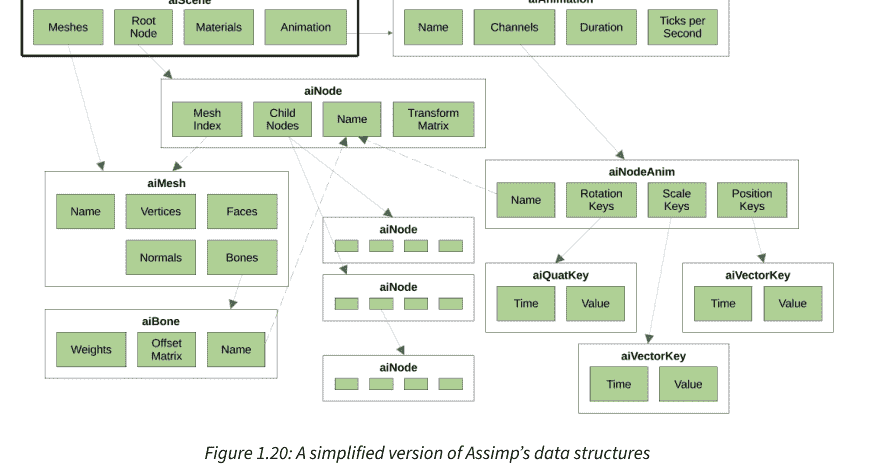

图 1.20：Assimp 数据结构的简化版本

让我们仔细看看这些数据结构及其功能：

- aiScene 是 Assimp 数据结构的核心元素。根节点条目、有关多边形网格、材质和动画的所有信息都存储在 aiScene 元素中。
- aiScene 的根节点指向一个称为 aiNode 的结构。每个 aiNode 中存储了可能的子节点，最终形成一个节点树。此外，aiNode 结构中还有一个变换矩阵，定义了相对于父节点的局部变换。这个矩阵被称为 TRS 矩阵，表示三种可能的变换：平移、旋转和缩放，顺序依次如此。通过将 TRS 变换从根节点向下组合到骨骼的每个节点，最终节点的世界位置可以仅通过使用根节点的世界位置和骨骼层次结构中每个节点的局部变换来计算。
- 节点名称在其他结构（如骨骼或动画）中用于引用回这个特定节点。对于节点的顶点，这里存储了 aiScene 中对应 aiMesh 结构的索引。


## 使用 Open Asset Import Library

- 所有将绘制在屏幕上的数据都存储在 `aiMesh` 结构体中。每个网格由许多所谓的面（通常是三角形）组成。对于每个面的每个顶点，诸如顶点、法线和纹理坐标等重要数据都直接存储在 `aiMesh` 中。顶点的绘制顺序则作为索引分别存储在其他结构中，从而支持节省空间的顶点复用等功能。

- 对于动画而言，模型的“骨架”由存储在 `aiBone` 结构体中的骨骼组成。这里的偏移矩阵定义了网格空间中的位置与骨骼空间中的绑定姿势之间的偏移（在 glTF 文件格式中，这被称为“逆绑定矩阵”）。此外，每个顶点还存储了若干值对，每对包含一个节点索引和一个权重值。在每个值对中，权重值指定了应用于该顶点的节点运动比例。

- 在 Assimp 网格中，每个顶点的位置最多可以绑定到四根骨骼，而这四根骨骼对最终顶点位置的影响可以通过一个介于 0 和 1 之间的权重值来控制。该权重用作指定骨骼变换的缩放因子——值为 1 表示顶点与骨骼进行相同的变换，值为 0 表示顶点忽略该骨骼的变换。

- 在图 1.20 的右侧，显示了动画的数据。`aiAnimation` 结构体包含骨骼和网格的动画通道、特定动画的总时长，以及该动画的每秒帧数。

- 作为动画的一个示例，我们将了解 `aiNodeAnim` 结构体。该结构体由关键帧组成，包含要应用于特定节点的旋转、平移或缩放。在 `aiNode` 结构体中使用节点名称来查找要设置动画的对应骨骼。

目前，Assimp 已知支持超过 50 种不同的文件格式。这里列出一些值得注意的例子：

- Autodesk 3D Studio (.3ds)、AutoCAD (.dxf) 和 FBX (.fbx)

- Collada (.dae) 以及由 Khronos Group 管理的 glTF (.gltf 和 .glb)

- Wavefront vertices (.obj 以及材质文件 .mat)

- STL 文件，大多为 3D 打印所知 (.stl)

- 游戏引擎格式，例如来自 Quake (.md3/.md5) 或 Half-Life (.mdl) 的格式

尽管格式数量可观，但需要指出的是，并不是你找到的所有模型都能通过 Assimp 导入到应用程序中。

其中一些文件格式是从闭源应用程序中逆向工程而来，并且只有部分版本可用。其他格式是开源的，如 Collada 或 glTF，但其中一些格式也在不断演进。此外，并非所有新特性都已在 Assimp 中实现。因此，即使使用像 Assimp 这样多功能的资源导入库，你最终仍可能遇到模型无法导入、在屏幕上产生“顶点垃圾”或缺少某些属性的情况。尽管如此，Assimp 目前仍是将许多游戏及非游戏 3D 模型加载到你自己应用程序中的最佳开源解决方案。

使用 Assimp 加载模型文件可以归结为：导入文件的 `aiScene` 对象，检查其他数据类型是否存在，然后将该数据导入到应用程序中。在下一节中，我们将简要介绍使用 Assimp 加载模型文件的步骤。

该应用程序的完整源代码可以在 chapter01 文件夹中找到，其中 OpenGL 版本位于子文件夹 01_opengl_assimp，Vulkan 版本位于子文件夹 02_vulkan_assimp。

## 加载模型文件

要使用 Open Asset Import Library 加载模型文件，我们需要在 model 文件夹中 AssimpModel 模型加载类的实现文件中包含以下三个头文件：

```cpp
#include <assimp/scene.h>
#include <assimp/Importer.hpp>
#include <assimp/postprocess.h>
```

接下来，我们在 `loadModel()` 方法中创建一个 `Assimp::Importer` 实例，并使用该导入器从磁盘加载文件：

```cpp
Assimp::Importer importer;
const aiScene *scene = importer.ReadFile(modelFilename,
  aiProcess_Triangulate | aiProcess_GenNormals);
```

我们传入要加载的资源文件名，以及两个值 `aiProcess_Triangulate` 和 `aiProcess_GenNormals` 作为可选的后处理标志。

第一个标志 `aiProcess_Triangulate` 指示 Assimp 对所有多于三个顶点的多边形进行三角化（如果文件中存在这样的多边形）。由于我们的基础渲染器只理解三角形，因此多于三个顶点的多边形会导致图形错误。

使用 `aiProcess_GenNormals` 作为导入标志，可确保所有三角形都具有法线向量。只有在未找到法线向量时，才会创建默认的从三角形表面指向上方的法线向量。该标志不会更改已有的法线。

接下来，我们必须检查导入是否成功：

```cpp
if(!scene || scene->mFlags & AI_SCENE_FLAGS_INCOMPLETE ||
    !scene->mRootNode) {
    return false;
}
```

如果场景指针本身为 `nullptr`、导入器将场景标记为不完整，或者场景没有定义根节点，我们就认为导入失败。

模型文件成功加载后，我们将扫描模型中是否嵌入了纹理。

### 加载嵌入的纹理

某些模型格式可以将纹理嵌入到对象文件中。如果对 `HasTextures()` 的函数调用返回 `true`，我们将遍历模型文件的所有纹理。

```cpp
if (scene->HasTextures()) {
    unsigned int numTextures = scene->mNumTextures;
    for (int i = 0; i < scene->mNumTextures; ++i) {
```

在循环内部，我们提取纹理的名称、高度、宽度以及纹理的像素数据。纹理名称仅用于信息目的，因为数据已嵌入到模型文件中，但在调试问题时，拥有名称会很有帮助：

```cpp
std::string texName =
    scene->mTextures[i]->mFilename.C_Str();
int height = scene->mTextures[i]->mHeight;
int width = scene->mTextures[i]->mWidth;
aiTexel* data = scene->mTextures[i]->pcData;
```

现在，我们创建一个共享指针，并尝试导入纹理数据。如果导入因意外错误而失败，我们将停止加载模型：

```cpp
std::shared_ptr<Texture> newTex =
    std::make_shared<Texture>();
if (!newTex->loadTexture(texName, data,
    width, height)) {
    return false;
}
```

在 `mNodeList` 中，所有节点都以扁平但分层的顺序存储，这保证了我们可以在访问任何节点的子节点之前访问到该节点。这样，当需要对所有节点进行更新时，`mNodeList` 的速度很快。我们只需从向量的开头到结尾进行迭代即可。

在 `processNode()` 的末尾，我们检查子节点，并递归处理找到的任何子节点：

```cpp
unsigned int numChildren = aNode->mNumChildren;
for (unsigned int i = 0; i < numChildren; ++i) {
    std::string childName =
        aNode->mChildren[i]->mName.C_Str();
    std::shared_ptr<AssimpNode> childNode =
        node->addChild(childName);
    processNode(childNode, aNode->mChildren[i],
        scene, assetDirectory);
}
```

处理完层次结构中的所有节点后，我们就从模型中收集了所有网格、纹理和骨骼数据。

### 为网格添加顶点缓冲区

回到 `loadModel()` 方法中，我们为每个网格创建一个组合的顶点和索引缓冲区对象，上传提取的顶点数据，并将缓冲区存储在名为 `mVertexBuffers` 的 `std::vector` 中：

```cpp
for (auto mesh : mModelMeshes) {
    VertexIndexBuffer buffer;
    buffer.init();
    buffer.uploadData(mesh.vertices, mesh.indices);
    mVertexBuffers.emplace_back(buffer);
}
```

要绘制导入的模型，我们现在只需遍历 `mModelMeshes` 向量，并使用 `VertexIndexBuffer` 类的 `drawIndirect()` 调用，仅通过一条绘制命令即可绘制该特定网格的所有三角形。该方法被称为“indirect”是因为 Assimp 在内部将模型数据存储为顶点加索引，而我们通过索引以间接模式绘制三角形。


类。网格数据会被转换为 GLM 类型，这样我们就可以直接将其上传到 GPU，而无需在每次绘制时进行耗时的转换。

既然我们已经具备了打开模型文件的基础，接下来就会遇到一个简单但至关重要的问题：模型文件的文件名是硬编码的。

与其将模型文件的路径硬编码后加载，不如添加一个浏览文件的功能。一个简单的方法是通过“打开文件”对话框将特定模型从文件加载到应用中，让我们能够选择要导入的文件。为了将这个对话框无缝集成到程序中，我们将使用基于 ImGui 的方案，而不是操作系统原生的对话框。

## 使用“打开文件”对话框扩展 UI

ImGui 可以用来创建像我们的动画应用那样的简单 UI，但也可以扩展代码来构建不同类型的工具。对于我们的应用，一个用于在系统上选择文件的对话框有助于在运行时加载模型，这样我们就无需在代码中硬编码模型名称，也无需在启动应用时将模型作为命令行参数传入。

目前已存在多种基于 ImGui 的文件对话框；一个简洁且易于集成的文件对话框可以在 Stephane Cuillerier 的 GitHub 仓库中找到，地址是 https://github.com/aiekick/ImGuiFileDialog。

为了简单集成文件对话框，我们将使用 CMake 的 `FetchContent` 来下载并构建代码。

## 将文件对话框集成到 CMakeLists.txt 中

首先，我们在 CMakeLists.txt 文件中添加一个新的 `FetchContent` 块，位置在 ImGui 拉取代码结束的正下方：

```
FetchContent_Declare(
	filedialog
	GIT_REPOSITORY https://github.com/aiekick/ImGuiFileDialog
	GIT_TAG v0.6.7
	CONFIGURE_COMMAND ""
	BUILD_COMMAND ""
)
```

这里我们“绕过”了配置和构建命令，因为我们只需要源代码可用，而不是构建文件对话框的独立版本。

遗憾的是，初始配置仍然需要 ImGui 头文件的位置。由于 `FetchContent` 块不允许设置额外的编译器选项，我们需要一个小技巧来在拉取过程中修改 CMake 属性 `COMPILE_OPTIONS` 的值。

为此，我们将 `COMPILE_OPTIONS` 的当前状态保存到一个名为 `current_compile_options` 的新 CMake 变量中。然后，我们调整编译选项，将 ImGui 源文件夹中的头文件添加到搜索列表中：

```cmake
get_property(current_compile_options DIRECTORY
    PROPERTY COMPILE_OPTIONS)
set_property(DIRECTORY PROPERTY
    COMPILE_OPTIONS -I ${imgui_SOURCE_DIR})
```

现在，我们可以触发文件对话框源代码的下载和初始化：

```cmake
FetchContent_MakeAvailable(filedialog)
```

为了避免在构建系统中造成更多混乱，我们将 `COMPILE_OPTIONS` 属性恢复为其保存的状态，并取消设置用于保存该状态的变量：

```cmake
set_property(DIRECTORY PROPERTY
    COMPILE_OPTIONS ${current_compile_options})
unset(current_compile_options)
```

在 Visual Studio 2022 中，会自动触发一次新的 CMake 配置运行。在 Eclipse 中，需要通过项目右键上下文菜单中的**构建项目**选项来触发新的 CMake 运行。

包含文件对话框的功能非常简单；UI 类只需要扩展几行代码。

## 使用 ImGui 文件对话框

我们可以将对话框代码放在 opengl 文件夹中 `UserInterface.cpp` 文件里 `UserInterface` 类的 `createFrame()` 方法的任何位置。首先，我们添加一个名为“Import Model”的 `ImGui::Button`。这个按钮将打开一个模态版本的对话框：

```cpp
if (ImGui::Button("Import Model")) {
    IGFD::FileDialogConfig config;
    config.path = ".";
    config.countSelectionMax = 1;
    config.flags = ImGuiFileDialogFlags_Modal;
```

```
ImGuiFileDialog::Instance()->OpenDialog(
    "ChooseModelFile", "Choose Model File", "*.*",
    config);
}
```

这个按钮会配置文件对话框的一个特殊的 `FileDialogConfig` 属性。`config.path` 条目将打开的路径设置为执行程序时所在的当前路径，而 `countSelectionMax` 则告诉对话框只允许选择一个文件。将 `flags` 设置为 `ImGuiFileDialogFlags_Modal` 会使文件对话框显示在所有其他 ImGui 窗口之上。

设置好标志后，调用 `OpenDialog()` 来打开一个对话框实例，第一个参数是内部名称“ChooseModelFile”，第二个参数是窗口标题“Choose Model File”，第三个参数是用于显示所有文件的过滤器（无论文件扩展名如何），最后一个参数是配置属性。

在 `Display()` 调用中设置要打开的对话框的内部名称，使我们能够根据程序在特定情况下的需求定义多个打开文件对话框。

就在按钮之后，定义了文件对话框本身：

```cpp
if (ImGuiFileDialog::Instance()->Display(
    "ChooseModelFile")) {
    if (ImGuiFileDialog::Instance()->IsOk()) {
        ...
    }
    ImGuiFileDialog::Instance()->Close();
}
```

文件对话框的代码遵循 ImGui 的编码风格。第一个围绕 `Display()` 调用的 `if` 在对话框显示时返回 true，也就是在点击了上面的“Import Model”按钮之后。然后，对话框代码在点击对话框的“OK”按钮后将 `IsOk()` 设置为 true，从而允许我们插入对所选文件采取的操作。最后的 `Close()` 调用在选择了一个文件后关闭对话框。

在检查文件对话框的返回值之前，我们先看看文件扩展名过滤器。显示所有文件可能会让我们难以找到要加载的文件。

## 添加过滤器以仅显示受支持的文件类型

文件对话框的过滤字段允许相当复杂的配置，但我们只检查其中三种：单一过滤器、扩展名组和正则表达式风格的过滤器。

### 添加单一过滤器

“使用 ImGui 文件对话框”部分中的代码已经展示了一个单一过滤器：

```
".*"
```

这个过滤器只表示“文件名最后一个点之后的内容”，因此你会看到当前文件夹中的所有可见文件。

你也可以在这里指定单个扩展名，并且只会显示具有此扩展名的文件：

```
".jpg"
```

> 关于大小写的说明
> 
> 在 Linux 中，过滤是区分大小写的。
> 
> 因此，`.jpg` 过滤器不会显示名为 `IMAGE.JPG` 的文件！

### 添加过滤器组

将文件扩展名分组到一个过滤器中，可以通过逗号分隔：

```
".jpg, .jpeg, .png"
```

然而，这可能无法按预期工作——你仍然只能从组中选择一个扩展名，显示当前文件夹中仅具有该特定扩展名的文件。从一组中仅允许一个文件扩展名可用于“保存文件”对话框，从而强制用户从可用格式列表中选择特定的文件格式。

### 添加正则表达式风格的过滤器

过滤器最有用的变体是正则表达式风格：

```
"Supported Types{.gltf, .glb, .obj, .fbx, .dae}"
```

这里，字符串“Supported Types”将作为过滤器显示在对话框中，并且所有具有花括号中命名的文件扩展名的文件都会被显示。

你也可以添加多个正则表达式过滤器，用逗号分隔，以创建各种文件类型的下拉列表。下面这行代码能让你在几张图片、文本和二进制 glTF 格式以及所有文件之间进行选择：

```
"Pictures{.jpg,.png},Models{.gltf,.glb},All Files{.*}"
```

由于 `OpenDialog()` 调用的过滤字段是指向字符数组的指针，因此过滤列表甚至可以动态创建。根据程序的状态、你希望用户选择的文件类型等，你可以呈现各种过滤选项。

现在，文件对话框已打开并（可能有限地）向用户展示了文件类型，让我们完成处理用户所选文件的代码。

## 加载模型文件

如果用户选择了文件并按下“OK”按钮，或者双击了文件名，可以通过调用 `GetFilePathName()` 获得所选文件的名称（包括完整路径）：

```cpp
std::string filePathName =
  ImGuiFileDialog::Instance()->GetFilePathName();
```

为了清晰分离关注点，UI 代码本身不处理加载过程。相反，我们创建一个基于 lambda 的简单回调，并使用模型名称来调用此回调：

```cpp
if (modInstData.miModelAddCallbackFunction(
    filePathName)) {
  ...
}
```

用于添加新模型的回调定义在 model 文件夹中的 ModelAndInstanceData.h 文件中：

```cpp
using modelAddCallback = std::function<bool(std::string)>;
```

在渲染器初始化期间，回调函数通过 lambda 绑定到渲染器类的 `addModel()` 方法：

```cpp
mModelInstData.miModelAddCallbackFunction =
  [this](std::string fileName) {
    return addModel(fileName);
  };
```

现在，当选择了一个文件时，渲染器会执行导入新模型的所有“繁重工作”，并反馈模型导入是否成功。


目前，回调的返回值仅调整模型列表中的位置。但它可用于向用户提供反馈——如果模型文件无法打开，或同一模型文件已被加载，则可以弹出错误消息。

## 将模型绘制到屏幕上

在渲染器中绘制模型的过程很简单：

- 获取指向 Assimp 模型的智能指针。
- 如果模型是动画的，则使用上一帧和当前帧之间的增量时间更新动画，并收集新的骨骼矩阵。
- 如果模型不是动画的，则直接获取实例的节点矩阵。
- 将矩阵数据上传到着色器上的着色器存储缓冲区。
- 向图形 API 发出绘制调用。

自定义类处理绘制模型所需的所有其他步骤，例如上传顶点数据或为下一个绘制的网格绑定正确的纹理。

加载和绘制单个文件已经很酷了。但为了充分发挥 Assimp 的强大功能，我们将在程序运行时允许添加和删除不同的模型和模型实例。

## 动态添加和删除模型实例

通过在 model 文件夹中创建类 AssimpInstance 来支持来自多个模型的多个实例。每个 AssimpInstance 都包含一个智能指针，用于访问其基础模型，包括节点和骨骼。添加同一模型的多个实例需要两种选项之一来处理节点和骨骼：使用每个实例中的节点数据结构副本或在所有实例之间共享模型的节点。

为了避免在每个实例中重复所有节点，我们将在计算每一帧的最终节点位置时重用模型的节点。

## 为简化而重用骨骼

为了在 updateAnimation() 方法中在动画期间计算节点，我们遍历剪辑的通道并使用模型对应的节点：

```
for (const auto& channel : animChannels) {
    std::string nodeNameToAnimate =
        channel->getTargetNodeName();
```

```
std::shared_ptr<AssimpNode> node =
    mAssimpModel->getNodeMap().at(nodeNameToAnimate);
```

每个节点的方向、旋转或缩放都会发生变化：

```
node->setRotation(channel->getRotation(
    mInstanceSettings.isAnimPlayTimePos));
node->setScaling(channel->getScaling(
    mInstanceSettings.isAnimPlayTimePos));
node->setTranslation(channel->getTranslation(
    mInstanceSettings.isAnimPlayTimePos));
}
```

对于根节点，将实例的局部变换应用于模型的根变换矩阵：

```
mAssimpModel->getNodeMap().at(
    mAssimpModel->getBoneList().at(0)->getBoneName()
)->setRootTransformMatrix(
    mLocalTransformMatrix *
    mAssimpModel->getRootTransformationMatrix());
```

然后，使用对应骨骼存储的偏移矩阵和节点的局部变换矩阵，利用节点属性生成骨骼的最终位置。

首先，我们获取模型骨骼对应的节点：

```
mBoneMatrices.clear();
for (auto& bone : mAssimpModel->getBoneList()) {
    std::string nodeName = bone->getBoneName();
    std::shared_ptr<AssimpNode> node =
        mAssimpModel->getNodeMap().at(nodeName);
```

接下来，我们更新包含节点平移、旋转和缩放属性的矩阵（因此名称中包含三个字母 TRS）：

```
node->updateTRSMatrix();
```

调用 updateTRSMatrix() 还会检索父节点的 TRS 矩阵，并将局部 TRS 矩阵与父节点的 TRS 矩阵相乘。将局部 TRS 矩阵与其父节点矩阵组合可确保所有节点都继承模型骨骼层次结构中所有先前节点的变换。

最后，我们将当前节点的 TRS 矩阵与节点的骨骼偏移矩阵相乘，以计算每个节点的最终世界位置：

```
if (mAssimpModel->getBoneOffsetMatrices().count(
    nodeName) > 0) {
    mBoneMatrices.emplace_back(
        mAssimpModel->getNodeMap().at(
        nodeName)->getTRSMatrix() *
        mAssimpModel
        ->getBoneOffsetMatrices().at(nodeName));
    }
}
```

重用模型节点效果良好，除非你计划添加并行（多线程）计算实例动画的情况：如果多个线程同时访问模型的节点，则至少有一个线程正在修改节点属性，而其他线程正在读取数据，因此可能会发生所谓的“数据竞争”，导致旧数据和新数据混杂。

因此，在使用代码的多线程版本时，将需要节点的本地副本。附加的节点映射可以通过简单地遍历节点列表并按其名称将节点添加到映射中来生成。

## 存储实例特定设置

剩余的每个实例设置存储在 struct InstanceSettings 中，定义在 model 文件夹中的 InstanceSettings.h 文件中：

```
struct InstanceSettings {
    glm::vec3 isWorldPosition = glm::vec3(0.0f);
    glm::vec3 isWorldRotation = glm::vec3(0.0f);
    float isScale = 1.0f;
    bool isSwapYZAxis = false;

    unsigned int isAnimClipNr = 0;
    float isAnimPlayTimePos = 0.0f;
    float isAnimSpeedFactor = 1.0f;
};
```

OpenGL 渲染器的 addModel() 方法如下所示：

```
bool OGLRenderer::addModel(std::string modelFileName) {
    if (hasModel(modelFileName)) {
        return false;
    }
}
```

首先，我们检查模型是否已被加载。为了避免混淆，模型文件只能加载一次。将完全相同的模型文件加载两次（或更多次）意义不大。

现在，我们尝试加载指定的模型文件：

```
std::shared_ptr<AssimpModel> model =
    std::make_shared<AssimpModel>();
if (!model->loadModel(modelFileName)) {
    return false;
}
```

加载失败时，模型也会向调用者返回 false，尽管目前返回值未被使用。

如果模型文件可以加载，它将被放入模型列表的 std::vector 中：

```
mModelInstData.miModelList.emplace_back(model);
```

从该列表中，UI 生成当前已加载模型的组合框。

我们还添加模型的实例并向调用者返回有关模型成功加载的信息：

```
addInstance(model);
return true;
```

为了使已加载的模型有用，我们需要创建至少一个实例，以便在世界中有东西可渲染。我们使用已实现的创建第一个实例的方式，而不是采用单独的解决方案。

addInstance() 方法也只有几行长：

```
std::shared_ptr<AssimpInstance>
OGLRenderer::addInstance(std::shared_ptr<AssimpModel>
    model) {
```

该方法的签名显示我们将创建的实例返回给调用者。即使实例将被添加到内部数据结构中，从方法中获取新实例也可能很方便，即当实例需要进一步调整时。

首先，我们创建一个 AssimpInstance 对象的新的智能指针：

```
std::shared_ptr<AssimpInstance> newInstance =
    std::make_shared<AssimpInstance>(model);
```

这里，基础模型作为唯一参数给出。AssimpInstance 类的构造函数有三个附加参数并设置了默认值：初始位置、旋转和缩放。设置这些参数在未来可能有用，但要创建单个实例，可以省略它们。

现在，新实例被插入到 struct ModelAndInstanceData 的两个数据结构 miAssimpInstances 和 miAssimpInstancesPerModel 中：

```
mModelInstData.miAssimpInstances.emplace_back(newInstance);
mModelInstData.miAssimpInstancesPerModel[
    model->getModelFileName()
].emplace_back(newInstance);
```

作为最后的步骤，我们更新 UI 中显示的三角形计数并返回新创建的实例

```
updateTriangleCount();
return newInstance;
}
```

删除模型和实例大致遵循相同的路径。UI 通过回调触发操作；渲染器搜索实例，或该模型及其所有实例，并将其从数据结构中移除。

## 绘制所有实例

绘制 Assimp 模型的实例的过程变化不大。我们需要遍历所有模型实例，而不是仅单个模型。我们使用图形 API 的“实例化”类型的调用，直接在 GPU 上绘制一个 Assimp 模型的所有实例：

- 1. 遍历 miAssimpInstancesPerModel 映射以找到特定模型的所有实例。
- 2. 如果模型是动画的，则使用上一帧和当前帧之间的增量时间更新动画，并收集新的骨骼矩阵。


3. 如果模型没有动画，只需获取实例的节点矩阵。
4. 将矩阵数据上传到着色器中的着色器存储缓冲区。
5. 向图形 API 发出实例化绘制调用。

对于列表中的第 5 步，必须尽快获得每个模型的精确实例数量。获取实例数量最快的方法是测量 `miAssimpInstancesPerModel` 映射中每个向量的大小。

如果我们改用未排序的 `miAssimpInstances` 向量来绘制实例，那么收集同一模型类型的所有实例将需要额外的工作。遍历 `miAssimpInstances` 向量以查找同一模型的所有实例，并将这些实例添加到临时数据结构中会耗费宝贵的时间。这种策略会降低我们能够达到的最大每秒帧数。为了使用实例化绘制调用，我们需要按关联模型对实例进行分组处理。因此，我们使用 `miAssimpInstancesPerModel` 向量来绘制所有实例。

图 1.21 展示了从 assets 文件夹加载示例模型并生成多个实例后的应用程序：

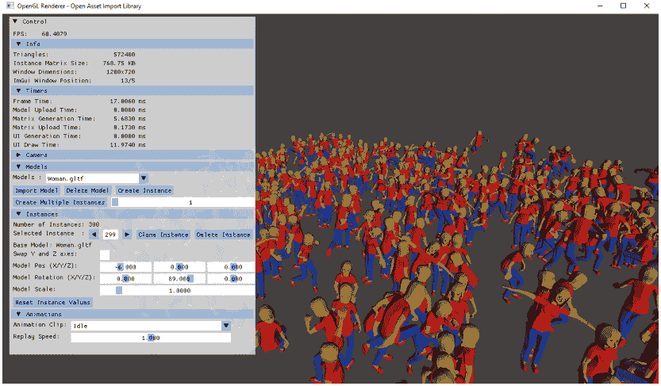

图 1.21：示例动画角色模型的多个实例

## 总结

在本章中，我们通过使用 Open Asset Importer Library（简称 Assimp）迈出了掌握 C++ 游戏动画编程的第一步。Assimp 使我们能够简化和加速对模型实例进行动画处理和渲染的路径。

我们首先了解了 Assimp 库的通用数据结构、如何解析文件的不同部分以及解析顺序。接下来，我们在代码中添加了一个基于 ImGui 的漂亮文件对话框，使我们能够以交互方式选择文件，而无需硬编码一个或多个我们希望打开 的模型文件。在本章末尾，我们探讨了如何在运行时添加或移除模型和实例，使我们能够创建一个更加“拥挤”的虚拟世界。

在第 2 章中，我们将计算模型矩阵的计算负载从 CPU 转移到 GPU，从而让我们拥有更多 CPU 算力来在虚拟世界中实现令人惊叹的功能。

## 实践环节

你会在本书每一章的末尾看到这个部分。在这里，我会提供一些建议和练习，你可以配合 GitHub 上的代码进行尝试。

你可以尝试以下内容：

-   为动画添加更多控制，例如播放方向、单次播放与循环播放，甚至是乒乓播放，即在所选动画的正向和反向播放之间交替。
-   添加一个动画滑块，让你可以选择在动画的某个时间点显示某一帧。
-   在互联网上搜索模型文件。尝试哪些模型可以工作，或者它们能在多大程度上工作。你不必局限于游戏角色模型；你也可以搜索兼容格式的游戏地图或可 3D 打印的物体。记得调整文件对话框的过滤器，以显示额外的文件格式。

## 补充资源

如需进一步阅读，请参阅以下资源：

-   微软关于路径长度限制的文档：https://learn.microsoft.com/en-us/windows/win32/fileio/maximum-file-path-limitation?tabs=registry
-   Assimp GitHub 仓库：https://github.com/assimp/assimp
-   Assimp 文档：https://assimp-docs.readthedocs.io/en/latest/
-   Learn OpenGL 中关于 Assimp 的部分：https://learnopengl.com/Model-Loading/Assimp
-   骨骼动画教程：https://www.ogldev.org/www/tutorial38/tutorial38.html

2

将动画计算从 CPU 移至 GPU

欢迎进入第 2 章！在上一章中，我们探索了使用 Open Assimp Import Library（简称 Assimp）加载并动画化 3D 模型的步骤。生成的应用程序可以渲染大量模型实例。但是，取决于你的处理器类型和速度，模型矩阵的计算部分会很快成为瓶颈。因此，我们不再能够在应用程序中达到每秒 60 帧。

在本章中，我们将矩阵计算移至计算着色器，使其完全在 GPU 上运行。我们首先简要回顾一下独立于应用程序主代码进行计算的方法历史，以及 CPU 和 GPU 中并行性的增长。接下来，我们检查矩阵计算的当前状态。然后，我们制定一个计划，明确应该将哪些内容移至计算着色器，以及如何实现这种迁移。最后，我们检查迁移后的结果，并简要看看应用程序中还有哪些其他部分可能受益于将计算密集型工作卸载出去。

在本章中，我们将涵盖以下主题：

-   什么是计算着色器，为什么我们应该喜欢它们？
-   性能分析：动画性能剖析
-   将节点计算移至 GPU
-   通过扩展规模来测试实现
-   如何调试计算着色器

## 技术要求

要使用计算着色器，需要支持至少 OpenGL 4.3 和/或 Vulkan 1.0 的 GPU。由于本书的源代码是为 OpenGL 4.6 和 Vulkan 1.1 编写的，我们在这方面是安全的。

你可以在 `chapter02` 文件夹中找到示例代码，其中 `01_opengl_computeshader` 子文件夹对应 OpenGL，`02_vulkan_computeshader` 子文件夹对应 Vulkan。

## 什么是计算着色器，为什么我们应该喜欢它们？

让我们简要回顾一下家用计算机的历史，看看并发是如何处理的。在服务器上，并发程序自 20 世纪 60 年代中期以来就已成为常态，但对于家用计算机和游戏主机来说，演变过程则有所不同。

## 著名的光栅中断

虽然中断的总体思想自计算机诞生之初就存在于系统中，但家用计算机中的中断通常由操作系统用来响应外部事件（不过第一批带中断的机器是在 20 世纪 50 年代推出的）。其中一种中断标志着要向旧的“阴极射线管”电视机输出新画面的开始：光栅中断。

光栅中断在阴极射线被重置到电视屏幕左上角后触发。这个稳定的事件每秒发生 50 次（在欧盟；在美国为每秒 60 次），很快成为程序员们关注的焦点。通过将中断处理程序重定向到他们自己的代码，机器可以执行需要按固定时间表完成的工作，例如播放音乐或在屏幕特定位置进行图形变化。这些程序对家用计算机能力的挖掘甚至超出了机器架构师们的想象，例如在屏幕上添加比机器原本支持的更多的精灵、在屏幕边框内绘制精灵、绘制光栅条，甚至在 8 位 CPU 上实现一种简单的多任务处理。

直到今天，复古编码者仍在用旧家用计算机创造更多神奇的效果。请参阅“补充资源”部分，获取演示程序和相关教程的链接，了解随着时间的推移，硬件限制是如何被巧妙利用的。

然后，很长一段时间内，没有什么特别的事情发生。8 位和 16 位家用计算机的时代结束了，x86 机器接管了市场。然而，整体系统布局保持不变——一个处理器核心通过中断进行时间分片，以呈现出多个程序同时运行的假象。

## 多核机器的兴起

到 2000 年初，普通台式机已经能够使用多个 CPU 核心：Windows 2000 问世（Linux 早已能够利用多个 CPU，但在 2000 年的台式机市场上它是一个小众系统）。

五年后，第一批拥有多个计算核心的处理器面向桌面用户推出：Pentium D 和 AMD 64 X2。这些新的 CPU 被视为编程新时代的开端，因为多个进程可以真正同时运行。这也标志着程序员头疼时代的开始——两个线程可能真正并行运行，这需要重新思考同步问题。

目前，台式机的平均 CPU 核心数在 4 到 8 之间。考虑到现代 CPU 的同步多线程技术，许多台式机甚至能够并行处理 28 到 32 个线程。遗憾的是，程序员的头疼问题与 20 年前相同——利用大量核心仍然是一个复杂且容易出错的过程。

在幕后，另一项核心数量更为庞大的技术也在不断发展：图形处理器。

## 隐藏的多核冠军

在处理器核心升级的阴影下，显卡也提高了并行核心的数量，而且规模更大。从 2009 年和 2010 年只有几个着色器核心开始，数量增长是惊人的：

NVIDIA GeForce RTX 4090 拥有多达 16,384 个着色器核心，而 AMD Radeon RX 7900 XTX 拥有 6,144 个着色器核心。

由于这两款 GPU 之间存在内部差异，这两个数字不能直接比较，但原始数字说明了一件事：如果我们能够利用部分着色器核心来计算动画帧的模型矩阵，计算速度将会快得多。同时，我们的 CPU 要做的工作也会减少，使我们能够在 GPU 计算模型矩阵的同时处理其他任务。

感谢图形 API 设计者和 GPU 厂商，使用这些着色器核心就像编写一个简短的、类似 C 语言的程序一样简单：即计算着色器。


## 欢迎来到计算着色器的奇妙世界

直到 OpenGL 4.2，利用其他着色器类型（如顶点和片段着色器）在 GPU 上进行计算已经成为可能。类似于通过纹理缓冲对象将任意数据上传到 GPU，着色器可用于大规模并行计算，并将结果保存到纹理缓冲区。最终的纹理可以被读回 CPU 可访问的内存——瞧：GPU 帮助我们完成了一些昂贵的计算。

随着 OpenGL 4.3 的引入，通过正式添加计算着色器和着色器存储缓冲对象（SSBO），这一过程得到了简化。在 Vulkan 1.0 中，对计算着色器和 SSBO 的支持已经是强制性的，使新的图形 API 与 OpenGL 4.3+ 持平。

SSBO 的优势很大：与只读的统一缓冲不同，着色器可以读写 SSBO。SSBO 的一般访问也简化了，因为它没有硬限制的最大大小。加上 float 和 vec2 数据类型的填充规则略有不同，在 SSBO 中获取或设置值就像使用 C 风格数组一样简单：

```
layout (std430, binding = 0) readonly buffer Matrices {
    mat4 matrix[];
};
...
void main() {
    ...
    mat4 boneMat = matrix[index];
    ...
}
```

另一方面，使用计算着色器，你可以完全控制要启动的着色器实例数量。着色器调用的总数取决于计算着色器中的设置和调度调用。

假设我们使用以下计算着色器设置：

```
layout(local_size_x = 16, local_size_y = 32,
    local_size_z = 1) in;
```

然后，运行这个 OpenGL 调度调用：

```
glDispatchCompute(10, 10, 1);
```

这意味着我们将向 GPU 驱动程序发送启动 51,200 个着色器实例的请求：

```
16*32*1*10*10*1 = 51200
```

有关计算着色器的更多详细信息，可在“其他资源”部分找到 OpenGL 和 Vulkan 教程的链接。

虽然存在一些额外的限制，例如为了简化内部管理而一起使用的着色器核心数量（在 AMD GPU 上称为 wave，在 NVIDIA GPU 上称为 warp），但调用次数展示了计算着色器的用户友好性。

你，作为程序员，无需关心在代码中生成大量线程或在程序结束时汇合它们。此外，也无需创建互斥锁或原子变量来控制数据访问。所有这些步骤都牢牢隐藏在图形驱动程序深处，不为你所见。

不过你并非没有义务——你仍然必须确保单个着色器调用只读取或写入单个缓冲区地址。但是，借助 GPU 设置的控制变量（如全局和本地调用 ID），这部分也很容易——与在 CPU 上手动多线程所需的努力相比，要容易得多。

那么，我们如何在程序中使用计算着色器的魔力呢？第一步是分析代码中的热点，并制定如何在 GPU 上计算相同数据的计划。

## 分析动画性能

要在你的系统上测试应用程序的性能，你可以导入 assets 文件夹中 woman 子文件夹下名为 Woman.gltf 的测试模型，将“Create Multiple Instances”按钮旁边的滑块移动到 100，并多次单击“Create Multiple Instances”按钮。每次点击都会再添加 100 个模型实例，随机分布在虚拟世界中。

或者，你可以修改 opengl 文件夹中 UserInterface 类的 createFrame() 方法中实例滑块的代码。调整调用的第四个参数，该参数控制滑块的最大值：

```
ImGui::SliderInt("##MassInstanceCreation",
    &manyInstanceCreateNum, 1, 100, "%d", flags);
```

## 将动画计算从 CPU 移动到 GPU

添加几百个实例后，你应该会看到类似于图 2.1 的画面。用户界面的 Timers 部分已被放大，以显示生成模型矩阵所需的时间值：

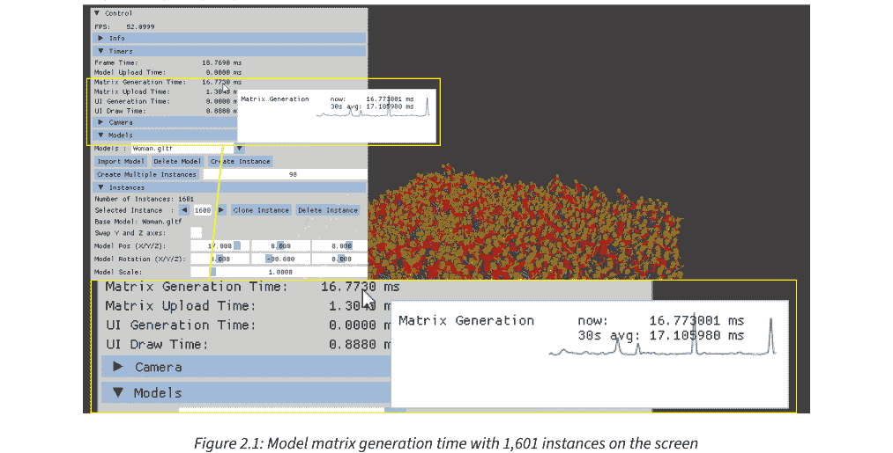

这里，1,601 个实例需要超过 20 毫秒来创建模型矩阵——如果我们计算原始数字，这仍然是一个很小的值。

每个模型有 41 块动画骨骼。对于每块骨骼，每帧都会读取平移、旋转和缩放（TRS）各两个值。这些值通过线性插值混合平移和缩放，通过球面线性插值（SLERP）混合旋转：

```
1601*41*3*2 = 393846
```

除了这近 400,000 次向量乘法之外，每块骨骼还需要生成最终的 TRS 矩阵，并乘以父矩阵。每次矩阵乘法包含 16 次浮点乘法，因此我们还有约 100,000 次乘法：

```
1601*4*16 = 102464
```

这是 CPU 在每一帧中需要完成的大量工作。这些数字也反映在 Windows 和 Linux 的性能分析输出中。

让我们验证一下关于 CPU 工作负载的假设。

### 定位代码中的热点

通过使用 Visual Studio 2022 的内置分析器，我们看到动画和矩阵乘法的函数调用位于单个函数内执行时间最多的函数之中：

| 函数 | 包含样本 | 独占样本 | 模块 |
|---|---|---|---|
| `OGLRenderer::draw` | 159603 (95.78%) | 172 (0.10%) | main |
| `AssimpInstance::updateAnimation` | 134331 (80.62%) | 19475 (11.69%) | main |
| `std::operator<< <char, std::char_traits<char>, std::allocator<char> >` | 48740 (29.25%) | 23833 (14.30%) | main |
| `glm::operator*<float, 0>` | 26069 (15.64%) | 25883 (15.53%) | main |
| `AssimpNode::updateTRSMatrix` | 24616 (14.77%) | 3689 (2.21%) | main |
| `AssimpAnimChannel::getRotation` | 16088 (9.65%) | 11828 (7.10%) | main |
| `ImGui_ImplOpenGL3_RenderDrawData` | 14959 (8.98%) | 3 (0.00%) | main |

图 2.2：Visual Studio 2022 分析中的动画调用

在 Linux 上使用额外的 -pg 标志编译可执行文件、运行应用程序并启动 gprof 后，结果类似：

平面剖析：

每个样本计为 0.01 秒。

| % 时间 | 累计秒数 | 自身秒数 | 调用次数 | 自身秒/调用 | 总计秒/调用 | 名称 |
|---|---|---|---|---|---|---|
| 38.61 | 5.15 | 5.15 | 719798 | 0.00 | 0.00 | `AssimpInstance::updateAnimation(float)` |
| 19.23 | 7.72 | 2.57 | 24473132 | 0.00 | 0.00 | `AssimpAnimChannel::getRotation(float)` |
| 14.17 | 9.61 | 1.89 | 29511718 | 0.00 | 0.00 | `AssimpNode::updateTRSMatrix()` |
| 8.92 | 10.80 | 1.19 | 24473132 | 0.00 | 0.00 | `AssimpAnimChannel::getScaling(float)` |
| 6.26 | 11.63 | 0.84 | 24473132 | 0.00 | 0.00 | `AssimpAnimChannel::getTranslation(float)` |
| 2.77 | 12.00 | 0.37 | 719798 | 0.00 | 0.00 | `AssimpAnimClip::getChannels()` |

图 2.3：Linux 分析中的动画调用

大量的 CPU 时间用于计算每个节点的新平移、旋转、缩放和模型矩阵。那么，让我们检查如何更改数据表示，以便能够轻松上传到计算着色器。

### 分析当前数据表示

在当前实现中，矩阵工作是在 AssimpInstance 类的 updateAnimation() 方法中完成的。对于渲染器绘制到屏幕的每一帧，必须完成以下步骤：

1. 首先，我们遍历所有动画通道，获取模型的相应节点，并使用动画数据中的骨骼局部变换更新每个节点的平移、缩放和旋转：

```cpp
for (const auto& channel : animChannels) {
    std::string nodeNameToAnimate =
        channel->getTargetNodeName();
    std::shared_ptr<AssimpNode> node =
        mAssimpModel->getNodeMap().at(nodeNameToAnimate);
    node->setRotation(
        channel->getRotation(
            mInstanceSettings.isAnimPlayTimePos));
    node->setScaling(
        channel->getScaling(
            mInstanceSettings.isAnimPlayTimePos));
    node->setTranslation(
        channel->getTranslation(
            mInstanceSettings.isAnimPlayTimePos));
}
```

2. 然后，我们遍历所有骨骼，并更新每个节点的 TRS 矩阵，计算节点局部变换：

```cpp
mBoneMatrices.clear();
for (auto& bone : mAssimpModel->getBoneList()) {
    std::string nodeName = bone->getBoneName();
    std::shared_ptr<AssimpNode> node =
        mAssimpModel->getNodeMap().at(nodeName);
    node->updateTRSMatrix();
}
```

节点的 TRS 矩阵更新包括与父节点 TRS 矩阵的乘法。


3. 在这一点上，我们可以收集节点的最终 TRS 矩阵，并将其乘以对应的骨骼偏移矩阵，生成包含每个节点世界位置的 `mBoneMatrices` 向量：

```
if (mAssimpModel->getBoneOffsetMatrices().count(
    nodeName) > 0) {
    mBoneMatrices.emplace_back(
        mAssimpModel->getNodeMap().at(
            nodeName)->getTRSMatrix() *
        mAssimpModel->getBoneOffsetMatrices().at(nodeName));
}
}
```

对骨骼偏移矩阵进行额外的 `.count()` 检查是为了避免访问无效的矩阵。骨骼偏移矩阵对于动画中的每个节点都应该是有效的，但谨慎为上。

4. 然后，在渲染器的 `draw()` 调用中，即在 `OGLRenderer` 类中，动画会为每个实例更新。动画更新后，`mBoneMatrices` 向量会被检索并添加到本地的 `mModelBoneMatrices` 向量中：

```
for (unsigned int i = 0; i < numberOfInstances; ++i) {
    modelType.second.at(i)->updateAnimation(
        deltaTime);
    std::vector<glm::mat4> instanceBoneMatrices =
        modelType.second.at(i)->getBoneMatrices();
    mModelBoneMatrices.insert(
        mModelBoneMatrices.end(),
        instanceBoneMatrices.begin(),
        instanceBoneMatrices.end());
}
```

5. 作为下一步，本地的 `mModelBoneMatrices` 向量将被上传到 SSBO 缓冲区：

```
mShaderBoneMatrixBuffer.uploadSsboData(
    mModelBoneMatrices, 1);
```

在 shader 文件夹中的 `assimp_skinning.vert` 顶点着色器中，骨骼矩阵以只读缓冲区的形式可见：

```
layout (std430, binding = 1) readonly buffer BoneMatrices {
    mat4 boneMat[];
};
```

6. 我们使用每个顶点的骨骼编号值作为索引进入骨骼矩阵 SSBO，以计算名为 `skinMat` 的最终顶点蒙皮矩阵：

```
mat4 skinMat =
    aBoneWeight.x * boneMat[int(aBoneNum.x) +
    gl_InstanceID * aModelStride] +
    aBoneWeight.y * boneMat[int(aBoneNum.y) +
    gl_InstanceID * aModelStride] +
    aBoneWeight.z * boneMat[int(aBoneNum.z) +
    gl_InstanceID * aModelStride] +
    aBoneWeight.w * boneMat[int(aBoneNum.w) +
    gl_InstanceID * aModelStride];
```

7. 作为最后一步，我们使用 `skinMat` 矩阵将顶点移动到特定动画帧的正确位置：

```
gl_Position = projection * view * skinMat *
vec4(aPos, 1.0);
```

正如你所见，渲染动画的每一帧都需要大量的计算。让我们将计算负载转移到显卡上。

## 调整数据模型

为了将计算转移到 GPU，我们在 opengl 文件夹中的 `OGLRenderData.h` 文件里创建一个新的结构体 `NodeTransformData`：

```
struct NodeTransformData {
    glm::vec4 translation = glm::vec4(0.0f);
    glm::vec4 scale = glm::vec4(1.0f);
    glm::vec4 rotation = glm::vec4(1.0f, 0.0f, 0.0f, 0.0f);
};
```

对于 Vulkan 渲染器，该结构体需要在 vulkan 文件夹中的 `VkRenderData.h` 文件中创建。

在这个新结构体中，我们将按节点保存变换值。我们使用 `glm::vec4`，这是一种具有四个浮点元素的向量类型，用于平移和缩放，以避免额外的填充值以实现正确的对齐，并在着色器中简单地忽略最后一个元素。

## GPU/CPU 内存对齐可能不同

由于 GPU 针对快速内存访问进行了优化，缓冲区中的数据必须在内存中对齐，通常对齐到 16 字节的倍数。将数据上传到 GPU 时，该对齐会自动创建。在 CPU 端，可能使用不同的对齐，例如对于 3 个元素的向量类型 `glm::vec3`，其长度为 12 字节。要使用 `glm::vec3` 向量，需要额外添加一个 float 作为填充以匹配 16 字节对齐，因为上传未对齐的数据会导致图像失真和错误结果。

我们还为旋转使用 `glm::vec4` 向量，它在 `AssimpChannel` 类中是 `glm::quat` 四元数。做出此决定的原因很简单：GLSL，即 OpenGL 着色语言，不知道什么是四元数，也不知道如何处理四元数。我们必须在计算着色器中自行实现四元数函数。因此，我们利用普通的 4 元素向量来将旋转四元数的四个元素传输到着色器。

现在，我们可以简化动画更新。首先，我们向类中添加一个本地 `std::vector`，其类型为我们新的 `NodeTransformData`：

```
std::vector<NodeTransformData> mNodeTransformData{};
```

我们再次遍历所有通道，但不是修改模型的节点，而是用变换数据填充本地的 `NodeTransformData` 变量：

```
for (const auto& channel : animChannels) {
    NodeTransformData nodeTransform;

    nodeTransform.translation =
        channel->getTranslation(
            mInstanceSettings.isAnimPlayTimePos);
    nodeTransform.rotation =
        channel->getRotation(
            mInstanceSettings.isAnimPlayTimePos);
    nodeTransform.scale =
        channel->getScaling(
            mInstanceSettings.isAnimPlayTimePos);
```

并且，在检查以避免访问无效骨骼之后，我们使用收集到的变换数据设置对应骨骼的节点变换：

```
int boneId = channel->getBoneId();
if (boneId >= 0) {
    mNodeTransformData.at(boneId) = nodeTransform;
}
```

在渲染器的 `draw()` 调用期间，我们仍需要以相同的方式更新动画：

```
for (unsigned int i = 0; i < numberOfInstances; ++i) {
    modelType.second.at(i)->updateAnimation(deltaTime);
```

然后，我们从实例中获取节点变换，并将它们收集到本地数组中：

```
std::vector<NodeTransformData> instanceNodeTransform =
    modelType.second.at(i)->getNodeTransformData();
std::copy(instanceNodeTransform.begin(),
    instanceNodeTransform.end(),
    mNodeTransformData.begin() + i * numberOfBones);
```

作为最后一步，我们必须将节点变换上传到 SSBO：

```
mNodeTransformBuffer.uploadSsboData(mNodeTransformData, 0);
```

`NodeTransformData` 结构体的元素不是 4x4 矩阵，而是每个节点仅有的三个 `glm::vec4` 元素。因此，在此步骤中，我们需要向 SSBO 上传 25% 更少的数据。

在 GPU 上拥有节点变换是一个很棒的初步步骤。但如果我们进一步分析数据流，就会发现要在计算着色器中计算最终模型矩阵，我们还需要更多数据。让我们看看从骨骼本地变换数据计算世界空间位置还需要什么。

## 为计算着色器添加缺失的数据

第一个，也是最明显缺失的数据部分是骨骼偏移矩阵数组。在 CPU 实现中，我们将每个节点的最终 TRS 矩阵与同一节点的骨骼偏移矩阵相乘：

```
mBoneMatrices.emplace_back(
    mAssimpModel->getNodeMap().at(
        nodeName)->getTRSMatrix() *
    mAssimpModel->getBoneOffsetMatrices().at(nodeName));
```

由于骨骼偏移矩阵是按模型为基准的，我们可以向 `AssimpModel` 类添加一个 SSBO，并在模型加载期间上传数据。我们只需在 model 文件夹中的 `AssimpModel.h` 头文件中添加一个 SSBO：

```
ShaderStorageBuffer mShaderBoneMatrixOffsetBuffer{};
```

然后，在 `loadModel()` 方法中，我们用偏移矩阵填充一个本地向量并将数据上传到 SSBO：

```
std::vector<glm::mat4> boneOffsetMatricesList{};
for (const auto& bone : mBoneList) {
    boneOffsetMatricesList.emplace_back(
        bone->getOffsetMatrix());
}
mShaderBoneMatrixOffsetBuffer.uploadSsboData(
    boneOffsetMatricesList);
```

准备好计算着色器的数据后，我们将包含骨骼偏移矩阵的 SSBO 绑定到矩阵乘法计算着色器中配置的相同绑定点（binding = 2）：

```
modelType.second.at(0)->getModel()
    ->bindBoneMatrixOffsetBuffer(2);
```

乍一看有点隐藏的是对父矩阵的需求。在 `AssimpNode` 的 `updateTRSMatrix()` 方法中，我们从父节点（如果有父节点）检索 TRS 矩阵。然后，我们使用父节点来计算节点本身的 TRS 矩阵：

```
if (std::shared_ptr<AssimpNode> parentNode =
    mParentNode.lock()) {
    mParentNodeMatrix = parentNode->getTRSMatrix();
}
mLocalTRSMatrix = mRootTransformMatrix *
    mParentNodeMatrix * mTranslationMatrix *
    mRotationMatrix * mScalingMatrix;
```

在 `AssimpInstance` 类的 `updateAnimation()` 方法中，我们从根节点的 TRS 矩阵更新开始，并深入到子节点，收集父矩阵节点，其中包含从模型根节点到该节点的所有变换矩阵。


对于计算着色器，我们需要采用不同的方法。由于所有着色器调用都是并行运行的，我们需要将调用次数减少到每个模型一个，允许在模型矩阵上进行已知的线性递进。为了使用更多量的着色器调用，我们将创建一个 int 向量，其中包含每个位置的父节点的编号。这个“父节点向量”使我们能够在着色器中“向后走”模型骨架，在途中收集所有父节点矩阵。

我们在循环中创建父节点向量，同时创建骨骼偏移矩阵。首先，我们获取当前骨骼的父节点，然后使用一个小的 lambda 来获取父骨骼在同一骨骼列表中的位置：

```
std::string parentNodeName = mNodeMap.at(
bone->getBoneName())->getParentNodeName();
const auto boneIter = std::find_if(mBoneList.begin(),
mBoneList.end(),
[parentNodeName](std::shared_ptr<AssimpBone>& bone)
{ return bone->getBoneName() == parentNodeName; });
```

如果我们在骨骼列表中找不到父节点，我们就找到了模型的根节点。在这种情况下，我们添加一个 -1 来标识根节点。在所有其他情况下，我们添加父骨骼的索引号：

```
if (boneIter == mBoneList.end()) {
boneParentIndexList.emplace_back(-1);
} else {
boneParentIndexList.emplace_back(
std::distance(mBoneList.begin(), boneIter));
}
```

boneParentIndexList 现在包含模型中所有节点的父节点扁平列表，其中根节点使用特殊的父节点 -1。通过重复查找父节点，我们可以从每个节点向上遍历骨骼树，直到到达父节点为特殊数字 -1 的根节点。

为了使父骨骼列表在计算着色器中可用，我们在 AssimpModel 类中创建另一个 SSBO，并将 boneParentIndexList 上传到 GPU：

```
mShaderBoneParentBuffer.uploadSsboData(boneParentIndexList);
```

回到渲染器中，父骨骼缓冲区将被绑定到计算着色器的一个绑定点：

```
modelType.second.at(0)->getModel()
->bindBoneParentBuffer(1);
```

我们还没有完成将工作负载转换到 GPU。有些数据在使用计算着色器时需要以不同的方式处理。

## 将数据重新定位到另一个着色器

现在计算中还缺少实例世界位置。updateAnimation() 方法包含以下行来设置模型根节点的变换矩阵：

```
mAssimpModel->getNodeMap().at(
mAssimpModel->getBoneList().at(0)->getBoneName())
->setRootTransformMatrix(mLocalTransformMatrix *
mAssimpModel->getRootTransformationMatrix());
```

模型的根变换矩阵包含将应用于整个模型的通用变换，例如模型的全局缩放。另一个矩阵 mLocalTransformMatrix 用于设置模型实例的用户控制参数。局部变换矩阵允许我们在虚拟世界中旋转和移动模型实例。

与骨骼偏移矩阵不同，根节点变换将被移动到 assimp_skinning.vert 顶点着色器，而不是计算着色器。矩阵乘法由哪两个着色器完成并不重要，但将根节点变换移动到顶点着色器可能会降低计算着色器的负载。此外，顶点着色器仅对绘制到屏幕上的对象运行，而不对在渲染之前被剔除的实例或不可见实例运行，从而可能降低 GPU 的整体计算负载。

## 进行最后的准备

最后，我们也可以决定需要多少个不同的计算着色器：

我们至少需要两个计算着色器。

要计算节点的最终 TRS 矩阵，我们需要所有父 TRS 矩阵都已完成，并将矩阵从当前节点乘到模型根。我们只能控制启动的着色器调用数量，但不能控制何时或多长时间运行这样的着色器调用，因此我们需要在节点 TRS 矩阵的计算和沿骨骼收集矩阵的过程之间设置某种屏障。

## 将动画计算从 CPU 移动到 GPU

创建这种屏障的唯一方法是在 CPU 端。在提交计算着色器到图形 API 时会添加屏障，告诉 GPU 等待第一个着色器完成，然后再开始第二批。

因此，我们必须先开始节点变换，等待所有节点变换矩阵完成，然后再开始最终节点矩阵的计算。

在理论部分完成后，我们可以开始着色器相关的实现。

加载计算着色器的过程与加载顶点或片段着色器只有细微差别。对于 OpenGL，我们需要在 glCreateShader() 调用中设置着色器类型：

```
glCreateShader(GL_COMPUTE_SHADER);
```

对于 Vulkan，我们必须在创建 VkShaderModule 期间设置正确的着色器阶段：

```
VkPipelineShaderStageCreateInfo computeShaderStageInfo{};
computeShaderStageInfo.sType =
VK_STRUCTURE_TYPE_PIPELINE_SHADER_STAGE_CREATE_INFO;
computeShaderStageInfo.stage =
VK_SHADER_STAGE_COMPUTE_BIT;
```

加载着色器代码、链接或创建着色器模块的所有其他步骤保持不变。由于我们只有一个着色器文件，已向 Shader 类添加了额外的方法。现在可以通过调用 Shader 类的 loadComputeShader() 方法并传入着色器源的相对文件名来加载 OpenGL 中的计算着色器：

```
if (!AssimpTransformComputeShader.loadComputeShader(
"shader/assimp_instance_transform.comp")) {
return false;
}
```

Vulkan 使用标准可移植中间表示 SPIR-V 格式的着色器。不是着色器源，而是预编译的着色器代码必须加载到 Shader 类中以供 Vulkan 渲染器使用。

由于我们在计算着色器中计算新的矩阵，并且必须在不同着色器之间移动这些矩阵，因此需要两个额外的 SSBO。

## 添加更多着色器存储缓冲区

第一个 SSBO 将存储我们从节点变换创建的 TRS 矩阵。此 SSBO 是一个简单缓冲区，定义在渲染器的头文件中：

```
ShaderStorageBuffer mShaderTRSMatrixBuffer{};
```

第二个 SSBO 将包含将在蒙皮顶点着色器中使用的最终骨骼矩阵。骨骼矩阵缓冲区也作为渲染器头文件中的普通 SSBO 声明添加：

```
ShaderStorageBuffer mShaderBoneMatrixBuffer{};
```

在着色器中使用 SSBO 的一个重要步骤是设置正确的大小。如果 SSBO 太小，不是所有数据都会存储在计算着色器中，实例或实例的身体部位可能会丢失。错误的缓冲区大小可能很难调试——你甚至可能不会收到着色器写入缓冲区末尾之外的警告。我们必须根据骨骼数量、实例数量和 4x4 矩阵的大小来计算缓冲区大小，如下所示：

```
size_t trsMatrixSize = numberOfBones *
numberOfInstances * sizeof(glm::mat4);
```

然后，我们将两个 SSBO 调整为最终矩阵大小：

```
mShaderBoneMatrixBuffer.checkForResize(trsMatrixSize);
mShaderTRSMatrixBuffer.checkForResize(trsMatrixSize);
```

绘制多个模型时，两个缓冲区最终将具有所有模型的最大大小。但这不会造成任何伤害，因为缓冲区将被重用于下一个模型，并且只填充新模型中实际使用的数据量。

## 在着色器中计算节点变换

对于第一个计算着色器，我们必须将节点变换数据上传到第一个计算着色器。我们将存储从节点变换创建的新 TRS 矩阵的 SSBO 绑定到计算着色器的适当绑定点：

```
mAssimpTransformComputeShader.use();
mNodeTransformBuffer.uploadSsboData(
    mNodeTransFormData, 0);
mShaderTRSMatrixBuffer.bind(1)
```

计算着色器本身命名为 `assimp_instance_transform.comp`，位于 shader 文件夹中。计算着色器的第一行是常见的版本定义；第二行定义了局部调用大小：

```
#version 460 core
layout(local_size_x = 1, local_size_y = 32,
    local_size_z = 1) in;
```

这里，我们默认创建了 32 个着色器调用。你可能需要尝试不同的局部大小以达到最佳性能。着色器以固定大小的组启动，以简化 GPU 内部管理。常见的值有 32（对于 NVIDIA GPU 称为“warps”）或 64（对于 AMD GPU 称为“waves”）。对于 NVIDIA 或 AMD GPU，将所有局部大小设置为 1 是没用的，因为剩余的 31 个 warp 或相应的 63 个 wave 将不会被使用。

接下来，我们必须添加 `NodeTransformData`，其数据类型与我们在 `OGLRenderData.h` 中声明该类型时使用的一致：

```
struct NodeTransformData {
    vec4 translation;
    vec4 scale;
    vec4 rotation;
};
```

提醒一下：rotation 元素是一个四元数，以 `vec4` 形式表示。

现在，我们定义两个 SSBO，使用与渲染器代码中相同的绑定点：

```
layout (std430, binding = 0) readonly restrict
    buffer TransformData {
        NodeTransformData data[];
    };
layout (std430, binding = 1) writeonly restrict
    buffer TRSMatrix {
        mat4 trsMat[];
    };
```

我们将节点变换数据标记为 `readonly`，将 TRS 矩阵标记为 `writeonly`。这两个修饰符可以帮助着色器编译器优化对缓冲区的访问，因为可以省略一些操作。另一个修饰符 `restrict` 也有助于着色器编译器优化着色器代码。通过添加 `restrict`，我们告诉着色器编译器，我们绝不会使用另一个变量读取之前写入的变量值。消除写后读依赖将使着色器编译器的工作轻松得多。

为了从 `TransformData` 缓冲区读取数据，我们添加了三个方法。在这三个方法中，称为 `getTranslationMatrix()`、`getScaleMatrix()` 和 `getRotationMatrix()`，我们读取缓冲区的数据元素，并为相应的变换创建 4x4 矩阵。

例如，参见 `getTranslationMatrix()` 方法的实现：

```
mat4 getTranslationMatrix(uint index) {
    return mat4(1.0, 0.0, 0.0, 0.0,
                0.0, 1.0, 0.0, 0.0,
                0.0, 0.0, 1.0, 0.0,
                data[index].translation[0],
                data[index].translation[1],
                data[index].translation[2],
                1.0);
}
```

得到的 4x4 矩阵是一个单位矩阵，并添加了 `TransformData` 缓冲区中特定索引的平移数据。`getScaleMatrix()` 方法创建一个缩放矩阵，其主对角线的前三个元素设置为缩放值。最后，`getRotationMatrix()` 方法类似于 GLM 中的 `mat3_cast` 算法的精神，将四元数转换为 4x4 旋转矩阵。

在第一个计算着色器的 `main()` 方法中，我们获取着色器调用的 x 和 y 维度：

```
void main() {
    uint node = gl_GlobalInvocationID.x;
    uint instance = gl_GlobalInvocationID.y;
```

我们将使用模型中的骨骼数量作为 x 维度，以简化着色器代码的其余部分：

```
uint numberOfBones = gl_NumWorkGroups.x;
```

通过在缓冲区中定位正确的索引，需要结合骨骼数量、着色器实例（调用）以及我们将处理的节点：

```
uint index = node + numberOfBones * instance;
```

计算着色器的主要逻辑按 TRS 顺序乘以平移、旋转和缩放矩阵，并将结果保存到 TRS 矩阵缓冲区中，索引与节点变换相同：

```
trsMat[index] = getTranslationMatrix(index) *
    getRotationMatrix(index) * getScaleMatrix(index);
}
```

在 GLM 中，矩阵是从右到左相乘的，这一点一开始可能会让人困惑。因此，尽管矩阵名为“TRS”，乘法运算却是按照名称的相反顺序执行的：先应用模型缩放，然后是旋转，最后才是平移。其他数学库或不同的矩阵打包方式可能使用不同的乘法顺序。在“其他资源”部分列出了两个详尽的矩阵教程。

将 TRS 矩阵保存在与节点变换相同的位置，可以保持模型中节点的顺序以及所有模型实例中节点的顺序。

为了触发着色器执行，我们为 OpenGL 渲染器调用 `glDispatchCompute()`，并添加一个等待 SSBO 的内存屏障：

```
glDispatchCompute(numberOfBones,
    std::ceil(numberOfInstances / 32.0f), 1);
 glMemoryBarrier(GL_SHADER_STORAGE_BARRIER_BIT);
```

内存屏障确保 CPU 等待 GPU 达到特定状态。在这种情况下，我们必须等待所有 SSBO 写入完成，因此我们为着色器存储缓冲区设置了该位。对 `glMemoryBarrier()` 的调用只是阻塞执行，直到 GPU 达到期望状态后才返回。

在我们继续之前，让我们看看当调用 `glDispatchCompute()` 或 `vkCmdDispatch()` 时，计算着色器内部发生了什么。图 2.4 显示了计算着色器调用的内部元素：

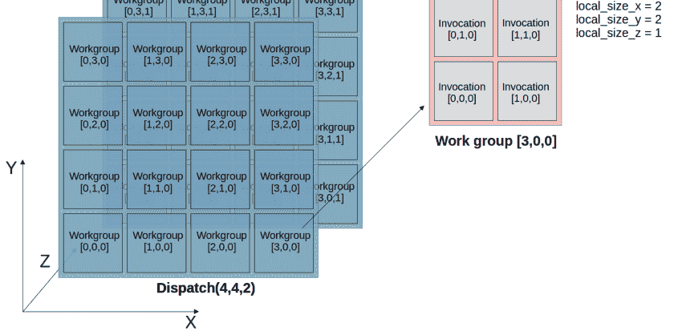

图 2.4：计算着色器的全局工作组和局部调用结构

当我们使用参数 4、4、2 调用调度命令时，将启动总共 4*4*2 = 32 个工作组的数量，如图 2.4 左侧所示。工作组的总数就是全局计算空间的 X、Y、Z 三个维度的乘积。

在这 32 个工作组的每一个中，总共运行四个着色器调用，如图 2.4 中间的工作组 [3,0,0] 所示。所谓的局部大小由三个着色器布局值 `local_size_x`、`local_size_y` 和 `local_size_z` 定义。工作组的局部大小的计算方式与工作组数量相同，即通过将 X、Y、Z 维度的三个值相乘：2*2*1 = 4。

如果着色器实例需要相互通信，则划分为工作组非常重要，因为通信只能在同一个工作组内进行。来自不同工作组的着色器调用实际上是隔离的，无法通信。

如你所见，由于单个工作组的局部大小与工作组总数相乘，着色器调用的总数很快就会变得非常庞大。这种大规模的并行性正是 GPU 强大原始性能背后的秘密。

因此，对于 x 维度，我们使用 `numberOfBones`，如前所述。通过计算 `numberOfInstances` 除以 32 的 `std::ceil` 作为 y 维度，我们确保启动 32 个着色器调用的组，一次计算最多 32 个实例的矩阵，这与着色器代码中配置的局部 y 维度一致。如果实例数量不是 32 的倍数，额外的 wave 或 warp 仍会运行，但结果会被忽略。从技术上讲，我们正在缓冲区边界之外读写，但 GPU 驱动程序应该处理这种情况，例如丢弃写入。

```
vkCmdDispatch(commandBuffer, numberOfBones,
std::ceil(numberOfInstances / 32.0f), 1);
```

Vulkan 中计算着色器的 Shader Storage Buffer Object（SSBO）的大小也应该进行舍入，使其能够容纳骨骼数量的 32 倍，以避免意外覆盖缓冲区数据。

```
boneMatrixBufferSize +=
numberOfBones * ((numberOfInstances - 1) / 32 + 1) * 32;
```

在 Vulkan 中，用于同步着色器的屏障必须设置为等待队列的结果。为了在计算着色器和顶点着色器之间进行同步，我们需要在计算着色器的写入和顶点着色器的第一次读取操作之间设置屏障，如下所示：

```
VkMemoryBarrier memoryBarrier {}
...
memoryBarrier.srcAccessMask = VK_ACCESS_SHADER_WRITE_BIT;
memoryBarrier.dstAccessMask = VK_ACCESS_SHADER_READ_BIT;

vkCmdPipelineBarrier(...,
VK_PIPELINE_STAGE_COMPUTE_SHADER_BIT,
VK_PIPELINE_STAGE_VERTEX_INPUT_BIT,
1, &memoryBarrier, ...);
```

现在，Vulkan 会等待计算着色器完成所有计算，然后才开始顶点着色器中的绘制调用。

现在，TRS 矩阵缓冲区包含了每个节点的矩阵，但不包含父节点、根节点变换矩阵或任何偏移矩阵。


## 创建最终的节点矩阵

在开始下一个计算着色器之前，我们必须绑定在着色器运行期间会使用到的所有缓冲区。我们总共有四个 SSBO：

```cpp
mAssimpMatrixComputeShader.use();
mShaderTRSMatrixBuffer.bind(0);
modelType.second.at(0)->getModel()
    ->bindBoneParentBuffer(1);
modelType.second.at(0)->getModel()
    ->bindBoneMatrixOffsetBuffer(2);
mShaderBoneMatrixBuffer.bind(3);
```

由于所有数据都已驻留在 GPU 上，因此这里不需要任何上传操作。

第二个计算着色器本身名为 `assimp_instance_matrix_mult.comp`，可以在着色器文件夹中找到。着色器代码再次从版本和局部大小定义开始：

```glsl
#version 460 core
layout(local_size_x = 1, local_size_y = 32, local_size_z = 1) in;
```

使用局部大小 32 是因为代码是在一台 NVIDIA GPU 上开发的。对于 AMD GPU，你应该使用局部大小 64，如“Calculating the node transforms in a shader”一节中所述。

与第一个计算着色器类似，其后是 SSBO：

```glsl
layout (std430, binding = 0) readonly restrict
buffer TRSMatrix {
    mat4 trsMat[];
};
layout (std430, binding = 1) readonly restrict
buffer ParentMatrixIndices {
    int parentIndex[];
};
layout (std430, binding = 2) readonly restrict
buffer BoneOffsets {
    mat4 boneOffset[];
};
```

前面的代码行可能会让你皱眉，因为我们似乎违反了 GLSL 着色器代码的基本规则之一：循环的大小必须在编译时已知。幸运的是，该规则不适用于 while 循环。我们可以自由地在循环体内部修改循环控制变量，从而创建各种长度的循环。

然而，这段代码可能会影响着色器性能，因为 GPU 经过优化以在每个线程上执行相同的指令。你可能需要在不同的 GPU 上检查着色器代码，以确保看到预期的加速。

还要注意，无意中创建无限循环可能会导致系统锁定，因为着色器代码永远不会将 wave 或 warp 归还到池中。确保在 CPU 端为 while 循环提供有效的退出条件是个好主意，因为 GPU 锁定可能只能通过强制重启计算机来解决。

只要父节点列表中没有错误或循环，我们就会在每个节点上结束于最后一个块：

```cpp
if (parentNode == -1) {
    nodeMat[index] = nodeMatrix * boneOffset[node];
}
```

在这里，我们将包含根节点以上所有矩阵的 resulting 节点矩阵与节点的骨骼偏移矩阵相乘，并将结果存储在可写的 NodeMatrices 缓冲区中。

启动计算的方式与第一个着色器完全相同。对 OpenGL 运行 `glDispatchCompute()`，然后跟随 `glMemoryBarrier()`：

```cpp
glDispatchCompute(numberOfBones,
    std::ceil(numberOfInstances / 32.0f), 1);
glMemoryBarrier(GL_SHADER_STORAGE_BARRIER_BIT);
```

对于 Vulkan，使用 `vkCmdDispatch()`：

```cpp
vkCmdDispatch(commandBuffer, numberOfBones,
    std::ceil(numberOfInstances / 32.0f), 1);
```

此时，NodeMatrices 缓冲区包含所有节点的 TRS 矩阵，接近我们在第 1 章 CPU 版本代码中 `updateAnimation()` 调用后得到的结果——除了实例的模型根矩阵之外。

## 完成计算迁移

因此，让我们将缺失的矩阵计算添加到顶点蒙皮着色器中。首先，我们在遍历模型的所有实例时收集包含世界位置的矩阵：

```cpp
mWorldPosMatrices.resize(numberOfInstances);
for (unsigned int i = 0; i < numberOfInstances; ++i) {
    ...
    mWorldPosMatrices.at(i) =
        modelType.second.at(i)->getWorldTransformMatrix();
}
```

然后，世界位置矩阵被上传到一个 SSBO，并绑定到顶点蒙皮着色器：

```cpp
mAssimpSkinningShader.use();
mAssimpSkinningShader.setUniformValue(
    numberOfBones);
mShaderBoneMatrixBuffer.bind(1);
mShaderModelRootMatrixBuffer.uploadSsboData(
    mWorldPosMatrices, 2);
```

在顶点蒙皮着色器本身中，引入了新的缓冲区：

```glsl
layout (std430, binding = 2) readonly restrict
    buffer WorldPosMatrices {
    mat4 worldPos[];
};
```

最后，我们从世界位置和顶点蒙皮矩阵创建一个组合矩阵，并使用新矩阵来计算顶点和法线的位置：

```glsl
mat4 worldPosSkinMat = worldPos[gl_InstanceID] * skinMat;
gl_Position = projection * view * worldPosSkinMat *
    vec4(aPos.x, aPos.y, aPos.z, 1.0);
...
normal = transpose(inverse(worldPosSkinMat)) *
    vec4(aNormal.x, aNormal.y, aNormal.z, 1.0);
```

现在让我们添加更多模型——大量模型。假设我们总共添加了 4,000 个示例模型的实例。你机器上的 resulting 矩阵生成时间可能与图 2.6 中的数字相似：

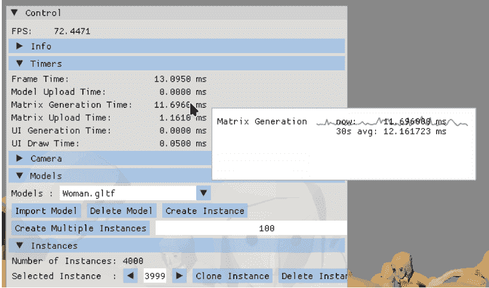

图 2.6：使用 4,000 个实例的计算着色器版本

即使实例数量增加了 2.5 倍，计算着色器代码的平均矩阵生成时间仍约为 CPU 版本的一半。你甚至可能在更强大的 GPU 上看到更大的非线性性能提升。最近的 GPU 不仅有数千个核心并行处理矩阵乘法，而且下一个更大的型号几乎使核心数量翻倍，从而带来更多并行化。

我们可以将实例数量扩展得更多或处理更复杂的模型，同时仍保持更低的矩阵生成时间。在某个任意的实例数量下，应用程序的帧率仍会降至 60 FPS 以下。根据你的系统，这可能在达到图 2.6 中的 4,000 个实例之前发生，也可能要晚得多。

如果你将分析器附加到应用程序，你会发现我们计算的新瓶颈：`AssimpAnimChannel` 类中方法 `getRotation()` 结尾处的四元数 SLERP：

```cpp
glm::quat rotation =
    glm::normalize(glm::slerp(mRotations.at(timeIndex),
    mRotations.at(timeIndex + 1), interpolatedTime));
```

```cpp
buffer, bufferVector.data();
glBindBuffer(GL_SHADER_STORAGE_BUFFER, 0);
```

SSBO 的内容可以与在 CPU 上完成的相同计算结果进行比较。逐步地、缓冲区地缩小问题范围，直到找到错误。

回读 SSBO 可能不是进行计算着色器调试的明显解决方案，但这里任何一点帮助都是受欢迎的。但是，根据着色器的复杂性，你可能不得不退回到手动遍历代码。还尝试使用简单的数据集来简化调试。

## 总结

在本章中，我们将大部分计算从 CPU 迁移到 GPU 上的计算着色器。在简要回顾了并发代码执行的历史之后，我们制定了将节点变换计算迁移到 GPU 的计划，并最终执行了该计划。在本章结束时，我们检查了 resulting 应用程序所获得的加速。

在下一章中，我们将研究为模型视图应用程序添加视觉选择的方法。能够创建数千个模型实例是很好的，但目前在所有其他实例中定位一个特殊实例几乎是不可能的。我们将讨论两种不同的方法并实现其中一种。

## 实践环节

你可以对代码做一些补充：

- 添加“可编程顶点拉取”到代码中。

    使用可编程顶点拉取，顶点数据将不再通过顶点缓冲区推送。相反，顶点数据将被上传到 GPU 上的 UBO 或 SSBO，并且顶点着色器用于从该缓冲区为每个顶点提取所有数据。

- 将 `mix()` 和 `slerp()` 从 `AssimpAnimChannel` 移动到 GPU。

    当从通道向量中提取平移、旋转和缩放的两个数据值的定时后，需要对平移和缩放进行线性插值，对旋转进行 SLERP。两种插值类型每帧都会被调用数千次——也许 GPU 更快。


- 在计算着色器中混合两种动画。

此任务与之前的实践课类似。但不是在 GPU 上对单个动画剪辑的动画关键帧进行插值，而是对两个不同动画剪辑在同一时间点的变换进行插值。

增加难度：合并这两个任务，并在计算着色器中对两个动画剪辑的节点变换的 4 个值进行插值。

- 使用 RenderDoc 查看缓冲区内容。

由于缓冲区数据类型在 RenderDoc 中显示为 RGB 值，你可能会在缓冲区中看到一些有趣且重复出现的模式。

## Additional resources

- C64 demo coding: https://codebase64.org/doku.php?id=base:start
- Atari ST demo scene: https://democyclopedia.wordpress.com
- pouët.net demo scene archive: https://www.pouet.net
- LearnOpenGL on compute shaders: https://learnopengl.com/Guest-Articles/2022/Compute-Shaders/Introduction
- Vulkan Tutorial on compute shaders: https://vulkan-tutorial.com/Compute_Shader
- Vulkan Compute: High-Performance Compute Programming with Vulkan and Compute Shaders by Kenwright, published by the author himself, ISBN: 979-8345148280
- GLSL Interface block restrictions: https://www.khronos.org/opengl/wiki/Interface_Block_(GLSL)
- Matrix multiplication guide: https://blog.mecheye.net/2024/10/the-ultimate-guide-to-matrix-multiplication-and-ordering/
- Tutorial on different matrix multiplications: https://tomhultonharrop.com/mathematics/matrix/2022/12/26/column-row-major.html
- OpenGL memory barriers: https://registry.khronos.org/OpenGL-Refpages/gl14/html/glMemoryBarrier.xhtml
- RenderDoc homepage: https://renderdoc.org
- NVIDIA Nsight: https://developer.nvidia.com/tools-overview
- AMD Radeon GPU Profiler: https://gpuopen.com/rgp/
