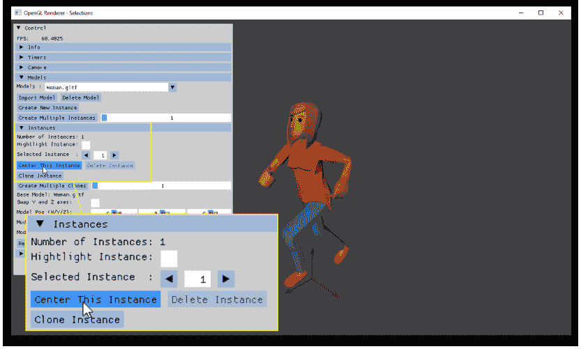
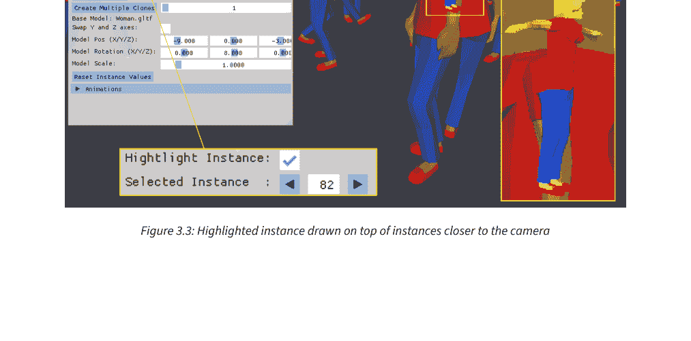
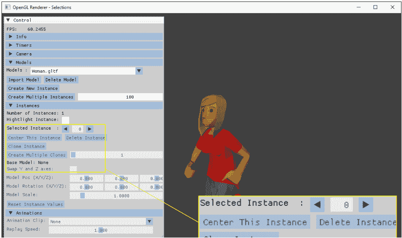

# 第3章 添加视觉选择

## Adding a Visual Selection

欢迎来到第 3 章！在上一章中，我们将大部分矩阵和向量计算卸载到 GPU。现代显卡拥有比桌面 CPU 更多、也更专业的计算核心，因此将计算负载转移到 GPU 将使主 CPU 从大部分动画工作中解脱出来。

在本章中，我们将在处理大量模型实例时增加一些简化。在上一章的更改之后，我们能够在屏幕上显示数千个模型实例，但选择特定实例仍然很困难。我们将首先添加坐标箭头以标识当前选中的实例。接下来，我们将添加一个函数，允许我们将指定的实例居中到屏幕中间。然后，将创建图形高亮，进一步帮助我们在所有实例中找到选中的实例。作为最后一步，我们将添加一个没有三角形的模型，以及该空模型的实例，允许我们取消选择可见的实例。

在本章中，我们将涵盖以下主题：

- 实现“移动到实例”功能
- 为选中的实例添加高亮
- 通过点选选择模型实例
- 实现空对象以允许取消选择

乍一看，这些主题可能与动画编程无关。但适当的工具是创建用户友好应用程序的重要组成部分。好的工具将帮助用户简化应用程序处理。

在本书后面的部分，当你创建了数十甚至数百个实例，它们在屏幕上快乐地随机跳跃和奔跑时，通过简单地用鼠标点击来选择一个实例，使用 UI 按钮将实例居中到屏幕上，或使用鼠标移动和旋转实例，将使你的生活变得轻松很多。你甚至可能会忘记在选择实例或更改实例属性时，前两章有多麻烦。

## Technical requirements

我们需要第 2 章的应用程序代码：https://github.com/PacktPublishing/Mastering-Cpp-Game-Animation-Programming。

本章的示例源代码可以在文件夹 chapter03 中找到，OpenGL 的子文件夹为 01_opengl_selection，Vulkan 的子文件夹为 02_vulkan_selection。

## Implementing a “move to instance” function

作为“移动到实例”功能的第一个更改，我们将在绘制模型的原点处添加一组小的坐标箭头，以标识当前选中的实例。我们还将添加一个按钮来居中当前选中的实例。让我们从坐标箭头的实现开始。

## Adding coordinate arrows

由于我们将使用线条而不是三角形在选中实例的中心绘制坐标箭头，因此需要一些额外的数据结构、对象和着色器。为了存储顶点和颜色数据，我们在 opengl 文件夹中文件 OGLRenderData.h 的声明中添加了两个新结构体：

```
struct OGLLineVertex {
	glm::vec3 position = glm::vec3(0.0f);
	glm::vec3 color = glm::vec3(0.0f);
};

struct OGLLineMesh {
	std::vector<OGLLineVertex> vertices{};
};
```

对于 Vulkan，新的结构体命名为 VkLineVertex 和 VkLineMesh，位于 vulkan 文件夹中的文件 VkRenderData.h 中。

```
glm::vec3(0.8f, 0.0f, 0.0f);
mVertexData.vertices[1].color = glm::vec3(0.8f, 0.0f, 0.0f);
mVertexData.vertices[2].color = glm::vec3(0.8f, 0.0f, 0.0f);
...
```

坐标箭头顶点的最终位置在 render 的 draw() 调用中设置。作为第一步，线条计数器将被清零，并且用于坐标箭头顶点的 mLineMesh 向量将被清空：

```
mCoordArrowsLineIndexCount = 0;
mLineMesh->vertices.clear();
```

接下来，我们检索当前选中实例的设置，包含实例的位置和旋转：

```
InstanceSettings instSettings = 
mModelInstData.miAssimpInstances.at(
mModelInstData.miSelectedInstance)
->getInstanceSettings();
```

然后，我们将顶点数量添加到线条计数器变量 mCoordArrowsLineIndexCount，并遍历 std::for_each 中的每个顶点：

```
mCoordArrowsLineIndexCount += 
mCoordArrowsMesh.vertices.size();
std::for_each(mCoordArrowsMesh.vertices.begin(),
mCoordArrowsMesh.vertices.end(),
[]{ (auto &n){
n.color /= 2.0f;
n.position =
glm::quat(glm::radians(
instSettings.isWorldRotation())) * n.position;
n.position += instSettings.isWorldPosition;
}});
```

通过使用 lambda 函数，顶点的位移数据被修改以匹配实例的位置和旋转。此外，我们通过将颜色向量除以 2 的值来降低坐标箭头的颜色亮度。

# 第3章 创建用于居中选中实例的按钮

生成的逐顶点数据被收集到 mLineMesh 向量中：

```
mLineMesh->vertices.insert(mLineMesh->vertices.end(),
mCoordArrowsMesh.vertices.begin(),
mCoordArrowsMesh.vertices.end());
```

然后，我们将顶点数据上传到 GPU，并绘制坐标线：

```
mLineVertexBuffer.uploadData(*mLineMesh);
if (mCoordArrowsLineIndexCount > 0) {
	mLineShader.use();
	mLineVertexBuffer.bindAndDraw(GL_LINES, 0,
		mCoordArrowsLineIndexCount);
}
```

这里，mCoordArrowsLineIndexCount 用于检查是否存在坐标线，以及作为参数绘制线条的正确点数。使用线条计数作为检查值和计数器有助于我们在完全不想绘制任何坐标线时。只需跳过填充 mLineMesh 和计数坐标线，即可自动跳过线条绘制。或者，我们可以在多选场景中绘制多个坐标箭头。

与 OpenGL 相比，在 Vulkan 中上传顶点数据要复杂得多，这是由于 Vulkan API 的显式特性。创建不同着色器并上传顶点数据的完整过程在 Vulkan 中需要以下步骤：

1. 在 GLSL 或 HLSL（DirectX 的高级着色器语言）中创建一对 passthrough 着色器。对于 GLSL 着色器，语法只有很小的差异——主要是在使用 layout 语句时更明确。
2. 使用新的着色器和相应的属性定义创建一个新的管线。Vulkan 需要新的管线，因为管线本身在创建后将变为不可变（除了少数几个显式可动态配置的子对象，如视口）。Vulkan 着色器不能像 OpenGL 那样在运行时交换；我们需要绑定另一个管线来使用不同着色器绘制顶点。
3. 通过使用暂存缓冲区将顶点数据上传到 GPU。为了在 Vulkan 中获得最佳性能，顶点数据应以优化的格式存储在仅 GPU 可访问的内存区域中。使用 CPU 和 GPU 共享的缓冲区需要驱动程序进行额外的同步，并且数据可能不是 GPU 绘制的最佳格式，从而导致性能损失。


## 创建一个用于居中选中实例的按钮

对于用户界面中的新按钮，我们将遵循之前的实现，为 UserInterface 类添加一个回调函数。该回调函数会调用渲染器类中的方法，从而将相机计算从用户界面移到渲染器中。

在 UserInterface 类中，我们添加一个新的 ImGui 按钮，以及新的回调函数，并使用当前实例作为参数：

```
if (ImGui::Button("Center This Instance")) {
    std::shared_ptr<AssimpInstance> currentInstance =
        modInstData.miAssimpInstances.at(
            modInstData.miSelectedInstance);
    modInstData.miInstanceCenterCallbackFunction(
        currentInstance);
}
```

当渲染器被初始化时，回调函数 miInstanceCenterCallbackFunction 将通过 lambda 函数绑定到渲染器新的 centerInstance() 方法上：

```
mModelInstData.miInstanceCenterCallbackFunction =
    [this](std::shared_ptr<AssimpInstance> instance)
    { centerInstance(instance); };
```

centerInstance() 方法提取实例的位置，在所有轴上加一个 5 个单位的静态偏移量，并调用相机对象的 moveCameraTo() 方法：

```
void OGLRenderer::centerInstance(
    std::shared_ptr<AssimpInstance> instance) {
    InstanceSettings instSettings =
        instance->getInstanceSettings();
    mCamera.moveCameraTo(mRenderData,
        instSettings.isWorldPosition + glm::vec3(5.0f));
}
```

最后，moveCameraTo() 将相机移动到实例位置加上渲染器中给定的偏移量处，并使用固定的方位角和仰角将选中实例居中显示在屏幕中央：

```
void Camera::moveCameraTo(OGLRenderData& renderData,
    glm::vec3 position) {
    renderData.rdCameraWorldPosition = position;
    renderData.rdViewAzimuth = 310.0f;
    renderData.rdViewElevation = -15.0f;
}
```

对方位角和仰角使用硬编码值会使这一过程更简单一些，因为从像 glm::lookAt() 这种方法生成的矩阵中提取这两个值有点复杂。你也可以尝试自行从变换矩阵中设置相机角度——参见“实践环节”一节。

你可以将新的 ImGui 居中按钮放在实例折叠标题栏中的任何位置。在示例代码中，该按钮被放置在用于选择当前实例的箭头的正下方，如图 3.2 所示：



将当前选中的实例居中，是使应用程序具有更好观感的重要一步。我们不再需要搜索闪烁的实例或坐标箭头来找到所选实例；现在，距离该实例真的只需一次鼠标点击。

不过，这个方案也有一些缺点。如果我们不想居中选中实例，也许是因为我们希望保持相机位置固定，该怎么办？因此，让我们向代码中添加另一个功能，使当前选中的实例在屏幕上显示的所有实例中更容易被找到。

## 为选中实例添加高亮

乍一看，通过向顶点和顶点缓冲区添加更多字段来添加某种高亮似乎很容易。遗憾的是，出于性能原因，我们使用了实例化渲染。这意味着所有实例共享相同的顶点数据。所以，这种方法行不通。

下一个想法可能是实例放置和动画数据。这些矩阵完全由第 2 章中的计算着色器根据节点的节点变换数据计算而来。将模型相关数据添加到每个节点似乎有点大材小用，因为高亮数据每个实例只需要一次，而不是每个节点一次。

更好的想法是使用另一个 SSBO，在渲染器的 draw() 调用中，从实例检索到节点变换数据之后，立即用正确数据填充它。在实例循环中，我们可以直接访问模型的所有实例，并且可以简单地向 std::vector 中推入一个值，以标明该实例是否被选中。将向量数据上传到 SSBO 后，着色器实例可以检查缓冲区数据，以确定是否应该为其正在处理的实例添加高亮。

### 准备渲染器以支持高亮

作为为选中实例添加高亮的第一步，我们向渲染器头文件中添加一个包含 float 的向量，并为 OpenGL 渲染器添加一个 SSBO：

```
std::vector<float> mSelectedInstance{};
ShaderStorageBuffer mSelectedInstanceBuffer{};
```

由于不同的数据逻辑，对于 Vulkan，将改用文件 VkRenderData.h 中 VkRenderData 结构体里的 VkShaderStorageBufferData 对象。

在渲染器的 draw() 调用中，我们在开始遍历模型和实例之前，保存当前选中实例的智能指针：

```
std::shared_ptr<AssimpInstance> currentSelectedInstance =
    nullptr;

...

currentSelectedInstance =
    mModelInstData.miAssimpInstances.at(
        mModelInstData.miSelectedInstance);
```

除了存储实例之外，我们还通过添加缩放的 deltaTime 来改变 OGLRenderData 或相应的 VkRenderData 结构体中的 float 值，并在该值达到 2.0f 时重置它：

```
mRenderData.rdSelectedInstanceHighlightValue +=
    deltaTime * 4.0f;
if (mRenderData.rdSelectedInstanceHighlightValue > 2.0f) {
    mRenderData.rdSelectedInstanceHighlightValue = 0.1f;
}
```

变量 rdSelectedInstanceHighlightValue 的值将在着色器中用于调节所选实例颜色的亮暗。通过在每次 draw() 调用中添加 deltaTime 值，并在达到 2.0f 时将高亮变量重置为 0.1f，所选实例将从暗到亮闪烁。与仅使用坐标箭头相比，闪烁的实例在屏幕上更容易被找到。

在实例循环中，我们将正在处理的实例的智能指针与保存的选中实例的智能指针进行比较。如果它们相同，变量 rdSelectedInstanceHighlightValue 的变化值将被设置到 mSelectedInstance 向量中当前实例的索引位置：

```
if (currentSelectedInstance ==
    modelType.second.at(i)) {
    mSelectedInstance.at(i) =
        mRenderData.rdSelectedInstanceHighlightValue;
} else {
    mSelectedInstance.at(i) = 1.0f;
}
```

如果我们在循环中处理任何其他实例，只需将该值设置为 1.0f，从而保持着色器中该实例的颜色不变。

然后，mSelectedInstance 向量中收集的数据会被上传到 SSBO。例如，OpenGL 渲染器使用 ShaderStorageBuffer 类的 uploadSsboData() 方法将向量数据上传到 GPU：

```
mSelectedInstanceBuffer.uploadSsboData(
    mSelectedInstance, 3);
```

### 调整着色器和用户界面的逻辑

作为为选中实例添加高亮的下一步，必须调整着色器。在 shader 文件夹中的 assimp_skinning.vert 顶点着色器中，必须添加新的 SSBO：

```
layout (std430, binding = 3) readonly restrict
buffer InstanceSelected {
    float selected[];
};
```

对于非动画模型实例，还需要在 shader 文件夹中的 assimp.vert 着色器中进行相同的添加。

请注意绑定编号——由于缺少动画数据，动画实例和非动画实例的着色器之间 SSBO 的数量不同：动画模型的着色器将实例选择数据绑定在绑定点 3 上，因为绑定点 2 已被世界位置矩阵占用：

```
mShaderBoneMatrixBuffer.bind();
mShaderModelRootMatrixBuffer.uploadSsboData(
    mWorldPosMatrices, 2);
mSelectedInstanceBuffer.uploadSsboData(
    mSelectedInstance, 3);
```

相比之下，非动画模型的着色器只绑定两个缓冲区：

```
mShaderModelRootMatrixBuffer.uploadSsboData(
    mWorldPosMatrices, 1);
mSelectedInstanceBuffer.uploadSsboData(
    mSelectedInstance, 2);
```

为了调整选中实例的颜色，我们现在可以使用着色器的内部变量 gl_InstanceID，从 selected 缓冲区中获取该实例位置的数据值：

```
color = aColor * selected[gl_InstanceID];
```

作为可选更改，我们还可以将选中实例的深度值减去 1.0f：

```
if (selected[gl_InstanceID] != 1.0f) {
    gl_Position.z -= 1.0f;
}
```


## 添加视觉选择

降低内部变量 gl_Position 的 z 元素会将三角形的深度值调整为最低可能值。这种深度调整使得高亮的实例即使在其他实例更靠近摄像机位置时仍然可见。

最后，我们在 OGLRenderData 相应的 VkRenderData 结构体中添加一个名为 rdHighlightSelectedInstance 的布尔变量，以便我们可以打开或关闭高亮。此新变量将附加到用户界面类中的 ImGui 复选框：

```
ImGui::Text("Highlight Instance:");
ImGui::SameLine();
ImGui::Checkbox("##HighlightInstance", &renderData.rdHighlightSelectedInstance);
```

在图 3.3 中，顶点着色器中组合高亮和 z 位置调整的效果如下所示：



根据较亮实例的相对大小，该实例至少会被部分隐藏在更靠近摄像机的其他实例后面。然而，z 位置的调整会将选定的实例绘制在屏幕上所有实例的最上方。

图片中无法展示的是所选实例的交替亮度。如渲染器的 draw() 调用中所设置，所选实例的颜色会从原始颜色的仅 10%（起始值为 0.1f）上升到原始颜色的 200%（在 2.0f 处钳位）。

实例的闪烁颜色将使在屏幕上找到当前选定的实例变得相当容易。但应用程序中仍缺少一个部分：能够通过点击窗口中的位置来选择所需实例，而不是通过实例编号箭头在所有实例中搜索。让我们现在来处理视觉选择。

## 使用点按选择模型实例

在开始实现之前，我们将查看向应用程序添加视觉选择的两种不同方法：通过“射击”光线进入虚拟场景，以及使用保存实例索引的纹理。

### 射击虚拟光线的利弊

你可能会觉得向场景中射击虚拟光线的想法很有吸引力：

我们已经拥有虚拟世界中摄像机的位置作为第一个端点，并且通过将鼠标指针位置从屏幕位置映射回场景坐标，你将得到第二个端点。将坐标映射回场景只需要进行几次矩阵求逆和乘法运算。

听起来很有希望且容易，不是吗？

遗憾的是，在这一点上，低估最终的复杂性是很常见的。只要你世界中只有一个模型，或两个，一切都很好。你将虚拟光线射入场景，并遍历每个实例的三角形以找到光线与实例三角形之间最近的交点。

但如果有 1,000 个实例会怎样？

每次你在鼠标上点击选择按钮时，你都必须遍历所有实例的所有三角形，希望能找到至少一个匹配。本书的测试模型大约有 2,000 个三角形，因此在有 1,000 个实例的虚拟世界中，你必须检查 2,000,000 个可能的交点。即使使用大规模并行的计算机着色器，这种计算量对现代显卡来说也是大量的工作。

有几种方法可以从命中测试中排除虚拟世界的较大区域。结合节点级别的其他分层方法，交点检查的数量可以降低几个数量级。我们将在第 8 章处理实例碰撞时介绍查找交点的过程优化。

那替代方案——使用纹理呢？

### 将实例索引绘制到纹理中的优势

用于实例选择的额外纹理的基本思想来自 **延迟渲染**。在延迟渲染中，像光照这样的计算不是在片段着色器中完成，而是“延迟”在将所需信息存储到纹理之后完成。包含屏幕上像素的所有信息的纹理集合称为 **G-Buffer**，即 **几何缓冲区** 的简称。

通过使用 G-Buffer 中纹理的数据，将光照应用于场景的复杂性从整个场景中 三角形数量 * 光源数量 降低到 G-Buffer 的像素数量 * 附近光源数量。

即使对于 4K 或 8K 图形分辨率，创建光照信息的运算次数也会大幅降低。而且，通过使用渲染过程中的其他信息，使用延迟渲染可以轻松实现其他效果，如阴影映射或间接光照。

对于 naive 的光线射击，选择复杂性会随着虚拟世界中实例数量的增加而增长，即使这些实例在屏幕上不可见。当我们将延迟渲染方法应用于视觉选择时，我们只需将一些像素绘制到单独的纹理中即可产生恒定的开销。我们的选择过程不再依赖于世界中可变的实例数量。此外，缓冲区的分辨率可能只会轻微影响实例选择的性能。

添加使用单独纹理的视觉选择所需的更改量出人意料地低。让我们看看我们需要采取的步骤。

### 调整帧缓冲

我们从 FrameBuffer 类开始并添加一个新的颜色附件。对于 OpenGL 版本，新颜色附件的创建如下。

```
glGenTextures(1, &mSelectionTex);
glBindTexture(GL_TEXTURE_2D, mSelectionTex);
glTexImage2D(GL_TEXTURE_2D, 0, GL_R32F, width, height,
    0, GL_RED, GL_FLOAT, NULL);
glBindTexture(GL_TEXTURE_2D, 0);
glFramebufferTexture(GL_FRAMEBUFFER,
    GL_COLOR_ATTACHMENT1, mSelectionTex, 0);
```

对于选择纹理，我们添加一个仅包含单个元素的纹理，即红色颜色。但我们使用 32 位宽的红色颜色，而不仅仅是 8 位，从而允许我们存储更多实例索引。新纹理然后作为索引为 1 的颜色附件添加到帧缓冲中。

### 关于纹理数据类型的说明（float）

可以创建一个类型为 GL_R32UI 的纹理，其中每个像素包含一个 32 位宽的无符号整数。但所有整数版本的纹理都使用组件的转换因子，从而由于读写时的额外计算而增加选择过程的复杂性。相比之下，GL_R32F 缓冲区存储和检索未更改的浮点值。通过在 GPU 端使用浮点，我们仍然能够存储约 1670 万个实例索引（2^24），在此之前，32 位浮点的精度可能会在整数和浮点值之间转换时导致舍入错误。有关浮点精度的更多细节，请参阅“附加资源”部分中指向博客文章的链接。

此外，在帧缓冲创建期间，我们必须确保我们的着色器写入两个颜色附件：

```
const GLenum buffers[] = { GL_COLOR_ATTACHMENT0,
    GL_COLOR_ATTACHMENT1 };
glDrawBuffers(2, buffers);
```

如果我们不更改要绘制的缓冲区，只有模型会被绘制到屏幕上，选择纹理永远不会被填充。

为了用不同的值清除颜色缓冲区和选择缓冲区，已在 FrameBuffer 类中添加了一个名为 clearTextures() 的新方法：

```
void Framebuffer::clearTextures() {
    static GLfloat colorClear[] =
        { 0.25f, 0.25f, 0.25f, 1.0f };
    glClearBufferfv(GL_COLOR, 0, colorClear);
    static GLfloat selectionClearColor = -1.0f;
    glClearBufferfv(GL_COLOR, 1, &selectionClearColor);
```

```
layout (location = 2) out vec2 texCoord;

layout (location = 3) out float selectInfo;
```

main() 方法末尾的第二行执行对片段着色器的实际转发：

```
selectInfo = selected[gl_InstanceID].y;
}
```

对于两个新的片段着色器，需要类似的更改。在着色器代码顶部，我们必须添加新的输入变量 selectInfo：

```
layout (location = 2) in vec2 texCoord;
layout (location = 3) flat in float selectInfo;
```

此外，片段着色器输出必须进行调整。用以下两行替换单个 FragColor 输出行：

```
layout (location = 0) out vec4 FragColor;
layout (location = 1) out float SelectedInstance;
```

我们现在写入两个不同的输出，每个颜色缓冲区一个：帧缓冲的颜色缓冲区将像以前一样用每个像素的屏幕上颜色的 RGBA 值填充，而在 main() 方法末尾，从顶点着色器传递的实例索引将被写入第二个颜色缓冲区：

```
SelectedInstance = selectInfo;
```

如果我们现在在绘制实例时使用新的选择着色器，实例的索引将被添加到选择缓冲区中屏幕上实例的每个像素。

### 从纹理中读取一个像素

在给定位置读取像素的颜色将在 FrameBuffer 类的 readPixelFromPos() 方法中完成。

首先，我们用一个特殊值初始化指定的返回变量，使得当 OpenGL 由于配置问题拒绝读取像素颜色时，很容易找到错误：

```
float Framebuffer::readPixelFromPos(unsigned int xPos,
    unsigned int yPos) {
    float pixelColor = -444.0f;
```


接下来，我们将帧缓冲对象绑定为读取缓冲区，并选择帧缓冲的颜色附件 1，其中包含选择纹理：

```
glBindFramebuffer(GL_READ_FRAMEBUFFER, mBuffer);
glReadBuffer(GL_COLOR_ATTACHMENT1);
```

然后，我们调整读取过程中使用的内部对齐方式，并读取给定 xPos 和 yPos 位置处单个像素的颜色值：

```
glPixelStorei(GL_PACK_ALIGNMENT, 1);
glReadPixels(xPos, yPos, 1, 1, GL_RED, GL_FLOAT, &pixelColor);
```

最后，我们将帧缓冲切换回颜色附件 0，解绑缓冲区并返回像素颜色：

```
glReadBuffer(GL_COLOR_ATTACHMENT0);
glBindFramebuffer(GL_READ_FRAMEBUFFER, 0);
return pixelColor;
}
```

## 添加鼠标按钮处理

实例选择将添加到左鼠标按钮。点击实例进行选择感觉很自然。为了存储选择状态，在渲染器中添加了一个名为 `mMousePick` 的布尔成员变量。

然后，必须在渲染器的 `handleMouseButtonEvents()` 方法中添加以下行：

```
if (button == GLFW_MOUSE_BUTTON_LEFT &&
    action == GLFW_RELEASE) {
    mMousePick = true;
}
```

在此使用 `GLFW_RELEASE` 动作，在左鼠标按钮释放时做出反应，与许多应用程序的选择样式相匹配。如果您想更改行为，可以使用动作 `GLFW_PRESS`。

```
->setInstanceSettings(instSettings);
}
}
```

方法 `assignInstanceIndices()` 会在实例添加或移除时被调用。

在遍历模型的所有实例的循环中，手头有一个易于访问的实例编号，有助于填充 `mSelectedInstance` 向量的 y 元素：

```
if (mMousePick) {
    InstanceSettings instSettings =
        modelType.second.at(i)->getInstanceSettings();
    mSelectedInstance.at(i).y =
        static_cast<float>(
        instSettings.instanceIndexPosition);
}
```

## 在鼠标位置选择实例

作为视觉选择的最后一步，我们在渲染器的 `draw()` 调用结束时触发像素读取：

```
if (mMousePick) {
    glFlush();
    glFinish();
}
```

通过用对 `mMousePick` 变量的检查包围像素读取，我们确保读取像素的函数仅在选择事件时被调用。

这种保护检查对于对 `glFlush()` 和 `glFinish()` 的调用尤其重要。两个命令都是必需的，以确保所有着色器运行已结束，并且选择纹理中的数据已完整。虽然 `glFlush()` 会清空内部缓冲区并触发渲染本身，但 `glFinish()` 会阻塞渲染器并等待所有之前的 OpenGL 调用完成。在每一帧都强制执行这些 OpenGL 命令会降低大多数实现中的每秒帧数。

接下来，我们在 `FrameBuffer` 实例上调用 `readPixelFromPos()`：

```
float selectedInstanceId =
    mFramebuffer.readPixelFromPos(mMouseXPos,
    (mRenderData.rdHeight - mMouseYPos - 1));
```

但还有一件事可能会让您感到烦恼：完全无法选择任何实例。我们将在本章的最后一节中为其添加解决方案。

## 实现空对象以允许取消选择

通过在应用程序窗口的背景中单击来添加取消选择，会带来一系列有趣的影响。例如，位置 0 可能是 `miAssimpInstances` 向量中的有效索引，表示已选择第一个实例。因此，简单地使用零来表示未选择任何实例是行不通的。更糟糕的是：使用零作为第一个索引可能会让应用程序用户感到困惑，因为不打算从零开始计数数字，而应从一开始。

此外，默认缓冲区背景值 -1 是一个无效的数组索引。使用 -1 作为 `miAssimpInstances` 向量的索引将直接导致应用程序崩溃。由于我们将在代码中频繁使用实例向量，为每次访问添加范围检查至关重要，因为即使遗漏一次检查也会导致崩溃。

因此，我们需要另一种信号机制来在两种选择变体之间切换，并简化范围检查。为了用一个解决方案解决这两个问题，我们将使用一个空模型作为空对象。

### 什么是空对象？

使用空对象是面向对象编程中众所周知的设计模式。通常，您会使用 `nullptr` 来表示对象实例的缺失。但是，使用 `nullptr` 需要在每次使用实例之前创建额外的检查，以判断其是否有效。取消引用不存在的实例会导致运行时错误，应用程序崩溃。

空对象是一个有效对象实例，提供明确但中性的行为。空对象实例中的函数调用是有效的，但可能返回不可用的内容，例如空列表或某些默认值。这种行为使代码免于额外的检查，因为实例本身是有效的。

对于我们的选择问题，我们只需创建一个 `AssimpModel` 类的实例，该实例不返回任何顶点，并且节点、网格等的列表或向量为空。然后，我们将特殊模型作为第一个模型添加到 `miModelList` 向量中，并将一个“空模型”的实例作为第一个实例添加到 `miAssimpInstances` 向量和 `miAssimpInstancesPerModel` 映射中。

如果我们现在选择第一个模型实例，我们将拥有一个有效对象，只是没有绘制任何三角形。关闭坐标箭头或调整用户界面以在未选择实例时禁用控件可以无需额外的信号变量完成。我们只需测试 `miSelectedInstance` 是否为 0 即可。

我们将对原始模式进行一点修改，不使用派生类。相反，我们将提供 `AssimpModel` 类的空对象。

### 创建和使用 AssimpModel 空对象

由于我们已在头文件 `AssimpModel.h` 中使用默认值初始化了类成员变量，因此可以通过创建空实例来实现空对象的创建。而创建 `AssimpModel` 类实例而不设置任何数据的最简单方法是通过隐式创建的默认构造函数。我们甚至不需要定义自定义构造函数；C++ 编译器将在后台处理我们需要的一切。

```
std::shared_ptr<AssimpModel> nullModel =
std::make_shared<AssimpModel>();
mModelInstData.miModelList.emplace_back(nullModel);
```

然后，我们可以从空模型创建一个 `AssimpInstance` 实例，并将其放入 `miAssimpInstancesPerModel` 映射和 `miAssimpInstances` 向量中：

```
std::shared_ptr<AssimpInstance> nullInstance =
std::make_shared<AssimpInstance>(nullModel);
mModelInstData.miAssimpInstancesPerModel[nullModel->getModelFileName()].emplace_back(nullInstance);
mModelInstData.miAssimpInstances.emplace_back(nullInstance);
```

作为最后的初始化步骤，我们更新实例的索引号：

```
assignInstanceIndices();
```

现在，`nullModel` 模型的实例具有索引号 0。应用程序中添加的任何实例现在都将从索引 1 开始。实例总数与实例索引的匹配数字将避免对实例编号方案差异的混淆。

为了在渲染器的 `draw()` 调用中跳过顶点处理时的模型，已添加了对三角形计数的检查：

```
if (numberOfInstances > 0 &&
    modelType.second.at(0)->getModel()
    ->getTriangleCount() > 0) {
    ...
```

如果模型中没有三角形，则该特定模型的所有实例都将被跳过。

此外，在为坐标箭头生成最终顶点位置之前，我们检查实例编号是否为 0：

```
if (mModelInstData.miSelectedInstance > 0) {
    ....
```

每当选择第一个实例时——即空模型的实例——屏幕上将不会绘制坐标箭头。我们甚至可以在此处删除 `miAssimpInstances` 向量的 `size()` 检查，因为我们知道至少有一个有效实例可用。

### 调整用户界面

在用户界面中，我们将稍微作弊，以在选择空实例时保持实例选择字段处于禁用状态：

```
bool modelListEmpty =
    mModelInstData.miModelList.size() == 1;
bool nullInstanceSelected =
    mModelInstData.miSelectedInstance == 0;
size_t numberOfInstances =
    mModelInstData.miAssimpInstances.size() - 1;
```

通过从 `miModelList` 向量的大小中减去 1，我们忽略了该向量中的空模型。我们还忽略了空模型的空实例来计算 `numberOfInstances` 中的实例数。额外的布尔值 `nullInstanceSelected` 帮助我们在模型和实例可用但尚未选择任何实例时禁用用户界面的部分内容。


在图 3.5 中，使用空对象进行取消选择的效果如下所示：



图 3.5：未选择任何内容时用户界面部分被禁用

在模型实例的脚部没有绘制坐标箭头，因为我们在选择空实例时隐藏了箭头。此外，用户界面也被部分禁用，这是忽略空实例来计算实例数量时的效果。

## 摘要

在本章中，我们增强了代码中的实例选择方法，以便更好地处理在屏幕上查找所选实例。并且，我们添加了使用鼠标选择实例的能力。首先，我们实现了一个按钮，用于将虚拟摄像机居中到所选实例上。接下来，我们添加了高亮显示所选模型的能力，使其在屏幕上更容易被发现。然后，我们实现了视觉选择，允许用户通过用鼠标点击任何实例来选择实例。最后，我们创建了完全不选择任何实例的可能性，避免了意外更改。

在下一章中，我们将为将更多游戏引擎功能适配到模型查看器奠定一些基础。除了将查看器的行为拆分为编辑模式和纯查看器功能外，我们还将添加撤销对实例进行的正在进行更改的能力。在下一章结束时，我们将实现撤销/重做功能，允许用户撤销更改，或重新应用之前的更改。

## 实践环节

你可以对代码做一些补充：

- 计算移动摄像机时的方位角和仰角。
  
  目前，方位角和仰角的值是硬编码的。你可以尝试从变换矩阵中计算这两个值。
- 实现视觉多选。
  
  增强选择功能，使在选择点击时按住 Ctrl 或 Shift 会将新选择的实例添加到其他已选实例中，而不是替换当前所选实例。
- 额外难度：通过坐标箭头实现实例移动。
  
  由于选择的坐标箭头是在单独的着色器中绘制的，你可以尝试为箭头添加额外的一组选择索引并将箭头添加到选择纹理中。当用户点击箭头而不是模式时，你可以切换应用程序到一种模式，在该模式下实例可以沿所选轴移动。这种行为类似于在任何常见的 3D 编辑器中移动实例。

## 附加资源

- OpenGL 基础： https://learnopengl.com/Getting-started/Hello-Triangle
- OpenGL 着色器编程： https://learnopengl.com/Getting-started/Shaders
- Vulkan 教程： https://vulkan-tutorial.com
- 揭秘浮点精度： https://blog.demofox.org/2017/11/21/floating-point-precision/
- 空对象模式： https://www.geeksforgeeks.org/null-object-design-pattern/

## 在 Discord 上加入我们的社区

加入我们社区的 Discord 空间，与作者和其他读者进行讨论：
https://packt.link/cppgameanimation


