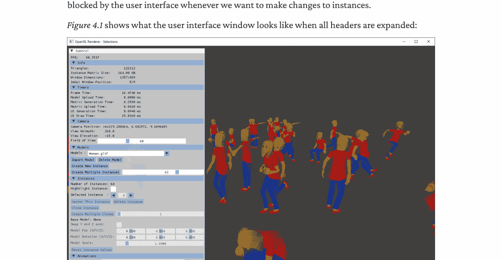
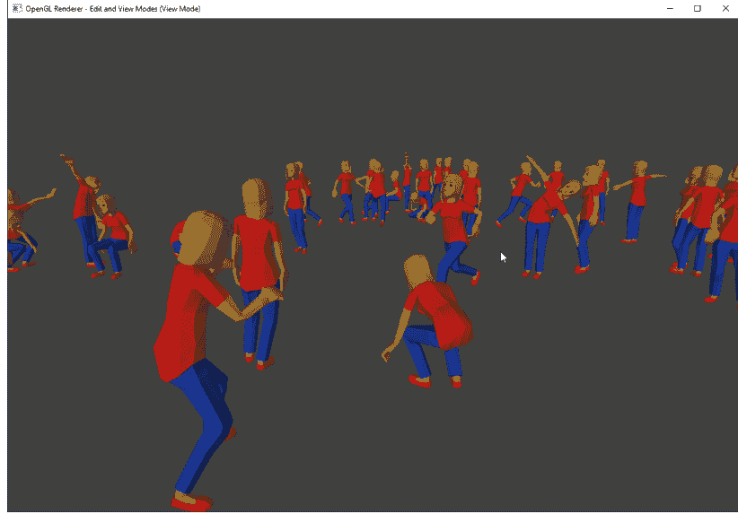
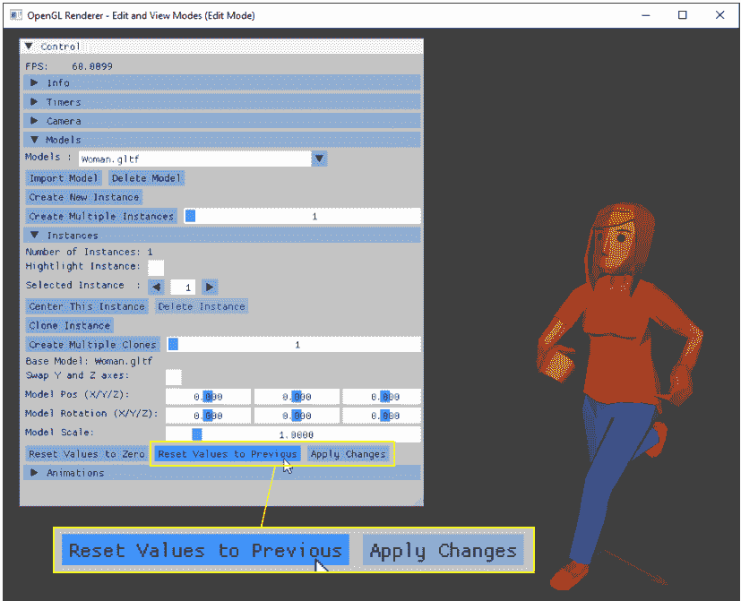
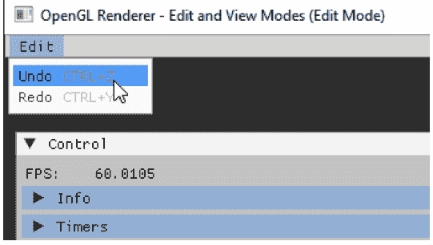

# 第4章 增强应用程序处理

## 增强应用程序处理

欢迎来到第 4 章！在上一章中，我们增加了在可能的大量模型和实例中更好地选择单个实例的能力。我们从简单的“移动到”功能开始，并将当前实例的高亮作为下一步添加。然后，我们通过使用鼠标实现了视觉选择。最后，我们创建了一个空对象以允许完全不选择任何实例。

在本章中，我们将重点关注编辑模式。首先，我们将通过创建单独的视图模式来添加关闭所有控件和菜单的能力。编辑模式和视图模式之间的分离将在后面的章节中帮助我们在配置实例设置时停止所有自动操作。接下来，我们将实现撤销功能的简化版本，允许我们在应用更改后重置模型实例的设置。作为最后一步，我们将实现实例级别的设置更改的撤销和重做。

在本章中，我们将涵盖以下主题：

- 在编辑模式和视图模式之间切换
- 在应用更改前撤销更改
- 实现撤销和重做功能

## 技术要求

本章的示例源代码位于 chapter04 文件夹中，OpenGL 的 01_opengl_edit_view_mode 子文件夹和 Vulkan 的 02_vulkan_edit_view_mode。

在第 3 章中使实例选择变得容易之后，更改实例的设置将是下一个需要解决的话题。目前，我们屏幕上有一个控制菜单，如果指针放置在 ImGui 窗口上，它会捕获鼠标输入。我们所做的任何更改都将在当前应用程序会话中永久保留。撤销任何意外的旋转或缩放以恢复到与之前完全相同的值可能非常困难，因为我们必须记住之前的值才能撤销更改。

我们现在将更改应用程序以切换到没有任何控件或选择的模式，并添加一个相当简单但有用的撤销和重做功能来回滚或向前推进对实例的更改。

## 在编辑模式和视图模式之间切换

如果我们启动当前版本的应用程序，我们会看到每当我们想要更改实例时，大部分屏幕都会被用户界面阻挡。

图 4.1 显示了当所有标题都展开时用户界面窗口的外观：



图 4.1：用户界面阻挡屏幕部分

随着本书后面添加更多选项，用户界面可能会占据更多可用窗口空间。此外，如果高亮处于活动状态，所选实例会闪烁，坐标箭头会放置在其下方。

为了改变整体外观，我们必须检查在单独的视图模式中应禁用哪些功能。

## 决定在视图模式中应切换的内容

本节的主要目标是移除 ImGui 控制窗口，以便将整个应用程序用于与模型实例交互。我们可以简单地关闭用户界面的渲染，但如果我们不显示用户界面窗口，就没有必要进行计时器和 FPS 更新等计算。因此，对于第一个决定，我们将在视图模式中跳过用户界面。

我们还必须添加一个快捷方式，以避免在用户界面不活动时将鼠标按钮事件转发给 ImGui。ImGui 保存所有控件元素的位置，如果我们在鼠标指针位于 ImGui 窗口上方时切换用户界面，我们仍会得到不想要的副作用，例如无法移动摄像机。

即使没有用户界面，与实例选择相关的所有部分仍然处于活动状态。这意味着我们不需要在视图模式中使用实例选择，因为在没有用户界面的情况下无法调整实例参数。我们在这里的第二个决定是关闭与实例选择相关的所有内容。我们将禁用鼠标拾取，包括选择着色器、坐标箭头和亮度计算。

我们还将调整窗口标题，反映应用程序当前的视图/编辑状态。从渲染器更改窗口属性需要一些回调“魔法”，但有助于立即了解应用程序处于何种模式。

视图和编辑模式的大部分切换实现很简单。我们只需要一个变量来保存当前状态，以及一些分支来为两种模式启用或禁用上述指定的操作。

## 添加状态变量和代码

作为第一个实现步骤，我们在 opengl1 文件夹中的 OGLRenderData.h 文件中创建一个名为 appMode 的新枚举类：

```
enum class appMode {
    edit = 0,
}
```


通过按下热键即可在编辑模式和视图模式之间切换。我们不能在此处使用ImGui按钮，因为一旦完全禁用用户界面，我们就需要这个按钮来切换回编辑模式。

## 在两种模式之间切换并更改标题

对于模式切换，在渲染器的`handleKeyEvents()`方法中对F10键进行简单检查：

```
if (glfwGetKey(mRenderData.rdWindow, GLFW_KEY_F10) ==
    GLFW_PRESS) {
    mRenderData.rdApplicationMode =
        mRenderData.rdApplicationMode == appMode::edit ?
        appMode::view : appMode::edit;
    setModeInWindowTitle();
}
```

任何其他未使用的键都可以通过将相应的GLFW键名作为第二个参数放入`glfwGetKey()`调用来实现。

需要进一步解释`setModeInWindowTitle()`的调用，因为我们使用回调函数来更改应用程序窗口的标题字符串。函数调用本身简短而简单：

```
void OGLRenderer::setModeInWindowTitle() {
    if (mRenderData.rdApplicationMode == appMode::edit) {
        setWindowTitle(mOrigWindowTitle + " (Edit Mode)");
    } else {
        setWindowTitle(mOrigWindowTitle + " (View Mode)");
    }
}
```

我们在渲染器的`init()`方法中保存原始窗口标题，并将默认模式（编辑模式）附加到窗口标题：

```
mOrigWindowTitle = getWindowTitle();
setModeInWindowTitle();
```

由于Window类初始化渲染器类，我们必须将窗口标题更改请求从渲染器传回应用程序窗口。

首先，在渲染器头文件中创建两个`std::function`别名：OpenGL的`OGLRenderer.h`和Vulkan的`VkRenderer.h`：

```
using GetWindowTitleCallback =
    std::function<std::string(void)>;
using SetWindowTitleCallback =
    std::function<void(std::string)>;
```

我们还在渲染器的声明中添加两个公有方法：

```
SetWindowTitleCallback setWindowTitle;
GetWindowTitleCallback getWindowTitle;
```

使用这些别名可以更轻松地处理对`std::function`的调用。

接下来，我们在window文件夹中的Window类头文件`window.h`中创建两个与回调签名匹配的方法：

```
std::string getWindowTitle();
void setWindowTitle(std::string newTitle);
```

此外，添加一个名为`mWindowTitle`的私有成员变量，用于存储窗口的当前标题：

```
std::string mWindowTitle;
```

将窗口标题存储在变量中可能便于调试日志打印。

然后，在Window类的`init()`方法中初始化渲染器之后，使用两个lambda函数将Window类的函数调用转发给渲染器：

```
mRenderer->getWindowTitle = [this]()
{ return getWindowTitle(); };
mRenderer->setWindowTitle = [this](std::string
windowTitle) { setWindowTitle(windowTitle); };
```

现在，当我们按下F10时，渲染器会将模式字符串附加到原始窗口标题，并通过回调将生成的字符串转发给Window类。这样，当前应用程序模式就会显示在应用程序窗口的标题文本中。

在图4.2中，用户界面和选择已被禁用。检查窗口标题以查看当前模式：



图4.2：视图模式下没有用户界面

在视图模式下，没有用户界面窗口，整个应用程序窗口可用于在虚拟世界中飞行漫游。按下F10，我们可以返回编辑模式以调整模型实例的参数。

## 未来变更展望

对于我们在本书后续添加的每个新功能，我们必须决定如何在编辑模式和视图模式下处理该功能。有些新功能仅在编辑模式下可行，例如在第6章中添加和配置不同的摄像机。另一方面，使用摄像机最好在视图模式下进行，因为我们只会在漫游所创建的虚拟世界时需要在不同摄像机之间切换。每次我们都必须考虑新功能的用法。

添加了单独的视图模式后，让我们回到基本的应用程序处理。每当我们选择一个实例并更改其中一个设置时，我们都会受困于新值，而没有合适的方法将实例状态重置为“上次已知的良好设置”。在下一节中，我们将添加一个基本机制，至少可以撤销对模型实例的最后一次更改。

## 在应用之前还原更改

当前模型查看器应用程序的主要目的是查看模型实例。但是，除了纯粹的模型查看之外，调整实例属性和设置将在本书中成为应用程序中越占越重的一部分。而更改设置可能以多种方式出错。预览更改的解决方案听起来像是一个值得添加的好功能。

### 基本思路

一个简单的回滚方法将允许我们接受对实例设置的更改，或将相同的设置还原为先前的值。我们可以试验这些值，尝试将实例移动到正确的位置，或调整其他参数以满足需求。当我们对结果满意时，按下Apply按钮，实例设置就会被永久保存。相同的工作流程可用于下一个实例，依此类推，直到我们以预想的方式放置好所有实例。

### 添加代码和用户界面元素

首先，我们在UserInterface类的`UserInterface.h`头文件中添加两个新的私有成员：

```
std::shared_ptr<AssimpInstance> mCurrentInstance;
InstanceSettings mSavedInstanceSettings{};
```

在`mCurrentInstance`智能指针中，我们存储当前选中的实例，而在`mSavedInstanceSettings`变量中，我们将保存当前选中实例的原始设置。

由于我们在用户界面中多次检索当前实例，我们可以简单地在CollapsingHeader块内的所有其他位置删除`currentInstance`声明。

读取当前选中实例的设置保持不变：

```
if (numberOfInstances > 0) {
    settings = modInstData.miAssimpInstances.at(
        modInstData.miSelectedInstance)
        ->getInstanceSettings();
```

但是，此外，我们还要检查当前选中的实例是否与新的`mCurrentInstance`指针不同：

```
if (mCurrentInstance !=
    modInstData.miAssimpInstances.at(
    modInstData.miSelectedInstance)) {
    mSavedInstanceSettings = settings;
    mCurrentInstance =
    modInstData.miAssimpInstances.at(
    modInstData.miSelectedInstance);
}
}
```

每当当前实例更改时，我们都会将新选中的实例存储在`mCurrentInstance`指针中，并且还会将刚检索到的实例设置保存在`mSavedInstanceSettings`变量中。

`mSavedInstanceSettings`变量现在使我们能够还原实例的设置，撤销任何更改。为了切换设置还原，我们在现有的Reset Values to Zero按钮下方添加一个名为Reset Values to Previous的新按钮：

```
ImGui::SameLine();
if (ImGui::Button("Reset Values to Previous")) {
    settings = mSavedInstanceSettings;
}
```

要撤销任何更改，我们将已保存的实例设置复制回当前设置变量。在CollapsingHeader的Instances部分末尾，`settings`中的值将保存到当前选中的实例。就这样，我们已经将设置还原到选择实例时的状态。

应用更改则反过来执行复制操作：

```
ImGui::SameLine();
if (ImGui::Button("Apply Changes")) {
    mSavedInstanceSettings = settings;
}
```

这里，已保存的设置会被实例的当前设置覆盖，从而使当前设置成为撤销操作的新默认值。

图4.3显示了两个新按钮的位置：



图4.3：分别用于还原实例设置和永久应用的按钮

通过使用Apply Changes按钮，对模型实例的当前更改将被永久保存。而使用Reset Values to Previous按钮，我们可以将实例的任何更改还原到之前按下Apply Changes时的状态。

### 当前解决方案的缺点

使用两个按钮来应用或还原每个实例设置更改既耗时又麻烦。一个自动且更频繁地应用更改的版本，在编辑实例属性时将会带来更好的工作流程。本节中的总体思路将保留；我们只是添加一些更自动化的行为。

让我们创建一个实际可行的撤销和重做解决方案。


## 实现撤销和重做功能

几乎每个应用程序都有某种撤销一个或多个操作的方式，而且许多应用程序还允许重做已撤销的步骤。事故可能以两种方式发生；撤销一次不想要的撤销操作可以为用户节省大量时间和压力。

## 我们需要创建撤销和重做功能吗？

要能够撤销一个改变对象属性的简单操作，我们需要保存之前的值。然后可以通过将“旧”值应用到同一个对象来撤销该更改，并恢复该对象在更改之前的状态。

对于更复杂的撤销操作，还需要存储操作类型。如果我们删除了某物，撤销步骤必须使用相同的属性重新创建对象，反之亦然——撤销创建新对象将删除该对象。

还可以考虑其他选项。我们是想存储绝对的先前值还是仅存储与新值的差异？通过存储相对值，重做在撤销操作之后发生的更改可以使用调整后的值作为基础，而绝对值将覆盖中间的调整。我们是存储该对象的完整设置，还是仅存储已更改的参数？其含义与之前的绝对值和相对值类似。

从技术角度来看，我们的实现将使用两个栈：一个用于可能的撤销操作，另一个用于可能的重做操作。每次配置更改都会将新设置和旧设置推入撤销栈，从而可以通过应用旧设置来逆转更改。

在完成撤销操作后，完全相同的设置组合将从撤销栈中取出并推入重做栈。如果我们现在重做相同的操作，将应用新设置，并且设置将被移回撤销栈。

这种简单的流程将允许我们拥有几乎无限的撤销和重做大小，主要受限于计算机的内存量。而且，由于设置很小，用两个栈填满计算机内存需要很长时间。

作为迈向撤销和重做的第一步，我们将创建一个存储容器类，该类封装了我们需要的所有信息，以便在任一方向上恢复设置。

## 创建设置存储类

新类名为 AssimpSettingsContainer，其头文件和实现文件位于 model 文件夹中。在头文件中，声明了一个结构体来存储我们对撤销和重做所需的全部设置：

```
struct AssimpInstanceSettings {
    std::weak_ptr<AssimpInstance> aisInstance;
    InstanceSettings aisInstanceSettings{};
    InstanceSettings aisSavedInstanceSettings{};
};
```

AssimpInstanceSettings 结构体保存实例的先前设置和当前设置，以及指向该实例的弱指针。在这里使用 std::weak_ptr 而不是 std::shared_ptr 有两个重要原因：

- 弱指针打破了包含实例 std::shared_ptr 的 miAssimpInstances 向量与为撤销/重做存储的设置之间的依赖关系，因为弱指针不会增加实例智能指针的引用计数。如果我们在存储撤销/重做信息时使用另一个共享指针，已删除实例的内存可能无法释放，因为在撤销或重做栈中的某个位置可能仍存在对该实例的另一个活动引用。
- 当请求弱指针通过使用 lock() 调用返回共享指针时，我们可以轻松找到已删除的实例并删除已保存的设置。lock() 调用在共享指针不再可用时返回一个 nullptr，我们只需在相应的栈上使用 pop() 调用即可删除已死的设置。

如果我们想保存实例的设置，我们调用 AssimpSettingsContainer 类的 apply() 方法。apply() 方法创建一个新的 AssimpInstanceSettings 对象并将设置推入撤销栈。

我们还会在通过 apply() 保存新设置时清空重做栈。在我们撤销了几次更改并应用了最近的更改之后，使用重做操作可能毫无用处，因为重做操作可能会与最新更改产生冲突，甚至覆盖最新的更改。删除重做栈中的所有设置是一种快速且安全的方式，可以避免在应用最新更改后出现副作用。

undo() 和 redo() 方法的实现简短而简单：

- 1. 通过从弱指针请求共享指针来检查是否有任何已删除的实例，并在实例指针无效时删除设置结构体。检查将在 while() 循环中进行，以找到所有已删除的实例。
- 2. 如果栈为空（即因为所有保存了撤销或重做设置的实例都不复存在），我们立即从操作中返回。
- 3. 从栈中获取顶部条目，并在撤销操作的情况下将保存的设置应用到实例，或在重做操作的情况下应用新设置。
- 4. 将栈的顶部条目推到相反的栈并删除顶部条目。

现在，所有相关的实例更改都可以保存到撤销栈中。如果我们选择撤销对实例的更改，我们也可以立即重做完全相同的更改。在后台，包含旧设置和新设置以及实例指针的结构体在撤销和重做操作中只是在两个栈之间移动。

将新操作添加到渲染器需要一些额外的工作。

## 将存储类连接到渲染器

渲染器将通过两个用于撤销/重做相关代码的新方法进行扩展，称为 undoLastOperation() 和 redoLastOperation()。

在每个方法开始时，我们在设置容器上调用相应的操作：

```
mModelInstData.miSettingsContainer->undo();
assignInstanceIndices();
```

此外，还会发出对 assignInstanceIndices() 的调用。在撤销和重做操作后枚举所有实例至关重要。从栈中取出的设置在其他实例被删除后可能在 isInstanceIndexPosition 变量中包含无效的实例索引，导致访问 miAssimpInstance 向量之外的位置。

枚举的一个副作用是 miAssimpInstances 向量的位置发生变化。因此，我们不能仅采用新的 isInstanceIndexPosition 来选择被撤销或重做操作更改的实例。相反，我们从 AssimpInstanceSettings 中检索已更改实例的实例指针，并使用 std::find_if 在 miAssimpInstance 向量中搜索匹配的指针。如果我们找不到正确的实例，将选择空实例，导致没有实例被选中。

## 为撤销和重做定义热键

为了使用键盘上已知的键组合使用撤销和重做功能，我们将新键添加到渲染器中的 handleKeyEvents() 方法：

```
if (mRenderData.rdApplicationMode == appMode::edit) {
    if ((glfwGetKey(mRenderData.rdWindow,
        GLFW_KEY_Z) == GLFW_PRESS &&
        (glfwGetKey(mRenderData.rdWindow,
        GLFW_KEY_LEFT_CONTROL) == GLFW_PRESS ||
        glfwGetKey(mRenderData.rdWindow,
        GLFW_KEY_RIGHT_CONTROL) == GLFW_PRESS)) {
        undoLastOperation();
    }
    ...
}
```

这里只显示了撤销部分，使用了 CTRL + Z 键组合，就像许多其他应用程序一样。当按下 CTRL + Y 时会调用重做函数，这也是一个众所周知的用于重做更改的键组合。

撤销和重做功能仅在编辑模式下激活。我们无法在查看模式下调整实例设置，因此也不需要撤消或重做更改。

我们现在可以通过键组合调用撤销和重做函数。然而，为了更方便的访问，通过菜单栏访问这两个操作会很棒。

## 添加 ImGui 菜单以允许直接访问

幸运的是，可以通过几个 ImGui 调用添加菜单栏：

```
if (ImGui::BeginMainMenuBar()) {
    if (ImGui::BeginMenu("Edit")) {
        if (ImGui::MenuItem("Undo", "CTRL+Z")) {
            modInstData.miUndoCallbackFunction();
        }
        if (ImGui::MenuItem("Redo", "CTRL+Y")) {
            modInstData.miRedoCallbackFunction();
        }
        ImGui::EndMenu();
    }
}
```


```
}
    ImGui::EndMainMenuBar();
}
```

与其它 ImGui 控件一样，主菜单栏本身以及菜单栏中的所有菜单都以 ImGui::Begin*() 行开始，以 ImGui::End*() 行结束。与其它 ImGui 控件一样，ImGui 菜单命令在被激活时（即通过在菜单项上点击鼠标左键）返回布尔值 true。

此外，我们再次在 ModelAndInstanceData 结构体中使用回调方法，将执行撤销和重做操作的负担从用户界面转移到渲染器。

在图 4.4 中，应用程序的新 ImGui 菜单栏显示如下：



图 4.4：主菜单栏，包含带有撤销和重做条目的编辑菜单

该菜单由本节中的小代码片段创建，并且可以轻松添加新的菜单条目和菜单项。当你在实践环节部分解决任务时，可以实现两个新的菜单条目。

## 我们撤销/重做实现的限制和增强

当前撤销/重做实现最大的不足之一是仅限于对单个实例的配置更改做出反应。我们没有捕获其它功能，例如加载或删除模型，或一次性创建多个模型实例。

为多个实例添加撤销/重做支持需要扩展 AssimpSettingsContainer 类，以便在单个组中存储所有受影响的实例。在撤销或重做操作的情况下，我们不想逐个遍历每个实例，而应让所有实例同时重新出现或消失。

将模型更改纳入撤销/重做栈需要对设置容器类进行另一次重构。现在，我们必须检查正在处理的对象类型，并添加模型更改以及受影响的实例更改。删除模型也会删除该模型的所有实例；撤销操作需要恢复模型以及所有实例及其各自的设置。

将当前实现的撤销/重做功能扩展以支持多个实例和模型更改，可以在本章末尾的 *实践环节* 部分找到相关任务。但请注意，构建一个成熟的撤销/重做系统并非易事，并且需要大量的时间。

正如你所见，保持一个稳定工作的撤销/重做功能会给应用程序带来很多开销，但投入时间做好撤销和重做处理是值得的。任何应用程序的未来用户都会感谢程序员能够从不想要的更改中恢复，例如意外更改，甚至元素的删除。

## 总结

在本章中，我们为应用程序添加了第二种应用程序模式，以禁用访问虚拟世界时不需要的所有功能。用户界面、选择以及属于此类主题的所有部分现在都可以通过热键禁用。接下来，我们测试了实例设置更改的基本回滚操作并启用了简单的撤销。最后，我们将回滚增强为实例级别任何设置更改的撤销/重做功能。

在下一章中，我们将实现保存所有模型和实例当前配置到文件的能力，以及从已保存文件恢复所有模型和实例的功能。拥有可用的保存和加载功能后，我们可以随时停止更改虚拟世界，并在稍后的时间点从完全相同的状态继续。

## 实践环节

你可以对代码做一些补充：

- 将 **导入模型** 按钮移至菜单栏。

  **导入模型** 按钮从一开始就显得有些格格不入，但现在我们有机会更改该功能。将按钮的功能移至菜单栏的子菜单中，使导入模型到应用程序的方式更易于理解。

- 在应用程序关闭时添加确认对话框。

  如果我们现在使用像 ALT + F4 这样的键组合或按下关闭窗口的图标，应用程序会立即结束。添加一个简单的弹出对话框并提出是否问题，允许用户停止可能意外的操作。由于我们现在有了菜单栏，你也可以创建一个 File->Exit 条目，调用相同的逻辑在关闭应用程序前请求确认。哦，别忘了在请求退出应用程序时切回编辑模式。一个隐藏的退出对话框几乎无法使用。

- 增强难度：添加功能完善的撤销/重做。

  目前，我们只存储简单的设置更改。将 `AssimpSettingsContainer` 类扩展以同时存储实例的添加和删除事件。你可能需要一个枚举来存储操作，因为在撤销和重做操作期间，你需要执行相反的操作。你可能需要调整两个栈以同时存储实例设置的向量。对实例进行批量添加应通过一次撤销或重做调用在两个方向上回滚，而不是对组中的每个实例单独操作。

## 附加资源

- 用于撤销/重做操作的命令模式：https://gameprogrammingpatterns.com/command.html
- *Sanjay Madhav* 所著的 *Game Programming in C++*，由 *Pearson Addison-Wesley* 出版，ISBN 978-0134597201
