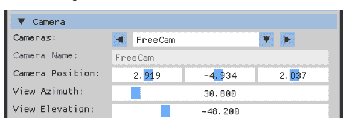
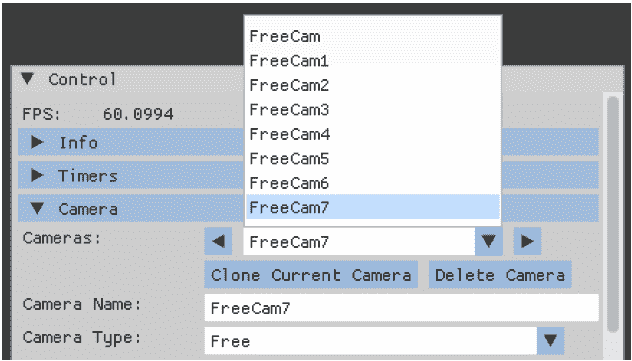
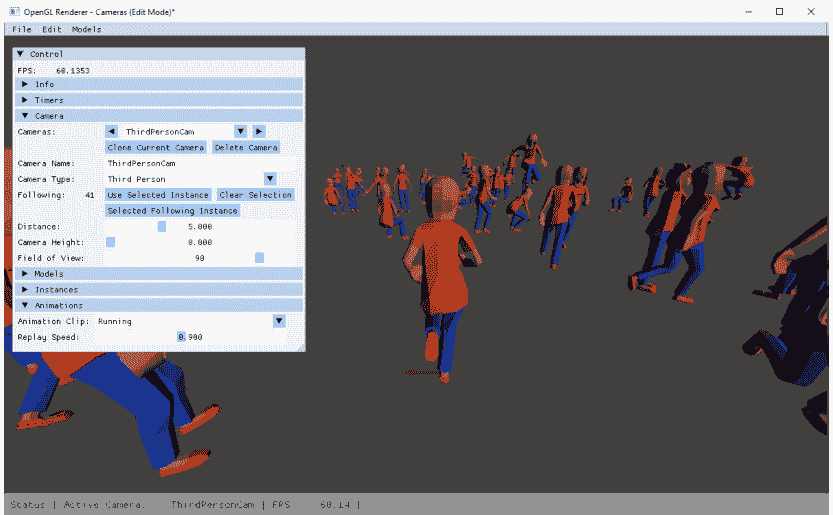
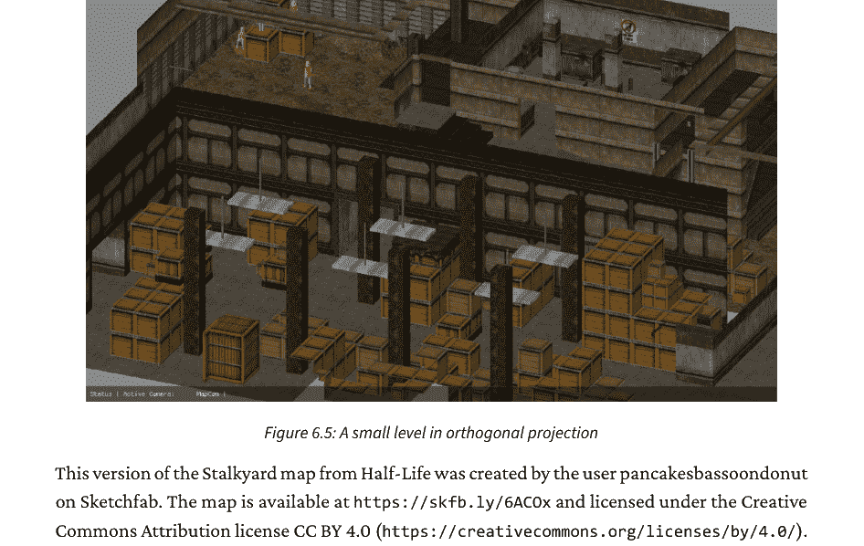

# 第6章 扩展摄像机处理

## 扩展摄像机处理

欢迎来到第 6 章！在第 5 章中，我们添加了保存和加载应用程序配置的功能。首先，我们探索了数据类型、文件格式以及要保存到文件的数据。然后，我们实现了一个解析器类，用于以 YAML 文件格式写入和读取配置文件。在本章结束时，所有模型和实例以及全局设置都使用 yaml-cpp 库存储在 YAML 文件中，并且所有数据都可以读回应用程序，使我们能够继续构建虚拟世界。

在本章中，我们将增强摄像机配置。作为前两个步骤，我们将扩展应用程序以处理不止一个摄像机并添加多种摄像机类型。然后，我们将实现第一人称和第三人称视图的摄像机类型，像真实游戏一样跟随选定的实例。接下来，我们将添加固定摄像机，允许以监控风格查看虚拟场景。作为最后一步，我们将添加一个热键来在摄像机之间切换，以及正交投影和基于鼠标滚轮的视场调整。

在本章中，我们将涵盖以下主题：

- 添加多个摄像机
- 创建不同摄像机类型
- 实现第一人称和第三人称摄像机
- 添加固定摄像机
- 在摄像机和配置之间切换


## 技术需求

示例代码位于 chapter06 文件夹中，OpenGL 的子文件夹 01_opengl_cameras 和 Vulkan 的子文件夹 02_vulkan_cameras 中。

## 添加多个摄像机

在第 3 章中，我们在用户界面中添加了一个按钮来跳转到任意实例。但我们仍然以相同的角度和距离着陆到我们选择的每个实例，并且返回到地图上不同模型的精彩构图几乎是不可能的。你可以写下摄像机值或截屏，但这远非完美。

能够在场景中添加几乎无限数量的摄像机使我们能够创建令人惊叹的地图和模型组合，并在我们想要时返回该视图。通过添加不同类型的摄像机，我们甚至可以更进一步——一个以第三人称追踪一个实例的摄像机；另一个以等距视图呈现整个地图的摄像机；还有一个摄像机通过实例的虚拟眼睛来看虚拟世界——所有这些都可以通过按下热键或选择菜单来实现。

所有这些点将在本章末尾实现。所以，让我们从第一步开始，为应用程序添加多个摄像机对象。

## 从单个摄像机到摄像机数组

目前，应用程序中只有一个摄像机，定义在 tools 文件夹中的 Camera 类中。该摄像机提供虚拟世界的自由视图。我们可以在三个轴上移动并绕三个轴中的两个轴旋转。绕指向屏幕的轴旋转视图（滚动）在此时对于模型和动画查看器应用程序来说用处不大，因为我们只会看到头部向侧倾斜的效果。此外，在没有固定参考如地平线的情况下在三维中导航摄像机可能相当困难。因此，我们仅实现上下（仰角）和绕垂直轴旋转（方位角）。升级摄像机旋转并添加鼠标或键盘控制以绕第三轴旋转留给你作为练习。

摄像机位置和两个旋转角度的值存储在 OpenGL 的 OGLRenderData 结构体中，以及 Vulkan 的 VkRenderData 结构体中：

```
float rdViewAzimuth = 330.0f;
float rdViewElevation = -20.0f;
glm::vec3 rdCameraWorldPosition =
    glm::vec3(2.0f, 5.0f, 7.0f);
```

为了支持多个摄像机，我们需要一个 Camera 类元素的简单 std::vector 以及一个 int 值，指出当前选中的摄像机。由于这些设置更接近模型和模型实例而不是渲染，我们将把新的摄像机向量存储在 ModelAndInstanceData 结构体中。为了匹配新的内容，我们将把 ModelAndInstanceData 结构体重命名为 ModelInstanceCamData：

```
struct ModelInstanceCamData {
    ...
    std::vector<std::shared_ptr<Camera>> micCameras{};
    int micSelectedCamera = 0;
    ...
}
```

使用 IDE 的重构功能，重命名 ModelAndInstanceData 结构体以及类和函数中的变量只不过是一些鼠标点击和文本编辑的问题。

除了新的结构体名称外，我们还将把文件从 ModelAndInstanceData.h 重命名为 ModelInstanceCamData.h 并将文件从 model 文件夹移动到 opengl 文件夹（Vulkan 的 vulkan 文件夹）。最终，存储头文件的位置取决于个人喜好，但使用包含渲染器的文件夹作为中央位置是有意义的，因为我们主要从渲染器访问该结构体。

在 UserInterface 类中，我们在名为 Cameras 的 ImGui::CollapsingHeader 定义内部添加一个包含可用摄像机名称的组合框。组合框的代码可以从模型或动画剪辑选择中获取并调整。

## 提取摄像机设置

类似于实例设置，我们将把主要的摄像机设置提取到一个名为 CameraSettings 的单独结构体中。包含摄像机变量的单独结构体使得一次性读取或应用所有摄像机相关设置变得更容易，而不是通过 setter 和 getter 访问所有设置。

CameraSettings 结构体位于 tools 文件夹中的头文件 CameraSettings.h 中：

```
struct CameraSettings{
    std::string csCamName = "Camera";
    glm::vec3 csWorldPosition = glm::vec3(0.0f);
    float csViewAzimuth = 0.0f;
    float csViewElevation = 0.0f
};
```

除了摄像机的名称外，我们从摄像机的世界位置和两个视角角度开始：方位角和仰角。

在 Camera 类中，必须包含新的 CameraSettings.h 头文件，并添加一个名为 mCamSettings 的新私有成员变量。可以删除包含位置、方位角和仰角的三个旧变量。访问这三个位置和视角角度变量的所有方法必须更改为在新的 mCamSettings 变量内部存储和检索值。

我们必须为新的 CameraSettings 添加 getter 和 setter 方法。getter 和 setter 将允许我们像处理模型实例一样处理摄像机，通过简单的变量赋值来操作摄像机设置。

## 调整渲染器

由于渲染器需要更新摄像机的位置和视图，我们还需要升级一些方法以使用选中的摄像机。

第一步总是获取当前摄像机的指针并读取 CameraSettings 以便更轻松地访问和更改：

```
std::shared_ptr<Camera> cam =
mModelInstCamData.micCameras.at(
mModelInstCamData.micSelectedCamera);
CameraSettings camSettings = cam->getCameraSettings();
```

如果我们更改了任何值，我们必须将设置存储回摄像机：

```
cam->setCameraSettings(camSettings);
```

然后，在 handleMousePositionEvents() 方法中，我们将所有变量从旧的 mRenderData 变量更改为如下代码中突出显示的内容：

```
mRenderData.rdViewAzimuth += mouseMoveRelX / 10.0f;
```

新的 camSettings 变量，包含新的摄像机设置，看起来像这样：

```
camSettings.csViewAzimuth += mouseMoveRelX / 10.0f;
```

渲染器的 draw() 方法中也需要进行类似的更改。

首先，我们从渲染器类中删除私有 mCamera 成员变量，因为我们将不再使用单个摄像机。然后，我们获取摄像机的指针并读取当前摄像机设置。

现在，摄像机的更新将从旧的 mCamera 变量切换：

```
mCamera.updateCamera(mRenderData, deltaTime);
```

相反，我们通过 cam 指针更新当前选中的摄像机：

```
cam->updateCamera(mRenderData, deltaTime);
```

对于投影矩阵，我们使用新的 camSettings 变量来读取当前配置的视场：

```
mProjectionMatrix = glm::perspective(
    glm::radians(static_cast<float>(
        camSettings.csFieldOfView)),
        static_cast<float>(mRenderData.rdWidth) /
        static_cast<float>(mRenderData.rdHeight),
        0.01f, 500.0f);
```

我们也通过访问 cam 指针来读取更新后的视图矩阵：

```
mViewMatrix = cam->getViewMatrix();
```

最后，在渲染器的 centerInstance() 方法中，对摄像机的 moveCameraTo() 方法的调用也必须进行调整。我们不再使用旧的 mCamera 变量，如以下代码中突出显示的那样：

```
mCamera.moveCameraTo(...);
```

现在，我们直接在 mCameras 向量中访问当前摄像机：

```
mModelInstCamData.mCameras.at(
    mModelInstCamData.mSelectedCamera)->moveCameraTo(...);
```

提取当前摄像机的指针在这里没有意义，因为这只是对摄像机实例的单次操作。

## 将自由摄像机定义为默认摄像机

像空模型和空实例一样，我们应该确保 micCameras 向量中始终至少有一个摄像机。避免空数组可以让我们免于大量的边界检查，并且始终可用的自由摄像机是在新配置或删除所有现有摄像机后一个不错的功能。

为了简化默认自由摄像机，将向渲染器类添加一个名为 loadDefaultFreeCam() 的新方法：

```
void OGLRenderer::loadDefaultFreeCam() {
    mModelInstCamData.micCameras.clear();
```

首先，我们清除包含所有摄像机的向量。然后，我们创建一个具有一些默认值的新摄像机设置对象，将设置应用到摄像机，并将摄像机添加为第一个实例：

```
std::shared_ptr<Camera> freeCam =
    std::make_shared<Camera>();

CameraSettings freeCamSettings{};
freeCamSettings.csCamName = "FreeCam";
freeCamSettings.csWorldPosition = glm::vec3(5.0f);
freeCamSettings.csViewAzimuth = 310.0f;
freeCamSettings.csViewElevation = -15.0f;
freeCam->setCameraSettings(freeCamSettings);
mModelInstCamData.micCameras.emplace_back(freeCam);
mModelInstCamData.micSelectedCamera = 0;
}
```

你可以根据需要调整默认自由摄像机的设置。前面代码片段中显示的设置只是将世界原点居中，使加载的模型的第一个实例出现在屏幕中央。

最后，我们将选中的摄像机设置为零，即我们新添加的摄像机的索引。

每当我们需要删除所有摄像机并添加默认摄像机时（即创建新配置时），我们只需调用 loadDefaultFreeCam() 即可。


对于用户界面，我们应禁用对默认自由摄像机的名称更改，当摄像机实例 0 被选中时，通过在名称字段周围使用 ImGui::BeginDisabled() 和 ImGui::EndDisabled() 的调用来实现。

图 6.1 显示了摄像机部分的 resulting 用户界面：



图 6.1：新的摄像机设置

在摄像机之间切换现在变得和选择新的基础模型或新的动画片段一样简单。除了组合框之外，还添加了两个箭头，允许我们直接选择上一个和下一个摄像机。

对于真正的摄像机管理，缺少两个功能：创建新摄像机和删除现有摄像机，除默认摄像机外。

## 添加和删除摄像机

要创建摄像机，可以采用两种路径：

- 在原点添加摄像机，使用默认值
- 克隆当前选中的摄像机及其所有设置，除了名称

强迫用户返回原点并将新摄像机移动到虚拟世界中的期望位置感觉有些不妥。更好的解决方案是能够克隆当前选中的摄像机，因为用户很可能希望使虚拟世界的当前视图持久化。

克隆和删除功能都由新的回调处理，将检查负担和所有工作从用户界面转移到渲染器。新的渲染器方法，名为 cloneCamera() 和 deleteCamera()，简短而简单，因此我们在此跳过其列表。

然而，处理摄像机名称需要一些额外的注意。组合框中重复的名称会令人困惑，因此我们在克隆摄像机时必须找到一种解决方案来创建唯一名称。创建新名称的一种简单方法是向名称附加一个数字，并在进一步克隆时将数字递增。

处理新名称的方法称为 generateUniqueCameraName()，定义在渲染器类中。该方法只有一个参数，即摄像机基本名称。

首先，我们复制基本名称，因为我们在 while 循环期间如果摄像机名称已被使用会调整名称，并定义一个名为 matches 的字符串，包含从零到九的所有数字：

```
std::string camName = camBaseName;
std::string matches("0123456789");

while (checkCameraNameUsed(camName)) {
```

在循环中，我们检查摄像机名称是否已有数字作为后缀。如果没有，我们简单地附加一个 1：

```
const auto iter = std::find_first_of(camName.begin(),
    camName.end(), matches.begin(), matches.end());
if (iter == camName.end()) {

    camName.append("1");
} else {
```

如果我们找到一个数字，那么我们将不带尾随数字的摄像机名称保存到 cameraNameString 中，将现有的摄像机数字转换为 int，将数字递增 1，将新数字转换回字符串，并组合原始摄像机名称和新数字：

```
std::string cameraNameString = camName.substr(0,
    std::distance(camName.begin(), iter));
std::string cameraNumString = camName.substr(
    std::distance(camName.begin(), iter));
int cameraNumber = std::stoi(cameraNumString);
camName = cameraNameString +
    std::to_string(++cameraNumber);
}
}
```

这样，我们在克隆现有摄像机时可以创建唯一但仍然可理解的摄像机名称。

generateUniqueCameraName() 中的 while 循环使用另一个名为 checkCameraNameUsed() 的新方法。检查摄像机名称是否已被使用是通过遍历现有摄像机并将摄像机名称与建议的新名称进行比较来完成的：

```
bool OGLRenderer::checkCameraNameUsed(std::string
  cameraName) {
  for (const auto& cam : mModelInstCamData.micCameras) {
    if (cam->getCameraSettings().csCamName == cameraName) {
      return true;
    }
  }
  return false;
}
```

相同的 checkCameraNameUsed() 方法也将在用户界面中使用，以在摄像机重命名时检测重复名称。如用户界面中的大多数地方一样，使用回调到渲染器来执行名称检查，将工作转移到渲染器类。

在图 6.2 中，克隆和删除摄像机的新按钮显示了出来，以及多次按下 Clone Current Camera 按钮的结果：



图 6.2：克隆和删除的新按钮，以及一些新摄像机

作为摆脱单一摄像机的最后一步，我们必须更改基于 YAML 的配置文件以反映新的摄像机配置。

## 调整摄像机配置的加载和保存

为了加载和保存新的摄像机设置，我们必须在 tools 文件夹中的 Yam1Parser 类中更改 YAML 解析和发射。

解码 YAML 摄像机节点可以与解码 glm::vec3 或 InstanceSettings: 类似，通过在头文件 Yam1ParserTypes.h 中新的 convert 模板块中添加新的 decode 方法来实现：

```
Template<
  struct convert<CameraSettings> {

    static bool decode(const Node& node,

        CameraSettings& rhs) {

      CameraSettings defaultSettings = CameraSettings{};

      rhs.csCamName =
        node["camera-name"].as<std::string>();

      try {

        rhs.csWorldPosition =

          node["position"].as<glm::vec3>();

      } catch (...) {

        rhs.csWorldPosition =

          defaultSettings.csWorldPosition;

      }

      try {

        rhs.csViewAzimuth =
          node["view-azimuth"].as<float>();
```

```
} catch (...) {
    rhs.csViewAzimuth = defaultSettings.csViewAzimuth;
}

try {
    rhs.csViewElevation =
        node["view-elevation"].as<float>();
} catch (...) {
    rhs.csViewElevation =
        defaultSettings.csViewElevation;
}
```

在解析节点时处理抛出的异常可确保在格式错误或缺少键的情况下尽可能恢复摄像机配置。无法解析摄像机名称时仍会跳过整个摄像机以避免命名问题。

我们还添加 encode 方法以使模板完整实现。有了 decode 函数，我们只需将 CameraSettings 类型传递给 .as<>() 调用即可读取包含摄像机设置的节点：

```
... camNode.as<CameraSettings>();
```

对于向保存文件发射摄像机配置，我们创建一个序列并为每个可用摄像机添加一个映射：

```
...
mYamlEmit << YAML::BeginMap;
mYamlEmit << YAML::Key << "cameras";
mYamlEmit << YAML::Value;
mYamlEmit << YAML::BeginSeq;
for (const auto& cam : modInstCamData.micCameras) {
    CameraSettings settings = cam->getCameraSettings();
    mYamlEmit << YAML::BeginMap;
    mYamlEmit << YAML::Key << "camera-name";
    mYamlEmit << YAML::Value << settings.csCamName;
...
}
```

```
mYamlEmit << YAML::EndSeq;
 mYamlEmit << YAML::EndMap;
```

在保存的 YAML 配置文件中，将为每个摄像机出现一个新的序列，存储所有摄像机设置作为键/值对：

```
cameras:
  - camera-name: FreeCam
    position: [2.9061296, 11.1587305, 64.1114578]
    view-azimuth: 289.300262
    view-elevation: -34.4999695
```

由于我们对配置文件进行了基本更改，我们应该通过新的版本号来反映新的磁盘格式。

## 提升配置文件版本号

调整发射器中的配置文件版本号很容易；我们只需将版本号字符串从 1.0 提高到类似 1.1 或 2.0。从现在开始，所有保存的配置文件都将具有新的版本号。

加载配置文件现在变得有点复杂。如果我们想支持旧文件格式，我们必须保留用于解析先前文件版本内容的所有方法。在读取要解析的文件的版本号后，我们必须决定是解析多个摄像机的新序列样式，还是获取单一摄像机的设置并将这些设置应用于始终可用的默认自由摄像机。保存配置可以在新版本中完成，从而将配置文件从旧版本迁移到新版本。

通过支持读取旧版本来更新配置是实践课程部分中的任务之一。

我们现在可以创建一堆自由浮动的摄像机，将摄像机定位在我们的虚拟世界中，并通过用户界面在摄像机之间切换。听起来还是有点无聊，不是吗？让我们通过添加不同类型的摄像机来进一步增强应用程序。

## 创建不同类型的摄像机

在虚拟世界中添加多个摄像机的能力是添加一些预定义摄像机设置的一个良好基础。不同的摄像机类型在视图移动和摄像机本身移动方面表现不同。


我们定义了一个名为 cameraType 的新枚举类，位于 Enums.h 文件中：

```
enum class cameraType {
	free = 0,
	firstPerson,
	thirdPerson,
	stationary,
	stationaryFollowing
};
```

在 CameraSettings 结构体中，必须添加一个 cameraType 类型的新变量：

```
cameraType csCamType = cameraType::free;
```

名称本身已说明了相机类型的用途。以下是各种类型的说明：

- 自由相机已在之前的代码示例中出现过。我们可以在五个自由度中自由地在世界中移动：三个方向和两个旋转。相机或视角没有任何移动限制。
- 第一人称相机做的是第一人称游戏中相机的事：它允许你通过主角的眼睛看到虚拟世界。在我们的应用中，我们会将相机附加到一个实例的头部，并让相机和视角随实例一起移动。然而，会有一个选项来解锁视角，以避免奇怪的角度或晕动症。
- 第三人称相机像另一个人或无人机一样跟随选定的实例，从实例身体外部展示与实例所见相同的虚拟世界角度。可以进行一些视角调整，例如与实例的距离，但相机运动和视角都由实例控制。
- 固定相机可以与固定监控摄像头相比较。固定相机可以放置在世界中的任何位置和任何角度，但一旦相机锁定，除了视野外，不允许任何移动或视角调整。视野设置保持解锁状态，以便像普通监控摄像头一样进行缩放。
- 最后，固定跟随相机是一种特殊的监控相机类型。虽然移动和视角都不能由用户控制（再次例外的是视野设置），但此相机类型会始终自动将选定的实例居中，无论该实例是否直接可见。而且如果实例在周围移动，相机将在虚拟世界中跟踪该实例。

根据相机类型，我们必须在渲染器中限制相机设置的部分。每当我们无法更改特定的相机设置，例如位置时，我们也会禁用用户界面中对应设置的控制。

我们将从第一人称和第三人称相机开始，因为这两种相机类型在行为变化和数据检索方面有很大共同之处。

## 实现第一人称和第三人称相机

对于第一人称相机，tools 文件夹中 CameraSettings.h 头文件里的 CameraSettings 结构体需要一些额外的变量：

```
bool csFirstPersonLockView = true;
int csFirstPersonBoneToFollow = 0;
std::vector<std::string> csFirstPersonBoneNames{};
glm::mat4 csFirstPersonBoneMatrix = glm::mat4(1.0f);
glm::vec3 csFirstPersonOffsets = glm::vec3(0.0f);
```

新变量 csFirstPersonLockView 用于控制第一人称视角是否跟随实例骨骼的运动，或者我们放宽该限制并启用自由视角，但仍保持固定位置。我们需要模型骨架中的一个骨骼来附加相机；变量 csFirstPersonBoneToFollow 让我们设置要跟随的骨骼。在用户界面中，csFirstPersonBoneNames 向量的内容用于呈现一个包含所有骨骼名称的组合框，并将所选骨骼保存到 csFirstPersonBoneToFollow 中。最后一个变量 csFirstPersonOffsets 可用于稍微移动相机位置，防止相机被放置在实例头部内部的奇怪点等。

由于我们使用的是骨骼动画，我们需要访问包含相机虚拟附加的骨骼的平移、旋转和缩放的矩阵。我们可以通过重新实现第一章中的动画代码来获取矩阵，或者在第 2 章的计算着色器完成最终矩阵数据的计算后，从 Shader Storage Buffer Object 中提取骨骼矩阵。

对于实际应用，你应该使用分析器来检查两个版本的成本。在示例应用中，我们将使用计算着色器的结果，以避免再次进行相同的动画计算。

### 关于第一人称模型说明

对于许多第一人称风格的游戏，第一人称模型会与同一角色的第三人称模型不同。

有时，头部元素会被移除或旋转离开。这会在玩家看到手臂、手和腿的同时移除头部对视野的干扰，从而产生拥有虚拟身体的感觉。在其他游戏中，身体被完全移除，只绘制像前臂或肩部以上的手臂之类的部分模型。 resulting 视图为玩家提供了简单但足够好的虚拟身体表示。

我们在这里对所有相机类型使用相同的模型，仅仅因为在相机切换时动态交换模型会产生大量额外开销。如果你有兴趣了解在第一人称中使用另一个模型需要多少工作，可以尝试在与相机类型并行时添加切换模型的逻辑。

对 CameraSettings 结构体的另一个补充是向我们想要跟随的实例的弱指针：

```
std::weak_ptr<AssimpInstance> csInstanceToFollow{};
```

与撤销/重做设置类似，我们使用 std::weak_ptr 而不是 std::shared_ptr，以避免在我们跟随的实例被移除时出现问题。

在用户界面中捕获实例可以通过添加一个按钮来实现，该按钮将当前选定的实例存储在相机设置的 csInstanceToFollow 变量中。但要注意检查空实例，否则你会得到不想要的结果并使相机居中于原点。

## 获取第一人称视角的骨骼矩阵

第一人称魔法的第一部分是检索我们想要将相机附加到的骨骼的最终 TRS。在渲染器的 draw() 调用中，在第二个计算着色器之后，我们从 mShaderBoneMatrixBuffer SSBO 中提取骨骼矩阵：

```
glm::mat4 boneMatrix =
 mShaderBoneMatrixBuffer.getSsboDataMat4(
 selectedInstance * numberOfBones + selectedBone, 1).at(0);
```

## 扩展相机处理

我们使用重载的 getSSBODataMat4() 方法在选定实例的选定骨骼位置读取单个 glm::mat4。为了能够从 SSBO 读取多个矩阵，getSSBODataMat4() 返回一个 std::vector<glm::mat4>。但由于我们只需要单个矩阵，我们通过使用 .at(0) 提取向量的第一个矩阵。

相机偏移矩阵是通过简单的 glm::translate() 调用计算的：

```
glm::mat4 offsetMatrix = glm::translate(glm::mat4(1.0f),
	camSettings.csFirstPersonOffsets);
```

最后，使用一个略显庞大的调用来计算骨骼的位置：

```
cam->setBoneMatrix(
	mWorldPosMatrices.at(selectedInstance) *
	boneMatrix * offsetMatrix *
	glm::inverse(modelType.second.at(0))
	->getModel()->getBoneList().at(selectedBone)
	->getOffsetMatrix()));
```

通过使用正确的矩阵乘法顺序（取决于库，GLM 使用从右到左），执行以下操作：

1. 从模型中获取所选骨骼的偏移矩阵并计算偏移矩阵的逆矩阵。骨骼的偏移矩阵包含该骨骼在蒙皮位置与默认 T 姿势之间的偏移。
2. 将骨骼偏移矩阵的逆矩阵乘以相机位置偏移矩阵，将相机稍微移离骨骼偏移。
3. 将最终骨骼 TRS 矩阵乘以之前的骨骼偏移和相机矩阵的乘积，将相机移动到相对于模型根部的该骨骼的正确位置。
4. 乘以所选实例的世界位置偏移，将相机移动到我们所选实例的所选骨骼。

在计算出骨骼矩阵后，我们需要更新相机并重新上传视图和投影矩阵到 GPU：

```
cam->updateCamera(mRenderData, deltaTime);
	mViewMatrix = cam->getViewMatrix();
	std::vector<glm::mat4> matrixData;
	matrixData.emplace_back(mViewMatrix);
```


matrixData.emplace_back(mProjectionMatrix);
 mUniformBuffer.uploadUboData(matrixData, 0);

现在，魔法的第二部分来了：计算位置、方位角和仰角。

## 计算第一人称相机参数

要从骨骼的旋转矩阵中获取世界位置以及方位角和仰角视角，需要一些技巧：

- 1. 首先，我们从矩阵中设置相机位置：
mCamSettings.csWorldPosition = mFirstPersonBoneMatrix[3];

在行主序旋转矩阵中，平移量存储在最后一行的前三列中。通过提取整行并丢弃第四个值，我们可以立即获得骨骼的平移量。

- 2. 对于仰角视角，我们通过与骨骼TRS矩阵相乘来旋转一个指向上方的向量：

glm::vec3 elevationVector = glm::mat3(mFirstPersonBoneMatrix) * mSideVector;

矩阵-向量乘法将参考向量 mSideVector 按照骨骼TRS矩阵中存储的角度进行旋转。理论上，我们可以使用任何向量作为参考；这里我们使用的是指向正Z轴的单位向量。

得到的向量指向动画计算过程中应用于所选骨骼的方向。

- 3. 接下来，我们计算仰角：

mCamSettings.csViewElevation = glm::degrees(std::atan2(glm::length(glm::cross(elevationVector, mWorldUpVector)), glm::dot(elevationVector, -mWorldUpVector))) - 90.0f

通过使用双元素反正切，我们可以计算两个给定向量之间的角度。这里我们使用指向上方的 mWorldUpVector 作为第二个参数，因为我们关心的是相对于垂直轴旋转的角度。反正切计算结合了两个角度之间的余弦和正弦角度计算。关于公式的详细信息，可以在“其他资源”部分找到链接。

将所得角度从弧度转换为度数后，我们减去90度，以获得相对于地平线的角度（mWorldUpVector 指向上方）。与通常用于计算两个向量之间夹角的反余弦 + 点积方法相比，此方法对于接近参考向量的角度在数值上更稳定。

## 仰角限制

请注意仰角的一个重要限制：仰角的总范围只有180度（从-90度到90度）。你不能比正上方更向上看，也不能比正下方更向下看。尝试将仰角调整到超出限制范围，会导致绕X轴旋转180度——方位角将被调整，而仰角仍将保持在限制范围内。

此时，相机与所选骨骼具有相同的上/下角度。

我们可以用类似的方式计算方位角：

- 1. 首先，我们通过与骨骼TRS矩阵相乘来旋转一个向量。我们再次使用指向正Z轴的向量 mSideVector：

glm::vec3 azimuthVector = glm::mat3(mFirstPersonBoneMatrix) * mSideVector;

- 2. 然后，我们计算旋转向量与另一个单位向量之间的角度：

mCamSettings.csViewAzimuth = glm::degrees(glm::acos(glm::dot(glm::normalize(glm::vec3(azimuthVector.x, 0.0f, azimuthVector.z)), -mSideVector)));

与仰角相比，这里有两个主要区别：

- 点积并非从整个旋转角度计算，而是通过将Y坐标设置为零映射到二维。这种映射的原因可能并不明显——当使用所有三个维度时，仰角部分（上/下）可能小于方位角部分（绕垂直轴旋转），而点积会计算出错误的角度。通过消除仰角部分，我们得到正确的结果。
- 我们计算点积时使用的是指向相反方向的向量。这个符号变化是获得正确方位角值所必需的。或者，我们可以对点积结果取负值，以达到相同的效果。

- 3. 作为最后一步，我们检查最初计算的 azimuthVector 向量的 x 分量是否小于零，并相应调整旋转角度：

if (azimuthVector.x < 0.0f) {
    mCamSettings.csViewAzimuth = 360.0f - mCamSettings.csViewAzimuth;
}

通常，调用反余弦函数 std::acos() 只会得到0到180度之间的角度。通过考虑所得旋转向量的方向，我们可以修改计算，以获得0到360度之间的完整角度。

如果我们现在根据计算出的仰角和方位角创建视图方向，相机将朝向与所选骨骼完全相同的方向：

updateCameraView(renderData, deltaTime);

需要180度的偏移，因为实例和相机的角度范围不同。实例的范围是-180到180度，而相机的范围是0到360度。我们还反转了实例旋转的方向。

接下来，我们使用简单的三角函数计算相机与实例之间的偏移：

glm::vec3 offset = glm::vec3(
    -glm::sin(glm::radians(rotationAngle)),
    1.0f,
    glm::cos(glm::radians(rotationAngle))
) * mCamSettings.csThirdPersonDistance;

使用正弦和余弦可以围绕一个假想的单位圆中心旋转相机。单位圆的半径为1，因此在偏移的Y轴使用1.0f会导致与地面保持与假想圆半径相同的高度距离。通过与 csThirdPersonDistance 变量进行统一缩放，我们可以控制相机与实例的距离。并且使用 csThirdPersonHeightOffset 变量，我们可以单独调整相机的高度。

接下来，我们添加单独的相机高度偏移，并将相机的世界位置设置为实例世界位置加上偏移：

offset.y += mCamSettings.csThirdPersonHeightOffset;
mCamSettings.csWorldPosition = instSettings.isWorldPosition + offset;

现在，相机始终放置在实例后方，我们可以控制视图距离和额外的相机高度偏移。

对于视图的仰角，我们再次使用点积，这次是在从相机到实例的向量与指向上方的 mWorldUpVector 之间：

glm::vec3 viewDirection = instSettings.isWorldPosition - mCamSettings.csWorldPosition;
mCamSettings.csViewElevation = (90.0f - glm::degrees(glm::acos(glm::dot(glm::normalize(viewDirection), mWorldUpVector))))


```
)
)) / 2.0f;
```

因此，我们得到了 mWorldUpVector 与视线方向之间角度的一半，单位为度。摄像机略微向下指向实例的世界位置，但仍然足够向上以俯视实例的肩膀。

图 6.4 显示了所选模型后面的第三人称视角：



图 6.4：第三人称视角

除了摄像机位置和视角的计算之外，我们还应禁用基于用户的摄像机移动。忽略控制摄像机的请求，比在每一帧中都 visibly 重置摄像机更改，更能给用户更好的反馈。

## 禁用手动摄像机移动

忽略更改摄像机角度的请求可以通过一个简单的添加来实现。我们只需要获取摄像机设置，并在 handleMouseButtonEvents() 中围绕更改 mMouseLock 变量的块，使用以下条件：

```
if (!(camSettings.csCamType ==
    cameraType::thirdPerson ||
(camSettings.csCamType == cameraType::firstPerson &&
 camSettings.csFirstPersonLockView)) &&
 camSettings.csInstanceToFollow.lock() {
 ...
```

这个复杂条件可以分解为以下规则：只有在以下情况下才允许锁定鼠标并手动移动摄像机：

- 摄像机类型不是第一人称或第三人称。
- 对于第一人称摄像机，视角是解锁的。
- 对于两种摄像机类型，都已设置要跟随的目标实例。

这意味着只要在第一人称和第三人称中没有实例被设为目标，并且第一人称摄像机的视角未设置为锁定状态，摄像机就可以在自由摄像机类型上自由移动。

条件行看起来可能有点吓人，但使用相反的逻辑元素创建相同的条件以避免初始的感叹号否定，会产生复杂程度相似的布尔表达式。因此，我们完全可以坚持使用这个表达式。

由于我们尚未实现绕指向屏幕的轴的滚动旋转，这两个新摄像机可能会表现异常。

## 当前第一人称/第三人称摄像机的局限性

如果在第一人称摄像机上绕 X 轴和/或 Z 轴旋转当前锁定的实例，视角将围绕着疯狂旋转，只跟随所选骨骼的位置而不跟随旋转。这种行为可以通过向摄像机添加第三个旋转并绕指向屏幕的轴进行滚动来修复。添加第六个自由度后，所有计算都必须调整以包含新的角度。

此外，第三人称摄像机可能在以不同角度旋转的模型上放置不正确，或者模型可能需要交换 Z 轴和 Y 轴。

尽管添加最后一个旋转是可能的，但在应用程序中的使用仅限于第一人称视角之类的情况，因为你可以通过反转滚动旋转并旋转地图而不是模型来获得相同的结果。对于旋转错误的第三人称模型，需要额外的固定旋转复选框，或更多的偏移旋转。

鼓励你扩展当前代码库并添加实例设置，以处理本节中提到的边缘情况。

在添加与实例位置直接相关的摄像机之后，让我们继续进行固定摄像机。

## 添加固定摄像机

固定摄像机可以在多种情况下使用。你制作了角色模型和道具的精美构图。或者，你想要整个游戏地图的俯视图，看看每个角色放置在哪里。也许你甚至想要跟随地图上游荡的一个实例。固定摄像机非常适合这些需求。

对于纯固定摄像机，配置很简单。只需将摄像机类型添加到渲染器的 handleMouseButtonEvents() 方法中 mMouseLock 布尔值的激活中：

```
... && camSettings.csCamType != cameraType::stationary ...
```

并且在 Camera 类的 updateCamera() 中，在检查零 deltaTime 之后立即添加以下行：

```
if (mCamSettings.csCamType == cameraType::stationary) {
    return;
}
```

就这样！一旦你选择固定摄像机，鼠标右键将被忽略，并且摄像机也永远不会接收任何更新。

如果固定摄像机应该跟随实例，则需要更多代码。

### 创建固定跟随摄像机

创建固定实例跟随摄像机的第一步与纯固定摄像机相同——将摄像机类型添加到渲染器类的 handleMouseButtonEvents() 方法中：

```
if (!((camSettings.csCamType ==
    cameraType::stationaryFollowing
```

我们必须将摄像机类型添加到第一人称和第三人称类型检查的括号中，因为我们只想在已配置要跟随的实例时禁用摄像机手动移动。

对于摄像机位置和视角的更新，将创建第一人称和第三人称算法的混合。你将从前面的章节中认出代码示例。

首先，我们获取实例并从摄像机到实例位置计算视线方向：

```
std::shared_ptr<AssimpInstance> instance =
    mCamSettings.csInstanceToFollow.lock();
glm::vec3 viewDirection = instance->getWorldPosition() -
    mCamSettings.csWorldPosition;
```

接下来，我们将视角的仰角设置为视线方向到实例与向上指向的 mWorldUpVector 之间角度的余弦值：

```
mCamSettings.csViewElevation = 90.0f -
    glm::degrees(
        glm::acos(
            glm::dot(
                glm::normalize(viewDirection), mWorldUpVector
            )
        )
    );
```

使用视线方向与向上指向向量之间的点积，在第一人称和第三人称摄像机中已以非常相似的方式使用。

然后，我们将相同的视线方向向量映射到两个维度，并计算展平的视线方向向量与指向负 z 轴的向量之间的角度：

```
float rotateAngle =
glm::degrees(
    glm::acos(
        glm::dot(
            glm::normalize(
                glm::vec3(viewDirection.x, 0.0f, viewDirection.z)),
            glm::vec3(0.0f, 0.0f, -1.0f)
        )
    )
);
```

最后，我们将方位角扩展到完整的 360 度：

```
if (viewDirection.x < 0.0f) {
    rotateAngle = 360.0f - rotateAngle;
}
```

我们还不将摄像机更改限制为编辑模式，以允许在视图模式中在摄像机之间切换。

另一个很酷的补充是正交投影。虽然透视投影试图模仿远离摄像机的物体的尺寸缩小，但正交投影将保留物体的尺寸。

## 添加正交投影

你可能认出与图 6.5 中的图片相似的游戏：



图 6.5：正交投影中的一个小关卡

这个来自 Half-Life 的 Stalkyard 地图的版本是由用户 pancakesbassoondonut 在 Sketchfab 上创建的。该地图可在 https://skfb.ly/6A0Cx 获取，并根据知识共享署名许可 CC BY 4.0（https://creativecommons.org/licenses/by/4.0/）许可。

老式游戏仅出于美学原因使用正交投影。在不缩放纹理或改变面角度的情况下，创建令人惊艳的游戏所需的计算能力非常少。

为了支持正交投影，我们在 Enums.h 文件中创建一个名为 cameraProjection 的新枚举类：

```
enum class cameraProjection {
  perspective = 0,
  orthogonal
};
```

在 CameraSettings 结构体中，我们添加两个名为 csCamProjection 和 csOrthoScale 的新变量：

```
cameraProjection csCamProjection = cameraProjection::perspective;
float csOrthoScale = 20.0f;
```

而 csCamProjection 用于在透视和正交投影之间切换，csOrthoScale 变量将定义正交投影的缩放级别样式设置，类似于透视投影的视场设置。

创建 mProjectionMatrix 的当前代码将被移动到对新投影设置进行检查中：

```
if (camSettings.csCamProjection == cameraProjection::perspective) {
  ...
} else {
}
```

并且，如果选择了正交投影，我们将使用 glm::ortho() 而不是 glm::perspective() 来创建投影矩阵。首先，我们读取 csOrthoScale 并使用该值缩放纵横比以及左右和近远平面距离：

```
float orthoScaling = camSettings.csOrthoScale;
float aspect = static_cast<float>(mRenderData.rdWidth)/static_cast<float>(mRenderData.rdHeight) * orthoScaling;
float leftRight = 1.0f * orthoScaling;
float nearFar = 75.0f * orthoScaling;
```


调用 `glm::ortho()` 创建了正交投影矩阵，将虚拟世界的原点移动到屏幕的原点：

```
mProjectionMatrix = glm::ortho(-aspect, aspect, -nearFar, nearFar);
```

通过使用虚拟世界的中心作为投影矩阵的中心，我们在屏幕上得到了一个缩放良好的结果。由于视图矩阵中的摄像机位置，我们甚至能够在正交绘制的虚拟世界中移动摄像机。

这里唯一的限制是向屏幕内的移动：虽然左右或上下移动摄像机会按预期调整视图，但前后移动最初不会显示任何变化。这种对摄像机沿 z 轴方向移动缺乏反应的现象是由正交投影的基本原理造成的。我们没有像透视投影那样的视锥体：投影矩阵创建了一个巨大的矩形盒子，盒子内的每个三角形都会被绘制。

要让摄像机到达某个点，使得一些三角形位于矩形盒子的远 z 平面之后，就需要将摄像机远离虚拟世界的原点。你可以自己尝试到达这样的点，但即使使用更快的摄像机移动，也需要花费大量时间。

尽管正交投影的效果看起来很酷，但请注意，在这种情况下深度感知可能很棘手。我们的大脑已经学会，如果距离增大，物体的大小会减小，而在屏幕上大小相同但距离不同的物体在现实生活中并不相同。当屏幕上所有实例的大小都相同时，你在猜测哪些实例更靠近摄像机时可能会完全出错。

## 投影设置的界面控制

为了控制使用哪种投影，在 UserInterface 类中添加了两个单选按钮。第一个单选按钮用于激活透视投影：

```
ImGui::Text("Projection: ");
ImGui::SameLine();
if (ImGui::RadioButton("Perspective", settings.cCamProjection == cameraProjection::perspective)) {
	settings.cCamProjection = cameraProjection::perspective;
}
```

- 将第三人称摄像机扩展为更具动作感。

你可以尝试为第三人称摄像机添加更多功能。如何将摄像机安装在弹簧上，只松散地跟随实例的运动？或者像向前移动时稍微拉远一点、旋转时延迟跟随、甚至侧向行走时稍微倾斜之类的效果？或者在碰撞时添加轻微的抖动，就像实例撞到障碍物一样。此外，为这些不同类型提供预设会很方便。

- 将摄像机实现更改为四元数。

在上一任务中添加第三个维度很可能会导致旋转出现万向节锁，从而再次失去一个自由度，因为一个轴被旋转或接近另一个轴。将整个摄像机旋转改为使用四元数而不是欧拉角应该可以解决万向节锁的情况。

- 添加基于样条的摄像机和目标路径。

为了创建掠影场景，你可以为摄像机位置添加样条线以沿其跟随，包括可配置的速度和乒乓运动。通过添加样条作为目标，你可以创建虚拟世界的摄像机镜头。

- 在编辑模式下将摄像机显示为独立对象。

类似于模型操作的箭头，你可以添加视锥体和一个小盒子来描绘虚拟世界中摄像机的位置和方向。不同类型的摄像机可以用不同的线条颜色显示。

- 使摄像机符号可通过鼠标选择。

完成上一任务后，你还可以将摄像机符号添加到选择纹理中。只需为摄像机保留一个专用的值范围，将盒子和/或视锥体线绘制到选择纹理上，并根据从显卡缓冲区返回的值在实例和摄像机之间切换。

- 专家难度：添加画中画窗口。

大多数游戏引擎都具有在应用程序屏幕的小窗口中显示另一个摄像机的缩小版本的能力。创建单独的摄像机显示需要对渲染器类进行一些底层添加，因为整个场景必须使用两个摄像机的视图和投影矩阵绘制两次。

ImGui 具有将纹理绘制到屏幕的能力——你可以将第二个摄像机视图渲染到纹理中并在 ImGui 窗口中显示图像。向窗口标题添加摄像机名称和类型等附加信息将进一步增强画中画模式。

为了避免在两种不同摄像机类型同时激活时产生混淆，将基于类型的限制仅在编辑模式下激活可能是一个好主意。

## 附加资源

- 3D Math Primer for Graphics and Game Development: https://gamemath.com/book/
- How to calculate the angle between two vectors in 3D: https://www.quora.com/How-do-I-calculate-the-angle-between-two-vectors-in-3D-space-using-atan2
