# 第7章 增强动画控制

## 增强动画控制

欢迎来到 *第 7 章*！在上一章中，我们添加了一些摄像机功能。我们首先通过实现对多个摄像机对象的支持并添加新的摄像机类型开始。然后我们设置了键盘快捷键以允许简单地选择现有摄像机。作为最后一步，我们添加了正交摄像机配置，这使我们能够创建模型实例和虚拟世界的完全不同的视图。

在本章中，我们将动画混合和控制更新到新水平。首先，我们将在现有的变换计算着色器中实现两种动画之间的混合。此外，我们将每个节点的平移、缩放和旋转的计算移动到查找表并放到 GPU 上。接下来，我们将向代码中添加新的实例状态，存储实例可以执行的操作类型，如行走、奔跑和跳跃，以及移动方向。然后，我们将创建 UI 控制，允许我们将现有动画剪辑映射到实例动作。最后，我们将添加动画与动作之间映射的逻辑。

在本章中，我们将涵盖以下主题：

- 具有风格的动画混合
- 向代码添加新状态
- 链接状态和动画
- 保存和加载状态

## 技术要求

本章中的示例代码位于 chapter07 文件夹中，OpenGL 的 01_opengl_animations 文件夹和 Vulkan 的 02_vulkan_animations 文件夹。

## 具有风格的动画混合

如果你解决了第 2 章实践环节部分的第二和第三任务，并将更多动画混合部分移至 GPU，本节的部分内容可能对你来说很熟悉。但如果你跳过了这些任务也不用担心，因为将变换数据移至查找表并在 GPU 上进行插值计算的过程很直接。

让我们从查找表数据开始。

## 查找表的威力

目前，动画关键帧的数据和对应的节点变换是在模型加载期间提取的，所有数据都存储在 AssimpAnimChannel 对象内的数组中。

对于每个节点在每一帧，需要进行六次查找来提取前一个和当前关键帧时间的平移、缩放和旋转。然后，对值进行成对插值以计算指定节点的最终变换。

然而，反复进行相同的计算会耗时。更好的解决方案是在模型加载时生成所有插值变换，并在播放动画时只查找最终变换值。

这里的权衡很明显：GPU 内存与 CPU 计算能力。将查找表的大小设置得太小会导致可见的伪影，而将查找表数据的大小设置得太大则会浪费宝贵的 GPU 内存而没有任何视觉收益。你可以尝试查找表的大小，但 ~1,000 个变换值元素应该是视觉效果和内存大小之间的良好平衡。

> 另一种查找解决方案
> 
> 可以通过为关键帧时间创建表格并使用提取的数据作为原始变换数据的索引来实现更节省内存的查找表版本。如果你有很多节点和动画剪辑需要节省 GPU 内存，可以使用这种变体。或者如果你动画中每个动画的关键帧很少，也可以采用这种更稀疏的查找。另一方面，这种版本需要在每个关键帧之间再次计算成对插值，从而给 GPU 增加更多计算负载。


The first step for every lookup table is the extraction of the minimum and the maximum keyframe times:

```
mMinTranslateTime =
    static_cast<float>(nodeAnim->mPositionKeys[0].mTime);
mMaxTranslateTime =
    static_cast<float>(
nodeAnim->mPositionKeys[mNumTranslations - 1].mTime);
```

Then, we calculate three scaling factors:

```
float translateScaleFactor = maxClipDuration /
    mMaxTranslateTime;
mTranslateTimeScaleFactor = maxClipDuration /
    static_cast<float>(LOOKUP_TABLE_WIDTH);
mInvTranslateTimeScaleFactor = 1.0f /
    mTranslateTimeScaleFactor;
```

These include:

- The first variable, translateScaleFactor, stores the ratio between the maximum clip duration and the maximum keyframe time. We need the first scaling factor when we advance the time in the lookup table data creation.
- In mTranslateTimeScaleFactor, we calculate the ratio between the maximum clip duration and the size of our lookup table. The second scaling factor is simply the keyframe time step width of the lookup table entries.
- As the last scaling factor, mInvTranslateTimeScaleFactor stores the inverse of the mTranslateTimeScaleFactor value. We will use the third scaling factor in the compute shader to calculate the right index position in the lookup table from the keyframe time.

Next, we set a helper variable named timeIndex to 0 and iterate over our lookup table entries:

```
int timeIndex = 0;
for (int i = 0; i < LOOKUP_TABLE_WIDTH; ++i) {
```

For every lookup table entry, we extract the translation data from the mPositionKeys array of the aNodeAnim object for the current and next keyframe times into a glm::vec4:

```
glm::vec4 currentTranslate = glm::vec4(
    nodeAnim->mPositionKeys[timeIndex].mValue.x,
    nodeAnim->mPositionKeys[timeIndex].mValue.y,
```

```
nodeAnim->mPositionKeys[timeIndex].mValue.z, 1.0f);
glm::vec4 nextTranslate = glm::vec4(
    nodeAnim->mPositionKeys[timeIndex + 1].mValue.x,
    nodeAnim->mPositionKeys[timeIndex + 1].mValue.y,
    nodeAnim->mPositionKeys[timeIndex + 1].mValue.z,
    1.0f);
```

Even though we only need the first three values for the translation, a four-element vector is used for proper data alignment in the Shader Storage Buffer Object.

Now, we extract the time values for the current and next keyframes, plus the current time of the animation:

```
float currentKey = static_cast<float>(
    nodeAnim->mPositionKeys[timeIndex].mTime);
float nextKey = static_cast<float>(
    nodeAnim->mPositionKeys[timeIndex + 1].mTime);
float currentTime = i * mTranslateTimeScaleFactor /
    translateScaleFactor;
```

For the current time, two scaling factors are used.

By using the two translation vectors and the time values, we can create an interpolated glm::vec4 of the two translations at the time stamp of the lookup table entry:

```
mTranslations.emplace_back(glm::mix(
    currentTranslate,
    nextTranslate,
    (currentTime - currentKey) / (nextKey - currentKey)));
```

Finally, we check whether the current time of the lookup table entry is longer than the time of the next keyframe. If it is, we increment our time index:

```
if (currentTime > nextKey) {
    if (timeIndex < mNumTranslations - 1) {
        ++timeIndex;
    }
}
```

Then, the offset value is advanced to the next lookup data position before storing the next transformation data:

```
offset += LOOKUP_SIZE;
```

After all the translation, scaling, and rotation data is stored in the animLookupData vector, we can upload the data to the SSBO:

```
mAnimLookupBuffer.uploadSsboData(animLookupData);
```

Now, the animation lookup data for the loaded model is available on the GPU. When we need to access the transformation data in the compute shader, we can simply bind the SSBO.

## Adjusting the renderer code and the compute shader

To be able to tell the compute shader which animation to play and/or blend, we define a new struct called PerInstanceAnimData in the OGLRenderData.h file in the opengl folder for OpenGL:

```
struct PerInstanceAnimData {
    uint32_t firstAnimClipNum;
    uint32_t secondAnimClipNum;
    float firstClipReplayTimestamp;
    float secondClipReplayTimestamp;
    float blendFactor;
};
```

For Vulkan, the file is named VkRenderData.h and resides in the vulkan folder.

Here, we simply store the first clip number plus the timestamp of the current frame we want to render from the first clip. Also, a possible second animation clip, the time stamp for the second clip, and the blending factor between the two clips can be sent to the compute shader.

In the renderer, we define two new private data members:

```
std::vector<PerInstanceAnimData> mPerInstanceAnimData{};
ShaderStorageBuffer mPerInstanceAnimDataBuffer{};
```

The mPerInstanceAnimData variable stores the clip numbers, time stamp, and blending factor for every instance, and mPerInstanceAnimDataBuffer is the CPU-side handle for the animation data SSBO.

And we declare the two buffer bindings using the same binding points as in the renderer code:

```
layout (std430, binding = 0) readonly restrict
buffer AnimLookup {
	vec4 lookupData[];
};
layout (std430, binding = 1) readonly restrict
buffer InstanceAnimData {
	PerInstanceAnimData instAnimData[];
};
```

In the main() method of the compute shader, we define the same lookup table size and offset calculation as in the AssimpModel class:

```
int lookupWidth = 1023 + 1;
uint node = gl_GlobalInvocationID.x;
uint instance = gl_GlobalInvocationID.y;
uint numberOfBones = gl_NumWorkGroups.x;
uint boneOffset = lookupWidth * 3;
uint clipOffset = numberOfBones * boneOffset;
```

We can now access all the animation settings for each instance by using the instance variable as the index in the InstanceAnimData SSBO:

```
uint firstClip = instAnimData[instance].firstAnimClipNum;
uint secondClip = instAnimData[instance].secondAnimClipNum;
float blendFactor = instAnimData[instance].blendFactor;
```

For instance, to get the mTranslateTimeScaleFactor value for the translation data, we must use the same formula as in C++ to access the first element of the translation lookup data for the clip:

```
float firstTransInvScaleFactor = lookupData[firstClip * clipOffset + node * boneOffset].x;
```

Even slight differences between C++ and shader formulae or data types could lead to discrepancies in the transferred data, so we need to be strict here to do exactly the same operations and use the same data types.

Then, we use the inverse time scale factor to calculate the correctly scaled index in the translation lookup data:

```
int firstTransLookupIndex =
    int(instAnimData[instance].firstClipReplayTimestamp *
    transInvScaleFactor) + 1;
```

The per-node translation data for the first and second animation clip can also be calculated as in C++:

```
vec4 firstTranslation = lookupData[firstClip *
    clipOffset + node * boneOffset +
    firstTransLookupIndex];
...
vec4 secondTranslation = lookupData[secondClip *
    clipOffset + node * boneOffset +
    secondTransLookupIndex];
```

Now we can interpolate between the two animation clip translations:

```
vec4 finalTranslation = mix(firstTranslation,
    secondTranslation, blendFactor);
```

We do the same lookup and interpolation for the scaling values. For rotation, the same code as the GLM implementation for SLERP is used.

Finally, the product of all three transformation matrices is stored in the SSBO containing the resulting TRS matrices of all instances:

```
uint index = node + numberOfBones * instance;
trsMat[index] =
    createTranslationMatrix(finalTranslation) *
    createRotationMatrix(finalRotation) *
    createScaleMatrix(finalScale);
```

At this point, the mShaderTRSMatrixBuffer SSBO in the renderer contains the same data as we had with the CPU-based transformation calculations.

But all we need to upload to the compute shader is the data of the animations we want to draw. So, the transformation calculation in the updateAnimation() method of the AssimpInstance class can be removed, leaving the following three lines to be executed when we update the animation of the instance:

```
mInstanceSettings.isFirstClipAnimPlayTimePos +=
    deltaTime *
    mInstanceSettings.isAnimSpeedFactor * 1000.0f;
mInstanceSettings.isAnimPlayTimePos =
    std::fmod(mInstanceSettings.isFirstClipAnimPlayTimePos,
    mAssimpMode->getMaxClipDuration());
mModelRootMatrix = mLocalTransformMatrix *
    mAssimpModel->getRootTranformationMatrix();
```

We simply advance the clip time by the delta time and update the instance root matrix.

If you compile and run the code now, the only visible difference is a much lower matrix generation time when the number of instances goes up. For a recent computer model, reaching 10,000 or even 20,000 animated instances of the basic model should be no problem. We don’t need so many instances in the virtual world, but the lower CPU usage for animations and animation blending gives us more freedom to implement more features in the remaining chapters of the book.

Now that we have a fast and easy-to-use animation calculation, we can implement a state-based system to organize the behavior of each instance. By defining different states, like a movement direction or an action the instance will do, we create the first steps on the path to an animation system where we can control the instance as we would do in a simple game.

So, let’s continue by adding new instance states.

## Adding new states to the code

Our future game character should be able to perform typical actions for a character in a game: wait idle for player input, walk in all four main directions, run forward, plus a bunch of other actions. Depending on the available animations, we could add a state for jumping or rolling, punching, or waving.

For maximum flexibility, we will allow characters of all models to perform all the configured actions. Then we can use the UI to map an animation clip to each action we want to use for a specific model. Without a mapped animation clip, the requested action will be simply ignored.


# 使用位域和普通枚举

我们将在 Enums.h 文件中添加两个不同的枚举类定义。第一个枚举名为 moveDirection 是一个位域：

```
enum class moveDirection : uint8_t {
    none = 0x00,
    forward = 0x01,
    back = 0x02,
    right = 0x04,
    left = 0x08,
    any = 0xff
};
```

对于每个方向，都可以在一个变量中设置不同的位。当多个值可以同时出现时需要位域。在我们的例子中，角色同时向前和向左奔跑是正常的情况。

另外两个枚举值 none 和 any 是特殊的占位符。如果角色只是处于空闲状态，为空闲状态强制一个方向会很奇怪，因为角色不能“向前空闲”或“向左空闲”。因此，单独的枚举值 none 用于表示完全不移动，这有助于使代码更简单。值 any 可以用作步行状态的通配符或后备。例如，我们可以为所有方向设置一个通用的步行动画，而不是为四个方向配置相同的动画剪辑，我们使用 any 方向来为所有步行动作使用这一剪辑。

为了能够以真正的位域方式使用 moveDirection 枚举的值，我们必须为新的数据类型定义按位布尔运算符 OR 和 AND。声明很短也很简单，如以下两个移动方向之间的逻辑 AND 运算符代码所示：

```
inline moveDirection operator | (moveDirection lhs,
    moveDirection rhs) {
    using T = std::underlying_type_t <moveDirection>;
    return static_cast<moveDirection>(static_cast<T>(lhs) |
        static_cast<T>(rhs));
}
```

第二个枚举类名为 moveState，负责可能的角色动作：

```
enum class moveState {
    idle = 0,
    walk,
    run,
    hop,
    jump,
    ...
    wave,
    NUM
};
```

这里不需要位域。我们可能能够同时奔跑和跳跃，并在代码中处理这些情况。但大多数动作不能同时执行。

我们简单地在 moveState 枚举类中列出所有可能的移动状态。最后一个值 NUM 可用于在 for 循环中遍历所有枚举值，即从第一个动作的值零 idle 开始，到最后一个有效动作 wave 结束。

拥有不仅仅是数字的移动方向和状态在 UI 和调试消息中会很有用，因此我们在 ModelInstanceCamData.h 文件中的 ModelInstanceCamData 结构体中添加了两个从枚举类值到字符串的新映射：

```
std::unordered_map<moveDirection, std::string>
    micMoveDirectionMap{};
std::unordered_map<moveState, std::string>
    micMoveStateMap{};
```

我们将在渲染器的 init() 方法中用适当的字符串值填充这两个状态映射。接下来，我们必须扩展实例和模型的设置结构体。

## 扩展模型和实例设置

对 idle、walk 和 run 动画剪辑的特殊处理需要一个名为 IdleWalkRunBlending 的新结构体，位于 model 文件夹中的新 ModelSettings.h 文件中：

```
struct IdleWalkRunBlending {
    int iwrblIdleClipNr = 0;
    float iwrblIdleClipSpeed = 1.0f;
    int iwrblWalkClipNr = 0;
```

我们还存储实例的速度和加速度值：

```
glm::vec3 isAccel = glm::vec3(0.0f);
glm::vec3 isSpeed = glm::vec3(0.0f);
```

特定实例的速度将用于选择正确的 idle、walk 或 run 动画剪辑。通过使用基于加速度的移动，我们实现了角色实例更自然的外观。在现实生活中，我们在移动时也会加速和减速，而不是直接从空闲跳到奔跑速度。

## 添加 idle/walk/run 逻辑

idle/walk/run 动画剪辑的混合逻辑在 AssimpInstance 类中的 playIdleWalkRunAnimation() 方法中定义。

在对实例的模型进行健全性检查后，我们计算实例的绝对速度，读取包含混合设置的模型设置映射，并创建一个新的空变量 blend，其类型为 IdleWalkRunBlending：

```
float instanceSpeed =
    glm::length(mInstanceSettings.isSpeed);
ModelSettings modSettings =
    mAssimpMode->getModelSettings();
IdleWalkRunBlending blend;
```

接下来，我们检查是否已配置方向特定的动画剪辑：

```
if (modSettings.msIWRBlendings.count(
    mInstanceSettings.isMoveDirection) > 0) {
    blend = modSettings.msIWRBlendings[
        mInstanceSettings.isMoveDirection];
} else if (modSettings.msIWRBlendings.count(
    moveDirection::any) > 0) {
    blend = modSettings.msIWRBlendings[moveDirection::any];
} else if (modSettings.msIWRBlendings.count(
    moveDirection::none) > 0) {
    blend = modSettings.msIWRBlendings[moveDirection::none];
} else {
    return;
}
```

如果找到这样的方向剪辑，blend 变量将被适当的设置填充。如果没有找到方向特定的剪辑，我们也会检查特殊的 any 和 none 方向，尝试使用适用于所有方向的通用动画。如果我们找不到通用动画剪辑，则从方法返回。如果没有为 idle/walk/run 配置剪辑，播放任何动画都没有意义。

控制是否在 idle 和 walk 之间混合，或在 walk 和 run 之间混合动画，是通过使用 instanceSpeed 变量完成的：

```
if (instanceSpeed <= 1.0f) {
    mInstanceSettings.isFirstAnimClipNr =
        blend.iwrbIdleClipNr;
    mInstanceSettings.isSecondAnimClipNr =
        blend.iwrbWalkClipNr;
    mInstanceSettings.isAnimSpeedFactor = glm::mix(
        blend.iwrbIdleClipSpeed,
        blend.iwrbWalkClipSpeed, instanceSpeed);
    mInstanceSettings.isAnimBlendFactor = instanceSpeed;
} else {
```

在这里，我们根据 instanceSpeed 值缩放速度因子并在 idle 和 walk 动画之间进行混合。通过使用 0.0f 表示空闲和 1.0f（含）表示完全步行速度，动画将在实例静止站立和行走之间平滑混合。

为了将实例动画从步行混合到奔跑，我们使用 1.0f（不含）到 2.0f 之间的 instanceSpeed 范围。逻辑保持不变；我们只需从速度因子和线性插值中减去 1.0f 以在 walk 和 run 剪辑之间进行混合：

```
mInstanceSettings.isFirstAnimClipNr =
    blend.iwrbWalkClipNr;
mInstanceSettings.isSecondAnimClipNr =
    blend.iwrbRunClipNr;
mInstanceSettings.isAnimSpeedFactor = glm::mix(
    blend.iwrbWalkClipSpeed,
    blend.iwrbRunClipSpeed, instanceSpeed - 1.0f);
mInstanceSettings.isAnimBlendFactor =
    instanceSpeed - 1.0f;
}
```

instanceSpeed 值 1.0f 表示步行速度，2.0f 表示奔跑速度，是因为它们最适合在剪辑之间进行线性插值。任何其他范围都是可能的；你只需相应地调整动画混合的缩放即可。

## 使用加速度和减速

由于我们的实例需要在虚拟世界中移动，因此我们需要控制我们控制的实例的速度。但我们不直接使用速度，而是采用基于加速度的速度模型。使用单独的加速度值来加速或减慢实例会产生更自然的结果。就像真实的物理物体一样，我们在虚拟世界中的模型实例的惯性会阻碍速度变化。

首先，AssimpInstance 类需要三个新的私有 float 变量，名为 MAX_ACCEL、MAX_ABS_SPEED 和 MIN_STOP_SPEED：

```
const float MAX_ACCEL = 4.0f;
const float MAX_ABS_SPEED = 1.0f;
const float MIN_STOP_SPEED = 0.01f;
```

在 MAX_ACCEL 中，我们存储模型可达到的最大加速度，而 MAX_ABS_SPEED 限制实例的速度。加速度和速度都是三分量向量，不同方向的移动可能会累加到更大的值。限制这两个值有助于防止实例在虚拟世界中移动过快。

基于加速度的模型有一个主要缺点：停止实例可能变得困难。由于我们只是将加速度值加到速度上或从速度中减去，达到精确的零值是困难的。为了实现完全停止，我们在 MIN_STOP_SPEED 变量中定义最小速度。如果实例当前速度低于 MIN_STOP_SPEED 的值，我们将加速度和速度设为零，最终停止实例。

实例加速度在 AssimpInstance 类的 updateInstanceState() 方法中控制。基本上，我们检查移动方向并设置 isAccel 的相应 x 分量：

```
if (state == moveState::walk || state == moveState::run) {
	if ((dir & moveDirection::forward) == moveDirection::forward) {
		mInstanceSettings.isMoveKeyPressed = true;
		mInstanceSettings.isAccel.x = 5.0f;
	}
}
```


如果按下方向键，我们将 isMoveKeyPressed 设置为 true 并应用加速度。

当我们释放所有移动键时，该实例的减速就会启动。减速逻辑在 AssimpInstance 类的 updateInstanceSpeed() 方法中发生：

```
float currentSpeed =
    glm::length(mInstanceSettings.isSpeed);
static float maxSpeed = MAX_ABS_SPEED;
```

我们还会在本地保存实例的最大速度。使用静态变量有助于在步行和奔跑速度之间跟踪实例的加速和减速。

首先，我们计算 3 分量 isSpeed 向量的长度。然后将所得长度用于检查在未按下移动键时我们是否仍在移动：

```
if (!mInstanceSettings.isMoveKeyPressed) {
    if (currentSpeed > 0.0f) {
        if (mInstanceSettings.isSpeed.x > 0.0f) {
            mInstanceSettings.isAccel.x = -2.5f;
        }
    ...
```

对于实例的可能移动方向，我们检查是否还有剩余速度，并使用与速度相反方向的加速度来减慢实例。

如果我们的速度慢于 MIN_STOP_SPEED，则强制将速度和加速度设为零，将移动状态设为 idle，并将移动方向设为 none：

```
if (currentSpeed < MIN_STOP_SPEED) {
    currentSpeed = 0.0f;
    mInstanceSettings.isAccel = glm::vec3(0.0f);
    mInstanceSettings.isSpeed = glm::vec3(0.0f);
    mInstanceSettings.isMoveState = moveState::idle;
    mInstanceSettings.isMoveDirection =
        moveDirection::none;
}
}
```

将速度和加速度限制为最大值是一个两步过程。如果我们超过最大值，则对向量进行归一化：

```
float currentAccel =
    glm::length(mInstanceSettings.isAccel);
if (currentAccel > MAX_ACCEL) {
    mInstanceSettings.isAccel =
        glm::normalize(mInstanceSettings.isAccel);
```

现在 isAccel 向量的长度等于 1.0f。然后，我们将向量缩放到最大长度：

```
mInstanceSettings.isAccel *= MAX_ACCEL;
```

乘法之后，isAccel 的所有三个分量都被缩放到长度为 MAX_ACCEL 的结果。

更新实例速度是通过将 isAccel 中的加速度的 deltaTime 分数加到 isSpeed 上完成的：

```
mInstanceSettings.isSpeed +=
    mInstanceSettings.isAccel * deltaTime;
```

要达到奔跑速度，我们将 maxSpeed 值加倍：

```
if (mInstanceSettings.isMoveState == moveState::run) {
    maxSpeed = MAX_ABS_SPEED * 2.0f;
}
```

如果我们不再奔跑但速度超过 maxSpeed，则减速至步行速度：

```
if (currentSpeed > maxSpeed) {
    if (mInstanceSettings.isMoveState != moveState::run) {
        maxSpeed -= 
            glm::length(mInstanceSettings.isAccel) * deltaTime;
        if (maxSpeed <= MAX_ABS_SPEED) {
            maxSpeed = MAX_ABS_SPEED;
        }
    }
}
```

示例代码使用简单的线性插值来达到期望的实例速度。你可能想尝试其他技术，例如 ease-in/ease-out 曲线，或三次曲线来调整不同实例速度之间的插值。

如果我们在加速至步行或奔跑速度时速度快于 maxSpeed，则将实例速度 isSpeed 限制为 maxSpeed：

```
mInstanceSettings.isSpeed =
glm::normalize(mInstanceSettings.isSpeed);
mInstanceSettings.isSpeed *= maxSpeed;
```

此时，当前选定的实例将从 idle 动画片段平滑过渡到 walk 动画片段，并在切换到 run 状态时甚至加速到 run 动画片段。可惜我们目前还看不到任何东西，因为移动状态、方向和动画片段之间没有映射。

因此，让我们将动画片段链接到现有状态。

## 链接状态和动画

我们从三个状态（idle、walk 和 run）之间的连接开始，并将对应的模型动画片段映射到这三个状态。IdleWalkRunBlending 结构体和 ModelSettings 结构体中的 msIWBlending 成员变量已经就位，因此我们只需要处理 UI。

### 映射 idle/walk/run 动画

图 7.1 显示了 Control 窗口中三个状态 idle、walk 和 run 的映射部分：

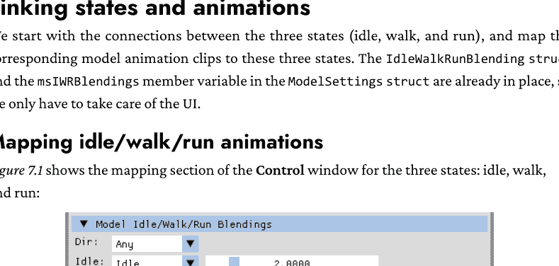

图 7.1：移动方向、移动状态与动画片段之间的映射

```
}
ImGui::PopID();
```

ImGui 需要为每个控件元素提供唯一的标识符。如果未能提供唯一 ID，会导致不想要的结果，因为触发一个控件元素也会触发包含相同 ID 的其他元素。

通过使用递增的整数值作为标识符，每条映射行都将拥有唯一的 Edit 和 Remove 按钮，并且按钮只会影响其映射行。

ImGui 的另一个不错功能是可以从代码的其他部分关闭 CollapsingHeader 元素：

```
ImGui::GetStateStorage()->SetInt(
    ImGui::GetID("Model Animation Mappings"), 0);
```

ImGui 的内部状态存储保存了当前 ImGui 窗口元素的有关信息。通过 SetInt() 调用和 CollapsingHeader 名称，我们可以控制当前 ImGui 窗口中任何标题的打开/关闭状态。

这样，我们强制关闭另外两个映射 CollapsingHeader 元素。我们在全部三个映射标题中更改动画片段设置，而 ImGui 会多次应用设置，导致不想要的结果。

在设置完所有 idle/walk/run 动画片段后，我们继续进行动作设置。

## 将动作映射到动画片段

在 moveState 枚举类中，我们为实例定义了多个动作，除了已配置的 idle、walk 和 run 状态之外。根据模型文件中的动画，并非所有动作都适用于所有模型。但无需担心：代码会忽略没有配置动画的动作。按下动作键将不会产生动画或动作。

所有配置的动作映射都保存在 ModelSettings.h 文件中 ModelSettings 结构体的 msActionClipMappings 新映射中：

```
std::map<moveState, ActionAnimation>
    msActionClipMappings;
```

要在 AssimpInstance 类中在 idle/walk/run 状态与任何动作之间进行混合，我们可以使用 msActionClipMappings 映射中的片段编号和回放速度，并将片段用作混合操作的目标片段：

```
mInstanceSettings.isSecondAnimClipNr =
modSettings.msActionClipMappings[mActionMoveState]
.aClipNr;

float animSpeed =
modSettings.msActionClipMappings[mActionMoveState]
.aClipSpeed;
```

如果我们希望模型切换到某个动作，则调用 AssimpInstance 类的 setNextInstanceState() 方法。渲染器在 handleMovementKeys() 方法中使用此调用来请求所选实例的状态更改：

```
moveState nextState = moveState::idle;
...

if (glfwGetKey(mRenderData.rWindow, GLFW_KEY_E) ==
GLFW_PRESS) {
nextState = moveState::punch;
}
...

currentInstance->setNextInstanceState(nextState);
```

在深入研究动画混合逻辑之前，让我们通过查看如何设置允许的片段序列来完成 UI 部分。

在预览模型的不同动画片段时，你会注意到有些片段只有在实例静止时才有效，而其他动画只有在实例行走或奔跑时才可用。

为了防止片段之间不想要且不自然的过渡，例如从 idle 模型过渡到全速跳跃动画，我们定义了允许的动作状态更改。目标状态只能在源状态为当前活动状态时触发。

## mAnimState 的状态

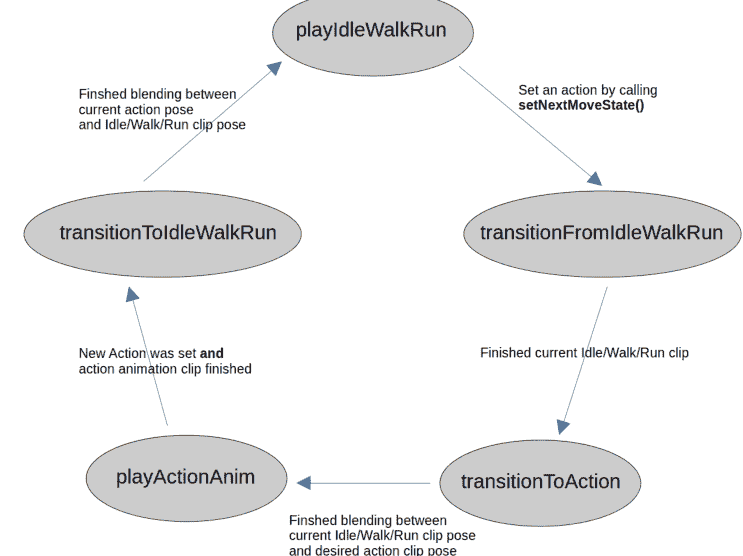

图 7.4：AssimpInstance 类中 mAnimState 变量的状态机

这五个状态及其之间的转换可以解释如下：

- 1. 我们从状态机中的 playIdleWalkRun 开始。在这里，基于实例速度的默认混合在移动状态 idle、walk 和 run 之间播放。
- 2. 一旦请求动作，我们检查源（当前状态）和目标（动作状态）是否在 msAllowedStateOrder 映射中。如果是，我们准备方向性片段并更改为 transitionFromIdleWalkRun 状态。
- 3. transitionFromIdleWalkRun 状态是平滑从 idle/walk/run 过渡到请求动作所必需的。大多数动画片段都从身体、手臂和腿部相似的姿势开始。通过将当前 idle、walk 或 run 动画与同一动画片段的起点进行混合，实例会被调整回其起始姿势。到达起始姿势后，我们进入 transitionToAction 状态。


4. 在 transitionToAction 中，我们从待机、行走或奔跑动画剪辑的初始姿势混合到动作状态动画剪辑。这个过渡只有几帧长，并为动作剪辑添加平滑混合。一旦到动作剪辑的过渡完成，我们切换到 playActionAnim。

5. 一旦进入 playActionAnim，所请求动作状态的动画就会以配置的重放速度播放，直到剪辑结束。当动作动画剪辑播放时，来自键盘的切换其他动画剪辑或返回到待机/行走/奔跑循环的请求会被忽略。当动作动画剪辑播放完毕且没有发出新的动作请求时，状态会切换到 transitionToIdleWalkRun。

与 transitionToAction 类似，transitionToIdleWalkRun 状态用于在动作剪辑和待机/行走/奔跑剪辑之间进行混合。目标剪辑（待机、行走或奔跑）根据实例速度选择。为了实现平滑的动画循环，身体、手臂和腿部的位置与剪辑的开始和结束位置相同。通过将动作剪辑的结尾与待机/行走/奔跑剪辑的开头混合，我们可以平滑地过渡回初始状态。混合完成后，我们将状态切换回 playIdleWalkRun。

对于动画剪辑过渡，我们在 Enums.h 文件中创建了一个新的枚举结构体 animationState，其中包含有限状态机的状态：

```
enum class animationState : uint8_t {
playIdleWalkRun = 0,
transitionFromIdleWalkRun,
transitionToAction,
playActionAnim,
transitionToIdleWalkRun
};
```

状态机在 AssimpInstance 类的 updateAImStateMachine() 方法中定义。这些状态通过 switch/case 语句构建，并根据图7.4中概述的条件向前推进：

```
switch (mAnimState) {
case animationState::playIdleWalkRun:
playIdleWalkRunAnimation();
...
break;
case animationState::transitionFromIdleWalkRun:
blendIdleWalkRunAnimation(deltaTime);
}
```

```
break;
case animationState::transitionToAction:
blendActionAnimation(deltaTime);
break;
case animationState::playActionAnim:
playActionAnimation();
...
break;
case animationState::transitionToIdleWalkRun:
blendActionAnimation(deltaTime, true);
break;
}
```

可以在 AssimpInstance 类的 updateAnimStateMachine() 方法中查看有限状态机的细节。代码简单直接：我们只是重放并在各种动画剪辑之间混合。

有了混合代码和有限状态机，您可以按 F10 切换到应用程序的视图模式。如果您在允许的源状态下按下一个动作按键，动作剪辑就会被播放。动作剪辑播放完毕后，实例会回到之前的待机/行走/奔跑状态。

为了完成本章的功能，我们需要将 ModelSettings 结构体的内容以及所有相关的自定义数据类型添加到配置文件中，使状态和剪辑映射永久生效。

## 保存和加载状态

我们可以复用之前章节中保存和加载自定义数据类型当前状态时创建的保存和加载代码。moveState 和 moveDirection 枚举类类型将作为整数值存储在应用程序的 YAML 配置文件中。三个新的结构体类型 IdleWalkRunBlending、ActionAnimation 和 ModelSettings 在保存到配置文件时会被解构为它们的元素，并在读取值时重新组装。C++ 的 map 和 set 使用已知的 YAML 序列和 YAML 映射组合来创建。

## 存储新的数据类型

对于 moveState 和 moveDirection 结构体，我们在 tools 文件夹的 YamlParserTypes.h 文件中创建了一个新的 convert 模板，该模板将简单地强制转换为 int，然后再转回来：

```
template<>
struct convert<moveState> {
	static Node encode(const moveState& rhs) {
		Node node;
		node = static_cast<int>(rhs);
		return node;
	}
	static bool decode(const Node& node, moveState& rhs) {
		rhs = static_cast<moveState>(node.as<int>());
		return true;
	}
};
```

tools 文件夹的 YamlParser.cpp 文件中针对 moveState 和 moveDirection 的 YAML emitter 重载也会将值转换为 int：

```
YAML::Emitter& operator<<(YAML::Emitter& out, const moveState& state) {
	out << YAML::Flow;
	out << static_cast<int>(state);
	return out;
}
```

现在，在生成或解析 YAML 配置文件时，我们可以像处理其他任何类型一样读写这些新的数据类型。

IdleWalkRunBlending 和 ActionAnimation 这两个结构体类型只使用 int 和 float 值，因此这里的主要任务是为 YAML 节点找到好名字。例如，ActionAnimation 的值在 YAML 文件中存储为 clip 和 clip-speed：

```
static bool decode(const Node& node, ActionAnimation& rhs) {
	rhs.aaClipNr = node["clip"].as<int>();
	rhs.aaClipSpeed = node["clip-speed"].as<float>();
	return true;
}
```

保存 ModelSettings 结构体的内容也很直接。我们只需输出所有值，并使用 for 循环遍历 msIWRBblendings 和 msActionClipMappings 映射以及 msAllowedStateOrder 集合：

```
...
if (settings.msActionClipMappings.size() > 0) {
    out << YAML::Key << "action-clips";
    out << YAML::Value;
    out << YAML::BeginSeq;
    for (auto& setting : settings.msActionClipMappings) {
        out << YAML::BeginMap;
        out << YAML::Key << setting.first;
        out << YAML::Value << setting.second;
        out << YAML::EndMap;
    }
    out << YAML::EndSeq;
}
...
```

读回 ModelSettings 是在 YamlParser 类的 getModelConfigs() 方法中完成的。getModelConfigs() 方法内部的 YAML 解析与 InstanceSettings 或 CameraSettings 结构体的解析相同。通过使用 convert 模板，我们只需要指示 yaml-cpp 在填充临时 modeSettings 向量时使用正确的数据类型：

```
modSettings.emplace_back(modelsNode[i].
    as<ModelSettings>());
```

解析 C++ 的 map 和 set 有点棘手。我们需要遍历包含序列的节点，将每个条目作为 std::map 获取，并将该 map 添加到 ModelSettings 类型的相应 map 中：

```
if (Node clipNode = node["idle-walk-run-clips"]) {
    for (size_t i = 0; i < clipNode.size(); ++i) {
        std::map<moveDirection, IdleWalkRunBlending> entry =
            clipNode[i].as<std::map<moveDirection,
            IdleWalkRunBlending>>();
        rhs.msIWRBblendings.insert(entry.begin(),
            entry.end());
    }
}
```

## 在渲染器中读回模型设置

保存模型设置完全由 YAML emitter 完成；不需要修改渲染器的 saveConfigFile() 方法。要在 loadConfigFile() 方法中将模型设置读回应用程序，我们使用 YAML 解析器的 getModelConfigs() 方法：

```
std::vector<ModelSettings> savedModelSettings =
    parser.getModelConfigs();
```

然后，我们遍历向量的内容，并尝试使用加载的模型设置中提供的文件名称和路径来添加模型：

```
for (const auto& modSetting : savedModelSettings) {
    if (!addModel(modSetting.msModelFilenamePath,
        false, false)) {
        return false;
    }
}
```

如果模型无法加载，我们就停止加载过程。如果我们希望在出错时处理文件更宽松一些，可以存储加载失败的模型，跳过失败模型的实例，并通过对话框告知用户发生了错误。

接下来，我们再次按文件名获取模型，并恢复模型设置：

```
std::shared_ptr<AssimpModel> model =
    getModel(modSetting.msModelFilenamePath);
model->setModelSettings(modSetting);
```

最后，我们恢复保存配置时选中的模型：

```
mModelInstCamData.micSelectedModel =
    parser.getSelectedModelNum();
```

现在，所有动画剪辑映射和状态序列都被恢复了。应用程序用户可以在任何时候暂停虚拟世界的创建，而不会丢失进度。

通过本章的添加内容，我们可以让屏幕上的实例活起来。根据模型文件中可用的动画，实例不仅可以行走和奔跑，还可以执行额外的动作，如向前或向上跳跃、翻滚、打击目标、挥手或与环境互动。动画还在不同移动和动作之间进行混合，营造出类似游戏的感觉。


## Summary

在本章中，我们改进了动画处理的效率，并为将动画片段映射到当前动画状态添加了类似游戏的控制。我们首先将动画混合的计算工作从 CPU 转移到 GPU，并创建了查找表以减少 GPU 的工作量（以内存使用量为代价）。然后，我们将不同的移动状态添加到代码中，包括基于 UI 的状态与动画片段之间的映射。作为最后一步，我们将新的映射添加到 YAML 配置文件中，以便我们可以保存和恢复映射。

在下一章中，我们将更仔细地研究碰撞检测。在我们可以在虚拟世界中移动实例之后，我们需要避免只是*穿过*屏幕上其他实例。作为第一步，我们将探讨碰撞检测的理论背景并讨论朴素实现的难题。然后，我们将向虚拟世界添加空间划分并对实例进行简化，以降低碰撞检测检查的复杂性。最后，我们将实现多级碰撞检测，从而以最小的成本检测实例之间的碰撞。

## Practical sessions

你可以对代码做一些补充：

- 使用根运动来控制实例移动。

与其在虚拟世界中移动实例的位置并以特定速率播放动画，可以使用所谓的**根运动**让动画片段控制角色的移动。在根运动中，模型根骨骼的移动由动画协调，而不是由我们控制，从而更好地同步脚与地面。然而，根运动数据必须烘焙到模型动画中才能工作。更新动画超出了本书的范围。

- 为 idle/walk/run 映射添加第二个方向。

目前，只能配置四个主要方向（向前、向后、向左和向右）的动画以及特殊的通配符 none 和 any。脚步与实例移动不同步时，沿对角线移动看起来可能有点别扭。

## Enhancing Animation Controls

- 为对角线移动添加动画混合。

与前一个任务类似，而不是添加多个方向，你可以尝试在实例沿对角线方向移动时在向前/向后和向左/向右动画片段之间进行混合。

- 为状态顺序配置添加预览。

为了预览从源状态到目标状态的转换，有限状态机需要以某种测试模式进行调整。源状态必须被设置并播放一段时间，即直到动画片段重新开始。然后，必须触发到目标状态的转换。此外，我们需要禁止实例移动；所有转换都必须在不改变实例世界位置的情况下发生。

- 允许动画片段以反向播放。

女性模型有一个坐下动画片段。为了让实例再次站起来，你可以添加一个布尔值来让片段向前或反向播放。

- 添加更多速度插值函数并使其可选择。

如 Using acceleration and deceleration 部分所述，不同速度之间的插值是通过简单的线性插值完成的。在这里尝试添加更高级的插值变体，例如基于曲线的单独缓入和缓出函数。你还可以向模型设置中添加一个额外字段来存储插值函数，并在 UI 中添加额外字段以选择要使用的插值。

- 使用图形工具绘制节点和连接。

ImGuizmo 的 Graph Editor（参见 Addition resources 部分中的链接）为 ImGui 添加了节点和连接。你可以将映射配置更改为为状态和动画片段设置节点，并使用连接来定义映射。

## Additional resources

ImGuizmo GitHub repo: https://github.com/CedricGuillemet/ImGuizmo

## Join our community on Discord

加入我们社区的 Discord 空间，与作者和其他读者进行讨论：https://packt.link/cppgameanimation


## Technical requirements

示例代码位于 chapter08 文件夹中，在 01_opengl_collisions 用于 OpenGL 和 02_vulkan_collisions 用于 Vulkan 的子文件夹中。

## The complexities of collision detection

我们已经在第 3 章讨论过寻找碰撞的复杂性，当时决定如何实现视觉选择，是使用射线投射还是缓冲区绘制。我们选择将实例绘制到单独的缓冲区中，从而完全避免了碰撞检测。

现在是时候对这个复杂主题做一个简短的回顾，并介绍加速查找实例之间碰撞的解决方案。

## Avoiding the naive way

如果我们要在虚拟世界中检查每个实例的每个三角形与所有其他实例的所有三角形之间的碰撞，这将带来巨大的处理成本。这种简单的暴力碰撞检查会呈指数级增长，使得在添加越来越多的实例时保持合理的帧时间变得不可能。

与其使用朴素的解决方案，我们应该退一步思考在实现任何碰撞检测之前可能的简化类型。

一个想法是减少我们需要检查的实例数量。为什么要费心检查虚拟世界中远处部分的实例呢？即使我们的对象是某种子弹、火箭或其他飞行实体，我们可能击中的所有东西都需要“在我们臂长之内”。所有其他对象都可以安全地忽略。

为了实现这种减少，我们可以将世界划分为不同的区域。突然间，我们只需要检查我们所在的区域。也许我们还需要检查相邻区域，这取决于我们使用的算法，但我们需要检查的实例总数可以大幅减少。

另一方面，我们可以通过减少在接近实例的任何三角形时需要测试的表面元素数量来降低碰撞检测的计算工作。任何种类的简化都会很有用；需要测试的交集越少越好。

将实例表示为盒子或球体可能会产生很多错误结果，但如果对实例周围的盒子或球体的碰撞检查已经失败，我们就可以立即将该实例从可能碰撞目标列表中剔除。

这两种想法结合起来——减少需要检查的实例数量并降低实例检查的复杂性——有助于在实时中进行碰撞检查，即使是大量详细的模型。

让我们从虚拟世界的空间划分开始。

## Using spatial partitioning to reduce complexity

在本节中，我们将看看一些将世界空间划分为不同部分的方法，从而降低每个部分中的实例数量。我们从最简单的二维或三维空间划分变体开始，即网格。

## Grid

在网格中，虚拟线将虚拟世界划分为大小相等的正方形或矩形，或大小相等的多立方体和长方体。

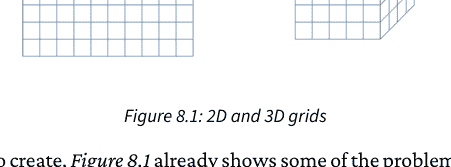

Figure 8.1: 2D and 3D grids

虽然网格很容易创建，但图 8.1 已经显示了一些问题。大于网格间距的对象必须放置到所有重叠的网格字段中，需要检查所有受影响的字段中的其他实例。

而且虽然网格的绝大多数区域将保持为空，但虚拟世界中的“拥挤地点”可能导致单个网格字段内有许多实例。许多实例意味着许多检查，不均匀的实例分布可能导致因计算数量而减速。

网格的一种继任者是四叉树。四叉树解决了网格的不均匀分布问题。


## Quadtree

四叉树的**基本元素**是一个单一的单元，可以是正方形或矩形。我们仅使用正方形单元进行描述，但所有内容同样适用于矩形单元。对象会连同其位置和尺寸一起插入到根单元中，通常使用覆盖对象范围的二维包围盒。

当每个单元的对象数量达到可配置的阈值时，四叉树的神奇之处就开始了。受影响的单元会被细分为四个大小相等的子单元。任何与一个或多个子单元重叠的对象都可以根据实现方式保留在父单元中或添加到所有受影响的子单元中。所有其他对象都会移入相应的子单元。图 8.2 显示了四叉树的示例：

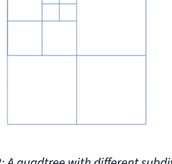

*图 8.2：具有不同细分情况的四叉树*

将正方形划分为四个子单元并将对象从父单元移入子单元，可将每个单元中的对象数量减少到低于配置的阈值，从而最小化需要进行碰撞检测的对象数量。

如果四个子单元内所有对象的总和低于阈值，则所有对象会再次移回父单元，而现在空的子单元将被删除。这种动态行为有助于将每个单元中的对象数量保持在零到阈值之间，而与单元的大小、父级数量或位置无关。

四叉树只能保存关于对象位置和尺寸的二维信息。要将相同的逻辑扩展到三维，可以使用八叉树。

## Octree

四叉树和**八叉树**的基本功能是相同的。唯一的区别是用于树元素的维数。 四叉树使用正方形或矩形作为单元，而八叉树由立方体或长方体组成。图 8.3 显示了一个简单的八叉树：

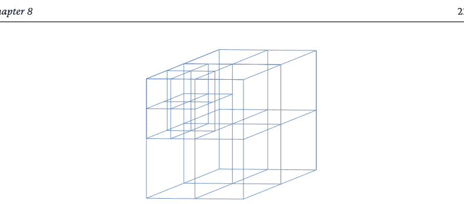

插入的对象在内部以三维轴对齐包围盒的形式维护，表示对象的范围。达到阈值时的分裂操作会创建八个子立方体作为子单元（或八个子长方体）。

八叉树是检查可能碰撞时剔除三维空间大块区域的有效方法。另一种处理二维和三维空间划分的数据结构是二叉空间划分（BSP）。

你可能听过老游戏中出现的三个字母 BSP。第一个使用 BSP 树维护关卡数据的游戏之一是 Id Software 于 1993 年发布的《Doom》。

尽管《Doom》中的关卡数据只是二维的，但游戏引擎创造了完全三维游戏的幻觉。

BSP 树是通过使用线（2D）或平面（3D）作为超平面递归地划分世界空间创建的，从而创建正面和背面。正面和背面的划分会一直持续，直到剩余的分区满足某个退出条件；对于游戏而言，该条件通常是分区完全被填满或为空时。

如果有其他线或平面被细分击中，这些线或平面会被分割成两部分，一部分位于正面，另一部分位于背面。

图 8.4 显示了空间的细分以及由此产生的 BSP 树：

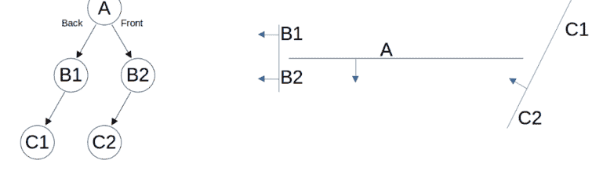

图 8.4：示例对象及其生成的 BSP 树

在图 8.4 中，线 A 用作起点，正面指向下方。将空间分割成两半也会分割线 B 和 C，从而产生线 B1、B2、C1 和 C2。线 B1 位于 A 的背面，将被添加为 A 的左子节点，而 B2 位于 A 的背面，作为 A 的右子节点。线 C1 和 C3 都位于 B1 和 B2 的背面，因此它们分别被添加为 B1 和 B2 的左子节点。

虽然解析 BSP 树以查找分区非常快，但生成相同的 BSP 树是一项耗时的任务。树生成通常在离线完成，预先计算好的树会随游戏或应用程序一起发布。将所有线或平面与所有其他线或平面进行比较是与碰撞检测相同类型的问题。

BSP 树无法快速更改或更新其元素的能力使其仅适用于静态数据（即游戏的关卡数据）。动态游戏元素，如门或玩家，需要使用不同的数据结构，例如八叉树。

与 BSP 树类似，k-d 树在搜索元素时很快，但在创建或更新时很慢。

## K-d tree

k-d 树存储 k 维空间中对象的相关信息。与之前的树相比，该算法稍微复杂一些。在每次数据点插入时，剩余空间会被分割成两部分，分裂后受影响的维度会发生变化。

对于二维 k-d 树，分裂维度在 X 和 Y 轴之间交替；对于三维 k-d 树，按 X、Y、Z 的顺序交替；以此类推。图 8.5 显示了二维和三维 k-d 树的样子：

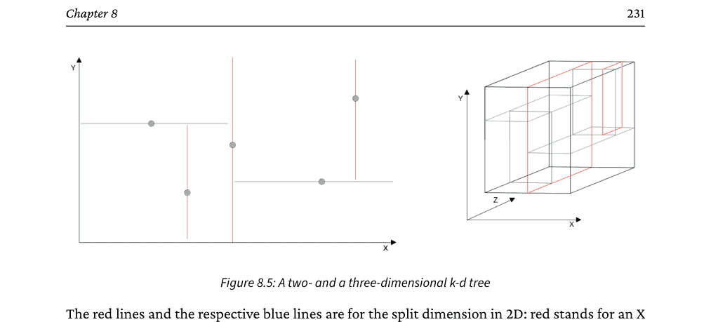

红色线和相应的蓝色线用于二维中的分裂维度：红色代表 X 分裂，蓝色代表 Y 分裂。在三维中采用相同的模式，并在连续分裂时使用“下一个”维度。由于剩余空间的部分被移除，因此在 k-d 树中搜索元素非常快。k-d 树的主要用途是点云和搜索给定点的最近邻。

一种略有不同的方法是通过使用包围体积层次结构进行空间划分。

## Bounding volume hierarchy

与之前的树变体不同，包围体积层次结构可以通过不同类型的几何表示来实现。作为示例，我们使用图 8.6 所示的二维包围圆：


通过将两个或多个包围圆封闭到更大的包围圆中，可以降低碰撞测试的数量。如果可能碰撞的对象未击中外圆，则无需检查任何内部圆是否可能发生碰撞。内部圆对碰撞对象而言是无法到达的。

只有当我们击中外圆时，才需要进行更深入的检查。与其他树类似，包围体积层次结构可以从进一步的碰撞检查中剔除世界空间的大部分区域。

在开始实现空间划分算法之前，我们需要探索加速碰撞检测的第二种方法：使用实例的简化表示以进行更快的检查。

## Simplifying the instances for faster collision checks

在减少总体数量后，如果我们使用模型抽象，碰撞检查的性能可以大大提高。这些抽象仅由少量几何元素组成，如盒子、长方体或圆，包围实例。如果这些抽象不相交，则实例不可能发生碰撞，我们可以将其从候选列表中移除。

对象最快的抽象之一是轴对齐包围盒。

## Axis-aligned bounding box

轴对齐包围盒（AABB）是一个矩形或长方体，刚好足够包含对象，且矩形的所有线或长方体的所有平面都与笛卡尔坐标系的轴对齐。我们将在四叉树的实现中使用 AABB 的二维变体，即包围盒。图 8.7 显示了一个二维包围盒：

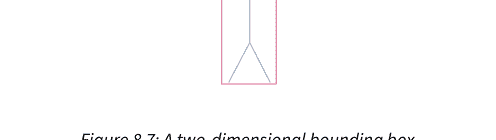

图 8.7：二维包围盒

AABB 最适合形状接近正方形、矩形、立方体或长方体的对象。对于圆形对象，AABB 会在对象与盒子范围之间产生大量空间，导致在检查可能碰撞时出现更多“假阳性”。

AABB 之间交集的检查是快速而简单的任务。由于所有四条线或六个面都与轴对齐，只需检查每条线或平面相对于第二个实例的相反线或平面在某一维度上的情况即可。

例如，实例一的底部平面和实例二的顶部平面只需比较 Y 值即可进行检查（如果 Y 轴向上）。如果该检查表明实例未发生碰撞（即第二个实例的顶部平面未位于实例一的底部平面之上），则可以立即结束碰撞检查——这两个实例根本不可能相交。因此，我们可以使用 AABB 进行快速预检。

当我们随对象旋转 AABB 时，就会创建**定向包围盒（OBB）**。

## Oriented bounding box

随对象一起旋转 AABB 可能很诱人，因为我们仍然保持对象数据与盒子额外空间之间良好的比例。图 8.8 显示了一个示例：

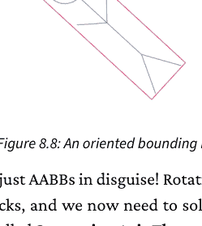

*图 8.8：定向包围盒*

但请注意，OBB 并不只是 AABB 的伪装！旋转平面将不再允许我们进行简单的坐标检查，我们现在需要求解大量平面方程或使用诸如**分离轴定理**之类的高级方法来检查两个 OBB 的侧平面是否相交。此外，OBB 的创建和旋转可能复杂且模棱两可。因此，这里的小贴士是远离 OBB；在大多数情况下，它们不值得额外的复杂性。

对于圆形（ish）对象，包围圆和包围球是良好的简化类型。


## 包围圆和包围球

二维中的包围圆，或三维中的包围球，其实相当简单。我们只需要一个中心点和一个半径，就完成了。图 8.9 显示了围绕一个物体的包围圆：

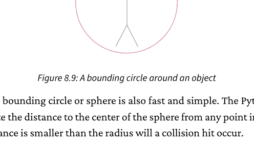

检查包围圆或包围球也很快且简单。毕达哥拉斯定理帮助我们计算世界中任意点到球心的距离。只有当计算出的距离小于半径时，才会发生碰撞命中。

请记住，毕达哥拉斯定理包含计算平方根，如果不使用现代单指令多数据 SIMD CPU 扩展，如流式 SIMD 扩展 SSE 或高级向量扩展 AVX，这是一个相当昂贵的操作。这里一个可能的优化是使用半径的平方，并在计算距离时跳过平方根。由于两个结果现在都被平方了，比较的结果与平方根版本相同。

包围圆或包围球的一个有趣的改编是胶囊。

### 胶囊

胶囊看起来像是圆或球的拉伸版本，其中中间部分呈矩形或圆柱形。由于胶囊的整体形状比球或矩形包围盒更接近人体形状，因此胶囊用于人体。图 8.10 显示了胶囊的示例：

检查凸包的碰撞需要大量测试，可能降低我们通过模型简化想要实现的效果。只要你没有大量三角形的模型，凸包可能就不在考虑范围内。

另一方面，如果可以容忍小的碰撞误差，凸包可以用作高模模型的替代品，并且所有碰撞检查都只需针对凸包进行。

作为最后一种方法，可以使用包围体积层次结构。层次结构模型不仅适用于空间划分，也适用于模型简化。

### 包围体积层次结构

包围体积层次结构用于空间划分的一般思想也适用于简化实例。但在这里，模型部件被包含在越来越大的体积中。图 8.12 显示了围绕角色模型的包围体积层次结构的简化示例：

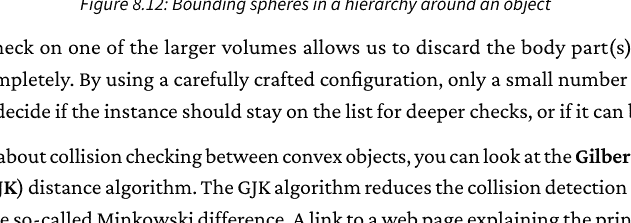

对其中一个较大体积的检查失败，允许我们完全丢弃该体积内部的身体部位。通过精心设计的配置，只需要很少的测试即可决定实例是否应保留在列表中以进行更深入的检查，或者是否可以忽略。

有关凸对象之间碰撞检查的详细信息，可以查看 Gilbert–Johnson–Keerthi GJK 距离算法。GJK 算法通过使用所谓的 Minkowski 差来降低碰撞检测复杂度。解释 GJK 算法原理的网页链接可在“附加资源”部分找到。

为了简单起见，由于更新速度快，并且基于设置要检查的实例数量的限制，我们将在应用程序中实现四叉树并为实例使用包围球。四叉树将使我们能够比“暴力”成对比较所有模型的朴素方法更快地完成碰撞检测的第一步。包围球在碰撞检查数量和球与实例三角形之间的空隙导致的误报数量之间取得了很好的平衡。

接下来，让我们进入四叉树的实现。

## 添加四叉树以存储附近的模型实例

让复杂的代码正确无误是困难的，因此使用开源的四叉树实现是一个可行的选择。我找到的最合适的四叉树版本来自 Pierre Vigier，可以在 GitHub 上找到：https://github.com/pvigier/Quadtree。

Pierre 的代码基于 C++ 模板，以在四叉树中存储的数据上具有很大的灵活性。此外，他使用自定义模板化的二维向量类型来存储位置和大小。

我们不需要这种灵活性，因为我们只会存储一个包含实例索引位置的 int 到四叉树中。而且由于我们对所有其他需要二维向量类型的情况都使用 GLM，我们将更改边界框实现以使用 glm::vec2 来存储框位置和大小。

### 调整边界框代码

作为新而闪亮的四叉树的第一个步骤，我们需要调整边界框的代码。不是将顶部和左侧位置以及宽度和高度作为单个值存储，我们使用 vec2 来存储位置和大小。将 GitHub 仓库 include 文件夹中 Box.h 文件中的模板化 C++ 代码转换过来相当容易，我们最终在新创建的 quadtree 文件夹中的 BoundingBox2D.h 和 BoundingBox2D.cpp 文件中得到了构造函数、几个 getter 以及 contains() 和 intersects() 两个方法。

最复杂的方法是 intersects()，用于检查两个边界框是否相交：

```cpp
bool BoundingBox2D::intersects(BoundingBox2D otherBox) {
	return !(
		mPosition.x >= otherBox.getRight() ||
		otherBox.getTopLeft().x >= getRight() ||
		mPosition.y >= otherBox.getBottom() ||
		otherBox.getTopLeft().y >= getBottom()
	);
}
```

在 AssimpInstance 类中，将添加一个名为 mBoundingBox 的新私有成员，存储实例的边界框：

```
BoundingBox2D mBoundingBox{};
```

我们不需要加载或保存边界框，因此它可以直接存储在 AssimpInstance 中，InstanceSettings 结构体之外。

我们需要两个简单的公共方法来存储和检索边界框：

```
BoundingBox2D getBoundingBox();
void setBoundingBox(BoundingBox2D box);
```

作为边界框实现的最后一步，我们必须在项目根文件夹的 CMakeLists.txt 文件中添加一个新的 quadtree 文件夹到两个位置，以便在其他类中使用边界框和四叉树。首先，使用通配符为所有 .cpp 文件将文件夹添加到 SOURCES 文件搜索中：

```
file(GLOB SOURCES
...
quadtree/*.cpp
...
)
```

然后，将 quadtree 文件夹附加到 include 目录列表：

```
target_include_directories(${PROJECT_NAME} ... quadtree)
```

重新创建 CMake 文件后，这应该由 Visual Studio 和其他 IDE 在保存 CMakeLists.txt 中的更改后自动完成，我们可以继续四叉树的实现。

### 重写四叉树代码以适应我们的需求

我们将把新的 Quadtree 类存储在 quadtree 文件夹中的 Quadtree.h 和 Quadtree.cpp 文件中。从四叉树 C++ 模板到 C++ 类的转换与边界框代码相比需要额外的步骤。

在将 C++ 模板代码翻译时，我们需要进行以下调整：

- 用 glm::vec2 替换自定义 Vector2 类型。
- 用 BoundingBox2D 类型替换自定义 Box 类型，并将参数更改为 glm::vec2。
- 用日志输出替换 assert() 检查。
- 添加一个 clear() 方法，删除四叉树中的所有内容。
- 添加清理交换 ID 的碰撞实例对的代码。
- 使用返回值而不是输出参数返回结果。
- 使用回调函数代替 GetBox 函数参数。

对于回调函数，我们在 Callbacks .h 文件中添加另一个回调，只接受一个 int 作为参数并返回一个 BoundingBox2D：

```
using instanceGetBoundingBox2D = std::function<BoundingBox2D(int)>;
```

四叉树将作为名为 mQuadtree 的私有成员变量添加到渲染器中：

```
std::shared_ptr<QuadTree> mQuadtree = nullptr;
```

在 initQuadTree() 方法中的初始化期间，我们将回调绑定到 getBoundingBox() 方法，使用实例索引作为参数：

```
mQuadtree->instanceGetBoundingBox2DCallback = [this](int instanceId) {
	return mModelInstCamData.micAssimpInstances.at(
		instanceId)->getBoundingBox();
};
```

填充四叉树将在渲染器的 draw() 调用中在遍历模型实例时发生。对于每个实例，我们创建边界框并将实例添加到四叉树中：

```
BoundingBox2D box{position, size};
instances.at(i)->setBoundingBox(box);
mQuadtree->add(instSettings.isInstanceIndexPosition);
```

为每个实例创建边界框将在“计算实例边界框”部分中处理。

关于四叉树使用仍有一个重要问题：我们应该在每一帧更新树中的实例位置，还是应该清除整个四叉树并再次添加所有实例？

在四叉树中更新一个对象需要删除并重新添加。因此，如果四叉树中大部分是静态对象，更新是可以的。但由于我们的计划是有许多实例在移动和/或播放动画，位置和/或边界框将会


几乎每一帧都会发生变化。在这样的环境中，移除和添加实例比清空四叉树并重新添加所有实例的新数据更加昂贵。

在渲染器的 `draw()` 调用中重新开始一个全新的四叉树很简单。在进入实例循环之前，清空四叉树的内容：

```
mQuadtree->clear();
```

四叉树准备好后，我们必须解决如何为实例生成包围盒的问题。答案可能令人惊讶：我们需要在 GPU 和 CPU 之间分配工作。

## 计算实例包围盒

当涉及对所有实例进行大量计算时，首先想到的很可能是“我会使用计算着色器！”，尤其是在我们通过将工作卸载到 GPU 来解决一些计算密集型问题之后。但在这种情况下，CPU 必须承担一部分工作。

虽然计算着色器非常适合以大规模并行方式计算独立结果，但它们并不适合创建包围盒这样的简单任务。要计算实例的包围盒，我们需要在虚拟世界中为每个实例存储所有节点的最小和最大坐标，合并中间结果以创建最终的包围盒。在 CPU 上，我们可以轻松地从数据结构中逐个获取顶点位置，执行所需计算，并将最终的 AABB 存回内存。

但如果我们想在着色器内计算 AABB 坐标，如果 AABB 结果使用相同的缓冲区位置，我们最终可能会覆盖其他着色器调用的结果。或者我们会得到一个巨大的坐标列表，之后必须进行排序。排序坐标也可以在另一个计算着色器中完成，但并行排序算法往往很复杂，因为它们面临同样的限制：无法将数据写入相同的缓冲区位置。

因此，与其担心计算着色器中的数据同步问题，我们不如利用它们能快速完成的任务：创建查找表。

## 添加三维包围立方体类

为了存储生成的查找数据，我们将为三维 AABB 添加一个 C++ 类。在这里使用 AABB 的优点是可以在渲染器中绘制调试线条，但第三组坐标在存储和生成时间上只增加少量开销。此外，将来升级为八叉树以在所有三个维度上进行快速碰撞检测也将变得简单。

新类名为 AABB，将位于 tools 文件夹中。除了构造函数、一些公共的 getter 和 setter，以及两个私有浮点数 mMinPos 和 mMaxPos 之外，AABB 类还有两个公共方法：create() 和 addPoint()。

通过使用 create() 方法，我们在 glm::vec3 参数给定的位置添加一个点，作为包围盒的最小和最大范围。而使用 addPoint()，我们扩展包围盒以包含新点：

```
void AABB::addPoint(glm::vec3 point) {
    mMinPos.x = std::min(mMinPos.x, point.x);
    mMinPos.y = std::min(mMinPos.y, point.y);
    mMinPos.z = std::min(mMinPos.z, point.z);
    mMaxPos.x = std::max(mMaxPos.x, point.x);
    mMaxPos.y = std::max(mMaxPos.y, point.y);
    mMaxPos.z = std::max(mMaxPos.z, point.z);
}
```

如果新点位于包围盒内部，则什么也不会发生。但如果该点位于包围盒外部，包围盒将在一个、两个或三个维度上扩展以包含该新点。最终，我们将得到一个包围所有已添加点的盒子，由三个维度的最小值和最大值定义。

为了生成在渲染器中绘制的调试线条，使用公共方法 getAABBLines()。在 getAABBLines() 方法中，我们创建 12 条线，介于 mMinPos 和 mMaxPos 的 x、y、z 元素的最小和最大位置的 8 种可能组合之间：

```
mAabbMesh->vertices.at(0) =
    {{mMinPos.x, mMinPos.y, mMinPos.z}, color};
    mAabbMesh->vertices.at(1) =
    {{mMaxPos.x, mMinPos.y, mMinPos.z}, color};
    ...
    mAabbMesh->vertices.at(22) =
    {{mMaxPos.x, mMaxPos.y, mMinPos.z}, color};
    mAabbMesh->vertices.at(23) =
    {{mMaxPos.x, mMaxPos.y, mMaxPos.z}, color};
```

## 创建 AABB 查找表

AABB 查找表的基本思想是为每个模型的每个动画剪辑预先计算固定帧数的 AABB。将包围盒存储在查找表中，使我们能够检索模型在动画剪辑某帧中的良好近似 AABB。

通过在两个不同剪辑中相同帧号的 AABB 坐标之间进行混合，并根据模型的变换来变换最终 AABB，我们可以以较低的计算成本为实例计算出一个贴合良好的 AABB，即使实例正处于动画混合过程中。

创建查找表是计算着色器和 CPU 工作的混合，在渲染器的 createAABBlookup() 方法中完成。查找表在渲染器类中生成有两个原因：

- 加载模型的主要方法位于渲染器中，我们还通过回调将模型加载方法暴露给用户界面。
- 渲染器已经加载了计算着色器。我们可以直接使用这些着色器，而不必在 AssimpModel 类中使用另一组相同的着色器。

对于计算着色器部分，我们可以复用第 2 章中渲染器 draw() 调用的实例循环中的代码。

为了找到模型的最大范围，我们将使用节点。为了计算每个实例的节点，可以使用两个计算着色器 assimp_instance_transform.comp 和 assimp_instance_matrix_mult.comp。在包含节点平移、旋转和缩放的计算矩阵的平移部分，存储了每个节点的位置。这里唯一的区别是节点偏移矩阵。

虽然这些偏移矩阵对于顶点蒙皮是必需的，但它们会给出错误的节点位置结果。我们可以通过绑定一个充满单位矩阵的 SSBO 来在计算中移除偏移矩阵，这样我们只得到节点的 TRS 矩阵。

通过提取每个实例的节点位置，并根据这些位置创建每个节点的 AABB，我们就有了一种简单的方法来计算四叉树和调试显示所需的数据。对于 2D 包围盒，我们只需提取 AABB 的 x 和 z 元素，生成 AABB 的“俯视”视图。

AABB 计算按每个动画剪辑和模型的每个节点进行。生成的 std::vector 将存储在我们刚刚加载的模型的 AssimpModel 数据中。要检索动画剪辑中某个时间位置的正确 AABB 数据，我们使用与生成顶点蒙皮矩阵相同的逻辑，并将缩放后的时间位置作为查找数据的索引。如果我们在两个动画之间混合，我们甚至可以在两个动画的 AABB 之间进行混合。

## 在模型和渲染器中使用 AABB

现在，在渲染器的 draw() 调用中遍历实例时，我们可以通过调用 getAABB() 来检索动画剪辑和时间位置的 AABB 数据：

```
AABB instanceAABB = model->getAABB(instSettings);
```

在 getAABB() 内部，使用来自动画和实例平移、旋转和缩放的数据来创建适合该实例的 AABB。具体来说，getAABB() 将：

- 查找第一个和第二个动画剪辑的 AABB
- 根据动画混合因子在两个 AABB 之间进行混合
- 按实例缩放因子缩放生成的 AABB
- 如果模型的轴交换被激活，则旋转 AABB
- 根据实例旋转旋转 AABB（此时它是一个 OBB）
- 从旋转后的 AABB 生成新的 AABB
- 将 AABB 平移到实例位置

此时，AABB 包围了该实例。

由于混合和旋转仍然是昂贵的操作，可能会损害包含许多实例的场景的性能，因此可以通过使用现代处理器的 SIMD 操作（如 SSE 或 AVX）并行化计算来实现加速。但即使将 AABB 查找数据保留在 GPU 上也可能是有益的。使用计算着色器计算所有实例的包围盒并下载结果，可能仍然比纯粹的 CPU 计算更快，尽管需要额外下载结果。

为了获得最佳性能，您可能需要实现 getAABB() 方法的不同版本，并针对各种场景大小和复杂度对应用程序进行性能剖析。


调整实例的 AABB 后，我们计算四叉树的二维包围盒的位置和大小：

```
glm::vec2 position =
glm::vec2(instanceAABB.getMinPos().x,
instanceAABB.getMinPos().z);
glm::vec2 size =
glm::vec2(std::fabs(instanceAABB.getMaxPos().x -
instanceAABB.getMinPos().x),
std::fabs(instanceAABB.getMaxPos().z -
instanceAABB.getMinPos().z));
```

现在，我们拥有了将实例插入四叉树所需的所有数据：

```
BoundingBox2D box{position, size};
instances.at(i)->setBoundingBox(box);
mQuadtree->add(instSettings.isInstanceIndexPosition);
```

为了确保我们创建了一个可用的四叉树，我们将添加一个包含四叉树的新 ImGui 窗口，包括所有细分和实例。看到四叉树的运行情况有助于找到任何实现错误。

## 创建一个显示四叉树及其内容的窗口

对于 ImGui 窗口，我们在 UserInterface 类中创建一个名为 createPositionsWindow() 的新方法。在此方法中，我们使用 ImGui::Begin() 创建一个新窗口。

接下来，我们获取世界边界以获得绘制所需的原点、大小和中心点。

然后，我们遍历所有实例，使用包围盒的位置和大小在实例的二维世界位置绘制 ImGui 矩形。我们还使用 micInstanceCollisions 变量的配对，以不同颜色绘制非碰撞和碰撞的实例。

最后，我们获取四叉树及其所有细分部分的包围盒。为了获取四叉树所有层级的包围盒，我们在 Quadtree 类中添加一对公有和私有方法 getTreeBoxes()。getTreeBoxes() 方法递归遍历四叉树节点和子节点，将包围盒存储在 BoundingBox2D 元素的 std::vector 中。我们使用白色线条绘制所有四叉树盒子。

图 8.13 显示了四叉树窗口的示例：

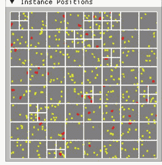

图 8.13：带有细分、实例和检测到的碰撞的四叉树

在图 8.13 中，四叉树及其所有细分都用白色绘制。普通实例的包围盒用黄色线条绘制，碰撞的实例用红色线条绘制。

填充四叉树并在屏幕上绘制结果只是碰撞检测的一半；我们还需要对虚拟世界中实例碰撞的信息做些什么。

## 获取碰撞的实例并对碰撞做出反应

从四叉树中获取所有碰撞实例的列表是通过调用 mQuadtree 对象的 findAllIntersections() 完成的：

```
mModelInstCamData.micInstanceCollisions =
    mQuadtree->findAllIntersections();
```

我们将结果存储在 ModelInstanceCamData 结构中的新变量 micInstanceCollisions 中，以便使实例碰撞对代码的其他部分可用（即用于调试绘制线条）。碰撞的实例以实例对的形式提供给我们。

为了在屏幕上看到碰撞的结果，我们可以遍历实例对并旋转一个或两个实例：

```
for (const auto& instPairs :
    mModelInstCamData.micInstanceCollisions) {
    instances.at(instPairs.first)->rotateInstance(6.5f);
```

```
instances.at(instPairs.second)->rotateInstance(-5.3f);
```

行走或跑向另一个实例时现在应该会旋转你的实例，或你的实例和碰撞的实例。即使角度很小，它也会在检测到这些实例之间碰撞的每一帧中累加。在正常的 60 或 75 FPS 帧率下，你会看到自己瞬间远离另一个实例，突然朝不同方向运行。

如果你不喜欢实例在碰撞时只是旋转，你可以尝试实现更复杂的碰撞反应。查看 Practical sessions 部分，了解关于添加碰撞解决的任务，以及 Additional resources 部分，了解有关碰撞避免的资源链接。

## 绘制 AABB 调试线

如果你的实例或另一个实例没有旋转并且你仍然可以直接穿过其他实例，将 AABB 线绘制到屏幕上会很有帮助。

```
mLineVertexBuffer.uploadData(*mAABBMesh);
mLineShader.use();
mLineVertexBuffer.bindAndDraw(GL_LINES, 0, mAABBMesh->vertices.size());
```

作为替代方案，我们可以遍历所有实例并使用 micInstanceCollisions 中的实例索引对来切换要绘制的 AABB 的颜色。

为了更好地控制 AABB 线条，将在 ImGui 控制窗口中创建一个单独的部分。结合一个名为 collisionDebugDraws 的新枚举类以及 renderer 中 drawAABBs() 方法中的更多代码，你可以在三种不同的绘制模式之间切换：

- 无 AABB
- 仅碰撞的 AABB 以红色显示
- 所有碰撞的 AABB 以红色显示，所有其他 AABB 以黄色显示

相反，我们将使用球体来简化实例的更详细级别，通过为模型节点添加可配置的包围球体。即使我们现在必须检查数十个球体与另一个实例的球体，我们仍然远低于我们需要检查两个模型的所有三角形彼此之间的计算能力。

误报的数量也将保持在可接受的水平。如 Simplifying the instances for faster collision checks 部分所述，在更高细节的简化与更多计算之间选择，或更简单的抽象与更多误报碰撞检测之间选择，是我们必须接受的权衡，但我们可以战略性地做出决定。

## 创建包围球体的数据

为了创建球体数据，我们使用与包围盒计算相同的第一步。我们使用 compute shader assim_instance_transform.comp 和 assim_instance_matrix_mult.comp，并用单位矩阵替换骨骼偏移矩阵。此着色器运行的结果是一个包含我们想要配备包围球体的所有实例的节点位置的 SSBO。

但是，与包围盒不同，我们可以使用另一个 compute shader 来计算节点的包围球体。第三个 compute shader，称为 assim_instance_bounding_spheres.comp，使用前一个 compute shader 创建的节点的 TRS 矩阵、实例的世界位置矩阵以及父节点索引，为每个实例的每个节点创建一个包围球体。

另一个名为 SphereAdjustment 的 SSBO 被使用，包含每个节点的 vec4。这些球体调整可以通过 UI 扩展设置，该扩展将模型节点名称映射到一个 SliderFloat 和一个 SliderFloat3，允许我们调整着色器创建的包围球体的大小和位置。通过仔细放置包围球体，我们可以确保模型周围尽可能少的多余空间被检测为碰撞。

```
uint numberOfBones = gl_NumWorkGroups.x;
uint index = node + numberOfBones * instance;
```

我们根据着色器的调用 ID 选择要处理的节点和实例，而模型中节点的数量来自我们分派 compute shader 时使用的 work group 数量的 X 维度。

接下来，我们通过从实例特定节点的 TRS 矩阵中提取平移部分并添加来自球体调整缓冲区的位移来获取节点位置：

```
vec3 nodePos =
    (worldPosMat[instance] * trsMat[index])[3].xyz;
nodePos += sphereAdjustment[node].xyz;
float radius = 1.0;
```

我们还声明球体半径并将其初始化为默认值。

然后，我们从父索引缓冲区中提取当前节点的父节点 ID：

```
int parentNode = parentIndex[node];
```

父节点用于在具有父节点的节点和父节点或未连接的独立节点之间切换。如果我们找到有效的父节点，我们计算父节点在包含位置调整后的世界位置：

```
if (parentNode >= 0) {
    uint parentIndex = parentNode +
        numberOfBones * instance;
    vec3 parentPos =
        (worldPosMat[instance] * trsMat[parentIndex])[3].xyz;
    parentPos += sphereAdjustment[parentNode].xyz;
```

通过使用节点和父节点位置，我们计算节点与其父节点之间的中点。我们计算球体的半径——再次可通过球体调整值调整：

```
vec3 center = mix(nodePos, parentPos, 0.5);
radius = length(center - nodePos) *
    sphereAdjustment[node].w;
```


对于根节点，我们将球体的半径设置为可调值：

```
} else {
 radius = sphereAdjustment[node].w;
}
```

在 main() 方法的末尾，我们添加一个小的检查来在着色器中禁用较小的球体：

```
if (radius < 0.05) {
 sphereData[index] = vec4(0.0);
} else {
 sphereData[index] = vec4(nodePos, radius);
}
```

由于我们需要在渲染器代码的多个不同位置运行这三个计算着色器，我们通过将填充和运行着色器的代码添加到名为 runBoundingSphereComputeShaders 的新方法中来简化工作。

## 绘制包围球

包围球的计算着色器的第二个用途是调试显示，与 AABB 类似。在运行计算着色器之后，我们可以使用另一个新的顶点和片段着色器对将球体绘制到屏幕上。

在名为 sphere_instanted.vert 的新球体绘制顶点着色器的 main() 方法中，我们提取球体的中心和半径：

```
void main() {
 vec3 boneCenter = sphereData[gl_InstanceID].xyz;
 float radius = sphereData[gl_InstanceID].w;
}
```

为了加快绘制速度，我们将使用实例化绘制调用来进行渲染 API，因此我们可以在此处使用特殊变量 gl_InstanceID（在 Vulkan 中，该变量 gl_InstanceID 被重命名为 gl_InstanceIndex）。OpenGL 和 Vulkan 都会在每个实例中分别递增变量 gl_InstanceID 和 gl_InstanceIndex 的值，从而使我们能够从单个顶点集绘制数千个包围球。

## 碰撞检测简介

将球体调整为正确半径的工作由着色器中一个名为 createScaleMatrix() 的小型 GLSL 函数完成，本质上是用半径值在主对角线元素中创建缩放矩阵：

```
mat3 scaleMat = createScaleMatrix(radius);
```

然后，我们通过缩放矩阵缩放球体顶点的原始位置，加上球体调整，通过与视图和投影矩阵相乘创建最终的着色器矩阵，并设置线条颜色：

```
gl_Position = projection * view * vec4(scaleMat * aPos + boneCenter, 1.0);
lineColor = vec4(aColor, 1.0);
}
```

运行球体着色器是通过调用 Shader 类绘制命令的实例化版本来完成的：

```
mLineVertexBuffer.uploadData(mSphereMesh);
mSphereShader.use();
mBoundingSphereBuffer.bind(1);
mLineVertexBuffer.bindAndDrawInstanced(GL_LINES, 0, mSphereMesh.vertices.size(), numberOfSpheres);
```

对于 Vulkan 渲染器，使用等效的绘制调用（vkCmdBindPipeline()、vkCmdBindVertexBuffers()、vkCmdBindDescriptorSets() 和 vkCmdDraw()）。

由于用于碰撞检测的包围球可能与我们希望在屏幕上绘制的包围球不相同，因此我们使用单独的方法来绘制调试球体。我们调试绘制方法之间的主要区别是为计算着色器提供实例列表的创建。

我们可以通过调用 drawSelectedBoundingSpheres() 仅在选定的实例上绘制包围球，通过调用 drawCollidingBoundingSpheres() 显示发生碰撞的实例的包围框，或通过调用 drawAllBoundingSpheres() 在屏幕上所有实例周围创建“蓬松的白色雪球”，如图 8.16 所示。

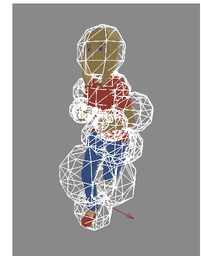

图 8.16：女性模型节点上的调整后包围球

现在我们能够计算和绘制模型的包围球，让我们将球体作为第二层添加到碰撞检测代码中。

## 使用包围球进行碰撞检测

从四叉树中收集的碰撞实例通过调用 findAllIntersections() 由渲染器收集并保存到 micInstanceCollisions，如 Retrieving the colliding instances and reacting to the collision 部分所述：

```
mModelInstCamData.micInstanceCollisions =
    mQuadtree->findAllIntersections();
```

为了使碰撞检测代码更易于维护，我们将相交提取调用移动到名为 checkForInstanceCollisions() 的新方法中。此新方法将成为与碰撞检测和处理相关的所有代码的起点。

我们扩展碰撞检测的第一步是通过调用上述 findAllIntersections() 方法来获取四叉树中的所有碰撞实例。然后，我们按模型将实例拆分为单独的 int 集合。使用每个模型的碰撞实例的单独列表是必要的，因为不同的模型可能具有不同的节点数。

然后，对于每个实例集合，我们创建具有包围球的 SSBO 并将球体数据提取到 glm::vec4 向量的映射中。我们将使用实例索引位置作为映射的键，将 SSBO 拆分为包含每个实例的所有球体作为值的映射。

包围球的实际碰撞检查是通过比较一个碰撞实例的所有球体与第二个碰撞实例的所有球体来完成的。我们已经大大减少了这些检查的数量，因为我们只剩下四叉树提供的实例对。

但即使检查球体碰撞是一项简单的任务，我们只需要比较中心之间的距离与两个球体半径之和，比较次数也会使此检查变慢。

即使有一种捷径可以删除所有半径为零的球体，并在检测到碰撞时停止比较，两个仅不碰撞且每个模型有 30 个活动球体的实例之间的检查仍需要 900 次这样的比较。

使用计算着色器加速球体比较操作是可能的，但像每对实例的节点数不同这样的问题会提高复杂性并降低计算着色器的效率。

虽然 GPU 上的并行计算可能很快，但上传和下载数据以及为单个实例对运行着色器可能会增加显著延迟，从而抵消计算着色器的加速。

因此，我们坚持使用基于 CPU 的解决方案来计算包围盒之间的碰撞第二层。除非我们在一个非常小的虚拟世界中有数千个实例，或者在一个世界的很小部分中有许多实例，否则碰撞检查的总体数量将保持较低。

图 8.17 显示了由包围盒检测到的碰撞示例（用红色线绘制），以及任何包围球的额外碰撞（也是红色）：

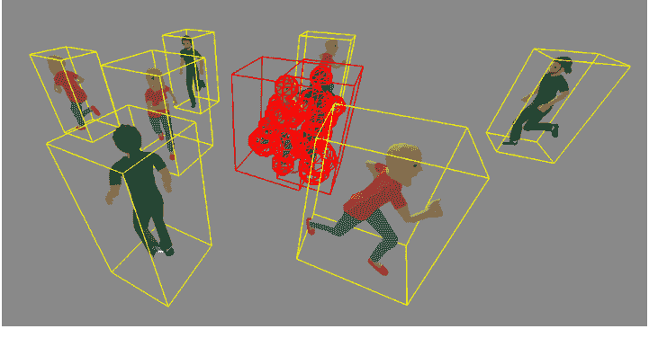

图 8.17：实例的包围球检测到一次碰撞

处理碰撞与 Retrieving the colliding instances and reacting to collisions 部分中包围盒碰撞的反应保持一致——我们只需在每一帧围绕固定角度旋转碰撞的实例。我们将在第 9 章和第 12 章中增强对碰撞的反应。

碰撞检测是一个复杂的话题，有许多算法和基于应用程序特定需求的选择。我们需要知道需要检查什么类型的对象以选择一个好的抽象形状，并且根据抽象的复杂性，我们可能需要调整用于查找碰撞的算法（或算法）。我们甚至没有涉及碰撞解决部分，该部分通过在检测到相交后移动实例来解决碰撞。如果你想深入了解游戏物理、碰撞检测和碰撞解决的世界，请查看 Additional resources 部分的书籍。

## 总结

在本章中，我们探讨了碰撞检测并为应用程序创建了两层碰撞检测。我们首先讨论了朴素解决方案的不足之处，然后我们探讨了空间划分方法和模型简化，以降低我们必须进行的检查次数，直到我们相当确定哪些实例真的存在一些碰撞。最后，我们实现了具有包围盒和包围球的四叉树来找出哪些实例发生碰撞。


在下一章中，我们将创建“真实”的非玩家角色（NPC），并通过添加可配置的行为让实例栩栩如生。我们将首先探索行为树的本质及其与 NPC 决策的关系，并为我们的实例实现支持行为树的代码。作为最后一步，我们将研究模型之间的交互，作为通用行为的一个特例。

## 实践环节

以下是你可以对代码做的一些补充：

- 为四叉树配置添加 UI 控制。
  
  目前，四叉树是在 renderer init() 调用期间静态初始化的。添加 UI 控制和 setter 回调函数以调整在拆分盒子之前实例的最大数量以及树的最大深度。

- 添加 UI 控制来配置世界边界。
  
  实例在虚拟世界中四处奔跑，如果某个实例到达 mWorldBoundaries 中设置的虚拟边界，它将被旋转以保持在边界内。添加一些滑块和回调来控制虚拟世界的原点和大小，并确保实例位置窗口也会更新。

- 实现八叉树和三维 AABB 检查。
  
  目前，我们仅为实例使用二维包围盒，就好像实例是从上往下看一样。将四叉树扩展为八叉树，并在实例的 AABB 之间添加三维相交检查。

- 加快包围球碰撞检查。
  
  由于检查的总体复杂性——我们必须将第一个实例的每个球体与第二个实例的每个球体进行检查——碰撞检查相当慢。也许计算着色器可以帮助这里。与包围盒生成不同，我们只需要每个实例一个是/否的答案来表示是否发生碰撞。使用每个球体或实例的原子计数器可以帮助避免计算着色器完成工作后冗长的后处理工作。

## 添加一个简单的包围体积层次结构。

与其检查两个实例的所有球体，你可以向模型添加一些未使用的节点并为这些节点添加更大的包围球，包围一些较小的球体。通过从两个实例的较大球体开始检查球体。如果这些大球体不发生碰撞，则较大球体内部的所有球体永远不会发生碰撞，并且身体的整个部分可以跳过下一次碰撞检查。

## 增强难度：在实例之间进行真正的三角形到三角形检查。

这是碰撞检测的最终目标。通过检查实例的真实相交，而不仅仅是一些 AABB 或包围球，可以实现自然的外观碰撞行为。此外，请注意该方法的优点，并查看额外的精度是否会使运行时行为受益。

## 增强难度：添加碰撞解决。

当碰撞检查发出两个实例之间发生碰撞的信号时，已经太晚了——实例部分相交。良好的碰撞检测伴随着碰撞解决，即在发现碰撞时将实例移开。关于碰撞检测和碰撞解决已经写了几本书；有关一些知名标题，请参阅其他资源部分。通往“做对”的道路上仍有许多需要注意的地方。

## 其他资源

- Separating Axis Theorem: https://dyn4j.org/2010/01/sat/
- Gilbert–Johnson–Keerthi distance algorithm: https://cse442-17f.github.io/Gilbert-Johnson-Keerthi-Distance-Algorithm/
- Template-based quadtree implementation: https://github.com/pvigier/Quadtree
- Collision Detection in Interactive 3D Environments: ISBN 978-1558608016
- Real-Time Collision Detection: ISBN 978-1558607323
- Game Physics Engine Development: ISBN 978-012381765
- Game Physics: ISBN 978-0123749031
- Collision Avoidance: https://code.tutsplus.com/understanding-steering-behaviors-collision-avoidance--gamedev-7777t
- More about Collision Avoidance: https://www.gameaipro.com/GameAIPro2/GameAIPro2_Chapter19_Guide_to_Anticipatory_Collision_Avoidance.pdf
