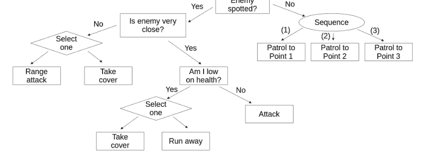
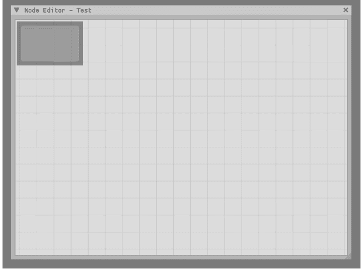
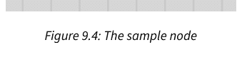
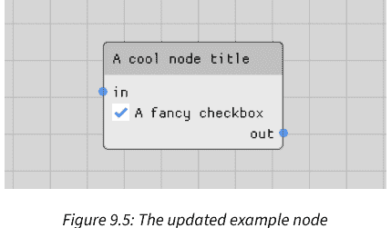
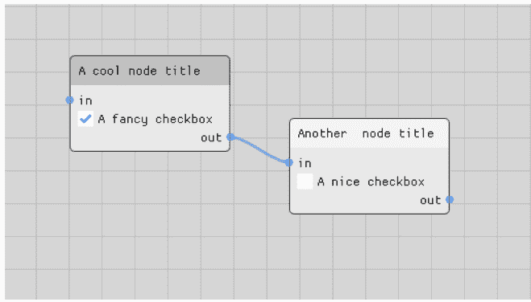
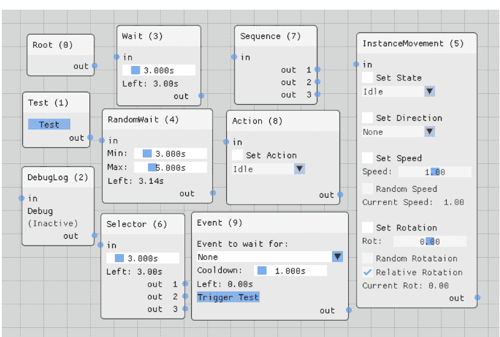
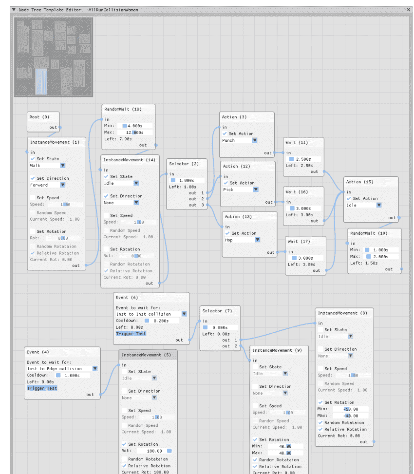
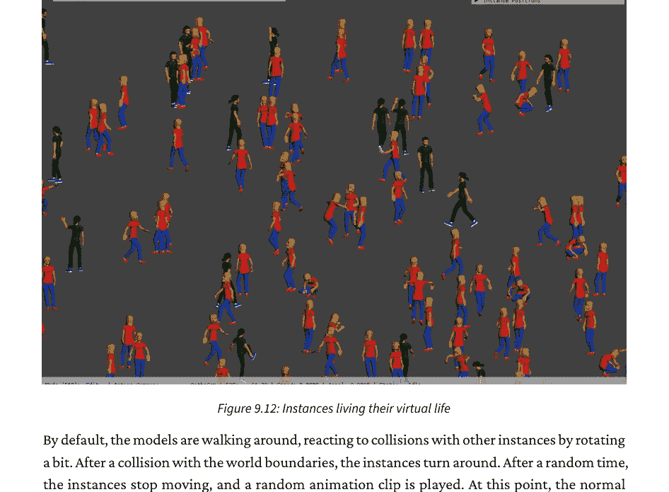
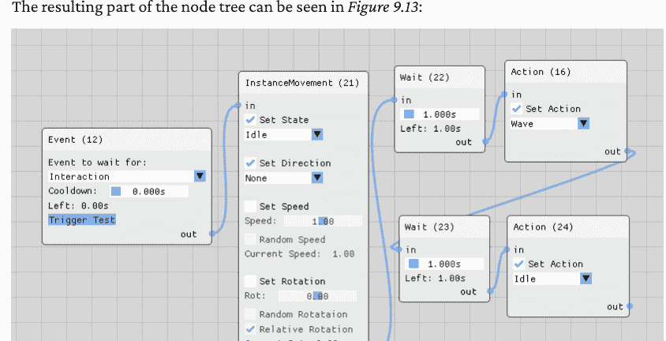
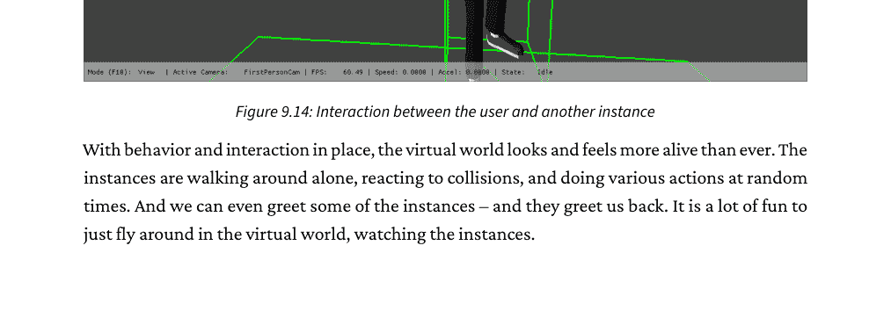

# 第9章 添加行为和交互

## 添加行为和交互

欢迎来到第 9 章！在上一章中，我们深入研究了碰撞检测。在讨论了在虚拟世界中找到碰撞实例的复杂性之后，我们探索了通过添加世界分区和模型简化来加快碰撞搜索的方法。然后，我们实现了四叉树将世界分割成更小的区域，并为实例添加了包围盒和包围球。最后，我们使用四叉树和实例边界来检测实例之间的碰撞。

在本章中，我们将为实例添加某种“现实生活”行为，使它们能够自行在虚拟世界中行走并对事件做出反应，例如我们在上一章中添加的碰撞。首先，我们将简要了解行为树和状态机以及两者是如何工作的。然后，我们将添加一个可视化编辑器，以可视化表示实例本身的状态机。在本章结束时，我们将扩展代码以从创建的节点树中执行行为更改，并将交互作为行为的额外形式添加。

在本章中，我们将涵盖以下主题：

- 控制实例行为的结构
- 添加可视化节点编辑器
- 扩展代码以支持行为更改
- 在实例之间添加交互

图 9.1 显示了 NPC 行为的一个简单想法：



图 9.1：一个简单的行为计划

尽管该计划看起来很简单，但它封装了复杂的智能行为。考虑敌人的距离和健康状况，同时扫描计划以寻找所需的行为，应该会产生相当令人印象深刻的 NPC 行动。通过在随机变化之间切换，采取掩护和远程攻击，直接攻击接近的敌人，或只是尝试隐藏或逃跑作为最后的选择，观看一群这些 NPC 与来袭敌人战斗将会很有趣。

我们将在本章中添加一个简单的状态机来控制实例的行为。此外，为了简化使用状态机创建和控制行为，我们将添加一个工具来创建节点和链接。因此，让我们稍作绕路，为应用程序添加一个可视化节点编辑器。

## 添加可视化节点编辑器

像在前几章一样，我们将使用开源工具来构建我们的可视化节点编辑器，而不是手工构建自己的解决方案。有几个基于 ImGui 的节点编辑器可用。你可以在其他资源部分找到一个精选列表。

在本章中，我们将使用 Johann “Nelarius” Muszynski 创建的名为 imnodes 的扩展。imnodes 的源代码可在 GitHub 上获得：

```
https://github.com/Nelarius/imnodes
```

像在前几章一样，我们将使用 CMake 为我们获取 imnodes。

## 使用 CMake 集成 imnodes

要让 CMake 将 imnodes 作为依赖项进行管理，请在项目根目录的 CMakeLists.txt 文件中，在 stbi 的 FetchContent 块和仅限 WIN32 的区域之间添加一个新的 FetchContent 块：

```
FetchContent_Declare(
    imnodes
    GIT_REPOSITORY https://github.com/Nelarius/imnodes
    GIT_TAG v0.5
)
```

我们将在此处使用 Git 标签 v0.5，以避免因 master 分支的新提交而引入的问题，导致找不到 ImGui 源代码。

接下来，我们使 imnodes 代码可用并让 CMake 填充源文件夹的变量：

```
FetchContent_MakeAvailable(imnodes)
FetchContent_GetProperties(imnodes)
if(NOT imnodes_POPULATED)
    FetchContent_Populate(imnodes)
    add_subdirectory(${imnodes_SOURCE_DIR} EXCLUDE_FROM_ALL)
endif()
```

然后，我们将 imnodes 的源目录变量附加到已存在的外部源文件和包含目录列表中：

```
file(GLOB SOURCES
    ...
    ${imnodes_SOURCE_DIR}/imnodes.cpp
)
...
target_include_directories(... ${imnodes_SOURCE_DIR})
```

作为最后一步，我们向现有的 add_definitions 行添加一个编译器定义：

```
add_definitions(... -DIMGUI_DEFINE_MATH_OPERATORS)
```


现在你应该能看到一个带有可见网格的窗口——节点编辑器。在此上下文中，所有 imnodes 和 ImGui 调用都可用，尽管无法直接在节点编辑器上绘制 ImGui 元素，因为它们会覆盖节点编辑器元素。

要结束节点编辑器和 ImGui 窗口，我们在结束 ImGui 窗口之前调用 EndNodeEditor()。如果我们想在窗口左上角显示整个节点编辑器窗口的透明小地图，我们可以在结束编辑器之前调用 MiniMap()：

```
ImNodes::MiniMap();
ImNodes::EndNodeEditor();
ImGui::End();
```

此时，节点编辑器窗口将如 图 9.3 所示：



图 9.3：一个全新的节点编辑器窗口

在节点编辑器窗口内部，可以创建新节点。作为一个小示例，我们将把所有属性硬编码到节点中。在“扩展节点编辑器”部分，将添加一个上下文菜单，允许我们在运行时创建和删除节点。

## 添加一个简单节点

可以通过调用 BeginNode() 开始一个新节点，使用 int 值作为节点的唯一标识：

```
```cpp
const int nodeId = 1;
ImNodes::BeginNode(nodeId);
ImGui::Text("Sample Node");
ImNodes::EndNode();
```
```

与 ImGui 本身一样，所有 immnodes UI 元素都必须设置唯一的 ID 才能被 ImGui 区分。内部，immnodes 使用 ImGui::PushID() 调用为包含节点数据的组设置 ID。我们只需要确保节点编辑器中的所有元素都设置了唯一的标识。

在节点内部，我们可以使用所有 ImGui 元素来创建控件元素。某些 ImGui 元素可能会表现异常。例如，ImGui::Separator() 调用会在节点编辑器的右端绘制一条线。但通常的元素，如文本、按钮或滑块，按预期工作。调用 BeginDisable() 和 EndDisable() 也能正常工作，允许我们使节点的一部分不可用。

小心在节点中禁用 ImGui 元素

虽然看起来很诱人，可以通过将不需要的 ImGui 元素包在 if 语句中来完全移除它们，但请注意 immnodes 会根据属性给定的 ID 计算输入和输出引脚的位置。如果你想移除属性或 ImGui 元素，请确保为仍可见的属性和元素保留相同的 ID，否则链接将被连接到错误的位置。

图 9.4 显示了之前找到的代码行的结果：



图 9.4：示例节点

除了可以通过按住鼠标左键移动外，我们的新节点并没有什么用处。因此，让我们在节点中添加一些元素，在 imnodes 中称为“属性”。

## 在节点中创建 imnodes 属性和 ImGui 元素

所有节点的属性必须在 BeginNode() 和 EndNode() 之间定义。请确保跳过“添加一个简单节点”部分中的 ImGui::Text() 行，因为它会破坏节点的布局。

我们添加的第一个 imnodes 属性是节点标题，使用 BeginNodeTitleBar()：

```
ImNodes::BeginNodeTitleBar();
ImGui::TextUnformatted("A cool node title");
ImNodes::EndNodeTitleBar();
```

标题显示在节点顶部的单独区域中，并显示其是否未选中、悬停或选中。

接下来，我们通过调用 BeginInputAttribute() 创建一个输入引脚：

```
const int inputId = 2;
ImNodes::BeginInputAttribute(inputId);
ImGui::Text("in");
ImNodes::EndInputAttribute();
```

输入节点定义会在节点的左侧创建一个“磁性”点，之后允许我们连接链接。节点可以有零到几乎无限的输入引脚，但很可能只会使用几个引脚。

在输入引脚之后，我们使用 BeginStaticAttribute() 创建一个静态属性：

```
const int staticId = 3;
static bool checkboxState = false;
ImNodes::BeginStaticAttribute(staticId);
ImGui::Checkbox("A fancy checkbox", &checkboxState);
ImNodes::EndStaticAttribute();
```

静态属性在节点的两侧没有输入或输出连接器。你可以像在 ImGui 窗口中的任何其他控件元素一样使用静态属性。

最后，我们使用 BeginOutputAttribute() 添加一个输出引脚：

```
const int outId = 4;
ImNodes::BeginOutputAttribute(outId);
ImGui::Text(" out");
ImNodes::EndOutputAttribute();
```

与输入引脚类似，输出引脚会在节点右侧创建连接器以对接链接。

在图 9.5 中，本节代码行创建的节点结果如下所示：



图 9.5：更新的示例节点

更新后的节点看起来已经很棒了。我们有一个标题、输入和输出引脚，以及一个由有状态变量控制的复选框——所有这些仅用了大约二十行代码。

连接节点与链接也很简单，我们现在就会看到。

## 维护节点之间的链接

imnodes 中的链接有三个属性：唯一的链接 ID、起始引脚 ID 和结束引脚 ID。唯一的链接 ID 用于标识和绘制链接本身，而引脚 ID 取自父节点（或源节点）的输出引脚，分别对应子节点（或目标节点）的输入引脚。

通过组合这三个 ID，imnodes 中的链接最好作为链接 ID 的映射中的引脚 ID 对进行管理：

```
std::map<int, std::pair<int, int>> links;
```

内部的 std::pair 以该顺序存储链接的起始引脚（输出）和结束引脚（输入）的 ID。通过外部的 std::map，我们在链接 ID 和引脚 ID 对之间建立连接。

### 先输出，后输入

> 值得注意的是，Imnodes 严格遵循此顺序。第一个报告的引脚始终是父节点的输出引脚，第二个引脚是子节点的输入引脚。遵循此规则使得使用节点和链接创建有限状态机变得容易，通过一组简单规则维护节点树的 state。

```
```cpp
for (const auto& link : links) {
    ImNodes::Link(link.first,
        link.second.first, link.second.second);
}
```
```

映射中的所有链接现在都将作为在两端带有曲线的线条绘制，连接父节点的输出引脚（对的第一元素）和子节点的输入引脚（对的第二元素）。

在编辑器结束之后通过调用 EndNodeEditor()，Imnodes 会发出新节点的信号。然后，可以使用两个 Imnodes 调用来创建或删除链接。

是否在当前帧中在编辑器中创建了新链接，可以通过调用 IsLinkCreated() 来请求：

```
```cpp
int startId, endId;
if (ImNodes::IsLinkCreated(&startId, &endId)) {
    linkId = findNextFreeLinkId();
    links[linkId] = (std::make_pair(startId, endId));
}
```
```

如果 IsLinkCreated() 返回 true，则用户在两个节点之间创建了新链接，我们可以将新链接保存到映射中。findNextFreeLinkId() 如何搜索新的链接 ID 取决于应用程序的需求。你可以查看示例代码，其中有一个简单的实现，重新使用已删除链接的 ID。

如果现有链接被断开然后丢弃，IsLinkDestroyed() 将返回 true，并将丢弃的链接 ID 作为输出参数返回：

```
int linkId;
if (ImNodes::IsLinkDestroyed(&linkId)) {
    links.erase(linkId);
}
```

imnodes 有一些其他函数可以实现自定义链接管理，但对于我们的节点编辑器，IsLinkCreated() 和 IsLinkDestroyed() 将足够。

复制我们示例节点的代码（记住为每个属性使用唯一的 ID）并在第一个节点的输出引脚 ID 与第二个节点的输入 ID 之间添加一个链接，将得到类似于图 9.6 的结果：



图 9.6：由链接连接的两个示例节点

你将不得不将节点移开，因为默认情况下所有新节点都创建在同一位置。除了在创建节点时设置初始位置外，imnodes 还允许我们使用 SaveCurrentEditorStateToIniString() 在当前编辑器会话中存储所有节点的位置。稍后可以通过调用 LoadCurrentEditorStateFromIniString() 来恢复位置。

在重新打开编辑器时节点保持在相同位置有助于创建良好的用户体验。


现在我们已经探索了如何使用 imnodes 管理节点编辑器的图形部分，我们需要创建一个类来存储状态信息和 imnodes 绘制调用。这些新类是驱动实例行为的有限状态机的构建块。

## 创建图节点类

节点树类的基本元素是一个名为 GraphNodeBase 的抽象类，位于新的文件夹 graphnodes 中。所有其他节点类都将从基类继承，增加特定任务的属性和逻辑，该节点需要负责处理。

与 *功能齐全* 的行为树相比，我们的简化版本将存储节点的状态在节点本身中。将节点状态维护在代码的单独部分会使实现更复杂且更难理解。使用集成状态的唯一缺点是为每个实例复制整个节点树，因为节点树本身被用作有限状态机。但节点对象很小；每个实例添加几个节点在内存空间和计算时间上造成的开销可以忽略不计。

在我们深入细节之前，这里是本章示例代码中创建的所有节点类型列表：

- **Root Node**

  根节点是每个节点树的起点，默认创建。不可能删除根节点，因为它是整个树的起点。有限状态机执行开始时，根节点首先被激活。此外，当没有其他节点处于活动状态时，根节点会再次被触发以重新开始。由于不需要通过其他节点触发根节点，根节点只有输出引脚而没有输入引脚。
- **Test Node**

  测试节点有助于开发和调试节点树。像根节点一样，只有输出引脚可用，外加一个按钮来激活输出引脚。
- **DebugLog Node**

  这是另一个帮助构建节点树的节点。目前，附加到实例的节点树无法加载到编辑器中进行实时调试会话。*实践环节* 部分中有一个任务用于实现将现有节点树加载到编辑器窗口的能力。为了观察特定操作，可以添加调试日志节点，在激活时向系统控制台打印一行。
- **Wait Node**

  等待节点已在图 9.2 中作为示例展示。该节点会通过可配置的时间延迟两个其他节点之间的执行。
- **RandomWait Node**

  这与等待节点类似，但可以设置延迟的上限和下限，从而实现更随机的行为。
- **Selector Node**

  选择器节点也有固定的延迟，延迟时间结束后会激活随机的输出引脚。
- **Sequence Node**

  序列节点按顺序依次激活输出引脚，从引脚编号一开始。作为额外功能，序列节点会等待活动输出上的子节点完成。等待子节点目前仅针对两种等待节点类型实现；可以添加更多类型或与孙节点级联。有关想法，请参阅实践环节部分。
- **Action Node**

  我们在第 7 章中添加了动作。动作节点允许我们像第 7 章中那样触发动作，同时使用键盘和鼠标控制实例，从而使实例不仅能走动，还能根据节点树的状态跳跃、翻滚、击打或挥手。
- **Event Node**

  事件节点由发送到实例的外部事件触发，例如发生碰撞时。事件节点还具有冷却计时器，以忽略短时间内相同的事件，避免如果事件持续发送到实例，树在每次更新时重复执行相同动作而导致的行为异常。
- **Instance Movement Node**

  实例节点允许我们在节点树中控制移动状态和移动方向、实例速度和实例旋转。使用实例节点是更改主要移动状态（如空闲、行走和奔跑）的必要条件。此外，速度和旋转都可以在上限和下限内随机化，以实现更非确定性的行为。

在图 9.7 中，所有这些节点都显示如下：



图 9.7：为示例代码创建的所有节点的概览

节点类型旁边的数字是数值节点 ID。在出现错误或使用 DebugLog 节点时，拥有节点 ID 可能会有所帮助。

现在让我们检查 GraphNodeBase 类的最重要部分。

## 探索图节点的基类

为了确保派生的节点类实现最小功能集，GraphNodeBase 类在 graphnodes 文件夹中的头文件 GraphNodeBase.h 中声明了多个纯虚方法：

```
virtual void update(float deltaTime) = 0;
virtual void draw(ModelInstanceCamData modInstCamData) = 0;
virtual void activate() = 0;
virtual void deactivate(bool informParentNodes = true) = 0;
virtual bool isActive() = 0;
virtual std::shared_ptr<GraphNodeBase> clone() = 0;
```

```
virtual std::optional<std::map<std::string, std::string>>

exportData() = 0;
virtual void importData(
std::map<std::string, std::string> data) = 0;
```

第一个方法 update() 用于根据两帧之间的时间差改变节点的内部状态。例如，所有具有延迟的节点都会减少内部计数器，一旦时间达到 0 就会触发输出引脚。

在 draw() 方法内部，节点的外观被设置。我们从“添加一个简单节点”部分开始创建了一个示例节点。draw() 调用包含针对特定节点类型视觉效果量身定制的全部命令。

当计时节点的内部计时器达到 0，或当连接到当前节点输入引脚的节点完成其执行时，activate() 将被触发。在这里，节点功能的主要逻辑被设置。

当应从实例中移除控制其行为的节点树时，我们可以通过调用 deactivate() 来确保停止所有节点。不停止当前实例的有限状态机可能会导致有趣的副作用和不想要的行为，如果节点为速度或移动状态等属性设置值的话。参数 informParentNodes 用于区分节点的有序关闭，即通知类型为 Sequence 的父节点子节点已完成执行，以及完全停止，此时应避免所有进一步操作。

通过使用 isActive()，有限状态机的控制代码可以检查是否至少有一个节点仍在积极执行某些操作，例如等待计时器达到 0。一旦没有活动节点剩下，根节点将被触发。

clone() 方法用于创建当前节点实例的副本，包含所有设置。由于我们使用继承，使用拷贝构造函数来实现相同结果会很困难，因为无法访问私有成员。虚拟克隆方法使我们的生活变得容易得多，从而实现 1:1 复制。

最后，exportData() 和 importData() 用于获取和设置任何节点实例的当前状态，以及保存和恢复的值。内部，节点类型的值存储在 std::string 映射中，避免在映射中使用多种数据类型。此外，在 YAML 解析器中使用简单字符串可以消除与磁盘上原始文本数据交互时的任何转换。图节点类型知道如何编码和解码数据，将节点特定的保存和加载逻辑移离 YAML 解析器。

除了纯虚方法外，GraphNodeBase.h 头文件中还声明并定义了少量非纯虚函数。这些方法仅对一小部分节点类型有用。因此，强制所有节点类型实现该功能是没有意义的。

前三个方法 addOutputPin、delOutputPin 和 getNumOutputPins 用于处理 Sequence 和 Selector 节点上的动态输出引脚数量：

```
virtual void addOutputPin() {};
virtual int delOutputPin() { return 0; };
virtual int getNumOutputPins() { return 0; };
```

这三个方法名不言自明。只有 delOutputPin() 的返回值可能需要解释：从节点中删除输出引脚时，我们必须检查是否有任何链接连接到该引脚。通过返回刚刚删除的输出引脚的引脚 ID，可以通过搜索链接映射查找特定输出节点并从链接映射中删除所有受影响的链接来删除所有连接的链接。

另外三个虚方法 childFinishedExecution、listensToEvent 和 handleEvent 甚至更特殊：

```
virtual void childFinishedExecution() {};
virtual bool listensToEvent(nodeEvent event)
{ return false; };
virtual void handleEvent() { };
```

Sequence 节点类型等待连接到其输出引脚的子节点报告它们已完成执行。Wait 和 RandomWait 节点都将通过调用 childFinishedExecution() 通知其父节点状态变化。

只有事件节点实现了最后两个方法 listensToEvent() 和 handleEvent()。这两个方法名应该不言自明。将它们拆分为两个单独的方法在某些准备工作需要在检查节点是否会处理事件和实际事件执行之间完成时可能很有用。

作为派生类的示例，我们将检查等待节点的某些实现细节。

## 创建等待节点

构造新的等待节点时，会设置一些默认值：

```
WaitNode::WaitNode(int nodeId, float waitTime) :
GraphNodeBase(nodeId) {
}
```


```cpp
int id = nodeId * 1000;
mInId = id;
mStaticIdStart = id + 100;
mOutId = id + 200;
mWaitTime = waitTime;
mCurrentTime = mWaitTime;
}

```

我们在这里使用预定义的属性 ID 范围，以简化后续编码并帮助调试问题。通过将节点 ID 乘以 1000，每个节点可为最多 1000 个 ID 预留空间，可用于输入和输出引脚，或滑块和按钮等静态元素。树中节点的数量仅受 `int` 存储容量的限制，并且我们还会回收已删除的节点 ID——即使对于非常大的节点树，这对于节点和引脚来说也绰绰有余。此外，通过对任意引脚 ID 简单进行整数除以 1000，我们就能得到包含该特定引脚的节点 ID。这是向引脚发送信号时识别节点的完美解决方案。

```cpp
std::shared_ptr<GraphNodeBase> WaitNode::clone() {
	return std::make_shared<WaitNode>(*this);
}
```

这种虚拟克隆方式被广泛使用，能够让我们对该等待节点进行精确复制，包括所有节点特定的设置。

`draw()` 方法的代码可以跳过，因为我们只是使用滑块作为控制元素而不是复选框。`draw()` 的大部分代码与“添加一个简单节点”以及“在节点中创建 imnodes 属性和 ImgGui 元素”部分中的代码相同，因此这里可以跳过细节。

```cpp
void WaitNode::activate() {
	if (mActive) {
		return;
	}
	mActive = true;
	mFired = false;
}
```

我们仅使用 `mFired` 来将输出引脚的颜色从白色改为绿色，在编辑器窗口中表示等待节点已通知连接到输出引脚的节点。

一旦 `mActive` 被设为 true，`update()` 方法就会开始递减 `mCurrentTime` 中的等待时间：

```cpp
void WaitNode::update(float deltaTime) {
    if (!mActive) {
        return;
    }
    mCurrentTime -= deltaTime;
}
```

等待时间低于 0 后，会向输入和输出引脚同时发送触发信号，等待时间被重置，节点被停用，输出引脚的颜色发生变化：

```cpp
if (mCurrentTime <= 0.0f) {
    fireNodeOutputTriggerCallback(mOutId);
    fireNodeOutputTriggerCallback(mInId);
    mCurrentTime = mWaitTime;
    mActive = false;
    mFired = true;
}
```

触发输入引脚的原因在“创建图节点类”一节中已讨论过：如果等待节点是序列节点的子节点，父序列节点需要知道等待节点不再处于活动状态。

最后，导出和导入数据由两个方法 `exportData()` 和 `importData()` 完成：

```cpp
std::optional<std::map<std::string, std::string>>
WaitNode::exportData() {
	std::map<std::string, std::string> data{};
	data["wait-time"] = std::to_string(mWaitTime);
	return data;
}
void WaitNode::importData(
    std::map<std::string, std::string> data) {
	mWaitTime = std::stof(data["wait-time"]);
	mCurrentTime = mWaitTime;
}
```

这两个方法都很直接。我们在导出时只需将浮点数存储为 `std::string`，在导入时读取回浮点值。

所有其他专用节点都是以类似方式创建的，实现所需的方法，并在需要时增强其他虚方法。

应用程序中另一个为人熟知的编码风格是使用回调来在不同类中调用方法。`GraphNodeBase` 使用两个回调来处理事件。

## 使用回调传播更改

通过激活第一个回调，节点会通知有限状态机其执行已完成，应将控制权交给连接到输出引脚的节点：

```cpp
fireNodeOutputCallback mNodeCallbackFunction;
```

处理此回调的方法是推进节点状态时状态管理的核心部分。

实际的行为变化发生在第二个回调执行的 方法中：

```cpp
nodeActionCallback mNodeActionCallbackFunction;
```

此回调由实例和动作节点类型使用，在相当长的回调级联之后，通知渲染器类操作启动回调的节点树所属实例的单个属性。

这里就是所有魔法的发生之处，让实例模式能够将移动状态更改为行走或奔跑，或开始诸如跳跃或挥手等动作。

我们现在将更仔细地查看将使用这两个回调的代码。

## 创建行为结构体和实例的存储类

为了存储节点、链接和动作回调，将使用新的结构体 `BehaviorData`，位于 `model` 文件夹中的 `BehaviorData.h` 文件中：

```cpp
struct BehaviorData {
    std::vector<std::shared_ptr<GraphNodeBase>>
    bdGraphNodes{};
    std::unordered_map<int, std::pair<int, int>>
    bdGraphLinks{};
    std::string bdEditorSettings;
    nodeActionCallback bdNodeActionCallbackFunction{};
};
```

节点和链接存储在基础 STL 容器中，我们还在结构体中存储编辑器设置字符串，以便能够保存和恢复节点编辑器窗口中的节点位置。`nodeActionCallback` 回调仅在中间阶段需要，以在节点中的回调和存储行为数据结构本身的类之间创建链接链。

新的类 `SingleInstanceBehavior` 用于收集单个实例的行为控制所需的所有数据和方法。在这里，我们通过将 `BehaviorData` 结构体的回调函数设置为本地方法 `nodeActionCallback()` 来为 `nodeActionCallback` 回调创建链：

```cpp
mBehaviorData->bdNodeActionCallbackFunction = [this]
(graphNodeType nodeType, instanceUpdateType updateType,
nodeCallbackVariant data, bool extraSetting) {
	nodeActionCallback(nodeType, updateType, data,
		extraSetting);
};
```

每当创建需要更改实例数据的节点类型时，`BehaviorData` 结构体的 `nodeActionCallback` 就会在新节点中设置：

```cpp
newNode->setNodeActionCallback(
	newBehavior.bdNodeActionCallbackFunction);
```

最后，在 `nodeActionCallback()` 方法中，传入的数据会被转换以包含实例 ID，并执行另一个回调函数：

```cpp
mInstanceNodeActionCallback(mInstanceId, nodeType,
	updateType, data, extraSetting);
```

回调链将内部实例和动画状态与控制它的状态机解耦。通过解耦状态，实例移动或动作类型的节点可以请求更改其所在行为中该实例的属性，而无需知道该节点属于哪个实例。

节点动作的剩余部分将在“扩展代码以支持行为更改”一节中实现，完成从节点树中的单个节点一直到渲染器的完整链。

对于第二个回调函数，使用 `SingleInstanceBehavior` 类中的 lambda 将状态更新请求连接到本地方法：

```cpp
mFireNodeOutputCallback = [this](int pinId)
{ updateNodeStatus(pinId); };
```

在 `updateNodeStatus()` 内部，一些简单的逻辑通过使用作为参数给出的 `pinId` 来更改节点的主动状态。遵循 imnodes 的链接 ID 规则“先输出，后输入”以及引脚 ID 的整数除法，我们可以检测信号来自输入引脚还是输出引脚，甚至找到调用 `updateNodeStatus()` 的节点。

如果 `updateNodeStatus()` 接收到以输出引脚 ID 作为参数的调用，所有连接的子节点将被激活。如果在输出引脚上找不到连接的子节点，我们会通知父节点执行已完成。这种特殊处理目前仅与序列节点相关，使我们能够跳过没有连接的输出引脚。

对于输入引脚作为参数，对应连接到该输入引脚的节点将被通知。这目前仅在序列节点的子节点执行结束时需要，但该功能可以扩展到新的节点类型。

不含日志调用和注释，整个 `updateNodeStatus()` 方法只有约四十行，但它仍然承担了整个行为树实现的主要工作。

为了简化新节点的创建，我们将使用工厂模式。节点工厂将创建指定类型的新节点所需的所有逻辑封装在一个地方。此外，我们将通过上下文菜单增强编辑器，并提供在不同节点树之间切换的能力。

## 添加节点工厂

工厂模式是创建派生自单个基类的类对象的良好解决方案，可将所有创建逻辑保留在一个地方。

`graphnodes` 文件夹中的工厂类 `GraphNodeFactory` 很小且简单，与其他工厂类类似。在工厂对象创建时，适当的 `fireNodeOutputCallback` 被注入到构造函数中，帮助我们为所有新节点添加正确的回调目标。构造函数还添加了所有节点类型与其在节点标题区域中的名称之间的映射。此名称映射使我们无需在节点创建时添加节点名称；我们只需要节点类型和唯一的节点 ID 即可构建新节点。

`makeNode()` 方法完成所有工作，根据给定的节点类型创建新的派生类，添加回调、映射的节点名称以及所选派生类的节点类型


Change Node 菜单中显示的选项取决于节点类型。对于序列节点和选择器节点，输出引脚的数量可以动态更改，因此这两个选项会出现，而对于所有其他节点，则只显示 Deactivate 和 Delete。是否可以停用和删除一个节点取决于节点的活动状态。例如，在等待时间尚未过期之前，你无法删除一个活动的等待节点。

要将现有的节点树编辑到现有的编辑器窗口中，新增了一种名为 loadData() 的方法：

```
void loadData(std::shared_ptr<BehaviorData> data);
```

在 loadData() 内部，创建了一个新的 SingleInstanceBehavior 和一个新的 GraphNodeFactory 对象，以便以与全新节点树相同的方式编辑节点树。

编辑器还具有一个 update() 方法，使其表现得像一个正在运行的节点树，根据节点的状态更新所有节点属性：

```
void updateGraphNodes(float deltaTime);
```

最后，我们添加了一个名为 mShowEditor 的标志来控制编辑器的可见性。当创建新的节点树或编辑现有树时，窗口会出现在屏幕上。通过点击编辑器的关闭按钮，或当当前编辑的节点树被删除时，我们会隐藏编辑器窗口。

完成基于 imnodes 的可视化节点编辑器实现的最后一步是将所有必需的数据添加到 YamlParser 类中。我们不想每次启动应用程序时都从空编辑器开始。

## 保存和加载节点树

为新的行为数据创建所需的模板和重载与我们在前几章中所做的并没有太大不同。

要将行为数据添加到 YAML 文件中，需要在文件 YamlParser.cpp 中重载输出流运算符。该文件可以在 tools 文件夹中找到：

```
YAML::Emitter& operator<<(YAML::Emitter& out,
const BehaviorData& behavior) {
```

大部分代码可以从之前定义的重载中复制。通过 exportData() 创建的字符串映射，可以轻松保存节点的状态：

```
if (node->exportData().has_value()) {
    std::map<std::string, std::string> exportData =
```

```
node->exportData().value();
    ...
}
```

通过在 exportData() 的返回值中使用 std::optional，我们可以轻松跳过 YAML 文件中的整个部分，如果节点没有状态需要保存的话。如果没有 optional 关键字，我们将需要额外的检查来确定是否需要保存节点状态。

对于新的行为数据的加载部分，我们必须在文件 YamlParserTypes.h 中添加一个新的 convert 模板：

```
template<>
struct convert<ExtendedBehaviorData> {
    static Node encode(const ExtendedBehaviorData& rhs) {
        ...
    }
    static bool decode(const Node& node,
        ExtendedBehaviorData& rhs) {
        ...
    }
}
```

我们使用 BehaviorData 结构体的扩展版本，因为我们只存储节点的类型，而 YAML 解析器并不是创建新节点的正确位置：

```
struct PerNodeImportData {
    int nodeId;
    graphNodeType nodeType;
    std::map<std::string, std::string> nodeProperties{};
};
struct ExtendedBehaviorData : BehaviorData {
    std::vector<PerNodeImportData> nodeImportData;
};
```

节点重建将在加载保存文件时在渲染器类中发生，就像模型、实例和摄像机的创建一样。

大部分 convert 代码可以取自之前实现的模板。但 decode() 方法有一个需要注意的地方。与节点数据的类型不同，节点数据的数据类型是一个字符串的 std::map，yaml-cpp 库要求我们使用一个映射的向量，包含节点数据中每一行的单个条目。以下代码展示了解析是如何完成的：

```
std::vector<std::map<std::string, std::string>> entry =
    nodeDataNode.as<std::vector<std::map<std::string,
        std::string>>>();
```

所有向量条目将被添加到中间 PerNodeImportData 结构体的 nodeProperties 变量中：

```
if (entry.size() > 0) {
    for (const auto& mapEntry : entry) {
        nodeData.nodeProperties.insert(mapEntry.begin(),
            mapEntry.end());
    }
}
```

在渲染器中，我们通过创建一个新的 SingleInstanceBehavior 实例、一个新的 BehaviorData 结构体，以及保存的类型和 ID 的新节点，并加载回保存的属性来恢复行为节点树。在链接被重新创建并且链接和编辑器设置被导入到新的 BehaviorData 之后，节点树的状态与保存时相同。

恢复顺序：Behavior 在 instances 之前

我们必须在恢复实例之前恢复行为节点树数据，因为如果我们在保存配置数据之前设置了行为，行为数据将被复制到实例中。

一旦节点编辑器本身准备就绪，我们需要连接节点树和实例。因此，让我们添加缺失的部分，使实例活跃起来。

## 扩展代码以支持行为更改

为了完全支持实例中的计算机控制行为，还有几个步骤需要完成。首先，我们需要在每个实例中复制一份节点树。

### 为每个实例创建节点树副本

我们不能直接复制节点，因为原始节点和副本会访问同一个共享指针后面的节点。重用相同的节点用于多个实例会导致混乱，因为来自所有实例的碰撞事件都会被触发，导致为共享节点的每个实例执行相同的步骤。

为了为其中一个实例创建节点树的副本，已经为 SingleInstanceBehavior 类创建了一个自定义拷贝构造函数。拷贝构造函数设置所需的回调，复制链接，并遍历现有节点的向量以克隆每个节点。对于更改实例行为的节点，将额外设置节点动作回调。

接下来，必须完成到渲染器的回调链。目前，只有 SingleInstanceBehavior 类对象被告知节点想要向实例发送属性更改请求。

### 连接 SingleInstanceBehavior 和渲染器

实例行为副本的管理将由位于 model 文件夹中的新的 BehaviorManager 类完成。BehaviorManager 类在实例 ID 和特定实例使用的节点树副本之间维护一个映射。此外，我们有一个新的回调来让渲染器保持在循环中以更新节点树中节点的实例属性：

```
std::map<int, SingleInstanceBehavior>
    mInstanceToBehaviorMap();
    instanceNodeActionCallback mInstanceNodeActionCallback;
```

为了更新实例的所有节点树的状态，BehaviorManager 类中存在一个 update() 方法：

```
void BehaviorManager::update(float deltaTime) {
    for (auto& instance : mInstanceToBehaviorMap) {
        instance.second.update(deltaTime);
    }
}
```

我们只需遍历所有实例并调用 SingleInstanceBehavior 对象的 update() 方法，该方法更新节点树的所有节点。

在渲染器中，添加了一个名为 mBehaviorManager 的私有成员，并在渲染器的 init() 方法期间初始化：

```
mBehaviorManager = std::make_shared<BehaviorManager>();
mInstanceNodeActionCallback = [this](int instanceId,
    graphNodeType nodeType, instanceUpdateType updateType,
    nodeCallbackVariant data, bool extraSetting) {
    updateInstanceSettings(instanceId, nodeType, updateType,
        data, extraSetting);
};
mBehaviorManager->setNodeActionCallback(
    mInstanceNodeActionCallback);
```

可以通过将实例 ID 和节点树交给 BehaviorManager 类的 addInstance() 方法来添加模型实例：

```
void addInstance(int instanceId,
    std::shared_ptr<SingleInstanceBehavior> behavior);
```

在 addInstance() 方法中，我们复制树中的所有节点，将回调设置为渲染器，并将实例 ID 添加到 SingleInstanceBehavior 对象中。

现在，该实例的节点树中的任何实例或动作节点都可以调用绑定到其 nodeActionCallback 成员的函数。请求沿回调链向上传递，最终在渲染器的 updateInstanceSettings() 方法中结束，其中包含渲染器更改实例属性所需的所有信息。

最后，我们必须定义要发送到实例的所有事件，以及放置触发这些事件的代码的位置。

### 添加事件

为了支持事件，在 opengl 文件夹中位于 Enums.h 的文件中创建了一个名为 nodeEvent 的新枚举类（或 Vulkan 的 vulkan 文件夹）：

```
enum class nodeEvent : uint8_t {
    none = 0,
```


```cpp
instanceToInstanceCollision,
instanceToEdgeCollision,
NUM
};
```

首先，我们定义了两个值 `instanceToInstanceCollision` 和 `instanceToEdgeCollision`，用于通知一个实例发生了与其他实例的碰撞或与世界边界的碰撞。第一个值 `none` 用于在事件节点中忽略事件，而 `NUM` 值则需要在 `for` 循环中遍历所有值时使用。

在 `ModelInstanceCamData` 结构体中，添加了一个名为 `micNodeUpdateMap` 的映射，用于将 `nodeEvent` 值翻译为事件的可读字符串：

```cpp
std::unordered_map<nodeEvent, std::string>
micNodeUpdateMap{};
```

渲染器不仅在 `init()` 方法期间添加字符串，而且所有触发事件的调用都从渲染器发送到节点树：

```cpp
mModelInstCamData::mNodeEventCallbackFunction(
instSettings.isInstanceIndexPosition,
nodeEvent::instanceToEdgeCollision);
```

这个新的 `micNodeEventCallbackFunction` 回调被绑定到渲染器的 `addBehaviorEvent()` 方法，并在将请求传递给现有对象之后，调用最终结束于 `SingleInstanceBehavior` 类。在那里，所有请求的事件都被添加到一个向量中：

```cpp
std::vector<nodeEvent> mPendingNodeEvents;
```

事件在 `SingleInstanceBehavior` 类的 `update()` 调用中处理，调用节点的 `handleEvent()` 方法。`handleEvent()` 方法在“探索图节点的基类”部分中引入。它只是激活图中正在监听此事件类型的指定实例的所有事件节点。

包含事件的示例节点树如下所示：



图 9.9：女性模型的节点树概览

为了更好地理解，我们将此节点树的图像分为两部分，分别在图 9.10 和图 9.11 中。

图 9.10 显示了节点树中的默认路径，从根节点开始。

图 9.10：女性模型节点树中的默认路径

图 9.11 显示了事件节点以及对事件的反应。

图 9.11：女性模型节点树中的事件

在图 9.12 中，图 9.9 中女性模型的树以及男性模型的类似树的 resulting 行为如下所示：



> 图 9.12：实例在虚拟生活中

默认情况下，模型在四处行走，通过稍微旋转来对与其他实例的碰撞做出反应。碰撞世界边界后，实例会转身。经过随机时间后，实例停止移动，并播放随机动画片段。此时，正常执行结束，根节点再次被触发。

尽管节点编辑器看起来非常酷，我们可以添加不同类型的节点、创建链接并保存和加载状态，但仍应注意当前实现的某些限制。

我们基本实现缺少其他行为树的某些功能。

首先，状态直接存储在节点中。对于我们正在创建的应用程序用例而言，将状态数据存储在节点中是足够的。但对于更大的树，单独的状态存储会很方便，主要是因为我们不再需要将节点数据复制到实例中。

此外，编辑器会话中对节点树的更改不会自动复制到实例中。每次更改后，您需要选择一个实例或模型并应用当前状态。

由于只将编辑器会话的原始节点树数据保存到 YAML 文件中，而不保存各个实例的树数据，因此重新启动应用程序或重新加载配置会将编辑器状态应用于使用特定节点树的所有实例。

最后，节点无法访问其实例的数据或虚拟世界的其他数据。无法对诸如位置或旋转之类的属性做出反应，或查看您是否是碰撞的主要或次要候选者以调整旋转角度。

通过一些努力和额外的编码，可以消除其中许多限制。请参阅“实践环节”部分获取想法。

在本章的最后一节中，我们将使用到目前为止添加的代码来创建一个新功能：实例之间的交互。

## 添加实例之间的交互

我们已经有一个名为 `Interaction` 的动作，启动男性模型的交互动画片段（对于女性模型则什么也看不到，因为该模型没有动画片段来显示某种交互）。

此交互动作将被扩展以向附近的实例发送事件，说明我们想要与该实例交互。对交互请求的可能反应可以是为附近实例的男性模型重放挥手动画片段，从视觉上确认事件已被处理。

## 创建交互控制属性

渲染器需要一些变量和一点代码来支持交互。我们在 `opengl` 文件夹中的 `OGLRenderData.h` 中的 `OGLRenderData` 结构体中添加这些新变量：

```
bool rdInteraction = false;
float rdInteractionMaxRange = 10.0f;
float rdInteractionMinRange = 1.5f;
float rdInteractionFOV = 45.0f;
std::set<int> rdInteractionCandidates{};
int rdInteractWithInstanceId = 0;
```

与往常一样，对于 Vulkan，变量必须添加到 `VkRenderData.h` 文件中的 `VkRenderData` 结构体中。

有了这些新变量，我们可以打开和关闭交互，以及设置其他实例的最小和最大扫描范围，以及同伴实例需要处于的视野角度。视野允许我们仅选择我们正在看的实例，以及正在朝我们看的实例。

在 `std::set` 的 `int` 值中，我们存储配置范围内且具有正确视角的所有实例。最后，我们存储选择进行交互的实例。

交互候选选择在渲染器的 `findInteractionInstances()` 中处理。与碰撞检测类似，我们从所有实例开始，通过缩小选择属性来细化到单个实例。

用于查找适合交互的实例的简单算法如下：
- 1. 使用最大尺寸的 `BoundingBox2D` 对象，并调用四叉树的 `query()` 方法。现在我们有了该区域内的所有实例。
- 2. 筛除最小范围内的所有实例，包括我们自己。
- 3. 通过使用我们自己的旋转角度与我们和步骤 2 中剩余实例之间的距离向量之间的点积，移除所有朝向不正确 的实例。
- 4. 对步骤 3 中剩余的所有实例与我们之间的距离按升序排序，并将最近的实例设为交互实例。

如果任何步骤没有返回有效候选，则交互请求将被忽略。

## 扩展处理代码

多亏了我们的准备，添加新事件现在变得非常简单。首先，我们通过新的交互值扩展 `nodeEvent` 枚举：

```
enum class nodeEvent : uint8_t {
  ...
  interaction,
  NUM
};
```

然后，当按下交互键并且我们的模型播放交互动画片段时，我们向中央行为类发送交互事件：

```
if (glfwGetKey(mRenderData.rdWindow, GLFW_KEY_U) ==
    GLFW_PRESS) {
    if (mRenderData.rdInteractWithInstanceId > 0) {
        mBehaviorManager->addEvent(
            mRenderData.rdInteractWithInstanceId,
            nodeEvent::interaction);
    }
}
```

最后，我们在男性模型的节点树中创建一个新的事件节点，设置挥手动作。新的挥手动作被两个设置实例为空闲状态以实现平滑动画混合的其他动作包围，并且有两个等待节点让我们完成动画（我们目前还没有来自实例到节点树的反馈）。

节点树的 resulting 部分可以在图 9.13 中看到：



图 9.13：通过播放挥手动画对交互事件做出反应


## 添加行为和交互

太好了！切换到查看模式并在另一个实例附近按下U键将指示该实例停止并向我们挥手。在挥手动画之后，节点树的该部分将结束，恢复正常行为。

与之前的所有添加一样，没有适当的调试信息就让新功能工作可能非常耗时。对于交互，我们利用AABB绘制代码在实例候选周围绘制边界框，我们可以使用线网格在地面上绘制一个正方形，显示最小和最大搜索区域的尺寸。

Figure 9.14 显示了使用第一人称相机捕获的调试线示例：



有了行为和交互，虚拟世界看起来和感觉比以前更生动。实例独自走来走去，对碰撞做出反应，并在随机时间做各种动作。我们甚至可以向一些实例问好——它们也会向我们问好。在虚拟世界中随意飞来飞去，看着实例真是太有趣了。

## 总结

在本章中，我们在虚拟世界中创建了NPC的一种简单形式。我们首先探索了行为树和状态机的基本性质，为了有一个用于创建控制行为的状态机的工具，我们添加了一个基于ImGui的可视化节点编辑器。然后，我们为不同类型的节点添加了类，并将这些新类集成到现有代码中，包括节点工厂和节点编辑器扩展。最后，我们在虚拟世界中与其他实例添加了交互。

在下一章中，我们将回到动画方面：我们将以形态动画的形式添加附加混合来创建面部动画。首先，我们将讨论形态动画是什么，以及我们必须注意哪些限制。然后，我们将导入glTF模型中的现有形态动画，并将动画工作卸载到GPU，与其他动画类似。最后一步，我们将结合面部动画和交互，创建可以显示它们是否同意或不同意我们的实例。

## 实践练习

以下是一些您可以添加到代码中的内容：

- 将撤销/重做功能扩展到节点树。
- 除了现有的撤销/重做操作之外，还添加代码以支持撤销和重新撤销节点树中的任何操作。能够撤销意外更改（如删除连接或节点）将非常有用。
- 为更新实例创建“应用更改”按钮。
- 实现一个更简单的方法来更新所有使用此树实例的已更改节点树的副本。
- 将正在运行的实例中的节点树加载到编辑器中。
- 这对于调试目的来说是一个好主意，但也可能很有趣，可以实时观看实例节点树中发生的情况。
- 添加已加载节点树的实时调试可视化。
- 视觉调试可以大大帮助理解节点树中发生的情况。您可以先通过突出显示所选实例图中当前活动的节点，然后再突出显示当前活动的输出引脚以及连接到其他节点的传出连接。
- 对imnodes中创建的新链接做出反应。

不要每次都必须创建一个新节点然后再放置链接，而是当创建新链接但未连接时，向上下文菜单添加创建节点的功能。将悬空的链接直接连接到新节点的输入或输出引脚。

- 让序列节点也等待孙节点。

您可以添加一系列通知，说明整个子序列已完成执行，而不仅仅是等待和RandomWait节点——也许可以通过一个额外的复选框来控制链中最后一个等待的子节点。

- 添加条件和循环节点。

获得更多控制。条件节点需要访问它应该做出反应的数据，来自实例、世界或其他节点。循环节点还必须等待子节点完成。

- 允许重命名和复制/粘贴整个节点树，或在编辑器窗口之间。

通过添加重命名现有节点树的功能来扩展当前实现。创建整个节点树的副本可能有助于复制和调整现有行为，在两个编辑会话之间对节点或整个选择进行复制/粘贴操作将非常有趣。

- 在编辑器窗口中显示多个树节点。

通过使用可停靠的ImGui窗口或只是打开更多编辑器窗口，让用户同时处理多个节点树。

注意：如果显示多个窗口，所有UI元素的内部ImGui ID必须在所有窗口中是唯一的。

- 增强难度：集成一个完整的C++行为树库。

而不是这个小型手工制作的节点树版本，从第三方库添加一个功能齐全的行为树，并为树管理添加imnodes支持。

## 附加资源

- 行为树简介：https://robohub.org/introduction-to-behavior-trees/
- 行为树：打破误用循环：https://takinginitiative.net/wp-content/uploads/2020/01/behaviortrees_breaking-the-cycle-of-misuse.pdf
- 一个简单的C++行为树示例：https://lisyarus.github.io/blog/posts/behavior-trees.html
- 使用ImGui的节点图编辑器：https://github.com/ocornut/imgui/issues/306
- ImGui的imnodes扩展：https://github.com/Nelarius/imnodes

## 加入我们的Discord社区

加入我们的Discord社区与作者和其他读者进行讨论：

https://packt.link/cppgameanimation


