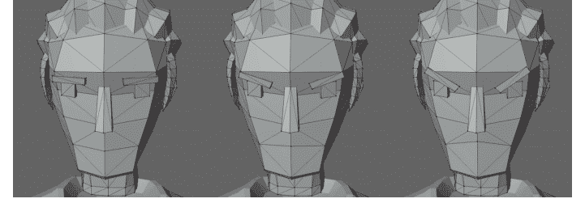
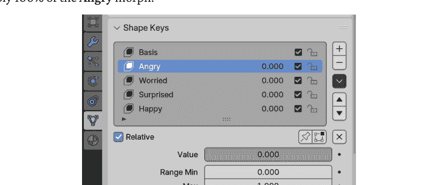
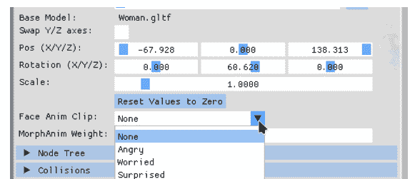
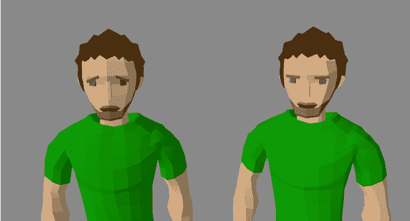
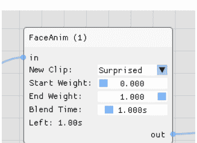
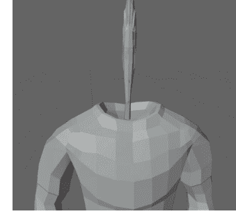
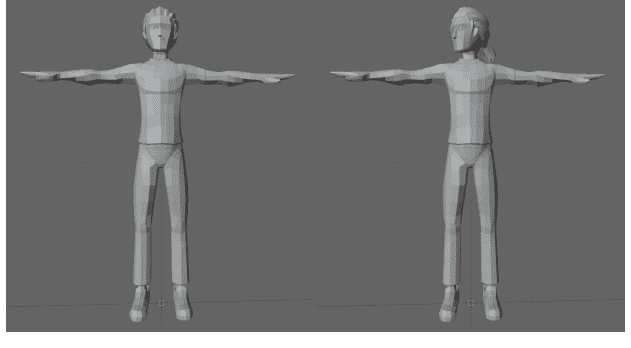
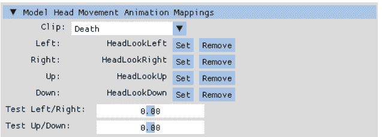
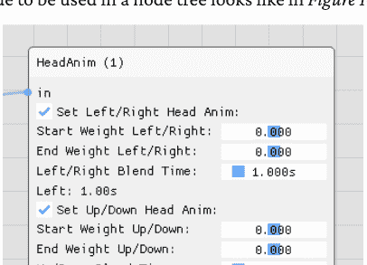

# 第10章 高级动画混合

## 高级动画混合

欢迎来到 *第10章*！在前一章中，我们向实例添加了更多*真实生活行为*。在简要概述了行为树后，我们添加了一个可视化节点编辑器，使用简单的有限状态机来直观地绘制实例的行为。在本章末尾，我们扩展了代码并将交互实现为行为的另一种形式。

在本章中，实例将更加生动。我们将首先简要探索由形态目标动画制作的面部动画世界。然后我们将添加额外的功能将形态网格加载到应用程序中，并对实例的面部动画进行控制。接下来，我们添加一个图节点，以便也能在节点树中使用面部动画。在本章末尾，将实现附加混合，允许我们独立于骨骼和面部动画移动实例的头部。

在本章中，我们将涵盖以下主题：

- 如何制作面部表情动画
- 将面部动画添加到代码和GPU着色器中
- 在节点树中使用面部动画
- 实现附加混合

## 技术要求

示例代码位于chapter10文件夹中，OpenGL的01_opengl_morphanim子文件夹和Vulkan的02_vulkan_morphanim子文件夹。

## 如何制作面部表情动画

在第9章实现行为后，我们虚拟世界中的生活变得更加生动。实例可以独自走或跑，做随机时间的简单任务，对与其他实例的碰撞做出反应，不会越过不可见的边界离开虚拟世界。

但是实例仍然显得有点无菌和死气沉沉。它们像机器人一样四处游荡，总是向前看，保持一张直板板的脸。没有可见的情绪，除了播放挥手动画外，对交互也没有反应。

所以，让我们通过添加面部表情来赋予实例展示情绪的能力。向任何种类的活的虚拟对象添加面部动画的最常见方式是形态目标动画。

为了理解形态目标动画，这里有一个简单的例子。在图10.1中，显示了三种不同权重的形态目标动画：



左边的人脸应用了0%的愤怒形态目标动画，只显示原始脸。中间的人脸应用了50%的形态目标，介于原始脸和完整形态之间，右边的人脸应用了完整的形态目标动画。

如您所见，眉毛已被旋转，嘴巴顶点在最终状态中向上移动了一点，顶点位置仅在原始和最终网格之间插值。但这些小的顶点位置变化为模型创造了完全不同的面部表情。

形态目标动画在您的工具中可能有不同的名称，如逐顶点动画、形状插值、形状键或混合形状。所有这些名称描述的是相同的技巧：网格的多个变形版本存储在关键帧中，网格的动画通过在关键帧位置之间插值顶点位置来完成。


就开销而言，骨骼动画与变形目标动画（morph target animation）之间有一个重要区别：骨骼动画只影响模型节点的属性，而变形动画会替换模型虚拟皮肤的整个网格，并且模型每播放一个变形动画，该网格就需要对应复制一份，从而增大了模型作为文件在磁盘上和内存中的整体大小。

模型的骨骼数量相当少，但皮肤的顶点数量很多，因此每帧为大量顶点重新计算位置会给变形动画带来额外的计算成本。幸运的是，变形动画完全在顶点着色器中执行，并且只是对以向量形式保存的两个位置进行线性插值。因此，在我们的示例代码中，变形动画带来的额外计算负担可以忽略不计。

在 Blender 中，变形目标动画可以通过“数据”（Data）选项卡上的“形态键”（Shape Keys）选项来控制。图 10.2 显示了用于图 10.1 中右侧的脸的设置，其中“数值”（Value）设置为 1.000，以 100% 应用“Angry”（愤怒）变形：



在 Blender 中创建和修改基于形态键的变形目标动画超出了本书的范围。Blender 有一些关于形态键的基础文档，“其他资源”（Additional resources）一节中提供了相关链接，而且网上也有大量视频展示了如何在 Blender 中使用形态键。

如果你有一个包含变形目标动画的模型文件，比如第 10 章 assets 文件夹中的两个模型，或者你在任何其他现有模型中创建了自己的一组变形动画，那么你就可以进入下一步了：使用 Open Asset Importer 库导入这些额外的动画。

现在，让我们来学习如何将变形目标动画添加到我们的应用程序中。

## 将面部动画添加到代码和 GPU 着色器中

变形目标动画数据存放在 Assimp 模型文件中的两个位置。

变形动画数据的第一部分是网格，位于 aiMesh 节点的 mAnimMeshes 数组中，网格数量存储在 aiMesh 的 mNumAnimMeshes 变量中。mAnimMeshes 数组中的每个元素与原始网格包含完全相同数量的顶点，这使我们可以在网格的不同版本之间对顶点位置进行插值。

这种插值不仅限于在原始网格与一个变形目标网格之间进行混合，也可以在两个变形目标网格之间进行混合，或者混合两个以上网格的位置。请注意，混合网格的结果可能并不总是符合预期，因为变形目标动画的效果在很大程度上取决于动画师的意图。

变形动画数据的第二部分是关键帧数据，存放在 aiAnimation 节点的 mMorphMeshChannels 数组中，关键帧的数量存储在一个名为 mNumMorphMeshChannels 的变量中。每个关键帧中的键包含该键对应的时间点、要使用的变形网格编号，以及该变形网格在线性插值中的权重。

我们只使用网格数据在不同面部表情之间进行插值，因此会忽略变形网格的动画数据。但在本章代码的基础上，很容易添加对变形目标动画的支持。

作为实现变形动画的第一步，我们将学习如何加载额外的网格数据并提取顶点。

## 加载变形网格

由于变形网格中的每个顶点会替换原始网格中同一顶点的位置和法线，因此替换顶点只需要顶点数据的一个子集。我们将在 opengl 文件夹的 OGLRenderData.h 文件中创建一个轻量级的顶点版本，命名为 OGLMorphVertex，其中只包含位置和法线：

```
struct OGLMorphVertex {
    glm::vec4 position = glm::vec4(0.0f);
    glm::vec4 normal = glm::vec4(0.0f);
};
```

为了将替换用的变形顶点收集到一个网格中，我们还创建了一个名为 OGLMorphMesh 的新结构体，用一个 std::vector 保存所有顶点：

```
struct OGLMorphMesh {
	std::vector<OGLMorphVertex> morphVertices{};
};
```

由于所有变形网格都依赖于原始网格，我们向默认网格结构体 OGLMesh 添加一个 OGLMorphMesh 向量：

```
struct OGLMesh {
	...
	std::vector<OGLMorphMesh> morphMeshes{};
};
```

对于 Vulkan，这两个新结构体分别命名为 VkMorphVertex 和 VkMorphMesh，位于 vulkan 文件夹的 VkRenderData.h 文件中。VkMorphMesh 向量被添加到 VkMesh 结构体中。在 AssimpMesh 类的 processMesh() 方法结束之前，我们添加一段新代码，从模型文件中提取变形网格数据。首先，我们检查当前网格是否附加了任何变形网格：

```
int animMeshCount = mesh->mNumAnimMeshes;
if (animMeshCount > 0) {
```

如果找到了变形网格，我们就遍历所有变形网格，提取网格数据和顶点数量：

```
for (unsigned int i = 0; i < animMeshCount; ++i) {
	aAnimMesh* animMesh = mesh->mAnimMeshes[i];
	unsigned int mAnimVertexCount = animMesh->mNumVertices;
}
```

根据定义，变形网格中的顶点数量必须与原始网格中的顶点数量一致。在这里多做一次额外检查并无坏处：如果检测到顶点数量不匹配，就跳过整个变形网格并打印一条错误信息：

```
if (animVertexCount != mVertexCount) {
	Logger::log(1, "%s error: morph mesh %i vertex count does not match (orig mesh has %i vertices, morph mesh %i)\n",
		orig mesh has %i vertices, morph mesh %i)\n",
		orig mesh has %i vertices, morph mesh %i)\n"
```

## Transformer

Transformer 是 Google 团队在 2017 年提出的一种基于自注意力机制（Self-Attention）的深度学习模型架构，其论文《Attention Is All You Need》发表于 NeurIPS 2017。Transformer 摒弃了传统的循环神经网络（RNN）与卷积神经网络（CNN），完全依赖注意力机制来建模序列中任意两个位置之间的依赖关系，解决了长距离依赖问题，并且高度支持并行计算。

Transformer 整体结构采用 Encoder-Decoder 架构。编码器（Encoder）由若干相同的层堆叠而成，每一层包含多头自注意力子层和前馈神经网络子层；解码器（Decoder）在编码器结构的基础上额外增加了对编码器输出进行交叉注意力的子层。每个子层之后都应用了残差连接（Residual Connection）和层归一化（Layer Normalization）。

- 核心优势：并行计算、长距离依赖建模、全局感受野
- 关键模块：Self-Attention、Multi-Head Attention、Positional Encoding
- 主要应用：机器翻译、文本分类、问答系统、预训练语言模型（如 BERT、GPT）

```python
# 注意力计算（Scaled Dot-Product Attention）
def attention(query, key, value, mask=None):
    d_k = query.size(-1)
    scores = torch.matmul(query, key.transpose(-2, -1)) / math.sqrt(d_k)
    if mask is not None:
        scores = scores.masked_fill(mask == 0, -1e9)
    p_attn = F.softmax(scores, dim=-1)
    return torch.matmul(p_attn, value)
```

访问任意备选变形网格现在变得很简单：只需检查 morphMeshes 向量的大小是否大于零；如果确实存在变形网格，就提取顶点数据，并在原始顶点与所选变形网格的顶点的位置和法线之间进行插值。

此时，模型文件中找到的所有有效变形网格都已作为 AssimpMesh 网格数据的一部分可供使用。要在面部动画中使用这些变形网格，我们必须向应用程序添加一些代码和逻辑。

## 将所有变形网格存储在单个缓冲区中

为了在着色器中使用变形网格的顶点，我们将所有变形网格的顶点数据存储到单个 SSBO 中。由于模型实例在屏幕上是实例化渲染的，因此必须使用单个 SSBO——在渲染过程中，我们需要所有网格的顶点数据随时可用，因为我们无法判断某个特定模型实例何时会被绘制到屏幕上。根据所选变形网格来拆分渲染也是可行的，但那是相当昂贵的替代方案，因为我们必须在每次绘制调用中对实例进行过滤。

变形网格 SSBO 以及一些相关变量被添加到 AssimpModel 类中。首先，在 AssimpModel.h 头文件中添加三个新的私有变量：mNumAnimatedMeshes、mAnimatedMeshVertexSize 和 mAnimMeshVerticesBuffer：

```
unsigned int mNumAnimatedMeshes = 0;
unsigned int mAnimatedMeshVertexSize = 0;
ShaderStorageBuffer mAnimMeshVerticesBuffer{};
```

在 mNumAnimatedMeshes 中，我们存储该模型的变形网格数量。目前，代码只支持单个包含变形网格的网格，因此 mNumAnimatedMeshes 中的数值等于该特定网格中变形网格的数量。

但由于我们只做面部动画，单个含变形网格的网格这一限制不是问题。此外，“实践练习”（Practical sessions）一节中还有一个任务，可以相应扩展代码，以支持多个包含变形网格的网格。

mAnimatedMeshVertexSize 中的值用于在 SSBO 中找到所选变形片段（morph clip）的顶点数据起始位置。将网格顶点大小乘以变形片段的索引，我们就可以直接跳到变形片段的第一个顶点。

最后，所有顶点数据都存储在 mAnimMeshVerticesBuffer SSBO 中。


我们还在AssimpModel.cpp类实现文件中添加了两个公共方法：hasAnimMeshes()和getAnimMeshVertexSize()。由于方法名具有描述性，无需进一步解释。

填充SSBO的工作在AssimpModel类的loadModel()方法中完成。当所有网格（meshes）被收集到mModelMeshes向量后，我们可以遍历所有网格，将顶点数据添加到新缓冲区：

```
for (const auto& mesh : mModelMeshes) {
    if (mesh.morphMeshes.size() == 0) {
        continue;
    }
}
```

作为在mAnimMeshVerticesBuffer SSBO中收集顶点的第一步，我们检查该网格中是否有任何形变网格。如果某个网格没有额外的形变网格，我们直接继续处理下一个网格。

然后，我们创建一个名为animMesh的临时OGLMorphMesh对象，用于收集所有顶点，并调整animMesh中的morphVertices向量大小：

```
OGLMorphMesh animMesh;
animMesh.morphVertices.resize(
    mesh.vertices.size() * mNumAnimatedMeshes);
```

现在我们可以将所有形变网格的顶点复制到animMesh中，使用顶点数量来计算正确的位置：

```
for (unsigned int i = 0; i < mNumAnimatedMeshes; ++i) {
    unsigned int vertexOffset = mesh.vertices.size() * i;
    std::copy(mesh.morphMeshes[i].morphVertices.begin(),
        mesh.morphMeshes[i].morphVertices.end(),
        animMesh.morphVertices.begin() + vertexOffset);
    mAnimatedMeshVertexSize = mesh.vertices.size();
}
```

最后，我们将收集到的顶点上传到SSBO：

```
mAnimMeshVerticesBuffer.uploadSsboData(
    animMesh.morphVertices);
}
```

现在，每当我们需要该模型的形变动画时，可以将缓冲区绑定到指定的着色器绑定点。通过新的公共方法bindMorphAnimBuffer()即可实现绑定：

```
void AssimpModel::bindMorphAnimBuffer(int bindingPoint) {
	mAnimMeshVerticesBuffer.bind(bindingPoint);
}
```

为了在逐实例基础上使用面部动画，我们必须添加一些变量和方法，并扩展某些数据结构。

## 在代码中添加面部形变设置

启用面部动画最重要的改变是新增一个名为faceAnimation的枚举类，它位于Enums.h文件中：

```
enum class faceAnimation : uint8_t {
	none = 0,
	angry,
	worried,
	surprised,
	happy
};
```

所有支持的形变动画都像动作或节点类型一样存储在faceAnimation枚举中。我们不会使用模型文件中的形变动画，而只在代码中使用一组固定的面部动画。

与其他数据类型类似，我们添加了从枚举值到字符串的映射。在代码中使用枚举值，并在UI中显示用户友好的字符串会容易得多。新的映射micFaceAnimationNameMap将被添加到ModelInstanceCamData.h文件中的ModelInstanceCamData结构体中：

```
std::unordered_map<faceAnimation, std::string>
micFaceAnimationNameMap{};

```

填充该映射的字符串的工作发生在渲染器类文件OGLRenderer.cpp或VkRenderer.cpp的init()方法中，最佳位置是现有映射代码旁边。

## 固定形变映射 vs. 从模型动态加载

在faceAnimation枚举和micFaceAnimationNameMap中硬编码所有形变目标动画剪辑的原因是为了保持代码简单。

虽然从模型文件填充形变目标剪辑列表很容易，但在UI中维护动态列表会变得相当复杂。例如，在节点树中添加选择形变剪辑的代码会在树与单个模型之间建立硬依赖——为其他模型使用同一棵树将变得不可能。

为避免模型与树的依赖，将只使用预定义的形变动画集。任何模型都可以支持全部形变动画、不支持任何形变动画，或支持部分索引匹配的剪辑，并用空的形变动画填充空缺。

对于实例部分，InstanceSettings结构体中添加了两个新变量：isFaceAnimType和isFaceAnimWeight：

```
faceAnimation isFaceAnimType = faceAnimation::none;
float isFaceAnimWeight = 0.0f;
```

在isFaceAnimType中，我们存储当前的面部动画剪辑。由于faceAnimation枚举中额外增加了none值，我们不需要另一个布尔值来开启或关闭面部动画。默认面部网格与面部动画之间的插值权重可由isFaceAnimWeight控制，0.0f只显示默认网格，1.0f显示形变网格。

## is代表“InstanceSettings”，而非“it is”

再次提起这个旁注以避免混淆：InstanceSettings变量名中的is只是结构体名称的缩写，而不是用来定义状态。因此，isFaceAnimType代表“Instance Settings Face Animation Type”，而不是控制面部动画是否启用的布尔值。

我们还需要为每个实例提供关于面部动画的信息。下一步，让我们扩展渲染器。

## 在渲染器中填充逐实例缓冲区数据

与所有其他着色器相关数据一样，我们需要一个SSBO将数据传递给GPU。要填充SSBO，需要某种数据类型的std::vector。因此，渲染器类头文件OGLRenderer.h将获得两个新的私有变量：mFaceAnimPerInstanceData和mFaceAnimPerInstanceDataBuffer：

```
std::vector<glm::vec4> mFaceAnimPerInstanceData{};
ShaderStorageBuffer mFaceAnimPerInstanceDataBuffer{};
```

对于Vulkan渲染器，缓冲区的数据类型有所不同。我们需要向VkRenderer.h文件中添加以下行：

```
std::vector<glm::vec4> mFaceAnimPerInstanceData{};
VkShaderStorageBufferData mFaceAnimPerInstanceDataBuffer{};
```

虽然我们只需要三个值，但这里将使用glm::vec4来处理可能的数据对齐问题。你应该尽量避免使用三元素向量（glm::vec3）通过SSBO将数据传输到GPU，因为CPU侧的向量或结构体与GPU侧的缓冲区之间可能会出现不匹配。

逐实例面部动画SSBO将被添加到渲染器类文件OGLRenderer.cpp或VkRenderer.cpp的draw()调用中，更具体地说，是在模型实例的循环中：

```
for (const auto& model : mModelInstCamData.micModelList) {
    ...
    mFaceAnimPerInstanceData.resize(numberOfInstances);
    ...
    for (size_t i = 0; i < numberOfInstances; ++i) {
```

我们还在循环之前添加了对包含形变数据的向量的大小调整；参见前一个代码片段中突出显示的部分。

而且由于我们已经在循环中提取了当前实例的InstanceSettings结构体，只需几行代码即可添加面部动画。

首先，我们添加一个名为morphData的空glm::vec4，并检查该实例是否设置了面部动画：

```
glm::vec4 morphData = glm::vec4(0.0f);
if (instSettings.isFaceAnimType !=
    faceAnimation::none) {
```

如果需要对实例的面部进行动画处理，我们填充morphData的三个元素：

```
morphData.x = instSettings.isFaceAnimWeight;
morphData.y = static_cast<int>(instSettings.isFaceAnimType) - 1;
morphData.z = model->getAnimMeshVertexSize();
```

现在我们设置面部动画的权重、剪辑号减一（以考虑faceAnimation枚举中的none元素），以及在两个形变网格之间跳过的顶点数。

当前着色器代码使用顶点数和剪辑号来计算所需形变动画的第一个顶点，但这里也可以使用一个绝对值。如果我们计划扩展代码以支持多个具有形变目标动画的网格，绝对值会变得很方便（参见实践环节部分）。

最后，我们将morphData存储到用于填充SSBO的向量中：

```
}
mFaceAnimPerInstanceData.at(i) = morphData;
```

作为面部动画的最后一步，必须让顶点着色器感知新的缓冲区。

## 扩展着色器以绘制面部动画

由于形变目标动画只改变顶点数据，我们需要在顶点着色器中添加新的SSBO和一些逻辑。无需改动计算着色器或片段着色器，这一事实大大简化了面部动画的实现。

为防止没有面部动画的模型出现失真，我们将使用一组单独的着色器来绘制包含形变动画的网格。首先，我们向渲染器头文件OGLRenderer.h中添加两个新的私有着色器变量：

```
Shader mAssimpSkinningMorphShader{};
Shader mAssimpSkinningMorphSelectionShader{};
```

对于Vulkan渲染器，这里需要更多工作，因为着色器是管线的一部分。我们需要在VkRenderData.h文件中添加两个VkPipelineLayout句柄、两个VkPipeline句柄、两个VkDescriptorSetLayout句柄和两个VkDescriptorSet句柄：

```
VkPipelineLayout rdAssimpSkinningMorphPipelineLayout;
VkPipelineLayout rdAssimpSkinningMorphSelectionPipelineLayout;
```

VkPipeline rdAssimpSkinningMorphPipeline;
VkPipeline rdAssimpSkinningMorphSelectionPipeline;
VkDescriptorSetLayout
rdAssimpSkinningMorphSelectionDescriptorLayout;
VkDescriptorSetLayout
rdAssimpSkinningMorphPerModelDescriptorLayout;
VkDescriptorSet rdAssimpSkinningMorphDescriptorSet;
VkDescriptorSet rdAssimpSkinningMorphSelectionDescriptorSet;

借助这些句柄，创建了两个新的 Vulkan 管线，用于绘制启用和未启用特殊选择处理的模型。更多 Vulkan 实现细节，请参阅 `VkRenderer.cpp` 文件。

我们需要调整选择顶点着色器，以便在选择缓冲区中绘制经过变形处理的面部网格。如果没有该选择着色器，实例的头部将无法再通过鼠标点击选中。

- `assimpskinning.vert` 改为 `assimpskinning_morph.vert`
- `assimpskinning.frag` 改为 `assimpskinning_morph.frag`
- `assimpskinning_selection.vert` 改为 `assimpskinning_morph_selection.vert`
- `assimpskinning_selection.frag` 改为 `assimpskinning_morph_selection.frag`

扩展名为 `.frag` 的片段着色器不会更改，但为了后续的修改或调试，最好还是为新着色器使用单独的文件。

在以 `.vert` 结尾的两个顶点着色器文件中，添加以下代码行来定义新的 `MorphVertex` 结构体，该结构体与 `opengl1` 文件夹中 `OGLRenderData.h` 文件里定义的 `OGLMorphVertex` 结构体匹配：

```
struct MorphVertex {
	vec4 position;
	vec4 normal;
};
```

对于 Vulkan，原始结构体的名称是 `VkMorphVertex`，定义在 `vulkan` 文件夹的 `VkRenderData.h` 中。

然后，在绑定点 4 和 5 上添加两个新的 SSBO，命名为 `AnimMorphBuffer` 和 `AnimMorphData`：

```
layout (std430, binding = 4) readonly restrict
    buffer AnimMorphBuffer {
    MorphVertex morphVertices[];
};
layout (std430, binding = 5) readonly restrict
    buffer AnimMorphData {
    vec4 vertsPerMorphAnim[];
};
```

第一个缓冲区 `AnimMorphBuffer` 包含所有可用变形动画的顶点。第二个缓冲区 `AnimMorphData` 则将从 CPU 取得的所有实例设置传递给 GPU。

在顶点着色器的 `main()` 方法中，我们通过将顶点数量与每个实例的面部动画剪辑索引相乘，来计算所需面部动画的顶点偏移量：

```
int morphAnimIndex =
    int(vertsPerMorphAnim[gl_InstanceID].y *
        vertsPerMorphAnim[gl_InstanceID].z);
```

在这里将浮点值转换为整数没有问题，这样可以避免使用一个同时包含整数和浮点值的单独结构体，并将 `glm::vec4` 用作“传输对象”。浮点数表示的第一个不精确整数是 `2^24+1`，这个值即使对于包含大量面部动画的较大网格来说也足够大（`2^24+1` 大约相当于 16 MiB 的顶点数据）。

然后，我们使用着色器内置变量 `gl_VertexID`（Vulkan 中为 `gl_VertexIndex`）从变形网格中提取顶点：

```
vec4 origVertex = vec4(aPos.x, aPos.y, aPos.z, 1.0);
vec4 morphVertex = vec4(morphVertices[gl_VertexID +
    morphAnimOffset].position.xyz, 1.0)
```

现在，我们可以根据权重因子，混合原始顶点与来自变形网格的替换顶点的位置：

```
gl_Position = projection * view * worldPosSkinMat *
    mix(origVertex, morphVertex,
    vertsPerMorphAnim[gl_InstanceID].x);
```

我们还需要对顶点法线执行相同的提取和计算，因为顶点位置的改变也可能影响该顶点所属三角形的法线：

```
vec4 origNormal =
    vec4(aNormal.x, aNormal.y, aNormal.z, 1.0);
vec4 morphNormal =
    vec4(morphVertices[gl_VertexID +
    morphAnimOffset].normal.xyz, 1.0);
normal = transpose(inverse(worldPosSkinMat)) *
    mix(origNormal, morphNormal,
    vertsPerMorphAnim[gl_InstanceID].x);
```

为了更好地区分带有和不带变形动画的网格，我们还需要在 `AssimpModel` 类和渲染器中进行一些小改动。

## 完成面部动画代码

在 `AssimpModel` 类中，新增了两个绘制方法：

```
void drawInstancedNoMorphAnims(int instanceCount);
void drawInstancedMorphAnims(int instanceCount);
```

从名称可以看出这些方法的功能：`drawInstancedNoMorphAnims()` 绘制所有没有变形动画的网格，而 `drawInstancedMorphAnims()` 只绘制带有变形动画的网格。

要在两个方法中过滤网格，可以使用一个非常简单的检查——我们循环遍历所有网格，并查看网格内部 `morphMeshes` 向量的大小。对于只绘制非变形网格的 `drawInstancedNoMorphAnims()` 方法，我们只需跳过带有额外变形网格的网格：

```
for (unsigned int i = 0; i < mModelMeshes.size(); ++i) {
    if (mModelMeshes.at(i).morphMeshes.size() > 0) {
        continue;
    }
    OGLMesh& mesh = mModelMeshes.at(i);
    drawInstanced(mesh, i, instanceCount);
}
```

而对于只绘制变形网格的版本，我们反转这个检查：

```
...
if (mModelMeshes.at(i).morphMeshes.size() == 0) {
    continue;
    ...
}
```

使用两个独立方法的原因在于渲染器类文件 `OGLRenderer.cpp` 或 `VkRenderer.cpp` 中的 `draw()` 方法。在那里，我们将动画模型的常规实例化绘制调用替换为无变形版本：

```
model->drawInstancedNoMorphAnims(numberOfInstances);
```

在检查模型是否包含任何变形网格之后，再绘制带有变形动画的网格，如下面的 OpenGL 渲染器代码所示：

```
if (model->hasAnimMeshes()) {
    mAssimpSkinningMorphShader.use();
    ...
    model->bindMorphAnimBuffer(4);
    mFaceAnimPerInstanceDataBuffer.uploadSsboData(
        mFaceAnimPerInstanceData, 5);
    model->drawInstancedMorphAnims(numberOfInstances);
}
```

在这种情况下，我们使用新的变形着色器，绑定包含顶点数据和逐实例设置的两个 SSBO，并使用只绘制带有变形动画网格的绘制调用。

若要做一个简单测试，你可以将渲染器中的 `morphData` 值设置为某些固定值，然后检查实例是生气地跑动还是面带微笑。但要完全控制这些新设置，我们还需要在 UI 中添加一个组合框和一个滑块。

## 添加 UI 元素以控制面部动画

对于 UI，代码量很小。我们只需要一个组合框，将 `InstanceSettings` 的 `isFaceAnimType` 值映射到 `micFaceAnimationNameMap` 中的字符串，以及一个与 `isFaceAnimWeight` 关联的浮点滑块。对于没有面部动画的模型，我们只需禁用组合框和滑块。

图 10.3 显示了展开后的组合框，其中有四种面部动画，以及用于禁用面部动画的 `None` 设置：



图 10.3：用于控制实例面部动画的 UI 设置

现在我们可以选择面部动画剪辑，并使用权重滑块来控制面部动画变形被应用的程度。

作为面部动画实现的最后一步，我们将介绍如何将新设置添加到 YAML 配置文件中。

## 保存和加载新的实例设置

幸运的是，当前 YAML 解析器和写出器代码的状态使得我们只需极少的努力就能添加面部动画。由于面部动画设置是按实例设置的，我们需要扩展 `tools` 文件夹中 `YamlParser.cpp` 文件内 `InstanceSettings` 的 YAML 写出器输出运算符。

在可选的节点树设置输出之后，我们检查是否配置了面部动画；如果设置了剪辑，则输出实例设置：

```
if (settings.isFaceAnimType != faceAnimation::none) {
    out << YAML::Key << "face-anim-index";
    out << YAML::Value << settings.isFaceAnimType;
    out << YAML::Key << "face-anim-weight";
    out << YAML::Value << settings.isFaceAnimWeight;
}
```

为了输出 `faceAnimation` 枚举，我们还需要为新的数据类型定义输出运算符：

```
YAML::Emitter& operator<<(YAML::Emitter& out,
    const faceAnimation& faceAnim) {
    out << YAML::Flow;
    out << static_cast<int>(faceAnim);
    return out;
}
```

在 `YamlParserTypes.h` 文件中，我们还需要为新的 `faceAnimation` 数据类型定义简单的 `decode()` 方法：

```
template<>
struct convert<faceAnimation> {
    static bool decode(const Node& node, faceAnimation& rhs) {
        rhs = static_cast<faceAnimation>(node.as<int>());
        return true;
    }
};
```

此处未展示 `encode()` 方法，它本质上与其他所有枚举 `encode()` 方法所做的工作相同：将节点数据转换为 `int`。

最后，我们只需扩展 `ExtendedInstanceSettings` 的 `decode()` 方法，添加两个新值：

```
if (node["face-anim"]) {
    rhs.isFaceAnimType =
        node["face-anim"].as<faceAnimation>();
    rhs.isFaceAnimWeight =
        node["face-anim-weight"].as<float>();
}
```

`encode()` 方法的扩展也非常简单：

```
if (rhs.isFaceAnimType != faceAnimation::none) {
    node["face-anim"] = rhs.isFaceAnimType;
    node["face-anim-weight"] = rhs.isFaceAnimWeight;
}
```


确保提升配置文件的版本号，因为我们在其中添加了新数据。在这种情况下，更改文件版本并不是那么关键，因为之前章节中的解析器版本根本不知道这些新设置。

就是这样！现在当你选择一个实例时，你可以更改面部表情的类型和强度，如图10.4所示：



图10.4：默认面部网格旁边的一个“担心”的实例

每个实例都可以独立控制面部动画，并且对一个实例的更改不会影响其他实例。对实例显示愤怒、担心、快乐甚至惊讶的表情，以及显示程度，都由你来决定。

向应用程序添加更多变形片段也很容易。对于新片段来说，最复杂的部分很可能是在Blender等工具中进行的顶点动画。在代码中，只需向faceAnimation枚举类添加一个新值，并向ModelInstanceCamData结构的micFaceAnimationNameMap变量中的名称映射添加一个新字符串。

为了也能在节点树中使用新的面部动画，我们需要创建一个新的节点类型，以便控制动画片段和所需变形目标动画的权重。因此，让我们添加全新的FaceAnim节点。

## 在节点树中使用面部动画

创建新节点类型很容易。首先，我们添加一个新类FaceAnimNode，包含头文件FaceAnimNode.h和实现文件FaceAnimNode.cpp，两者都放在graphnodes文件夹中。我们可以从WaitNode借用大部分实现，并添加ImGui元素和一些逻辑，以在执行期间控制面部动画。图10.5展示了FaceAnim节点的最终布局：



图10.5：新的FaceAnim节点

该节点允许我们选择其中一个面部动画片段，包括用于禁用实例面部动画的None设置，在两个播放方向上的动画起始和结束权重，以及控制动画重播所需时间的计时器。

在添加新的FaceAnim节点之前，我们必须扩展包含节点类型和图节点工厂类的枚举。

### 为新FaceAnim节点调整代码

与WaitNode类似，FaceAnim节点会延迟控制流，直到计时器归零，并在动画重播结束后通知父节点。

除了添加这两个新文件外，创建新节点类型还需要两个额外步骤。

首先，我们必须扩展Enums.h文件中的graphNodeType枚举：

```
enum class graphNodeType : int8_t {
  ...
  faceAnim,
  NUM
};
```

接下来，必须让GraphNodeFactory类的构造函数和makeNode()方法了解这个新节点。在构造函数中，我们将节点标题字符串添加到mGraphNodeTypeMap中：

```
mGraphNodeTypeMap[graphNodeType::faceAnim] = "FaceAnim";
```

在makeNode()中，我们为新节点类型添加一个case块：

```
case graphNodeType::faceAnim:
    newNode = std::make_shared<FaceAnimNode>(nodeId);
    break;
```

现在我们可以调整新FaceAnimNode类的实现了。

### 添加FaceAnim节点

由于我们将在两个权重值之间手动混合，因此一旦节点激活，我们将在update()方法中将混合时间映射到0到1之间：

```
float morphTimeDiff = 1.0f;
if (mFaceAnimBlendTime != 0.0f) {
    morphTimeDiff = std::clamp(mCurrentTime /
        mFaceAnimBlendTime, 0.0f, 1.0f);
}
```

通过一个简单的除法，并加上避免除以零的检查，morphTimeDiff中的时间差将从1变为0。

然后我们使用时间差和权重差的乘积来插值最终权重：

```
float morphWeightDiff =
    mFaceAnimEndWeight - mFaceAnimStartWeight;
float currentWeight =
    mFaceAnimEndWeight - morphWeightDiff * morphTimeDiff;
```

每次运行update()方法时，我们都会通过fireNodeActionCallback将新权重持续发送给渲染器：

```
instanceUpdateType updateType =
    instanceUpdateType::faceAnimWeight;
nodeCallbackVariant result;
bool extra = false;
result = currentWeight;
fireNodeActionCallback(getNodeType(), updateType,
    result, extra);
```

在进行权重更新之前，我们在activate()方法中发送所需的动画片段索引：

```
instanceUpdateType updateType =
    instanceUpdateType::faceAnimIndex;
nodeCallbackVariant result;
bool extra = false;
result = mFaceAnim;
fireNodeActionCallback(getNodeType(), updateType,
    result, extra);
```

为了向渲染器传递面部动画值，instanceUpdateType枚举需要扩展两个新值：faceAnimIndex和faceAnimWeight：

```
enum class instanceUpdateType : uint8_t {
    ...
    faceAnimIndex,
    faceAnimWeight
};
```

我们还需要在nodeCallbackVariant变体中使用faceAnimation类型，以便在类之间的回调中使用新数据类型：

```
using nodeCallbackVariant = std::variant<float, moveState, moveDirection, faceAnimation>;
```

由于我们在节点中使用了fireNodeActionCallback，因此GraphEditor和SingleInstanceBehavior类都需要扩展。

在graphnodes文件夹的GraphEditor.cpp文件中，必须将faceAnim节点类型添加到createNodeEditorWindow()方法中，以便将节点动作回调绑定到新创建的faceAnim节点上：

```
if (nodeType == graphNodeType::instance ||
    nodeType == graphNodeType::action ||
    nodeType == graphNodeType::faceAnim) {
    newNode->setNodeActionCallback(
        behavior->bdNodeActionCallbackFunction);
}
```

在SingleInstanceBehavior拷贝构造函数中存在类似的检查；我们还必须在此处添加FaceAnim节点类型来绑定节点动作回调：

```
if (node->getNodeType() == graphNodeType::instance ||
    node->getNodeType() == graphNodeType::action ||
    node->getNodeType() == graphNodeType::faceAnim) {
    newNode->setNodeActionCallback(
        mBehaviorData->bdNodeActionCallbackFunction);
}
```

除了在更改面部动画设置时操作InstanceSettings变量外，我们还在AssimpInstance类中添加两个新的setter，以简化对新InstanceSettings变量的访问。

### 使实例和渲染器能够响应面部动画变化

如果需要调整多个值，先读取所有数据再在最后写回所有数据来更新InstanceSettings是很好的做法。对于单一更改，使用单独的setter更方便。我们向AssimpInstance类添加两个新的公共方法setFaceAnim()和setFaceAnimWeight()：

```
void setFaceAnim(faceAnimation faceAnim);
void setFaceAnimWeight(float weight);
```

这两个方法都会更新实例的InstanceSettings数据中的两个值，并添加一些额外逻辑来处理faceAnimation枚举的none值。

作为新节点的最后一步，渲染器类（OGLRenderer.cpp或VkRenderer.cpp）的updateInstanceSettings()方法需要知道当实例想要更改面部动画设置时该怎么做。

为此，在节点类型的switch块中，必须添加一个针对新的faceAnim节点类型的新case块：

```
switch (nodeType) {
    ...
    case graphNodeType::faceAnim:
```

对节点树的更多扩展也是可能的。你可以让模型在击打或踢腿前变得愤怒，或者在播放拾取动画前表现出惊讶，以模拟实例在地面上看到了什么东西。而且，有了更多的骨骼和面部动画片段，还可以创造出更多有趣和疯狂的组合。

作为人类，能够从别人的脸上看到他们的情绪有助于我们评估可能的下一步行动，而将面部表情引入应用程序则提供了与实例交互的更广泛方式。通过使用变形目标动画，即使是基础的低多边形模型也会呈现出更多的个性。

但变形目标动画有三个严重的局限性，我们接下来将讨论这些局限性。

## 变形目标动画的局限性

使用变形目标动画时，我们需要注意以下三个限制：

- 网格中的顶点数量在所有动画和帧中必须相同。不可能在帧内或动画期间添加或移除顶点，也不能更改顶点与三角形的分配。你只能移动顶点。
- 模型的变形部分的整个网格必须为动画中的每个变形键复制。对于模型身体的较小部分来说，这可能没问题，但在内存中多次保留高细节的身体部分可能会产生明显的开销。
- 仅支持顶点位置更改；变形通常通过简单的线性插值完成。小角度旋转可以通过位置变化来模拟，但通过大角度旋转或缩放来移动顶点（例如转动头部或移动手部）将在插值期间导致视觉扭曲。

你可以在Blender中自行测试第三个限制。为此，添加一个基于变形目标的头部旋转，你会看到旋转也会影响头部的体积。旋转角度越大，动画过程中的扭曲就越大。


Figure 10.7 shows the result of around 50% of a head rotation by 180 degrees:



Figure 10.7: Distorted volume while rotating the head with a morph target animation

Morph target animations must be created and tested carefully while animating a model. They are a valuable addition to animations, but they still have some drawbacks.

How do we create advanced animations that may need rotations without using morph target animations, such as a fancy head movement animation to let the model look around in the virtual world?

That’s what we’ll learn next as we dive into additive blending.

## Implementing additive blending

Additive blending is an alternative method of animation blending. While normal animation blending is used to interpolate between two skeletal animation clips and morph target animations are changing vertex positions of a mesh, additive blending stacks two different skeletal animations on top of each other.

The technical part of additive blending is astonishingly simple, but the effect achieved by the combination of two different skeletal animations leads to a much more natural appearance of a 3D model.

Let’s explore the similarities and differences between additive blending and the animation blending methods we already know.

### How additive blending works

The basic idea of additive blending comes from the desire to split up model animations into multiple and especially independent parts.

A skeletal animation usually delivers an animation for the entire model, allowing the model to either run, walk, punch, or jump. Blending between skeletal animations will smooth the transition between these two clips but won’t add new movements. So, there are two different approaches: splitting the skeleton or stacking animations.

Splitting the skeleton into two or even more animation domains and playing a different clip for each part of the skeleton is called layered blending. Layered blending is a simple and cost-effective way to mix animations since every node of the skeleton is affected only by the transforms of a single animation clip, just the animation clips are different for the nodes.

But splitting the model skeleton into multiple parts with each part playing a different skeletal animation may lead to extra effort to synchronize clips across the body. Failures in a synchronous replay on a split-skeleton animation may lead to visual artifacts, just think of different replay speeds for the clips.

We don’t handle layered blending in the book, but a task in the Practical sessions section is available to implement layered animation blending for the models. In contrast, additive blending allows adding up skeletal animations on top of other skeletal animations. While the basic movement created by the basic skeletal animation is applied normally, property changes of one or even more other skeletal animations are added to the nodes of the model, creating a concatenated motion with what’s provided by the basic animation. Additive blending is more expensive to calculate than layered blending because we need to calculate multiple animations, and we also have to mix all the animations together. As an example, this simple addition of property changes allows us to add a head movement to the normal skeletal animations. The model will be able to run, walk, punch, or jump from a skeletal animation and move the head around at the same time. As a bonus, facial animations are not affected by additive blending, so a model can walk, look to the right, and smile, and all three animations are running in parallel.

For the technical implementation part, an additive animation is done by adding the differences in the node transformations between the current pose and a reference pose to another skeletal animation.

Let’s use another example to explain the technical side. Figure 10.8 shows the first and the last keyframe for an animation that only rotates the head node of the model to the right (from the model’s perspective), while all other nodes remain in the T-pose:



Figure 10.8: Start and end pose for the additive animation "head look right"

As the reference pose, we use the first keyframe, with the entire model in the T-pose. To calculate the values for an additive animation, we take the desired keyframe and simply subtract the translation, rotation, and scale values of the reference pose from the destination pose.

If the model remains in the T-pose, all values for the additive animation will be zero. And nothing is added to the running skeletal animation, for instance, the walking cycle.

When we advance further in the animation clip in Figure 10.8, the rotation of the head will lead to a bigger difference in the rotation value of the head node between the current pose and the reference pose. But we will get only a difference for the head node, all other node transformations are still identical to the reference pose.

Adding the difference of the head node rotation to the currently running skeletal animation clip is easy. Since we collect the transformation properties for all nodes, a combination of two skeletal animations is just a simple per-node addition of the values for translation and scale, and a quaternion multiplication for the rotation value.

This addition only changes the values for nodes that have changed in the animation clip of the additive animation compared to the reference pose. All nodes without changes in the additive animation will remain unaltered in the skeletal animation.

### How to create suitable animations

Creating animations to use in additive blending is out of the scope of this book, similar to creating face animations. You can use a tool like Blender, or use the man’s model from Chapter 10, which already contains four extra animations altering only the head.

If you create extra animations by yourself, make sure to prefix the clip names with something common, like an underscore, or the letters ZZZ_ to keep them grouped together. At least Blender tends to sort the clips by name during the export and since we store several clip mappings based on the index number of the clip in the YAML configuration file, adding the new clips at the start or somewhere in-between the existing clips would lead to broken config files.

Implementing additive animations in our application is also surprisingly simple.

### Extending the code to support additive animations

To bring the additional data to the GPU, we add four new variables to the struct PerInstanceAnimData in the OGLRendererData.h file in the opengl folder:

```
struct PerInstanceAnimData {
  ...
  unsigned int headLeftRightAnimClipNum;
  unsigned int headUpDownAnimClipNum;
  ...
  float headLeftRightReplayTimestamp;
  float headUpDownReplayTimestamp;
};
```

As always for Vulkan, the file is called VkRendererData.h and resides in the vulkan folder.

We split the head animation into two parts and use separate variables to control both the left/right animation and the up/down animation of the head. It’s impossible to move the head to the left and right at the same time, so we can combine those two directions into a single control variable. The same holds true for moving the head up and down.

Then, we create a new private compute shader called mAssimpTransformHeadMoveComputeShader in the renderer class file, OGLRenderer.cpp:

```
Shader mAssimpTransformHeadMoveComputeShader{};
```

For Vulkan, we add a new VkPipeline handle named rdAssimpComputeHeadMoveTransformPipeline to the VkRenderData.h file:

```
VkPipeline rdAssimpComputeHeadMoveTransformPipeline;
```

Since not all models may have additive head animations, we could skip the extra calculations if no head animations were set. We also add the new variables in the PerInstanceAnimData struct to the compute shader file, assimp_instance_transform.comp. The new head animation variables will be ignored, but we need to expand the struct to the same size in both shaders.

Next, we copy the assimp_instance_transform.comp file to assimp_instance_headmove_transform.comp and load the new file into the new mAssimpTransformHeadMoveComputeShader compute shader during the init() method of the OGLRenderer.cpp. For Vulkan, we create the new rendering pipeline loading the head transform compute shader in the createPipelines() method of VkRenderer.cpp.

In the new shader file, most of the additions are just copy and paste work. We must do the following steps in the extended compute shader, using the code for the rotational part of the left/right head movement as examples:

- 1. Extract the animation clip numbers for both head animations:

```
uint headLeftRightClip =
    instAnimData[instance].headLeftRightAnimClipNum;
```

- 2. Extract the inverse scale factors for both head animations:

```
float headLeftRightRotInvScaleFactor =
    lookupData[headLeftRightClip * clipOffset +
    node * boneOffset + lookupWidth].x;
```

- 3. Calculate the index values for accessing the lookup data of the head animations:

```
int headLeftRightRotLookupIndex =
    clamp(int(instAnimData[instance]
    .headLeftRightReplayTimestamp *
    headLeftRightRotInvScaleFactor) + 1, 0,
    lookupWidth - 1);
```


4. 获取第一个查找位置的参考姿势以及所需头部动画剪辑时间戳的平移、旋转和缩放值：

```cpp
vec4 headLeftRightBaseRotation =
    lookupData[headLeftRightClip * clipOffset + node *
    boneOffset + lookupWidth + 1];
...
vec4 headLeftRightRotation =
    lookupData[headLeftRightClip * clipOffset + node *
    boneOffset + lookupWidth +
    HeadLeftRightRotLookupIndex];
```

5. 使用四元数乘法计算当前姿势与参考姿势的变换值之差，用于旋转：

```cpp
vec4 headLeftRightRotationDiff =
    qMult(qInverse(headLeftRightBaseRotation),
        headLeftRightRotation);
```

6. 将两个头部动画的平移、旋转和缩放差值累加为每个变换的单一值：

```cpp
vec4 headRotationDiff =
    qMult(headUpDownRotationDiff,
        headLeftRightRotationDiff);
```

7. 使用四元数乘法将累加后的差值加到第一和第二剪辑变换上：

```cpp
vec4 finalRotation =
    slerp(qMult(headRotationDiff, firstRotation),
    qMult(headRotationDiff, secondRotation), blendFactor);
```

实例还需要携带头部运动的信息，因此我们在 InstanceSettings.h 文件中的 InstanceSettings 结构体中添加了两个新变量 isHeadLeftRightMove 和 isHeadUpDownMove：

```cpp
float isHeadLeftRightMove = 0.0f;
float isHeadUpDownMove = 0.0f;
```

我们将 0.0f 到 1.0f 之间的正范围映射到头部向左和向上的运动，而将 0.0f 到 -1.0f 的负范围映射到头部向右或向下移动。运动值为零时，将对两个动画都使用参考姿势的值，从而完全没有头部运动。

在 OGLRenderer 或 VKRenderer 类的 draw() 调用中填充 PerInstanceAnimData 结构体中的新数据，与面部动画相同的位置。按照之前解释的映射，选择剪辑编号的方式如下所示：

```cpp
if (instSettings.isHeadLeftRightMove > 0.0f) {
    animData.headLeftRightAnimClipNum =
        modSettings.msHeadMoveClipMappings[
            headMoveDirection::left];
} else {
    animData.headLeftRightAnimClipNum =
        modSettings.msHeadMoveClipMappings[
            headMoveDirection::right];
}
```

对于头部运动，我们使用时间戳的绝对值：

```cpp
animData.headLeftRightReplayTimestamp =
    std::fabs(instSettings.isHeadLeftRightMove) *
    model->getMaxClipDuration();
```

在代码中硬编码剪辑编号是个坏主意，不同的模型将这些新动画放在不同的剪辑索引上，或者根本没有。让我们再添加一个映射，这次是在叠加混合剪辑编号与头部运动的四种可能方向之间。

## 为新的头部动画创建映射

为了在剪辑和头部动画之间建立映射，在 Enums.h 文件中创建了一个新的 enum class，名为 headMoveDirection：

```cpp
enum class headMoveDirection : uint8_t {
    left = 0,
    right,
    up,
    down,
    NUM
};
```

对应的字符串映射 micHeadMoveAnimationNameMap 用于在 UI 中显示名称，已添加到 ModelInstanceCamData 结构体中：

```cpp
std::unordered_map<headMoveDirection, std::string> micHeadMoveAnimationNameMap{};
```

并且由于该映射与模型相关，新的 msHeadMoveClipMappings 映射已添加到 ModelSettings.h 文件中的 ModelSettings 结构体中：

```cpp
std::map<headMoveDirection, int> msHeadMoveClipMappings{};
```

AssimpModel 类还获得了一个新的公共方法，用于检查 msHeadMoveClipMappings 中的所有映射是否都已激活：

```cpp
bool hasHeadMovementAnimationsMapped();
```

如果找不到头部动画中的至少一个，则叠加头部动画将被禁用。在 OGLRenderer.cpp 文件的 draw() 调用中，我们根据所有头部动画映射的可用性切换计算着色器：

```cpp
if (model->hasHeadMovementAnimationsMapped()) {
	mAssimpTransformHeadMoveComputeShader.use();
} else {
	mAssimpTransformComputeShader.use();
}
```

对于 Vulkan，我们使用头部移动动画的可用性在 VkRenderer.cpp 文件的 runComputeShaders() 方法中选择要为计算着色器绑定的管线：

```cpp
if (model->hasHeadMovementAnimationsMapped()) {
	vkCmdBindPipeline(mRenderData.rdComputeCommandBuffer,
	VK_PIPELINE_BIND_POINT_COMPUTE,
	mRenderData.rdAssimpComputeHeadMoveTransformPipeline);
} else {
	vkCmdBindPipeline(mRenderData.rdComputeCommandBuffer,
	VK_PIPELINE_BIND_POINT_COMPUTE,
	mRenderData.rdAssimpComputeTransformPipeline);
}
```

头部动画的 UI 部分可以从 UserInterface 类中的其他代码部分大部分复制过来。一个用于选择剪辑的组合框、遍历 headMoveDirection 枚举中所有四个值的循环、两个按钮和两个用于测试动画的滑块，就是我们创建新 UI 部分所需的一切，如图 10.9 所示：



图 10.9：头部运动/动画剪辑映射的 UI 控制

剪辑映射和剪辑均取自当前选中实例的模型，使得为所有模型配置叠加头部动画变得容易。

要在节点树中使用头部动画，还需要另一种新的节点类型。

## 添加头部动画节点

得益于之前的 FaceAnimNode 节点，添加一个新的 HeadAnimNode 只需几分钟。你可以按照 Using face animations in node trees 部分中的步骤创建新节点，因为你需要执行与 FaceAnimNode 相同的操作。只有一些小的改动，例如枚举类条目的名称。

对于新节点的 UI 部分，你可以重用 FaceAnimNode 类代码中的控件，并从 InstanceNode 类代码中复制用于切换两个部分开/关的代码。

最终要在节点树中使用的 **HeadAnim** 节点如下图所示 *Figure 10.10*：



图 10.10：HeadAnim 节点

与 Instance 节点一样，我们可以控制想要更改哪些头部动画值，并且对于每个动画，我们可以调整起始和结束权重以及在两个权重值之间混合所需的时间。与 FaceAnim 节点类似，HeadAnim 节点会延迟控制流，直到两个计时器都过期，并向父节点发出执行结束的信号。

我们以保存和加载叠加头部动画设置所需的更改来结束本章。

## 保存和加载头部动画设置

与新的树节点类似，实现 YAML 配置文件更改以保存和加载头部动画设置也只需几分钟。

对于 YamlParser.cpp 文件中 ModelSettings YAML 发射器输出，我们在所有四个剪辑都配置好的情况下直接从映射中添加剪辑映射。我们还需要一个用于 headMoveDirection 枚举的新发射器输出，将值强制转换为 int：

```cpp
YAML::Emitter& operator<<(YAML::Emitter& out,
    const headMoveDirection& moveDir) {
    out << YAML::Flow;
    out << static_cast<int>(moveDir);
    return out;
}
```

为了重新加载映射，我们在 YamlParserTypes.h 文件中 ModelSettings 的 decode() 方法中添加了一个部分，逐个读取回映射值。这里也需要一个新的 headMoveDirection 枚举的 decode() 方法：

```cpp
static bool decode(const Node& node, headMoveDirection& rhs) {
    rhs = static_cast<headMoveDirection>(node.as<int>());
}
```

对于实例设置，存储在 InstanceSettings 的 isHeadLeftRightMove 和 isHeadUpDownMove 中的两个 float 值已添加到 YamlParser.cpp 中的发射器中：

```cpp
if (settings.isHeadLeftRightMove != 0.0f) {
    out << YAML::Key << "head-anim-left-right-timestamp";
    out << YAML::Value << settings.isHeadLeftRightMove;
}
if (settings.isHeadUpDownMove != 0.0f) {
    out << YAML::Key << "head-anim-up-down-timestamp";
    out << YAML::Value << settings.isHeadUpDownMove;
}
```

并且这两个值也已添加到 YamlParserTypes.h 中 ExtendedInstanceSettings 数据类型的 decode() 方法中：

```cpp
if (node["head-anim-left-right-timestamp"]) {
    rhs.isHeadLeftRightMove =
        node["head-anim-left-right-timestamp"].as<float>();
}
if (node["head-anim-up-down-timestamp"]) {
    rhs.isHeadUpDownMove =
        node["head-anim-up-down-timestamp"].as<float>();
}
```

完成所有这些添加后，你可以将一些 HeadAnim 节点添加到男人的模型的节点树中，创建如图 10.11 所示的动画：


## 实践环节

以下是你可以添加到代码中的一些内容：

- 为包含形变目标动画的多个网格添加支持。目前，一个模型的只能有一个网格具有形变目标动画。对于简单的头部动画来说，这个限制是可以接受的。但如果你想控制面部的多个部位，使用多个形变目标可能会有所帮助。
- 在两个形变目标之间添加混合。为了获得更自然、更好的面部表情，直接在两个形变目标之间进行混合会很不错。这样就不再需要通过中性位置的迂回，而是可以直接在愤怒和担忧之间进行过渡。
- 添加更多形变目标。
- 你可以尝试让模型说话。你可以为不同的元音和辅音添加表情，包括上一项任务中的直接混合。有了这样的动画，你就可以模仿实例在交互过程中对你说话。
- 添加分层/遮罩动画。与叠加动画混合不同，分层混合使用不同的骨骼动画片段来控制模型虚拟身体的不同部位。例如，除了右臂之外都使用奔跑动画，而只有右臂播放挥手动画。如“叠加混合的工作原理”一节所述，分层动画可能需要额外的努力来同步两个动画片段。你需要添加一些逻辑来遮罩模型的骨骼部分。
- 让实例在交互时朝你转头。这是许多游戏的功能：如果你开始与一个实例交互，他们会转头直接看向你。
- 让附近的实例来评判你。这与上一项任务类似：你也可以将叠加的转头动画添加到附近行走的实例中。还添加一个随机的面部表情，使实例在经过你身边时表现出某种情绪。
- 让实例对经过的最近实例微笑并挥手。这是前两项任务的组合和扩展：使用交互逻辑为虚拟世界中的每个实例找到最近的实例，然后将头部转向该实例。播放微笑的形变动画和一个仅右臂挥手的新叠加动画。这里你可能想为手臂使用分层动画。
