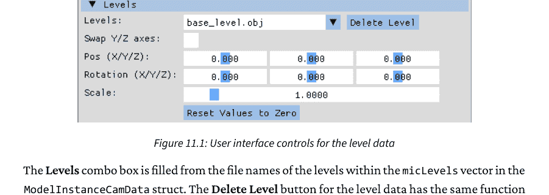
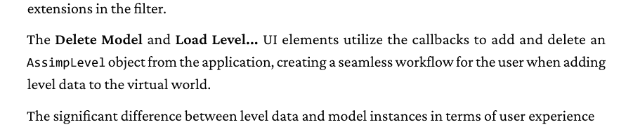
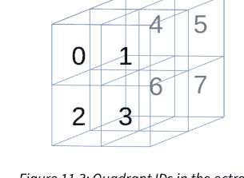
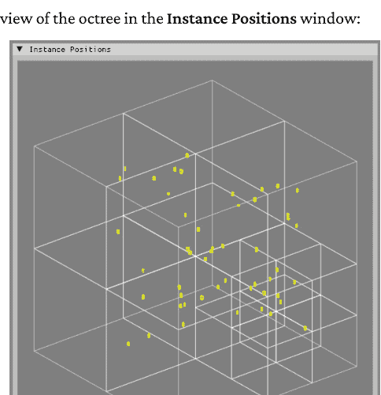
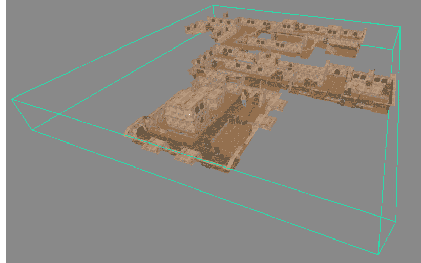

## 第 4 部分：增强你的虚拟世界

在本书的最后一部分，你将为虚拟世界的居民提供一个居住地。你将探索实例数据和关卡数据之间的差异，并实现一个关卡数据加载器，该数据可以从互联网上获取或由你自己创建。你还将学习实例与关卡几何体之间碰撞检测的处理方式，使实例不仅能够避开墙壁，还能够在加载的关卡地面上行走。然后，你将被介绍到关卡内的寻路和导航，使实例能够在游戏地图中的路径点之间漫游。最后，你将获得一系列想法和资源，将动画编辑器升级为小型游戏引擎。

本部分包含以下章节：

- 第 11 章，加载游戏地图
- 第 12 章，高级碰撞检测
- 第 13 章，添加简单导航
- 第 14 章，创建沉浸式交互世界

### 11：加载游戏地图

欢迎来到第 11 章！在上一章中，我们为实例添加了面部表情。在简要介绍形变目标动画后，我们扩展了应用程序以加载形变网格并添加了 UI 元素来控制实例的面部动画。此外，还添加了一种新的图节点类型，以便在节点树中使用面部动画。最后，我们实现了叠加混合，使实例的头部能够独立于任何骨骼和面部动画移动。

在本章中，我们将暂时从角色控制中脱离出来，并为虚拟世界添加游戏关卡和关卡资源。我们将首先探讨为什么关卡数据应与模型和实例不同地处理；此外，我们将查看使用 Open Asset Importer Library 导入关卡数据合适的的文件格式以及在哪里找到游戏关卡。然后，我们将从文件中加载关卡数据和资源到应用程序中，并将四叉树更新为八叉树。作为最后一步，我们将把关卡相关数据添加到渲染器中，以将游戏地图绘制到屏幕上，让我们对我们虚拟世界居民的家园会是什么样子有一个概念。

- 地图数据与模型数据的差异
- 为地图选择文件格式
- 导入游戏地图
- 将地图数据发送到 GPU

本章的示例代码可在 chapter11 文件夹中找到，OpenGL 的在 01_opengl_level 子文件夹中，Vulkan 的在 02_vulkan_level 子文件夹中。

### 光照贴图

即使光照贴图的原理在近三十年前 id Software 的 Quake 中就已引入，这一技术至今仍在使用。在关卡创建期间，静态光源的光效会被“烘焙”到纹理中，明亮的像素描绘了关卡几何体上静态光源照射到的部位，而暗色像素则表示关卡表面上的阴影。

光照贴图纹理随后被添加为次要纹理，使光源照不到的区域变暗并模拟阴影。使用光照贴图可以通过保持合理的视觉效果大幅加快光照计算速度，因为不需要昂贵的逐像素计算。

### 导航网格

导航网格，或称 navmesh，是为敌人、NPC 或任何其他计算机控制对象而添加的。关卡几何体将被额外覆盖一层由三角形或其他多边形组成的网格，但仅在计算机控制对象应能够移动的那些位置。导航网格可以加速对象的寻路，并在放置正确时有助于防止碰撞检测。

我们将在第 13 章中再次讨论导航网格，在那里我们为实例添加简单导航。

### 层次细节

模型文件可以包含所谓的细节层次网格。在绘制远离摄像机的模型时，可以降低网格复杂度，而不会影响视觉质量，因为模型只覆盖屏幕上的几个像素。通过使用不同的网格分辨率，可以减少绘制模型所需的总体三角形数量。

关卡数据可以更充分地利用细节层次网格，用更简单的表示替换一组对象。例如，与其在远距离绘制大量视觉上无法区分的岩石，层次细节（HLOD）版本的同一区域可以合并为一个具有调整纹理的单一网格，以极少的面片和纹理提供相似的视觉质量。

### 关卡数据可能是部分或不完整的

你的精美动画 3D 模型应该始终完全可用，而不仅仅是模型的一半，甚至更少。但对于关卡数据而言，关卡的庞大尺寸可能对 PC 或主机来说一次处理太多，尤其是在考虑额外的关卡数据时，如光照、导航或碰撞检测。但纹理尺寸和质量，或计算机控制角色的数量和分布，也会大幅提高内存需求。此外，当前加载的关卡部分可能具有更多细节，利用可用资源绘制可见区域，而不是将不可见且未使用的數據保留在内存中。

保持玩家的沉浸感是关卡设计的一部分。关卡可能隐藏在蜿蜒的通道后面，其中两个关卡部分都不可见，从而允许游戏引擎丢弃玩家来过的区域并加载他们前往的部分。另一个广泛使用的关卡切换示例是使用电梯，并在进入建筑物、宇宙飞船或类似场景的下一层时加载新的关卡数据。

通过明智地使用预计算数据，可以减少渲染单帧所需的时间，为玩家提供更好的体验。或者，可以利用现在未使用的 CPU 能力来调整视觉细节，允许在屏幕上显示更多对象，或更详细的对象，同时仍保持相同的帧时间。

在地图和实例之间的差异明确后，让我们看看哪些文件格式主要用于关卡数据，以及如何获取游戏地图。

### 为地图选择文件格式

Open Asset Importer Library 知道几种旧的和新的 3D 角色模型格式，但——遗憾的是——对关卡数据的支持相当有限。

我们将首先探索在互联网上找到的关卡文件格式，然后如果可用格式不符合我们的需求，再查看替代方案。

### 使用 Assimp 支持的文件格式中的关卡

一些文件格式用于创建游戏关卡数据，要么从头创建数据，要么使用其他游戏中的建筑和地形作为模板。

如果你想获取一些导入的游戏地图，你应该查看这些网站：

- **Sketchfab**: https://sketchfab.com/
- **Free3D**: https://free3d.com

在这两个网站上，可以搜索和下载大量免费和付费的动画和非动画模型、关卡和资源。多个模型附带 Creative Commons 许可，允许你在免费甚至商业项目中使用模型。


通常，你会看到以下格式的关卡：

- Khronos Group glTF（.glTF/.glb）：开源 glTF 格式不仅可以用于我们各章中使用的动画 Woman 和 Man 模型等模型，还可以将整个关卡导出为 glTF 文件。
- Collada（.dae）：Collada 是一种古老但完全开放的基于 XML 的文件格式。Collada 也由 Khronos Group 管理，并且该文件格式甚至已经制定了 ISO 标准。
- Wavefront（.obj + .mtl）：许多关卡都采用 Wavefront 文件格式。Wavefront 格式的文件是纯文本（没有二进制组件），该格式文档完善且被广泛支持。
- 通用场景描述（.usd/.usdz）：与其他文件格式相比，**通用场景描述（USD）** 格式相当新。USD 也是开源的且文档完善，但由于文件格式的复杂性，Assimp 中的支持仍处于实验阶段。
- Autodesk FBX（.fbx）：“Filmbox” 格式是专有的，并且大多没有文档，但 Blender 和 Assimp 等工具可以读写这种文件格式。使用 FBX 或多或少需要自担风险，因为可能只有特定版本能按预期工作。

如果这些格式都不符合你的需求，你可能需要扩展某种文件格式，甚至构建自定义文件格式。

## 扩展现有格式或创建自定义格式

从头创建新的游戏关卡或修改现有游戏关卡，可能需要原始文件格式中不存在的额外信息，例如烘焙光照贴图、树木数据、导航网格或细节层次数据。更多信息请参见 *关卡数据可能包含额外数据* 一节。

glTF 等文件格式内置了创建扩展的能力，而其他文件格式可能很难扩展，甚至无法在不破坏现有导入器的情况下扩展。在这种情况下，你可以从头发明自己的文件格式，或者将某种标准文件格式用于关卡数据，并添加一种自定义格式来存储额外数据。

本书前面在 *第 5 章* 的 *添加 YAML 解析器* 一节中创建了一种自定义文件格式：用于存储模型、实例、摄像机、碰撞检测和节点树的所有设置的 YAML 配置文件。虽然我们依赖标准的文本格式将数据存储到磁盘上，但文件的内容是针对我们示例应用的需求而定制的。

将相同的数据存储为二进制格式也是可行的，例如，当解码文本信息耗时过长时。

但创建一种全新的文件格式应该是最后的手段，因为你需要编写所有读写数据的代码，在读写操作期间跟踪文件格式的不同版本，甚至可能还要支持不同的操作系统和硬件架构。维护这样一种自然演化的文件格式可能成为一场噩梦。

更好的方法是使用标准格式，并将所有文件打包到一个存档中，例如 ZIP 文件。当关卡分发给玩家或其他开发者时，你不必担心文件缺失，同时也不需要重新发明轮子去创建一种包罗万象的新文件格式。

这类存档比你想象的更常见。例如，原版 DOOM 中的 WAD 格式和 Quake 系列的 PAK/PK2/PK3 格式，都是为了将全部游戏数据收集到单个文件中而创建的，而且这些文件类型甚至支持补丁更新，因为新存档中的文件会替换旧存档中的同名文件。

## 构建自己的关卡

如果你在互联网上找不到合适的游戏关卡地图怎么办？你仍然可以选择自己创建一个小地图，例如使用 Blender。创建地图超出了本书的范围，但你可以在互联网上找到合适的教程和视频。在“其他资源”一节中可以找到两个示例视频的链接。

在探讨了在应用中分离模型数据和关卡数据的原因之后，我们现在将实现用于加载和处理关卡数据的新代码。

## 导入游戏地图

作为加载关卡的第一步，我们将添加一个名为 AssimpLevel 的新 C++ 类。你可以将 AssimpLevel 类视为 AssimpModel 和 AssimpInstance 这两个类的混合体，它包含模型类的静态顶点数据，以及实例类的位置、旋转或缩放等动态属性。

AssimpLevel 类由两个新文件组成：AssimpLevel.h 和 AssimpLevel.cpp。这两个文件都位于 model 文件夹中，但我们将借用 AssimpModel 和 AssimpInstance 这两个类的大部分方法和成员。

让我们简要地浏览一下 AssimpLevel 类。

## 添加一个 C++ 类来保存关卡数据

由于关卡数据与模型/实例数据非常相似，我们可以重用 AssimpModel 和 AssimpInstance 类中已有的部分功能，例如加载模型文件或执行矩阵运算。

对于静态数据，我们可以从 AssimpModel 类中复制以下方法和成员，并将名称中的 model 部分替换为 level，以与类名保持一致：

- loadModel() 方法，但不包括骨骼、动画和查找表创建
- processNode() 方法，同样不包括骨骼相关部分
- 整个 draw() 方法
- getTriangleCount()、getModelFileName() 和 getModelFileNamePath() 方法
- setModelSettings() 和 getModelSettings() 方法
- mTriangleCount 和 mVertexCount 成员变量
- mRootNode、mNodeList、mRootTransformMatrix、mModelMeshes、mVertexBuffers 和 mModelSettings 成员变量，用于存储可行的关卡数据
- mTextures 和 mPlaceholderTexture 成员变量，用于纹理

对于动态数据，可以从 AssimpInstance 类中复制以下方法和成员，同样将名称中的 model 替换为 level：

- updateModelRootMatrix() 和 getWorldTransformMatrix() 方法
- mLocalTranslationMatrix、mLocalRotationMatrix、mLocalScaleMatrix、mLocalSwapAxisMatrix、mLocalTransformMatrix 和 mModelRootMatrix 成员变量

为了将所有可变的关卡数据放在一个位置，我们在 model 文件夹中创建了 LevelSettings.h 文件，其中包含 LevelSettings 结构体：

```
struct LevelSettings {
    std::string lsLevelFilenamePath;
    std::string lsLevelFilename;
    glm::vec3 lsWorldPosition = glm::vec3(0.0f);
    glm::vec3 lsWorldRotation = glm::vec3(0.0f);
    float lsScale = 1.0f;
    bool lsSwapYZAxis = false;
};
```

如你所见，这些关卡设置也是部分取自模型设置（文件名）和实例设置（位置、旋转、缩放、轴交换）的数据的混合体。LevelSettings 数据类型将用于简化用户界面中的关卡设置，并用于保存和加载关卡相关数据。

我们还通过添加一个名为 micLevels 的 AssimLevel 共享指针向量，以及一个保存向量中当前所选关卡的 micSelectedLevel 整数，使已加载的关卡数据可用于应用的其他部分：

```
std::vector<std::shared_ptr<AssimLevel>> micLevels{};
int micSelectedLevel = 0;
```

管理 micLevels 向量中的 AssimLevel 对象的主要工作将由 renderer 类处理，因此我们第二步将添加方法和回调。

## 添加回调和渲染器代码

新的关卡功能与现有模型功能之间的相似性也延续到了回调中。必须在 Callbacks.h 文件中添加三个新的回调定义：levelCheckCallback、levelAddCallback 和 levelDeleteCallback。

```
using levelCheckCallback = std::function<bool(std::string)>;
using levelAddCallback = std::function<bool(std::string)>;
using levelDeleteCallback =
    std::function<void(std::string)>;
```

对于模型，我们有一组相同的回调。第一个回调 levelCheckCallback 用于检查是否已加载了同名的关卡文件，另外两个回调 levelAddCallback 和 levelDeleteCallback 用于从文件加载新关卡和删除现有关卡对象。

与大多数回调一样，我们也会在 ModelInstanceCamData.h 的 ModelInstanceCamData 结构体中提供这些函数：

```
levelCheckCallback micLevelCheckCallbackFunction;
levelAddCallback micLevelAddCallbackFunction;
levelDeleteCallback micLevelDeleteCallbackFunction;
```


在图 11.1 中，显示了用于关卡数据的 resulting 用户界面部分：



Levels 组合框是从 ModelInstanceCamData 结构体中的 micLevels 向量内的关卡文件名填充的。用于关卡数据的 Delete Level 按钮的功能与 UI 的 Models 部分中的 Delete Model 按钮相同，删除当前选中的关卡，而轴交换、位置、旋转和缩放的控件则取自 Instances UI 部分，并带有 Reset Values to Zero 按钮以将所有控件设置为默认值。

除了新的控件元素外，还创建了一个名为 Levels 的新主菜单项。图 11.2 显示了此时主菜单的所有元素：



点击 Load Level... 会打开众所周知的基于 ImGui 的文件对话框，其配置了关卡数据支持的文件格式列表。有关过滤器中扩展名的信息，请参阅 Choosing a format for a map 部分。

Delete Model 和 Load Level... UI 元素利用回调来向应用程序添加和删除 AssimpLevel 对象，为用户在向虚拟世界添加关卡数据时创建无缝的工作流程。

就用户体验而言，关卡数据与模型实例之间的显著区别在于缺少对关卡数据的视觉选择和修改功能。由于你会在对位置、旋转和缩放感到满意之前只调整关卡数据几次，因此像实例一样持续移动关卡数据的额外代码只会被使用一次或两次。更有可能的是，如果关卡数据在错过目标实例几像素时被选中，视觉选择会损害工作流程。

作为关卡数据管理的最后一步，我们将把加载的关卡文件名和每个关卡的设置添加到 YAML 配置文件中。

## 保存和加载关卡配置

将加载的关卡和关卡设置存储在 YAML 配置文件中非常快速且直接。

在为 LevelSettings 数据类型添加 Emitter 输出运算符重载后，我们可以复制并调整 YamlParser 类的 createConfigFile() 方法中用于模型或相机的 emitting 代码块，以保存关卡数据。此外，我们还必须在配置文件的 settings map 中发出选中的关卡编号。

此外，还向 YamlParser 类添加了两个名为 getLevelConfigs() 和 getSelectedLevelNum() 的新方法：

```
std::vector<LevelSettings> getLevelConfigs();
int getSelectedLevelNum();
```

这两种方法遵循与模型和相机对应方法相同的流程。第一个方法 getLevelConfigs() 尝试从 YAML 文件加载关卡数据，而 getSelectedLevelNum() 返回配置保存时所选关卡的索引。

在 YamlParserTypes.h 文件中，必须为 LevelSettings 数据类型添加一对简单的 encode() 和 decode() 方法以从 YAML 文件读取回数据。我们还应将 mYamlConfigFileVersion 值增加，因为配置结构已发生变化。

现在我们可以从文件中添加关卡数据，将关卡放置在虚拟世界中，并存储和重新加载配置。将关卡数据添加到撤销/重做栈留作练习，但关卡数据撤销/重做的基本原理与模型的撤销/重做功能相同。

由于关卡数据可能包含重叠的元素，例如桥梁、隧道或建筑物的多层，实例可能在二维上位于同一位置。即使实例在关卡中以不同的高度行走，现有的碰撞检测也会被触发，导致对不存在的碰撞产生错误反应。

我们必须将四叉树扩展为八叉树以支持三维中的碰撞检测。让我们看看如何升级四叉树。

## 将四叉树转换为八叉树

将四叉树更新为八叉树惊人地简单，大部分工作可以通过使用 IDE 的重构功能中的重命名功能触发。为了简洁，我们只在这里简要介绍所需的更改。请在 chapter11 文件夹内的子文件夹中查看示例代码以获取完整的八叉树代码。

首先，我们将四叉树文件夹的名称更改为 octree。在 CMakeLists.txt 文件中，quadtree 的两个出现也必须重命名为 octree 以匹配文件夹名称。我们重命名 QuadTree 类为 Octree 并将 BoundingBox2D 更改为 BoundingBox3D。

接下来，我们通过使用八个而不是四个子节点来扩展 Octree 类。图 11.3 显示了八叉树的象限 ID：



图 11.3：八叉树中的象限 ID

四个现有的子象限 ID 0 到 3 将用于四个正面朝向的八分体，而四个背面朝向的八分体将获得新的 ID 4 到 7。将四个新的八分体移动到八叉树长方体的后面使我们能够保留大部分来自四叉树的逻辑。添加查找正确八分体的新逻辑仅仅是复制和粘贴代码的行为，同时考虑到正面和背面朝向的八分体。

然后，我们将代码中所有 QuadTree 相关的 include 语句、类和方法调用更新为 Octree，并将所有 BoundingBox2D 的出现更新为 BoundingBox3D。边界框的升级包括将旧 BoundingBox2D 参数的所有 glm::vec2 类型更改为使用 glm::vec3。我们还将 getTopLeft() 的名称更改为 getFrontTopLeft() 并添加 getBack() 方法以反映第三维度的可用性。

最后，代码中所有回调函数的类型将从 quadTree 重命名为 octree，以反映代码其他地方的功能更改。

现在我们可以使用八叉树在三维中检测碰撞。可惜的是，Instance Positions 窗口仍然显示实例的俯视图，我们无法看到是否有实例放置在不同的高度。我们必须调整包含实例的迷你窗口的渲染方式，以便可以看到放置在不同高度的任何实例。

## 创建交互式八叉树视图

新的八叉树视图创建分为三个步骤：

- 1. 为了更好地概览八叉树和实例，新视图可以通过使用鼠标进行缩放、旋转和平移。由于正交显示和八叉树的对称性，可能仍需要一些额外的旋转来使八叉树与摄像机视图对齐，但这很难做到。淡出远处的八叉树部分或突出显示包含摄像机的八分体可能有助于聚焦当前感兴趣区域。另一方面，使用透视投影的八叉树可能更容易找到正确的对齐方式，但透视会扭曲实例之间的距离，我们只是创建了主关卡渲染的副本。
- 2. 八叉树象限和实例的线条被收集到一个临时数据结构中。我们将在此使用 OGLLineMesh，因为该数据类型仅包含最少的内容；我们需要绘制 ImGui 线条。
- 3. 为了实现所需的视图，八叉树象限和实例边界框的所有点必须通过第一步中的缩放、旋转和平移进行转换。这种转换与我们对摄像机和实例所做的相同：通过为每个点创建矩阵和矩阵-向量乘法进行。矩阵运算中不应有任何意外；只有平移可能需要解释。

让我们先逐步介绍交互部分。

## 添加交互性

为了能够使用鼠标按钮和鼠标移动更改八叉树视图，我们需要在 UserInterface 类中添加三个新的私有变量，命名为 mOctreeZoomFactor、mOctreeRotation 和 mOctreeTranslation：

```
float mOctreeZoomFactor = 1.0f;
glm::vec3 mOctreeRotation = glm::vec3(0.0f);
glm::vec3 mOctreeTranslation = glm::vec3(0.0f);
```

变量的名称不言自明，因此我们无需在此深入细节。


在 UserInterface 类的 createPositionsWindow() 方法中创建 **实例位置** 窗口之后，我们添加一个检查以查看当前窗口是否已被悬停：

```
if (ImGui::IsWindowHovered(
    ImGuiHoveredFlags_RootAndChildWindows)) {
```

如果没有这个检查，鼠标按钮和移动会触发所有窗口中的八叉树视图变化，导致不想要的结果。

然后，我们获取 ImGui 内部 io 结构的引用：

```
ImGuiIO& io = ImGui::GetIO();
mOctreeZoomFactor += 0.025f * io.MouseWheel;
mOctreeZoomFactor = std::clamp(mOctreeZoomFactor,
    0.1f, 5.0f);
```

在 ImGui 的 io 结构中，可以使用许多内部状态，例如鼠标滚轮或鼠标位置的变化。

我们在这里使用鼠标滚轮来调整八叉树视图的缩放因子。为缩放因子设置上下界有助于避免失去整体概览。

接下来，我们检查右键鼠标按钮是否已被按下，并在右键鼠标按钮仍被按下时根据鼠标移动旋转视图：

```
if (ImGui::IsMouseDown(ImGuiMouseButton_Right)) {
    mOctreeRotation.y += io.MouseDelta.x;
    mOctreeRotation.x += io.MouseDelta.y;
}
```

使用右键鼠标按钮改变旋转也用于相机，因此这种视图变化在使用应用时应该很熟悉。

最后，我们检查中键鼠标按钮，使用鼠标移动移动八叉树：

```
if (ImGui::IsMouseDown(ImGuiMouseButton_Middle)) {
    mOctreeTranslation.x += io.MouseDelta.x;
    mOctreeTranslation.y += io.MouseDelta.y;
}
```

如果你想知道为什么这里不使用左键鼠标按钮：按下 ImGui 窗口上方的左键鼠标按钮会激活内部窗口移动。我们只剩下右键和中键鼠标按钮来实现两种不同的视图变化。

一旦我们有了想要看到的变换，我们就可以从八叉树和实例中获取线条。

## 收集线条

为了在绘制之前存储线条，我们在 UserInterface 类中添加了一个名为 mOctreeLines 的私有变量：

```
OGLLineMesh mOctreeLines{};
```

在清除 mOctreeLines 内部的顶点向量后，我们获取八叉树线条：

```
mOctreeLines.vertices.clear();
const auto treeBoxes =
    modInstCamData.micOctreeGetBoxesCallback();
```

对于每个八叉树象限，我们获取一个 BoundingBox3D 对象，其中包含最小和最大点位置。转换为 AABB 很简单：

```
AABB boxAABB{};
boxAABB.create(box.getFrontTopLeft());
boxAABB.addPoint(box.getFrontTopLeft() +
    box.getSize());
```

然后，我们使用 getAABBLines() 方法为 AABB 创建所有线条作为 OGLLineMesh，并将线条添加到 mOctreeLines 网格中：

```
std::shared_ptr<OGLLineMesh> instanceLines =
    boxAABB.getAABBLines(white);
mOctreeLines.vertices.insert(
    mOctreeLines.vertices.end(),
    instanceLines->vertices.begin(),
    instanceLines->vertices.end());
```

接下来，我们为每个实例获取 AABB 线条，碰撞实例着红色，所有其他实例着黄色。当前选中的实例还会获得额外的绿色边框，以便轻松停止实例。

在遍历八分之一和实例的循环结束时，mOctreeLines 包含所有应绘制到 ImGui 窗口的线条顶点。现在我们需要将顶点变换以匹配选定的缩放、旋转和平移。

## 计算视图并绘制线条

由于存储中间结果比为每个帧的八叉树线分配和计算新的变换矩阵更快，我们添加了三个更多私有成员变量，名为 mScaleMat、mRotationMat 和 mOctreeViewMat：

```
glm::mat3 mOctreeViewMat = glm::mat3(1.0f);
glm::mat4 mRotationMat = glm::mat4(1.0f);
glm::mat4 mScaleMat = glm::mat4(1.0f);
```

然后，应用缩放和两个旋转以创建最终视图矩阵：

```
mScaleMat = glm::scale(glm::mat4(1.0f),
glm::vec3(mOctreeZoomFactor));
mRotationMat = glm::rotate(mScaleMat,
glm::radians(mOctreeRotation.x),
glm::vec3(1.0f, 0.0f, 0.0f));
mOctreeViewMat = glm::rotate(mRotationMat,
glm::radians(mOctreeRotation.y),
glm::vec3(0.0f, 1.0f, 0.0f));
```

现在我们以每组两个顶点的方式遍历 mOctreeLines 中的顶点，因为我们需要每条线的起点和终点：

```
for (int i = 0; i < mOctreeLines.vertices.size(); i += 2) {
```

在循环内部，我们提取每条线的顶点对，并通过与 mOctreeViewMat 相乘来变换顶点位置：

```
OGLLineVertex startVert = mOctreeLines.vertices.at(i);
OGLLineVertex endVert = mOctreeLines.vertices.at(i+1);
glm::vec3 startPos = mOctreeViewMat *
    startVert.position;
glm::vec3 endPos = mOctreeViewMat * endVert.position;
```

接下来，我们将点坐标添加到绘制的中心并添加平移部分：

```
ImVec2 pointStart =
    ImVec2(drawAreaCenter.x + startPos.x +
        mOctreeTranslation.x,
        drawAreaCenter.y + startPos.z +
        mOctreeTranslation.y);
ImVec2 pointEnd =
```

```
ImVec2(drawAreaCenter.x + endPos.x +
    mOctreeTranslation.x,
    drawAreaCenter.y + endPos.z +
    mOctreeTranslation.y)
```

我们不需要在这里使用单独的平移矩阵，因为八叉树线的移动只与 ImGui 窗口相关，而不是 3D 顶点的位置。

在循环结束时，我们使用线条的颜色和固定 alpha 值从起点到终点绘制一条 ImGui 线：

```
drawList->AddLine(pointStart, pointEnd,
    ImColor(startVert.color.r, startVert.color.g,
        startVert.color.b, 0.6f));
```

如果我们在这些更改后启动应用程序，八叉树视图可以通过按右键鼠标按钮旋转，通过按中键鼠标按钮移动，并通过使用鼠标滚轮缩放进出。

图 11.4 显示了实例位置窗口中八叉树的视图：



图 11.4：带有实例和两个细分级别的旋转八叉树

您可以看到所有实例的三维包围盒。碰撞实例以红色绘制，所有其他实例以黄色绘制（与 AABB 调试线相同的颜色），当前选中的实例具有额外的绿色轮廓。

另一个要看到的重要事实是八叉树的细分级别。在八叉树的根级别，一个细分被分为八个八分之一——这是由于实例数量而发生的。在最右下方的八分之一中，需要另一个细分来限制每个八分之一的实例数量。

当应用程序运行时，可以实时看到实例的移动和八叉树细分的变化。视图可以更改以聚焦于八叉树的任何有趣区域。

默认八叉树实现的缺点是开销不断增长。细分可能产生大量空节点，特别是如果每个节点的阈值小且树深度高。对于我们的实现，每个细分成八个八分之一会增加大约一千字节的内存开销，即使我们只需要在一个子八分之一中存储一两个实例 AABB。

此外，每个细分会为遍历成本增加另一个步骤。尽管遍历复杂度仅以对数方式增长，但内存和遍历时间的开销在较大级别可能会变得显著。在这种情况下，可以使用稀疏体素八叉树等数据结构代替。描述稀疏体素八叉树原理的论文链接可在“附加资源”部分找到。

当前关卡加载的一个缺点是缺少关于加载关卡数据尺寸的“感觉”。如果关卡不是平坦的，而是包含不同高度的区域，就很难想象关卡数据的边缘。

为了获得更好的方向感，我们还将为关卡数据添加一个 AABB。

## 为关卡数据构建 AABB

轴对齐包围盒是一个很好的工具，可以避免估计或猜测物体的尺寸。我们使用模型实例 AABB 作为解决方案，通过允许应用程序比较两个实例的最大范围来检测碰撞。

虽然实例顶点和包围盒之间的未使用区域是碰撞检测速度和复杂性的权衡，但对于关卡数据情况不同。AABB 线条将帮助我们看到关卡在所有三个维度上的最大范围，特别是当关卡数据有大量未使用区域时。


为了在用户界面中获得一个漂亮的交互式显示，我们在 Levels 部分添加了一个名为 settingChangedForAABB 的布尔值。在每次滑块或复选框更改时，或按下 Reset Values to Zero 按钮时，我们会触发对该级别 AABB 的重新计算。

那么其他静态关卡元素呢？这些对象称为资产，可以添加到关卡中。资产也需要碰撞检测以防止实例相互穿过，但资产大多不是动画的；它们保持在关卡设计师预期的位置。

我们在这里使用一个快捷方式，利用非动画模型来模拟静态关卡资产。对于动态资产，例如按钮或门，可以使用动画模型；请参阅 Level data does not move around 部分以获取简要说明。在 Practical sessions 部分，有一个将动态资产添加到虚拟世界的任务。

那么，让我们看看非动画模型需要做哪些更改。

## 使用非动画模型作为资产

为了避免添加一个功能与非动画模型大多相同的新 AssimpAsset 类，我们将扩展当前的 AssimpModel 类和渲染器。

对于模型类，我们更改 getAABB() 方法，使其为带动画的模型返回动态 AABB，为不带动画的模型返回静态 AABB：

```
AABB AssimpModel::getAABB(InstanceSettings instSettings) {
    if (mNumAnimatedMeshes > 0) {
        return getAnimatedAABB(instSettings);
    } else {
        return getNonAnimatedAABB(instSettings);
    }
}
```

新的方法 getAnimatedAABB() 只是旧 getAABB() 方法的新名称，它像以前一样从查找数据计算 AABB。另一个新方法 getNonAnimatedAABB() 基本上是 AssimpInstance 类中的 updateModelRootMatrix() 方法。

首先，我们为缩放、旋转、轴交换和转换计算一个单独的矩阵：

```
glm::mat4 localScaleMatrix = glm::scale(glm::mat4(1.0f),
    glm::vec3(instSettings.iScale));
glm::mat4 localSwapAxisMatrix;
if (instSettings.iSwapYZAxis) {
    glm::mat4 flipMatrix = glm::rotate(glm::mat4(1.0f),
        glm::radians(-90.0f), glm::vec3(0.0f, 0.0f, 1.0f));
    localSwapAxisMatrix = glm::rotate(flipMatrix,
        glm::radians(-90.0f), glm::vec3(0.0f, 1.0f, 0.0f));
} else {
    localSwapAxisMatrix = glm::mat4(1.0f);
}
glm::mat4 localRotationMatrix = glm::mat4_cast(
    glm::quat(glm::radians(instSettings.iWorldRotation)));
glm::mat4 localTranslationMatrix =
    glm::translate(glm::mat4(1.0f),
        instSettings.iWorldPosition);
```

然后，将变换矩阵和来自模型文件的根变换矩阵组合成一个变换矩阵：

```
glm::mat4 localTransformMatrix =
    localTranslationMatrix * localRotationMatrix *
    localSwapAxisMatrix * localScaleMatrix *
    mRootTransformMatrix;
```

为了创建边界框数据，模型网格的所有顶点都转换到新位置，并将位置添加到名为 modelAABB 的局部变量中：

```
AABB modelAABB{};
for (const auto& mesh : mModelMeshes) {
    for (const auto& vertex : mesh.vertices) {
        modelAABB.addPoint(localTransformMatrix *
            glm::vec4(glm::vec3(vertex.position), 1.0f));
    }
}
```

对于顶点位置的 w 元素，需要与关卡数据 AABB 相同的调整。通过将最后一个值设置为 1.0f，我们保证在计算最终位置时进行正确的矩阵乘法。

有了 resulting AABB，非动画实例顶点的范围能够检测与动画模型的 AABB 碰撞并绘制调试线。

## 资产 AABB 的性能考虑

目前，非动画实例的 AABB 在每一帧为每个实例计算，就像动画实例的 AABB 一样。如果计算成为瓶颈，例如在虚拟世界中放置了大量静态资产，可以很容易地仅在 UI 中的属性更改时更改 AABB 计算。

一旦关卡数据被加载和处理并且 AABB 被计算，我们就可以准备将关卡三角形绘制到屏幕上。

让我们扩展渲染器以将关卡数据添加到渲染过程中。

## 将关卡数据发送到 GPU

随着新功能的不断添加，应用程序中重用代码变得更加简单。在关卡数据的情况下，网格数据被封装在 AssimpLevel 类中，并且可以通过对所有加载的关卡进行一个小循环来绘制关卡的三角形。

作为第一步，我们创建一个新的着色器来绘制关卡数据。

### 创建新的着色器

由于我们只需要绘制一次关卡三角形，使用单独的着色器来绘制关卡数据是一个聪明的想法。将私有着色器 mAssimpLevelShader 添加到渲染器类的头文件中：

```
Shader mAssimpLevelShader{};

```

着色器将使用两个新文件，assimp_level.vert 用于顶点着色器和 assimp_level.frag 用于片段着色器。我们在渲染器的 init() 方法中与其它着色器一起加载这些文件：

```
if (!mAssimpLevelShader.loadShaders(
"shader/assimp_level.vert",
"shader/assimp_level.frag")) {
  return false;
}

```

片段着色器文件 assimp_level.frag 只是 assimp.frag 文件的副本，没有任何更改。对于顶点着色器文件 assimp_level.vert，我们可以复制 assimp.vert 文件并保留 in 和 out 布局部分以及 Matrices 统一缓冲区。

我们不需要选择缓冲区，因为尚未为关卡数据实现视觉选择，并且我们可以将绑定点 1 处的缓冲区更改为只包含单个 4x4 矩阵：

```
layout (std430, binding = 1) readonly restrict
  buffer WorldTransformMatrix {
    mat4 worldTransformMat;
};
```

将像单个矩阵这样的小数据元素上传到 GPU 上的统一缓冲区并不是最好的主意，因为每次上传都可能给帧增加一点延迟。对于真正的游戏或游戏引擎，世界变换矩阵将是更大缓冲区的部分，但为了简单起见，我们在这里只进行单次上传。

在顶点着色器的 main() 方法中，我们使用 worldTransformMat 将位置和法线顶点转换到由关卡属性创建的矩阵给出的最终位置：

```
void main() {
  gl_Position = projection * view * worldTransformMat *
    vec4(aPos.x, aPos.y, aPos.z, 1.0);
  color = aColor;
  normal = transpose(inverse(worldTransformMat)) *
    vec4(aNormal.x, aNormal.y, aNormal.z, 1.0);
  texCoord = vec2(aPos.w, aNormal.w);
}
```

然后，在渲染器的 draw() 方法中，我们遍历所有关卡并通过检查是否存在任何三角形来跳过空关卡：

作为关卡显示过程的最后一步，触发顶点绘制：

```
for (const auto& level : mModelInstCamData.miLevels) {
  if (level->getTriangleCount() == 0) {
    continue;
  }

  mAssimpLevelShader.use();
  mShaderModelRootMatrixBuffer.uploadSsboData(
      level->getWorldTransformMatrix(), 1);
  level->draw();
}
```

在屏幕上绘制关卡 AABB 需要渲染器中更多的几个方法和成员变量。

### 绘制关卡 AABB

关卡 AABB 顶点存储在渲染器类的一个新私有成员变量 mAllLevelAABB 中：

```
AABB mAllLevelAABB{};
```

另外，两个新的私有方法 generateLevelAABB() 和 drawLevelAABB() 被添加到渲染器类中：

```
void generateLevelAABB();
void drawLevelAABB(glm::vec4 aabbColor);
```

我们在这里将生成和绘制 AABB 线分开，以避免在每一帧绘制时进行昂贵的计算。

在 generateLevelAABB() 中生成关卡 AABB 是通过一个简单的循环完成的。在清除关卡 AABB 数据后，我们遍历所有加载的关卡：

```
mAllLevelAABB.clear();
for (const auto& level : mModelInstCamData.miLevels) {
    if (level->getTriangleCount() == 0) {
        continue;
    }
}
```


### 加载游戏关卡地图

对于没有三角形的关卡，检查会跳过空关卡，因为没有需要绘制到屏幕上的内容。然后，我们生成每个关卡的AABB，并将每个关卡的最小和最大范围添加到 mAllLevelAABB：

```cpp
level->generateAABB();
mAllLevelAABB.addPoint(level->getAABB().getMinPos());
mAllLevelAABB.addPoint(level->getAABB().getMaxPos());
}
```

生成的AABB包含所有已加载关卡的全部关卡数据。如果你希望每个关卡拥有独立的AABB，可以使用AABB的向量，而不是单一的AABB。

在 `drawLevelAABB()` 方法中绘制关卡AABB几乎无需赘述：

```cpp
mAABBMesh = mAllLevelAABB.getAABBLines(aabbColor);
mLineVertexBuffer.uploadData(*mAABBMesh);
mLineShader.use();
mLineVertexBuffer.bindAndDraw(GL_LINES, 0, mAABBMesh->vertices.size());
```

我们使用AABB的 `getAABBLines()` 方法生成线数据，将线条上传到 `mLineVertexBuffer`，在 `LineShader` 上调用 `use()`，然后在 `mLineVertexBuffer` 对象上调用 `bindAndDraw()` 来绘制关卡数据的轴对齐包围盒。

随后，在渲染器的 `draw()` 方法中，当 `rdDrawLevelAABB` 设置为 `true` 时，我们调用 `drawLevelAABB()`：

```cpp
if (mRenderData.rdDrawLevelAABB) {
    glm::vec4 levelAABBColor = glm::vec4(0.0f, 1.0f, 0.5f, 0.5f);
    drawLevelAABB(levelAABBColor);
}
```

颜色是随意选取的，你可以更改颜色值，甚至在UI中添加一个包含3个浮点分量的滑块来控制颜色值。

在屏幕上显示关卡AABB线，是通过 `OGLRenderData.h` 文件中的 `OGLRenderData` 结构体中一个名为 `rdDrawLevelAABB` 的新布尔变量实现的：

```cpp
bool rdDrawLevelAABB = false;
```

对于Vulkan版本的代码，该变量将创建在 `VkRenderData.h` 文件中的 `VKRenderData` 结构体中。

在 `UserInterface` 类中，我们在 `createSettingsWindow()` 方法的 `Levels` 部分为 `rdDrawLevelAABB` 添加了一个复选框，允许我们切换关卡AABB线的显示。

到此为止！在图11.5中，一个来自Sketchfab的示例地图被加载到女性模型旁边，并且关卡AABB已激活：



图11.5：示例地图（未缩放）和一个女性模型实例（来源：Zarudko 制作的 Counter Strike 1.6 地图“de_dust”，https://skfb.ly/6QYJw）

作为游戏玩家，你可能认识这张地图：它是 Counter Strike 1.6 中的“de_dust”。这张地图在 Sketchfab 上有多个版本和格式，还有其他热门游戏地图。

关卡数据周围的包围盒有助于我们了解关卡的尺寸。特别是在像图11.5右前方这样的未使用区域，如果没有AABB线，将很难找到关卡数据的边界。

你还会注意到关卡地图和模型实例之间不同寻常的大小比例。地图和模型都以其默认缩放值加载，大小值由文件作者随意选取。借助用于模型和关卡数据的缩放滑块，调整其中一个或两个对象的大小很容易，但要在来自不同来源和创作者的关卡、模型和其他对象之间获得合理的比例可能会变得很有挑战性。

为了创建一个可信的虚拟世界，游戏角色模型的尺寸必须与家具、建筑、环境物体等的尺寸相匹配。即使不同物体比例上很小的不匹配，在与现实世界中的游戏角色和物体进行比较时也会显而易见。调整不同元素的一个好方法是使用一个已知尺寸的固定大小对象，例如 Minecraft 中的一个方块，其（虚拟）边长为1米，甚至在虚拟世界中使用一条定义好长度的简单线段。通过将所有对象按与已知对象相比的真实世界尺寸进行缩放，不同来源的模型可以在视觉上匹配。

### 总结

在本章中，我们向虚拟世界添加了静态关卡数据。在探讨了关卡地图与模型之间的差异后，我们了解了适合关卡数据的文件格式，以及如何找到炫酷的游戏地图。然后，我们为应用程序添加了对关卡数据的支持，并将四叉树替换为八叉树，以支持三维碰撞检测。最后，我们将新的关卡数据和关卡AABB添加到渲染器中。在接下来的两章中，我们将扩展关卡数据，以创建一个实例可以自由自主漫游的虚拟世界。

在下一章中，我们将继续第8章的碰撞检测。首先，我们将扩展现有代码，以支持实例与关卡几何体之间的碰撞。为了确保实例始终在地面上，我们将在虚拟世界中引入重力。最后，我们将为实例的腿部添加逆运动学，使模型能够以自然的动作爬楼梯或爬坡。

### 实践练习

以下是你可以在代码中进行的一些扩展尝试：

- 向关卡中添加一扇门或一个按钮。

由于动画关卡数据更像是放置在关卡中固定位置的动画角色模型，而不是静态关卡数据，你可以尝试向关卡中添加门、开关或按钮。按钮在交互时不是弹回，而是播放“按下”动画；门则可以围绕铰链旋转或向一侧滑动。

### 加入我们的Discord社区

加入我们社区的Discord空间，与作者和其他读者讨论：
https://packt.link/cppgameanimation


