## 12 高级碰撞检测

欢迎来到*第12章*！在上一章中，我们向虚拟世界添加了加载静态关卡数据的能力。现在实例不再需要在空中奔跑；它们可以拥有一个虚拟家园。首先，我们探讨了模型与关卡数据之间的差异，哪些文件格式主要用于关卡数据，以及如何在互联网上找到游戏地图。然后，我们添加了加载关卡数据的代码，并将二维四叉树替换为三维八叉树。最后，我们实现了关卡数据渲染，包括线框、八叉树和关卡AABB线的调试数据。

在本章中，我们将扩展上一章的关卡数据。首先，我们将为关卡数据添加一个专用的八叉树，并更新代码，使其同时支持实例与关卡几何体之间的碰撞检测。然后，我们将在虚拟世界中添加一种简化形式的重力，使实例保持在地面高度，而不是四处漂浮。最后，我们将为实例的腿部引入逆运动学，使实例能够以更自然的腿部动作爬坡和爬楼梯，并防止脚部陷入地面或悬在空中。

在本章中，我们将介绍以下主题：

- 增强关卡数据的碰撞检测
- 使用重力使实例保持在地面高度
- 添加逆运动学

### 技术要求

本章的示例代码位于 `chapter12` 文件夹中，其中 `01_opengl_adv_collision` 子文件夹对应 OpenGL，`02_vulkan_adv_collision` 子文件夹对应 Vulkan。

### 增强关卡数据的碰撞检测

为了加速实例与关卡几何体之间的碰撞检测，我们将为关卡数据创建空间分区结构，例如八叉树。但不同于将关卡三角形添加到实例八叉树中，我们单独为三角形数据构建一个专用的八叉树。

**添加一种新的八叉树类型**

为关卡数据使用独立的数据结构，比试图在现有八叉树中混合两种数据类型更有意义，原因如下：

- 关卡数据是静态的，而实例位置频繁变化。每次实例位置变化时，我们都需要对使用率相当高的八叉树进行昂贵的更新，在移除并重新添加实例时，可能会导致大量额外的拆分和合并操作。
- 关卡数据和实例的细分数量可能完全不同，这取决于关卡的复杂程度和实例的数量。如果只有少量实例在精细的关卡中漫游，在搜索附近的三角形或实例时可能会产生巨大的开销。
- 我们为了简单而使用八叉树处理关卡数据，但其他数据结构，如BSP树或**边界体积层次结构（BVHs）**，更为常见。由于BSP树和BVH无法像我们的八叉树那样快速动态更新，因此仍然有必要将关卡数据和实例分开。

通过两个不同的八叉树，我们可以克服上述问题。在添加所有关卡三角形后，关卡数据八叉树保持不变；两个八叉树各自拥有自己的细分，具体取决于每个八分区中的数据量。但我们仍然可以通过在关卡八叉树中使用实例包围盒来合并信息。

作为关卡八叉树的第一步，我们在 `opengl` 文件夹中的 `OGLRenderData.h` 文件中添加一个名为 `MeshTriangle` 的新结构体：

```cpp
struct MeshTriangle {
    int index;
    std::array<glm::vec3, 3> points;
};
```


```
BoundingBox3D boundingBox;
};
```

对于 Vulkan，三角形结构体将被添加到 vulkan 文件夹中的 `VkRenderData.h` 文件中。

`index` 成员主要用于调试目的，当某些三角形无法添加到八叉树时，它会被添加到日志输出行中。在 `points` 数组中，我们保存三角形三个点中每个点的世界坐标。世界坐标是创建三角形正确包围盒所必需的；我们稍后还会将世界坐标用于碰撞检测。`boundingBox` 成员包含关卡数据网格中每个三角形的 AABB。

在八叉树中使用包围盒而不是实际三角形数据，可以大大简化查询操作，因为我们在搜索碰撞时无需检查每个三角形的精确轮廓。使用 AABB 可能会导致需要检查更多的三角形，但 AABB 检查的成本很低，因为我们最多只需进行六次简单的浮点数比较。由于关卡几何体的大部分区域要么是墙壁，要么是地面，AABB 的额外尺寸并不重要。

接下来，我们添加名为 `TriangleOctree` 的新八叉树类。这个新的三角形八叉树将在 octree 文件夹中的两个新文件 `TriangleOctree.h` 和 `TriangleOctree.cpp` 中实现。

`TriangleOctree` 类是普通 `Octree` 类的副本，但有一些例外：

- 我们在树中存储三角形数据，而不是实例索引。
- 由于关卡数据八叉树将保持只读，我们不需要更新或移除对象或合并八分体的方法。
- 我们在三角形八叉树中只处理静态数据；搜索关卡三角形之间的相交不会为我们返回任何有用信息。因此，`findAllIntersections()` 和 `findIntersectionsInDescendants()` 方法也可以跳过。

除了在 *添加新八叉树类型* 一节中提到的为关卡数据使用单独八叉树的原因之外，我们还对不适合放入单个八分体的对象采用了不同的处理方法。

在实例八叉树中，实例的包围盒只在少数情况下会大于单个八分体，例如当实例被大幅缩放时。但在关卡八叉树中，许多三角形的包围盒可能无法放入单个细分后的八分体。关卡创建者会尽量最小化关卡中三角形的数量，以获得良好的渲染性能，这导致关卡的部分区域仅由少数几个大三角形组成。

我们可以使用以下三种方法之一来克服尺寸问题：

1. 将大三角形保留在足以容纳整个三角形的八分体中。这种解决方案会将额外对象存储在父节点中，而不只是叶子节点。
2. 将该三角形添加到所有受影响的细分八分体中。这样我们只会在叶子节点中保存数据，但在最坏的情况下会将三角形数据重复 8 次。
3. 在八分体边界上拆分三角形，并且只将子三角形添加到每个八分体。同样，每个受影响的八分体会多出一个三角形，而且分割线还可能产生舍入误差问题。

为了保持代码简单，我们将使用第一种方法，并且只将任何超出细分八分体尺寸的三角形添加到父八分体中。

我们可以在 `add()` 和 `split()` 方法中通过两步检查来实现超大三角形的存储过程。首先，我们遍历所有子八分体，以查找三角形与子八分体边界可能存在的相交：

```
int intersectingChildren = 0;
for (int i = 0; i < node->childs.size(); ++i) {
    BoundingBox3D childBox = getChildOctant(box, i);
    if (childBox.intersects(triangle.boundingBox)) {
        intersectingChildren++;
    }
}
```

如果发现与子八分体存在相交，我们就递增 `intersectingChildren` 变量。然后，在 `add()` 方法中，我们检查该三角形会与多少个子八分体相交。如果超过一个八分体，则三角形保留在当前八分体中：

```
if (intersectingChildren > 1) {
    node->triangles.emplace_back(triangle);
} else {
    int i = getOctantId(box, triangle.boundingBox);
    if (i != -1) {
        add(node->childs.at(i), depth + 1,
            getChildOctant(box, i), triangle);
    }
}
```

同样，对于 Vulkan，这两个变量会被添加到 vulkan 文件夹中 `VkRenderData.h` 文件的 `VkRenderData` 结构体中。

在渲染器的 `init()` 方法中，会调用 `initTriangleOctree()` 来创建具有给定阈值和最大深度的八叉树：

```
void OGLRenderer::initTriangleOctree(int thresholdPerBox,
    int maxDepth) {
    mTriangleOctree = std::make_shared<TriangleOctree>(
        mWorldBoundaries, thresholdPerBox, maxDepth);
}
```

世界边界在关卡 AABB 生成期间更新，因此加载关卡后，我们的三角形八叉树与关卡数据的大小完全相同。

填充关卡数据八叉树是在 `generateLevelOctree()` 方法中完成的。我们这里只介绍重要部分，因为外层代码只是对 `ModelInstanceCamData` 结构体的 `micLevels` 向量中的所有关卡进行循环。

对于 `micLevels` 中的每个关卡，我们以用于绘制关卡的优化网格形式获取关卡网格。然后，我们遍历关卡网格的所有索引：

```
std::vector<OGLMesh> levelMeshes =
    level->getLevelMeshes();
glm::mat4 transformMat =
    level->getWorldTransformMatrix();
glm::mat3 normalMat =
    level->getNormalTransformMatrix();
for (const auto& mesh : levelMeshes) {
    int index = 0;
    for (int i = 0; i < mesh.indices.size(); i += 3) {
```

对于 Vulkan，`levelMeshes` 向量将包含 `VkMesh` 数据类型。

我们必须使用索引来绘制三角形，因为三角形数据是基于索引存储的；直接使用顶点不会为我们提供推断三角形顶点的正确信息。我们还从关卡中获取世界变换矩阵和法线变换矩阵。法线变换矩阵就是世界变换矩阵的逆矩阵的转置；添加 `getNormalTransformMatrix()` 方法是为了将这些额外的变换保留在 `AssimpLevel` 类中。

每当添加或移除关卡数据时，通过调用 `generateLevelOctree`，我们可以确保八叉树拥有所有三角形的正确世界坐标。实现关卡变化时更新的最佳方法是将八叉树更新与已经实现的关卡数据 AABB 更新绑定在一起。

为了实现这种耦合，我们添加一个名为 `generateLevelVertexData()` 的新私有方法，并在其中调用 AABB 和八叉树的生成：

```
void OGLRenderer::generateLevelVertexData() {
    generateLevelAABB();
    generateLevelOctree();
}
```

然后，所有出现的 `generateLevelAABB()` 都会被新的 `generateLevelVertexData()` 方法替换，并且每当关卡数据或其他属性（如旋转或缩放）发生变化时，关卡八叉树也会随之更新。

有了最新的关卡八叉树，我们最终可以检查实例是否与关卡几何体发生碰撞。

## 检测实例/关卡碰撞

通过使用我们在第8章 *添加四叉树以存储邻近模型实例* 一节中用于实例/实例碰撞检测的相同策略，查找实例与关卡三角形之间的碰撞非常简单。我们只需遍历所有实例，获取实例的包围盒，并查询三角形八叉树以查找与该包围盒的碰撞。八叉树会向我们提供所有三角形，其中三角形的包围盒与实例的包围盒发生碰撞，即使该实例未存储在三角形八叉树中，也是如此。

要实现实例与关卡数据之间的碰撞检测，请按照以下步骤操作：

1. 首先，我们在 `InstanceSettings.h` 文件的 `InstanceSettings` 结构体中添加一个名为 `isCollidingTriangles` 的新成员，用于存储碰撞三角形：

   ```
   std::vector<MeshTriangle> isCollidingTriangles{};
   ```

2. 然后，创建 `AssimpInstance` 类的一个新的公有方法 `setCollidingTriangles()`，将传入的三角形数据存储在实例设置中：

   ```
   void AssimpInstance::setCollidingTriangles(
       std::vector<MeshTriangle>& collidingTriangles) {
       mInstanceSettings.isCollidingTriangles =
       collidingTriangles;
   }
   ```


3. 接下来，我们在渲染器中创建一个新的私有方法 `checkForLevelCollisions()`。我们首先获取实例设置并跳过空实例：

```
void OGLRenderer::checkForLevelCollisions() {
    for (const auto& instance :
        mModelInstCamData.micAssimpInstances) {
        InstanceSettings instSettings =
            instance->getInstanceSettings();
        if (instSettings.isInstanceIndexPosition == 0)
            continue;
    }
```

4. 然后，我们只需使用实例的包围盒查询三角形八叉树：

```
std::vector<MeshTriangle> collidingTriangles =
    mTriangleOctree->query(instance->getBoundingBox());
```

5. 仅仅知道我们有碰撞是不够的，但我们想要存储碰撞数据以供进一步操作，例如对碰撞做出反应或绘制调试线。因此，我们将 `MeshTriangles` 向量存储在实例设置中：

```
instances.at(i)->setCollidingTriangles(
    collidingTriangles);
}
}
```

方法 `checkForLevelCollisions()` 被调用到渲染器的 `draw()` 方法中，在实例渲染之后、在 UI 绘制之前。现在所有实例在每一帧都会被检查是否与场景几何体发生碰撞，如果发现碰撞三角形，我们将其存储在实例的 `InstanceSettings` 中。

尽管你可以相信碰撞检测的通用功能是可行的，但眼见为实。我们现在为各种场景数据添加额外的调试线，允许我们将可行信息作为覆盖在屏幕上的线条绘制出来。

## 绘制调试线

如果我们想实时在屏幕上看到碰撞，我们可以在场景几何体中突出显示受影响的三角形。为了实现这种高亮，我们将遵循以下步骤：

- 1. 我们为渲染器添加一个新的私有成员 `mLevelCollidingTriangleMesh`，用于存储碰撞三角形网格：

```
std::shared_ptr<OGLLineMesh>
mLevelCollidingTriangleMesh = nullptr;
```

- 2. 然后，在 `checkForLevelCollisions()` 中，我们清空网格：

```
mLevelCollidingTriangleMesh->vertices.clear();
```

- 3. 接下来，我们遍历所有碰撞三角形，将顶点成对添加到网格存储中，为三角形的每一边创建一个线段：

```
for (const auto& tri : collidingTriangles) {
OGLLineVertex vert;
vert.color = glm::vec3(1.0f, 0.0f, 0.0f);
vert.position = glm::vec4(tri.points.at(0), 1.0f);
mLevelCollidingTriangleMesh->vertices.push_back(vert);
vert.position = glm::vec4(tri.points.at(1), 1.0f);
mLevelCollidingTriangleMesh->vertices.push_back(vert);
vert.position = glm::vec4(tri.points.at(1), 1.0f);
mLevelCollidingTriangleMesh->vertices.push_back(vert);
vert.position = glm::vec4(tri.points.at(2), 1.0f);
mLevelCollidingTriangleMesh->vertices.push_back(vert);
vert.position = glm::vec4(tri.points.at(2), 1.0f);
mLevelCollidingTriangleMesh->vertices.push_back(vert);
vert.position = glm::vec4(tri.points.at(0), 1.0f);
mLevelCollidingTriangleMesh->vertices.push_back(vert);
}
```

- 4. 现在我们已为所有实例保存了检测到的三角形的轮廓。将三角形渲染到屏幕上可以通过一个简单的线条绘制调用完成：

```
mLineVertexBuffer.uploadData(*mLevelCollidingTriangleMesh);
if (mLevelCollidingTriangleMesh->vertices.size() > 0) {
```

```
mLineShader.use();
mLineVertexBuffer.bindAndDraw(GL_LINES, 0,
    mLevelCollidingTriangleMesh->vertices.size());
}
```

运行带有实例/场景碰撞和调试绘制的应用程序，结果的图片类似于图 12.1：

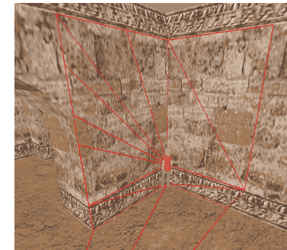

图 12.1：实例与场景几何体的碰撞

在图 12.1 中，实例与地面和多面墙发生碰撞。所有三角形都是通过其包围盒检测到的，因此如果实例仍距离三角形本身有一段距离时三角形被高亮显示，请不要惊慌。在这种情况下，三角形的包围盒被击中，其覆盖的区域比三角形本身更大。但检测到的碰撞中误报的数量很少，可能只会对碰撞检测的性能产生很小的影响。

为了让实例对与场景几何体的碰撞做出适当的反应，我们将下一步扩展节点树。

## 扩展节点树以支持场景几何体碰撞

得益于前几章建立的良好基础，添加一种新的碰撞类型只需几分钟，按照以下步骤操作即可：

- 1. 首先，我们在 `Enums.h` 文件中的 `nodeEvent` 枚举中添加新的事件类型：
```
enum class nodeEvent : uint8_t {
...
instanceToLevelCollision,
NUM
};
```
- 2. 我们还在渲染器 `init()` 方法期间向 `micNodeUpdateMap` 添加一些文本，以便在节点树中添加名称：
```
mModelInstCamData.micNodeUpdateMap[
nodeEvent::instanceToLevelCollision] =
"Inst to Level collision";
```
- 3. 然后，在 `checkForLevelCollisions()` 中，如果我们至少有一个碰撞三角形，则触发新的事件：
```
if (collidingTriangles.size() > 0) {
 mModelInstCamData.micNodeEventCallbackFunction(
 instSettings.isInstanceIndexPosition,
 nodeEvent::instanceToLevelCollision);
}
```
- 4. 该事件通知实例的节点树发生了与场景几何体的碰撞。作为示例，我们可以让实例转身 180 度，如图 12.2 所示：

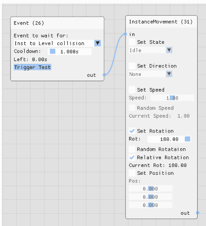

图 12.2：一个对实例/场景碰撞做出反应的事件节点

在图 12.2 中的事件节点中，实例在与场景发生碰撞时会立即转身。还添加了 250 毫秒的冷却时间。使用冷却时间应给予实例足够的时间远离受影响的场景几何体，以避免立即重新触发场景碰撞。

但现在，碰撞检测有一个巨大的缺点：实例保持在同一高度行走，从而穿过山丘或在地形变化时在空中行走。

为了让实例保持在地面上，让我们为应用程序添加一种简单的重力形式。

## 使用重力使实例保持在地面上

重力在我们周围无处不在，将物体向下加速，直到它们撞到其他不可移动的物体，例如地面。我们在行走或静止时大多意识不到重力的作用；我们只在某物掉落并且很可能在撞到地面时破碎时才意识到其威力。

在添加重力之前，我们需要找到一种方法来检测场景几何体中的三角形是否属于地面。

## 在场景数据中查找地面三角形

对于真实世界的场景，可以使用额外属性来标记场景的区域是否可行走。由于我们希望尽可能通用地保持地面级别技术，我们将使用不同的方法并使用三角形法线来检查我们周围的区域是否属于地面或墙壁，以及斜坡区域可以行走的最大角度。

我们将每个三角形的法线作为 3 元素向量存储在 `MeshTriangle` 结构体内部，与其他三角形数据一起存储：

```
struct MeshTriangle {
    ...
    glm::vec3 normal;
    BoundingBox3D boundingBox;
};
```

在 `generateLevelOctree()` 中生成三角形八叉树时，会采用三角形的第一个顶点的法线：

```
tri.normal = glm::normalize(normalMat *
    glm::vec3(mesh.vertices.at(
    mesh.indices.at(i)).normal));
```

由于场景数据的索引结构，使用三角形的顶点之一的法线可能会导致因同一顶点被不同三角形重用而产生的伪影。在这种情况下，我们可以更改法线的计算方式，使其为每个三角形的两条边的叉积：

```
glm::vec3 edge1 = glm::vec3(mesh.vertices.at(
    mesh.indices.at(i + 1)).position -
    mesh.vertices.at(mesh.indices.at(i)).position);
glm::vec3 edge2 = glm::vec3(mesh.vertices.at(
    mesh.indices.at(i + 2)).position -
    mesh.vertices.at(mesh.indices.at(i)).position);
tri.normal = glm::normalize(normalMat *
    glm::cross(edge1, edge2));
```

为了能够在用户界面中控制地面坡度，我们在 `OGLRenderData` 结构体中添加一个名为 `rdMaxLevelGroundSlopeAngle` 的新变量：

```
float rdMaxLevelGroundSlopeAngle = 0.0f;
```


对于 Vulkan，一如既往，该变量将被添加到 VkRenderData 结构体中。

然后，在 checkForLevelCollisions() 中，我们添加一个新的检查，以确定指向上方的向量与三角形的法线之间的角度是否大于最大可配置的地面坡度：

```
if (glm::dot(tri.normal, glm::vec3(0.0f, 1.0f, 0.0f))
    >= glm::cos(glm::radians(
    mRenderData.rdMaxLevelGroundSlopeAngle))) {
```

在 if 块内部，我们现在可以将事件发送代码限制为仅针对墙壁触发，而不再针对地面三角形触发。我们还将被检测为地面三角形的三角形的调试线颜色改为蓝色，而墙壁三角形仍保持红色：

```
vertexColor = glm::vec3(0.0f, 0.0f, 1.0f);
} else {
    vertexColor = glm::vec3(1.0f, 0.0f, 0.0f);
    mModelInstCamData.miNodeEventCallbackFunction(
        instSettings.isInstanceIndexPosition,
        nodeEvent::instanceToLevelCollision);
}
```

在 UserInterface 类的 Levels... 部分，我们添加一个浮点滑块，以支持交互式控制最大地面坡度：

```
ImGui::Text("Max Ground Slope:");
ImGui::SameLine();
ImGui::SliderFloat("##MaxSlope",
    &renderData.rdMaxLevelGroundSlopeAngle,
    0.0f, 45.0f, "%.2f", flags);
```

现在，应用程序会以不同的颜色绘制与墙壁和地面的碰撞，如图 12.3 所示：

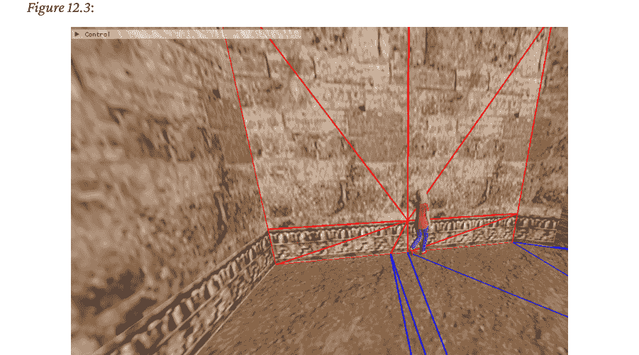

如图 12.3 所示，墙壁碰撞现在用红色三角形边标记，而地面碰撞则用蓝色三角形边突出显示。坡度角可以通过滑块配置，从而可以微调山坡或边缘的哪个坡度仍被视为地面。

除了实例与墙壁或地面之间碰撞的颜色不同之外，事件报告也有所不同。对于地面碰撞，不会生成实例/关卡几何碰撞事件，从而允许实例在关卡中四处奔跑，仅与墙壁碰撞。

在我们可以检查实例是否与地面多边形碰撞之后，是时候将重力添加到代码中了。

## 添加基本重力

对于我们的应用程序，我们只使用简单的重力。我们只是每帧将实例向下移动一定量，而不考虑更复杂的模式，例如随时间的加速。如果你想实现更多细节，补充资源部分包含深入介绍高级物理和碰撞检测主题的书籍的 ISBN。此外，实践课程部分中的一个任务实现了增强重力。

为了能够向实例添加重力效果，我们在 AssimpInstance 类中创建一个名为 applyGravity() 的新公共方法：

```
void AssimpInstance::applyGravity(float deltaTime) {
    glm::vec3 gravity =
        glm::vec3(0.0f, GRAVITY_CONSTANT * deltaTime, 0.0f);
    mInstanceSettings.isWorldPosition -= gravity;
}
```

私有变量 GRAVITY_CONSTANT 在 AssimpInstance.h 头文件中定义，并设置为 9.81，与地球上的真实重力相似。然后，在渲染器的 draw() 方法的实例循环中应用重力：

```
if (mRenderData.rdEnableSimpleGravity) {
    instances.at(i)->applyGravity(deltaTime);
}
```

rdEnableSimpleGravity 变量已添加到用于 OpenGL 的 OGLRenderData.h 文件中的 OGLRenderData 结构体，以及用于 Vulkan 的 VkRenderData.h 头文件中的 VkRenderData 结构体。

在 UserInterface 类的 createFrame() 方法的 Levels... 折叠标题中，使用一个复选框来控制重力：

```
ImGui::Text("Simple Gravity: ");
ImGui::SameLine();
ImGui::Checkbox("##EnableGravity",
    &renderData.rdEnableSimpleGravity);
```

我们将使用此复选框，在没有加载关卡几何体时防止所有实例下落。

还需要最后一步，使实例能够在关卡地面上漫游。让我们创建代码的最终部分，以完成对实例的地面处理。

## 将实例保持在关卡地面三角形上

使用本章前面几节的代码，我们可以检测实例与关卡墙壁和地板之间的碰撞，并处理墙壁碰撞。对于地面碰撞，我们需要特殊处理，因为实例大多数时候会停留在关卡的地板上。

一个朴素的地面碰撞想法是在施加重力后将实例向上移动一点。遗憾的是，如果垂直移动量不相同，施加重力然后将实例移回会导致振荡。但除了将实例向上移动，我们也可以首先避免施加重力，一旦检测到碰撞，就让实例留在地面三角形上。

将实例保持在关卡地面三角形上的功能将通过以下步骤实现：

- 1. 对于每个实例，我们通过使用 InstanceSettings.h 文件中的 InstanceSettings 结构体中一个名为 isInstanceOnGround 的新布尔变量来存储“在地面上”状态：

```
bool isInstanceOnGround = false;
```

- 2. 在 AssimpInstance 类中，还会为该状态添加一个公共 setter：

```
void AssimpInstance::setInstanceOnGround(bool value) {
    mInstanceSettings.isInstanceOnGround = value;
}
```

- 3. 然后，我们更新 applyGravity() 方法，如果发现实例位于地面上，则禁用将重力添加到垂直位置：

```
if (!mInstanceSettings.isInstanceOnGround) {
    mInstanceSettings.isWorldPosition -= gravity;
}
```

为了在渲染器中设置 isInstanceOnGround 实例变量，将在渲染器的 draw() 方法中，紧接在对三角形八叉树的 query() 调用下方添加一个新的检查代码。这样，我们确保使用的是最新的三角形碰撞数据。

- 4. 首先，我们将局部布尔变量 instanceOnGround 设置为 true，这在重力被禁用时防止实例下落。接下来，我们使用与实例相同的公式计算重力，并用世界位置初始化实例当前的 footPoint：

```
bool instanceOnGround = true;
if (mRenderData.rdEnableSimpleGravity) {
    glm::vec3 gravity =
        glm::vec3(0.0f, 9.81 * deltaTime, 0.0f);
    glm::vec3 footPoint =
        instSettings.isWorldPosition;
```

在下一步中，我们需要脚点，以便在地面检测失败时为实例提供一个有效的位置。

5. 现在，我们将 instanceOnGround 设置为 false，作为地面级别检测的默认设置，并遍历所有碰撞三角形：

```
instanceOnGround = false;
for (const auto& tri : collidingTriangles) {
```

6. 然后，使用与 checkForLevelCollisions() 中相同的三角形法线向量和指向上方的向量之间的角度检查，来判断该三角形是否是一个地面三角形，因此被视为可通行：

```
if (glm::dot(tri.normal, glm::vec3(0.0f, 1.0f, 0.0f)) >= glm::cos(glm::radians(
mRenderData.rdMaxLevelGroundSlopeAngle))) {
```

7. 如果该三角形是可通行的地面，我们尝试获取一条指向上方的虚拟射线与地面的交点，该射线从已经略微下沉到地面中的实例位置发出：

```
std::optional<glm::vec3> result = Tools::rayTriangleIntersection(
instSettings.isWorldPosition - gravity,
glm::vec3(0.0f, 1.0f, 0.0f), tri);
if (result.has_value()) {
footPoint = result.value();
instances.at(i)->setWorldPosition(
footPoint);
instanceOnGround = true;
}
```

在应用重力值后检查实例是必需的，因为如果实例与地面三角形完全在同一水平面上，则不会报告碰撞。

Tools 类中的辅助函数 rayTriangleIntersection() 实现了 Möller-Trumbore 算法，以查找射线与三角形之间的交点。该算法检测射线是否与三角形相交，并返回相交的确切点。

该算法的可视化如图 12.4 所示：

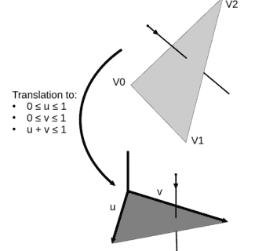

图 12.4：Möller-Trumbore 算法的可视化

Möller-Trumbore 算法使用由三个顶点 V0、V1 和 V2 创建的三角形的重心坐标来检查射线是否在三角形内部或外部。为了简化检测过程，该算法对三角形顶点和射线进行变换，使得三角形的两条边映射到笛卡尔坐标系的 X 轴和 Y 轴上，从而定义一个单位三角形。交点处的重心坐标在这些变换中保持不变。最后的相交测试只需通过测试有效的重心坐标，来检查交点的 x 和 y 坐标是否在三角形内部。有关该算法数学背景的链接可在补充资源部分找到。

8. 作为新渲染器代码中 draw() 调用部分的最后一步，我们为该实例设置地面标志，并应用重力：

```
instances.at(i)->setInstanceOnGround(instanceOnGround);
instances.at(i)->applyGravity(deltaTime);
```

在“添加基本重力”部分中添加的围绕 applyGravity() 的额外 rdEnableSimpleGravity 检查可以移除。我们已经通过将 instanceOnGround 的默认值设置为 true，确保如果 rdEnableSimpleGravity 为 false，则不会添加重力。


启用碰撞三角形调试绘制并调整地面坡度后运行应用程序，将得到类似于图 12.5 的图像：

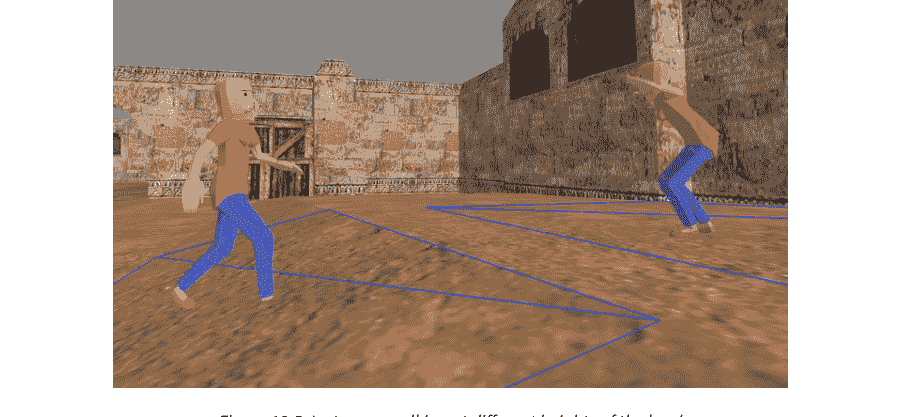

在图 12.5 中，我们看到实例各自在自己的水平面上行走，左侧实例正在爬上一段小坡。在运行的应用程序中，你会看到下坡也是按预期工作的。

启用水平重力后，实例在平坦地面上奔跑。但在不平整的地面上，上坡时会出现与地面相交的情况，或下坡时其中一只脚仍在空中。你可以在左侧实例的右脚上看到这种效果：整只脚都穿进了地面三角形。

让我们通过添加逆向运动学来修复实例的脚部。

## 添加逆向运动学

“运动学”一词被定义为物体运动背后的力学，但不涉及导致该运动的力。因此，我们日常运动的每个部分都可以用运动学来描述，即骨骼的运动。

## 两种运动学类型

我们在前几章中使用的角色动画类型称为**正向运动学**。图 12.6 显示了正向运动学的一个示例：

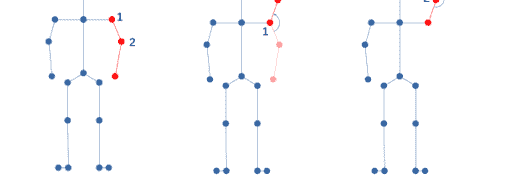

图 12.6：使用正向运动学抬起简易骨骼的手

图 12.6 中的骨骼通过在骨骼编号一、肩部和编号二、肘部处旋转来抬起其简化的手。

在骨骼骨头的移动或旋转过程中，附着在其上的所有其他节点也会受到影响。围绕肩部旋转手臂不会改变肘部或前臂，因为我们一次只改变一根骨头。接下来，前臂围绕肘部旋转，将手带到最终位置。手的这个最终位置由手之前所有骨头的变化的串联定义。

但……如果我们只知道手的期望最终位置会怎样？

如果我们想将图 12.7 中骨骼的手移动到绿色目标点，或想将脚放到绿色目标块上，使用正向运动学的唯一选择就是反复尝试。

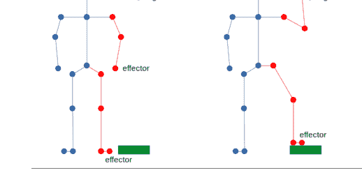

图 12.7：如何将手移动到目标，或将脚放在盒子上？

我们必须一遍又一遍地调整手臂或腿上的所有节点，直到达到匹配的位置。这就是**逆向运动学**发挥作用的地方。与直接旋转节点不同，我们计算与最终运动匹配的骨骼位置，并从最终骨骼位置读取节点旋转，

在逆向运动学中，名称**效应器**用于描述应到达**目标**的骨骼部分。如果目标距离太远而效应器节点无法到达，我们至少应尝试找到尽可能接近目标的位置。除了效应器和目标之外，还必须选择一个**根节点**。根节点是骨骼中第一个不变的节点。

尽管已经创建了许多逆向运动学求解器算法，但我们将使用其中一种基础算法：FABRIK，即**正向和反向伸展逆向运动学**求解器。FABRIK 易于理解和实现，并且能为节点找到良好的解决方案。因此，让我们使用 FABRIK 深入逆向运动学。

## 理解 FABRIK 基础

FABRIK 由 Andreas Aristidou 博士于 2011 年提出。FABRIK 算法通过一次移动骨骼链的节点，使其更接近目标，然后将骨骼重新缩放回原始长度来解决逆向运动学问题。此外，FABRIK 沿着骨骼链在两个方向上移动，正向和反向，因此得名。

我们将使用一个简单的机器人手臂来描述使用 FABRIK 解决逆向运动学问题的步骤。手臂的四个节点定义了三根骨骼，目标和效应器在每一步中都被绘制出来，蓝色节点作为根节点附着在地面上，外侧红色节点用作效应器。所有步骤均显示在图 12.8 至图 12.11 中。

让我们逐步完成算法的一次迭代。首先，我们将检查 FABRIK 的 *正向* 求解部分。

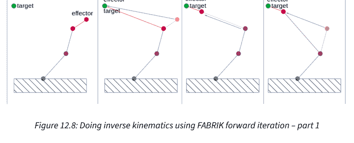

起始情况如图 12.8 (1) 所示：

- 1. 如图 12.8 (2) 所示，我们将首先将效应器移动到目标位置。你可以看到移动该节点会使红色骨骼远超其原始长度地被拉伸。
- 2. 我们必须纠正红色骨骼的长度，因此需要在移动效应器之前保存骨骼的长度。通过使用保存的长度，我们在效应器移动后立即将红色骨骼缩放到其原始长度，如图 12.8 (3) 所示。将红色骨骼缩放到先前的长度会将我们的机器人手臂撕裂开，如图 12.8 (3) 所见，但这是在 FABRIK 迭代期间的预期行为。
- 3. 然后，我们将紫色骨骼的外侧节点移回红色骨骼的末端，并再次将其缩放到任意长度。图 12.8 (4) 显示了机器人手臂重新连接后的结果。
- 4. 紫色骨骼被缩放到其先前的长度，如图 12.9 (5) 所示，将末端节点移离蓝色骨骼。

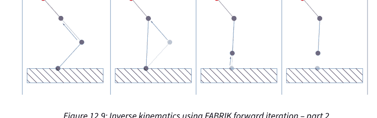

图 12.9：使用 FABRIK 正向迭代的逆向运动学 – 第 2 部分

5. 最后，我们将紫色骨骼移动的步骤 4 和 5 重复到蓝色骨骼。我们每次重新连接手臂并将骨骼缩放到其原始长度，如图 12.9 (6) 和图 12.9 (7) 所示。

图 12.9 (8) 显示了 FABRIK 算法正向步骤完成后的结果。但将机器人手臂与地面断开连接并不是我们想要的结果。为了修复手臂，我们将重复相同的步骤，但这次在同一骨骼链上反向进行。

在 FABRIK 的反向部分，我们将交换目标、效应器节点和根节点。我们使用手臂的原始连接点作为目标，蓝色骨骼的末端成为效应器，原始效应器节点是新的根节点。

6. 反向操作的第一个步骤是重新将手臂连接到地面，如图 12.10 (9) 所示。

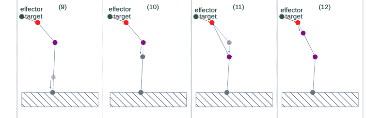

图 12.10：使用 FABRIK 反向迭代的逆向运动学 – 第 1 部分

7. 然后，我们将蓝色骨骼缩放到其先前的大小，并以我们最初在步骤 2 和 3 中所做的方式移动紫色骨骼。图 12.10 (10)、图 12.10 (11) 和图 12.10 (12) 显示了调整蓝色和紫色骨骼的结果。

8. 现在，红色骨骼的下部节点将移动，红色骨骼被缩放到其先前的大小，如图 12.11 (13) 和图 12.11 (14) 所示。

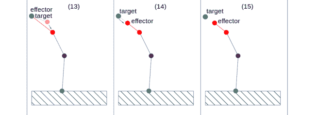

图 12.11：使用 FABRIK 反向迭代的逆向运动学 - 第 2 部分

图 12.11 (14) 将效应器移离目标位置，但如果目标无法到达，这在 FABRIK 中又是预期行为。在图 12.11 (15) 中，一次 FABRIK 迭代结束。

对于 FABRIK 的下一次迭代，步骤 2 至 9 将重复进行，直到效应器节点到达目标位置，或直到达到最大迭代次数。

使用简单的伪代码，FABRIK 可以简化为以下过程：

```
NodePositions := OrigNodePositions
StoreOriginalBoneLengths
RootNodePos := NodePositions[LastPosition];
For NumIterations; Do
    EffectorPos := NodePositions[0]
    If TargetIsCloseToEffector
        Return
    SolveForward(TargetNodePos)
    SolveBackwards(RootNodePos)
EndFor
```

SolveForward 和 SolveBackwards 方法类似，因此我们只需查看 FABRIK 正向求解部分的伪代码：

```
NodePositions[0] = TargetNodePos
For i = 1; i < NodePositions.Size; i += 1
    BoneDirection = NodePositions[i] - NodePositions[i-1]
    NewOffset = BoneDirection * BoneLengths[i - 1]
    NodePositions[i] = NodePositions[i-1] + NewOffset
EndFor
```

反向求解部分只是从保存的根节点位置开始，并以相反方向迭代骨骼。

正如你所见，步骤数量很少，这些步骤中的操作也很简单。掌握了新知识后，让我们添加一个 FABRIK 求解器。

## 实现 FABRIK 逆向运动学算法

使用 FABRIK 算法的逆向运动学求解器通过以下步骤实现：

- 1. 对于 FABRIK 逆向运动学求解器，我们通过向 tools 文件夹添加 IKSolver.h 和 IKSolver.cpp 文件创建一个新的类 IKSolver。
- 2. 在构造函数和迭代次数的 setter 旁边，添加一个名为 solveFABRIK() 的公共方法：

```
std::vector<glm::vec3> solveFABRIK(
    std::vector<glm::mat4>& nodeMatrices,
    glm::vec3 targetPos);
```


3. 我们还添加了两个私有成员 `mNodePositions` 和 `mBoneLengths`，以及三个私有方法 `solveFABRIKForward()`、`solveFABRIKBackwards()` 和 `calculateOrigBoneLengths()`：

```
std::vector<glm::vec3> mNodePositions{};
std::vector<float> mBoneLengths{};
void solveFABRIKForward(glm::vec3 targetPos);
void solveFABRIKBackwards(glm::vec3 rootPos);
void calculateOrigBoneLengths();
```

4. 在 `mNodePositions` 中，我们存储计算期间节点的世界位置，而在 `mBoneLengths` 中则保存所需的原始骨骼长度。`calculateOrigBoneLengths()` 方法的名称不言自明；我们无需深入细节。但让我们快速回顾一下其余三个方法。

5. FABRIK 的前向部分在 `solveFABRIKForward()` 中处理。首先，我们将 `mNodePositions` 的第一个元素设置为目标位置：

```
void IKSolver::solveFABRIKForward(glm::vec3 targetPos) {
    mNodePositions.at(0) = targetPos;
    for (size_t i = 1; i < mNodePositions.size(); ++i) {
        glm::vec3 boneDirection =
            glm::normalize(mNodePositions.at(i) -
            mNodePositions.at(i - 1));
        glm::vec3 offset = boneDirection *
            mBoneLengths.at(i - 1);
        mNodePositions.at(i) =
            mNodePositions.at(i - 1) + offset;
    }
}
```

6. 然后我们遍历剩余的节点，计算移动前一个节点后骨骼的新方向，并利用原始长度计算节点的新位置。最后，我们将节点移动到新位置，保持长度不变。

7. 在 `solveFABRIKBackwards()` 中，我们以沿节点链相反的方向执行与步骤 5 和 6 相同的操作。我们以根节点位置作为目标，并逐个调整节点位置：

```
void IKSolver::solveFABRIKBackwards(glm::vec3 rootPos) {
    mNodePositions.at(mNodePositions.size() - 1) = rootPos;
```

```
for (int i = mNodePositions.size() - 2; i >= 0; --i) {
    glm::vec3 boneDirection =
        glm::normalize(mNodePositions.at(i) -
        mNodePositions.at(i + 1));
    glm::vec3 offset = boneDirection * mBoneLengths.at(i);
    mNodePositions.at(i) =
        mNodePositions.at(i + 1) + offset;
}
}
```

8. 最后一个方法 `solveFABRIK()` 用于控制 FABRIK 的迭代次数以及比较末端执行器和目标位置。我们首先进行一个简单的空节点矩阵向量检查。在这种情况下，我们返回一个空向量：

```
std::vector<glm::vec3> IKSolver::solveFABRIK(
    std::vector<glm::mat4>& nodeMatrices,
    glm::vec3 targetPos) {
    if (nodeMatrices.size() == 0) {
        return std::vector<glm::vec3>{};
    }
}
```

9. 然后，我们调整 `mNodePositions` 向量的大小并填充它：

```
mNodePositions.resize(nodeMatrices.size());
for (int i = 0; i < nodeMatrices.size(); ++i) {
    mNodePositions.at(i) =
        Tools::extractGlobalPosition(
        nodeMatrices.at(i));
}
```

10. 在辅助方法 `extractGlobalPosition()` 中，提取节点矩阵的平移部分并返回。现在我们可以计算骨骼长度，并为 FABRIK 的后向部分保存根节点的位置：

```
calculateOrigBoneLengths();
glm::vec3 rootPos =
    mNodePositions.at(mNodePositions.size() - 1);
```

11. 我们需要保存根节点位置，因为在前向计算过程中会改变 `mNodePositions` 向量。如果不保存原始根节点，后向部分将无法求解。

12. 然后，我们开始一个具有最大迭代次数的循环：

```
for (unsigned int i = 0; i < mIterations; ++i) {
    glm::vec3 effector = mNodePositions.at(0);
    if(glm::length(targetPos - effector) <
        mCloseThreshold) {
        return mNodePositions;
    }
}
```

在循环开始时，我们比较末端执行器节点和期望目标的位置。如果位置足够接近，我们将当前节点位置作为解返回。

13. 现在是 FABRIK 求解部分。我们使用目标位置调用前向求解器方法，然后使用保存的根节点位置调用后向求解器方法：

```
solveFABRIKForward(targetPos);
    solveFABRIKBackwards(rootPos);
}
```

14. 两个求解部分完成后，我们继续下一轮迭代。最后，我们返回 FABRIK 为节点找到的位置：

```
return mNodePositions;
}
```

有可能末端执行器节点无法到达目标位置，即节点链太短。在这种情况下，将返回 FABRIK 能够找到的最佳位置。

在继续 FABRIK 的最后一部分之前，我们需要确保配置模型根节点和末端执行器节点。在这里，我们将只使用脚部以在上坡或下坡行走时营造自然的外观。

## 为实例的脚部定义节点链

为了能够配置脚部的节点，在 `ModelSettings.h` 文件的 `ModelSettings` 结构体中添加了两个新成员：

```
std::array<std::pair<int, int>, 2> msFootIKChainPair{};
    std::array<std::vector<int>, 2> msFootIKChainNodes{};
```

在 `msFootIKChainPair` 数组中，我们存储左脚和右脚的末端执行器和根节点的节点 ID。我们只需要该对用于用户界面，因为 `msFootIKChainNodes` 数组的内容将根据末端执行器和根节点 ID 计算得出。

对于用户界面，我们使用实例模型骨骼名称列表中的名称。由于骨骼 ID 与名称之间存在 1:1 的关系，因此遍历列表以创建组合框非常容易。

与用于启用或禁用逆运动学的布尔变量以及迭代滑块一起，模型脚部逆运动学部分的界面如下图 12.12 所示：

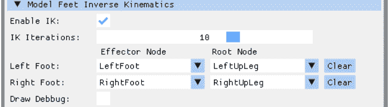

图 12.12：Women 模型的逆运动学配置

对于图 12.12，使用了 Women 模型作为示例。对于其他模型，节点名称可能不同。

### 逆运动学取决于模型

为模型脚部配置逆运动学的能力在很大程度上取决于模型的骨骼结构。你在互联网上找到的一些模型可能缺少骨骼节点之间的父子关系，例如腿部和脚部节点之间的关系，导致逆运动学无法正常工作。

FABRIK 算法还有另一部分，用于使用计算得到的位置调整原始节点世界位置。我们在《实现 FABRIK 逆运动学算法》部分跳过了最终部分的编码，因为出于技术原因必须拆分 FABRIK 算法——FABRIK 算法使用的节点数据驻留在 GPU 上，但其中一些计算在 CPU 上处理更容易。

让我们现在合并节点位置。

## 调整节点位置

由于使用了计算着色器，包含旋转、平移和缩放的矩阵以及节点世界位置的数据仅驻留在 GPU 内存中。此外，出于性能原因，节点位置在计算着色器中计算。我们需要复制数据

```
nodeMatrix = createTRSMatrix(parent) * nodeMatrix;
```

由于计算完全在 GPU 上完成，因此在渲染器代码中反映 TRS 数据拆分的唯一更改是 `mShaderTRSMatrixBuffer` SSBO 的大小计算：

```
size_t trsMatrixSize = numberOfBones *
    numberOfInstances * 3 * sizeof(glm::vec4);
```

我们不再使用完整的 TRS 矩阵的 `glm::mat4`，而是使用三个 `glm::vec4` 实例，在这里保持节点变换像计算着色器中一样拆分为平移、旋转和缩放。

在 `OGLRenderData.h` 文件中，添加了匹配的 `TRSMatrixData` 结构体：

```
struct TRSMatrixData{
    glm::vec4 translation;
    glm::quat rotation;
    glm::vec4 scale;
};
```

对于 Vulkan，`TRSMatrixData` 的添加在 `VkRenderData.h` 文件中进行。

在计算着色器计算出最终节点位置之后，但在实例渲染之前，将为动画实例添加新代码。

## 添加动画实例的代码

我们首先检索 TRS 缓冲区的当前内容：

```
mTRSData =
    mShaderTRSMatrixBuffer.getSsboDataTRSMatrixData();
```

然后我们遍历两个脚部并计算每个脚部的节点链大小：

```
for (int foot = 0; foot <
    modSettings.msFootIKChainPair.size(); ++foot) {
    int nodeChainSize =
        modSettings.msFootIKChainNodes[foot].size();
    if (nodeChainSize == 0) {
        continue;
    }
}
```


如果脚节点链为空，我们会立即继续，因为这里没有需要计算的内容。但如果我们有一个有效的脚节点链，我们会向后遍历节点链，并在每个节点链中向前遍历所有实例：

```
for (int index = nodeChainSize - 1; index > 0; --index) {
    for (size_t i = 0; i < numberOfInstances; ++i) {
```

循环的顺序——先脚，然后节点链，最后实例——是有原因的：这样处理其中一个脚节点链为空或脚节点链大小不同的情况会容易得多，因为我们可以跳过整个循环或使用不同的迭代次数。向后遍历节点链是必要的，因为脚链向量包含从末端执行器到根节点的节点顺序，但世界位置更新以根节点作为第一个节点开始。

在内部循环中，我们从脚节点链中提取当前节点和前一个节点的节点 ID：

```
int nodeId =
    modSettings.msFootIKChainNodes[foot].at(index);
int nextNodeId =
    modSettings.msFootIKChainNodes[foot]
    .at(index - 1);
```

通过使用这两个节点 ID，我们提取节点世界位置：

```
glm::vec3 position = Tools::extractGlobalPosition(
    mWorldPosMatrices.at(i) *
    mShaderBoneMatrices.at(i * numberOfBones +
    nodeId) *
    model->getInverseBoneOffsetMatrix(nodeId));
glm::vec3 nextPosition =
    Tools::extractGlobalPosition(
    mWorldPosMatrices.at(i) *
    mShaderBoneMatrices.at(i * numberOfBones +
    nextNodeId) *
    model->getInverseBoneOffsetMatrix(nextNodeId));
```

在乘以骨骼偏移节点的逆矩阵、当前节点位置和实例世界位置之后，我们得到脚节点链的两个相邻节点的世界位置。

利用这两个位置，我们计算归一化的 toNext 向量：

```
glm::vec3 toNext = glm::normalize(nextPosition - position);
```

要计算节点的期望旋转，我们需要找到一个四元数，将骨骼从当前世界旋转旋转到 FABRIK 算法计算出的旋转。

## 创建新的世界位置

我们提取 FABRIK 计算的相同节点的新的世界位置，计算新的世界位置之间的归一化 toDesired 向量，并将 toNext 和 toDesired 向量之间的旋转角度计算为四元数 nodeRotation：

```
int newNodePosOffset = i * nodeChainSize + index;
glm::vec3 toDesired = glm::normalize(
mNewNodePositions.at(foot)
.at(newNodePosOffset - 1) -
mNewNodePositions.at(foot)
.at(newNodePosOffset));
glm::quat nodeRotation = glm::rotation(toNext, toDesired);
```

此时，我们获得了骨骼当前位置与模型骨架相同骨骼新位置之间的世界级旋转。

现在我们提取当前节点世界级旋转并计算将匹配节点世界级旋转所需的局部旋转：

```
glm::quat rotation = Tools::extractGlobalRotation(
mWorldPosMatrices.at(i) *
mShaderBoneMatrices.at(i * numberOfBones + nodeId) *
model->getInverseBoneOffsetMatrix(nodeId));
glm::quat localRotation = rotation * nodeRotation * glm::conjugate(rotation);
```

最后，我们读取节点的当前局部旋转，拼接新的旋转，并将旋转存储回 TRS 数据中：

```
glm::quat currentRotation = mTRSData.at(i * numberOfBones + nodeId).rotation;
glm::quat newRotation = currentRotation * localRotation;
mTRSData.at(i*numberOfBones + nodeId).rotation = newRotation;
}
```

通过运行 mAssimpMatrixComputeShader 并上传更新后的 TRS 数据，脚节点链中所有节点的新的节点矩阵将被重新计算。作为最后一步，我们读取 mShaderBoneMatrixBuffer 的内容，以便在脚节点链的下一个节点中使用新的节点矩阵。

我们距离一个可用的逆运动学实现仅一步之遥。现在剩下的是检测脚位置与地面三角形之间的碰撞。让我们处理本章的最后一部分。

## 检测脚到地面的碰撞

检测实例脚与地面碰撞的总体思路与实例相同。我们使用射线到三角形检查来查找射线与定义脚节点下方或上方三角形相交。此交点随后用作 FABRIK 求解器的目标位置。

对于每个实例的两个脚，我们使用与 FABRIK 求解器代码最后一步相同的方法来提取世界位置：

```
int footNodeId = modSettings.msFootIKChainPair.at(foot).first;
glm::vec3 footWorldPos = Tools::extractGlobalPosition(
	mWorldPosMatrices.at(i) *
	mShaderBoneMatrices.at(i * numberOfBones + footNodeId) *
	model->getInverseBoneOffsetMatrix(footNodeId));

```

我们还计算脚节点相对于地面的偏移量：

```
float footDistAboveGround = std::fabs(
    instSettings.isWorldPosition.y - footWorldPos.y);
```

这个 footDistAboveGround 偏移量是必要的，以便让脚在斜坡地面三角形上方悬浮，与脚在平面地面三角形上时的距离相同。然后，我们使用实例的 AABB 来计算包围盒的完整高度和半高度：

```
AABB instanceAABB = model->getAABB(instSettings);
float instanceHeight = instanceAABB.getMaxPos().y - instanceAABB.getMinPos().y;
float instanceHalfHeight = instanceHeight / 2.0f
```

利用这两个高度值，我们创建一个射线来检测与地面三角形的相交。接下来，我们为交点的最终 hitPoint 设置默认值并遍历碰撞三角形：

```
glm::vec3 hitPoint = footWorldPos;
for (const auto& tri :
    instSettings.isCollidingTriangles) {
    std::optional<glm::vec3> result{};
```

然后我们检查每个碰撞三角形是否与从实例半高度开始、最多向下指向整个实例高度的射线相交：

```
result = Tools::rayTriangleIntersection(
    footWorldPos +
    glm::vec3(0.0f, instanceHalfHeight, 0.0f),
    glm::vec3(0.0f, -instanceHeight, 0.0f), tri);
```

使用射线的上、下限有助于防止误检测附近的任何三角形。接下来，我们检查是否找到了交点：

```
if (result.has_value()) {
    hitPoint = result.value() +
    glm::vec3(0.0f, footDistAboveGround, 0.0f);
}
```

```
mIKSolvedPositions.begin(),
mIKSolvedPositions.end();
```

此时，脚位置已准备好进行来自“检测脚到地面碰撞”部分的节点矩阵和 TRS 更新。

在加载关卡后启用并配置逆运动学将向屏幕渲染类似于图 12.14 的图像：

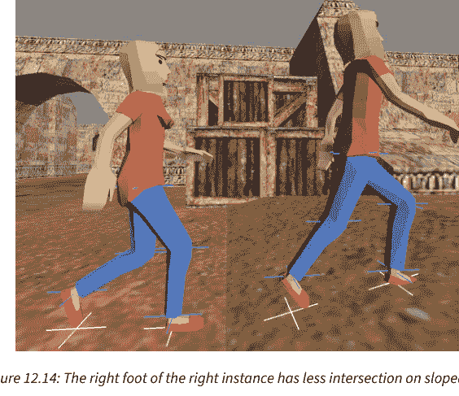

图 12.14：右实例的右脚在斜坡地面上的相交减少了

正如你在图 12.14 中右实例所看到的，右脚不再完全与地面三角形相交。此外，右膝的角度已调整，以允许脚放置在地面三角形较高部分上。

左脚的脚趾仍有一些相交。通过使脚趾与地面坡度对齐来修复剩余的相交是“实践环节”部分中的一个任务。但即使有这种最小的相交，观看实例在山丘上上下移动也更像真实人类，令人非常有趣。

## FABRIK 的局限性

使用 FABRIK 求解器进行逆运动学创建的动画通常看起来不错，但该算法有一些局限性需要解决。

最大的问题出现在节点旋转导致不自然骨骼位置时。例如，人类不能向前弯曲膝盖，但我们屏幕上的实例可以做到。如果不检查和限制节点的旋转，实例的骨骼最终可能处于几乎任何位置。*实践环节*部分中的一个任务通过限制节点旋转来处理这个问题。

另一个问题出现在目标距离末端执行器太远，从而无法到达时。FABRIK 通过将整个骨骼链从根节点拉伸到末端执行节点形成直线来解决无法到达的目标，导致实例像机器人一样腿部僵硬地行走。由于我们可以检测到目标是否无法被末端执行器到达，因此处理这些情况比无限节点旋转更容易。*实践环节*部分中有一个任务用于解决无法到达目标的问题。

## 总结

在本章中，我们增强了关卡的碰撞检测。首先，我们为关卡数据添加了单独且专门的八叉树，使我们能够快速检查实例与关卡几何体之间的碰撞。然后，我们为虚拟世界添加了简单的重力，并调整了碰撞检测以允许实例在关卡地面上行走。最后，我们为实例的脚添加了逆运动学，通过避免脚悬浮在地面上方或嵌入关卡的地面三角形中，使斜坡地面的脚和腿运动更自然。

在下一章中，我们将为关卡数据添加最终扩展并添加简单的导航。我们将首先简要回顾游戏中实现导航的几种方法。接下来，我们将探讨 A* 路径查找算法并在应用程序中实现它。然后，我们将向地图添加路径点，作为 A* 计算的目标。最后，我们将为实例实现路径点导航，使实例能够移动到随机路径点或在定义的一组路径点之间巡逻。


## 实践环节

以下是你可以对代码进行的改进：

- 添加更完整的重力。

  不要仅仅操纵实例的垂直位置，而是使用更复杂的方式通过垂直加速度来应用重力。由于重力在两个地方使用，一个是在实例的速度中，另一个是在渲染器中的碰撞检测中，因此需要在两个代码部分之间进行同步。

- 为第三人称摄像机添加碰撞检测。

  在真实游戏中，摄像机也是虚拟世界中的一个普通物体。而且摄像机不会穿过关卡数据，它始终保持在与所跟随角色相同的边界内，通过弹簧臂结构连接，以便在摄像机无法保持在角色正后方的确切位置时进行调整。你可以尝试为第三人称摄像机添加一个包围盒，并同样对照关卡八叉树检查边界。记住，如果发生碰撞，还要检查并更改摄像机的距离和高度。

- 增强楼梯和悬崖检测。

  为了使实例能够爬楼梯，代码中已添加了基本逻辑，用于比较楼梯的台阶高度与实例位置。这种方法可能不适用于不同类型的游戏地图，而且当楼梯检测返回错误结果时，实例可能会从悬崖上掉落。增强逻辑以获得更好的楼梯检测，并防止实例在“认为”自己站在台阶前时实际上处于深渊边缘而掉落。

- 使实例的脚跟随地面坡度和法线对齐。

  目前，实例的脚可能会与地面相交，这取决于地面的坡度和实例的位置。添加一些代码，甚至为模型添加更多节点，以使实例的脚与地面三角形对齐。此调整应适用于前后倾斜，以及脚的侧向旋转以匹配地面。

- 处理不可达目标。

  实现逻辑以检测效应器是否无法到达目标，并为节点添加某种默认旋转，例如取自动画片段的当前帧。

- 将 FABRIK 的节点更新部分移至计算着色器。

  为了保持 FABRIK 代码中更新最终节点旋转的简单性和易读性，采用了 CPU/GPU 组合。当前代码的缺点是，在每次更新节点链时，都需要从 GPU 内存中复制 TRS 矩阵数据和最终节点位置。通过为节点旋转更新创建计算着色器，可以将整个节点更新过程保留在 GPU 上。

- 扩展难度：为逆向运动学编写计算着色器。

  FABRIK 逆向运动学算法简单直接。在计算着色器中实现相同的算法应该不会太难。你可以使用矩阵乘法计算着色器作为示例，了解如何在 GLSL 代码中进行循环，而无需硬编码循环变量。

- 扩展难度：为逆向运动学算法添加节点限制。

  在默认版本中，逆向运动学在求解位置时不会担心不自然的骨骼旋转。对于游戏角色来说，如果膝盖或肘部弯曲方向错误，看起来会很奇怪。通过为所有三个旋转轴添加每个节点的限制，目标可能无法到达，但角色仍然看起来像人类。但请注意：添加节点限制可能会影响逆向运动学算法的稳定性。

- 扩展难度：使用包围体层次结构（BVH）进行碰撞检测。

  包围体层次结构的思想在 *第 8 章* 的 *使用空间划分来降低复杂度* 部分中提到过，而 Christer Ericson 的书籍 *Real-Time Collision Detection* 专门有一章介绍 BVH。用 BVH 替换八叉树来检测碰撞可能是一项长期任务，因为层次结构的创建本身就为碰撞检测增加了大量复杂性。

## 附加资源

- Jacobian Matrix 简介： https://medium.com/unity3danimation/overview-of-jacobian-ik-a33939639ab2
- *Collision Detection in Interactive 3D Environments* 由 Gino van den Bergen 所著，由 *CRC Press* 出版：ISBN 978-1558608016
- *Game Physics Engine Development* 由 Ian Millington 所著，由 *CRC Press* 出版：ISBN 978-0123819765
- *Game Physics* 由 David H. Eberly 所著，由 *Morgan Kaufmann* 出版：ISBN 978-0123749031
- *Real-Time Collision Detection* 由 Christer Ericson 所著，由 *CRC Press* 出版：ISBN 9781000750553
- FABRIK publications: http://www.andreasaristidou.com/FABRIK.html
- Unreal Engine 中的逆向运动学： https://dev.epicgames.com/documentation/en-us/unreal-engine/ik-setups?application_version=4.27
- 全身逆向运动学： https://dev.epicgames.com/documentation/en-us/unreal-engine/control-rig-full-body-ik-in-unreal-engine
- 用于射线-三角形相交检查的 Möller-Trumbore 算法： http://www.lighthouse3d.com/tutorials/maths/ray-triangle-intersection/
