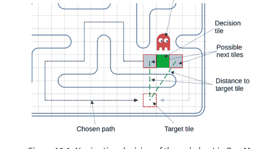
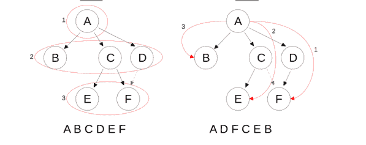
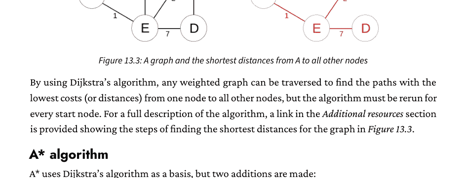
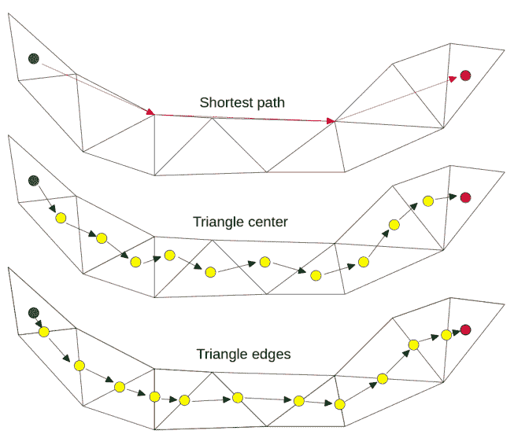
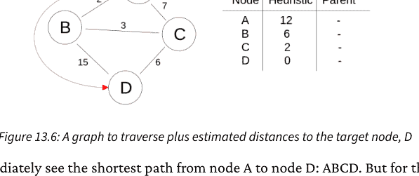
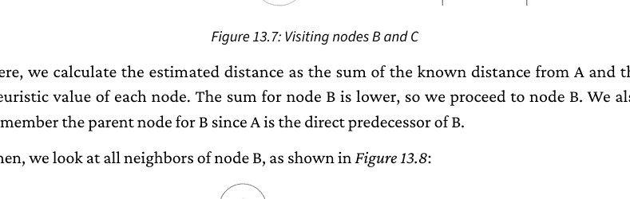
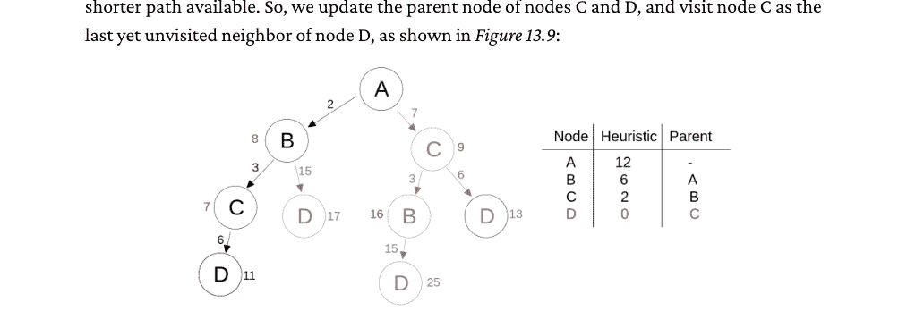
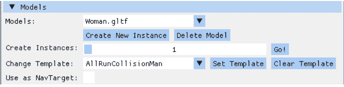

## 13 添加简单导航

欢迎来到第 13 章！在上一章中，我们创建了一个单独的八叉树来增强碰撞检测，从而能够以快速且计算成本低廉的方式检测实例与关卡几何体之间的碰撞。然后我们向应用程序添加了简单的重力，使实例保持在地图地面上，最终使实例能够在关卡地面和小山丘上行走。最后，我们对实例的脚使用了逆向运动学，使其在攀爬山丘或地图的斜坡区域时双脚保持在地面上。

在本章中，我们将添加寻路和导航。我们首先简要概述计算机游戏中使用的导航方法，然后探索并实现 A* 寻路算法。接下来，我们将向应用程序添加导航目标，从而能够在虚拟世界中以简单的方式放置路径目的地。本章最后，我们将实现向路径点的导航，使实例能够向定义的目标行走或奔跑。

在本章中，我们将涵盖以下主题：

- 不同导航方式的概述
- A* 寻路算法
- 向地图添加导航目标
- 将实例导航到目标

### 技术要求

本章的示例代码可在 chapter13 文件夹中找到，OpenGL 版本在 01_opengl_navigation 子文件夹中，Vulkan 版本在 02_vulkan_navigation 子文件夹中。

### 不同导航方式的概述

寻路和导航在视频游戏中的应用时间比人们想象的要长得多。让我们探索几种导航方法。

### 基于距离的导航

使用简单算法来模仿敌人智能行为的最早游戏之一是 **Namco 的 Pac-Man**。四个幽灵（Blinky、Pinky、Inky 和 Clyde）各自具有略微不同的“性格”，仅由幽灵移动的目标点创建。

虽然红色幽灵（Blinky）直接追逐 Pac-Man，但粉色幽灵（Pinky）和蓝色幽灵（Inky）会试图抢在 Pac-Man 前面，有效地试图包围玩家。第四个幽灵（橙色 Clyde）“有自己的想法”，在追逐玩家和逃跑之间切换。

关于选择新路径的决定仅在游戏迷宫的交叉路口做出，并且完全基于交叉路口所有可能路径到目标方格的距离。游戏不使用更高级的预判路径规划，有时会导致糟糕的决策。图 13.1 显示了交叉路口的此类决策情况：



图 13.1：Pac-Man 中红色幽灵的导航决策

在图 13.1 中，绿色方框是触发向左或向右决策的区域，而两条虚线绿色线是到红色轮廓目标方格的直接距离。即使右侧路径更短，左侧路径也会被选择，因为左侧的决策距离更短，导致幽灵行为异常。在附加资源部分提供了一个链接，其中包含有关幽灵导航内部原理的深入信息。


基于距离的导航在游戏开发中至今仍在使用，例如，根据玩家和敌人的速度与方向，找到敌人拦截玩家的地点。随后使用基于图的导航算法来规划到达玩家的路径。

## 基于图的导航

在图中，搜索算法使用图的节点来描述游戏地图上的位置，并使用边来描述节点之间的连接。通过构建地图的图，可以有组织地找到两个位置之间的最短路径。

导航中使用了多种图算法。最常见的是：

- 深度优先搜索（DFS）
- 广度优先搜索（BFS）
- Dijkstra 算法
- A*（读作“A star”）

### DFS 和 BFS 算法

这两种都是简单的算法。DFS 以“深度优先”的方式遍历图，从起始节点到最远节点，而 BFS 先访问最近的节点，以“环”的方式推进到下一个节点。图 13.2 显示了一个由六个节点 A 到 F 组成的示例图：



图 13.2：BFS 和 DFS

图 13.2 左侧的 BFS 算法在根节点 A 之后先开始最近的节点（B、C 和 D），然后遍历到节点 E 和 F。图 13.2 右侧的 DFS 算法首先遍历子节点 D 和 D 的子节点 F，然后推进到节点 C 和 E，最后到节点 B。

### Dijkstra 算法

Dijkstra 算法为图的边添加权重。权重可以视为从一个节点到另一个节点的旅行成本或距离，具体取决于要解决的问题。Dijkstra 算法遍历整个图，构建一个包含从起始节点到图中所有其他节点的最短路径的表。

图 13.3 显示了起始图以及算法所有步骤执行后的结果：



图 13.3：一个图以及从 A 到所有其他节点的最短距离

通过使用 Dijkstra 算法，任何加权图都可以被遍历以找到从一个节点到所有其他节点成本最低（或距离最短）的路径，但该算法必须为每个起始节点重新运行。有关该算法的完整描述，附加资源部分提供了链接，展示了为图 13.3 查找最短距离的步骤。

### A* 算法

A* 以 Dijkstra 算法为基础，但做了两个补充：

- 为每个节点添加所谓的启发式，表示从该节点到目标节点的估计距离。
- 算法从起始节点搜索到指定的目标节点，通常在到达目标节点时终止。

通过将从起始节点到某节点的距离与从同一节点到目标节点的估计距离相组合，并在遍历到下一个节点时使用最短总和，A* 对目标节点进行有向搜索。因此，与 BFS 或 DFS 的无向搜索不同，A* 总是朝向目标节点前进。我们将在“ A* 路径查找算法”部分深入讨论 A*。

本节算法的一个缺点是，如果目标不是静态的，它们必须重新创建整个路径。对于动态目标，像 LPA*、D* 或 D*-Lite 等算法可能提供更好的结果。此外，自 A* 引入以来，还创建了许多其他路径查找算法，旨在针对机器人等特殊环境，或进一步优化路径查找过程的结果，如 Theta*。

在深入研究 A* 之前，让我们先看看视频游戏中另一种流行的导航类型，使用三角形或其他多边形来描述机器人的可步行区域，以及简要了解一下机器学习作为创建导航数据的替代方案。

## 基于网格的导航

像 Pac-Man 和许多策略游戏这样的简单游戏使用基于距离的导航，通过将世界划分为网格，通常由矩形或六边形结构组成。但三维游戏（如开放世界）或第一人称和第三人称探索和战斗游戏的需求是不同的。由于虚拟世界的重叠部分，需要三维结构来引导计算机控制的角色穿过地图。

大多数具有三维地图的游戏使用导航网格、区域感知系统，或两者结合。

### 导航网格

导航网格（也称为 NavMeshes）大约在 2000 年左右引入游戏。导航网格是由多边形（大多数实现中使用三角形）组成、覆盖关卡几何体的附加数据结构。导航网格中的多边形标记关卡的可步行区域，省略任何计算机控制角色可能与其发生碰撞的对象和结构。

通过使用导航网格，机器人或 NPC 可以在虚拟世界中行走，同时避免与静态关卡几何体进行昂贵的碰撞检测，只要角色保持在导航网格上。只有当角色可以离开导航网格时，才需要碰撞检测。结合像 A* 这样的基于图的算法，可以精细控制计算机控制角色的行为。附加资源部分提供了有关使用导航网格进行路径查找的全面介绍的链接。图 13.4 显示了一个简单示例：



图 13.4：导航网格，起点（绿色）、目标（红色）以及从起点到目标的路径

在图 13.4 中，顶部图片显示了使用到下一个尖角的视线中的下一个顶点，从起始三角形（绿色）到目标三角形（红色）的最短可能路径。

相比之下，中间图片的路径使用三角形中心作为路径查找算法的图节点，而底部图片使用三角形内部边作为图节点。

路径的质量取决于网格以及将三角形的哪一部分用于图节点。图 13.4 中方法组合是可能的，因此三角形的中心和边的中点都可作为图节点使用。结果路径还可以通过跳到下一个直接可见的节点并使用样条曲线进行曲线平滑来优化。

请注意，如果在狭窄通道中边缘导航网格离墙壁或边界太近，实例可能会与墙壁发生碰撞，导致额外的移动修正或导致网格的不可通行部分。关卡中的静态障碍也应以安全距离绕行。

作为经验法则，使用实例的轴对齐包围盒边缘与中心之间的距离作为导航网格边缘与相邻关卡几何体之间的最小距离。通过始终将实例远离墙壁，可以在正常导航期间避免任何碰撞。

#### 从关卡数据生成导航网格

通常，导航网格会手工创建并添加到关卡数据中。但我们需要一个针对互联网上找到的关卡的解决方案，因此我们在代码中做一个捷径，并使用与检测实例是否与关卡地面发生碰撞时使用的相同的向上朝向三角形作为“可能可步行地面”。

结合所有地面三角形之间的邻接关系，可以实现对关卡中可步行区域的估计。地面区域创建代码的一些增强作为实践课程部分中的任务提供。

通过使用导航网格，可以实现两种导航：虚拟世界中的自由漫游和在路径点之间巡逻。

#### 自由导航

自由导航中，地图上的任何点都可以作为起点和目的地的目标点。从关卡的一个部分移动到另一个部分可能计算成本高昂；最坏情况下，路径查找期间必须检查整个网格。此外，角色的路径在两次路径规划之间可能完全不同，具体取决于起点和目标的确切位置。

#### 路径点导航

对于基于网格的导航，更好的方法是定义导航网格上的路径点，这些路径点彼此可见。例如，每扇门或道路上的每个岔路都将是一个路径点。当机器人穿过虚拟世界时，在到达期望的路径点后，将下一个路径点设为下一个目标。如果玩家被发现然后失去踪迹，机器人可以返回最近的路径点。通过确保计算机控制的角色始终能“看到”至少一个路径点，规划到该下一个路径点的路径变得廉价且易于计算。

### 区域感知系统

1999 年，id Software 在 Quake III Arena 中使用了名为区域感知系统。不是使用二维图，而是创建了关卡的简化三维表示，包含有关关卡结构、其他机器人和玩家的所有信息。


The bots can traverse the awareness areas not only by walking, jumping, or swimming but also by using a teleporter, a jump pad, or even by doing a rocket jump. With such a large repertoire of actions, a bot can easily follow the player around in the level or try to cut off the player’s path.

A full description of the area awareness system is available in a link to a PDF document in the Additional resources section.

## Using machine learning to generate navigation data

A more recent way to create navigation data for computer-controlled characters is machine learning, mostly in the form of so-called reinforced learning. During reinforced learning, an agent representing the character explores the virtual world on its own in a large amount of “trial-and-error” style rounds, but with added rewards for achieving a defined task or a punishment for failing to complete the task.

Such a task could be something like “Reach a defined target point with maximum health,” “Don’t fall off the level,” or “Complete the level in minimum time.” By taking the rewards and punishments of previous explorations into account, the agent optimizes its behavior to maximize rewards and minimize punishments. When the data generated by these agents is used in games, the enemies can utilize the strategies from machine learning to appear even more natural when moving around in the virtual world.

Two challenges of machine learning are making the usage time- and cost-expensive:

- Goals, rewards, and punishments must be clearly defined and adjusted during the calculations. Even if we humans think that the goals and rewards are well-defined, the machine learning algorithm could find unexpected ways to maximize rewards. A failure in the setup may result in discarding the data and doing a complete restart of the entire machine learning cycle.
- Since machine learning is exploring the virtual world by trial and error, progress is non-deterministic and may happen only in insignificant amounts. Even for simple tasks, thousands of game rounds must be played to achieve the desired results while the game is running. Creating a complex AI that explores big levels of the game may need a significant amount of computational resources, leading to excessive development costs.

Even though machine learning may produce better results than algorithm-based navigation, it is recommended to check the trade-offs between possible improvements and additional costs. A link to a video showing the progress of letting a machine learn how to drive a car is available in the Additional resources section.

After the short round-up of navigation methods, let’s dive into the A* algorithm next.

## The A* path-finding algorithm

The A* algorithm was published in 1968 in the earlier days of computing. A* is the result of the path planning for an AI-controlled mobile robot called Shakey. The robot was developed at the Stanford Research Institute. Its software included computer vision and natural language processing, and it was able to do simple tasks like driving to a place in the lab on its own, without describing every single action in advance. A link is available in the Additional resources section with more details about the project and the robot.

But what makes A* different from Dijkstra’s algorithm?

While Dijkstra’s algorithm only uses the weights between nodes, A* adds a heuristic value to every node. The heuristic function calculates an estimated cost of the cheapest path from every node to the selected target. In many cases, such as for large worlds and many nodes, calculating the minimal costs between every pair of nodes is computationally expensive, so an “educated guess” for the costs is cheaper to calculate and also good enough.

For the heuristics function, any distance calculation function can be used. In most cases, either the so-called L1 norm will be used, known as the Manhattan distance, or the L2 norm, known as the Euclidean distance. Figure 13.5 shows the idea behind both distance calculations:


Manhattan distance (gray horizontal/vertical arrows) vs. Euclidean distance (green diagonal line)

The Manhattan distance is modeled after the path of a taxicab in Manhattan. The streets are organized in parallel lines, crossing at an angle of 90 degrees. Like a cab in Manhattan, the blue paths in Figure 13.5 can only use the grid lines between the start and the target. It also does not matter whether we use straight, direct lines, as in the dark blue path, or a staircase version, like the light blue path; the distance for both paths is identical.

In contrast, the Euclidean distance for the green path in Figure 13.5 is calculated by using the Pythagorean theorem. This means squaring the lengths of the distances in both directions, summing up the squares, and calculating the square root of the sum.

Whether Manhattan distance, Euclidean distance, or any other distance calculation will be used for the heuristics function of A* heavily depends on the needs of the application. For instance, obstacles, hills, or enemies in a game map may need to be considered when estimating the distances. An intuitive way to find the best function is by drawing the paths for every heuristic function and a set of combinations for the start and target node and comparing the results.

By using the heuristic value to the target node, A* tries to minimize the costs of the path to the target for every iteration.

## Minimizing path costs

In every iteration, A* uses the sum of the known costs of the path from the start node and the estimated costs to the target node for every neighbor of the current node to calculate the minimal costs to reach the target node. Then, the algorithm chooses the neighboring node with the minimum costs, makes that neighboring node the current node, and starts the next iteration.

In addition, A* saves a reference to the current node in each visited neighboring node if the overall cost from the start to the target over this neighbor is minimal among all neighboring nodes. Storing the parent node in a node allows backtracking to the best path from target to source after the target node has been reached.

To visualize the algorithm, let’s step through a small example.

## Exploring the A* algorithm

Figure 13.6 shows a graph with nodes A, B, C, and D, plus the heuristics table from every node to the desired target node, D. The start node, in this case, is node A.



Figure 13.6: A graph to traverse plus estimated distances to the target node, D

We can immediately see the shortest path from node A to node D: ABCD. But for the computer, the A* algorithm must walk through the nodes to find this path.

For the first iteration, we visit the neighbors of node A, as shown in Figure 13.7:



Figure 13.7: Visiting nodes B and C

Here, we calculate the estimated distance as the sum of the known distance from A and the heuristic value of each node. The sum for node B is lower, so we proceed to node B. We also remember the parent node for B since A is the direct predecessor of B.

Then, we look at all neighbors of node B, as shown in Figure 13.8:


Figure 13.8: Visiting nodes C and D

We do the same calculations for node C and sum up the costs from A to B, B to C, and the heuristic from C to D. In an optimized version of A*, our search could be already over since we reached the target node, D.

But we continue here by checking the remaining neighbors of node D in case there is an even shorter path available. So, we update the parent node of nodes C and D, and visit node C as the last yet unvisited neighbor of node D, as shown in Figure 13.9:



| Node | Heuristic | Parent |
|------|-----------|--------|
| A    | 12        | -      |
| B    | 6         | A      |
| C    | 2         | B      |
| D    | 0         | C      |

Indeed, the path to node D via nodes B and C is much shorter than the path via B. So, we set node C as the new parent node for node D. After all the neighboring nodes of the target node D have been visited, A* has fulfilled its job to find a path from node A to node D.

By backtracking the parent nodes, we get the path from the target to the start. By reversing the node order, we now have the shortest path from the start to the target: ABCD.

As you can see, even in this very simple example, A* cares about the total estimated costs to the target when choosing the node to proceed with. If the algorithm learns about a shorter distance while working on a node, the parent node used to backtrack the best path is also updated. In the Additional resources section, a link to a website with a deep dive into A* is available.

Since we will not have a simple two-dimensional terrain in most maps, a two-dimensional grid for navigation cannot be used. Instead, we will use a navigation mesh to find a path from a source object to a target object in the virtual world.


## 第13章

如导航网格部分所述，创建网格至少是部分手动工作，具体取决于用于创建游戏地图的编辑器。某些编辑器可以根据地图元素创建导航网格，但在大多数情况下，生成的网格必须手动修正。导航网格必须与地图其余的关卡数据存储在同一张地图中，或存储在单独的数据文件中。

为了同时支持地图内和独立的导航网格，寻路在可行走地面网格方面保持模块化。例如，如果你的导航网格以特殊名称保存在地图文件中，你可以将导航多边形及其邻接属性导入寻路类。你还必须将导航三角形导入单独的三角形八叉树，并进行额外的射线到三角形相交，以找到地面层三角形和导航网格三角形。A* 寻路算法也已实现为单独的方法，允许你轻松添加其他算法或不同的启发式函数。

本章示例代码中，我们将使用与地面层检测相同的思路，并使用每个网格三角形的法线来决定其是否可行走。此方法将导致导航网格中包含所有向上朝向的三角形，即使这些三角形可能无法被任何实例到达。但为了演示游戏地图中寻路和导航的一般思想，从地图的地面三角形创建导航网格已足够，并能提供合理的结果。

我们将使用欧几里得距离来计算节点之间的距离以及启发式函数，因为地图中的三角形很可能不是按矩形网格排列的。为了加快距离计算，我们将扩展网格三角形数据结构。

MeshTriangle 结构体在 OpenGL 的 OGLRenderData.h 文件中定义，在 Vulkan 的 VkRenderData.h 文件中定义。在 MeshTriangle 结构体的末尾，我们添加两个新数组，edges 和 edgeLengths：

```
struct MeshTriangle {
    std::array<glm::vec3, 3> edges{};
    std::array<float, 3> edgeLengths{};
};
```

在 edges 数组中，我们存储每个三角形的三个边。我们按与原始三角形相同的缠绕顺序排列边。由于在计算任意相邻三角形时需要边的长度，我们将每条边的长度存储在对应的 edgeLengths 元素中。

现在我们可以直接进入寻路类的实现。

### 添加寻路类

寻路类（命名为 PathFinder）将驻留在 tools 文件夹中，该文件夹存储了在前几章中创建的所有其他辅助类，如 AABB 或 IKSolver。为了保持命名一致，头文件命名为 PathFinder.h，实现将放在 PathFinder.cpp 文件中。

在 PathFinder.h 头文件的顶部，在所有 #include 指令之后，我们添加两个结构体条目。第一个新结构体命名为 NavTriangle：

```
struct NavTriangle {
    int index;
    std::array<glm::vec3, 3> points{};
    glm::vec3 center{};
    glm::vec3 normal{};
    std::unordered_set<int> neighborTris{};
};
```

我们在这里不复用 MeshTriangle，因为我们需要一些不同的变量。虽然 index、points 数组和法线向量相同，但我们还需要将每个三角形的中心世界位置存储在 center 变量中，并将周围三角形存储在 neighborTris 中。实例将从一个三角形中心导航到下一个三角形中心，而 neighborTris 中存储的三角形用于找到距离目标最近的三角形。

对于邻居三角形，选择 std::unordered_set 而非普通的 std::vector，以便自动移除重复条目。

第二个结构体称为 NavData，包含 A* 算法的数据：

```
struct NavData {
    int triIndex;
    int prevTriIndex;
    float distanceFromSource;
    float heuristicToDest;
    float distanceToDest;
};
```

在 triIndex 变量中，我们存储对应 NavTriangle 的三角形索引。通过使用索引，我们可以简单查找以找到三角形数据，如位置或邻居三角形。一旦我们访问了三角形的邻居节点，我们就会将迄今为止最短路径的三角形的索引添加到 prevTriIndex 中，从而允许我们在寻路运行结束时回溯最短路径。

其余三个变量（distanceFromSource、heuristicToDest 和 distanceToDest）是 A* 算法的核心。在这里我们存储从源到当前节点的累计距离、当前节点与目标之间距离的启发式函数结果，以及两者的总和。通过比较所有邻居节点的 distanceToDest 值，A* 选择通向目标节点的下一个节点。

```
void generateGroundTriangles(OGLRenderData& renderData,
std::shared_ptr<TriangleOctree> octree,
BoundingBox3D worldbox);
std::vector<int> findPath(int startTriIndex,
int targetTriIndex);
```

通过调用 generateGroundTriangles()，所有三角形八叉树中向上朝向的三角形将被定位，并为每个“可通行”三角形创建邻居信息。地面数据准备就绪后，findPath() 可用于从起始三角形找到到目标三角形的路径。findPath() 的结果是 A* 找到的路径，作为要踩上的三角形索引向量，按从起始三角形到目标三角形的顺序排列；如果不存在有效路径，则返回空向量。

PathFinder 类中还有一个私有成员，名为 mNavTriangles：

```
std::unordered_map<int, NavTriangle> mNavTriangles{};
```

我们将计算出的地面三角形存储在 mNavTriangles 映射中。索引与三角形数据之间的映射用于通过三角形索引快速访问，该索引也作为 NavData 元素的一部分存储。

让我们接下来逐步介绍地面三角形生成代码。

### 生成地面三角形

地面三角形是通过利用渲染器生成的三角形八叉树生成的。由于我们将对三角形八叉树进行大量请求，它将作为 generateGroundTriangles() 方法的第二个参数传入。

在清除之前生成的任何导航三角形后，我们通过使用作为第三个参数给出的世界边界进行查询，从八叉树获取所有三角形：

```
mNavTriangles.clear();
std::vector<MeshTriangle> levelTris =
octree->query(worldbox);
```

然后我们遍历所有关卡三角形以找到向上朝向三角形的子集：

```
std::vector<MeshTriangle> groundTris{};
NavTriangle navTri;
for (const auto& tri: levelTris) {
if (glm::dot(tri.normal,
glm::vec3(0.0f, 1.0f, 0.0f)) >=
std::cos(glm::radians(
renderData.rdMaxLevelGroundSlopeAngle))) {
groundTris.emplace_back(tri);
}
}
```

将三角形的法线与向上朝向向量点积，与 rdMaxLevelGroundSlopeAngle 值的余弦进行比较，这一点在第12章的碰撞检测中已提到。如果当前三角形通过检查，我们将其添加到 groundTris 向量中。

接下来，除了 groundTris 中的地面三角形外，我们用最小数据填充名为 navTri 的 NavTriangle 并将其添加到 mNavTriangles 映射中：

```
navTri.points = tri.points;
navTri.normal = tri.normal;
navTri.index = tri.index;
navTri.center = (tri.points.at(0) +
tri.points.at(1) + tri.points.at(2)) / 3.0f;
mNavTriangles.insert(std::make_pair(tri.index, navTri))
```

我们在这里在 groundTris 向量和 mNavTriangles 映射中使用不同数据集，因为对三角形八叉树的查询返回 MeshTriangles 向量，但我们为地面三角形维护一个更合适的 NavTriangles 映射。

```
for (const auto& tri : groundTris) {
    std::vector<MeshTriangle> nearbyTris =
    octree->query(tri.boundingBox);
}
```

此查询效果良好，因为在第12章中，我们必须在渲染器类 OGLRenderer 或 VkRenderer 的 generateLevel0tree() 方法中将每个三角形的边界框稍微调大，以避免三个维度中任一维度的大小为零。通过这种最小尺寸更改，关卡中相邻三角形的边界框现在会相交，三角形八叉树将返回所有邻居三角形。

然后我们获取 mNavTriangles 映射中同一地面三角形的引用，并遍历八叉树查询报告的所有三角形：

```
NavTriangle& navTri = mNavTriangles.at(tri.index);
for (const auto& peer : nearbyTris) {
```

为地面三角形使用引用很重要，因为我们将直接在映射中的 NavTriangle 对象上更新邻居三角形。

即使这两个嵌套循环看起来很糟糕，总体计算时间仍然很小，因为八叉树查询只报告少量邻居三角形。我们甚至可以通过简单检查排除更多三角形：

```
if (tri.index == peer.index) {
    continue;
}
if (glm::dot(peer.normal,
    glm::vec3(0.0f, 1.0f, 0.0f)) <
    std::cos(glm::radians(
    renderData.rdMaxLevelGroundSlopeAngle))) {
    continue;
}
```


查询碰撞三角形时也可能报告我们当前正在检查的地形三角形，因此如果在结果中找到它，我们会立即返回。我们还从可能邻居列表中删除所有未朝上的三角形，因为我们只对相邻的地形三角形感兴趣。

在 Assimp 出现三角剖分错误的情况下，我们还需要检查 peer 三角形是否在 mNavTriangles 中：

```
if (mNavTriangles.count(peer.index) == 0) {
    continue;
}
```

如果我们找到一个有效的邻居三角形，我们将从 mNavTriangles 映射中获取邻居三角形：

```
NavTriangle peerNavTri =
    mNavTriangles.at(peer.index);
```

最后，我们可以对两个三角形的全部三个顶点进行循环以检查相邻性：

```
for (int i = 0; i < 3; ++i) {
    for (int j = 0; j < 3; ++j) {
```

在循环内部，我们计算每个顶点到另一个三角形边的距离：

```
glm::vec3 pointToPeerLine =
    glm::cross(tri.points.at(j) -
    peer.points.at(i), tri.points.at(j) -
    peer.points.at((i + 1) % 3));
float pointDistance =
    glm::length(pointToPeerLine) /
    peer.edgeLengths.at(i);
glm::vec3 peerPointToTriline =
    glm::cross(peer.points.at(j) -
    tri.points.at(i), peer.points.at(j) -
    tri.points.at((i + 1) % 3));
float peerPointDistance =
    glm::length(peerPointToTriline) /
    tri.edgeLengths.at(i);
```

通过计算所有顶点到另一个三角形每条边的距离，我们可以检测三角形是否共享一个顶点或一条边，或者一个三角形的顶点是否位于另一个三角形的边上。

接下来，我们创建两个名为 navOpenList 和 navClosedList 的集合以及一个名为 navPoints 的映射：

```
std::unordered_set<int> navOpenList{};
std::unordered_set<int> navClosedList{};
std::unordered_map<int, NavData> navPoints{};
```

在 navOpenList 变量中，我们存储所有作为下一次迭代候选节点的邻居，而在 navClosedList 中，我们保存所有已完全探索的节点。navPoints 映射包含有关所有已知节点的数据，如距离和父节点。

在 A* 算法第一次迭代之前，我们将 currentIndex 变量设置为起始三角形并创建起始三角形的导航数据：

```
int currentIndex = startTriIndex;
NavData navStartPoint{};
navStartPoint.triIndex = startTriIndex;
navStartPoint.prevTriIndex = -1;
navStartPoint.distanceFromSource = 0;
navStartPoint.heuristicToDest = 
glm::distance(startPoint, targetPoint);
navStartPoint.distanceToDest = 
navStartPoint.distanceFromSource + 
navStartPoint.heuristicToDest;
navPoints.emplace(std::make_pair(startTriIndex,
navStartPoint));
navOpenList.insert(startTriIndex);
```

距离目标点的距离通过调用 glm::distance 计算为欧几里得距离，而距离起始点的距离设置为零，因为我们仍在起始点。我们还将起始节点同时添加到开放节点列表和包含导航数据的映射中。

对于 A* 算法的主循环，我们启动一个 while 循环，该循环在命中目标三角形时结束。该循环在某些时间点不保证结束，例如如果目标三角形在不可达网格之外，因此我们需要在循环末尾添加退出条件：

```
while (currentIndex != targetTriIndex) {
NavTriangle currentTri = mNavTriangles.at(currentIndex);
glm::vec3 currentTriPoint = currentTri.center;
```

```
std::unordered_set<int> neighborTris =
    currentTri.neighborTris;
```

每次循环迭代时，我们从 mNavTriangles 映射中提取当前三角形，并获取世界坐标中的中心点和邻居三角形。

接下来，我们遍历所有邻居三角形并提取三角形的中心点：

```
for (const auto& navTriIndex : neighborTris) {
    NavTriangle navTri = mNavTriangles.at(navTriIndex);
    glm::vec3 navTriPoint = navTri.center;
```

如果相邻节点尚未完全探索且甚至尚未访问过，我们继续进入两个 if 条件并将节点添加到开放列表中：

```
if (navClosedList.count(navTriIndex) == 0) {
    if (navOpenList.count(navTriIndex) == 0) {
        navOpenList.insert(navTriIndex);
```

作为提醒，closed 列表包含所有完全探索的节点，而 open 列表包含所有已知邻居但尚未完全探索的节点，这些节点属于任意节点，甚至是已关闭的节点。此时，我们知道这是一个新节点需要访问，因此我们创建新的导航数据：

```
NavData navPoint{};
navPoint.triIndex = navTriIndex;
navPoint.prevTriIndex = currentIndex;
```

对于距离计算，我们获取当前索引的距离，即我们的父节点，并将两个节点之间的距离添加到源距离中：

```
NavData prevNavPoint =
    navPoints.at(navPoint.prevTriIndex);
navPoint.distanceFromSource =
    prevNavPoint.distanceFromSource +
    glm::distance(currentTriPoint, navTriPoint);
navPoint.heuristicToDest =
    glm::distance(navTriPoint, targetPoint);
navPoint.distanceToDest =
    navPoint.distanceFromSource +
    navPoint.heuristicToDest;
navPoints.emplace(
```

## 添加简单导航

```
std::make_pair(navTriIndex, navPoint));
}
```

作为代码块的最后一步，我们将新的导航数据添加到 navPoints 映射中，该映射包含有关所有当前已知节点的数据。

```
} else {
NavData& navPoint = navPoints.at(navTriIndex);
}
```

在这里，我们获取对导航数据的引用以便就地更新信息。对于现有的导航点，我们根据已知的源距离和到目标的启发式值计算新的估计距离：

```
NavData possibleNewPrevNavPoint =
navPoints.at(currentIndex);
float newDistanceFromSource =
possibleNewPrevNavPoint.distanceFromSource +
glm::distance(currentTriPoint, navTriPoint);
float newDistanceToDest = newDistanceFromSource +
navPoint.heuristicToDest;
```

如果通过此节点的新的路径比之前已知的路径更短，我们将更新导航数据以反映新的、更短的路径：

```
if (newDistanceToDest < navPoint.distanceToDest) {
navPoint.prevTriIndex = currentIndex;
navPoint.distanceFromSource =
newDistanceFromSource;
navPoint.distanceToDest = newDistanceToDest;
}
```

在检查完所有相邻节点后，我们将当前节点添加到 closed 列表中，将其标记为已完全探索：

```
navClosedList.insert(currentIndex);
```

如果我们的 open 列表变为空，我们返回一个空向量：

```cpp
if (navOpenList.empty()) {
	return std::vector<int>{};
}
```

我们在继续之前检查 open 列表是否为空，因为下一步涉及遍历 open 列表中的所有元素。

## 提取最佳节点

一旦我们收集了所有新节点并更新了所有现有节点的距离，我们就需要找到从起点到目标的组合距离最短的节点。我们将在此处使用优先队列，以最小化访问具有最小距离的节点的成本。优先队列将根据比较函数对所有节点排序到树结构中，并允许将最大或最小节点作为最顶层元素访问。

首先，我们为优先队列创建比较函数：

```cpp
auto cmp = [](NavData left, NavData right) {
	return left.distanceToDest > right.distanceToDest;
};
```

默认情况下，优先队列使用 std::less 作为比较函数，导致队列的顶部元素为最大值。但通过使用 cmp 函数，我们将使到目的地的最小距离成为顶部元素。

现在我们可以填充队列，通过推送 open 列表中的所有三角形：

```cpp
std::priority_queue<NavData, std::vector<NavData>, decltype(cmp)> navDataQueue(cmp);
for (const auto& triIndex : navOpenList) {
	NavData navPoint = navPoints.at(triIndex);
	navDataQueue.push(navPoint);
}
```

接下来，我们声明一个空的导航数据变量并通过调用 top() 从队列中提取具有最小距离的索引：

```cpp
NavData nextPointToDest{};
nextPointToDest = navDataQueue.top();
currentIndex = nextPointToDest.triIndex;
```


我们现在可以用任意的起始和目标三角形组合来调用 findPath()，如果存在路径则会返回一条路径。如果从起点到目标不存在路径，findPath() 会因 open 列表为空的检查而返回一个空向量。

路径查找的起点是已知的；它就是该实例。但目标呢？让我们为虚拟世界添加一些可配置的导航目标。

## 向地图添加导航目标

开始之前，让我们设想一个可能的导航目标必须具备哪些属性：

- 它可以有任意形状和数量。
- 它易于选择和移动。
- 它可以放置在地面上的任何位置。
- 理想情况下，它应该能够自行移动。

因此，我们理想的目标是一个模型实例！而且由于我们已经拥有了这个列表所需的所有要素，实现导航目标变得很容易。

## 调整模型和实例

首先，我们在 ModelSettings 结构体中添加一个名为 msUseAsNavigationTarget 的新布尔变量：

```
bool msUseAsNavigationTarget = false;
```

AssimpModel 类也需要两个简单的公共方法，名为 setAsNavigationTarget() 和 isNavigationTarget()，用于设置和查询新的变量：

```
void setAsNavigationTarget(bool value);
bool isNavigationTarget();
```

在 UserInterface 类中，将添加一个复选框，通过简单的鼠标点击来设置模型的状态。图 13.10 显示了带有新复选框的 Models 布局：



图 13.10：带有新的导航目标复选框选中的 UI 中的 Models 部分

无需切换实例即可找到目标，按下 Center Target 即可将目标居中到屏幕中间。

对于导航目标的组合框，将在 Callbacks.h 文件中添加一个名为 getNavTargetsCallback 的回调：

```
using getNavTargetsCallback = std::function<std::vector<int>(void)>;
```

渲染器类文件 OGLRenderer.cpp 和 VkRenderer.cpp 中对应的方法是 getNavTargets()，它收集所有被启用为导航目标的模型实例的索引：

```
std::vector<int> targets;
for (const auto& model : mModelInstCamData.micModelList) {
    if (!model->isNavigationTarget()) {
        continue;
    }
}
```

我们遍历所有模型，如果模型不是导航目标，则继续下一个模型。如果模型被标记为导航目标，我们将所有索引存储在名为 targets 的向量中并返回该向量：

```
std::string modelName = model->getModelFileName();
for (auto& instance : mModelInstCamData.
    micAssimpInstancesPerModel[modelName]) {
    InstanceSettings settings =
        instance->getInstanceSettings();
    targets.emplace_back(
        settings.isInstanceIndexPosition);
}
}
return targets;
```

为了将目标放置在地面上，我们还需要应用重力。

## 为非动画实例添加重力

目前重力仅影响任何动画实例，因为我们在第 12 章中需要它们保持在地面上以进行碰撞检测和逆运动学。由于我们保持了动画和非动画模型的代码大部分相似，为非动画实例添加重力只需做几处小的改动。

首先，将包含 mLevelCollisionTimer.start() 和 mLevelCollisionTimer() 调用的整个代码块复制到将当前实例添加到实例八叉树之后的调用下方，如以下代码块所示：

```
mOctree->add(
    instSettings.isInstanceIndexPosition);
    mLevelCollisionTimer.start();
    ...
    mRenderData.rdLevelCollisionTime +=
    mLevelCollisionTimer.stop();
```

然后，在新代码下方添加对 updateInstancePosition() 的调用：

```
instances.at(i)->updateInstancePosition(
    deltaTime);
```

最后，将检索包含世界变换的矩阵的操作从块的开头移动到实例位置更新之后：

```
mWorldPosMatrices.at(i) =
    instances.at(i)->getWorldTransformMatrix();
```

就这样！

现在重力和地面碰撞也会为非动画实例计算，实例位置会被更新，并且最新的世界变换会被收集并添加到 mWorldPosMatrices 数组中，然后上传到 Shader Storage Buffer Object。

## 保存和加载新的模型和实例数据

将新值存储在 YAML 配置文件中并恢复设置应该不需要进一步解释。用于将模型用作导航目标的布尔值存储在 ModelSettings 结构体中，而实例的所有新路径查找和导航变量则存储在 InstanceSettings 结构体中。将新值添加到 YAML 发射器和解析器只是复制粘贴的问题。YAML 配置版本也应更新以反映新值。

我们已经有了地面三角形、路径查找算法以及路径的起点和目标点。剩下的就是让实例沿着路径移动的逻辑。所以，让我们现在添加最后一部分。

## 让实例导航到目标

为了计算或更新到目标实例的路径，我们需要在渲染器中添加更多代码。我们从添加计算实例到目标位置的实际路径的代码开始。

## 计算到目标的路径

路径更新代码的最佳位置是在渲染器类 OGLRenderer.cpp 或 VKRenderer.cpp 的 draw() 调用中遍历所有动画实例的循环里，紧跟在刚刚为非动画实例复制的地面和碰撞检测代码之后。我们拥有实例的最终世界位置，包括任何重力更新，可以将此位置用作路径查找算法的起点。

```
if (instSettings.isNavigationEnabled) {
	int pathTargetInstance =
		instSettings.isPathTargetInstance;
}
```

然后，我们对目标实例进行健全性检查，以避免在访问 micAssimpInstances 向量时崩溃：

```
if (pathTargetInstance >= mModelInstCamData.micAssimpInstances.size()) {
	pathTargetInstance = -1;
	instances.at(i)->setPathTargetInstanceId(
		pathTargetInstance);
}
```

接下来，提取目标当前所在的三角形索引以及目标的世界位置：

```
int pathTargetInstanceTriIndex = -1;
glm::vec3 pathTargetWorldPos = glm::vec3(0.0f);
if (pathTargetInstance != -1) {
	std::shared_ptr<AssimpInstance> targetInstance =
		mModelInstCamData.micAssimpInstances.at(
			pathTargetInstance);
	pathTargetInstanceTriIndex =
		targetInstance->
		getCurrentGroundTriangleIndex();
}
```

```
pathTargetWorldPos =
    targetInstance->getWorldPosition();
}
```

由于目标实例可能自行移动或被用户移动，目标三角形索引必须在每次路径更新前检索。此三角形索引更新确保实例会跟随目标，无论目标是静态路点还是在关卡中游荡的另一个实例。

现在我们检查当前实例和目标实例是否都有有效的地面三角形，并且我们或目标是否已远离保存的三角形。只有在所有条件都满足时，我们才会重新计算路径，避免在源或目标未发生变化时进行昂贵的计算：

```
if ((instSettings.isCurrentGroundTriangleIndex > -1 &&
    pathTargetInstanceTriIndex > -1) &&
    (instSettings.isCurrentGroundTriangleIndex !=
    instSettings.isPathStartTriangleIndex ||
    pathTargetInstanceTriIndex !=
    instSettings.isPathTargetTriangleIndex)) {
    instances.at(i)->setPathStartTriIndex(
instSettings.isCurrentGroundTriangleIndex);
    instances.at(i)->setPathTargetTriIndex(
        pathTargetInstanceTriIndex);
```

在发生任何变化的情况下，我们会调整当前实例的起始和目标三角形。利用三角形的最新数据，我们可以调用 findPath()：

```
std::vector<int> pathToTarget =
    mPathFinder.findPath(
    instSettings.isCurrentGroundTriangleIndex,
    pathTargetInstanceTriIndex);
```

结果可能为空，如果未找到有效路径。在这种情况下，我们禁用实例的导航并使目标实例失效，将其设置为 -1：

```
if (pathToTarget.size() == 0) {
    instances.at(i)->setNavigationEnabled(false);
    instances.at(i)->setPathTargetInstanceId(-1);
} else {
```


```
instances.at(1)->setPathToTarget(pathToTarget);
```

如果路径有效，我们就在实例中设置路径索引。

由于路径只会在发生变化时更新，我们现在获取实例已保存或刚刚更新的路径：

```
std::vector<int> pathToTarget = instances.at(1)->getPathToTarget();
```

为了避免在开始或结束前往目标的路径时出现别扭的移动，我们移除了实例路径中的起始和目标三角形：

```
if (pathToTarget.size() > 1) {
	pathToTarget.pop_back();
}
if (pathToTarget.size() > 0) {
	pathToTarget.erase(pathToTarget.begin());
}
```

路径是在实例当前站立的地面三角形的中心与目标所在的地面三角形之间创建的。如果实例已经比三角形中心更接近，路径就会指向后方，实例可能永远无法离开当前的地面三角形。我们也可以在 PathFinder 类中移除这些元素，但如果我们想在 findPath() 生成的数据在其他地方使用，三角形可能仍是需要的。因此，我们在这里截断三角形索引。

作为寻路的最后一步，我们根据 pathToTarget 中是否还有路径，旋转实例朝向下一个路径点或目标：

```
if (pathToTarget.size() > 0) {
	int nextTarget = pathToTarget.at(0);
	glm::vec3 destPos = mPathFinder.getTriangleCenter(nextTarget);
	instances.at(1)->rotateTo(destPos, deltaTime);
} else {
	instances.at(1)->rotateTo(pathTargetWorldPos, deltaTime);
}
```

对 PathFinder 类的 getTriangleCenter() 的调用返回请求三角形的世界坐标下的中心。该中心点随后会传入实例的 rotateTo() 方法，因此让我们接下来查看旋转方法的实现。

## 旋转实例以到达目标

新的公共方法 rotateTo() 必须添加到 AssimpInstance 类中。

首先，我们检查实例当前是否正在行走或奔跑。实例在地面上空闲站立时旋转看起来会很奇怪：

```
if (mInstanceSettings.isMoveState != moveState::walk &&
    mInstanceSettings.isMoveState != moveState::run) {
    return;
}
```

然后，我们获取当前实例的旋转向量以及从当前位置指向目标位置的向量：

```
glm::vec3 myRotation = get2DRotationVector();
glm::vec3 twoDimWorldPos =
    glm::vec3(mInstanceSettings.isWorldPosition.x,
    0.0f, mInstanceSettings.isWorldPosition.z);
glm::vec3 toTarget = glm::normalize(glm::vec3(
    targetPos.x, 0.0f, targetPos.z) - twoDimWorldPos);
```

我们只关心绕 Y 轴的旋转，因此使用实例的二维旋转向量，并将指向目标的向量也简化为 X 和 Z 维度的值。

通过使用两个向量 myRotation 和 toTarget，我们可以通过点积计算两者之间的夹角：

```
float angleDiff = glm::degrees(std::acos(
    glm::dot(myRotation, toTarget)));
```

最后，我们计算包含两个向量之间旋转的四元数，提取欧拉角，并使用角度的 y 分量来旋转实例：

```
if (angleDiff > 6.0f) {
    glm::quat destRoation =
        glm::rotation(toTarget, myRotation);
```

```
glm::vec3 angles = glm::eulerAngles(destRoation);
rotateInstance(glm::degrees(angles.y) *
    deltaTime * 2.0f);
}
```

乘以 deltaTime 使实例旋转变得平滑，因为每一帧的角度都很小。初始的 angleDiff 值比较确保我们留有一个小的“死区”，从而在路径几乎笔直时减少旋转次数，并在旋转略微超调时避免振荡。

如果目标在关卡中移动，死区还能在实例路径被重新创建时减少修正次数。通过仔细调整超调量和死区角度，追逐的实例会表现得更自然，因为这两个参数都可以减少跟随目标时的方向变化次数。

为了让计算出的路径可见，我们还应为渲染器添加可视化输出。

## 为路径添加调试线

将路径绘制到屏幕上惊人地简单。除了在 OGLRenderData 结构体中为 OpenGL 添加一个名为 rdDrawInstancePaths 的控制布尔值，分别在 VkRenderData 结构体中为 Vulkan 添加，并在渲染器中添加一个新的线网格以及在 UserInterface 类中添加一个复选框，在所有路径点之间创建线条就很容易了。新增代码的最佳位置是在 计算前往目标的路径 部分添加的代码之后。

首先，我们检查是否应该创建线条以及是否有有效目标：

```
if (mRenderData.rdDrawInstancePaths &&
    pathTargetInstance > -1) {
```

然后，我们设置期望的颜色和路径的高度偏移，并创建用于绘制线的顶点：

```
glm::vec3 pathColor = glm::vec3(0.4f, 1.0f, 0.4f);
glm::vec3 pathYOffset = glm::vec3(0.0f, 1.0f, 0.0f);
OGLLineVertex vert;
vert.color = pathColor;
```

接下来，我们将当前实例的世界位置作为线条的起点添加：

```
vert.position = instSettings.isWorldPosition +
    pathYOffset;
mInstancePathMesh->vertices.emplace_back(vert);
```

如果我们有有效路径，我们提取路径中第一个三角形中心的世界位置作为第一条线的第二个点。由于我们已经移除了起始三角形，线条将被绘制到路径中的下一个三角形：

```
if (pathToTarget.size() > 0) {
    vert.position = mPathFinder.getTriangleCenter(
        pathToTarget.at(0)) + pathYOffset;
    mInstancePathMesh->vertices.emplace_back(vert);
}
```

然后，我们创建一个新的临时线网格并通过调用 PathFinder 类的 getAsLineMesh() 来获取路径段的顶点：

```
std::shared_ptr<OGLLineMesh> pathMesh =
    mPathFinder.getAsLineMesh(pathToTarget,
        pathColor, pathYOffset);
    mInstancePathMesh->vertices.insert(
        mInstancePathMesh->vertices.end(),
        pathMesh->vertices.begin(),
        pathMesh->vertices.end());
```

辅助方法 getAsLineMesh() 只是提取路径上地面三角形的中心点，将期望的偏移量添加到顶点的世界位置，并从顶点创建线条。

现在，我们将最后一个位置作为最后一条线的可能起点添加：

```
vert.position = mPathFinder.getTriangleCenter(
    pathToTarget.at(pathToTarget.size() - 1)) +
    pathYOffset;
    mInstancePathMesh->vertices.emplace_back(vert);
}
```

作为线条创建的最后一步，我们添加目标的世界位置：

```
vert.position = pathTargetWorldPos + pathYOffset;
    mInstancePathMesh->vertices.emplace_back(vert);
```

如果在移除第一个和/或最后一个元素后路径为空，我们跳过 if 条件内的代码，只从当前位置绘制一条线到目标。这仅在我们有有效目标且起始和目标三角形直接相邻时发生。如果寻路过程中出现错误且路径为空，我们会重置目标实例，线条将不再绘制。

可听侧并讨论向应用程序添加音效和音乐的方法和工具。然后，我们将查看为世界增添更多生机的想法，并随后讨论增强虚拟世界视觉效果的想法。我们将查看实例之间的任务和交互，最后探索昼夜和天气变化的影响。

## 实践环节

以下是你可以对代码进行的改进：

- 即使地面三角形很大，也平滑路径。

通过查找接下来的几个路径段，可能可以创建这些段的平均值。对于更尖锐的转弯，可以使用样条曲线来平滑三角形之间的过渡。

- 清理生成的三角形邻居列表。

目前，相邻三角形的列表相当庞大。当为关卡激活邻居网格调试绘制时可以看出这一点。尝试找到一种解决方案，只包含共享部分边的三角形。

- 在墙壁和路径线之间添加最小距离。

对于生成的地面三角形，一些中心位置可能离墙壁太近，导致实例在跟随路径时发生碰撞。在某些情况下，路径甚至会穿过关卡几何体的边缘，当三角形被视为相邻时。创建地面三角形时，尝试找到网格的轮廓并按可配置的量减小其大小。

- 使用实例 AABB 来检测狭窄通道。

某些地图可能有需要精确导航的通道。在没有真正的导航网格的情况下，你可以尝试沿路径使用实例的包围盒来查找可能的碰撞并调整路径以避免与关卡结构发生碰撞。

- 高级难度：在编辑器中创建导航网格并加载该网格。

如果你对使用 Blender 等工具很有信心，可以尝试将导航网格作为关卡的单独网格创建，甚至作为单独的文件，与关卡文件一起保存。然后，将导航网格加载到 PathFinder 类中，为实例提供无碰撞的地面。


## 附加资源
- Pac-Man 中的幽灵导航：https://gameinternals.com/understanding-pac-man-ghost-behavior
- Dijkstra 算法：https://graphicmaths.com/computer-science/graph-theory/dijkstras-algorithm/
- Quake III Arena 的区域感知系统：http://www.kbs.twi.tudelft.nl/docs/MSc/2001/Waveren_Jean-Paul_van/thesis.pdf
- 导航网格：https://www.gamedev.net/tutorials/programming/artificial-intelligence/navigation-meshes-and-pathfinding-r4880/
- Shakey 机器人：https://www.sri.com/hoi/shakey-the-robot/
- A* 简介：https://www.redblobgames.com/pathfinding/a-star/introduction.html
- 使用导航网格的 A*：https://medium.com/@mscansian/a-with-navigation-meshes-246fd9e72424
- Unreal Engine 中的导航网格：https://dev.epicgames.com/documentation/en-us/unreal-engine/basic-navigation-in-unreal-engine
- 在 Unreal Engine 项目中实现 A*：https://www.youtube.com/watch?v=xak129fupCA
- 在 Trackmania 中训练无敌 AI：https://www.youtube.com/watch?v=Dw3BZ6O_8LY
- Recast Navigation：https://github.com/recastnavigation/recastnavigation
- 平滑路径优化：https://www.gameaipro.com/GameAIPro3/GameAIPro3_Chapter20_Optimization_for_Smooth_Paths.pdf
- 更逼真的寻路：https://www.gamedeveloper.com/programming/toward-more-realistic-pathfinding

## 在 Discord 上加入我们的社区

加入我们社区的 Discord 空间，与作者和其他读者进行讨论：
https://packt.link/cppgameanimation


