# 第14章 创建沉浸式交互世界

## 创建沉浸式交互世界

欢迎来到第 14 章！在上一章中，我们为实例添加了寻路和导航功能。我们首先简要概述了计算机游戏中导航方法。然后我们探索并实现了 A* 算法，以在实例位置和虚拟世界中的某一点之间找到路径。接下来，我们增强了模型以作为导航目标，并扩展实例使其能够找到通往其中一个目标的路径。在本章末尾，我们添加了实例跟随路径并到达所需目标的能力。

在本章中，我们将探索不同的想法来增强示例代码，以获得更强的沉浸感和视觉质量。我们将从听觉方面着手，介绍为应用程序添加音效和音乐的工具和方法。还将实现一个简单的音频管理器类来播放音效和背景音乐。为了不仅取悦耳朵，还取悦眼睛，我们将收集一些关于如何增强视觉外观的想法，并将其中两种图形增强功能实现到应用程序中。我们将以本章结束本书，探讨昼夜和天气变化对虚拟世界的影响，并在应用程序中添加一个基本的昼夜循环。

在本章中，我们将涵盖以下主题：
- 添加音效和背景音乐
- 增强视觉效果
- 通过昼夜和天气扩展沉浸感

## 技术要求

本章的示例代码可在 chapter14 文件夹中找到：用于 OpenGL 的 01_opengl_ideas 子文件夹和用于 Vulkan 的 02_vulkan_ideas 子文件夹。

## 添加音效和背景音乐

运行第 13 章的示例代码提供了许多功能，例如面部动画、关卡加载、碰撞检测以及寻路和导航。但遗憾的是，屏幕上的所有动画都在死一般的寂静中运行。没有滴滴声或嗡嗡声，没有声音，也没有音乐。只有寂静。

但声音和音乐是游戏的重要组成部分，原因非常充分。无论你是在享受 Minecraft 的宁静草地还是深邃洞穴，沉浸在《超级马里奥》系列欢快的音乐中并听到动作的音效作为听觉反馈，还是在游荡于《死寂》或《寂静岭》系列令人毛骨悚然的世界中，仔细聆听环境音以了解周围情况，或是驾驶汽车伴随着《极品飞车》系列等赛车游戏的澎湃音乐和厚重音效——没有音乐和声音，游戏就无法为玩家提供同样的体验。

要添加声音输出，我们可以包含一个可自由获取的声音库，让我们能够轻松播放音效或音乐。让我们先看看一些库。

## 使用音频库

大多数音频库是用 C 编写的，但可以找到 C++ 绑定，以面向对象的方式封装特定于操作系统的底层函数调用。也可以只使用 C 函数并构建自定义抽象，类似于 GLFW、OpenGL 和 Vulkan。

## Simple DirectMedia Layer

Simple DirectMedia Layer（SDL）是一个跨平台库，用于计算机的多媒体硬件组件。SDL 管理音频，可作为窗口功能、图形上下文和输入处理的框架，如 GLFW。此外，还有多个官方库提供导入和导出图像、自定义网络以及字体渲染以在屏幕上显示文本的支持。

## OpenAL

OpenAL 是一个跨平台库，专注于多通道、三维音频。通过使用 3D 音频，声音可以被建模为在玩家前方或后方，而不仅仅是左右，从而加深沉浸感。

## PortAudio

PortAudio 是另一个跨平台音频库。它针对实时音频播放和录制。如果 SDL 和 OpenAL 的范围对项目来说过大，而目标只是播放一些音频，则可以使用 PortAudio。

## FMOD

尽管 FMOD 是一个专有的声音引擎，但它可以被列入可自由获取的库名单，因为存在非商业许可证，允许我们免费使用 FMOD。只有当最终应用程序或游戏将商业发行时，才需要付费的 FMOD 许可证。FMOD 支持 Unreal 和 Unity 等 3D 引擎，因此如果你在某个时候从事游戏开发，也可能会接触到 FMOD。

在探索了可以包含哪些用于声音和音乐回放的软件之后，让我们来看看应该播放什么。

## 播放音效

由于声音在我们生活中扮演关键角色，我们对游戏中或模拟中应该听到什么会有一定的期望。未能满足这些期望可能会损害沉浸感。

## 游戏角色的脚步声

玩家最想听到的最重要的音效之一就是角色在地面上的脚步声。通过根据地面材质和角色速度调整声音，可以立即向玩家反馈环境信息。悄悄穿过草地与在金属地面上奔跑之间存在显著差异，玩家应该意识到角色动作的“响亮程度”，并且通过碰撞检测和地面三角形发现，如第 12 章“关卡数据中寻找地面三角形”部分所述，可以轻松找到地面三角形的材质类型。

## 其他角色声音

角色会发出很多声音，不只是脚步声。跳跃和落地、攀爬梯子、游泳或被敌方角色伤害也应为玩家提供听觉反馈，以便了解虚拟世界中角色发生了什么。

## 局部声源

不仅玩家控制的角色需要音效，计算机控制的角色和虚拟世界中的无生命物体也应播放音频效果。听到门打开和关闭、铁匠的敲击声、鸟鸣，以及壁炉的噼啪声、瀑布声或高处世界的风声，将极大地增强沉浸感。

## 环境音

环境音是来自远处位置的不同声音和频率的混合，在传到听者耳中时会失去部分信息。大量人群、森林中的风声或几米外的街道都会产生我们熟知的声音，应添加到虚拟世界的相应位置。

## 天气效果

如果世界包含某种天气系统，也应添加声音和效果。远处的雷暴或下雪后地面的寂静可以改变玩家对虚拟世界的感知。

但音效不仅对沉浸感有用；播放音乐也有助于保持玩家的注意力。

## 播放音乐

自计算机游戏早期以来，音乐就被添加到游戏中以保持玩家的兴趣。因此，我们可能仍然记得看到游戏标题时的音乐，而不记得游戏玩法细节或游戏角色。

## 菜单音乐

玩家启动应用程序时看到的第一个屏幕很可能是一种主菜单。直接将玩家投入行动，而不先让他们配置虚拟角色的控制、视觉质量或声音音量，可能不是最好的主意。在玩家在菜单中探索选项时，音乐可以帮助防止玩家立即迷失或感到无聊。


## 环境音乐

与环境音类似，环境音乐有助于防止游戏中出现死寂。完全不播放任何声音可能是为了营造紧张感，但在游戏中连续数小时寂静穿行可能会变得无聊。添加一段风格和节奏与游戏玩法相匹配的音乐曲目，有助于玩家享受游戏中即便是缓慢的段落。

## 自适应音乐播放

当玩家在开放世界中进入不同区域，或进入风格不同的环境、另一房间时，更换音乐以匹配新地点是个好主意。进入房间时那个著名的“听到Boss音乐”的瞬间，再加上门锁上的声音，将为玩家创造难忘的时刻。

## 允许自定义音乐

一个有趣的音乐选择选项是让玩家将本地音乐添加到游戏播放的曲目列表中，甚至完全替换音乐。看到游戏角色一边探索虚拟世界，一边聆听一些喜爱的音乐曲目，对玩家来说可能是一个加分项。

为了体验音频回放所能带来的差异，我们将添加一个 C++ 类来管理音效和音乐回放。

## 实践：实现音频管理器

音频管理器类由两个不同的部分组成。一方面，我们需要一个音频管理器与渲染器及其他类之间的高级接口。另一方面，封装好的低级接口将音频管理器功能与操作系统的音频库连接起来，这样我们就可以用另一个变体替换音频库。

我们将先简要概述高级接口，然后再深入低层实现。

### 定义高级接口

新的 AudioManager 类由 AudioManager.h 头文件和 AudioManager.cpp 实现文件组成，将添加到 tools 文件夹中。我们将添加一个常规音乐/声音播放器应具备的基本功能：

- 初始化并清理音频库
- 从文件系统中的文件加载音乐曲目
- 从文件系统中的文件加载音效
- 播放和停止音乐与音效
- 暂停、恢复以及将音乐曲目跳转到上一首/下一首
- 获取、随机播放和清除当前播放列表
- 更改音乐和音效的音量

例如，向 AudioManager 类添加公共 `setMusicVolume()` 和 `getMusicVolume()` 方法来控制音乐音量：

```
void setMusicVolume(int volume);
int getMusicVolume();
```

此外，私有成员变量 `mMusicVolume` 用于存储当前音乐音量：

```
int mMusicVolume = 64;
```

对于函数列表中的其余功能，会创建公共方法和私有成员变量。查看 AudioManager.h 文件可看到 AudioManager 类中可用的全部方法和成员变量。

现在，我们必须向应用程序代码中添加一个 AudioManager 类对象的成员变量，以及音频功能的初始化和清理调用。为了将渲染器仅保留给视频部分，AudioManager 成员变量和方法将添加到 Window 类中。

### 将 AudioManager 类添加到 Window 类

将音频功能添加到 Window 类的两个主要步骤与其他所有类相同：在 Window.h 头文件顶部包含 AudioManager.h 头文件，并声明名为 `mAudioManager` 的私有成员变量：

```
#include "AudioManager.h"
...
AudioManager mAudioManager{};
```

然后，在 Window.cpp 文件中 Window 类的 `init()` 方法中，我们尝试初始化 AudioManager 对象：

```
if (!mAudioManager.init()) {
    Logger::log(1, "%s error: unable to init audio, skipping\n", __FUNCTION__);
}
```

注意，我们使用 Logger 类打印错误消息，但如果 AudioManager 初始化失败，我们不会终止窗口初始化。音频回放应保持可选，我们将继续运行而不进行音乐和音效回放，而不是使应用程序启动失败。

在初始化调用之后，可以立即将音乐曲目加载到 AudioManager 中：

```
if (mAudioManager.isInitialized()) {
    mAudioManager.loadMusicFromFolder("assets/music", "mp3");
}
```

在这里，如果初始化成功，我们将尝试将 `assets/music` 文件夹中的所有 MP3 文件加载到 AudioManager 中。同样，如果在资源文件夹中找不到音乐文件，我们也不会失败。

### 将音乐曲目添加到播放列表

在 AudioManager 类中，已经实现了从本地文件夹 `assets/music` 加载 MP3 和 OGG 文件到播放列表的支持。您可以将自己的音乐添加到 `assets/music` 文件夹中，因为应用程序启动时会填充播放列表。在实践环节中，有一个任务是为 UI 添加一个“刷新”按钮，允许您在应用程序运行时添加或移除音乐曲目。

最后，我们需要在关闭应用程序时清理 AudioManager。因此，我们在 Window 类的 `cleanup()` 方法中添加对 AudioManager 的 `cleanup()` 方法的调用：

```
void Window::cleanup() {
    mRenderer->cleanup();
    mAudioManager.cleanup();
    ...
}
```

由于我们在 Window 类中创建了 AudioManager，因此需要创建回调函数，以便从渲染器或用户界面访问音乐和音效功能。

### 使用回调使 AudioManager 类随处可用

通过使用这些回调函数，可以在代码中的任何位置更改音乐曲目或播放脚步声。作为示例，我们将在这里使用播放特定音乐曲目的功能，并以曲目名称作为参数。

首先，我们将名为 `playMusicTitleCallback` 的回调函数签名添加到 Callbacks.h 文件中：

```
using playMusicTitleCallback =
    std::function<void(std::string)>;
```

接下来，我们在 ModelInstanceCamData.h 文件的 ModelInstanceCamData 结构体中创建一个名为 `micPlayMusicTitleCallbackFunction` 的变量：

```
playMusicTitleCallback micPlayMusicTitleCallbackFunction;
```

我们使用 ModelInstanceCamData 结构体来避免回调函数散布在代码中。

然后，在 Window 类的 `init()` 方法中，将该回调变量绑定到 AudioManager 的相应函数：

```
ModelInstanceCamData& rendererMICData =
    mRenderer->getModInstCamData();
rendererMICData.micPlayMusicTitleCallbackFunction =
    [this](std::string title) {
        mAudioManager.playTitle(title);
    };
```

在这里，我们获取包含渲染器类的 ModelInstanceCamData 结构体的变量的引用，并通过 lambda 函数将 AudioManager 类的 `playTitle()` 方法赋值给它。

对于渲染器中应可用的每个音频方法，必须重复创建回调函数签名、向 ModelInstanceCamData 结构体添加变量、将回调函数绑定到 AudioManager 类方法这三个步骤。

现在，让我们看看音频管理器低层部分的实现。我们将使用 SDL，因为音频函数易于使用。

### 使用 SDL 作为底层

尽管 SDL 可以处理比音频更多的功能，但我们只使用 SDL 库提供的函数子集也是可行的。因此，我们不会使用 SDL 来处理窗口和键盘（这些由应用程序中的 GLFW 完成），而只使用 SDL 的声音回放和混音功能。

要使用 SDL 进行音频回放，我们需要核心 SDL 库以及名为 SDL_mixer 的独立混音器库。

#### 在 Windows 上安装 SDL 和 SDL_mixer

对于 Windows，GitHub 上提供了预编译版本的 SDL 和 SDL_mixer。请访问以下两个 URL 的 releases 页面，并下载适用于 Visual Studio 的最新稳定开发 zip 文件，这些文件名中包含 `devel` 和 `VC`。例如，当前适用于 Visual Studio 的 SDL 主库开发包名为 `SDL2-devel-2.30.9-VC.zip`。以下是 URL：

- SDL: https://github.com/libsdl-org/SDL/releases
- SDL_mixer: https://github.com/libsdl-org/SDL_mixer/releases

现在，将这两个 zip 文件解压到您的计算机上，但注意路径名中要避免空格和特殊字符（如德语元音变音），以免出现问题，因为即使在 2024 年，许多工具在路径中遇到特殊字符时仍然存在问题。

接下来，添加两个环境变量，以帮助 CMake 搜索脚本找到头文件和库：

- 第一个变量名为 `SDL2DIR`，必须指向 SDL 主库解压后的文件夹。
- 第二个变量名为 `SDL2MIXERDIR`，必须指向 SDL_mixer 库的文件夹。

图 14.1 展示了这些环境变量的示例：

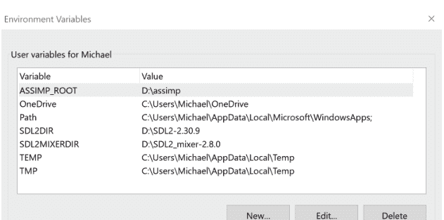

图 14.1：SDL 的环境变量示例


在应用程序终止时，Window 类的 cleanup() 方法会调用 AudioManager 的 cleanup() 方法。在 AudioManager 类的 cleanup() 方法内部，我们关闭音频设备，并通知 SDL_mixer 和 SDL 运行它们各自的清理代码：

```
Mix_CloseAudio();
Mix_Quit();
SDL_Quit();
```

请注意，我们没有在 init() 方法中调用 Mix_Init()，但在这里必须调用 Mix_Quit()。SDL 会为我们管理混音器的初始化，无需显式调用 Mix_Init()。

现在我们已经准备好播放音乐和音效了。让我们先来看看音乐重播代码。

## 控制音乐重播

加载音乐曲目是通过调用 Mix_LoadMUS() 并传入 C 风格字符数组作为参数来完成的：

```
Mix_Music* music = Mix_LoadMUS(fileName.c_str());
```

SDL_mixer 支持多种音乐格式，如 WAV、MP3 和 OGG。Mix_LoadMUS() 的返回值是指向 Mix_Music 结构体的指针。

要清理已加载的音乐曲目，必须调用 Mix_FreeMusic()，并传入上述 Mix_Music 结构体的指针：

```
Mix_FreeMusic(music);
```

可以通过调用 Mix_PlayMusic() 并传入两个参数来播放音乐曲目：

```
Mix_PlayMusic(music, 0);
```

第一个参数是指向有效 Mix_Music 结构体的指针，第二个参数告诉 SDL_mixer 要播放的循环次数。循环值为 0 表示禁用循环，值为 -1 表示无限循环播放音乐。

停止音乐通过调用 Mix_HaltMusic() 完成：

```
Mix_HaltMusic();
```

由于同一时间只能播放一个音乐曲目，因此不需要参数。如果当前曲目需要暂停或恢复，可以使用 Mix_PauseMusic() 和 Mix_ResumeMusic() 这两个调用：

```
Mix_PauseMusic();
Mix_ResumeMusic();
```

最后，音乐音量由 Mix_VolumeMusic() 控制：

```
Mix_VolumeMusic(volume);
```

Mix_VolumeMusic() 的参数是一个介于 0 和 128 之间的 int 值，用于设置新音量；或者使用 -1 来查询当前音乐音量。

通过使用默认的 SDL_mixer 调用，我们只能播放一个音乐曲目一次或无限循环。如果需要动态音乐系统，则需要进行手动实现，甚至应考虑使用不同的声音重播 API。为了实现曲目结束时自动前进到播放列表中下一曲目的简单功能，我们只需实现一个回调。

## 添加用于连续音乐播放的回调

SDL_mixer 支持一个回调，用于通知应用程序当前音乐曲目已完成指定次数的循环。在此回调中，我们可以简单地前进到播放列表中的下一首曲目。

遗憾的是，SDL_mixer 是一个 C 音频库，回调必须符合 C 风格的调用约定。C++ 调用约定与 C 调用约定不兼容，并且只允许调用 AudioManager 类的静态成员函数。我们需要添加一个小技巧，以便能够调用 AudioManager 类的非静态方法，该方法可以访问播放列表以及当前在播放列表中的位置。

首先，我们声明一个名为 mCurrentManager 的原始指针作为私有成员变量，同时声明用于 C 风格回调的私有静态成员方法 staticMusicFinishedCallback()，以及用于转换后回调的私有非静态成员方法 musicFinishedCallback()：

```
static AudioManager* mCurrentManager;
static void staticMusicFinishedCallback();
void musicFinishedCallback();
```

在 AudioManager 类的 init() 方法中，我们将 mCurrentManager 指针设置为当前实例，并使用静态回调方法调用回调钩子设置方法 Mix_HookMusicFinished()：

```
mCurrentManager = this;
Mix_HookMusicFinished(staticMusicFinishedCallback);
```

每当音乐曲目结束时，SDL_mixer 就会调用 staticMusicFinishedCallback()。为了将回调转换为 C++，我们使用存储在 mCurrentManager 中的指向当前 AudioManager 实例的指针来调用非静态回调方法 musicFinishedCallback()：

```
if (mCurrentManager) {
```

我们只希望在行走和奔跑动画重播的同时添加音效。

然后我们检查实例的移动状态，并为该状态调用相应的回调：

```
switch (state) {
    case moveState::run:
        mModelInstCamData.
            micPlayRunFootstepCallbackFunction();
        break;
    case moveState::walk:
        mModelInstCamData.
            micPlayWalkFootstepCallbackFunction();
        break;
```

当实例处于奔跑状态时，我们播放奔跑脚步的音效。如果实例处于行走状态，则播放行走脚步的音效。

如果实例既不是奔跑也不是行走，则停止脚步声音：

```
default:
    mModelInstCamData.
        micStopFootstepCallbackFunction();
    break;
}
```

如果实例不处于空闲/行走/奔跑循环中，我们也会停止所有声音。这样，我们就能处理所有尚未配备音效的动作，例如跳跃或出拳：

```
} else {
    mModelInstCamData.
        micStopFootstepCallbackFunction();
}
```

要听到脚步声音，需要执行以下步骤：

- 1. 启动应用程序并加载带有动画映射的配置。
- 2. 选择（或创建）第一人称或第三人称摄像机。
- 3. 选择一个实例，然后通过在 UI 的 Control 窗口的 Camera 部分中点击 Use Selected Instance 来设置该实例。
- 4. 按 F10 切换到视图模式。

如果你现在使用鼠标和 W/A/S/D 键移动受控实例，应该会听到两种不同的脚步声音，具体取决于实例在虚拟世界中行走还是奔跑。

## 扩展音频管理器类

为了概述 AudioManager 类可能的扩展，以支持更多声道来实现更具游戏性的声音管理，我们需要跟踪由 Mix_PlayChannel() 调用返回的正在播放脚步声音的声道。通过专门为本地脚步声音保留一个声道，我们可以实现相同的行为，但能够同时播放更多音效。

处理多个音效可以通过创建声道池并向 SDL 函数 Mix_ChannelFinished() 添加回调来实现，类似于 Mix_HookMusicFinished()。每当一个声道播放完当前声音片段，或调用 Mix_HaltChannel() 时，SDL 都会触发 Mix_ChannelFinished() 回调，并在回调中传递已结束声道的编号。

声道池可以在播放音效时以及效果重播完成时更新。通过使用到产生音效的对象的距离，并使用 Mix_Volume() 或 Mix_SetDistance() 按比例降低声道音量，可以模拟声源的不同距离。此外，可以使用 Mix_SetPanning() 来调整声源在左右方向上的位置。

“实践环节”部分提供了几个任务，用于从当前状态改进声音重播。

作为如何从 UserInterface 类使用 AudioManager 回调的示例，一个简单的音乐重播控制已添加到用户界面中。在 Control 窗口的 Music & Sound 部分，你会找到一个组合框和一些按钮，用于播放从 assets/music 文件夹创建的播放列表中的音乐。

## 在 UI 中使用音乐播放器

向 UserInterface 类添加音乐重播功能是一项快速而简单的任务。通过使用 AudioManager 类的回调，只需向 UI 添加少量代码块即可实现一个基本的音乐播放器。

在图 14.2 中，展示了使用 AudioManager 类的包含基本音乐播放器的 ImGui 部分：

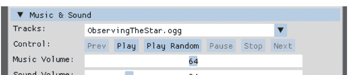

图 14.2：基于 AudioManager 的音乐播放器已添加到用户界面

可以通过 Tracks 组合框选择要播放的音乐曲目，按下 Play 按钮可以播放当前曲目，或者按下 Play Random 按钮将随机播放乱序播放列表中的一首曲目。其他四个按钮 Prev、Pause、Stop 和 Next 的功能与标签所示完全一致，通过使用滑块，可以将音乐和音效的音量设置为 0（静音）到 128 之间的值。

## 替代声音管理器实现

应用程序使用的 AudioManager 类采用了直接的实现方式，通过 C++ 回调函数进行直接控制。对于高级声音系统，可以使用基于事件或消息的实现。这种实现可以利用游戏中已有的事件管理代码，并且事件或消息也能将音效重播与请求重播音效或更改音乐的代码解耦。

在虚拟世界中拥有声音和音乐之后，对应用程序图形的更新也可能会出现在待办事项列表中。现在让我们来探索一些视觉增强功能。

## 增强视觉效果

示例代码中的 OpenGL 和 Vulkan 渲染器仅支持将图像显示到屏幕所需的最少功能集：两个渲染器只能绘制纹理三角形和彩色线条。添加以下一项或多项增强功能将极大地提升图像质量。

## 通过基于物理的渲染为世界带来色彩

目前，我们仅使用 Assimp 对象的纹理来将模型实例和关卡几何体渲染到屏幕上。通过使用基于物理的渲染（简称 PBR），我们还可以以材质的形式对表面属性进行建模。有了这样的 PBR 材质，就很容易创建


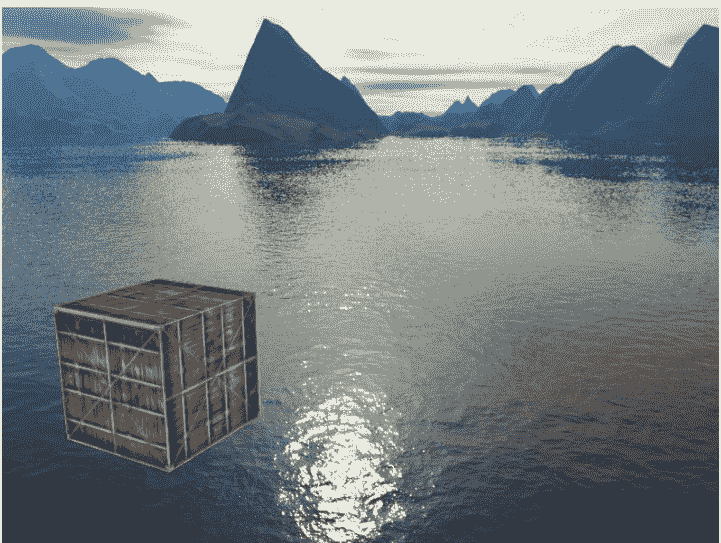

图14.5：一个木箱，以天空盒为背景

使用天空盒的效果在移动视角时最为明显。在如图14.5所示的静态图片中，可以看出木箱与天空盒之间的区别。

在本节末尾，我们将为虚拟世界实现一个天空盒。

## 光影效果

当前顶点着色器使用一个硬编码的光源作为虚拟太阳，从固定位置向世界发射白光。这种基础光照有助于识别关卡几何体和实例的尺寸，即使仅使用平面着色也是如此。通过向虚拟世界添加更多光源，可以更逼真地模拟其他发光物体，如灯、灯笼、火焰或火把。在黑暗处闪烁的火光可以用来营造各种紧张感，因为它可能意味着一个安全的过夜之处，也可能是一个敌人的位置。

图14.6中的场景由数千个不同颜色的光源照亮：

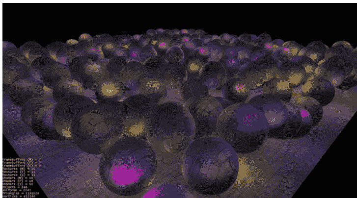

图14.6：虚拟世界中的多光源（图片由Hannes Nevalainen提供）

图14.6中的图像是Hannes Nevalainen为jMonkeyEngine制作的技术演示，可以看到许多独立光源的效果。完整视频可在“其他资源”部分找到。

当添加光源时，也应实现阴影。作为一个简单的开始，虚拟太阳投射的物体阴影可以使用所谓的阴影映射投影到地面上，从而营造出源自真实世界的光影印象。其他光源的阴影也可以添加，尽管实现更为复杂。但视觉效果将弥补这些努力，因为一盏灯只将窗户被照亮的部分投射到地面上，会让程序员脸上露出满意的笑容。

图14.7由Sascha Willens编写的Vulkan示例代码生成（代码可在 https://github.com/SaschaWillems/Vulkan/tree/master/examples/pbribl 获取），展示了使用级联阴影贴图创建的树木阴影：

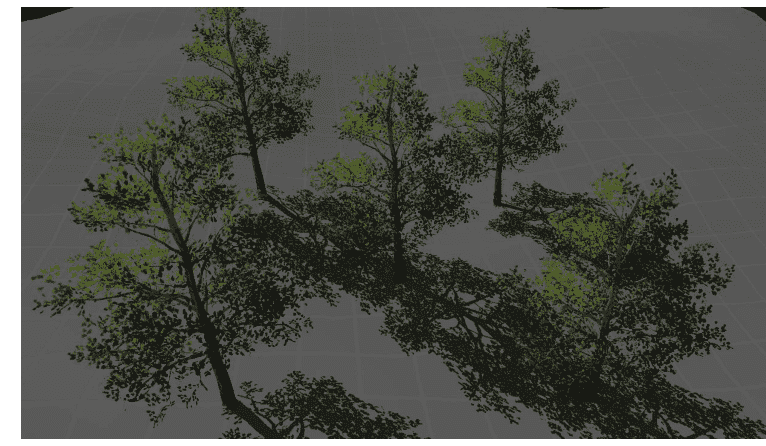

图14.7：树木的级联阴影贴图

与天空盒类似，当光源、物体和/或摄像机移动时，阴影贴图的效果会更为明显。像图14.7中的阴影是虚拟世界的一个绝佳补充。

## 打造逼真的水面效果

如果将水添加为扩展关卡环境的一部分，还应对其视觉外观进行检查和增强。虽然使用简单、静态的透明水纹理可能适合首次实现，但迟早会产生打造更逼真水面的冲动。

通过结合反射、折射以及光线照射到虚拟水面时的扭曲效果，可以创建逼真的水面。如果玩家能够潜入水中，还可以利用另一种扭曲来营造水下的错觉。

图14.8展示了Evan Wallace用WebGL制作的水模拟（代码可在 https://github.com/evanw/webgl-water/blob/master/index.html 获取）：

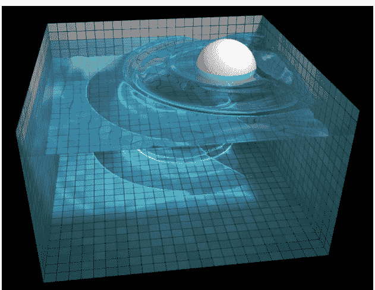

图14.8：具有波浪和水下焦散效果的逼真水面（图片由Evan Wallace提供）

在图14.8中，可以看到球体落入水中产生的波浪。此外，由水产生的池壁折射以及光线在池底的折射也清晰可见。

## 添加惊艳的后处理效果

为了在虚拟世界中获得更逼真的效果，可以向渲染器添加后处理效果。可能的效果列表很长，所以这里仅简要列出一些可以快速实现且能带来出色视觉效果的想法：

- 镜头光晕，模拟透过相机观察的错觉
- 上帝光线：当直视太阳的视线被遮挡时，薄雾中可见的光线
- 泛光效果，模拟发光物体
- 运动模糊，当视图移动时使图像模糊
- 景深，使清晰中心周围的世界模糊
- 屏幕空间环境光遮蔽，使缝隙和边缘变暗
- 屏幕空间反射，一种创建反射表面的廉价方式

所有这些效果都是通过使用着色器创建的，并对性能有不同的影响。然而，即使只是这里列出的一小部分效果，也能大幅提升视觉外观。

图14.9展示了两种后处理效果：泛光（Bloom）和屏幕空间环境光遮蔽（SSAO）。泛光效果是使用LearnOpenGL（https://learnopengl.com/）的代码（作者Joey de Vries，https://x.com/JoeyDeVriez）创建的，SSAO图片则是使用Sascha Willems的Vulkan示例代码制作的（代码可在 https://github.com/SaschaWillems/Vulkan/tree/master/examples/pbrb1 获取）：

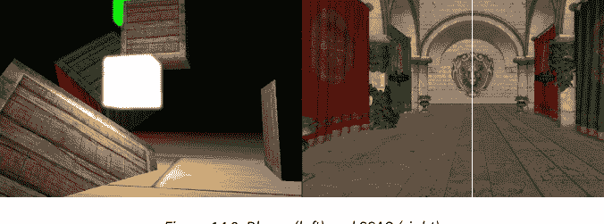

图14.9：泛光（左）和SSAO（右）

在图14.9的左侧，显示的是泛光效果。泛光效果的特征部分是光源周围的辉光效应。对于绿色光源，光线甚至覆盖了木箱的左上边缘。

在图14.9的右侧，显示的是SSAO效果。SSAO效果可能很细微，但确实可见：注意白色线条右侧窗帘下方的地板。阴影营造出窗帘后面房间更暗的错觉。

## 升级到光线追踪

作为迈向真实感的下一步，光线追踪可以作为可选增强功能添加。

光线追踪使用从摄像机发出的虚拟光线，通过追踪光线在虚拟世界中与物体的碰撞来计算最终的像素颜色。虚拟光线不仅使用物体颜色，还遵循物理规律进行反射，直至累积的光量低于阈值。

借助光线追踪，可以实现诸如全局光照之类的效果，使黑暗区域被物体反射的光照亮，或者实现逼真的反射。想象一下，你跑过一间满是镜子的房间，多次看到自己的角色，以正确的物理方式绘制出来。

图14.10展示了来自Sascha Willems的Vulkan代码中的一个光线追踪示例所创建的场景（代码可在 https://github.com/SaschaWillems/Vulkan/tree/master/examples/pbr1bl 获取）：

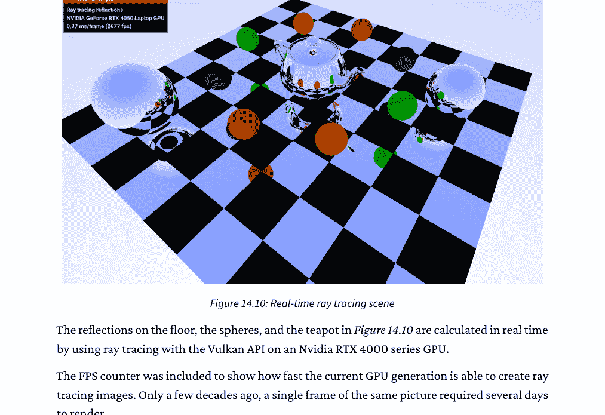

图14.10：实时光线追踪场景

图14.10中地板、球体和茶壶上的反射是使用Vulkan API在Nvidia RTX 4000系列GPU上通过光线追踪实时计算的。

其中的FPS计数器旨在展示当前这一代GPU生成光线追踪图像的速度。就在几十年前，同样图像的一帧需要数天才能渲染完成。

## 光线追踪应为可选功能

请注意，光线追踪的计算需要大量计算能力，而要实时创建复杂场景，需要支持光线追踪的GPU和图形API。目前，只有Vulkan和DirectX 12能够使用现代GPU的光线追踪功能。在切换到启用光线追踪的图形管线之前，您需要检查硬件和软件支持的可用性。

## 深入虚拟现实

尽管虚拟现实（VR）仍然是一个小众领域，但实现VR支持可以大大提升沉浸感。玩家不仅能在平面屏幕上看到虚拟世界，还能置身于世界中央，这可能成为一个难忘的时刻。利用头部追踪让虚拟摄像机与玩家的头部同步移动，并为VR控制器添加虚拟双手，这创造了许多新的交互方式。

图14.11展示了Godot XR Tools演示中的一个场景（代码可在 https://github.com/GodotVR/godot-xr-template 获取）：

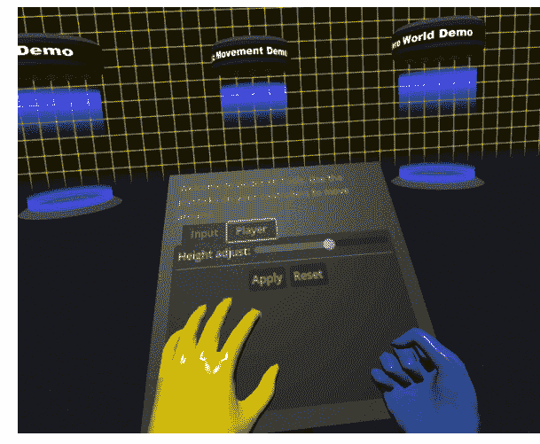

图14.11：Godot XR Tools 演示

图14.11中最引人注目的细节是两只虚拟手。通过使用Valve Index®控制器内置的传感器，不仅可以推算控制器在全部6个自由度上的位置，还可以跟踪单个手指，从而支持基于手指位置的手势或操作。

在完成本节的理论部分后，我们现在将为应用程序添加一个天空盒，作为全局背景。


## 实践：为虚拟世界添加天空盒

虚拟天空是虚拟世界的一个很好的补充，尤其是在任何开放区域的上方，如图 14.5 所示。

## 探索技术细节

从技术角度来看，天空盒是从应用在单位立方体内侧的纹理绘制的。图 14.12 显示了立方体以及放置在立方体中心的虚拟相机周围的坐标：

图 14.12：从立方体贴图的内部采样的区域

在图 14.12 中，立方体的红色区域将被采样以创建当前帧的背景。请注意，该区域在立方体的角落处环绕，但这无需担心。两个图形库都会处理此类边缘情况（双关语在此）并会采样两个受影响的立方体侧面的相应区域。

立方体贴图纹理通常存储为六张单独的图像，或作为一张图像，其中立方体的各面位于图像中的特定位置。图 14.13 显示了由 Jockum Skoglund（又名 hipshot – https://opengameart.org/content/stormy-days-skybox）制作的天空盒纹理，采用常用格式以及立方体面：

在图 14.13 的左侧，显示了一个用于天图的示例立方体贴图纹理。你会发现许多立方体贴图纹理都是这种十字形。在图 14.13 的右侧，列出了立方体贴图纹理的每个较小子图像的立方体面。请记住，OpenGL 和具有反转视口的 Vulkan 的负 Z 轴指向虚拟世界内部，因此 -Z 为前图像。

另一个值得注意的细节是立方体贴图图像的失真。由于立方体贴图纹理应用于立方体，但我们周围的虚拟天空可视为一个球体，因此立方体贴图纹理的像素必须进行调整，使其看起来像是图像是在球体内部的相机拍摄的。

在图 14.14 中，显示了立方体内投影与球体内投影之间的差异：

正如你在图 14.14 左侧所见，从立方体贴图采样的采样点与球体表面上的位置之间的差异越大，我们越接近立方体贴图一侧的边缘。在图 14.14 右侧，从立方体贴图采样出的区域以及所需投影到球体表面的区域被高亮显示为黑色条。你可以看到两个区域的大小和角度都不同。在为天空盒构建立方体贴图纹理时，必须对每个立方体面的图像应用球面失真，以创建逼真的天空。

## 实现天空盒

将天空盒添加到代码中只需要几个组件：

- 新的顶点和网格类型
- 一个新的顶点缓冲
- 一个包含面坐标的单位立方体模型。
- 一个新的着色器
- 从文件加载立方体贴图纹理

我们首先在 opengl 文件夹中的 OGLRenderData.h 文件中创建一个名为 OGLSkyboxVertex 的新顶点类型和一个名为 OGLSkyboxMesh 的新网格类型：

```cpp
struct OGLSkyboxVertex {
    glm::vec4 position = glm::vec4(0.0f);
};

struct OGLSkyboxMesh {
    std::vector<OGLSkyboxVertex> vertices{};
};
```

与往常一样，对于 Vulkan，这两个新的结构体元素必须添加到 vulkan 文件夹中的 VkRenderData.h 文件中。有关 Vulkan 实现的所有细节，请查看渲染器类文件 VkRenderer.cpp。

虽然我们可以重用模型的顶点缓冲，但这样做会浪费大量资源，因为立方体只需要顶点的位置数据。新的顶点缓冲类 SkyboxBuffer 仅使用新顶点结构体 OGLSkyboxVertex 的位置元素：

```cpp
glVertexAttribPointer(0, 4, GL_FLOAT, GL_FALSE,
    sizeof(OGLSkyboxVertex),
    (void*) offsetof(OGLSkyboxVertex, position));

glEnableVertexAttribArray(0);
```

对于立方体模型，我们创建一个名为 SkyboxModel 的类，返回一个由 36 个顶点组成的 OGLSkyboxMesh，每个面使用两个三角形。在所有三个轴上，模型坐标要么为 1.0，要么为 -1.0，定义一个单位立方体。

## 第 14 章

新的顶点着色器名为 skybox.vert 输出一个包含 3 维纹理坐标的 vec3。由于我们位于立方体内部，因此需要 3 维坐标：

```cpp
layout (location = 0) out vec3 texCoord;
```

在顶点着色器的 main() 方法中，我们首先反转投影矩阵并转置视图矩阵：

```cpp
mat4 inverseProjection = inverse(projection);
mat3 inverseView = transpose(mat3(view));
```

对于视图矩阵，我们可以使用更便宜的转置操作而不是求逆矩阵，因为我们需要去掉平移部分以阻止立方体随相机移动。

通过将逆矩阵与立方体的传入点位置相乘，我们计算出世界空间中的纹理坐标：

```cpp
texCoord = inverseView * (inverseProjection * aPos).xyz;
```

现在，采样的纹理坐标来自立方体的内部，如图 14.12 所示。

作为顶点着色器的最后一步，我们将 GLSL 内部变量 gl_Position 设置为传入的顶点位置：

```cpp
gl_Position = aPos.xyww;
```

通过将 gl_Position 的 z 分量设置为 w 分量的值，我们确保立方体贴图的像素绘制在远 Z 平面上，创建不会被其他像素覆盖的背景。

新的片段着色器 skybox.frag 使用传入的纹理坐标在立方体贴图中查找纹理数据：

```cpp
layout (location = 0) in vec3 texCoord;
layout (location = 0) out vec4 FragColor;
uniform samplerCube tex;
void main() {
    FragColor = texture(tex, texCoord);
}
```

请注意，纹理 tex 的类型是 samplerCube 而不是像其他片段着色器上的 sampler2D。

立方体贴图纹理的加载在 Texture 类中完成。在新的 loadCubemapTexture() 方法中，我们加载图 14.13 所示的图像并提取六张图像。由于纹理映射侧定义的值按升序排列，因此我们只需使用第一个侧定义 GL_TEXTURE_CUBE_MAP_POSITIVE_X 并为剩余的侧添加一个整数值即可上传：

```cpp
glTexImage2D(GL_TEXTURE_CUBE_MAP_POSITIVE_X + face, 0, GL_SRGB8_ALPHA8, cubeFaceWidth, cubeFaceHeight, 0, GL_RGBA, GL_UNSIGNED_BYTE, subImage.data());
```

有关立方体贴图纹理加载的完整实现，请查看 Texture 类中的详细信息。

## 绘制天空盒

现在将天空盒带到屏幕上分为两个步骤。首先，我们在 OGLRenderer.cpp 渲染器类文件的 init() 方法中将单位立方体模型数据上传到顶点缓冲：

```cpp
mSkyboxModel.init();
OGLSkyboxMesh skyboxMesh = mSkyboxModel.getVertexData();
mSkyboxBuffer.uploadData(skyboxMesh.vertices);
```

然后，在绘制关卡数据之前，我们使用新的着色器、绑定纹理并从顶点缓冲绘制立方体来绘制天空盒：

```cpp
mSkyboxShader.use();
mSkyboxTexture.bindCubemap();
mSkyboxBuffer.bindAndDraw();
mSkyboxTexture.unbindCubemap();
```

对于 Vulkan，我们还在 VkRenderData.cpp 文件的 init() 方法中上传天空盒模型和纹理，在 draw() 方法中绑定天空盒管线并在关卡数据之前绘制天空盒模型。

对于 OpenGL 和 Vulkan 渲染器，在绘制天空盒作为第一个对象时应进行一个简单的更改：禁用深度测试功能。没有深度测试，天空盒纹理会覆盖之前颜色缓冲的所有值，作为剩余对象的全局背景，例如关卡数据和实例。就这样。

如果一切都添加正确，关卡上方崭新而辉煌的天空可以在图 14.15 中看到（该图像由 Zarudko 创建的 glTF 关卡制作 https://skfb.ly/6Qyjw，使用由 Jockum Skoglund（又名 hipshot – https://opengameart.org/content/stormy-days-skybox）创建的纹理作为天空盒）：

图 14.15：启用天空盒的示例关卡

正如你在图 14.15 中看到的，天空盒为具有开放区域的关卡带来了真实世界的感觉。而且由于立方体在视图变化时不会像关卡数据那样移动，因此创造了无限遥远的天空的错觉。

但即使拥有出色的图形和酷炫的音效和音乐，仍有改进的空间。虚拟世界的环境仍然有些静态，所以让我们为世界本身添加变化。

## 通过昼夜和天气增强沉浸感

尽管它们是我们生活中自然现象，但昼夜循环、天气效果和不同季节在计算机游戏中很少使用。但所有这些方面都可以极大地增强游戏的沉浸感。根据内部时钟对虚拟世界进行轻微更改，有助于创建一个玩家希望停留更长时间以体验完整循环的环境。


## 添加昼夜循环

昼夜循环会给游戏增添某种熟悉感。看着太阳升起或欣赏绚丽的日落，在正午或深夜穿越世界时观察种种变化……每一个方面都会让玩家想起自己身处一个更真实的世界。如果不仅光照发生变化，其他角色和动物也会对一天中的时间作出反应，沉浸感就会越来越好。例如，也许可以只在夜晚看到某些动物，只在早上看到孩子，角色在某个时间出现在工作场所，下午则去酒吧。

游戏内的时间可以比真实时间快得多，将一整天压缩到几分钟。如果频繁需要的事件只发生在一天中的特定时间，这种加速会很有帮助。

昼夜循环最受欢迎的例子之一是《我的世界》（Minecraft）。在《我的世界》中，默认情况下一个完整的一天持续 20 分钟，分为 10 分钟的白天和 10 分钟的夜晚。由于光照水平会变化，敌对生物的生成以及食物和树木的生长在白天和夜晚的表现也完全不同。

图 14.16 展示了我们的应用程序中同一地点在正午和夜晚的样子：

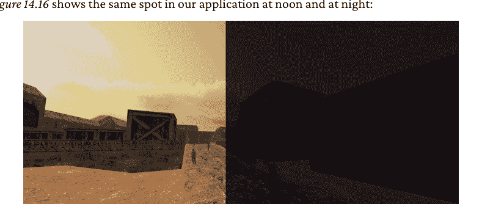

如图 14.16 所示，即使只是简单改变虚拟世界的整体亮度，也能产生巨大的差异。而根据一天中的时间改变世界更多的属性，将为玩家带来更强的沉浸感。

## 允许时间快进

在处理时间时，有一个事实不容低估：等待某个事件发生的时间可能很无聊，而且过得很慢。与其让玩家等待整整一天或一夜过去，不如加入特殊的“时间旅行”事件，例如睡过一夜，或在壁炉旁等待时间流逝，让游戏快进游戏内的时间。

## 实时游玩

在思考游戏中的时间时，将虚拟世界的时间与真实世界的时间同步会是一个有趣的选择。只有少数游戏使用了这一功能。此外，如果任务或委托与一天中的特定时间绑定，解决它们可能会更加复杂。但在游戏中体验“当下”也许很有趣。

## 崇拜天气之神

不仅一天中的时间会改变世界，天气变化也会极大地影响角色、动物和环境。雷雨天气时，最好的建议是待在室内；大雨可能非常嘈杂，以至于其他声音根本无法传入玩家耳中；新雪也会吸收噪音。因此，在不同天气状态下漫游，会对同一个世界产生截然不同的印象。

雾等环境变化也会改变对虚拟世界的感知。

图 14.17 展示了我们的应用程序中不同类型的雾：

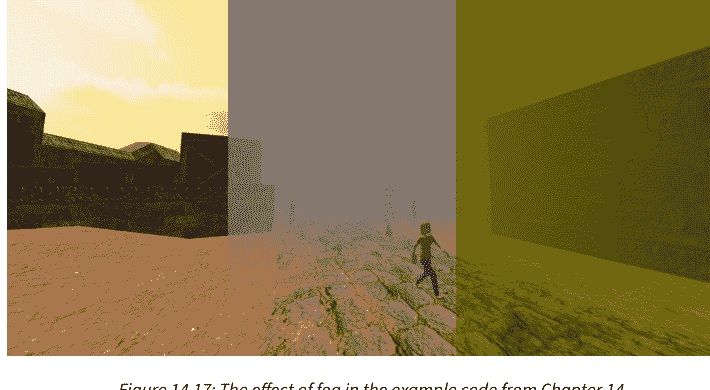

图 14.17：第 14 章示例代码中的雾效

在图 14.17 的左侧，虚拟世界完全没有雾，呈现晴朗的白天。在图 14.17 的中间，添加了浓雾，使世界在短距离后逐渐消失。在几款老游戏中，由于早期游戏引擎的渲染限制，雾被用来隐藏物体的出现和消失。最后，在图 14.17 的右侧，灯光颜色被调整为绿色调，在地图的街道上营造出有毒雾气的错觉。

## 聆听季节的神谕

在昼夜循环和天气之后的下一步进化，就是实现四季。春、夏、秋、冬之间的轮换是一个绝佳机会，可以为虚拟世界带来更多真实感，因为角色的行为或动物的外观会随着一年中的时间而变化。

与游戏内一天的长度一样，虚拟的一年也应缩短为合理的真实时间；或者，如果当前季节的所有任务都已完成，应允许使用时间快进功能。让玩家毫无理由地等待会扼杀他们的热情。

根据季节改变世界属性的一个好例子是任天堂为 GameBoy Color 推出的《塞尔达传说：季节之神谕》（Legend of Zelda: Oracle of Seasons）。尽管这款游戏年代久远，但季节变化实现得非常细致，玩家只能在特定季节进入世界的某些区域。例如，河流只在冬天结冰，雪原会抬高部分地形；而只有在夏天，花朵的卷须才能让林克爬上墙壁。

在 Eric Barone 的《星露谷物语》（Stardew Valley）中，季节也是游戏玩法的关键元素。四个季节中的每一个都会影响游戏的不同部分，比如作物生长。一个季节持续 28 个游戏日，通过加速时间，《星露谷物语》中的一整年会在 26 小时的游戏时间内过去。

对于我们的应用程序，我们将创建简单的昼夜光照变化和雾效作为示例。让我们从白天和夜晚开始吧。

## 动手实践：添加昼夜

改变光源的颜色和位置很容易。大多数片段着色器已经包含一个固定的光源定义，以便更好地可视化实例和关卡数据。

## 实现光照控制

作为第一步，我们在所有存在 Matrices 的顶点和片段着色器中，向 Matrices uniform 添加两个新变量 lightPos 和 lightColor：

```
layout (std140, binding = 0) uniform Matrices {
  ...
  vec4 lightPos;
  vec4 lightColor;
};
```

在 lightPos 中，我们将传入光源的当前位置，从而模拟太阳或月亮在虚拟世界中的位置；在 lightColor 中，我们将光源颜色传输到 GPU，从而模拟日出、正午、日落等场景。

由于我们在 CPU 端将包含视图矩阵和投影矩阵的 uniform 缓冲区的数据类型定义为 glm::mat4，因此我们必须将用于光源位置和颜色的两个 glm::vec4 向量作为 glm::mat4 的前两个元素，并在绘制帧之前上传到 GPU：

```
glm::mat4 lightMatrix = glm::mat4(lightPos, lightColor,
    glm::vec4(), glm::vec4());
matrixData.emplace_back(lightMatrix);
```

现在，所有包含光源定义的片段着色器都可以通过更好的光照控制来调整表面效果。

我们在 main() 方法中开始新的着色器代码，首先定义环境光强度：

```
float ambientStrength = 0.1;
vec3 ambient = ambientStrength * max(vec3(lightColor),
    vec3(0.05, 0.05, 0.05));
```

环境光强度用于模拟来自其他表面的光线散射，从而在虚拟世界中提供某种最低限度的光照。通过限制最低环境光，我们还能防止渲染出的画面变得漆黑一片。

接下来，我们使用三角形法线与光源方向之间的夹角来计算漫反射部分：

```
vec3 norm = normalize(vec3(normal));
vec3 lightDir = normalize(vec3(lightPos));
```

最后，我们探索了昼夜循环、天气和季节这些改变虚拟世界环境的元素。仅仅是一个简单的昼夜循环，就已经为虚拟世界增添了许多有趣的机遇，例如只能在一天中的特定时间遇到电脑控制的角色或动物，或者只能在夜晚出现的敌人。天气效果和季节也提供了更多根据当前环境改变行为的选项。

那么……接下来该做什么呢？嗯，这完全取决于你！

你可以先学习如何使用 Blender 创建自己的动画角色、动物、物体和关卡。创建的资源不一定需要达到最新游戏的质量；即使是低多边形世界也很有魅力，并且拥有许多粉丝。有很多书籍、教程和视频可供参考，涵盖了虚拟世界的各种不同艺术风格。

那添加更多物体呢？车辆和动物会丰富虚拟世界，而门和按钮则会带来更多与世界互动的方式。为了获得更好的重力效果，你甚至可以在应用程序中添加物理引擎，从而实现其他酷炫功能，例如物体碰撞时的力分布。

你也可以使用正交投影相机来探索世界。以等距投影或仅从侧面观察玩家、其他角色和环境，可能会开启新的叙事方式。由于等距投影和侧视图都只是三维世界的不同视角，本章提到的所有选项在使用正交投影时同样适用。

另一个想法是为玩家创建故事线和任务。迫使玩家在不同地点之间移动并与不同角色互动，以解锁更多任务、物品或门，或者只是为了获得任务谜题的下一块拼图，这样可以让玩家在你的游戏中停留更长时间。

或者，你可以深入研究 SDL 的网络部分，创建一个小型网络服务器，让你能与朋友一起探索虚拟世界。作为团队在关卡中漫游并解决问题是令人满足的，同时也会给任务系统带来新的复杂性，因为你可能会或不会允许玩家利用他们远距离共享的任务信息。

但接下来最重要的一步是：保持好奇心，不断尝试代码。


## 实践环节

以下是你可以对代码做出的一些补充：

- 添加一个按钮来重新加载资源文件夹中的音乐曲目。
  一个不错的功能，可以动态添加或移除曲目。
- 为实例添加更多音效。
  你可以为实例的每个动作映射一个音效片段，在控制所选实例时营造更逼真的效果。
- 根据地面材质播放脚步声。
  这里，你需要加载多于一对行走和奔跑的脚步声。适当的声音效果可以通过使用地面三角形的网格类型作为脚步声音效的索引来选择。
- 添加附近实例的声音。
  SDL_mixer 库允许我们为每个通道设置音量和平衡。使用周围实例的距离和角度可以用来计算声音的有效音量和方向。
- 在地图上的特殊位置播放环境音。
  类似于路点模型，你可以使用小型模型作为标记来播放环境音。和附近实例的声音一样，环境音的音量和平衡可以调整以符合预期。
- 添加音乐切换的标记。
  此任务与环境音密切相关。你可以使用模型和/或节点来在控制的实例进入地图的特定区域或与其他实例交互时切换音乐。
- 根据关卡位置调整关卡颜色和雾效。
  不仅在游览关卡时可以更改音乐；光照和雾效设置也可以调整。例如，进入洞穴时，可以降低环境光并提高雾密度。

## 额外资源

- SDL: https://www.libsdl.org
- OpenAL Soft: https://github.com/kcat/openal-soft
- PortAudio: https://www.portaudio.com
- FMOD: https://www.fmod.com
- *Game Physics Engine Development* by Ian Millington, published by CRC Press: ISBN 978-0123819765
- *Game Physics* by David H. Eberly, published by Morgan Kaufmann: ISBN 978-0123749031
- Open-source physics engine: https://www.tapirgames.com/blog/open-source-physics-engines
- Vulkan examples by Sascha Willems: https://github.com/SaschaWillems/Vulkan
- Ordered transparency: https://learnopengl.com/Advanced-OpenGL/Blending
- Order-independent transparency: https://github.com/nvpro-samples/vk_order_independent_transparency
- OpenGL skybox: https://learnopengl.com/Advanced-OpenGL/Cubemaps
- How to create cubemaps: https://paulbourke.net/panorama/cubemaps/
- OpenGL multiple lights: https://learnopengl.com/Lighting/Multiple-lights
- Multiple lights demo by Hannes Nevalainen: https://www.youtube.com/watch?v=vooznqE-XMM
- OpenGL shadow maps: https://learnopengl.com/Guest-Articles/2021/CSM
- WebGL water simulation: https://madebyevan.com/webgl-water/
- OpenGL realistic water: https://medium.com/@vincehnguyen/simplest-way-to-render-pretty-water-in-opengl-7bce40cbefbe
- OpenGL water caustics: https://medium.com/@martinRenou/real-time-rendering-of-water-caustics-59cda1d74aa
- OpenGL lens flares: https://john-chapman.github.io/2017/11/05/pseudo-lens-flare.html
- OpenGL God rays: https://github.com/math-araujo/screen-space-godrays
- OpenGL bloom effect: https://learnopengl.com/Advanced-Lighting/Bloom
- OpenGL motion blur: https://www.nvidia.com/docs/io/8230/gdc2003_openglshadertricks.pdf
- OpenGL depth of field: https://lettier.github.io/3d-game-shaders-for-beginners/depth-of-field.html
- OpenGL SSAO: https://lettier.github.io/3d-game-shaders-for-beginners/ssao.html
- OpenGL SSR: https://lettier.github.io/3d-game-shaders-for-beginners/screen-space-reflection.html
- Vulkan raytracing: https://nvpro-samples.github.io/vk_raytracing_tutorial_KHR/
- OpenXR: https://www.khronos.org/openxr/
- Godot XR Demo template: https://github.com/GodotVR/godot-xr-template
- Blender: https://www.blender.org
- Open Game Art for assets: https://opengameart.org/

## 在 Discord 上加入我们的社区

加入我们社区的 Discord 空间，与作者和其他读者进行讨论：https://packt.link/cppgameanimation


## <packt>

www.packt.com

订阅我们的在线数字图书馆，即可完全访问超过 7,000 本书籍和视频，以及帮助您规划个人发展和推进职业生涯的行业领先工具。有关更多信息，请访问我们的网站。

## 为什么订阅？

- 花更少时间学习，花更多时间编码，使用来自 4,000 多名行业专业人士的实用电子书和视频
- 使用专为你打造的技能计划提升学习效果
- 每月免费获得一本电子书或视频
- 完全可搜索，便于快速访问重要信息
- 复制、粘贴、打印和书签收藏内容

在 www.packt.com，你还可以阅读大量免费技术文章，订阅多种免费新闻通讯，并在 Packt 书籍和电子书上获得独家折扣和优惠。

## 你可能感兴趣的其他书籍

如果你喜欢这本书，你可能对 Packt 的这些其他书籍感兴趣：

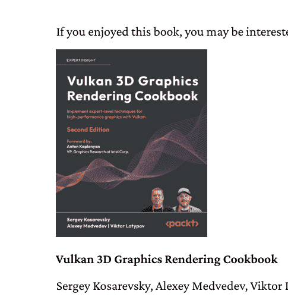

### Vulkan 3D Graphics Rendering Cookbook

Sergey Kosarevsky, Alexey Medvedev, Viktor Latypov

ISBN: 978-1-80324-811-0

- 精通 Vulkan 1.3 的核心功能，重点关注无绑定渲染
- 学习调试和分析 Vulkan 应用的有效技术
- 从零开始构建 glTF 2.0 物理基于渲染管线
- 使用高级 glTF 2.0 PBR 扩展增强视觉质量
- 将多种渲染技术和优化集成到单个应用中
- 在实时 3D 渲染引擎中高效管理大规模内容
- 利用 Vulkan 计算管线进行高级图像和几何处理

## Packt 正在寻找像你这样的作者

如果你有兴趣成为 Packt 的作者，请访问 authors.packtpub.com 并立即申请。我们已与数千名开发者和技术专业人士合作，帮助他们与全球技术社区分享见解。你可以提交通用申请、申请我们正在招聘作者的特定热门主题，或提交你自己的想法。

## 分享你的想法

现在你已经完成了《Mastering C++ Game Animation Programming》，我们很想听听你的想法！如果你从 Amazon 购买了本书，请点击此处直接前往本书在 Amazon 的评论页面分享你的反馈，或在你购买的网站上留下评论。

你的评论对我们和技术社区都很重要，将帮助我们确保提供优质的内容。

## 索引

### A

- AABB lookup tables
  - creating 242
- A* algorithm 416
- acceleration
  - using 206-208
- action node 272
- additive animation 19
- additive blending
  - code, extending to support additive animations 327-330
  - head animation node, adding 332, 333
  - head animation settings, saving 333-335
  - implementing 324
  - mappings, creating for head animations 330-332
  - working 325-327
- Advanced Vector Extensions (AVX) 234
- animation clips
  - actions, mapping to 211-213
- animation performance
  - data model, adjusting 56-58
  - data representation, analyzing 54-56
  - hotspots, locating in code 53
  - profiling 51-53
- animations
  - blending between 190
  - A* path-finding algorithm 421
  - A*-based navigation, implementing 424
  - distance, estimating to target 421
  - exploring 422-424
  - ground triangles, generating 428-431
  - mesh triangles, preparing 425, 426
  - path, between two ground triangles 431
  - path costs, minimizing 422
  - path-finding class, adding 426, 427
- A-pose 18
- application handling
  - undo and redo functionality, implementing 119
- area awareness 419
- artificial intelligence (AI) 260
- asset AABBs
  - performance considerations 363
- assets 361
  - non-animated models, using as 361-363
- AssimpModel null object
  - creating 101
- audio library
  - FMOD 453
  - OpenAL 453


- **PortAudio 453**
- **Simple DirectMedia Layer（SDL），使用 452**

- **音频管理器**
  - 回调，添加以支持连续音乐播放 463
  - 类，扩展 467
  - 脚步声效，在渲染中使用 465-467
  - 高级接口，定义 455
  - 实现 455
  - 音乐播放器，在 UI 中使用 467, 468
  - 音乐重放，控制 462
  - SDL，用作底层 458
  - 音效，播放 464

- **Autodesk FBX 346**
- **轴对齐包围盒（AABB）232, 233**
  - 构建，用于关卡数据 359-361

## B

- **背景音乐**
  - 添加 452
- **行为树 260**
- **二进制数据**
  - 优缺点 128, 129
- **二进制文件格式**
  - 优缺点 128
- **二叉空间分割（BSP）229, 230, 343**
- **绑定姿势 18**
- **位域**
  - 使用 201, 202
- **混合 19**
- **骨骼 18**
- **包围球**
  - 数据，创建 248-251
  - 绘制 251-253
  - 实现 247
  - 用于碰撞检测 253-255
- **包围体层次结构 231, 232, 236**
- **广度优先搜索（BFS）415**

## C

- **摄像机**
  - 添加 159-161
  - 与配置之间切换 178
  - 配置文件版本，提升 164
  - 配置加载与保存，调整 162-164
  - 当前第一/第三人称摄像机的限制 175
  - 删除 159-161
  - 键盘快捷键，为选择配置 178
  - 手动移动，禁用 174, 175
  - 在第三人称视图中移动 172-174
  - 正交投影，添加 179-181
  - 渲染器，调整 156, 157
  - 类型，创建 164-166
  - 用户界面控件，用于投影设置 181, 182
- **摄像机设置**
  - 设置 155
- **胶囊体 234, 235**
- **剪辑 19**
- **CMake**
  - 节点树副本，为实例创建 285
  - SingleInstanceBehavior，与渲染器连接 285, 286
- **Collada 346**
- **碰撞检测**
  - 调试线，绘制 380, 381
  - 增强，用于关卡数据 372
  - 实例/关卡碰撞，检测 378, 379
  - 关卡数据八叉树，填充 375-378
  - 局限性 226
  - 节点树，扩展以支持关卡几何体碰撞 382
  - 八叉树类型，添加 372-374
- **计算重定位**
  - 完成 72, 73
- **计算着色器 50**
  - 调整 196-200
  - 数据，重定位到 61
  - 调试 75
  - 实现，通过放大测试 73-75
  - 最后的准备 61, 62
  - 缺失数据，添加 58-61
  - 节点变换，计算 63-68
- **配置文件**
  - 内容，存储 140
  - 创建 142, 143
  - 错误，导致文件损坏 148, 149
  - 文件对话框，添加到用户界面 144, 145
  - 加载 139, 145, 146
  - 节点，解析 145, 146
  - 发射器的输出运算符，重载 141
  - 宽松的配置文件加载 148
  - 保存 139
  - 场景，从保存的值重新创建 147
  - 写入 142, 143
- **凸包 235, 236**
- **凸体 235**

## D

- **数据表**
  - 上传到 GPU 194-196
- **DebugLog 节点 271**
- **减速**
  - 使用 206-208
- **默认配置文件**
  - 启动时加载 149, 150
- **深度优先搜索（DFS）415**
- **Dijkstra 算法 416**
- **基于距离的导航 414**

## E

- **编辑模式**
  - 与视图模式之间切换 110
- **效应器 393**
- **仰角 170**
- **欧几里得距离（L2 范数）421**
- **事件节点 272**

## F

- **FABRIK 逆向运动学算法**
  - 实现 396-398
- **FABRIK 求解器**
  - 运行 407, 408
- **面部动画**
  - 添加到代码和 GPU 着色器 302
  - 使用实例和渲染器安装渲染更改 321-323
  - 调整代码以适应 FaceAnim 节点 318
  - 最终确定代码 313, 314
  - 使用 UI 元素控制 314, 315
  - 添加 FaceAnim 节点 319-321
  - 将面部变形设置添加到代码 307, 308
  - 加载实例设置 317
  - 保存实例设置 315
  - 加载变形网格 302-305
  - 将变形网格存储在单个缓冲区中 305-307
  - 变形目标动画的局限性 323, 324
  - 在渲染器中填充每个实例的缓冲区数据 309
  - 扩展着色器以绘制 310-312
  - 在节点树中使用 317
- **FaceAnim 节点**
  - 添加 319-321
  - 调整代码以适应 318
- **面部表情**
  - 动画化 300, 301
- **文件格式**
  - 为地图选择 345
  - 创建自定义格式 346, 347
  - 扩展现有格式 346, 347
- **Assimp 支持的文件格式**
  - 在关卡中使用 345, 346
- **有限状态机**
  - 用于控制动画流程 214-217
- **第一人称和第三人称摄像机**
  - 获取骨骼矩阵 167, 168
  - 实现 166, 167
  - 计算参数 169-172
- **FMOD 453**
- **前向和后向伸长逆向运动学（FABRIK）393**
  - 基础 393-396
  - 实现逆向运动学算法 396-399
  - 局限性 409
  - 为实例的脚定义节点链 399, 400
- **正向运动学 392**
- **帧缓冲**
  - 调整 92-94
  - 从纹理读取像素 95, 96
  - 创建选择着色器 94, 95
- **Free3D**
  - 参考链接 345
- **自由摄像机**
  - 定义为默认摄像机 158, 159
- **自由导航 419**

## G

- **游戏角色**
  - 动画化 18
  - 骨骼 18
  - 构建块 19, 20
  - 更新角色数据 21, 22
  - 数据准备 20
  - 节点 18
- **游戏地图**
  - 为关卡数据构建 AABB 359, 361
  - 添加 C++ 类以保存关卡数据 348
  - 添加回调和渲染器代码 349, 350
  - 导入 347
  - 创建交互式八叉树视图 354
  - 保存关卡配置 352
  - 使用非动画模型作为资产 361-363
  - 将四叉树转换为八叉树 353, 354
  - 使用关卡属性控件扩展 UI 350-352
- **几何缓冲区（G-Buffer）92**
- **Gilbert-Johnson-Keerthi（GJK）距离算法 236**
- **GPU**
  - 上传数据表 194-196
  - 发送关卡数据到 363
- **基于图的导航 415**
  - A* 算法 416
  - BFS 415
  - DFS 415
  - Dijkstra 算法 416
- **显卡 49**
- **图节点类**
  - 创建 271-273
- **图节点**
  - 基类 273-275
  - 创建行为结构 278, 280
  - 使用回调传播更改 278
  - 为实例创建存储类 278-280
- **重力**
  - 添加基本重力 386, 387
  - 在关卡数据中查找地面三角形 384-386
  - 将实例保持在地面三角形上 387-391
  - 使用，使实例落在地板上 383
- **网格 227**
- **地面三角形**
  - 生成 428, 430
- **过滤器组**
  - 添加 34

## H

- **启发式 416**
- **层次细节（HLOD）344**
- **高级接口**
  - 将 AudioManager 类添加到 Window 类 456, 457
  - 使用回调 457
  - 定义 455
- **高亮**
  - 添加到所选实例 87
  - 调整逻辑以适应着色器和 UI 89-91
  - 准备渲染器 87, 88
- **家用电脑 48**
- **快捷键**
  - 为撤销和重做功能定义 122

## I

- **空闲/行走/跑步动画**
  - 映射 209, 210
- **空闲/行走/跑步逻辑**
  - 添加 204-206
- **id Software 419**
- **ImGui 元素**
  - 创建 267, 268
- **ImGui 文件对话框**
  - 使用 32, 33
- **ImGui 菜单**
  - 添加以允许直接访问 122, 123
- **ImGui 窗口**
  - 创建节点编辑器 264, 265
  - 添加简单节点 266, 267
- **沉浸感**
  - 添加昼夜循环 484
  - 通过白天和天气扩展 483
  - 添加快进时间旅行 485
  - 季节神谕 486
  - 实时游玩 485
  - 敬拜天气之神 485
- **imnodes 261**
  - 设置默认值 264
  - 集成，使用 CMake 262, 263
  - 维护节点之间的链接 268-270
  - 参考链接 261
  - 用于创建 UI 元素 263
- **imnodes 属性**
  - 创建 267, 268
- **imnodes 上下文**
  - 创建 264
- **INI 格式 131**
- **实例行为**
  - 控制结构 260
- **实例包围盒**
  - 计算 240
  - 绘制 AABB 调试线 246, 247
  - 创建 AABB 查找表 242
  - 在模型和渲染器中使用 AABB 243
  - 检索碰撞实例 245
  - 对碰撞做出反应 245
  - 添加三维包围立方体类 240
  - 创建窗口以显示四叉树及其内容 244
- **实例节点 272**
- **实例**
  - 添加调试线到路径 445-447
  - 导航到目标 441
  - 计算到目标的路径 441-444
  - 旋转以达到目标 444, 445
- **实例和模型**
  - 扩展设置结构 202, 203
- **交互**
  - 在实例之间添加 291
  - 绘制调试信息 294
  - 扩展处理代码 292-294
- **交互控制属性**
  - 创建 291, 292
- **交互式八叉树视图**
  - 计算 357, 359
  - 创建 354
  - 添加交互性 354, 355
  - 收集线条 356
  - 绘制线条 357-359
- **逆绑定矩阵 19**
- **逆向运动学 393**
  - 添加 391
  - 运行 FABRIK 求解器 407, 408
  - 检测脚到地面的碰撞 405, 406
  - 类型 392, 393

## J

- **JSON 文件格式 131**

## K

- **k-d 树 230**
- **关键帧 19**
- **Khronos Group glTF 格式 346**

## L

- **L1 范数 421**
- **分层混合 325**
- **关卡数据，发送到 GPU**
  - 绘制关卡 AABB 365-368
  - 创建着色器 363, 364
- **光照控制**
  - 实现 487
- **光照贴图 344**
- **查找表**
  - 创建 191-194
  - 重要性 190


## M

- 曼哈顿距离（L1 范数）421
- map 与模型数据对比 342
  - 等级数据 342
  - 等级数据，作为部分或不完整 345
  - 带有额外数据的等级数据 343
  - 使用单独的碰撞检测，用于等级数据 343
- 网格 19
- 基于网格的导航 417
  - 区域感知系统 419
  - 导航网格 417, 418
- 网格三角形
  - 准备 425, 426
- Minkowski 差
  - 绘制 AABB 调试线 236
- 模型抽象 232
- 模型文件
  - 导入动画 30
  - 检查代码 30
  - 加载嵌入式纹理 26, 27
  - 加载 25, 26
  - 解析节点层级 27, 28
  - 为网格添加顶点缓冲区 29
- 模型实例
  - 添加 36
  - 复用骨骼 36, 38
  - 绘制 42
  - 动态模型及管理 39–42
  - 调整帧缓冲区 92–94
  - 分配索引 97
  - 存储实例特定设置 38, 39
  - 添加鼠标按钮 96
  - 射击虚拟数组的利弊 91
  - 在鼠标位置选择 98, 99
- 选择，使用点按 91
- 使用纹理 92

- 模型查看器应用程序
  - 在应用程序前撤销更改 116
  - 添加代码和用户界面元素 116–118
  - 当前解决方案的缺点 118
  - 回滚方法 116
- 形变动画 19
- 形变网格
  - 加载 302–305
  - 存储在单个缓冲区中 305–307
- 形变目标动画 300
  - 限制 323, 324
- 移动到实例函数
  - 创建按钮 85, 86
  - 添加坐标箭头 80–84
  - 实现 80
- 多核机器 49
- 多个摄像机
  - 添加 154
- 音乐
  - 自适应音乐播放 455
  - 环境音乐 455
  - 允许自定义音乐 455
  - 菜单音乐 454

## N

- 导航网格（navmesh）344, 417–419
  - 自由导航 419
  - 从等级数据生成 419
  - 路点导航 419
- 导航目标
  - 添加到地图 437
  - 为非动画实例添加重力 439
  - 调整模型和实例 437–439
  - 保存模型和实例数据 440
- 导航方式
  - 基于距离的导航 414
  - 基于图的导航 415
  - 用于生成导航数据的机器学习 420
  - 基于网格的导航 417
  - 概述 414
- 节点计算
  - 移动到 GPU 62
  - 添加着色器存储缓冲区 63
- 节点编辑器
  - 扩展 281, 282
- 节点工厂
  - 添加 280
- 节点矩阵
  - 创建 69–71
- 节点位置
  - 调整 400
  - 为动画实例调整代码 402–404
  - 保持变换分离 401, 402
  - 创建世界位置 404, 405
- 节点 18
- 节点树复制
  - 为实例创建 285
- 节点树
  - 在其中使用面部动画 317
  - 加载 282–284
  - 保存 282–284
- 非玩家角色（NPC）260
- 空对象 100
  - AssimpModel 空对象 101
  - 实现以允许取消选择 100
  - 调整用户界面 102, 103

- 八叉树 228, 229
  - 转换为四叉树 353, 354
- OpenAL 453
- Open Asset Import Library（Assimp）22–25
- 打开文件对话框
  - 用于扩展 UI 31
- OpenGL 着色语言（GLSL）57
- 定向包围盒（OBB）233

## P

- 解析器类
  - 添加 137
  - 处理 yaml-cpp 抛出的异常 139
  - 使用 yaml-cpp 的节点类型 137
  - 访问序列和映射 138
- 两地表三角形之间的路径
  - 提取最佳节点 435
  - 准备数据 431, 432
  - 运行主循环 432–434
  - 回溯最短路径 436
- 基于物理的渲染（PBR）
  - 使用 468, 469
- Pierre Vigier
  - 参考链接 237
- 普通枚举
  - 使用 201, 202
- PortAudio 453

## Q

- 四叉树 228
  - 添加以存储附近的模型实例 237
  - 调整包围盒代码 237, 238
  - 重写代码 238, 239

- Quake III Arena 419

## R

- RandomWait 节点 272
- 光栅中断 48
- 光线追踪 475
- 重做功能
  - 创建 119
  - 定义热键 122
  - 实现 119
  - 限制和增强 123, 124
- 正则表达式风格过滤器
  - 添加 34
- 强化学习 420
- RenderDoc 75
- 渲染器代码
  - 调整 196–200
- 根节点 18, 271, 393

## S

- 屏幕空间环境光遮蔽（SSAO）475
- SDL_mixer
  - 在 Linux 上安装 460
  - 在 Windows 上安装 459
- 选择器节点 272
- 分离轴定理 233
- 序列节点 272
- 设置存储类
  - 创建 120, 121
- 着色器存储缓冲区对象（SSBOs）50
- 简单直接媒体层（SDL）452
  - 与 SDL_mixer 初始化 461
  - 与 SDL_mixer 在 Linux 上的安装 460
  - 与 SDL_mixer 在 Windows 上的安装 459
  - 与 SDL_mixer 关闭 461
  - 用于低级层 458
- 单摄像机
  - 迁移到摄像机数组 154, 155
- 单过滤器
  - 添加 34
- SingleInstanceBehavior
  - 与渲染器连接 285, 286
- 单指令多数据（SIMD）234
- 骨骼动画 18
- Sketchfab
  - 参考链接 345
- 皮肤ning 19
- 音效
  - 添加 452
  - 环境音 454
  - 使用音频库 452
  - 实现音频管理器 455
  - 角色音效 454
  - 游戏角色脚步声 453
  - 本地音源 454
  - 播放音乐 454
  - 播放 453
  - 音效管理器实现的替代方案 468
  - 天气效果 454
- 空间划分
  - 二叉空间划分 229, 230
  - 包围体积层级 231, 232
  - 网格 227
  - k-d 树 230
  - 八叉树 228, 229
  - 四叉树 228
  - 用于减少复杂度的使用 227
- 球面线性插值（SLERP）52
- 标准便携式中间表示（SPIR-V）62
- 状态
  - 添加到代码 200
  - 定义允许的更改 213, 214
  - 与动画关联 209
  - 加载 217
  - 在渲染器中读取模型设置 220
  - 存储新数据类型 218, 219
  - 保存 217
- 固定摄像机
  - 添加 176
- 固定跟随摄像机
  - 创建 176, 178
- 存储类
  - 挂接到渲染 121
- 流式 SIMD 扩展（SSE）234

## T

- 目标 393
- 测试节点 271
- 文本格式
  - INI 文件格式 131
  - JSON 文件格式 131
  - 选择用于保存数据的格式 130
  - YAML 文件格式 132, 133
- 文本数据
  - 加载 130
  - 保存 129, 130
- 文本文件格式
  - 利弊 128
- 纹理数据类型（float）93
- T 姿势 18
- 平移、旋转和缩放（TRS）52

## U

- UI 控制
  - 添加 488
- UI 元素
  - 使用 imnodes 创建 263
- 使用打开文件对话框扩展 UI 31
  - 添加过滤器以显示支持的文件类型 34
  - 使用 ImGui 文件对话框 32, 33
  - 集成到 CMakeLists.txt 31, 32
  - 将模型绘制到屏幕 36
  - 加载模型文件 35
- 撤销功能
  - 创建 119
  - 定义热键 122
  - 实现 119
  - 限制和增强 123, 124
- 通用场景描述（USD）346

## V

- 视图模式
  - 与编辑模式之间切换 110
  - 与编辑模式之间切换 113, 114
  - 与编辑模式之间切换 113–115
  - 在视图中切换功能 111
  - 未来更改展望 115
  - 添加状态变量加代码 111, 112
- 虚拟天空盒
  - 绘制 482, 483
  - 实现 480–482
  - 探索技术细节 478, 479

## 下载本书的免费 PDF 副本

感谢您购买本书！

您喜欢随时阅读但无法随身携带印刷书籍吗？

您的电子书购买与您选择的设备不兼容吗？

不用担心，现在每本 Packt 书籍都免费提供一本无 DRM 的 PDF 版本。

随时随地在任何设备上阅读。直接从您喜爱的<|message|> 技术书籍中搜索、复制和粘贴代码到您的应用程序中。

福利还不止于此，您可以每天通过电子邮件获得独家折扣、新闻通讯和精彩免费内容。

按照以下简单步骤获取福利：

- 1. 扫描二维码或访问以下链接


```
https://packt.link/free-ebook/978-1-83588-192-7
```

- 2. 提交您的购买证明
- 3. 就这样！我们会直接将您的免费 PDF 和其他福利发送到您的电子邮件。

